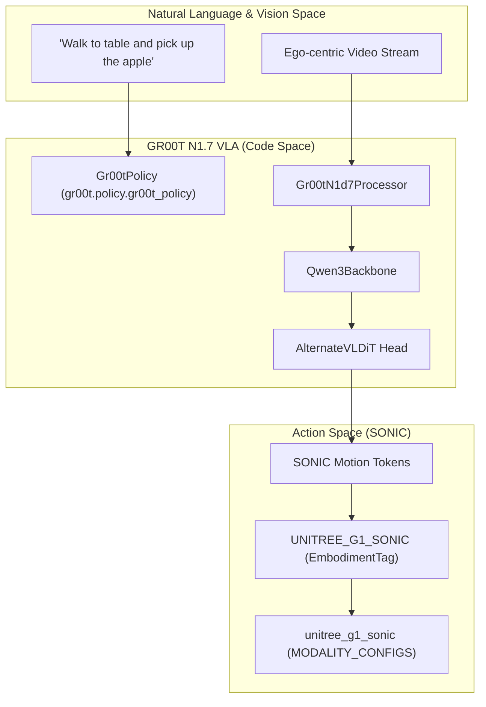
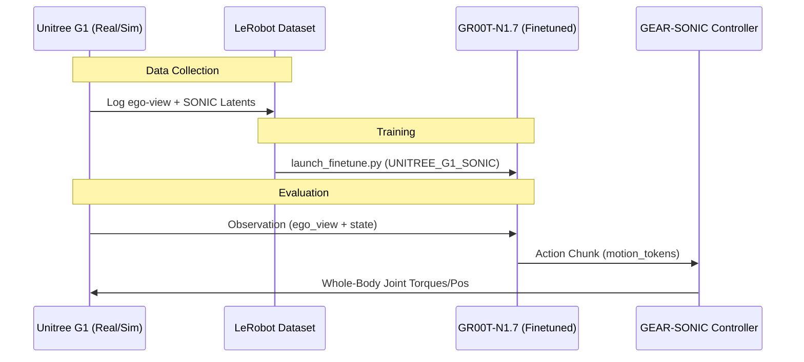

<!-- source: DeepWiki mcp.deepwiki.com · repo NVIDIA/Isaac-GR00T · page 7.10 GR00T Whole-Body Control (SONIC) · fetched 2026-10-26 -->

# GR00T Whole-Body Control (SONIC)

Relevant source files

The following files were used as context for generating this wiki page:

- [examples/DROID/server_client.py](examples/DROID/server_client.py)
- [examples/DROID/utils.py](examples/DROID/utils.py)
- [examples/GR00TWholeBodyControl/README.md](examples/GR00TWholeBodyControl/README.md)
- [getting_started/real_world_deployment.md](getting_started/real_world_deployment.md)
- [gr00t/configs/data/embodiment_configs.py](gr00t/configs/data/embodiment_configs.py)
- [gr00t/data/embodiment_tags.py](gr00t/data/embodiment_tags.py)
- [gr00t/policy/gr00t_policy.py](gr00t/policy/gr00t_policy.py)

The GR00T Whole-Body Control benchmark leverages the **GEAR-SONIC** (Stacked Output-based Network for Incremental Control) framework to enable closed-loop, whole-body manipulation and locomotion on humanoid platforms, specifically the Unitree G1 [examples/GR00TWholeBodyControl/README.md:1-3](). By integrating the Isaac-GR00T N1.7 VLA model with SONIC, the system can execute complex sequences such as walking to a table, localizing objects, and performing whole-body grasping under varying environmental conditions [examples/GR00TWholeBodyControl/README.md:5-7]().

## System Architecture

The integration utilizes a hierarchical control strategy where the GR00T VLA model acts as a high-level policy, outputting latents for the SONIC whole-body controller. This allows the model to handle high-dimensional humanoid control through a compressed action space.

### Code-to-System Mapping: SONIC Integration

The following diagram illustrates how the conceptual SONIC integration maps to specific code entities and data structures within the Isaac-GR00T repository.

**Diagram: SONIC Integration Architecture**

**Sources:** [gr00t/policy/gr00t_policy.py:70-81](), [gr00t/data/embodiment_tags.py:107-110](), [gr00t/configs/data/embodiment_configs.py:67-114]()

## Embodiment Configuration: `UNITREE_G1_SONIC`

The `UNITREE_G1_SONIC` embodiment tag is a pre-registered post-training tag that defines the specific modality requirements for the SONIC-enabled Unitree G1 [gr00t/data/embodiment_tags.py:44](). Unlike standard joint-space or EEF-space policies, the SONIC variant uses **motion tokens** as the primary action output.

### Modality Definition
The configuration for `unitree_g1_sonic` in `MODALITY_CONFIGS` specifies the following structure:

| Modality | Keys | Description |
| :--- | :--- | :--- |
| **Video** | `ego_view` | Single ego-centric camera stream [gr00t/configs/data/embodiment_configs.py:68-71](). |
| **State** | `left_leg`, `right_leg`, `waist`, `left_arm`, `right_arm`, `left_hand`, `right_hand`, `projected_gravity` | Comprehensive proprioceptive state including gravity vector [gr00t/configs/data/embodiment_configs.py:72-84](). |
| **Action** | `motion_token`, `left_hand_joints`, `right_hand_joints` | 40-step chunk of SONIC latents and dexterous hand commands [gr00t/configs/data/embodiment_configs.py:85-109](). |
| **Language** | `annotation.human.task_description` | High-level task instructions [gr00t/configs/data/embodiment_configs.py:110-113](). |

**Sources:** [gr00t/configs/data/embodiment_configs.py:67-114](), [gr00t/data/embodiment_tags.py:107-110]()

## Data-Train-Eval Workflow

The workflow for SONIC follows the standard GR00T real-world deployment pipeline but requires specific SONIC-compatible datasets.

**Diagram: SONIC Data Flow**

**Sources:** [getting_started/real_world_deployment.md:7-16](), [gr00t/policy/gr00t_policy.py:73-78](), [examples/GR00TWholeBodyControl/README.md:7-9]()

## Real-World Evaluation Results

The benchmark evaluates the model's ability to perform mobile manipulation in the real world. A single policy was trained on approximately 50 tabletop objects and tested across varying table heights (24, 27, and 30 inches) and object placements (3x3 grid) [examples/GR00TWholeBodyControl/README.md:7-18]().

### Task: Walk to Table and Pick Up Object
| Metric | Result |
| :--- | :--- |
| **Total Trials** | 216 |
| **Successes** | 159 |
| **Success Rate** | 73.6% |

### Object-Specific Breakdown
The model shows varying success rates depending on object geometry and material:
*   **Fruit**: 96.3% (26/27) [examples/GR00TWholeBodyControl/README.md:30]()
*   **Towel**: 88.9% (24/27) [examples/GR00TWholeBodyControl/README.md:24]()
*   **Flashlight**: 74.1% (20/27) [examples/GR00TWholeBodyControl/README.md:29]()
*   **Shoe**: 51.9% (14/27) - Lowest success due to complex geometry [examples/GR00TWholeBodyControl/README.md:25]()

### Task: Soda Can Disposal
A task-specific policy for a multi-stage sequence (walk -> pick -> rotate -> step on trigger -> drop) achieved a **66.7% success rate** (8/12 trials) [examples/GR00TWholeBodyControl/README.md:16]().

**Sources:** [examples/GR00TWholeBodyControl/README.md:11-32]()

## Implementation Details

### Policy Inference
The `Gr00tPolicy` class handles the loading of the SONIC-finetuned checkpoint. During initialization, it resolves the `UNITREE_G1_SONIC` tag and verifies that the checkpoint supports the required motion token outputs [gr00t/policy/gr00t_policy.py:83-106]().

### Data Preprocessing
For SONIC deployment, image resizing and padding are handled by `resize_with_pad` in the client utilities to ensure the `ego_view` matches the model's expected input dimensions while maintaining aspect ratio [examples/DROID/utils.py:34-59]().

**Sources:** [gr00t/policy/gr00t_policy.py:127-160](), [examples/DROID/utils.py:34-59]()

---

