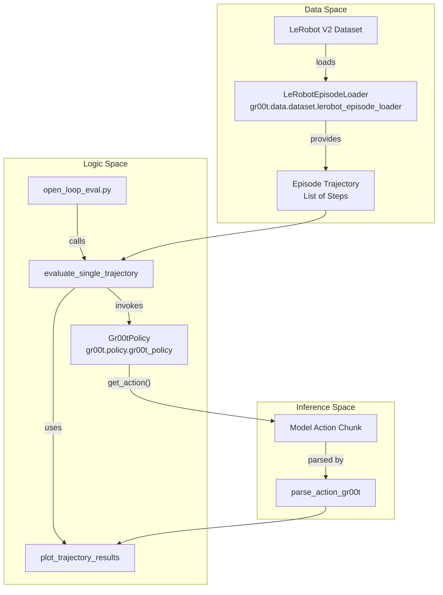
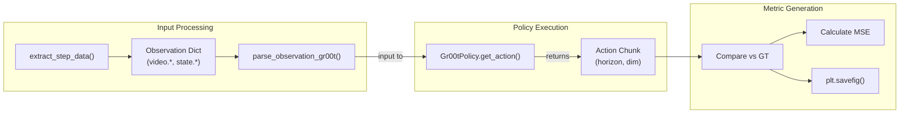

<!-- source: DeepWiki mcp.deepwiki.com · repo NVIDIA/Isaac-GR00T · page 7.2 Open-Loop Evaluation · fetched 2026-10-26 -->

# Open-Loop Evaluation

<details>
<summary>Relevant source files</summary>

The following files were used as context for generating this wiki page:

- [getting_started/finetune_new_embodiment.md](getting_started/finetune_new_embodiment.md)
- [gr00t/eval/open_loop_eval.py](gr00t/eval/open_loop_eval.py)
- [gr00t/model/gr00t_n1d7/gr00t_n1d7.py](gr00t/model/gr00t_n1d7/gr00t_n1d7.py)
- [gr00t/policy/server_client.py](gr00t/policy/server_client.py)
- [tests/gr00t/model/test_action_head.py](tests/gr00t/model/test_action_head.py)

</details>


## Purpose and Scope

This document describes the open-loop evaluation system in Isaac-GR00T, which provides **offline assessment** of trained models by comparing predicted actions against ground truth demonstrations. Open-loop evaluation serves as the first validation stage after training or fine-tuning, offering rapid feedback on model accuracy and trajectory alignment without requiring simulation environments or physical hardware.

The evaluation process uses the `gr00t/eval/open_loop_eval.py` script to load a `Gr00tPolicy`, process a sequence of observations from a dataset, and visualize the predicted action chunks against the actual recorded actions.

Sources: [gr00t/eval/open_loop_eval.py:40-46](), [getting_started/finetune_new_embodiment.md:129-132]()

## System Architecture and Data Flow

The open-loop evaluation pipeline bridges the gap between stored dataset modalities and the model's inference interface. It utilizes the `LeRobotEpisodeLoader` to pull trajectories and the `Gr00tPolicy` to generate predictions.

### Natural Language to Code Entity Mapping

The following diagram illustrates how high-level evaluation concepts map to specific classes and functions in the codebase.

**Evaluation Entity Mapping**

Sources: [gr00t/eval/open_loop_eval.py:24-31](), [gr00t/eval/open_loop_eval.py:136-145](), [gr00t/eval/open_loop_eval.py:182-183]()

### Detailed Data Transformation Flow

The evaluation script performs several transformations to align dataset formats with the expected `Gr00tPolicy` input dictionary.

**Data Transformation Pipeline**

Sources: [gr00t/eval/open_loop_eval.py:171-182](), [gr00t/eval/open_loop_eval.py:182-183](), [gr00t/eval/open_loop_eval.py:125-126]()

## Running Evaluation

The evaluation is typically executed via the CLI. It requires a path to a trained checkpoint and a dataset in LeRobot format.

### Execution Command
The following command structure is used to evaluate a specific embodiment (e.g., SO-100) against a checkpoint:

```bash
uv run python gr00t/eval/open_loop_eval.py \
    --dataset-path ./demo_data/cube_to_bowl_5 \
    --embodiment-tag NEW_EMBODIMENT \
    --model-path /tmp/so100/checkpoint-2000 \
    --traj-ids 0 \
    --execution-horizon 16 \
    --steps 400 \
    --modality-keys single_arm gripper
```
Sources: [getting_started/finetune_new_embodiment.md:133-141]()

### Key Parameters in `open_loop_eval.py`

| Parameter | Default | Description |
|-----------|---------|-------------|
| `--dataset-path` | `demo_data/cube_to_bowl_5/` | Path to LeRobot-format dataset |
| `--embodiment-tag` | `new_embodiment` | Robot embodiment tag (case-insensitive) |
| `--model-path` | `None` | Path to checkpoint. If omitted, connects to a running server |
| `--traj-ids` | `[0]` | Episode indices to evaluate (space-separated) |
| `--execution-horizon` | `16` | Steps of each predicted chunk to execute per inference |
| `--steps` | `200` | Max steps per trajectory (capped by actual trajectory length) |
| `--denoising-steps` | `4` | Diffusion denoising iterations |
| `--save-plot-path` | `None` | Directory to save GT-vs-predicted comparison plots |

Sources: [getting_started/finetune_new_embodiment.md:143-157](), [gr00t/eval/open_loop_eval.py:146-152]()

## Interpreting Results

### Action Chunking and Horizons
The script validates the model's prediction horizon against the execution stride. The `PolicyHorizonSpec` class ensures that the `execution_horizon` requested in evaluation is compatible with the `ModalityConfig` used by the model.

*   **Fast Failure**: The script calls `PolicyHorizonSpec.from_modality_config` to reject non-contiguous action windows or strides that don't fit the model's predicted chunk.
*   **Stride Logic**: The evaluation loops through the trajectory using `range(0, actual_steps, execution_horizon)`, performing one inference per chunk.

Sources: [gr00t/eval/open_loop_eval.py:165-171]()

### Visualization Plots
The function `plot_trajectory_results` generates a multi-panel figure saved to the path specified by `--save-plot-path`.

*   **State Joints**: Plotted if the robot uses direct joint commands (where state and action dimensions match).
*   **GT Action**: The ground truth demonstration recorded in the dataset.
*   **Pred Action**: The model's predicted action trajectory.
*   **Inference Points**: Marked with red dots (`"ro"`) to indicate the specific timesteps where the model was queried.

Sources: [gr00t/eval/open_loop_eval.py:49-71](), [gr00t/eval/open_loop_eval.py:102-117]()

## Implementation Details

### Observation Parsing
The `parse_observation_gr00t` function is critical for bridging the dataset loader to the model. It organizes keys into modalities defined in the `ModalityConfig`.
*   **Video**: Images are extracted and converted to `np.array` with shape `(T, H, W, C)`.
*   **State**: Proprioceptive readings are mapped to `state.*` keys.
*   **Language**: Task instructions are retrieved from the dataset's annotation columns.

Sources: [gr00t/eval/open_loop_eval.py:174-181]()

### Action Parsing
The `parse_action_gr00t` function unbatches the model's output and adds the `action.` prefix to keys, ensuring compatibility with the evaluation logic and plotting functions.

Sources: [gr00t/eval/open_loop_eval.py:131-133]()

### Diffusion Denoising
During open-loop evaluation, the `Gr00tN1d7ActionHead` uses a flow-matching denoising loop to generate actions. The number of iterations is controlled by `--denoising-steps`, which defaults to 4.

Sources: [getting_started/finetune_new_embodiment.md:153](), [gr00t/model/gr00t_n1d7/gr00t_n1d7.py:64]()

## Common Issues and Debugging

1.  **Trajectory Length**: The script automatically caps evaluation steps at the actual length of the trajectory if the requested `--steps` exceeds the dataset episode size.
2.  **Horizon Mismatch**: If `execution_horizon` does not align with the model's `action_horizon` (defined in `Gr00tN1d7Config`), the `PolicyHorizonSpec` will raise an error.
3.  **Object-Dtype Serialization**: If using a `PolicyClient` to connect to a remote `PolicyServer`, the `MsgSerializer` will refuse to encode `object-dtype` ndarrays to prevent arbitrary code execution via pickle.

Sources: [gr00t/eval/open_loop_eval.py:146-152](), [gr00t/eval/open_loop_eval.py:165-167](), [gr00t/policy/server_client.py:65-72]()

---

