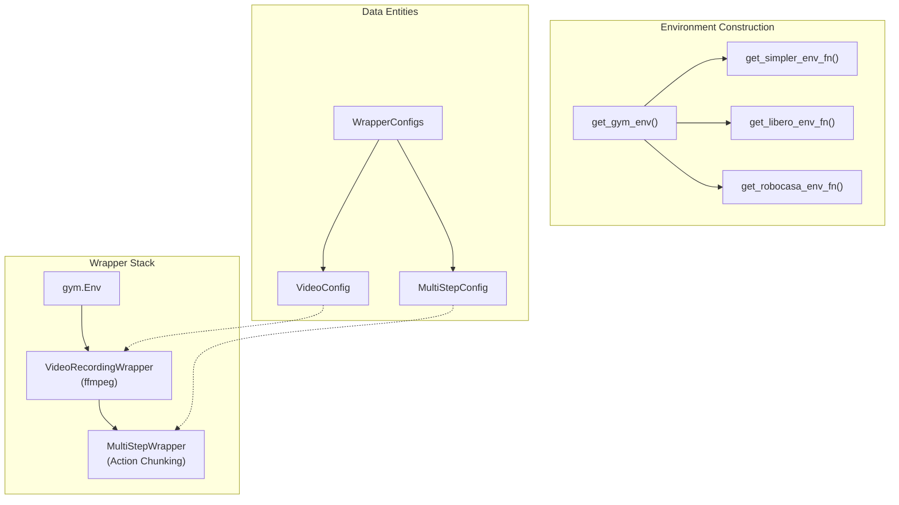
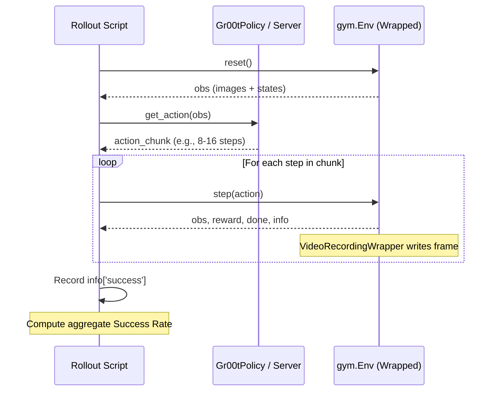

<!-- source: DeepWiki mcp.deepwiki.com · repo NVIDIA/Isaac-GR00T · page 7.3 Closed-Loop Evaluation · fetched 2026-10-26 -->

# Closed-Loop Evaluation

Relevant source files

The following files were used as context for generating this wiki page:

- [gr00t/data/dataset/sharded_single_step_dataset.py](gr00t/data/dataset/sharded_single_step_dataset.py)
- [gr00t/eval/rollout_policy.py](gr00t/eval/rollout_policy.py)
- [gr00t/eval/sim/wrapper/video_recording_wrapper.py](gr00t/eval/sim/wrapper/video_recording_wrapper.py)
- [pyproject.toml](pyproject.toml)
- [tests/gr00t/eval/sim/test_video_recording_wrapper.py](tests/gr00t/eval/sim/test_video_recording_wrapper.py)
- [uv.lock](uv.lock)

## Purpose and Scope

This document describes closed-loop evaluation in the GR00T system, where trained policies are executed in real-time within simulation environments or on physical hardware to measure task success rates. Closed-loop evaluation validates that the model can successfully control the robot through continuous observation-action loops, as opposed to offline prediction metrics.

For offline validation without environment interaction, see [Open-Loop Evaluation](#7.2). For specific benchmark setups and task configurations, see [SimplerEnv Benchmarks](#7.4), [LIBERO Benchmarks](#7.5), [SO-100 Robot Evaluation](#7.6), and [DROID and Other Real Robot Integration](#7.7). For policy server deployment details, see [Policy Server Architecture](#5.1) and [Starting an Inference Server](#5.2).

---

## Overview

Closed-loop evaluation tests a policy's ability to complete tasks through continuous interaction with an environment. Unlike open-loop evaluation which compares predicted actions against ground truth offline, closed-loop evaluation executes actions in the environment, observes the resulting states, and uses those observations to generate subsequent actions in a feedback loop.

### Key Characteristics

| Aspect | Closed-Loop Evaluation |
|--------|----------------------|
| **Execution Mode** | Real-time interaction |
| **Environment** | Simulation or physical hardware |
| **Metrics** | Success rate, episode completion |
| **Feedback** | Observation → Action → Execution → New Observation |
| **Duration** | Full episode rollouts (typically 200-720 steps) |
| **Purpose** | Validate real-world task performance |

Closed-loop evaluation is the second stage of the two-stage evaluation workflow recommended for GR00T models. After confirming reasonable open-loop metrics, closed-loop testing determines whether the policy can successfully complete tasks in realistic conditions.

**Sources:** [gr00t/eval/rollout_policy.py:83-96](), [gr00t/eval/sim/wrapper/video_recording_wrapper.py:36-78]()

---

## Rollout Policy Framework

The evaluation framework is centered around `rollout_policy.py`, which provides a standardized way to execute policies in various environments using Gymnasium wrappers for video recording and multi-step action execution.

### Environment Wrappers and Configuration

Evaluation environments are typically wrapped to handle specific GR00T requirements like temporal stacking of observations and action chunking.

**Diagram: Environment Wrapper Pipeline**

The `create_eval_env` function [gr00t/eval/rollout_policy.py:177-206]() initializes the environment and applies the following wrappers:
1.  **VideoRecordingWrapper**: Uses `ffmpeg` to save H.264 compressed videos of the rollout [gr00t/eval/sim/wrapper/video_recording_wrapper.py:104-156]().
2.  **MultiStepWrapper**: Handles observation stacking and manages the execution of action chunks (e.g., executing steps based on the policy contract) [gr00t/eval/rollout_policy.py:83-96]().

**Sources:** [gr00t/eval/rollout_policy.py:61-109](), [gr00t/eval/sim/wrapper/video_recording_wrapper.py:36-78]()

---

## Video Recording and Visualization

To analyze failures, the `VideoRecordingWrapper` captures the rollout. It supports capturing specific observation keys (e.g., side views and wrist views) and concatenating them into a single frame.

### VideoRecorder Implementation
The `VideoRecordingWrapper` class [gr00t/eval/sim/wrapper/video_recording_wrapper.py:36-84]() manages an `ffmpeg` subprocess for efficient encoding.
- **Codec**: Defaults to `h264` with `yuv420p` pixel format [gr00t/eval/sim/wrapper/video_recording_wrapper.py:30-33]().
- **FFmpeg Integration**: The wrapper opens a pipe to `ffmpeg` and writes raw RGB24 frames [gr00t/eval/sim/wrapper/video_recording_wrapper.py:112-144]().
- **Observation Filtering**: Users can specify `record_video_keys` to determine which visual modalities are recorded [gr00t/eval/sim/wrapper/video_recording_wrapper.py:73]().

**Sources:** [gr00t/eval/sim/wrapper/video_recording_wrapper.py:104-156](), [gr00t/eval/sim/wrapper/video_recording_wrapper.py:171-190](), [tests/gr00t/eval/sim/test_video_recording_wrapper.py:46-68]()

---

## Evaluation Environments

GR00T supports closed-loop evaluation across multiple simulation platforms. The `get_gym_env` function maps environment names to their respective registration and creation functions.

### Supported Simulation Suites
- **SimplerEnv**: Integrated via `get_simpler_env_fn` [gr00t/eval/rollout_policy.py:112-121](). It supports `SIMPLER_ENV_GOOGLE` and `SIMPLER_ENV_WIDOWX` embodiments [gr00t/eval/rollout_policy.py:165-166]().
- **LIBERO**: Integrated via `get_libero_env_fn` [gr00t/eval/rollout_policy.py:124-133](). It supports the `LIBERO_PANDA` embodiment [gr00t/eval/rollout_policy.py:168-169]().
- **RoboCasa**: Integrated via `get_robocasa_env_fn` [gr00t/eval/rollout_policy.py:136-153](). It handles specific camera keys like `robot0_agentview_left` [gr00t/eval/rollout_policy.py:45-49]().

**Sources:** [gr00t/eval/rollout_policy.py:156-174](), [gr00t/eval/rollout_policy.py:39-54]()

---

## Success Metrics and Data Flow

During closed-loop evaluation, the primary metric is the **Success Rate**.

**Diagram: Evaluation Data Flow**

### Multi-Step Execution
The `MultiStepConfig` determines the temporal behavior of the evaluation:
- `contract`: A `PolicyHorizonSpec` carrying `n_action_steps` and delta-indices [gr00t/eval/rollout_policy.py:93]().
- `max_episode_steps`: Caps the rollout length, defaulting to 720 [gr00t/eval/rollout_policy.py:58](), [gr00t/eval/rollout_policy.py:94]().
- `terminate_on_success`: Allows early termination if the task is reported solved [gr00t/eval/rollout_policy.py:95]().

**Sources:** [gr00t/eval/rollout_policy.py:83-96](), [gr00t/eval/sim/wrapper/video_recording_wrapper.py:63-64]()

---

## Summary of Key Components

| Component | Code Entity | Role |
|-----------|-------------|------|
| **Evaluation Entry** | `rollout_policy.py` | Main entry point for environment rollouts |
| **Env Factory** | `get_gym_env` | Dispatches to SimplerEnv, LIBERO, or RoboCasa |
| **Video Engine** | `VideoRecordingWrapper` | Manages `ffmpeg` subprocess and frame recording |
| **Action Handler** | `MultiStepWrapper` | Manages action chunking and temporal observation logic |
| **Data Extraction** | `extract_step_data` | Samples timesteps according to `ModalityConfig` |

**Sources:** [gr00t/eval/rollout_policy.py:156-174](), [gr00t/eval/sim/wrapper/video_recording_wrapper.py:36-49](), [gr00t/data/dataset/sharded_single_step_dataset.py:27-79]()

---

