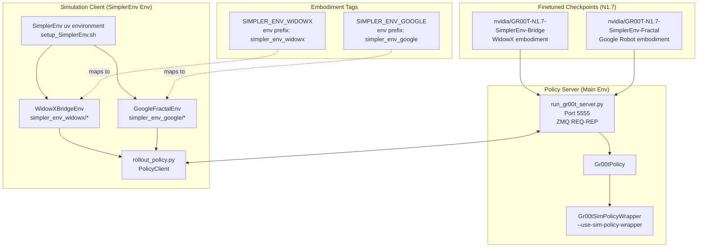
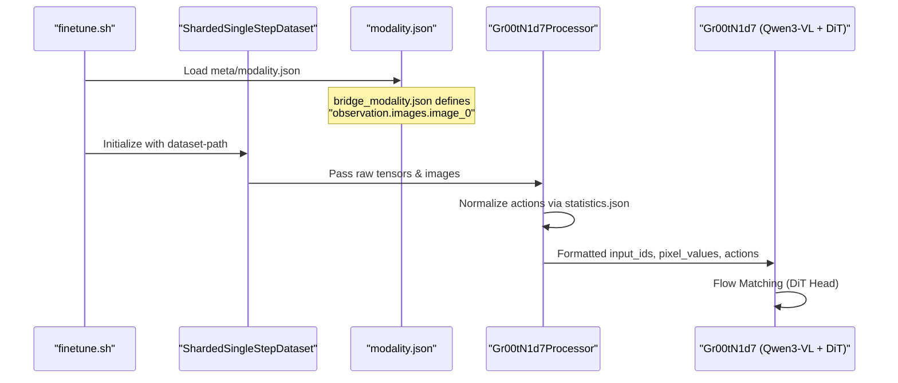

<!-- source: DeepWiki mcp.deepwiki.com · repo NVIDIA/Isaac-GR00T · page 7.4 SimplerEnv Benchmarks · fetched 2026-10-26 -->

# SimplerEnv Benchmarks

<details>
<summary>Relevant source files</summary>

The following files were used as context for generating this wiki page:

- [examples/LIBERO/README.md](examples/LIBERO/README.md)
- [examples/SO100/README.md](examples/SO100/README.md)
- [examples/SimplerEnv/README.md](examples/SimplerEnv/README.md)
- [examples/SimplerEnv/bridge_modality.json](examples/SimplerEnv/bridge_modality.json)
- [examples/SimplerEnv/fractal_modality.json](examples/SimplerEnv/fractal_modality.json)
- [gr00t/eval/sim/SimplerEnv/setup_SimplerEnv.sh](gr00t/eval/sim/SimplerEnv/setup_SimplerEnv.sh)
- [gr00t/eval/sim/robocasa-gr1-tabletop-tasks/setup_RoboCasaGR1TabletopTasks.sh](gr00t/eval/sim/robocasa-gr1-tabletop-tasks/setup_RoboCasaGR1TabletopTasks.sh)

</details>


This page describes the SimplerEnv simulation benchmark, which evaluates GR00T policies on standardized robot manipulation tasks. SimplerEnv provides GPU-accelerated simulation environments that replicate real-world setups for the WidowX robot (using the Bridge dataset) and Google Robot (using the Fractal dataset). This benchmark is used for closed-loop evaluation of finetuned GR00T models.

For general evaluation concepts including open-loop vs closed-loop evaluation, see [Evaluation Pipeline Overview](#7.1). For details on the server-client architecture used during evaluation, see [Policy Server Architecture](#5.1). For fine-tuning GR00T on SimplerEnv datasets before evaluation, see [Fine-tuning Overview](#6.2).

**Sources:** [examples/SimplerEnv/README.md:1-6]()

---

## Overview

SimplerEnv is a framework for evaluating robot manipulation policies in GPU-accelerated simulation. It replicates common experimental setups from real robot research, providing visual matching and variant aggregation evaluation methods for robust policy assessment. The framework achieves 10-15x speedup over CPU-only simulation [examples/SimplerEnv/README.md:3-3]().

GR00T provides finetuned checkpoints for SimplerEnv evaluation (N1.7 architecture):
- **nvidia/GR00T-N1.7-SimplerEnv-Bridge**: Fine-tuned on the Bridge dataset for WidowX robot manipulation [examples/SimplerEnv/README.md:148-148]().
- **nvidia/GR00T-N1.6-bridge**: Previous generation N1.6 checkpoint [examples/SimplerEnv/README.md:16-16]().
- **nvidia/GR00T-N1.7-SimplerEnv-Fractal**: Fine-tuned on the Fractal dataset for Google Robot manipulation [examples/SimplerEnv/README.md:116-116]().

**Sources:** [examples/SimplerEnv/README.md:1-44](), [examples/SimplerEnv/README.md:116-148]()

---

## SimplerEnv Architecture and Evaluation Flow

The evaluation uses a client-server pattern where the policy server handles model inference and the client manages the simulation physics and observation gathering.

### System Interaction Diagram



**Sources:** [examples/SimplerEnv/README.md:91-163](), [gr00t/eval/sim/SimplerEnv/setup_SimplerEnv.sh:1-74]()

---

## Benchmark Results

The N1.7 architecture shows significant improvements over N1.6 across most tasks.

### Bridge (WidowX Robot) Results
| Task | N1.6 success rate | N1.7 success rate |
| --- | ---: | ---: |
| `widowx_spoon_on_towel` | 55.4% | 78.0% |
| `widowx_carrot_on_plate` | 46.0% | 58.0% |
| `widowx_stack_cube` | 5.0% | 48.0% |
| `widowx_open_drawer` | 95.0% | 100.0% |
| **Average** | **56.6%** | **62.3%** |

### Fractal (Google Robot) Results
| Task | N1.6 success rate | N1.7 success rate |
| --- | ---: | ---: |
| `google_robot_pick_coke_can` | 95.0% | 100.0% |
| `google_robot_pick_object` | 87.0% | 94.0% |
| `google_robot_move_near` | 81.0% | 100.0% |
| `google_robot_open_drawer` | 0.0% | 65.0% |
| **Average** | **52.0%** | **72.5%** |

**Sources:** [examples/SimplerEnv/README.md:19-44]()

---

## Environment Setup

SimplerEnv requires a separate `uv` environment from the main GR00T repository because of conflicting dependencies, particularly `numpy` and `gymnasium` versions.

### Setup Script
Run the provided setup script from the project root:
```bash
bash gr00t/eval/sim/SimplerEnv/setup_SimplerEnv.sh
```
This script initializes the SimplerEnv submodule [gr00t/eval/sim/SimplerEnv/setup_SimplerEnv.sh:9](), creates a Python 3.10 virtual environment [gr00t/eval/sim/SimplerEnv/setup_SimplerEnv.sh:18](), and installs specialized dependencies including `ManiSkill2_real2sim` [gr00t/eval/sim/SimplerEnv/setup_SimplerEnv.sh:36]().

**Sources:** [gr00t/eval/sim/SimplerEnv/setup_SimplerEnv.sh:1-74]()

---

## Running Evaluation

### Starting the Policy Server
Run the policy server in **Terminal 1** using the main project's `uv` environment.

**Fractal (Google Robot):**
```bash
uv run python gr00t/eval/run_gr00t_server.py \
    --model-path nvidia/GR00T-N1.7-SimplerEnv-Fractal \
    --embodiment-tag SIMPLER_ENV_GOOGLE \
    --use-sim-policy-wrapper
```
[examples/SimplerEnv/README.md:115-119]()

**Bridge (WidowX):**
```bash
uv run python gr00t/eval/run_gr00t_server.py \
    --model-path nvidia/GR00T-N1.7-SimplerEnv-Bridge \
    --embodiment-tag SIMPLER_ENV_WIDOWX \
    --use-sim-policy-wrapper
```
[examples/SimplerEnv/README.md:147-151]()

### Running the Simulation Client
Run the rollout script in **Terminal 2** using the specialized SimplerEnv `uv` environment. Note the difference in `n-action-steps` (1 for Google Robot, 4 for WidowX):

```bash
# Example for WidowX
gr00t/eval/sim/SimplerEnv/simpler_uv/.venv/bin/python gr00t/eval/rollout_policy.py \
    --n-episodes 10 \
    --policy-client-host 127.0.0.1 \
    --policy-client-port 5555 \
    --max-episode-steps 300 \
    --env-name simpler_env_widowx/widowx_spoon_on_towel \
    --n-action-steps 4 \
    --n-envs 5
```
[examples/SimplerEnv/README.md:155-163]()

---

## Fine-tuning on SimplerEnv Datasets

Users can reproduce the benchmark models by fine-tuning the base `GR00T-N1.7-3B` model on the LeRobot-formatted datasets.

### Data Flow: Natural Language to Code Entities



### Fine-tuning Commands

**Bridge (WidowX):**
Requires patching the `modality.json` [examples/SimplerEnv/README.md:56-56]().
```bash
NUM_GPUS=8 MAX_STEPS=20000 GLOBAL_BATCH_SIZE=1024 SAVE_STEPS=1000 uv run bash examples/finetune.sh \
    --base-model-path nvidia/GR00T-N1.7-3B \
    --dataset-path examples/SimplerEnv/bridge_orig_lerobot/ \
    --embodiment-tag SIMPLER_ENV_WIDOWX \
    --output-dir /tmp/bridge_finetune \
    --state-dropout-prob 0.8
```
[examples/SimplerEnv/README.md:60-66]()

**Fractal (Google Robot):**
Requires converting AV1 videos to H.264 for compatibility [examples/SimplerEnv/README.md:77-77]().
```bash
NUM_GPUS=8 MAX_STEPS=20000 GLOBAL_BATCH_SIZE=1024 SAVE_STEPS=1000 uv run bash examples/finetune.sh \
    --base-model-path nvidia/GR00T-N1.7-3B \
    --dataset-path examples/SimplerEnv/fractal20220817_data_lerobot/ \
    --embodiment-tag SIMPLER_ENV_GOOGLE \
    --output-dir /tmp/fractal_finetune \
    --state-dropout-prob 0.5
```
[examples/SimplerEnv/README.md:81-87]()

**Sources:** [examples/SimplerEnv/README.md:46-87](), [examples/SimplerEnv/bridge_modality.json:1-77](), [examples/SimplerEnv/fractal_modality.json:1-77]()

---

## Summary of Configuration

The following table summarizes the key configurations for the two SimplerEnv embodiments:

| Parameter | SIMPLER_ENV_WIDOWX | SIMPLER_ENV_GOOGLE |
|-----------|--------------------|--------------------|
| **Robot** | WidowX | Google Robot |
| **Dataset** | Bridge | Fractal |
| **State Dim** | 8 (x,y,z,roll,pitch,yaw,pad,gripper) | 8 (x,y,z,rx,ry,rz,rw,gripper) |
| **Action Dim** | 7 (x,y,z,roll,pitch,yaw,gripper) | 7 (x,y,z,roll,pitch,yaw,gripper) |
| **Video Key** | `observation.images.image_0` | `observation.images.image` |
| **Dropout** | 0.8 | 0.5 |

**Sources:** [examples/SimplerEnv/bridge_modality.json:1-77](), [examples/SimplerEnv/fractal_modality.json:1-77](), [examples/SimplerEnv/README.md:65-86]()

---

