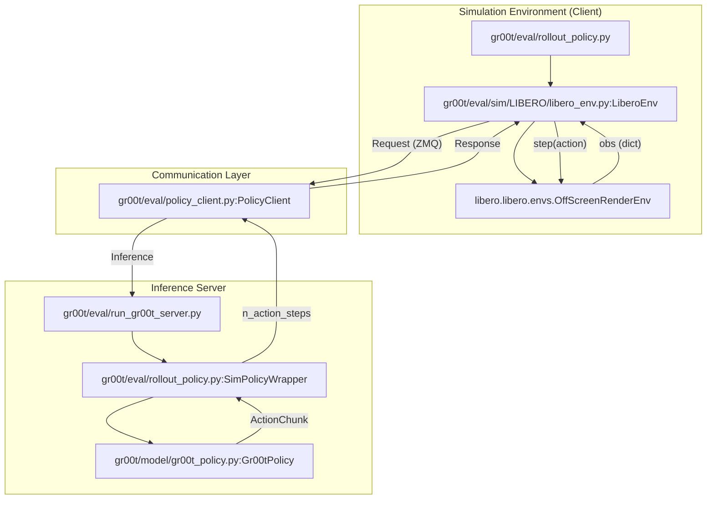

<!-- source: DeepWiki mcp.deepwiki.com · repo NVIDIA/Isaac-GR00T · page 7.5 LIBERO Benchmarks · fetched 2026-10-26 -->

# LIBERO Benchmarks

<details>
<summary>Relevant source files</summary>

The following files were used as context for generating this wiki page:

- [examples/LIBERO/README.md](examples/LIBERO/README.md)
- [examples/SO100/README.md](examples/SO100/README.md)
- [examples/SimplerEnv/README.md](examples/SimplerEnv/README.md)
- [gr00t/data/state_action/action_chunking.py](gr00t/data/state_action/action_chunking.py)
- [gr00t/data/state_action/pose.py](gr00t/data/state_action/pose.py)
- [gr00t/data/state_action/state_action_processor.py](gr00t/data/state_action/state_action_processor.py)
- [gr00t/eval/sim/LIBERO/libero_env.py](gr00t/eval/sim/LIBERO/libero_env.py)
- [gr00t/eval/sim/SimplerEnv/simpler_env.py](gr00t/eval/sim/SimplerEnv/simpler_env.py)
- [gr00t/experiment/utils.py](gr00t/experiment/utils.py)
- [tests/examples/test_droid.py](tests/examples/test_droid.py)
- [tests/examples/test_libero.py](tests/examples/test_libero.py)
- [tests/examples/test_robocasa.py](tests/examples/test_robocasa.py)
- [tests/examples/test_robocasa_gr1_tabletop.py](tests/examples/test_robocasa_gr1_tabletop.py)
- [tests/examples/test_simplerenv.py](tests/examples/test_simplerenv.py)

</details>


This page documents the integration of Isaac-GR00T with the LIBERO benchmark suite for evaluating robot manipulation policies. LIBERO (Lifelong Benchmark for Robot Learning) is a standardized benchmark consisting of four primary task suites designed to test different aspects of robot manipulation capabilities in simulation using a Franka Panda robot arm.

## Overview

LIBERO provides a comprehensive benchmark suite with four distinct categories, each testing different manipulation capabilities. The benchmark uses the MuJoCo-based Robosuite simulation environment. GR00T N1.7 demonstrates strong performance across all suites through fine-tuning on LeRobot-formatted datasets.

### Task Suites

The LIBERO benchmark consists of four main task suites [examples/LIBERO/README.md:1-5]():

| Task Suite | Description | Max Episode Steps |
|------------|-------------|-------------------|
| **Spatial** | Spatial reasoning tasks (e.g., "put the object to the left of the target") | 720 |
| **Object** | Object generalization with different object types | 720 |
| **Goal** | Goal-conditioned learning with varying objectives | 720 |
| **10 Long** | Long-horizon multi-step tasks | 720 |

**Sources:** [examples/LIBERO/README.md:1-22](), [gr00t/eval/sim/LIBERO/libero_env.py:140-146]()

## System Architecture

The integration utilizes a client-server architecture. The simulation environment runs in a specialized Python environment (typically `libero_uv`), while the GR00T model runs in a separate policy server.

### Evaluation Data Flow

The following diagram bridges the high-level evaluation concepts to the specific code entities used in the LIBERO pipeline.



**Sources:** [gr00t/eval/sim/LIBERO/libero_env.py:98-178](), [examples/LIBERO/README.md:126-144]()

### LIBERO Environment Integration

The `LiberoEnv` class [gr00t/eval/sim/LIBERO/libero_env.py:98]() wraps the original LIBERO `OffScreenRenderEnv` [gr00t/eval/sim/LIBERO/libero_env.py:36]() as a Gymnasium-compatible environment.

**Key Implementation Details:**
*   **Observation Processing**: The `_process_observation` method [gr00t/eval/sim/LIBERO/libero_env.py:143-159]() extracts the end-effector position (`robot0_eef_pos`), orientation (`robot0_eef_quat`), and gripper state (`robot0_gripper_qpos`). It also flips the images (`agentview_image` and `robot0_eye_in_hand_image`) using `[::-1, ::-1]` to match the expected coordinate frame [gr00t/eval/sim/LIBERO/libero_env.py:148-149]().
*   **Action Handling**: The `step` method [gr00t/eval/sim/LIBERO/libero_env.py:170-178]() concatenates the action components (x, y, z, roll, pitch, yaw, gripper) into a single vector for the underlying Robosuite environment.
*   **Gripper Normalization**: Gripper actions are normalized from `[0, 1]` to `[-1, 1]` via `normalize_gripper_action` [gr00t/eval/sim/LIBERO/libero_env.py:68-85]() and then inverted via `invert_gripper_action` [gr00t/eval/sim/LIBERO/libero_env.py:88-95]() to match LIBERO's internal convention where -1 is open and +1 is closed.

**Sources:** [gr00t/eval/sim/LIBERO/libero_env.py:41-95](), [gr00t/eval/sim/LIBERO/libero_env.py:143-178]()

## Evaluation Methodology

### Reported Success Rates

GR00T N1.7 achieves high success rates across all LIBERO suites using a consistent fine-tuning setup (20K steps, batch size 640, `state-dropout-prob 0.2`) [examples/LIBERO/README.md:13-22]().

| Task Suite | Success Rate | Max Steps | Batch Size |
|------------|--------------|-----------|------------|
| Spatial    | 195/200 (97.65%) | 20K       | 640        |
| Goal       | 195/200 (97.5%)  | 20K       | 640        |
| Object     | 197/200 (98.45%) | 20K       | 640        |
| 10 (Long)  | 189/200 (94.35%) | 20K       | 640        |

**Sources:** [examples/LIBERO/README.md:17-22]()

### Environment-to-Code Mapping

This diagram maps simulation environment names to the internal data structures and processors used to handle them.


**Sources:** [gr00t/data/state_action/state_action_processor.py:52-105](), [gr00t/data/state_action/action_chunking.py:29-80](), [examples/LIBERO/README.md:42]()

## Running Benchmarks

### 1. Fine-tuning
Datasets are available in LeRobot format. After downloading, a `modality.json` patch must be applied to the `meta/` directory [examples/LIBERO/README.md:34-35]().

```bash
# Example for LIBERO 10 (Long)
NUM_GPUS=8 MAX_STEPS=20000 GLOBAL_BATCH_SIZE=640 uv run bash examples/finetune.sh \
    --base-model-path nvidia/GR00T-N1.7-3B \
    --dataset-path examples/LIBERO/libero_10_no_noops_1.0.0_lerobot/ \
    --embodiment-tag LIBERO_PANDA \
    --output-dir /tmp/libero_10 \
    --state-dropout-prob 0.2
```

**Sources:** [examples/LIBERO/README.md:37-45]()

### 2. Inference Server
Start the server with the `LIBERO_PANDA` embodiment tag and the `--use-sim-policy-wrapper` flag [examples/LIBERO/README.md:126-130]().

```bash
uv run python gr00t/eval/run_gr00t_server.py \
    --model-path checkpoints/GR00T-N1.7-LIBERO/libero_10 \
    --embodiment-tag LIBERO_PANDA \
    --use-sim-policy-wrapper
```

### 3. Client Rollout
Run the rollout script pointing to a specific LIBERO task. Note the use of the `libero_uv` virtual environment [examples/LIBERO/README.md:136-144]().

```bash
gr00t/eval/sim/LIBERO/libero_uv/.venv/bin/python gr00t/eval/rollout_policy.py \
    --n-episodes 10 \
    --policy-client-host 127.0.0.1 \
    --policy-client-port 5555 \
    --max-episode-steps 720 \
    --env-name libero_sim/KITCHEN_SCENE3_turn_on_the_stove_and_put_the_moka_pot_on_it \
    --n-action-steps 8 \
    --n-envs 5
```

**Sources:** [examples/LIBERO/README.md:126-144](), [tests/examples/test_libero.py:60]()

## Task Mappings

The benchmark registers tasks with a `libero_sim/` prefix.

**Example Tasks:**
*   **LIBERO 10 (Long)**: `libero_sim/LIVING_ROOM_SCENE2_put_both_the_alphabet_soup_and_the_tomato_sauce_in_the_basket` [examples/LIBERO/README.md:149]()
*   **LIBERO 10 (Long)**: `libero_sim/KITCHEN_SCENE3_turn_on_the_stove_and_put_the_moka_pot_on_it` [examples/LIBERO/README.md:151]()
*   **LIBERO 10 (Long)**: `libero_sim/STUDY_SCENE1_pick_up_the_book_and_place_it_in_the_back_compartment_of_the_caddy` [examples/LIBERO/README.md:154]()

**Sources:** [examples/LIBERO/README.md:148-156]()

---

