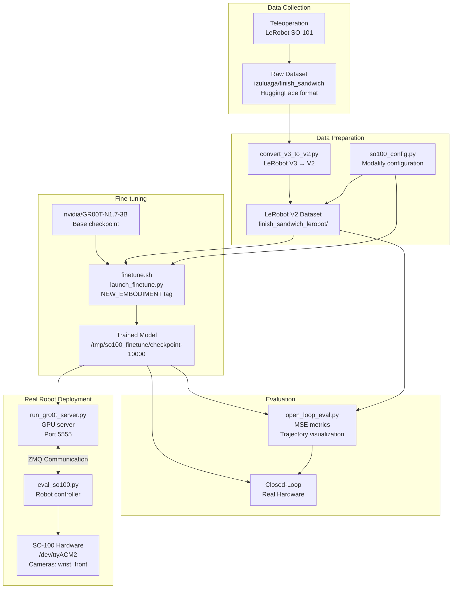
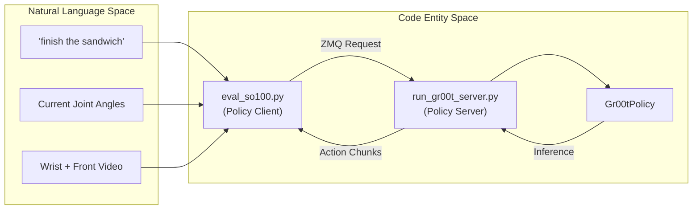

<!-- source: DeepWiki mcp.deepwiki.com · repo NVIDIA/Isaac-GR00T · page 7.6 SO-100 Robot Evaluation · fetched 2026-10-26 -->

# SO-100 Robot Evaluation

<details>
<summary>Relevant source files</summary>

The following files were used as context for generating this wiki page:

- [demo_data/droid_sample/meta/relative_stats.json](demo_data/droid_sample/meta/relative_stats.json)
- [demo_data/droid_sample/meta/stats.json](demo_data/droid_sample/meta/stats.json)
- [examples/LIBERO/README.md](examples/LIBERO/README.md)
- [examples/RoboLab/README.md](examples/RoboLab/README.md)
- [examples/SO100/README.md](examples/SO100/README.md)
- [examples/SimplerEnv/README.md](examples/SimplerEnv/README.md)
- [gr00t/eval/real_robot/SO100/pyproject.toml](gr00t/eval/real_robot/SO100/pyproject.toml)
- [scripts/download_droid_sample.py](scripts/download_droid_sample.py)
- [tests/examples/test_so100.py](tests/examples/test_so100.py)
- [tests/gr00t/data/test_demo_dataset_stats.py](tests/gr00t/data/test_demo_dataset_stats.py)
- [tests/gr00t/utils/test_torchcodec_import.py](tests/gr00t/utils/test_torchcodec_import.py)

</details>


This document covers the complete workflow for evaluating GR00T N1.7 on the SO-100 robot platform, including dataset preparation, fine-tuning, and deployment on real hardware. The SO-100 is a low-cost, open-source robot arm developed for imitation learning research.

The evaluation process follows a two-stage approach: open-loop validation against recorded datasets and closed-loop testing on physical hardware using the `eval_so100.py` deployment script.

## SO-100 Robot Platform

The SO-100 (also referred to as SO-101 in some documentation) is a compact robotic arm designed for tabletop manipulation tasks. The platform features:

- **Control Interface**: Single-arm configuration with joint position control.
- **Cameras**: Multi-camera setup including wrist-mounted and external front cameras.
- **Data Collection**: Teleoperation support via the LeRobot library.
- **Use Case**: Manipulation tasks such as object placement and assembly.

The robot integrates with the LeRobot ecosystem for data collection and provides a platform for testing learned manipulation policies.

**Sources:** [examples/SO100/README.md:1-12]()

## End-to-End Workflow

The following diagram illustrates the complete workflow for SO-100 evaluation, from data collection through real robot deployment:

### SO-100 Evaluation Workflow


**Sources:** [examples/SO100/README.md:1-124]()

## Dataset Preparation

### Dataset Source

The reference dataset for SO-100 fine-tuning is hosted on HuggingFace:

- **Dataset Repository**: `izuluaga/finish_sandwich` [examples/SO100/README.md:20-20]()
- **Task**: Sandwich assembly manipulation.
- **Collection Method**: Teleoperation using LeRobot's SO-101 interface [examples/SO100/README.md:16-16]().

### Data Conversion Process

The SO-100 dataset requires conversion from LeRobot V3 format to the V2 format used by GR00T N1.7. This is handled by a specialized conversion script:

```bash
uv run --project scripts/lerobot_conversion \
  python scripts/lerobot_conversion/convert_v3_to_v2.py \
  --repo-id izuluaga/finish_sandwich \
  --root examples/SO100/finish_sandwich_lerobot
```
[examples/SO100/README.md:30-34]()

After conversion, the `modality.json` patch must be applied to the dataset's metadata directory:

```bash
cp examples/SO100/modality.json examples/SO100/finish_sandwich_lerobot/izuluaga/finish_sandwich/meta/modality.json
```
[examples/SO100/README.md:37-39]()

### Modality Configuration

The SO-100 robot uses a custom modality configuration file (`so100_config.py`) that defines camera setups, state spaces (joint positions), and action spaces. During fine-tuning, this is passed via `--modality-config-path` [examples/SO100/README.md:48-48]().

## Fine-tuning Process

Fine-tuning is performed using the shared `finetune.sh` script. For SO-100, the `NEW_EMBODIMENT` tag is typically used to signal a custom configuration [examples/SO100/README.md:49-49]().

```bash
CUDA_VISIBLE_DEVICES=0 NUM_GPUS=1 uv run bash examples/finetune.sh \
  --base-model-path nvidia/GR00T-N1.7-3B \
  --dataset-path examples/SO100/finish_sandwich_lerobot/izuluaga/finish_sandwich \
  --modality-config-path examples/SO100/so100_config.py \
  --embodiment-tag NEW_EMBODIMENT \
  --output-dir /tmp/so100_finetune
```
[examples/SO100/README.md:45-51]()

## Open-Loop Evaluation

Open-loop evaluation validates the fine-tuned model by comparing predicted actions against ground truth trajectories from the dataset without executing them on the robot.

### Running Open-Loop Evaluation

The script `gr00t/eval/open_loop_eval.py` generates MSE metrics and trajectory visualizations:

```bash
uv run python gr00t/eval/open_loop_eval.py \
  --dataset-path examples/SO100/finish_sandwich_lerobot/izuluaga/finish_sandwich/ \
  --embodiment-tag NEW_EMBODIMENT \
  --model-path /tmp/so100_finetune/checkpoint-10000 \
  --traj-ids 0 \
  --execution-horizon 16 \
  --steps 400
```
[examples/SO100/README.md:58-65]()

The evaluation produces plots (e.g., `open_loop_eval_so100.jpg`) comparing predicted vs. ground truth joint trajectories [examples/SO100/README.md:75-77]().

## Closed-Loop Evaluation on Real Hardware

Closed-loop evaluation deploys the model to the physical SO-100 robot, where the policy receives live camera feeds and joint states to generate actions.

### Deployment Architecture

The system uses a server-client architecture where the model runs on a GPU-enabled server while the robot control logic runs on a local client machine.

### Natural Language to Code Entity Space: Deployment


### Environment Setup

The SO-100 evaluation environment requires specific client-side dependencies, including the `lerobot[feetech]` package:

```bash
cd "$GR00T_REPO/gr00t/eval/real_robot/SO100"
uv sync
uv pip install --no-deps -e ../../../../
```
[examples/SO100/README.md:88-91]()

The `pyproject.toml` in the SO100 directory defines the necessary dependencies like `zmq`, `draccus`, and the specific `lerobot` git revision [gr00t/eval/real_robot/SO100/pyproject.toml:10-19]().

### Server Startup

Start the policy server on the GPU machine:

```bash
cd "$GR00T_REPO"
uv run python gr00t/eval/run_gr00t_server.py \
  --model-path /tmp/so100_finetune/checkpoint-10000 \
  --embodiment-tag NEW_EMBODIMENT 
```
[examples/SO100/README.md:95-99]()

### Client Execution

Run the evaluation script on the machine connected to the SO-100 hardware. This script handles the control loop, camera capture, and communication with the server.

```bash
uv run --no-sync python eval_so100.py \
  --robot.type=so101_follower \
  --robot.port="/dev/ttyACM2" \
  --robot.id="orange_follower" \
  --robot.cameras="{ front: {type: opencv, index_or_path: 6, width: 640, height: 480, fps: 30}, wrist: {type: opencv, index_or_path: 2, width: 640, height: 480, fps: 30}}" \
  --policy_host=localhost \
  --policy_port=5555 \
  --lang_instruction="finish the ham cheese olives sandwich"
```
[examples/SO100/README.md:116-124]()

**Sources:**
- [examples/SO100/README.md:1-124]()
- [gr00t/eval/real_robot/SO100/pyproject.toml:1-21]()
- [tests/examples/test_so100.py:1-178]() (CI workflow validation)

---

