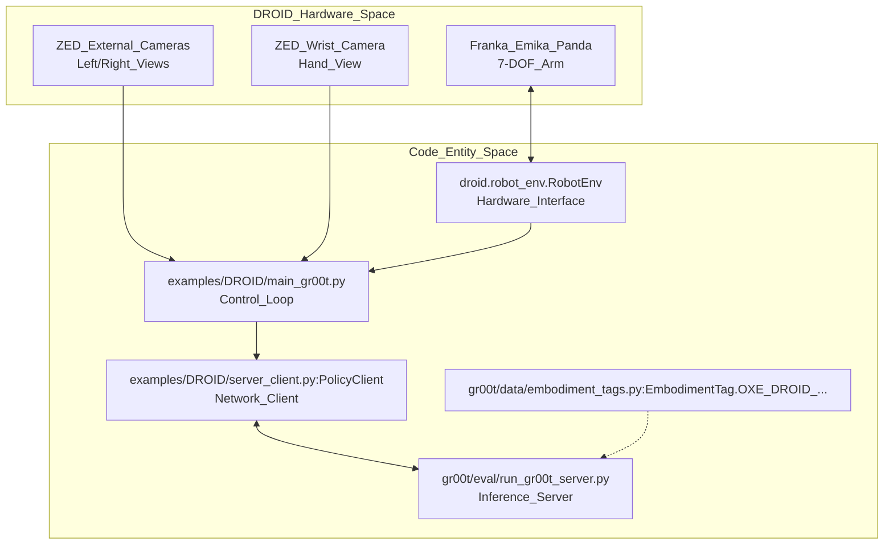
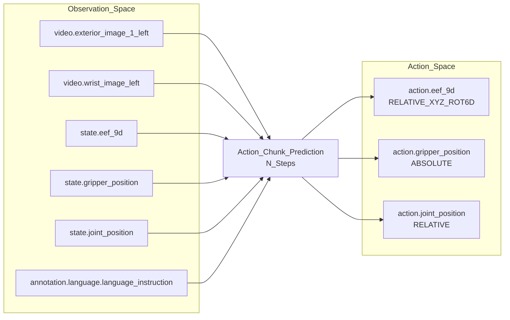
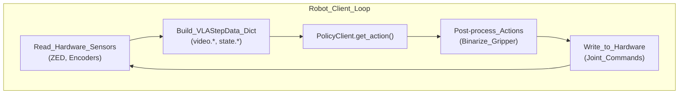

<!-- source: DeepWiki mcp.deepwiki.com · repo NVIDIA/Isaac-GR00T · page 7.7 DROID and Other Real Robot Integration · fetched 2026-10-26 -->

# DROID and Other Real Robot Integration

<details>
<summary>Relevant source files</summary>

The following files were used as context for generating this wiki page:

- [demo_data/droid_sample/meta/relative_stats.json](demo_data/droid_sample/meta/relative_stats.json)
- [demo_data/droid_sample/meta/stats.json](demo_data/droid_sample/meta/stats.json)
- [examples/DROID/README.md](examples/DROID/README.md)
- [examples/DROID/main_gr00t.py](examples/DROID/main_gr00t.py)
- [examples/RoboLab/README.md](examples/RoboLab/README.md)
- [examples/robocasa-gr1-tabletop-tasks/README.md](examples/robocasa-gr1-tabletop-tasks/README.md)
- [examples/robocasa/README.md](examples/robocasa/README.md)
- [gr00t/configs/data/data_config.py](gr00t/configs/data/data_config.py)
- [gr00t/data/dataset/factory.py](gr00t/data/dataset/factory.py)
- [gr00t/eval/real_robot/SO100/pyproject.toml](gr00t/eval/real_robot/SO100/pyproject.toml)
- [gr00t/eval/sim/wrapper/multistep_wrapper.py](gr00t/eval/sim/wrapper/multistep_wrapper.py)
- [scripts/download_droid_sample.py](scripts/download_droid_sample.py)
- [tests/gr00t/data/test_demo_dataset_stats.py](tests/gr00t/data/test_demo_dataset_stats.py)

</details>


This page documents real robot integration with GR00T N1.7, focusing on the DROID (Distributed Robot Interaction Dataset) platform and the general patterns for connecting the VLA model to physical hardware. GR00T N1.7 uses a server-client architecture where the model runs on a high-performance GPU server while a lightweight client script interfaces with the robot's sensors and actuators.

---

## DROID Platform Overview

DROID is a standardized desktop manipulation setup featuring a Franka Emika Panda arm and ZED cameras. The GR00T N1.7 system provides a pre-trained checkpoint specifically optimized for this platform using relative end-effector and joint position actions. The model supports DROID out of the box via the `OXE_DROID_RELATIVE_EEF_RELATIVE_JOINT` tag [examples/DROID/README.md:1-3]().

**DROID System Components**



**Sources:** [examples/DROID/main_gr00t.py:43-44](), [examples/DROID/README.md:98-110](), [gr00t/data/embodiment_tags.py:22]()

---

## DROID Embodiment Configuration

The DROID embodiment uses the `OXE_DROID_RELATIVE_EEF_RELATIVE_JOINT` tag. This configuration defines a multi-modal input space and a hybrid action space consisting of 17 dimensions: 9D relative EEF (XYZ + rot6d), 1D absolute gripper, and 7D relative joint positions [examples/DROID/README.md:9-22]().

**DROID Modality Mapping**



**Modality Table**

| Modality | Keys | Dimensions | Representation |
|----------|------|------------|----------------|
| **Video** | `exterior_image_1_left`, `wrist_image_left` | 2 cameras | RGB |
| **State** | `eef_9d`, `gripper_position`, `joint_position` | 17D total | Absolute/Relative mix |
| **Action** | `eef_9d`, `gripper_position`, `joint_position` | 17D total | Relative (EEF/Joints), Absolute (Gripper) |
| **Language** | `annotation.language.language_instruction` | Text | Tokenized |

**Sources:** [examples/DROID/README.md:9-22](), [examples/DROID/main_gr00t.py:57-70]()

---

## Data Preparation and Stats

Before running inference or fine-tuning, DROID data must be converted from LeRobot v3.0 to GR00T's LeRobot v2.0 format. The `scripts/download_droid_sample.py` script automates this, including the computation of `eef_9d` from Cartesian Euler angles [scripts/download_droid_sample.py:19-50]().

The dataset includes comprehensive statistics for normalization, stored in `stats.json` and `relative_stats.json` [demo_data/droid_sample/meta/stats.json:1-217](), [demo_data/droid_sample/meta/relative_stats.json:1-217](). The `DatasetFactory` ensures these statistics are generated or loaded before training [gr00t/data/dataset/factory.py:57-60]().

**Sources:** [scripts/download_droid_sample.py:101-184](), [gr00t/data/dataset/factory.py:28-69]()

---

## Setting Up DROID Inference

### 1. Start the Policy Server
On the GPU machine, launch the inference server using the DROID-specific checkpoint:

```bash
uv run python gr00t/eval/run_gr00t_server.py \
    --model-path nvidia/GR00T-N1.7-DROID \
    --embodiment-tag OXE_DROID_RELATIVE_EEF_RELATIVE_JOINT
```

**Sources:** [examples/DROID/README.md:77-80]()

### 2. Configure Robot Workstation
The DROID control script [examples/DROID/main_gr00t.py]() requires ZED camera IDs to be configured in the `Args` dataclass:

```python
@dataclasses.dataclass
class Args:
    left_camera_id: str = "<SET THIS>"
    right_camera_id: str = "<SET THIS>"
    wrist_camera_id: str = "<SET THIS>"
```

**Sources:** [examples/DROID/main_gr00t.py:73-80]()

---

## Control Script Implementation

The [examples/DROID/main_gr00t.py]() script implements the control loop that manages observation collection and action execution at the DROID control frequency of 15Hz [examples/DROID/main_gr00t.py:43]().

### Observation Preprocessing
Images are resized to `(180, 320)` to match the policy server requirements [examples/DROID/main_gr00t.py:44](). The script uses `resize_with_pad` to maintain the correct aspect ratio [examples/DROID/main_gr00t.py:119]().

### EEF Frame Correction
DROID uses a post-multiplication matrix `DROID_EEF_ROTATION_CORRECT` to align raw robot Euler angles with the OXE DROID training pipeline convention [examples/DROID/main_gr00t.py:46-54]().

```python
def compute_eef_9d(cartesian_position: np.ndarray) -> np.ndarray:
    # ...
    rot_robot = Rotation.from_euler("XYZ", euler).as_matrix()
    rot_mat = rot_robot @ DROID_EEF_ROTATION_CORRECT
    rot6d = rot_mat[:2, :].reshape(6)
    return np.concatenate([xyz, rot6d]).astype(np.float32)
```

**Sources:** [examples/DROID/main_gr00t.py:57-71]()

### Action Chunking and Open-Loop Execution
The script implements a receding horizon control strategy. It sources the `action_chunk_size` from the policy server's modality config and executes a locally defined `open_loop_horizon` (default 15 steps) before requesting a new chunk [examples/DROID/main_gr00t.py:92-180]().

---

## Integrating Other Real Robot Platforms

Integrating custom robots (like the SO-100 or RoboCasa Panda) follows a similar architectural pattern.

### 1. Environment Setup
Custom robots typically require specific dependencies (e.g., `lerobot[feetech]` for SO-100) [gr00t/eval/real_robot/SO100/pyproject.toml:10-19](). Simulation environments like RoboCasa require specific setup scripts to install `robosuite` and other physics dependencies [examples/robocasa/README.md:88-92]().

### 2. Embodiment Tagging
Every new integration must be mapped to an `EmbodimentTag`. For example, RoboCasa uses `ROBOCASA_PANDA_OMRON` [examples/robocasa/README.md:47](), and the GR1 tabletop tasks use `ROBOCASA_GR1_TABLETOP` [examples/robocasa-gr1-tabletop-tasks/README.md:51]().

### 3. Simulation to Real Bridge
For simulation environments like RoboLab, a `sim-policy-wrapper` is used to bridge the server and simulation client [examples/RoboLab/README.md:88-90]().

**Integration Flow**



**Sources:** [examples/DROID/main_gr00t.py:144-180](), [examples/RoboLab/README.md:11-24](), [examples/robocasa/README.md:112-130]()

---

