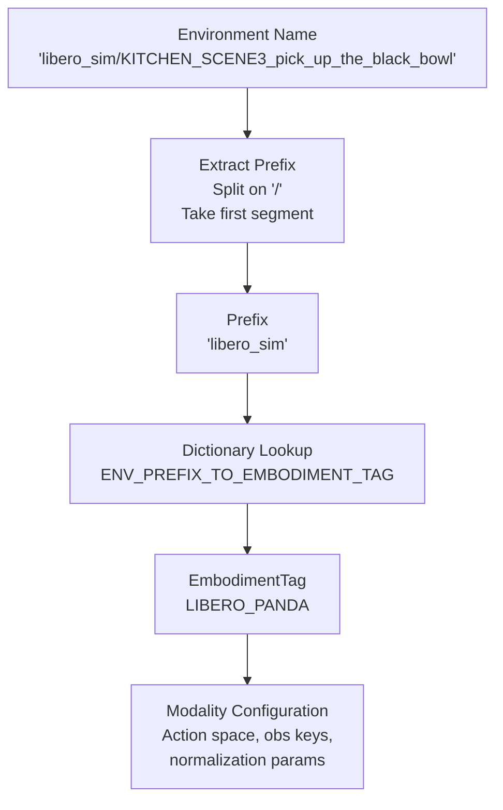
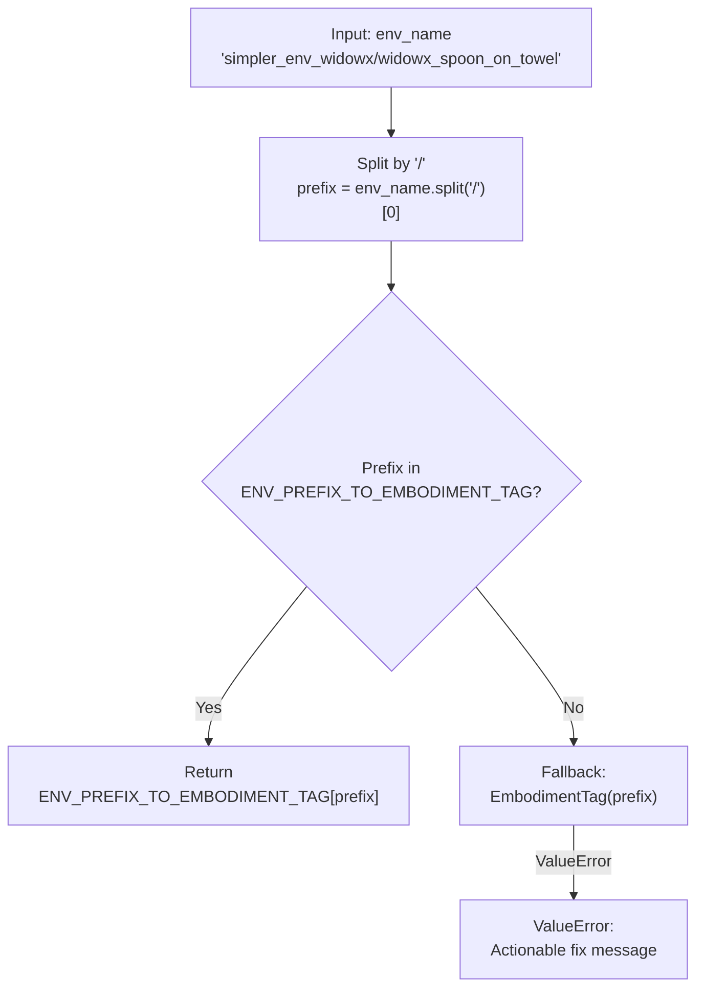
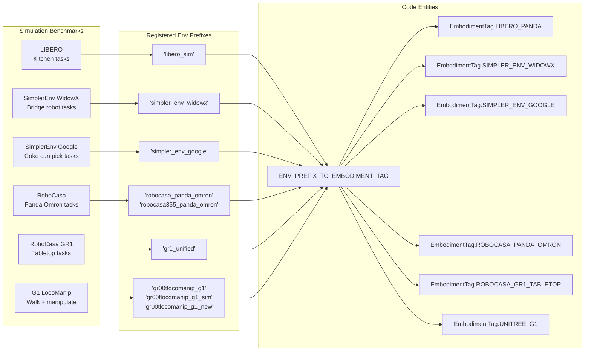

<!-- source: DeepWiki mcp.deepwiki.com · repo NVIDIA/Isaac-GR00T · page 7.8 Environment-to-Embodiment Mapping · fetched 2026-10-26 -->

# Environment-to-Embodiment Mapping

Relevant source files

The following files were used as context for generating this wiki page:

- [gr00t/eval/sim/env_utils.py](gr00t/eval/sim/env_utils.py)
- [tests/gr00t/eval/sim/test_env_utils.py](tests/gr00t/eval/sim/test_env_utils.py)

## Purpose and Scope

This page documents the **Environment-to-Embodiment Mapping** system, which translates gym-registered simulation environment names into `EmbodimentTag` enum values. This mapping is essential for evaluation workflows, ensuring that when a policy is deployed in a simulation environment, the correct embodiment configuration (action space, observation keys, normalization parameters) is automatically selected.

For information about embodiment configurations themselves, see [Robot Embodiment System](3.2). For overall evaluation workflows, see [Evaluation Pipeline Overview](7.1). For specific benchmark setups, see [SimplerEnv Benchmarks](7.4), [LIBERO Benchmarks](7.5), and [RoboCasa Benchmarks](7.9).

## System Overview

When running closed-loop evaluation in simulation environments, the system must determine which robot embodiment configuration to use. Simulation environments are registered with gym using names like `"libero_sim/KITCHEN_SCENE3_pick_up_the_black_bowl"` or `"simpler_env_widowx/widowx_spoon_on_towel"`. The environment-to-embodiment mapping system extracts the prefix (the part before the first `/`) and maps it to the appropriate `EmbodimentTag`.

Title: Environment Name to Embodiment Tag Flow

Sources: [gr00t/eval/sim/env_utils.py:22-34](), [gr00t/eval/sim/env_utils.py:53-55]()

## The Mapping Dictionary

The core of this system is the `ENV_PREFIX_TO_EMBODIMENT_TAG` dictionary defined in `gr00t/eval/sim/env_utils.py`. This dictionary explicitly maps environment name prefixes to their corresponding embodiment tags.

### Complete Mapping Table

| Environment Prefix | EmbodimentTag | Benchmark Category | Description |
|-------------------|---------------|-------------------|-------------|
| `gr00tlocomanip_g1` | `UNITREE_G1` | Locomanipulation | Unitree G1 locomotion + manipulation |
| `gr00tlocomanip_g1_sim` | `UNITREE_G1` | Locomanipulation | Unitree G1 sim variant |
| `gr00tlocomanip_g1_new` | `UNITREE_G1` | Locomanipulation | Unitree G1 new task suite |
| `simpler_env_google` | `SIMPLER_ENV_GOOGLE` | Posttrain | SimplerEnv with Google Robot |
| `simpler_env_widowx` | `SIMPLER_ENV_WIDOWX` | Posttrain | SimplerEnv with WidowX bridge robot |
| `libero_sim` | `LIBERO_PANDA` | Posttrain | LIBERO kitchen tasks with Franka Panda |
| `robocasa_panda_omron` | `ROBOCASA_PANDA_OMRON` | RoboCasa | RoboCasa Panda robot on Omron mobile base |
| `robocasa365_panda_omron`| `ROBOCASA_PANDA_OMRON` | RoboCasa | RoboCasa365 variant for Panda Omron |
| `gr1_unified` | `ROBOCASA_GR1_TABLETOP`| RoboCasa | Fourier GR1 robot in RoboCasa tabletop tasks |

Sources: [gr00t/eval/sim/env_utils.py:22-34](), [tests/gr00t/eval/sim/test_env_utils.py:41-52]()

### Prefix Variants and Consistency

Multiple prefixes can map to the same `EmbodimentTag`. This is intentional for benchmarks that have multiple variants, such as the Unitree G1 suites (`gr00tlocomanip_g1`, `gr00tlocomanip_g1_sim`, and `gr00tlocomanip_g1_new`) which all map to `EmbodimentTag.UNITREE_G1` [gr00t/eval/sim/env_utils.py:24-26](). Similarly, RoboCasa variants map to the same tag [gr00t/eval/sim/env_utils.py:31-32]().

The test suite enforces that related prefixes (those sharing a common root) must map to the same tag to prevent configuration conflicts [tests/gr00t/eval/sim/test_env_utils.py:54-67]().

Sources: [gr00t/eval/sim/env_utils.py:22-34](), [tests/gr00t/eval/sim/test_env_utils.py:54-67]()

## Lookup Function Implementation

The `get_embodiment_tag_from_env_name()` function performs the actual mapping logic [gr00t/eval/sim/env_utils.py:37-69]().

Title: get_embodiment_tag_from_env_name() Logic Flow

### Function Behavior

1. **Extract Prefix**: Splits the environment name on `/` and takes the first segment [gr00t/eval/sim/env_utils.py:53]().
2. **Dictionary Lookup**: Checks if the prefix exists in `ENV_PREFIX_TO_EMBODIMENT_TAG` [gr00t/eval/sim/env_utils.py:54]().
3. **Return Mapped Tag**: If found, returns the corresponding `EmbodimentTag` [gr00t/eval/sim/env_utils.py:55]().
4. **Fallback**: If not found, attempts to create an `EmbodimentTag` directly from the prefix string [gr00t/eval/sim/env_utils.py:57](). This works for prefixes that are identical to their enum values.
5. **Fail-Fast**: If the fallback fails, it raises a `ValueError` with a list of known prefixes and valid tag values, pointing the developer to `env_utils.py` to add the missing entry [gr00t/eval/sim/env_utils.py:58-69]().

### Edge Cases

The implementation handles several edge cases verified by the test suite:

| Case | Example | Behavior |
|------|---------|----------|
| Multiple slashes | `"simpler_env_google/task/subtask"` | Uses only first segment (`simpler_env_google`) [tests/gr00t/eval/sim/test_env_utils.py:122-125]() |
| Unknown prefix | `"totally_unknown_env/some_task"` | Raises `ValueError` [tests/gr00t/eval/sim/test_env_utils.py:114-116]() |
| Empty string | `""` | Raises `ValueError` [tests/gr00t/eval/sim/test_env_utils.py:118-120]() |

Sources: [gr00t/eval/sim/env_utils.py:53-69](), [tests/gr00t/eval/sim/test_env_utils.py:114-126]()

## Code-to-Benchmark Mapping

The following diagram maps code entities to their corresponding real-world benchmarks:

Title: Natural Language Benchmarks to Code Entities

Sources: [gr00t/eval/sim/env_utils.py:22-34](), [tests/gr00t/eval/sim/test_env_utils.py:70-111]()

## Historical Context: Issue #479 Fix

The explicit mapping dictionary was updated to resolve GitHub Issue #479, which identified that LIBERO and SimplerEnv benchmarks were failing to resolve correctly [tests/gr00t/eval/sim/test_env_utils.py:18-20]().

Prior to the fix, the system relied solely on the fallback mechanism. However, the prefix names (e.g., `simpler_env_google`) did not match the enum values exactly (e.g., `SIMPLER_ENV_GOOGLE`), causing `ValueError` exceptions. The solution was to add explicit entries in `ENV_PREFIX_TO_EMBODIMENT_TAG` for these prefixes [gr00t/eval/sim/env_utils.py:28-30]().

Sources: [gr00t/eval/sim/env_utils.py:28-30](), [tests/gr00t/eval/sim/test_env_utils.py:18-20]()

## Static Analysis and Closure Testing

The repository includes a specialized test class, `TestRegisteredPrefixClosure`, which uses Python's `ast` (Abstract Syntax Tree) module to scan `gr00t/eval/sim/**/*.py` for `register(id="<prefix>/...")` calls [tests/gr00t/eval/sim/test_env_utils.py:128-158]().

This static scan ensures that every prefix registered in the codebase has a corresponding entry in `ENV_PREFIX_TO_EMBODIMENT_TAG` or a matching `EmbodimentTag` value. This catches "categorical drift" where a developer adds a new simulation environment but forgets to update the mapping, preventing runtime errors during evaluation [tests/gr00t/eval/sim/test_env_utils.py:136-140]().

Sources: [tests/gr00t/eval/sim/test_env_utils.py:128-158]()

## Adding Support for New Environments

To add support for a new simulation benchmark:

1.  **Register the Prefix Mapping**: Add an entry to `ENV_PREFIX_TO_EMBODIMENT_TAG` in `gr00t/eval/sim/env_utils.py` [gr00t/eval/sim/env_utils.py:22-34]().
2.  **Ensure Consistency**: If the benchmark has multiple variants, map them all to the same `EmbodimentTag`.
3.  **Verify Embodiment Tag**: Ensure the `EmbodimentTag` exists in `gr00t/data/embodiment_tags.py`.
4.  **Add Tests**: Add regression tests to `tests/gr00t/eval/sim/test_env_utils.py` following the existing patterns for `test_locomanip_g1` or `test_simpler_env_google` [tests/gr00t/eval/sim/test_env_utils.py:70-111]().

Sources: [gr00t/eval/sim/env_utils.py:22-34](), [tests/gr00t/eval/sim/test_env_utils.py:54-67]()

---

