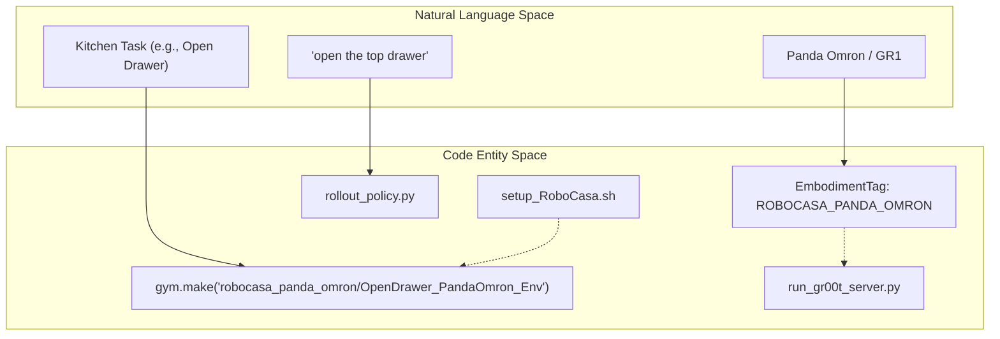
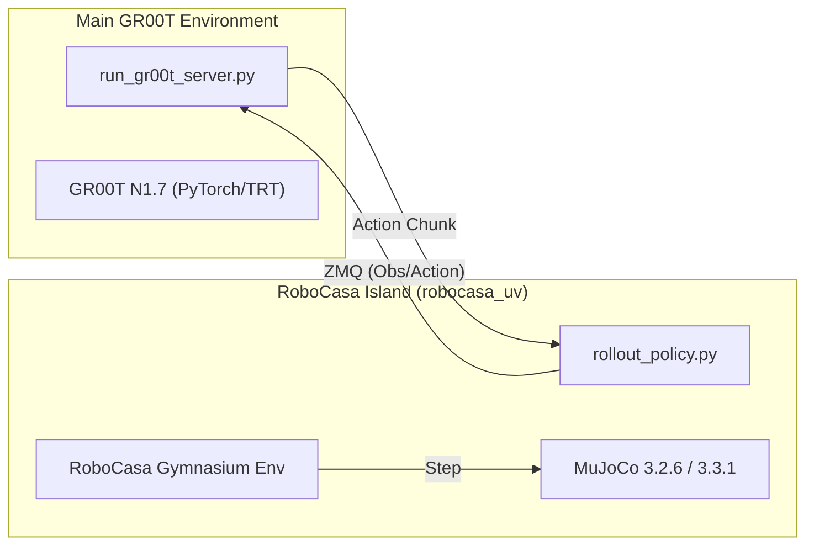

<!-- source: DeepWiki mcp.deepwiki.com · repo NVIDIA/Isaac-GR00T · page 7.9 RoboCasa Benchmarks · fetched 2026-10-26 -->

# RoboCasa Benchmarks

<details>
<summary>Relevant source files</summary>

The following files were used as context for generating this wiki page:

- [examples/DROID/README.md](examples/DROID/README.md)
- [examples/robocasa-gr1-tabletop-tasks/README.md](examples/robocasa-gr1-tabletop-tasks/README.md)
- [examples/robocasa/README.md](examples/robocasa/README.md)
- [gr00t/eval/sim/robocasa/setup_RoboCasa.sh](gr00t/eval/sim/robocasa/setup_RoboCasa.sh)
- [gr00t/eval/sim/robocasa365/__init__.py](gr00t/eval/sim/robocasa365/__init__.py)
- [gr00t/eval/sim/robocasa365/gymnasium_groot.py](gr00t/eval/sim/robocasa365/gymnasium_groot.py)
- [gr00t/eval/sim/robocasa365/setup_RoboCasa365.sh](gr00t/eval/sim/robocasa365/setup_RoboCasa365.sh)
- [tests/examples/test_droid.py](tests/examples/test_droid.py)
- [tests/examples/test_libero.py](tests/examples/test_libero.py)
- [tests/examples/test_robocasa.py](tests/examples/test_robocasa.py)
- [tests/examples/test_robocasa_gr1_tabletop.py](tests/examples/test_robocasa_gr1_tabletop.py)
- [tests/examples/test_simplerenv.py](tests/examples/test_simplerenv.py)
- [tests/gr00t/data/test_sharded_datasets.py](tests/gr00t/data/test_sharded_datasets.py)

</details>


The RoboCasa benchmarks provide a large-scale simulation framework for evaluating GR00T N1.7 models on household manipulation tasks. Featuring realistic kitchen environments with over 2,500 3D assets, these benchmarks test the model's ability to operate appliances, perform pick-and-place operations, and interact with articulated objects like doors and drawers [examples/robocasa/README.md:1-5]().

## System Overview

The evaluation pipeline for RoboCasa utilizes a server-client architecture where the GR00T model runs in a high-performance environment while the simulation environment (RoboCasa) runs in a specialized virtual environment due to strict dependency requirements [examples/robocasa/README.md:110-130]().

### Data Flow and Code Entity Mapping

The following diagram illustrates the relationship between the natural language task definitions and the code entities that manage the simulation and evaluation lifecycle.

**Natural Language to Code Entity Space**

Sources: [examples/robocasa/README.md:47-60](), [gr00t/eval/sim/robocasa/setup_RoboCasa.sh:89-107]()

## Benchmark Configurations

GR00T supports two primary RoboCasa configurations, each targeting different robot embodiments and task suites.

### 1. RoboCasa Panda Omron
This configuration uses a Franka Panda robot equipped with an Omron gripper. It is designed for general kitchen manipulation [examples/robocasa/README.md:1-5]().

*   **Embodiment Tag:** `ROBOCASA_PANDA_OMRON` [examples/robocasa/README.md:47-48]()
*   **Action Space:** 8-step action chunks [examples/robocasa/README.md:128]()
*   **Key Environments:** `CoffeeSetupMug`, `OpenSingleDoor`, `TurnOnMicrowave`, `PnPCounterToCab` [examples/robocasa/README.md:16-39]()

### 2. RoboCasa GR1 Tabletop Tasks
This configuration evaluates generalist policies on a humanoid GR1 robot performing tabletop manipulation tasks [examples/robocasa-gr1-tabletop-tasks/README.md:1-5]().

*   **Embodiment Tag:** `ROBOCASA_GR1_TABLETOP` [examples/robocasa-gr1-tabletop-tasks/README.md:51]()
*   **Action Space:** 8-step action target to match closed-loop evaluation [examples/robocasa-gr1-tabletop-tasks/README.md:57]()
*   **Key Environments:** `PnPBottleToCabinetClose`, `PosttrainPnPNovelFromPlacematToBowl` [examples/robocasa-gr1-tabletop-tasks/README.md:15-38]()

## Environment Setup and Implementation

RoboCasa requires specific versions of `mujoco` and `robosuite` that conflict with the main GR00T dependencies. Consequently, the benchmark uses a dedicated virtual environment (`robocasa_uv`) [gr00t/eval/sim/robocasa/setup_RoboCasa.sh:93]().

### Implementation Details
The setup script `setup_RoboCasa.sh` handles the installation of dependencies like `mujoco==3.2.6` and `robosuite` from a specific git commit to ensure compatibility with the `mj_fullM` signature [gr00t/eval/sim/robocasa/setup_RoboCasa.sh:33-43]().

**Simulation Environment Architecture**

Sources: [gr00t/eval/sim/robocasa/setup_RoboCasa.sh:17-56](), [examples/robocasa/README.md:110-130]()

### RoboCasa365
The `robocasa365` variant is a specialized setup for large-scale evaluation, pinning a specific commit of the RoboCasa repository and including additional dependencies like `ray`, `openai`, and `sqlalchemy` for distributed execution and logging [gr00t/eval/sim/robocasa/setup_RoboCasa.sh:57-84, 108-125]().

## Evaluation Procedure

Evaluation is performed in a closed-loop manner using the `rollout_policy.py` script.

### Steps to Evaluate
1.  **Start Server:** Launch the inference server with the appropriate embodiment tag and sim policy wrapper [examples/robocasa/README.md:112-118]().
    ```bash
    uv run python gr00t/eval/run_gr00t_server.py \
        --model-path <checkpoint> \
        --embodiment-tag ROBOCASA_PANDA_OMRON \
        --use-sim-policy-wrapper
    ```
2.  **Start Client:** Run the rollout script from within the `robocasa_uv` virtual environment [examples/robocasa/README.md:120-130]().
    ```bash
    gr00t/eval/sim/robocasa/robocasa_uv/.venv/bin/python gr00t/eval/rollout_policy.py \
        --n-episodes 10 \
        --env-name robocasa_panda_omron/OpenDrawer_PandaOmron_Env \
        --n-action-steps 8
    ```

## Benchmark Results

### Panda Omron Results
Comparison between GR00T N1.6 and N1.7 (finetuned) across 24 kitchen tasks.

| Task Category | N1.6 Success | N1.7 Success |
| :--- | :--- | :--- |
| Appliances (Coffee/Microwave) | 78.5% | 84.2% |
| Articulated (Doors/Drawers) | 80.1% | 78.3% |
| Pick-and-Place (PnP) | 41.9% | 49.3% |
| **Average** | **66.22%** | **70.8%** |

Sources: [examples/robocasa/README.md:14-40]()

### GR1 Tabletop Results
N1.7 performance on humanoid tabletop manipulation.

| Metric | Value |
| :--- | :--- |
| Average Success Rate | 44.5% |
| Highest Success (PnP Plate to Plate) | 75.0% |
| Lowest Success (PnP Novel Cuttingboard to Basket) | 10.0% |

Sources: [examples/robocasa-gr1-tabletop-tasks/README.md:13-39]()

## Fine-tuning for RoboCasa

Since RoboCasa is not part of the base N1.7 pretraining set, models must be finetuned using the `ROBOCASA_PANDA_OMRON` or `ROBOCASA_GR1_TABLETOP` tags [examples/robocasa/README.md:5-6]().

*   **Data Format:** LeRobot v2.0 (parquet metadata + mp4 videos) [examples/robocasa/README.md:47-48]().
*   **Metadata Repair:** The `scripts/repair_lerobot_metadata.py` script is used to inject the correct embodiment tags into the dataset before training [examples/robocasa/README.md:58-60]().
*   **Training Command:**
    ```bash
    NUM_GPUS=8 MAX_STEPS=60000 GLOBAL_BATCH_SIZE=512 uv run bash examples/finetune.sh \
      --base-model-path nvidia/GR00T-N1.7-3B \
      --embodiment-tag ROBOCASA_PANDA_OMRON \
      --output-dir /tmp/robocasa_finetune
    ```
Sources: [examples/robocasa/README.md:76-82](), [examples/robocasa-gr1-tabletop-tasks/README.md:47-53]()

---

