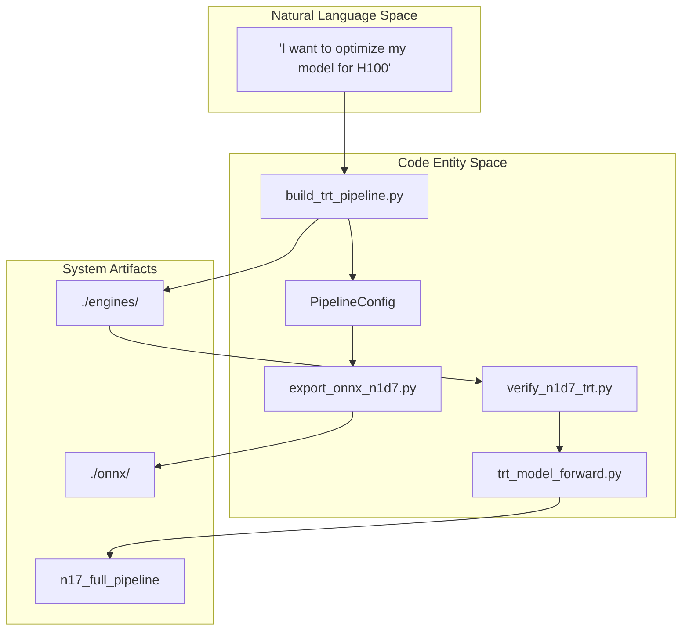
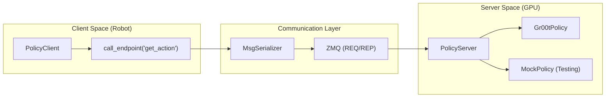

<!-- source: DeepWiki mcp.deepwiki.com · repo NVIDIA/Isaac-GR00T · page 8 Advanced Topics · fetched 2026-10-26 -->

# Advanced Topics

Relevant source files

The following files were used as context for generating this wiki page:

- [scripts/deployment/build_trt_pipeline.py](scripts/deployment/build_trt_pipeline.py)
- [scripts/deployment/export_onnx_n1d7.py](scripts/deployment/export_onnx_n1d7.py)
- [scripts/deployment/verify_n1d7_trt.py](scripts/deployment/verify_n1d7_trt.py)
- [tests/getting_started/test_policy_md.py](tests/getting_started/test_policy_md.py)
- [tests/gr00t/experiment/test_trainer_resume_strictness.py](tests/gr00t/experiment/test_trainer_resume_strictness.py)
- [tests/gr00t/model/test_vlm_image_input_parity.py](tests/gr00t/model/test_vlm_image_input_parity.py)
- [tests/gr00t/policy/test_policy_service.py](tests/gr00t/policy/test_policy_service.py)
- [tests/scripts/deployment/test_trt_pipeline.py](tests/scripts/deployment/test_trt_pipeline.py)

This page covers advanced deployment and optimization techniques for Isaac-GR00T N1.7. Topics include performance optimization through TensorRT, custom robot embodiment development, memory management, and specialized data augmentation features.

---

## 8.1 TensorRT Optimization

TensorRT optimization provides high-performance inference for production deployments by converting PyTorch models into optimized execution engines. For GR00T N1.7, the unified `build_trt_pipeline.py` script automates the export, build, and verification process [scripts/deployment/build_trt_pipeline.py:19-23]().

### Key Features
- **Full Pipeline Acceleration**: N1.7 supports optimizing the entire VLM backbone (ViT + LLM) and the DiT action head. This is referred to as `full_pipeline` or `n17_full_pipeline` [scripts/deployment/export_onnx_n1d7.py:24-30]().
- **Accuracy Verification**: The pipeline includes a verification step that compares PyTorch vs. TRT outputs, asserting a cosine similarity threshold (typically $\ge 0.99$) [tests/scripts/deployment/test_trt_pipeline.py:19-20](), [tests/scripts/deployment/test_trt_pipeline.py:77-77]().
- **Component Export**: Supports `dit_only`, `action_head`, and `full_pipeline` modes to allow flexible deployment depending on hardware constraints [scripts/deployment/export_onnx_n1d7.py:21-30]().

For details, see [TensorRT Optimization](#8.1).

**Sources:** [scripts/deployment/build_trt_pipeline.py:18-42](), [scripts/deployment/export_onnx_n1d7.py:18-49](), [tests/scripts/deployment/test_trt_pipeline.py:16-33]()

---

## 8.2 Custom Embodiment Development

GR00T is designed to be extensible to new robot platforms. Developers can create configurations for entirely new embodiments using the `NEW_EMBODIMENT` workflow [tests/getting_started/test_policy_md.py:100-100]().

### Development Workflow
1. **Modality Configuration**: Define the state and action spaces using the `ModalityConfig` class, specifying `delta_indices` and `modality_keys` [tests/getting_started/test_policy_md.py:96-112]().
2. **Registration**: Embodiments are identified via the `EmbodimentTag` enum [tests/getting_started/test_policy_md.py:97-100]().
3. **Data Preparation**: New embodiments require specific `processor_config.json` mappings to link modality keys to model input projectors [scripts/deployment/build_trt_pipeline.py:171-184]().

For details, see [Custom Embodiment Development](#8.2).

**Sources:** [tests/getting_started/test_policy_md.py:96-112](), [scripts/deployment/build_trt_pipeline.py:164-195]()

---

## 8.3 Memory Management and PyAV

Efficient video handling is critical for VLA models. GR00T N1.7 implements specific patterns to prevent memory leaks and optimize VRAM usage, particularly during high-frequency inference.

### Optimization Strategies
- **Direct Tensor Input**: The N1.7 processor now passes `CHW uint8` tensors directly to the Qwen3-VL processor, removing the overhead of PIL round-trips [tests/gr00t/model/test_vlm_image_input_parity.py:16-22]().
- **Context Managers**: Strict use of context managers for model loading and weight management [tests/gr00t/model/test_vlm_image_input_parity.py:46-48]().
- **Strict Resuming**: The `Gr00tTrainer` enforces strict checkpoint detection to avoid silent training fallbacks that could lead to memory fragmentation or configuration mismatches [tests/gr00t/experiment/test_trainer_resume_strictness.py:16-28]().

For details, see [Memory Management and PyAV](#8.3).

**Sources:** [tests/gr00t/model/test_vlm_image_input_parity.py:16-22](), [tests/gr00t/experiment/test_trainer_resume_strictness.py:16-28]()

---

## 8.4 Variable Image Resolution Support

GR00T N1.7 introduces native support for variable image sizes and aspect ratios through the Qwen3-VL (Cosmos-Reason2-2B) backbone. This allows the model to process visual data without forced square cropping.

### Features
- **Smart-Resize**: The processor handles non-square inputs (e.g., 240x320) and non-patch multiples (e.g., 243x243) by rounding to the nearest patch grid [tests/gr00t/model/test_vlm_image_input_parity.py:85-92]().
- **Bitwise Parity**: The system ensures that direct tensor processing is bitwise identical to legacy PIL-based processing, maintaining model accuracy across resolutions [tests/gr00t/model/test_vlm_image_input_parity.py:94-104]().

For details, see [Variable Image Resolution Support](#8.4).

**Sources:** [tests/gr00t/model/test_vlm_image_input_parity.py:85-115]()

---

## 8.5 Mask-Guided Background Suppression

To improve robustness in cluttered environments, GR00T N1.7 supports mask-guided background suppression during training. This feature allows the model to focus on relevant objects and robot parts by applying noise or transforms to non-masked regions.

For details, see [Mask-Guided Background Suppression](#8.5).

---

## 8.6 Hardware Recommendations and Platform-Specific Setup

GR00T N1.7 is optimized for a range of NVIDIA hardware, from data center GPUs to edge AI platforms like Jetson Thor and Orin.

### Platform Support
- **dGPU (H100/RTX 4090)**: Standard x86_64 setup with `uv sync`.
- **Jetson Thor/Orin**: Aarch64 environments with specific TensorRT engine requirements. The `build_trt_pipeline.py` script auto-detects embodiments from `processor_config.json` to ensure hardware-specific compatibility [scripts/deployment/build_trt_pipeline.py:164-184]().
- **Policy Server**: A ZMQ-based `PolicyServer` and `PolicyClient` architecture allows offloading inference to remote hardware [tests/gr00t/policy/test_policy_service.py:17-21]().

For details, see [Hardware Recommendations and Platform-Specific Setup](#8.6).

**Sources:** [scripts/deployment/build_trt_pipeline.py:164-184](), [tests/gr00t/policy/test_policy_service.py:17-21]()

---

## Advanced System Architecture

The following diagrams bridge the high-level optimization concepts to the specific code entities used in the deployment and communication pipelines.

### Deployment Optimization Pipeline

**Sources:** [scripts/deployment/build_trt_pipeline.py:19-23](), [scripts/deployment/export_onnx_n1d7.py:21-30](), [scripts/deployment/verify_n1d7_trt.py:41-60]()

### Remote Inference Service Architecture

**Sources:** [tests/gr00t/policy/test_policy_service.py:27-31](), [tests/gr00t/policy/test_policy_service.py:34-65](), [tests/gr00t/policy/test_policy_service.py:108-115]()

---

