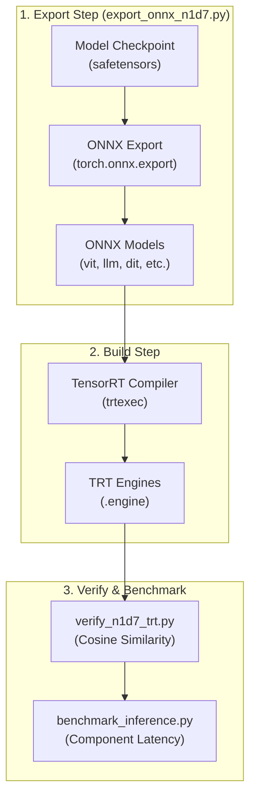
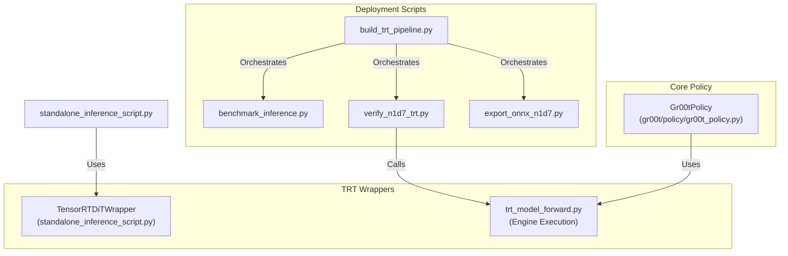

<!-- source: DeepWiki mcp.deepwiki.com · repo NVIDIA/Isaac-GR00T · page 8.1 TensorRT Optimization · fetched 2026-10-26 -->

# TensorRT Optimization

<details>
<summary>Relevant source files</summary>

The following files were used as context for generating this wiki page:

- [scripts/deployment/benchmark_inference.py](scripts/deployment/benchmark_inference.py)
- [scripts/deployment/build_trt_pipeline.py](scripts/deployment/build_trt_pipeline.py)
- [scripts/deployment/export_onnx_n1d7.py](scripts/deployment/export_onnx_n1d7.py)
- [scripts/deployment/standalone_inference_script.py](scripts/deployment/standalone_inference_script.py)
- [scripts/deployment/verify_n1d7_trt.py](scripts/deployment/verify_n1d7_trt.py)
- [tests/gr00t/policy/test_policy_service.py](tests/gr00t/policy/test_policy_service.py)

</details>


## Purpose and Scope

This page explains how to accelerate GR00T N1.7 inference using NVIDIA TensorRT, a high-performance deep learning inference optimizer. In N1.7, the optimization strategy has shifted from the N1.6 "DiT-only" approach to a **Full Pipeline** acceleration that optimizes the Vision-Language Model (VLM) backbone (Qwen3-VL/Cosmos-Reason2-2B) alongside the action head.

This page covers the `build_trt_pipeline.py` workflow, hardware-specific performance benchmarks (H100, Thor, Spark, Orin), and the architectural details of how model components are exported and executed using the `TensorRTDiTWrapper` and associated deployment scripts.

---

## Overview

### What is TensorRT Optimization?

TensorRT is NVIDIA's inference optimization library that performs graph optimization, kernel auto-tuning, and precision calibration. For GR00T N1.7, the optimization targets the following components:

| Component | Engine | Notes |
|-----------|--------|-------|
| **ViT** | TRT | Qwen3-VL Vision (24 blocks, FP32 for accuracy) |
| **LLM** | TRT | Qwen3-VL Text Model (16 layers, with deepstack injection) |
| **VL Self-Attention** | TRT | SelfAttentionTransformer (4 layers) |
| **State Encoder** | TRT | CategorySpecificMLP |
| **Action Encoder** | TRT | MultiEmbodimentActionEncoder |
| **DiT** | TRT | AlternateVLDiT (32 layers) |
| **Action Decoder** | TRT | CategorySpecificMLP |

Lightweight operations like `embed_tokens`, `masked_scatter`, and `get_rope_index` remain in PyTorch.

### Inference Modes

GR00T N1.7 supports several primary inference modes defined in `InferenceMode` [gr00t/deployment/modes.py]():
1. **PyTorch Eager**: Standard execution, best for debugging [scripts/deployment/benchmark_inference.py:28]().
2. **torch.compile**: PyTorch 2.0+ JIT compilation. Significant speedup for the DiT head but less effective for the backbone [scripts/deployment/benchmark_inference.py:29]().
3. **TensorRT (Full Pipeline)**: Recommended for N1.7. Accelerates both the VLM backbone and the DiT action head (ViT + LLM + Action Head) [scripts/deployment/benchmark_inference.py:31]().
4. **TensorRT (DiT-only)**: Optimized DiT action head using TensorRT engine while keeping the backbone in PyTorch [scripts/deployment/benchmark_inference.py:30]().
5. **TensorRT (vit_llm_only)**: ViT + LLM in TRT, action head in PyTorch (primarily used on Spark/sm121) [scripts/deployment/benchmark_inference.py:32]().

**Sources**: [scripts/deployment/benchmark_inference.py:27-32](), [scripts/deployment/standalone_inference_script.py:70-78](), [scripts/deployment/export_onnx_n1d7.py:21-31]()

---

## Hardware Requirements and Setup

### Supported Platforms

TensorRT optimization is verified across data center GPUs and NVIDIA edge platforms:

| Platform | Device | CUDA/JetPack |
|----------|--------|--------------|
| **dGPU** | H100, RTX 6000 Ada, RTX 4090 | CUDA 12.4+ |
| **Jetson Thor** | Jetson AGX Thor | JetPack 6.x |
| **DGX Spark** | DGX Spark (sm121) | CUDA 13.0 |
| **Jetson Orin** | Jetson AGX Orin | JetPack 6.2 (CUDA 12.6) |

### Installation

GPU dependencies (`flash-attn`, `onnx`, `tensorrt`) are required for optimization. The `TensorRTDiTWrapper` class initializes the `tensorrt` runtime and deserializes the CUDA engine [scripts/deployment/standalone_inference_script.py:112-128]().

For Jetson/Spark platforms, use the provided activation scripts to configure the environment (setting `TRITON_PTXAS_PATH` and `LD_LIBRARY_PATH`):
- `source scripts/activate_thor.sh`
- `source scripts/activate_spark.sh`
- `source scripts/activate_orin.sh`

**Sources**: [scripts/deployment/standalone_inference_script.py:111-135](), [scripts/deployment/benchmark_inference.py:145-165]()

---

## The Build Pipeline Workflow

The `build_trt_pipeline.py` script provides a unified workflow for generating optimized engines, wrapping export, build, verification, and benchmarking steps [scripts/deployment/build_trt_pipeline.py:18-23]().

### Diagram: Build Pipeline Data Flow



### Building Engines

To build the full pipeline:
```bash
python scripts/deployment/build_trt_pipeline.py \
  --model-path checkpoints/GR00T-N1.7-LIBERO/libero_10 \
  --dataset-path demo_data/libero_demo
```

**Key Parameters**:
- **Batch Size**: The `resolve_batch_size` helper ensures the engine batch size matches the runtime requirements [scripts/deployment/verify_n1d7_trt.py:91](). Engines are typically built with static dimensions.
- **Steps**: Users can select specific `Step` values: `export`, `build`, `verify`, `benchmark` [scripts/deployment/build_trt_pipeline.py:74-80]().
- **Embodiment**: The script can auto-detect the `EmbodimentTag` from `processor_config.json` [scripts/deployment/build_trt_pipeline.py:164-189]().

**Sources**: [scripts/deployment/build_trt_pipeline.py:25-42](), [scripts/deployment/build_trt_pipeline.py:74-83](), [scripts/deployment/verify_n1d7_trt.py:83-91]()

---

## Performance and Speedups

### Benchmark Results (N1.7)

The `benchmark_inference.py` script measures component-wise timing for data processing, the VLM backbone, and the action head [scripts/deployment/benchmark_inference.py:21-25]().

| Component | Function / Class | Measurement Logic |
|-----------|------------------|-------------------|
| **Data Processing** | `benchmark_data_processing` | Measures `VLAStepData` prep and collation [scripts/deployment/benchmark_inference.py:173-185]() |
| **Backbone** | `Qwen3-VL` forward | Timing for the VLM visual and text pass [scripts/deployment/benchmark_inference.py:23]() |
| **Action Head** | `Flow-matching` | Timing for the DiT denoising loop [scripts/deployment/benchmark_inference.py:24]() |

### DGX Spark (sm121) Optimization
On Spark, the system may use `vit_llm_only` mode [scripts/deployment/benchmark_inference.py:32](). The DiT implementation uses a specialized context to handle Attention backends to ensure accuracy on specific hardware [scripts/deployment/benchmark_inference.py:47-58]().

**Sources**: [scripts/deployment/benchmark_inference.py:19-33](), [scripts/deployment/benchmark_inference.py:168-171]()

---

## Code Implementation Detail

### Component Mapping

The following diagram maps high-level system components to the specific code entities involved in the TensorRT inference stack.

### Diagram: Code Entity Mapping



### Integration in Gr00tPolicy

The `Gr00tPolicy` class handles the transition between PyTorch and TensorRT backends. During inference, `prepare_model_inputs` mimics the internal `_get_action` logic to collate data for the optimized engines [scripts/deployment/benchmark_inference.py:99-142]().

The `TensorRTDiTWrapper` manages the execution context and memory bindings:
- **Inputs**: `sa_embs`, `vl_embs`, `timestep`, `image_mask`, and `backbone_attention_mask` [scripts/deployment/standalone_inference_script.py:136-164]().
- **Output**: Returns a `torch.bfloat16` tensor from the `execute_async_v3` call [scripts/deployment/standalone_inference_script.py:167-177]().

**Sources**: [scripts/deployment/standalone_inference_script.py:108-177](), [scripts/deployment/benchmark_inference.py:99-142](), [scripts/deployment/verify_n1d7_trt.py:158-163]()

---

## Verification and Accuracy

Accuracy is verified by comparing PyTorch reference outputs against TensorRT engine outputs using `cosine_similarity` [scripts/deployment/verify_n1d7_trt.py:25]().

1. **Reference Pass**: The script runs a standard PyTorch inference, capturing internal features via `register_forward_hook` [scripts/deployment/verify_n1d7_trt.py:112-140]().
2. **TRT Pass**: The same inputs are fed to the TRT engines [scripts/deployment/verify_n1d7_trt.py:160-186]().
3. **Comparison**: The outputs are flattened and compared to ensure the optimization hasn't introduced significant numerical drift [scripts/deployment/verify_n1d7_trt.py:149-156]().

**Sources**: [scripts/deployment/verify_n1d7_trt.py:18-26](), [scripts/deployment/verify_n1d7_trt.py:107-135](), [scripts/deployment/verify_n1d7_trt.py:149-170]()

---

