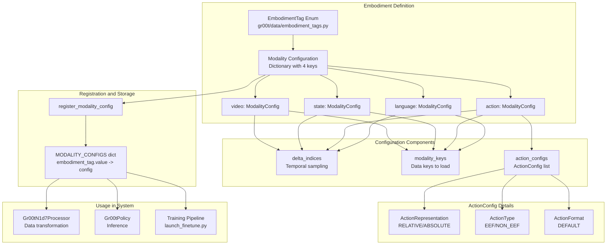
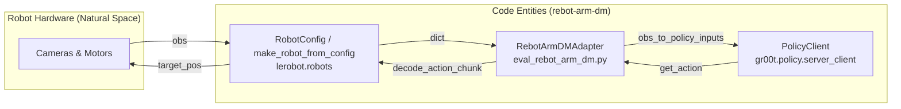

<!-- source: DeepWiki mcp.deepwiki.com · repo NVIDIA/Isaac-GR00T · page 8.2 Custom Embodiment Development · fetched 2026-10-26 -->

# Custom Embodiment Development

<details>
<summary>Relevant source files</summary>

The following files were used as context for generating this wiki page:

- [examples/rebot-arm-dm/README.md](examples/rebot-arm-dm/README.md)
- [examples/rebot-arm-dm/eval_rebot_arm_dm.py](examples/rebot-arm-dm/eval_rebot_arm_dm.py)
- [examples/rebot-arm-dm/modality.json](examples/rebot-arm-dm/modality.json)
- [examples/rebot-arm-dm/pyproject.toml](examples/rebot-arm-dm/pyproject.toml)
- [examples/rebot-arm-dm/rebot_config.py](examples/rebot-arm-dm/rebot_config.py)
- [getting_started/finetune_new_embodiment.md](getting_started/finetune_new_embodiment.md)
- [gr00t/model/gr00t_n1d7/gr00t_n1d7.py](gr00t/model/gr00t_n1d7/gr00t_n1d7.py)
- [media/open_loop_eval_rebot_arm_dm.jpg](media/open_loop_eval_rebot_arm_dm.jpg)
- [scripts/validate_hf_config_alignment.py](scripts/validate_hf_config_alignment.py)
- [tests/gr00t/model/test_action_head.py](tests/gr00t/model/test_action_head.py)

</details>


## Purpose and Scope

This page guides developers through creating and registering custom robot embodiments in the Isaac-GR00T system. An embodiment represents a specific robot platform (e.g., SO-100, reBot Arm B601-DM, Unitree G1) and defines how its sensor data and actions should be processed by the VLA model.

This document covers:
- Defining new `EmbodimentTag` identifiers.
- Creating modality configurations for video, state, action, and language data.
- Understanding `ActionConfig` parameters for different action representations.
- Registering embodiments using `register_modality_config`.
- The `NEW_EMBODIMENT` workflow for rapid fine-tuning.
- Real-world deployment examples using the `reBot Arm DM`.

---

## Embodiment System Architecture

The embodiment system acts as a configuration layer between raw robot data and the GR00T model, defining how each robot's observations and actions are interpreted.

### System Data Flow and Registration


**Sources**: [gr00t/data/embodiment_tags.py:14-62](), [getting_started/finetune_new_embodiment.md:12-72](), [gr00t/configs/data/embodiment_configs.py:16-17](), [gr00t/model/gr00t_n1d7/processing_gr00t_n1d7.py:103-105]()

---

## Defining a New EmbodimentTag

The `EmbodimentTag` enum provides unique identifiers for robot platforms.

### The NEW_EMBODIMENT Workflow
For custom development and fine-tuning on new hardware, the system provides a reserved tag: `EmbodimentTag.NEW_EMBODIMENT` [getting_started/finetune_new_embodiment.md:71-72]().

When using this workflow:
1. You define a modality configuration in a standalone Python file (e.g., `rebot_config.py`) [examples/rebot-arm-dm/rebot_config.py:27-68]().
2. You register it using `register_modality_config` with the `NEW_EMBODIMENT` tag [examples/rebot-arm-dm/rebot_config.py:70]().
3. You pass the path to this file via the `--modality-config-path` argument to `launch_finetune.py` [getting_started/finetune_new_embodiment.md:102]().

### Permanent Registration
To permanently add a robot to the codebase, add a new entry to the `EmbodimentTag` class. The `PRETRAIN_TAGS` and `POSTTRAIN_TAGS` lists categorize these for the training pipeline [scripts/validate_hf_config_alignment.py:96-98]().

**Sources**: [gr00t/data/embodiment_tags.py:14-62](), [getting_started/finetune_new_embodiment.md:71-72](), [examples/rebot-arm-dm/rebot_config.py:70]()

---

## Creating Modality Configurations

A modality configuration is a dictionary mapping four keys (`video`, `state`, `action`, `language`) to `ModalityConfig` objects [getting_started/finetune_new_embodiment.md:24-69]().

### Core ModalityConfig Fields

| Field | Type | Description |
|-------|------|-------------|
| `delta_indices` | `list[int]` | Temporal offsets. `[0]` is current, `list(range(0, 16))` is a 16-step future horizon [getting_started/finetune_new_embodiment.md:43](). |
| `modality_keys` | `list[str]` | Keys matching the `modality.json` entries in the LeRobot dataset [examples/rebot-arm-dm/modality.json:1-35](). |
| `action_configs`| `list[ActionConfig]` | (Action only) Defines how each key is represented (Relative vs Absolute) [getting_started/finetune_new_embodiment.md:48-61](). |

### ActionConfig Components

| Parameter | Options | Recommendation |
|-----------|---------|----------------|
| `rep` | `RELATIVE`, `ABSOLUTE` | Use `RELATIVE` for arm joints to improve generalization; `ABSOLUTE` for binary grippers [examples/rebot-arm-dm/rebot_config.py:49-60](). |
| `type` | `EEF`, `NON_EEF` | Use `NON_EEF` for joint-space control [examples/rebot-arm-dm/rebot_config.py:52](). |
| `format` | `DEFAULT` | Use `DEFAULT` for standard joint/gripper arrays [examples/rebot-arm-dm/rebot_config.py:53](). |

**Sources**: [getting_started/finetune_new_embodiment.md:24-69](), [examples/rebot-arm-dm/rebot_config.py:27-68](), [gr00t/data/types.py:15-21]()

---

## Case Study: reBot Arm B601-DM

The `reBot Arm DM` example illustrates a complete implementation for a 6-DOF arm plus gripper.

### Modality Configuration
The configuration in `examples/rebot-arm-dm/rebot_config.py` defines two camera views (`front`, `side`) and treats the arm joints as relative actions [examples/rebot-arm-dm/rebot_config.py:27-68]().

### Deployment Adapter
Real-world deployment requires an adapter to bridge the robot's hardware interface (via `lerobot`) and the GR00T Policy API.



**Key Implementation Details:**
- **`obs_to_policy_inputs`**: Formats raw robot observations into the nested dictionary expected by the `Gr00tN1d7Processor`, including adding batch and time dimensions [examples/rebot-arm-dm/eval_rebot_arm_dm.py:139-165]().
- **`decode_action_chunk`**: Extracts the specific timestep from the predicted action chunk and maps joint values back to the robot's specific joint keys [examples/rebot-arm-dm/eval_rebot_arm_dm.py:167-178]().

**Sources**: [examples/rebot-arm-dm/rebot_config.py:27-70](), [examples/rebot-arm-dm/eval_rebot_arm_dm.py:103-182](), [examples/rebot-arm-dm/modality.json:1-35]()

---

## The NEW_EMBODIMENT Workflow

### 1. Fine-tuning Execution
Fine-tuning is launched using `gr00t/experiment/launch_finetune.py`. The `--modality-config-path` is used to inject the custom configuration [getting_started/finetune_new_embodiment.md:94-112]().

```bash
CUDA_VISIBLE_DEVICES=0 uv run python \
    gr00t/experiment/launch_finetune.py \
    --base-model-path nvidia/GR00T-N1.7-3B \
    --dataset-path <path-to-dataset> \
    --embodiment-tag NEW_EMBODIMENT \
    --modality-config-path examples/rebot-arm-dm/rebot_config.py \
    --output-dir /tmp/rebot_finetune
```

### 2. Open-Loop Evaluation
After training, `gr00t/eval/open_loop_eval.py` compares predicted trajectories against ground truth from the dataset [getting_started/finetune_new_embodiment.md:132-141]().

```bash
uv run python gr00t/eval/open_loop_eval.py \
    --dataset-path <path-to-dataset> \
    --embodiment-tag NEW_EMBODIMENT \
    --model-path /tmp/rebot_finetune/checkpoint-2000 \
    --traj-ids 0 \
    --execution-horizon 16
```

### 3. Closed-Loop Real-World Deployment
Deployment involves running a ZMQ policy server and a separate client script that interacts with the hardware [examples/rebot-arm-dm/README.md:75-93]().

1. **Start Server**: `run_gr00t_server.py` loads the checkpoint and waits for requests [examples/rebot-arm-dm/README.md:77-80]().
2. **Start Client**: `eval_rebot_arm_dm.py` (using `RebotArmDMAdapter`) captures observations and sends them to the server [examples/rebot-arm-dm/README.md:83-93]().

**Sources**: [getting_started/finetune_new_embodiment.md:85-157](), [examples/rebot-arm-dm/README.md:28-93](), [examples/rebot-arm-dm/eval_rebot_arm_dm.py:31-34]()

---

