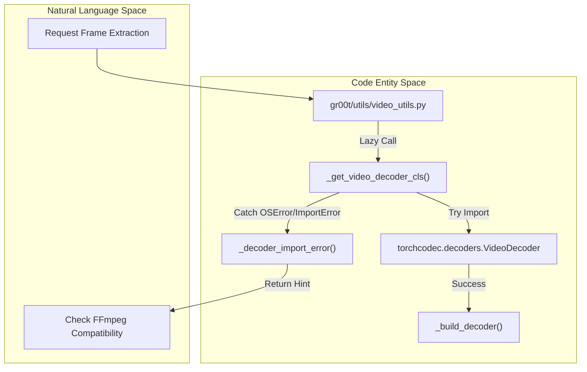
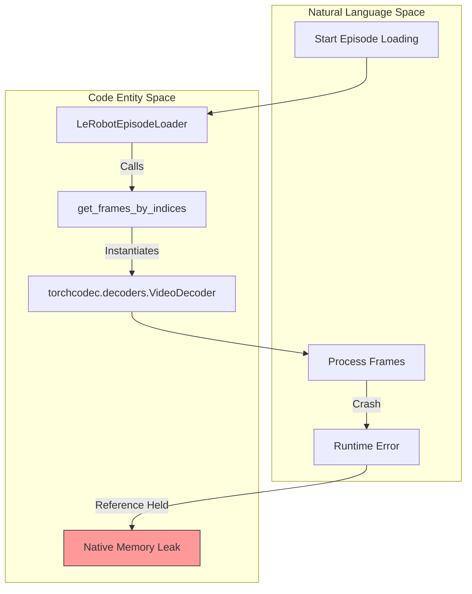

<!-- source: DeepWiki mcp.deepwiki.com · repo NVIDIA/Isaac-GR00T · page 8.3 Memory Management and PyAV · fetched 2026-10-26 -->

# Memory Management and PyAV

Relevant source files

The following files were used as context for generating this wiki page:

- [gr00t/data/dataset/lerobot_episode_loader.py](gr00t/data/dataset/lerobot_episode_loader.py)
- [gr00t/utils/video_utils.py](gr00t/utils/video_utils.py)
- [tests/examples/test_so100.py](tests/examples/test_so100.py)
- [tests/gr00t/utils/test_torchcodec_import.py](tests/gr00t/utils/test_torchcodec_import.py)
- [tests/gr00t/utils/test_video_backend.py](tests/gr00t/utils/test_video_backend.py)

This document covers best practices for memory management when working with video processing in the GR00T codebase, specifically focusing on `torchcodec` for high-performance decoding and `PyAV` for general video utilities. It details proper resource cleanup, avoiding memory leaks, and the lazy import pattern required for video backend stability.

For general data processing pipeline information, see [Data Processing Pipeline](). For video processing configurations, see [Video and Image Processing]().

---

## Purpose and Scope

Video decoding is a resource-intensive operation that involves native library bindings (FFmpeg). Improper resource management can lead to memory leaks, file descriptor exhaustion, and degraded performance during long-running training or inference sessions.

This page documents:
- The **Lazy Import Pattern** used to prevent library and simulator conflicts.
- **Torchcodec integration** for robust frame extraction.
- Common memory leak patterns and their mitigation using context managers.
- Exception safety requirements when handling video containers.

---

## Video Backend Architecture and Lazy Loading

The GR00T codebase primarily utilizes `torchcodec` for video decoding [gr00t/utils/video_utils.py:22-26](). 

### Lazy Import Pattern

A critical architectural decision in GR00T is the **lazy import pattern** for video libraries. Native video decoders are not imported at the module level in `gr00t/utils/video_utils.py`. Instead, they are loaded on-demand within specific helper functions [gr00t/utils/video_utils.py:56-61]().

**Reasons for Lazy Loading:**
1. **Library Conflicts**: Different backends (e.g., `torchcodec` vs `decord`) may bundle conflicting FFmpeg shared libraries.
2. **Import Safety**: Ensuring that importing `gr00t.utils.video_utils` does not side-effect the global `sys.modules` state [tests/gr00t/utils/test_video_backend.py:42-53]().
3. **FFmpeg Versioning**: `torchcodec` (v0.8.0) specifically requires FFmpeg versions 4-7 and fails against FFmpeg 8 [gr00t/utils/video_utils.py:28-35](). Lazy loading allows the system to provide descriptive error hints if the native library fails to load [gr00t/utils/video_utils.py:44-53]().

**Diagram: Lazy Import and Error Handling Flow**

**Sources:** [gr00t/utils/video_utils.py:22-67](), [tests/gr00t/utils/test_video_backend.py:45-54]()

---

## Torchcodec Frame Extraction

The codebase provides high-level wrappers for `torchcodec` to handle common robotic data tasks, such as retrieving frames by indices or timestamps.

### Handling Float Precision in Timestamps
When retrieving frames by timestamps, floating-point drift (e.g., 1.39999998 instead of 1.4) can cause decoders to snap to the wrong frame. `get_frames_by_timestamps` implements a 1% tolerance check and rounds to the nearest frame interval to ensure deterministic retrieval [gr00t/utils/video_utils.py:95-115]().

| Function | Input | Use Case |
|----------|-------|----------|
| `get_frames_by_indices` | `list[int]` | Exact frame index retrieval for datasets [gr00t/utils/video_utils.py:70-76]() |
| `get_frames_by_timestamps` | `list[float]` | Synchronizing multiple camera streams [gr00t/utils/video_utils.py:79-116]() |
| `get_all_frames` | `video_path` | Full episode processing [gr00t/utils/video_utils.py:119-130]() |

**Sources:** [gr00t/utils/video_utils.py:70-130](), [tests/gr00t/utils/test_video_backend.py:83-130]()

---

## The Memory Leak Problem

### Root Cause: Unclosed Native Contexts
Video decoders maintain internal FFmpeg buffers and file handles. If a decoder object is not properly garbage collected or closed, especially when an exception occurs during the decoding loop, it results in a memory leak.

**Diagram: Potential Leak Path in Episode Loading**

**Sources:** [gr00t/data/dataset/lerobot_episode_loader.py:47](), [gr00t/utils/video_utils.py:75-76]()

### Best Practices for Resource Management

1.  **Use Context Managers**: When interacting with raw `PyAV` or `torchcodec` decoders, always wrap the lifecycle in a `with` statement to ensure the `.close()` method is called on exit.
2.  **Avoid Global Decoder Caching**: Do not store decoder instances in long-lived global dictionaries, as this prevents memory reclamation.
3.  **Explicit Deletion**: In high-throughput training loops (like `LeRobotEpisodeLoader`), ensure that local references to frame buffers are cleared after they are converted to tensors [gr00t/data/dataset/lerobot_episode_loader.py:80-113]().

---

## Testing and Validation

The test suite includes specific checks to ensure that the video utility module remains "clean" of top-level imports that could cause crashes in simulation environments.

*   **Import Safety Test**: Spawns a subprocess to verify that `import gr00t.utils.video_utils` does not populate `sys.modules` with `torchcodec` [tests/gr00t/utils/test_video_backend.py:45-53]().
*   **Roundtrip Verification**: Ensures that decoded frames maintain the expected `NHWC` shape and `uint8` data type [tests/gr00t/utils/test_video_backend.py:86-92]().
*   **Missing Backend Handling**: Validates that if `torchcodec` is missing, the system raises an `ImportError` with a specific installation hint rather than a generic `ModuleNotFoundError` [tests/gr00t/utils/test_video_backend.py:132-161]().

**Sources:** [tests/gr00t/utils/test_video_backend.py:41-161](), [tests/gr00t/utils/test_torchcodec_import.py:21-25]()

---

