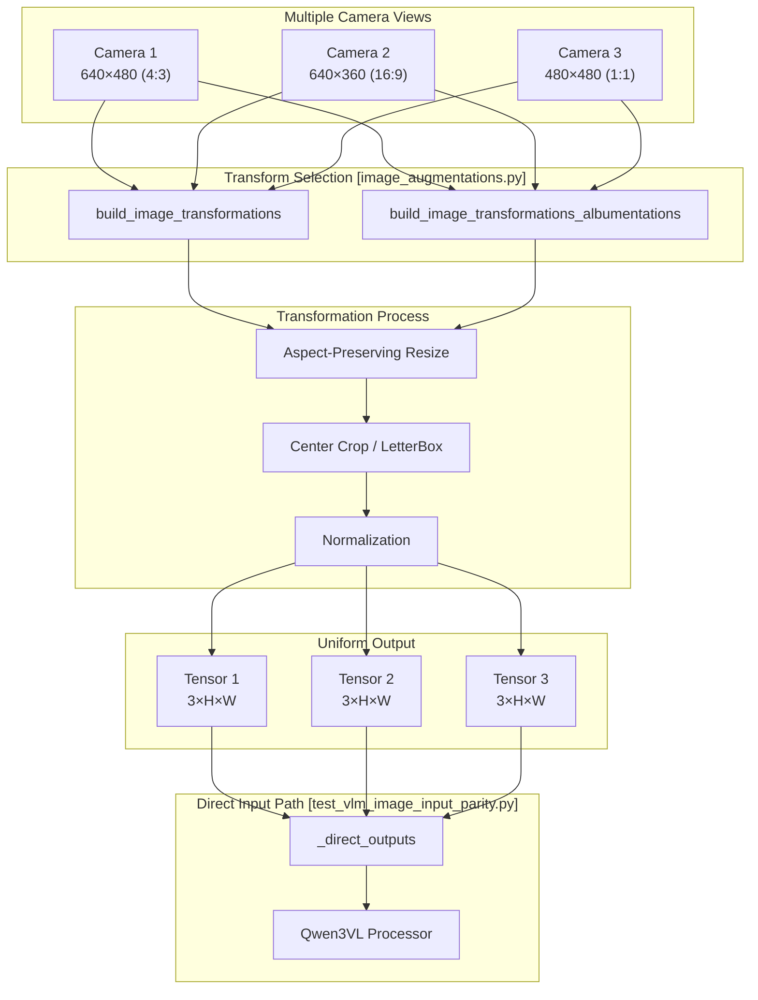
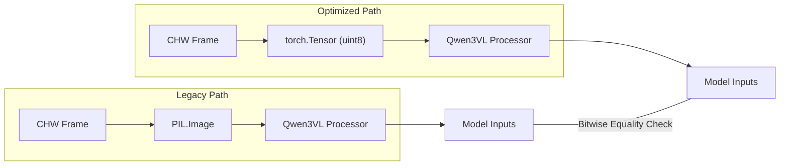

<!-- source: DeepWiki mcp.deepwiki.com · repo NVIDIA/Isaac-GR00T · page 8.4 Variable Image Resolution Support · fetched 2026-10-26 -->

# Variable Image Resolution Support

Relevant source files

The following files were used as context for generating this wiki page:

- [tests/fixtures/README.md](tests/fixtures/README.md)
- [tests/fixtures/processor_config/embodiment_id.json](tests/fixtures/processor_config/embodiment_id.json)
- [tests/fixtures/processor_config/processor_config.json](tests/fixtures/processor_config/processor_config.json)
- [tests/fixtures/processor_config/statistics.json](tests/fixtures/processor_config/statistics.json)
- [tests/getting_started/test_policy_md.py](tests/getting_started/test_policy_md.py)
- [tests/gr00t/experiment/test_trainer_resume_strictness.py](tests/gr00t/experiment/test_trainer_resume_strictness.py)
- [tests/gr00t/model/test_variable_image_size.py](tests/gr00t/model/test_variable_image_size.py)
- [tests/gr00t/model/test_vlm_image_input_parity.py](tests/gr00t/model/test_vlm_image_input_parity.py)
- [tests/scripts/deployment/test_trt_pipeline.py](tests/scripts/deployment/test_trt_pipeline.py)

## Purpose and Scope

This page explains how GR00T N1.7 handles variable image resolutions and aspect ratios across multiple camera views using the **Qwen3-VL (Cosmos-Reason2-2B)** backbone. Different robots may have cameras with varying native resolutions (e.g., 640×480 for 4:3 aspect ratio, 640×360 for 16:9), and the system must process these heterogeneous inputs into uniform tensor representations suitable for the Vision-Language Model (VLM).

The variable resolution support ensures that:
- Images from cameras with different aspect ratios can be batched together without tensor shape mismatches [tests/gr00t/model/test_variable_image_size.py:79-88]().
- Native aspect ratios are preserved during resizing to minimize distortion.
- Both `torchvision` and `albumentations` transformation pipelines produce consistent output shapes [tests/gr00t/model/test_variable_image_size.py:37-163]().
- Direct tensor processing is bitwise identical to legacy PIL-based paths, improving performance without accuracy loss [tests/gr00t/model/test_vlm_image_input_parity.py:16-22]().

For general video and image processing in GR00T, see [Video and Image Processing](3.6). For N1.7-specific input preparation, see [Gr00tN1d7Processor](4.4).

---

## Problem Context

Multi-camera robotic systems often have heterogeneous camera configurations. For example:
- **Wide-angle cameras** may capture 640×360 images (16:9 aspect ratio).
- **Standard cameras** may capture 640×480 images (4:3 aspect ratio).
- **Overhead cameras** may use square 480×480 images (1:1 aspect ratio).

Without proper handling, attempting to stack these variable-sized images into a single batch tensor fails with shape mismatch errors. GR00T N1.7 solves this by applying aspect-ratio-preserving transformations that resize all images to a consistent output size while minimizing distortion, even when different camera views have different aspect ratios [tests/gr00t/model/test_variable_image_size.py:79-88]().

---

## Image Transformation Architecture

This diagram bridges the high-level multi-camera requirement to the specific transformation functions and processing paths used in the codebase.

### Data Flow: Multi-Camera to Uniform Tensors

**Sources:** [tests/gr00t/model/test_variable_image_size.py:20-24](), [tests/gr00t/model/test_vlm_image_input_parity.py:69-82]()

---

## Torchvision Transform Pipeline

The `torchvision`-based transformation pipeline created via `build_image_transformations` handles variable resolutions through a sequence of operations that guarantee a fixed output shape regardless of input aspect ratio [tests/gr00t/model/test_variable_image_size.py:43-48]().

| Operation | Purpose | Parameters |
|-----------|---------|------------|
| **Resize** | Scale to target size preserving aspect ratio | `image_target_size` (e.g., [256, 256]) |
| **CenterCrop** | Crop to final size | `image_crop_size` (e.g., [224, 224]) |
| **LetterBoxTransform** | Optional padding to maintain aspect | `letter_box_transform` flag [tests/gr00t/model/test_variable_image_size.py:63-64]() |

The pipeline ensures that even mixed square and wide images result in identical shapes that can be stacked via `torch.stack` [tests/gr00t/model/test_variable_image_size.py:89-95]().

**Sources:** [tests/gr00t/model/test_variable_image_size.py:37-96]()

---

## Albumentations Transform Pipeline

The albumentations-based pipeline provides an alternative transformation strategy optimized for native aspect ratio preservation, used when `use_albumentations` is true in `processor_config.json` [tests/fixtures/processor_config/processor_config.json:125](). It uses `build_image_transformations_albumentations` [tests/gr00t/model/test_variable_image_size.py:102-109]().

| Operation | Purpose | Parameters |
|-----------|---------|------------|
| **SmallestMaxSize** | Resize shortest edge to target | `shortest_image_edge` (e.g., 256) [tests/gr00t/model/test_variable_image_size.py:107]() |
| **CenterCrop** | Crop based on fraction | `crop_fraction` (e.g., 0.95) [tests/gr00t/model/test_variable_image_size.py:108]() |
| **LetterBoxPad** | Optional padding for stackability | `letter_box_transform` flag [tests/gr00t/model/test_variable_image_size.py:130-136]() |

### Key Differences
1. **Shortest edge resizing**: Instead of targeting specific dimensions, it resizes based on the shortest edge [tests/gr00t/model/test_variable_image_size.py:107]().
2. **Letterboxing**: When enabled, `LetterBoxPad` ensures that mixed aspect ratios can be stacked without resizing-induced distortion [tests/gr00t/model/test_variable_image_size.py:141-161]().

**Sources:** [tests/gr00t/model/test_variable_image_size.py:98-163](), [tests/fixtures/processor_config/processor_config.json:133-135]()

---

## Qwen3-VL Tensor Parity

A critical optimization in N1.7 is the removal of the PIL round-trip during inference. The system now passes `CHW uint8` tensors directly to the `Qwen3VL` processor [tests/gr00t/model/test_vlm_image_input_parity.py:18-21]().

### Parity Data Flow

The `test_direct_tensor_input_is_bitwise_identical_to_pil` test ensures that for various resolutions (e.g., 256x256, 240x320, 243x243) and frame counts, the optimized tensor path produces inputs identical to the legacy PIL path [tests/gr00t/model/test_vlm_image_input_parity.py:85-103]().

**Sources:** [tests/gr00t/model/test_vlm_image_input_parity.py:53-83](), [tests/gr00t/model/test_vlm_image_input_parity.py:94-103]()

---

## Testing Framework

The variable resolution support includes comprehensive tests to prevent regressions like "stack expects each tensor to be equal size" or accuracy drifts in the VLM input [tests/gr00t/model/test_variable_image_size.py:16-22]().

### Test Case Categories

| Test Category | File | Purpose |
|------------|---------|---------------------|
| **Transform Sizing** | `test_variable_image_size.py` | Verify `torchvision` and `albumentations` produce stackable tensors for mixed aspect ratios [tests/gr00t/model/test_variable_image_size.py:79-95](). |
| **Bitwise Parity** | `test_vlm_image_input_parity.py` | Assert that direct `uint8` tensor inputs to the VLM processor match the legacy PIL path [tests/gr00t/model/test_vlm_image_input_parity.py:16-22](). |
| **Deployment Parity** | `test_trt_pipeline.py` | Verify that variable resolution handling remains consistent across PyTorch and TensorRT pipelines [tests/scripts/deployment/test_trt_pipeline.py:115-155](). |

### Verification of Smart-Resize
The testing framework validates the `Qwen3-VL` "smart-resize" behavior across different dimensions:
- **Patch multiples**: (256, 256) where smart-resize is a no-op [tests/gr00t/model/test_vlm_image_input_parity.py:88]().
- **Non-square**: (240, 320) where real smart-resize occurs [tests/gr00t/model/test_vlm_image_input_parity.py:89]().
- **Non-patch multiples**: (243, 243) where smart-resize rounding is required [tests/gr00t/model/test_vlm_image_input_parity.py:90]().

**Sources:** [tests/gr00t/model/test_variable_image_size.py:1-163](), [tests/gr00t/model/test_vlm_image_input_parity.py:85-93]()

---

## Configuration Reference

The processor behavior is governed by `processor_config.json`. Key fields for resolution support include:

- **`use_albumentations`**: Boolean flag to switch between transform engines [tests/fixtures/processor_config/processor_config.json:125]().
- **`shortest_image_edge`**: Target size for albumentations (e.g., 256) [tests/fixtures/processor_config/processor_config.json:133]().
- **`crop_fraction`**: Used for fractional cropping in albumentations (e.g., 0.95) [tests/fixtures/processor_config/processor_config.json:134]().
- **`letter_box_transform`**: Ensures aspect ratio preservation via padding instead of stretching [tests/fixtures/processor_config/processor_config.json:135]().

**Sources:** [tests/fixtures/processor_config/processor_config.json:123-135]()

---

