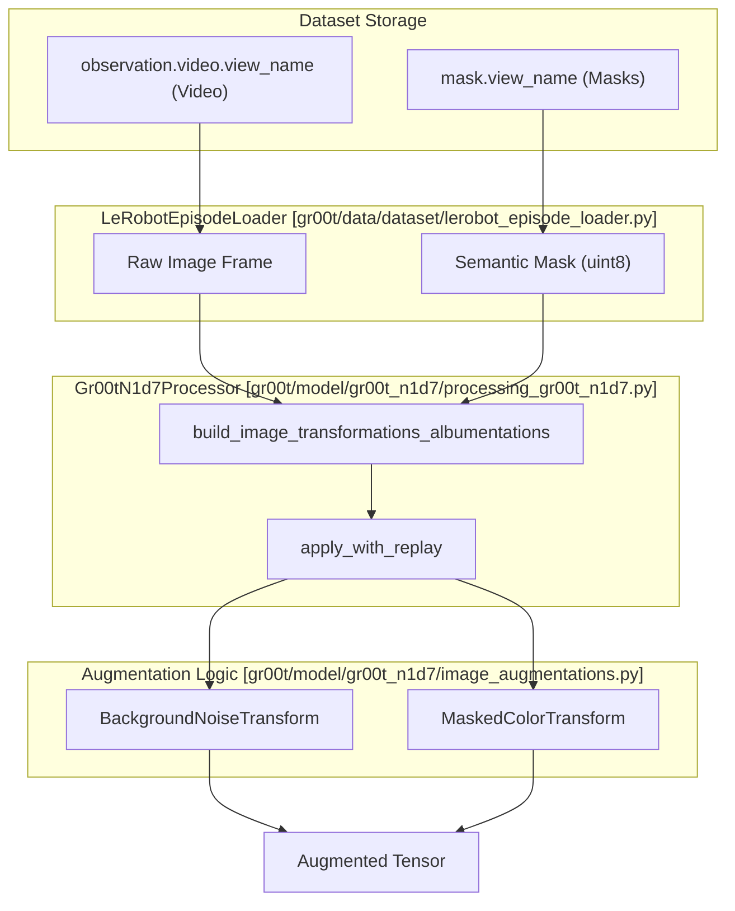
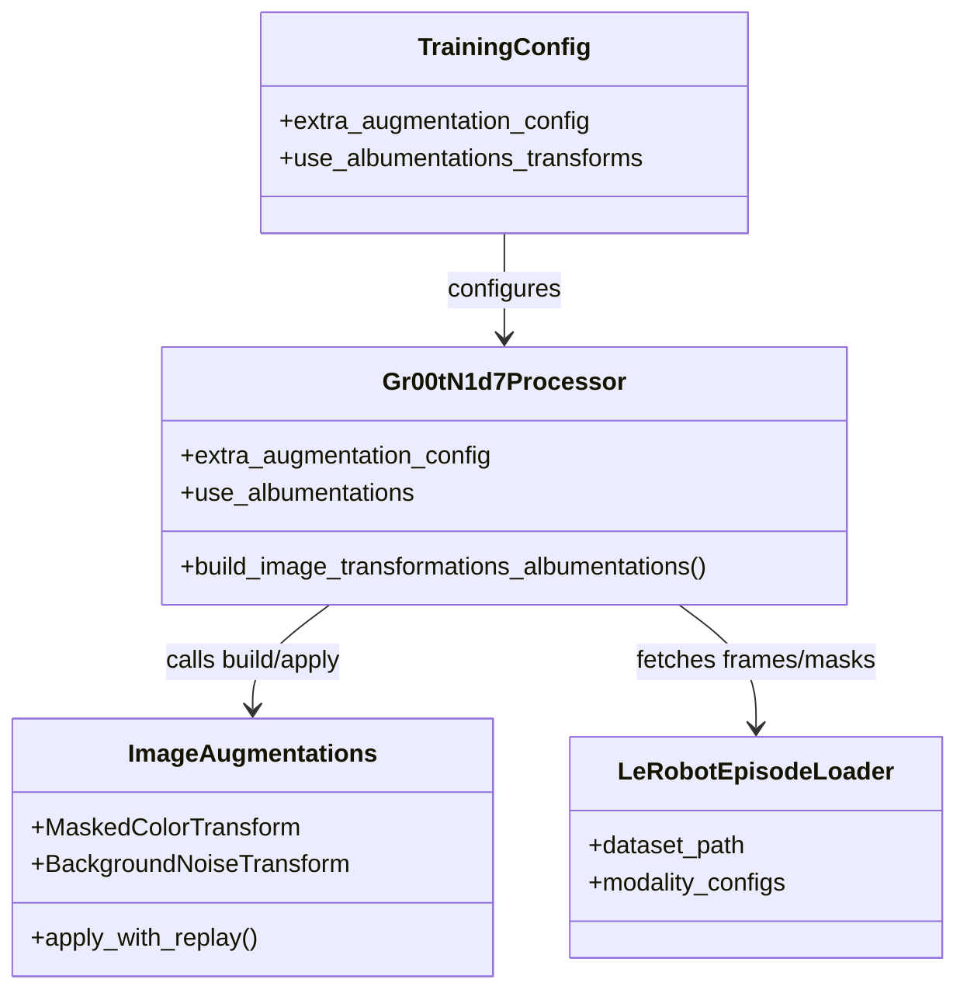

<!-- source: DeepWiki mcp.deepwiki.com · repo NVIDIA/Isaac-GR00T · page 8.5 Mask-Guided Background Suppression · fetched 2026-10-26 -->

# Mask-Guided Background Suppression

<details>
<summary>Relevant source files</summary>

The following files were used as context for generating this wiki page:

- [.pre-commit-config.yaml](.pre-commit-config.yaml)
- [examples/mask-guided-background-suppression/test_extra_augmentation.py](examples/mask-guided-background-suppression/test_extra_augmentation.py)
- [gr00t/model/gr00t_n1d7/image_augmentations.py](gr00t/model/gr00t_n1d7/image_augmentations.py)

</details>


Mask-guided background suppression is an advanced data augmentation feature in Isaac-GR00T N1.7 that leverages per-frame segmentation masks to apply targeted image transformations during training. This technique is primarily used for **domain randomization**, allowing the model to generalize across different environments by replacing backgrounds with noise or altering the appearance of specific foreground objects without affecting the rest of the scene.

## System Overview

The feature integrates into the `Gr00tN1d7Processor` pipeline via Albumentations-based transforms. It requires specific dataset structures where semantic masks are stored alongside RGB video frames [gr00t/model/gr00t_n1d7/image_augmentations.py:29-30]().

### Core Components and Data Flow

The following diagram illustrates how raw image and mask data are processed through the augmentation pipeline into model-ready tensors.

**Data Flow: From Dataset to Augmented Input**

**Sources:** [gr00t/model/gr00t_n1d7/image_augmentations.py:26-50](), [examples/mask-guided-background-suppression/test_extra_augmentation.py:86-94](), [examples/mask-guided-background-suppression/test_extra_augmentation.py:160-176]()

## Supported Augmentation Types

### 1. Background Noise Transform
The `BackgroundNoiseTransform` replaces pixels in specified mask regions with random RGB noise [gr00t/model/gr00t_n1d7/image_augmentations.py:147-151](). It is highly effective for sim-to-real transfer, as it prevents the model from overfitting to static background features in simulation.

*   **Class:** `BackgroundNoiseTransform` [gr00t/model/gr00t_n1d7/image_augmentations.py:147]()
*   **Key Parameter:** `target_mask_values` (Mask values to replace with noise, default: `[0]`) [gr00t/model/gr00t_n1d7/image_augmentations.py:165]().
*   **Key Parameter:** `p` (Probability of application) [gr00t/model/gr00t_n1d7/image_augmentations.py:160]().

### 2. Masked Color Transform
The `MaskedColorTransform` applies a random color tint to specific mask regions [gr00t/model/gr00t_n1d7/image_augmentations.py:98-99](). This is used to augment the appearance of specific tools, tables, or robot parts to improve color generalization.

*   **Class:** `MaskedColorTransform` [gr00t/model/gr00t_n1d7/image_augmentations.py:98]()
*   **Key Parameter:** `alpha_range` (Blending intensity between original and tint, default `(0.3, 1.0)`) [gr00t/model/gr00t_n1d7/image_augmentations.py:110]().
*   **Key Parameter:** `target_mask_values` (List of mask values to apply the transform to) [gr00t/model/gr00t_n1d7/image_augmentations.py:109]().

## Configuration Format

The feature is controlled via the `extra_augmentation_config` parameter, which is passed as a JSON string to the training scripts or the `Gr00tN1d7Processor` [examples/mask-guided-background-suppression/test_extra_augmentation.py:84-94]().

**Example Configuration:**
```json
{
    "background_noise_transforms": [
        {"target_mask_values": [0], "p": 0.9}
    ],
    "masked_region_transforms": [
        {"target_mask_values": [4], "p": 1.0, "alpha_range": [0.0, 1.0]}
    ]
}
```
**Sources:** [examples/mask-guided-background-suppression/test_extra_augmentation.py:84-94](), [gr00t/model/gr00t_n1d7/image_augmentations.py:107-113]()

## Dataset Requirements

To enable mask-guided suppression, the dataset must provide masks that align with video frames:

1.  **Mask Data:** The `LeRobotEpisodeLoader` must be able to load mask columns (e.g., `mask.view_name`) alongside video columns [examples/mask-guided-background-suppression/test_extra_augmentation.py:102-105]().
2.  **Mask Format:** Masks are expected to be `uint8` arrays where specific values correspond to semantic regions (e.g., 0 for background, 1 for robot) [gr00t/model/gr00t_n1d7/image_augmentations.py:59-60]().
3.  **Alignment:** The number of masks must match the number of images in a sequence [gr00t/model/gr00t_n1d7/image_augmentations.py:51-54]().

**Entity Mapping: Configuration to Code Symbols**

**Sources:** [examples/mask-guided-background-suppression/test_extra_augmentation.py:157-176](), [gr00t/model/gr00t_n1d7/image_augmentations.py:26-35]()

## Implementation Details

The core logic resides in `gr00t/model/gr00t_n1d7/image_augmentations.py`. The function `build_image_transformations_albumentations` parses the `extra_augmentation_config` and appends the requested mask-aware transforms to the standard augmentation pipeline [examples/mask-guided-background-suppression/test_extra_augmentation.py:86-94]().

### Mask-Aware Processing in `apply_with_replay`
During training, `apply_with_replay` is used to handle sequences of frames consistently:
1.  **Mask-Based Transforms:** Mask-based transforms (stored in `transform.mask_transforms`) are applied **per-frame** using that specific frame's mask [gr00t/model/gr00t_n1d7/image_augmentations.py:62-66]().
2.  **Replay Mechanism:** Standard Albumentations transforms are then applied using a `replay` mechanism to ensure consistency across a sequence of images (e.g., same crop or rotation for all frames in an episode chunk) [gr00t/model/gr00t_n1d7/image_augmentations.py:68-79]().

### Testing and Visualization
The script `examples/mask-guided-background-suppression/test_extra_augmentation.py` provides a utility to verify these augmentations by saving side-by-side comparisons of original frames, augmented frames, and the source masks [examples/mask-guided-background-suppression/test_extra_augmentation.py:40-64]().

**Sources:** [gr00t/model/gr00t_n1d7/image_augmentations.py:49-82](), [examples/mask-guided-background-suppression/test_extra_augmentation.py:120-132]()

---

