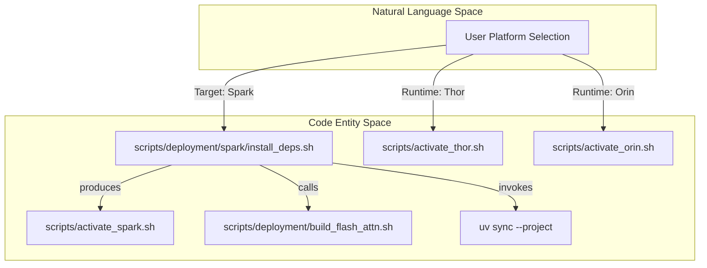
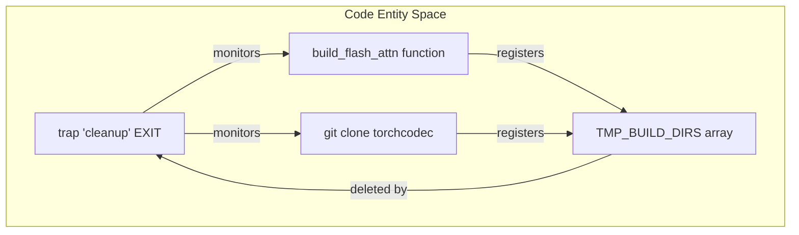

<!-- source: DeepWiki mcp.deepwiki.com · repo NVIDIA/Isaac-GR00T · page 8.6 Hardware Recommendations and Platform-Specific Setup · fetched 2026-10-26 -->

# Hardware Recommendations and Platform-Specific Setup

Relevant source files

The following files were used as context for generating this wiki page:

- [CLAUDE.md](CLAUDE.md)
- [getting_started/hardware_recommendation.md](getting_started/hardware_recommendation.md)
- [scripts/activate_jetpack72.sh](scripts/activate_jetpack72.sh)
- [scripts/activate_orin.sh](scripts/activate_orin.sh)
- [scripts/activate_thor.sh](scripts/activate_thor.sh)
- [scripts/deployment/build_flash_attn.sh](scripts/deployment/build_flash_attn.sh)
- [scripts/deployment/spark/install_deps.sh](scripts/deployment/spark/install_deps.sh)
- [tests/scripts/deployment/test_install_deps_cleanup_trap.py](tests/scripts/deployment/test_install_deps_cleanup_trap.py)
- [tools/manifest_alignment.toml](tools/manifest_alignment.toml)

This page provides hardware specifications, installation workflows, and performance benchmarks for the Isaac-GR00T N1.7 system. It covers diverse environments ranging from high-performance training clusters (H100) to edge deployment platforms (Jetson Thor, Spark, and Orin).

## Hardware Recommendations

The Isaac-GR00T N1.7 model has two primary hardware profiles: **fine-tuning** (focused on VRAM and compute) and **inference/deployment** (focused on low latency) [getting_started/hardware_recommendation.md:3-3]().

### Inference Hardware
Minimum requirement is 1 GPU with 16 GB+ VRAM and CUDA 12.6+ [getting_started/hardware_recommendation.md:11-11]().

| Platform | VRAM | PyTorch Eager | With TensorRT | Use Case |
| :--- | :--- | :--- | :--- | :--- |
| **H100 80GB HBM3** | 80 GB | 11.7 Hz | 35.9 Hz | High-frequency control, multi-env batch inference |
| **H20 96GB HBM3** | 96 GB | 12.0 Hz | 29.4 Hz | Cost-effective datacenter inference |
| **RTX Pro 6000 Blackwell** | 96 GB | 12.8 Hz | 35.9 Hz | Workstation inference, development |
| **DGX Spark** | 128 GB shared | 7.9 Hz | 10.1 Hz | Desktop edge, prototyping |
| **AGX Thor** | 128 GB shared | 8.9 Hz | 12.4 Hz | Robot-mounted edge deployment |
| **Orin** | 64 GB shared | 2.9 Hz | 6.6 Hz | Legacy Jetson edge |

*Note: Frequencies refer to the model replanning rate (producing a new action chunk). Execution rates typically reach ~30 FPS via asynchronous inference and action chunking [getting_started/hardware_recommendation.md:27-27]().*

### Fine-Tuning Hardware
Minimum requirement is 1 GPU with 40 GB+ VRAM, as N1.7 is a ~3B parameter model [getting_started/hardware_recommendation.md:43-43]().

*   **Quick Start:** 1x H100, L40, or A100 (40-80 GB VRAM) for demo datasets [getting_started/hardware_recommendation.md:47-47]().
*   **Recommended:** 4-8x H100 or L40 for faster convergence [getting_started/hardware_recommendation.md:48-48]().
*   **Full Scale:** 8x RTX Pro 6000 or DGX for production fine-tuning [getting_started/hardware_recommendation.md:49-49]().

**Sources:** [getting_started/hardware_recommendation.md:1-95]()

---

## Platform-Specific Setup

Isaac-GR00T uses `uv` for dependency management [CLAUDE.md:9-9](). Each platform has a dedicated setup script and environment activation logic.

### 1. DGX Spark (aarch64, CUDA 13.0)
Spark runs Ubuntu 24.04 and Python 3.12 [scripts/deployment/spark/install_deps.sh:31-32]().
*   **NVPL:** Requires `libnvpl-lapack0` and `libnvpl-blas0` for PyTorch support on aarch64 [scripts/deployment/spark/install_deps.sh:43-54]().
*   **CUDA Dev:** Requires `cuda-nvcc-13-0` for building extensions like `flash-attn` [scripts/deployment/spark/install_deps.sh:63-66]().
*   **Flash-Attn:** Built from source for `sm_121` [scripts/deployment/spark/install_deps.sh:112-112]().
*   **Torchcodec:** Built against Spark's FFmpeg 6 [scripts/deployment/spark/install_deps.sh:126-138]().

### 2. Jetson Thor & Orin (JetPack 7.2, CUDA 13.2)
These platforms share an activation strategy to ensure `torch.compile` and TensorRT can locate system libraries.
*   **Activation:** The `scripts/activate_thor.sh` (and Orin equivalent) sets `TRITON_PTXAS_PATH` to `/usr/local/cuda-13.2/bin/ptxas` [scripts/activate_thor.sh:9-10]().
*   **Library Paths:** It adds `nvidia`, `cuda`, and `tensorrt_libs` from site-packages to `LD_LIBRARY_PATH` [scripts/activate_thor.sh:40-52]().

### Platform Setup Architecture
The following diagram illustrates how platform-specific configuration files map to the installation process.

**Diagram: Platform-Specific Configuration Flow**

**Sources:** [scripts/deployment/spark/install_deps.sh:1-143](), [scripts/activate_thor.sh:1-57](), [scripts/activate_orin.sh:1-57](), [scripts/deployment/build_flash_attn.sh:1-144]().

---

## Dependency Management and Build Safety

The installer scripts implement a `trap` mechanism to prevent stale builds in `/tmp` if a build fails mid-process [scripts/deployment/spark/install_deps.sh:12-13]().

**Diagram: Build Cleanup Logic**

**Sources:** [scripts/deployment/spark/install_deps.sh:7-13](), [tests/scripts/deployment/test_install_deps_cleanup_trap.py:16-29]().

### Manifest Alignment
To manage drifts in non-hardware packages across platforms (e.g., `diffusers` versions), the project uses a manifest alignment allow-list [tools/manifest_alignment.toml:1-29]().
*   `diffusers`: Spark uses a specific `jetson-ai-lab` pin while others use PyPI stable [tools/manifest_alignment.toml:13-14]().
*   `transformers`: Currently tolerates patch-level sync lag between `4.57.3` and `4.57.6` [tools/manifest_alignment.toml:21-22]().

---

## Platform-Specific Activation Scripts

Users must source these scripts in every new shell to ensure the environment is correctly configured for inference.

### Spark Activation
`source scripts/activate_spark.sh` handles:
*   Exporting `CUDA_HOME` to `/usr/local/cuda-13.0`.
*   Setting `LD_LIBRARY_PATH` for `torch/lib` and `nvidia` libraries.

### JetPack 7.2 (Thor/Orin) Activation
`source scripts/activate_thor.sh` or `source scripts/activate_orin.sh` handles:
*   `TRITON_PTXAS_PATH`: Critical for `torch.compile` [scripts/activate_thor.sh:10]().
*   `CPATH`/`C_INCLUDE_PATH`: Ensures Triton can discover `cuda.h` for helper modules [scripts/activate_thor.sh:34-38]().

**Sources:** [scripts/activate_thor.sh:1-57](), [scripts/activate_orin.sh:1-57](), [scripts/deployment/spark/install_deps.sh:141-143]().

---

