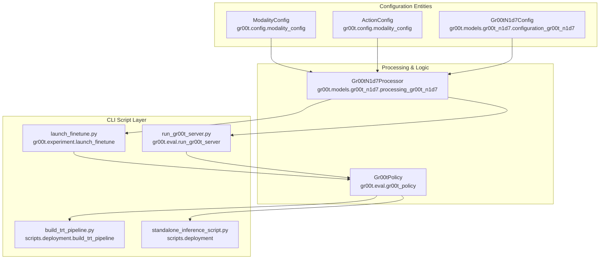
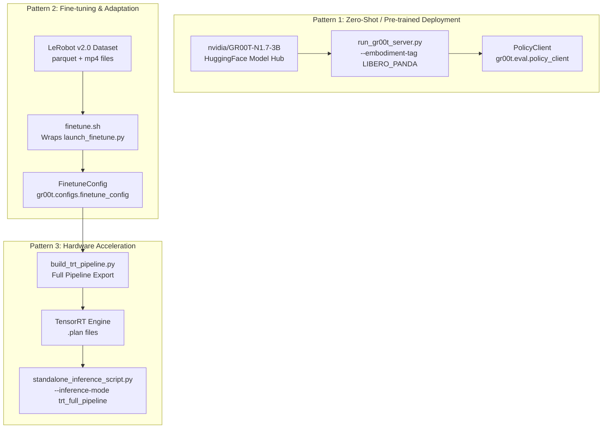

<!-- source: DeepWiki mcp.deepwiki.com · repo NVIDIA/Isaac-GR00T · page 9 Reference and Examples · fetched 2026-10-26 -->

# Reference and Examples

<details>
<summary>Relevant source files</summary>

The following files were used as context for generating this wiki page:

- [README.md](README.md)
- [examples/finetune.sh](examples/finetune.sh)
- [gr00t/configs/finetune_config.py](gr00t/configs/finetune_config.py)
- [gr00t/experiment/experiment.py](gr00t/experiment/experiment.py)
- [gr00t/experiment/launch_finetune.py](gr00t/experiment/launch_finetune.py)
- [scripts/deployment/README.md](scripts/deployment/README.md)

</details>


This page provides an overview of reference documentation and practical examples for using Isaac-GR00T N1.7. It serves as a navigation guide to detailed configuration specifications, command-line interfaces, workflow demonstrations, and troubleshooting resources.

## Section Overview

This reference section is organized into five main subsections:

| Section | Title | Purpose |
|---------|-------|---------|
| **9.1** | [Modality Configuration Reference](#9.1) | Comprehensive documentation of `ModalityConfig`, `ActionConfig` fields, and embodiment-specific configurations. |
| **9.2** | [Processor Configuration Reference](#9.2) | Reference for `Gr00tN1d7Processor` parameters, `Gr00tN1d7Config`, and projector index mappings. |
| **9.3** | [Complete Workflow Examples](#9.3) | End-to-end examples demonstrating data preparation, fine-tuning, and deployment for various robots. |
| **9.4** | [Command-Line Interface Reference](#9.4) | Reference for all CLI scripts including `launch_finetune.py`, `run_gr00t_server.py`, and `build_trt_pipeline.py`. |
| **9.5** | [Troubleshooting and FAQ](#9.5) | Common issues, error messages, debugging tips, and CI/CD infrastructure details. |

## Reference Architecture

The Isaac-GR00T N1.7 reference system connects configuration entities, core processing logic, and execution scripts. This diagram shows how these components relate to the code entities:

**Reference System Architecture**



**Sources:** [README.md:78-85](), [gr00t/experiment/launch_finetune.py:49-130](), [scripts/deployment/README.md:102-143]()

## Quick Navigation Guide

The following tables provide quick access to the most commonly used scripts and pre-registered embodiments. For detailed documentation, refer to the specific subsection indicated.

### Core CLI Scripts

| Script Path | Purpose | Detailed Reference |
|-------------|---------|-------------------|
| `gr00t/experiment/launch_finetune.py` | Fine-tune GR00T N1.7 on custom datasets | Section 9.4 |
| `gr00t/eval/run_gr00t_server.py` | Start ZMQ policy server for inference | Section 9.4 |
| `scripts/deployment/standalone_inference_script.py` | Run inference without a server (PyTorch/TRT) | Section 9.4 |
| `scripts/deployment/build_trt_pipeline.py` | Export model to TensorRT for acceleration | Section 9.4 |

**Sources:** [README.md:78-85](), [scripts/deployment/README.md:50-62](), [scripts/deployment/README.md:102-130]()

### Key Pre-registered Embodiment Tags

The N1.7 model supports several embodiments out of the box. These tags are resolved via `EmbodimentTag.resolve()` to load correct modality configurations.

| Embodiment Tag | Robot Platform | Action Representation |
|----------------|----------------|-----------------------|
| `OXE_DROID_RELATIVE_EEF_RELATIVE_JOINT` | DROID (Franka) | 9D EEF + 1D Gripper + 7D Joint |
| `LIBERO_PANDA` | Franka Panda | 6D EEF + 1D Gripper |
| `OXE_GOOGLE` | Google Robot | 6D EEF + 1D Gripper |
| `OXE_WIDOWX` | WidowX | 6D EEF + 1D Gripper |
| `UNITREE_G1` | Unitree G1 | Bimanual Humanoid |

**Sources:** [gr00t/experiment/launch_finetune.py:50-53](), [scripts/deployment/README.md:58-58]()

## Usage Pattern to Code Entity Mapping

The Isaac-GR00T system supports several common usage patterns, each with specific configuration and script combinations. The diagram below maps high-level patterns to the actual code entities involved:

**Usage Pattern to Code Entity Mapping**



**Sources:** [README.md:78-85](), [gr00t/configs/finetune_config.py:22-30](), [scripts/deployment/README.md:66-74]()

## Example Workflow Snippets

### LIBERO PyTorch Inference
The following command runs a standalone inference using a fine-tuned LIBERO model. For more details, see [Complete Workflow Examples](#9.3).

```bash
uv run python scripts/deployment/standalone_inference_script.py \
  --model-path checkpoints/GR00T-N1.7-LIBERO/libero_10 \
  --dataset-path demo_data/libero_demo \
  --embodiment-tag LIBERO_PANDA \
  --traj-ids 0 1 2 3 4 \
  --inference-mode pytorch \
  --execution-horizon 8
```
**Sources:** [scripts/deployment/README.md:50-62]()

### Fine-tuning with launch_finetune.py
The repository provides `launch_finetune.py` for adapting the model. The `FinetuneConfig` dataclass controls parameters like `tune_llm` and `tune_visual`. For more details, see [Command-Line Interface Reference](#9.4).

```bash
uv run python gr00t/experiment/launch_finetune.py \
  --base_model_path nvidia/GR00T-N1.7-3B \
  --dataset_path demo_data/libero_demo \
  --embodiment_tag LIBERO_PANDA \
  --output_dir ./outputs/libero_ft \
  --tune_llm False \
  --tune_visual False \
  --global_batch_size 32
```
**Sources:** [gr00t/configs/finetune_config.py:32-60](), [gr00t/experiment/launch_finetune.py:78-130]()

## Benchmark Performance Reference

The following table provides a performance reference for the N1.7 model on standard hardware. Speedup is achieved via the `trt_full_pipeline` mode in `build_trt_pipeline.py`.

| Device | Mode | Backbone Latency | Action Head Latency | E2E Latency |
|--------|------|------------------|---------------------|-------------|
| H100 | PyTorch | ~200ms | ~40ms | ~260ms |
| H100 | TensorRT | Optimized | Optimized | ~100ms+ |
| Jetson Thor | TensorRT | Optimized | Optimized | TBD |

**Sources:** [scripts/deployment/README.md:66-87](), [scripts/deployment/README.md:149-153]()

---

