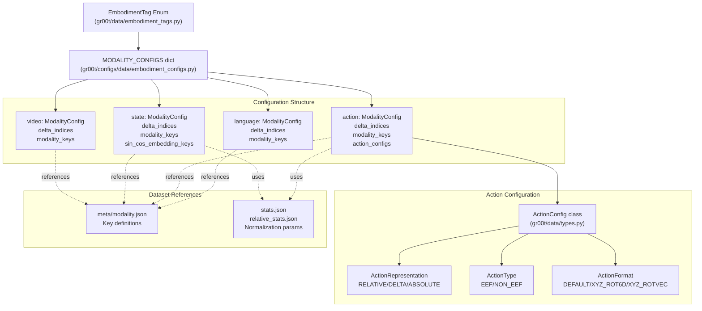
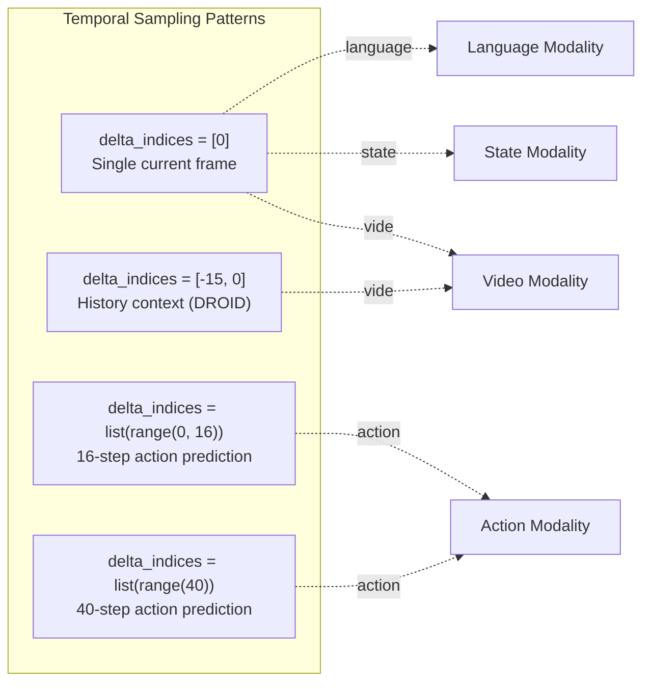
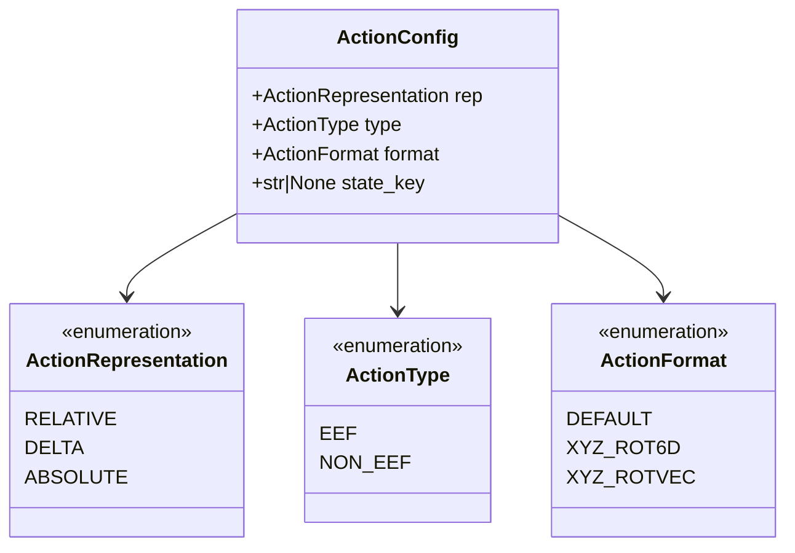

<!-- source: DeepWiki mcp.deepwiki.com · repo NVIDIA/Isaac-GR00T · page 9.1 Modality Configuration Reference · fetched 2026-10-26 -->

# Modality Configuration Reference

<details>
<summary>Relevant source files</summary>

The following files were used as context for generating this wiki page:

- [examples/DROID/server_client.py](examples/DROID/server_client.py)
- [examples/DROID/utils.py](examples/DROID/utils.py)
- [getting_started/data_config.md](getting_started/data_config.md)
- [getting_started/finetune_new_embodiment.md](getting_started/finetune_new_embodiment.md)
- [gr00t/configs/data/embodiment_configs.py](gr00t/configs/data/embodiment_configs.py)
- [gr00t/data/embodiment_tags.py](gr00t/data/embodiment_tags.py)
- [gr00t/model/gr00t_n1d7/gr00t_n1d7.py](gr00t/model/gr00t_n1d7/gr00t_n1d7.py)
- [gr00t/policy/gr00t_policy.py](gr00t/policy/gr00t_policy.py)
- [tests/gr00t/model/test_action_head.py](tests/gr00t/model/test_action_head.py)

</details>


This document provides a complete reference for modality configuration in Isaac-GR00T N1.7. Modality configurations define how robot sensor data (video, state, actions, language) is sampled, processed, and interpreted by the VLA model. Each robot embodiment requires a modality configuration that maps the dataset's physical structure to the model's processing pipeline.

For guidance on creating modality configurations for new embodiments, see [Custom Embodiment Development](8.2). For information on the processor that uses these configurations, see [Processor Configuration Reference](9.2). For data format details, see [LeRobot Compatible Data Format](3.1).

---

## Configuration System Architecture

The modality configuration system bridges dataset structure, embodiment identification, and model processing. Each embodiment is identified by an `EmbodimentTag`, which maps to a modality configuration containing four sub-configurations (video, state, action, language).

### Data to Code Entity Mapping
The following diagram illustrates how configuration objects in the codebase relate to the physical data structure defined in the dataset.

Title: Modality Configuration Data Flow

**Sources:** [gr00t/data/embodiment_tags.py:29-56](), [gr00t/configs/data/embodiment_configs.py:26-65](), [gr00t/data/types.py:100-124]() (Note: `ActionConfig` and `ModalityConfig` are also defined in [examples/DROID/server_client.py:99-142]() for client compatibility).

---

## ModalityConfig Class Reference

The `ModalityConfig` class specifies how to sample and process a single modality. It is defined as a dataclass.

### Field Definitions

| Field Name | Type | Required | Description |
|------------|------|----------|-------------|
| `delta_indices` | `list[int]` | Yes | Temporal offsets relative to current timestep. Negative for history, 0 for current, positive for future. |
| `modality_keys` | `list[str]` | Yes | Keys to load from dataset. Must match keys in `meta/modality.json`. |
| `sin_cos_embedding_keys` | `list[str] \| None` | No | State keys to apply sin/cos encoding (for radian values). Doubles dimensionality. |
| `mean_std_embedding_keys` | `list[str] \| None` | No | Keys to normalize using mean/std instead of min/max. |
| `action_configs` | `list[ActionConfig] \| None` | No | Action-specific configurations. Required only for action modality. |

### delta_indices Usage Patterns

Title: Temporal Sampling Configurations


**Delta Index Semantics:**
- `[0]`: Current timestep only [getting_started/data_config.md:43-43]().
- `[-15, 0]`: Used in `oxe_droid` for historical context [gr00t/configs/data/embodiment_configs.py:30-30]().
- `list(range(0, 16))`: Standard 16-step action prediction horizon [getting_started/finetune_new_embodiment.md:43-43]().
- **Important:** Changing `delta_indices` for actions requires regenerating stats via `gr00t/data/stats.py`. A mismatch between `delta_indices` length and the stats file will cause an `IndexError` during training [getting_started/data_config.md:58-90]().

**Sources:** [getting_started/data_config.md:40-90](), [gr00t/configs/data/embodiment_configs.py:28-65](), [gr00t/data/types.py:108-124]()

---

## ActionConfig Class Reference

The `ActionConfig` class defines how each action modality (e.g., "arm", "gripper") should be interpreted and transformed. The `action_configs` list must have the **same length and order** as `modality_keys` [getting_started/data_config.md:123-125]().

### Action Representation Enums

Title: Action Configuration Code Entities


### ActionRepresentation Enum
Defines how action values relate to the robot state [gr00t/data/types.py:33-37]().

| Enum Value | Description |
|------------|-------------|
| `RELATIVE` | Actions are deltas from the **current** state. Recommended for joint generalization [getting_started/finetune_new_embodiment.md:49-51](). |
| `DELTA` | Step-to-step differences. |
| `ABSOLUTE` | Actions are target positions. Best for binary signals like grippers [getting_started/finetune_new_embodiment.md:55-57](). |

### ActionType Enum
Defines the control space [gr00t/data/types.py:39-42]().

| Enum Value | Description |
|------------|-------------|
| `EEF` | End-effector/Cartesian space control. |
| `NON_EEF` | Joint-space or other non-Cartesian control [getting_started/finetune_new_embodiment.md:52-52](). |

### ActionFormat Enum
Defines the geometric encoding [gr00t/data/types.py:44-48]().

| Enum Value | Description |
|------------|-------------|
| `DEFAULT` | Standard format (e.g., raw joint angles). |
| `XYZ_ROT6D` | 3D position + 6D rotation (used in `oxe_droid`) [gr00t/configs/data/embodiment_configs.py:44-44](). |
| `XYZ_ROTVEC` | 3D position + rotation vector. |

**Sources:** [gr00t/data/types.py:33-48](), [gr00t/data/types.py:77-83](), [getting_started/finetune_new_embodiment.md:48-61]()

---

## Pre-registered Embodiment Configurations

The `MODALITY_CONFIGS` dictionary in `gr00t/configs/data/embodiment_configs.py` contains pre-defined configurations for supported robots.

| Embodiment Tag | Modality | Delta Indices | Modality Keys | Action Configs |
|----------------|----------|---------------|---------------|----------------|
| `oxe_droid...` | Action | `range(40)` | `eef_9d`, `gripper_position`, `joint_position` | `RELATIVE/EEF/XYZ_ROT6D`, `ABSOLUTE/NON_EEF`, `RELATIVE/NON_EEF` |
| `unitree_g1_sonic` | Action | `range(40)` | `motion_token`, `left_hand_joints`, `right_hand_joints` | `ABSOLUTE/NON_EEF` (x3) |
| `unitree_g1_full...` | Action | `range(50)` | `left_arm`, `right_arm`, `left_hand`, `right_hand`, `waist`, ... | `RELATIVE` (arms), `ABSOLUTE` (hands/waist) |

**Sources:** [gr00t/configs/data/embodiment_configs.py:28-65](), [gr00t/configs/data/embodiment_configs.py:67-114](), [gr00t/configs/data/embodiment_configs.py:115-187]()

---

## Configuration Example: Custom Embodiment

When defining a `NEW_EMBODIMENT`, the configuration is registered via `register_modality_config` [getting_started/finetune_new_embodiment.md:72-72]().

```python
# Example SO-100 configuration
so100_config = {
    "video": ModalityConfig(
        delta_indices=[0],
        modality_keys=["front", "wrist"],
    ),
    "state": ModalityConfig(
        delta_indices=[0],
        modality_keys=["single_arm", "gripper"],
    ),
    "action": ModalityConfig(
        delta_indices=list(range(0, 16)),
        modality_keys=["single_arm", "gripper"],
        action_configs=[
            ActionConfig(rep=ActionRepresentation.RELATIVE, type=ActionType.NON_EEF, format=ActionFormat.DEFAULT),
            ActionConfig(rep=ActionRepresentation.ABSOLUTE, type=ActionType.NON_EEF, format=ActionFormat.DEFAULT),
        ],
    ),
    "language": ModalityConfig(
        delta_indices=[0],
        modality_keys=["annotation.human.task_description"],
    ),
}
```

**Sources:** [getting_started/finetune_new_embodiment.md:24-69](), [gr00t/configs/data/embodiment_configs.py:349-356]()

---

