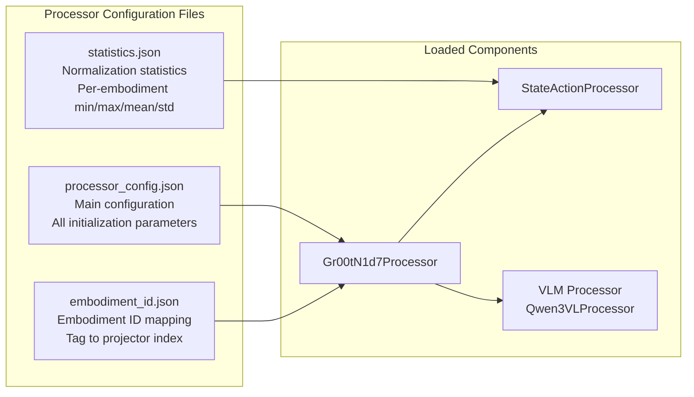
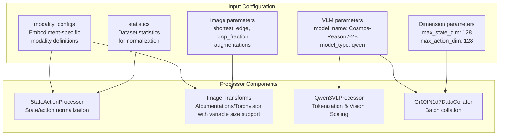

<!-- source: DeepWiki mcp.deepwiki.com · repo NVIDIA/Isaac-GR00T · page 9.2 Processor Configuration Reference · fetched 2026-10-26 -->

# Processor Configuration Reference

<details>
<summary>Relevant source files</summary>

The following files were used as context for generating this wiki page:

- [gr00t/__init__.py](gr00t/__init__.py)
- [gr00t/model/gr00t_n1d7/processing_gr00t_n1d7.py](gr00t/model/gr00t_n1d7/processing_gr00t_n1d7.py)
- [scripts/deployment/build_tensorrt_engine.py](scripts/deployment/build_tensorrt_engine.py)
- [tests/fixtures/README.md](tests/fixtures/README.md)
- [tests/fixtures/processor_config/embodiment_id.json](tests/fixtures/processor_config/embodiment_id.json)
- [tests/fixtures/processor_config/processor_config.json](tests/fixtures/processor_config/processor_config.json)
- [tests/fixtures/processor_config/statistics.json](tests/fixtures/processor_config/statistics.json)
- [tests/gr00t/model/test_variable_image_size.py](tests/gr00t/model/test_variable_image_size.py)

</details>


This page provides a complete reference for all configuration parameters of the `Gr00tN1d7Processor` class, which handles data normalization, encoding, and transformation for the GR00T N1.7 model. The processor bridges raw robot observations and actions to model-ready tensor inputs, specifically optimized for the Qwen3-VL (Cosmos-Reason2-2B) backbone.

For information about modality configuration structure (`ModalityConfig` and `ActionConfig`), see [Modality Configuration Reference](9.1). For understanding how the processor works internally, see [Gr00tN1d7Processor](4.4). For data pipeline concepts, see [Data Processing Pipeline](3.5).

Sources: [gr00t/model/gr00t_n1d7/processing_gr00t_n1d7.py:159-174](), [gr00t/model/gr00t_n1d7/processing_gr00t_n1d7.py:35-38]()

---

## Configuration File Structure

The `Gr00tN1d7Processor` configuration is stored in three JSON files when saved via `save_pretrained()`:



**Diagram: Processor Configuration File Structure**

The `processor_config.json` contains all initialization parameters under `processor_kwargs` [tests/fixtures/processor_config/processor_config.json:3-149](). The `statistics.json` contains per-embodiment normalization parameters computed from dataset statistics [tests/fixtures/processor_config/statistics.json:1-295](). The `embodiment_id.json` maps embodiment tag strings to integer projector indices used by the model [tests/fixtures/processor_config/embodiment_id.json:1-3]().

Sources: [gr00t/model/gr00t_n1d7/processing_gr00t_n1d7.py:16-33](), [tests/fixtures/README.md:15-17]()

---

## Complete Parameter Reference

### Modality and Statistics Parameters

| Parameter | Type | Default | Description |
|-----------|------|---------|-------------|
| `modality_configs` | `dict[str, dict[str, ModalityConfig]]` | **Required** | Nested dictionary mapping embodiment tags to modality configurations. Each embodiment has `video`, `state`, `action`, and `language` modality configs. [tests/fixtures/processor_config/processor_config.json:4-122]() |
| `statistics` | `dict[str, dict[str, dict[str, dict[str, list[float]]]]]` \| `None` | `None` | Pre-computed dataset statistics for normalization. Structure: `{embodiment_tag: {modality: {key: {stat_name: [values]}}}}`. [tests/fixtures/processor_config/statistics.json:1-295]() |
| `embodiment_id_mapping` | `dict[str, int]` \| `None` | `None` | Mapping from embodiment tag strings to integer projector indices. If `None`, uses `EMBODIMENT_TAG_TO_PROJECTOR_INDEX`. [gr00t/model/gr00t_n1d7/processing_gr00t_n1d7.py:118-120]() |

Sources: [gr00t/model/gr00t_n1d7/processing_gr00t_n1d7.py:35-39](), [gr00t/model/gr00t_n1d7/processing_gr00t_n1d7.py:118-120]()

### Image Processing Parameters

| Parameter | Type | Default | Description |
|-----------|------|---------|-------------|
| `image_crop_size` | `list[int]` \| `None` | `None` | Target crop size `[height, width]` for center cropping. [tests/fixtures/processor_config/processor_config.json:123]() |
| `image_target_size` | `list[int]` \| `None` | `None` | Target resize dimensions `[height, width]`. [tests/fixtures/processor_config/processor_config.json:124]() |
| `shortest_image_edge` | `int` | `256` | Resize images so the shortest edge has this length while preserving aspect ratio. [tests/fixtures/processor_config/processor_config.json:133]() |
| `crop_fraction` | `float` | `0.95` | Fraction of image to keep during center cropping (only with albumentations). [tests/fixtures/processor_config/processor_config.json:134]() |
| `use_albumentations` | `bool` | `True` | If `True`, use Albumentations library for image transforms. [tests/fixtures/processor_config/processor_config.json:125]() |
| `color_jitter_params` | `dict[str, float]` \| `None` | `None` | Color jitter augmentation parameters. [tests/fixtures/processor_config/processor_config.json:127-132]() |
| `letter_box_transform` | `bool` | `False` | If `True`, applies letter-boxing to maintain aspect ratio during resize. [tests/fixtures/processor_config/processor_config.json:135]() |

Sources: [gr00t/model/gr00t_n1d7/processing_gr00t_n1d7.py:41-45](), [tests/gr00t/model/test_variable_image_size.py:40-48](), [tests/gr00t/model/test_variable_image_size.py:101-109]()

### Vision-Language Model Parameters

| Parameter | Type | Default | Description |
|-----------|------|---------|-------------|
| `model_name` | `str` | `"nvidia/Cosmos-Reason2-2B"` | HuggingFace model identifier for the VLM processor. [tests/fixtures/processor_config/processor_config.json:136]() |
| `model_type` | `str` | `"qwen"` | VLM architecture type. [tests/fixtures/processor_config/processor_config.json:137]() |
| `formalize_language` | `bool` | `True` | If `True`, lowercase and remove punctuation from language instructions. [tests/fixtures/processor_config/processor_config.json:138]() |

Sources: [gr00t/model/gr00t_n1d7/processing_gr00t_n1d7.py:48-51](), [gr00t/model/gr00t_n1d7/processing_gr00t_n1d7.py:123-129]()

### State and Action Dimension Parameters

| Parameter | Type | Default | Description |
|-----------|------|---------|-------------|
| `max_state_dim` | `int` | `128` | Maximum state vector dimension across all embodiments. [tests/fixtures/processor_config/processor_config.json:139]() |
| `max_action_dim` | `int` | `128` | Maximum action vector dimension across all embodiments. [tests/fixtures/processor_config/processor_config.json:140]() |
| `max_action_horizon` | `int` | `50` | Maximum action horizon across all embodiments. [tests/fixtures/processor_config/processor_config.json:141]() |

Sources: [gr00t/model/gr00t_n1d7/processing_gr00t_n1d7.py:132-156]()

---

## Parameter Flow and Dependencies



**Diagram: Parameter Dependencies and Component Initialization**

This diagram shows how configuration parameters flow into the processor components. A key update in N1.7 is the integration of `Qwen3VLProcessor` and the enforcement of `max_action_horizon` validation during construction to prevent runtime shape mismatches [gr00t/model/gr00t_n1d7/processing_gr00t_n1d7.py:132-156]().

Sources: [gr00t/model/gr00t_n1d7/processing_gr00t_n1d7.py:123-129](), [gr00t/model/gr00t_n1d7/processing_gr00t_n1d7.py:159-172]()

---

## Default Embodiment ID Mapping

The `EMBODIMENT_TAG_TO_PROJECTOR_INDEX` mapping is defined in `processing_gr00t_n1d7.py` [gr00t/model/gr00t_n1d7/processing_gr00t_n1d7.py:118-120](). This mapping is derived from `_PROJECTOR_INDEX_GROUPS` [gr00t/model/gr00t_n1d7/processing_gr00t_n1d7.py:69-96]().

| Projector Index | Embodiment Tags |
|-----------------|-----------------|
| 0 | `simpler_env_google` |
| 1 | `simpler_env_widowx` |
| 2 | `libero_sim` |
| 10 | `new_embodiment`, `robocasa_panda_omron`, `robocasa_gr1_tabletop` |
| 11 | `unitree_g1_sonic` |
| 24 | `oxe_droid_relative_eef_relative_joint` |
| 25 | `real_g1_relative_eef_relative_joints`, `unitree_g1_full_body_with_waist_height_nav_cmd` |
| 26 | `real_r1_pro_sharpa_relative_eef`, `real_r1_pro_sharpa_relative_eef_human`, ... |
| 27 | `xdof_relative_eef_relative_joint`, `xdof_relative_eef_relative_joint_subtask` |

Sources: [gr00t/model/gr00t_n1d7/processing_gr00t_n1d7.py:69-96](), [gr00t/model/gr00t_n1d7/processing_gr00t_n1d7.py:118-120]()

---

## Configuration Examples

### Minimal N1.7 Configuration
This example shows the required fields for a simulation environment.

```json
{
  "processor_class": "Gr00tN1d7Processor",
  "processor_kwargs": {
    "modality_configs": {
      "libero_sim": {
        "video": {
          "delta_indices": [0],
          "modality_keys": ["observation.images.rgb.head_256_256"]
        },
        "state": {
          "delta_indices": [0],
          "modality_keys": ["x", "y", "z", "roll", "pitch", "yaw", "gripper"]
        },
        "action": {
          "delta_indices": [0, 1, 2, 3, 4, 5, 6, 7, 8, 9, 10, 11, 12, 13, 14, 15],
          "modality_keys": ["x", "y", "z", "roll", "pitch", "yaw", "gripper"]
        }
      }
    },
    "model_name": "nvidia/Cosmos-Reason2-2B",
    "model_type": "qwen",
    "max_state_dim": 128,
    "max_action_dim": 128,
    "max_action_horizon": 50
  }
}
```
Sources: [tests/fixtures/processor_config/processor_config.json:1-150]()

---

## Critical Constraints and Validation

1. **Action Horizon Check**: The function `validate_action_horizons` is called during processor construction. It raises a `ValueError` if any embodiment's `delta_indices` length exceeds `max_action_horizon` [gr00t/model/gr00t_n1d7/processing_gr00t_n1d7.py:132-156]().
2. **Projector Index Uniqueness**: The internal helper `_build_tag_to_projector_index` ensures that a single embodiment tag is not assigned to multiple projector indices, which prevents ambiguous model routing [gr00t/model/gr00t_n1d7/processing_gr00t_n1d7.py:99-115]().
3. **Variable Resolution**: The image transform pipeline supports variable input sizes. For example, in `TestTorchvisionTransforms`, images with different aspect ratios (4:3 vs 16:9) are transformed to the same output shape for batching [tests/gr00t/model/test_variable_image_size.py:79-87]().

Sources: [gr00t/model/gr00t_n1d7/processing_gr00t_n1d7.py:99-156](), [tests/gr00t/model/test_variable_image_size.py:79-87]()

---

