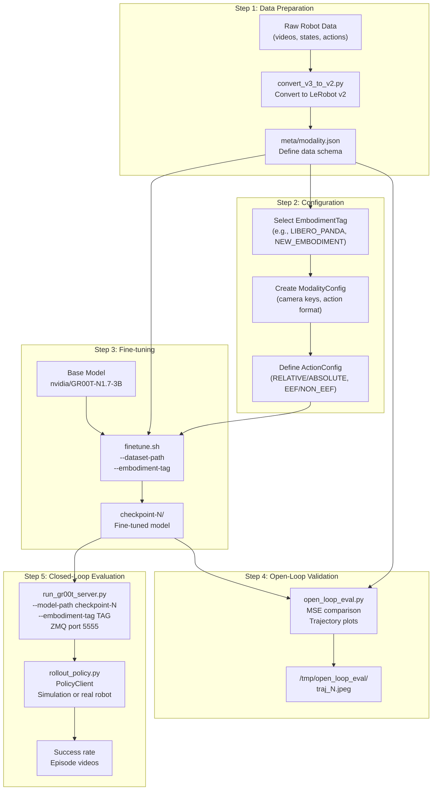
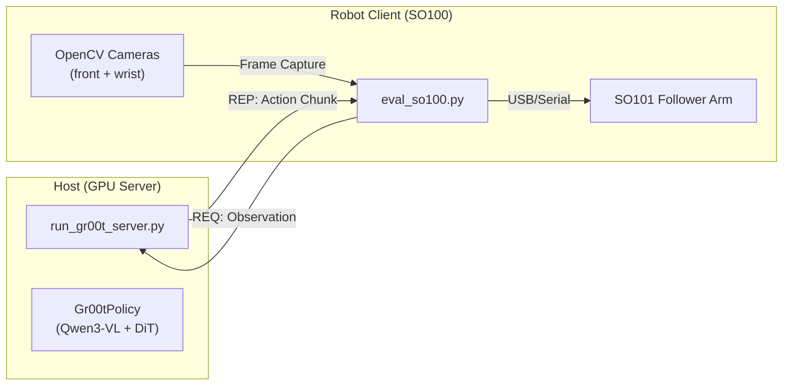
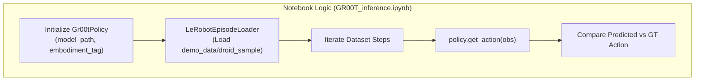

<!-- source: DeepWiki mcp.deepwiki.com · repo NVIDIA/Isaac-GR00T · page 9.3 Complete Workflow Examples · fetched 2026-10-26 -->

# Complete Workflow Examples

<details>
<summary>Relevant source files</summary>

The following files were used as context for generating this wiki page:

- [examples/LIBERO/README.md](examples/LIBERO/README.md)
- [examples/SO100/README.md](examples/SO100/README.md)
- [examples/SimplerEnv/README.md](examples/SimplerEnv/README.md)
- [examples/rebot-arm-dm/eval_rebot_arm_dm.py](examples/rebot-arm-dm/eval_rebot_arm_dm.py)
- [getting_started/GR00T_inference.ipynb](getting_started/GR00T_inference.ipynb)
- [scripts/validate_hf_config_alignment.py](scripts/validate_hf_config_alignment.py)

</details>


This page provides complete, end-to-end workflow examples that demonstrate data preparation, fine-tuning, evaluation, and deployment for different robot embodiments and tasks. Each example walks through the entire pipeline from raw dataset to deployed policy using the N1.7 architecture.

For detailed information about specific components, see:
- Data preparation: [LeRobot Compatible Data Format]() (3.1)
- Configuration: [Modality Configuration Files]() (3.3)
- Deployment: [Starting an Inference Server]() (5.2)
- Evaluation: [Evaluation Pipeline Overview]() (7.1)

---

## General Workflow Pattern

The GR00T N1.7 workflow follows a consistent pattern across all embodiments and tasks. Understanding this pattern helps when adapting the system to new use cases.

### Complete Pipeline Overview



**Sources:** [examples/SO100/README.md:26-51](), [examples/SimplerEnv/README.md:46-87]()

### Workflow Decision Points

| Decision Point | Options | When to Use |
|---------------|---------|-------------|
| **EmbodimentTag** | Pre-registered (e.g., `LIBERO_PANDA`) vs `NEW_EMBODIMENT` | Use pre-registered for supported robots; use `NEW_EMBODIMENT` for custom hardware [examples/SO100/README.md:49]() |
| **Action Representation** | `RELATIVE` vs `ABSOLUTE` | `RELATIVE` for most axes; `ABSOLUTE` for grippers or specific hardware [examples/SO100/README.md:43]() |
| **State Dropout** | `0.2` to `0.8` | High dropout (0.8) for SimplerEnv WidowX [examples/SimplerEnv/README.md:65](); lower (0.2) for LIBERO [examples/LIBERO/README.md:44]() |
| **Inference Mode** | `pytorch` vs `tensorrt` | Start with `pytorch` for debugging; use `tensorrt` for production speed |

---

## Example 1: SimplerEnv Bridge (WidowX Robot)

This example demonstrates fine-tuning GR00T N1.7 on the Bridge dataset for WidowX manipulation tasks and evaluating on the SimplerEnv benchmark.

### Workflow Commands

#### 1. Dataset Preparation
Download the dataset and apply the modality patch.
```bash
uv run hf download \
    --repo-type dataset IPEC-COMMUNITY/bridge_orig_lerobot \
    --local-dir examples/SimplerEnv/bridge_orig_lerobot/

cp examples/SimplerEnv/bridge_modality.json examples/SimplerEnv/bridge_orig_lerobot/meta/modality.json
```
**Sources:** [examples/SimplerEnv/README.md:50-57]()

#### 2. Fine-tuning
```bash
NUM_GPUS=8 MAX_STEPS=20000 GLOBAL_BATCH_SIZE=1024 SAVE_STEPS=1000 uv run bash examples/finetune.sh \
    --base-model-path nvidia/GR00T-N1.7-3B \
    --dataset-path examples/SimplerEnv/bridge_orig_lerobot/ \
    --embodiment-tag SIMPLER_ENV_WIDOWX \
    --output-dir /tmp/bridge_finetune \
    --state-dropout-prob 0.8
```
**Sources:** [examples/SimplerEnv/README.md:60-66]()

#### 3. Closed-Loop Evaluation
**Terminal 1 - Server:**
```bash
uv run python gr00t/eval/run_gr00t_server.py \
    --model-path /tmp/bridge_finetune/checkpoint-30000 \
    --embodiment-tag SIMPLER_ENV_WIDOWX \
    --use-sim-policy-wrapper
```
**Terminal 2 - Client:**
```bash
gr00t/eval/sim/SimplerEnv/simpler_uv/.venv/bin/python gr00t/eval/rollout_policy.py \
    --n-episodes 10 \
    --policy-client-host 127.0.0.1 \
    --policy-client-port 5555 \
    --max-episode-steps 300 \
    --env-name simpler_env_widowx/widowx_spoon_on_towel \
    --n-action-steps 4 \
    --n-envs 5
```
**Sources:** [examples/SimplerEnv/README.md:138-163]()

---

## Example 2: LIBERO 10 (Long-Horizon Tasks)

LIBERO is used for benchmarking knowledge transfer and long-horizon multi-step tasks.

### Step-by-Step Implementation

#### 1. Setup Dataset
```bash
uv run hf download \
    --repo-type dataset IPEC-COMMUNITY/libero_10_no_noops_1.0.0_lerobot \
    --local-dir examples/LIBERO/libero_10_no_noops_1.0.0_lerobot/

cp -r examples/LIBERO/modality.json examples/LIBERO/libero_10_no_noops_1.0.0_lerobot/meta/
```
**Sources:** [examples/LIBERO/README.md:29-35]()

#### 2. Fine-tuning
```bash
NUM_GPUS=8 MAX_STEPS=20000 GLOBAL_BATCH_SIZE=640 SAVE_STEPS=1000 uv run bash examples/finetune.sh \
    --base-model-path nvidia/GR00T-N1.7-3B \
    --dataset-path examples/LIBERO/libero_10_no_noops_1.0.0_lerobot/ \
    --embodiment-tag LIBERO_PANDA \
    --output-dir /tmp/libero_10 \
    --state-dropout-prob 0.2
```
**Sources:** [examples/LIBERO/README.md:39-45]()

#### 3. Simulation Evaluation
First, install the simulation environment using `gr00t/eval/sim/LIBERO/setup_libero.sh` [examples/LIBERO/README.md:114](). Then run the rollout:
```bash
gr00t/eval/sim/LIBERO/libero_uv/.venv/bin/python gr00t/eval/rollout_policy.py \
    --n-episodes 10 \
    --policy-client-host 127.0.0.1 \
    --policy-client-port 5555 \
    --max-episode-steps 720 \
    --env-name libero_sim/KITCHEN_SCENE3_turn_on_the_stove_and_put_the_moka_pot_on_it \
    --n-action-steps 8 \
    --n-envs 5
```
**Sources:** [examples/LIBERO/README.md:136-144]()

---

## Example 3: SO100 Real Robot Deployment

This example covers the transition from a LeRobot v3 dataset to a deployed GR00T policy on a physical SO100 robot.

### Hardware Deployment Workflow



### Step-by-Step Implementation

#### 1. Dataset Conversion (v3 to v2)
```bash
uv run --project scripts/lerobot_conversion \
  python scripts/lerobot_conversion/convert_v3_to_v2.py \
  --repo-id izuluaga/finish_sandwich \
  --root examples/SO100/finish_sandwich_lerobot

cp examples/SO100/modality.json examples/SO100/finish_sandwich_lerobot/izuluaga/finish_sandwich/meta/modality.json
```
**Sources:** [examples/SO100/README.md:28-39]()

#### 2. Fine-tuning with Custom Config
```bash
CUDA_VISIBLE_DEVICES=0 NUM_GPUS=1 uv run bash examples/finetune.sh \
  --base-model-path nvidia/GR00T-N1.7-3B \
  --dataset-path examples/SO100/finish_sandwich_lerobot/izuluaga/finish_sandwich \
  --modality-config-path examples/SO100/so100_config.py \
  --embodiment-tag NEW_EMBODIMENT \
  --output-dir /tmp/so100_finetune
```
**Sources:** [examples/SO100/README.md:45-51]()

#### 3. Real Robot Evaluation
Start the server [examples/SO100/README.md:96](), then run the client script which handles hardware communication:
```bash
uv run --no-sync python eval_so100.py \
  --robot.type=so101_follower \
  --robot.port="/dev/ttyACM2" \
  --robot.id="orange_follower" \
  --robot.cameras="{ front: {type: opencv, index_or_path: 6, width: 640, height: 480, fps: 30}, wrist: {type: opencv, index_or_path: 2, width: 640, height: 480, fps: 30}}" \
  --policy_host=localhost \
  --policy_port=5555 \
  --lang_instruction="finish the ham cheese olives sandwich"
```
**Sources:** [examples/SO100/README.md:116-124]()

---

## Example 4: Notebook-based Inference

For interactive exploration, the `GR00T_inference.ipynb` notebook provides a direct way to load a policy and test it against a sample dataset.

### Notebook Workflow



**Key Code Snippet:**
```python
policy = Gr00tPolicy(
    model_path=MODEL_PATH,
    embodiment_tag=EmbodimentTag.resolve(EMBODIMENT_TAG),
    device=device,
    strict=True,
)

action_chunk, info = policy.get_action(model_input)
```
**Sources:** [getting_started/GR00T_inference.ipynb:89-94](), [getting_started/GR00T_inference.ipynb:181]()

---

## Example 5: Custom Robot Adapter (reBot Arm DM)

For robots with non-standard joint configurations or third-party plugins, a standalone adapter may be necessary. The Seeed reBot Arm B601-DM example uses a custom adapter class to map robot observations to the `Gr00tPolicy` interface.

### Adapter Logic
The `RebotArmDMAdapter` handles:
1.  **Observation Mapping**: Converting raw robot state and camera frames into the nested dictionary format expected by the policy [examples/rebot-arm-dm/eval_rebot_arm_dm.py:139-165]().
2.  **Action Decoding**: Extracting specific joint values from the returned `ActionChunk` [examples/rebot-arm-dm/eval_rebot_arm_dm.py:167-177]().

**Sources:** [examples/rebot-arm-dm/eval_rebot_arm_dm.py:103-182]()

---

## Summary of Results

Success rates for various benchmarks using GR00T N1.7:

| Benchmark | Task Suite | Success Rate | Steps |
|-----------|------------|--------------|-------|
| **LIBERO** | Spatial | 97.65% | 20k |
| **LIBERO** | Goal | 97.5% | 20k |
| **LIBERO** | Object | 98.45% | 20k |
| **LIBERO** | 10 (Long) | 94.35% | 20k |
| **SimplerEnv** | Google Robot (Fractal) | 72.5% | 20k |
| **SimplerEnv** | WidowX (Bridge) | 62.3% | 20k |

**Sources:** [examples/LIBERO/README.md:17-22](), [examples/SimplerEnv/README.md:28](), [examples/SimplerEnv/README.md:44]()

---

