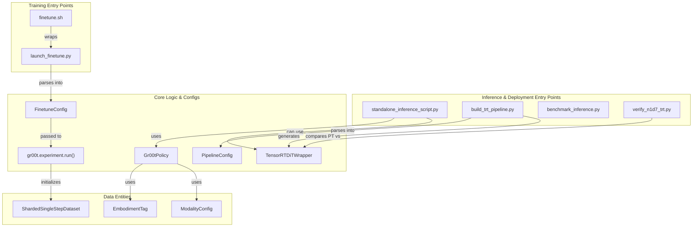
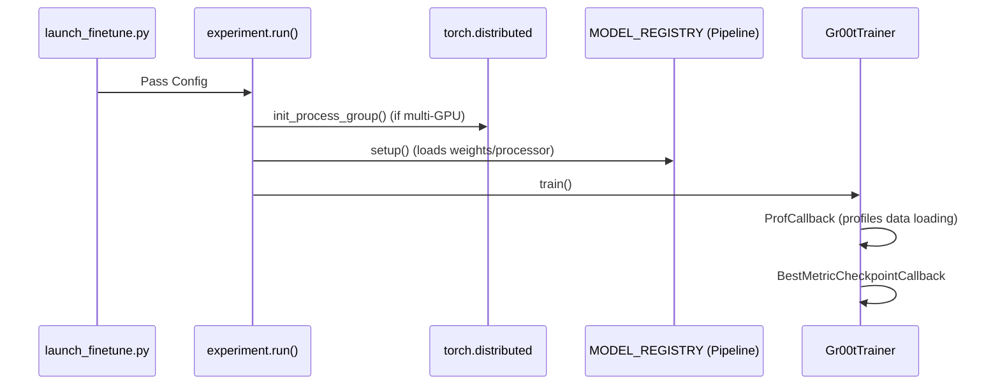

<!-- source: DeepWiki mcp.deepwiki.com · repo NVIDIA/Isaac-GR00T · page 9.4 Command-Line Interface Reference · fetched 2026-10-26 -->

# Command-Line Interface Reference

Relevant source files

The following files were used as context for generating this wiki page:

- [examples/finetune.sh](examples/finetune.sh)
- [gr00t/configs/finetune_config.py](gr00t/configs/finetune_config.py)
- [gr00t/experiment/experiment.py](gr00t/experiment/experiment.py)
- [gr00t/experiment/launch_finetune.py](gr00t/experiment/launch_finetune.py)
- [scripts/deployment/benchmark_inference.py](scripts/deployment/benchmark_inference.py)
- [scripts/deployment/build_trt_pipeline.py](scripts/deployment/build_trt_pipeline.py)
- [scripts/deployment/export_onnx_n1d7.py](scripts/deployment/export_onnx_n1d7.py)
- [scripts/deployment/standalone_inference_script.py](scripts/deployment/standalone_inference_script.py)
- [scripts/deployment/verify_n1d7_trt.py](scripts/deployment/verify_n1d7_trt.py)
- [tests/gr00t/policy/test_policy_service.py](tests/gr00t/policy/test_policy_service.py)

This page provides technical reference documentation for the command-line interface (CLI) scripts in the Isaac-GR00T repository. These scripts manage the lifecycle of a Vision-Language-Action (VLA) model, from fine-tuning on robot trajectory data to high-performance deployment using TensorRT.

The N1.7 architecture update introduces significant changes to the CLI, including native support for the Qwen3-VL backbone (Cosmos-Reason2-2B), simplified fine-tuning entry points, and integrated TensorRT pipeline building.

---

## CLI Script Architecture and Data Flow

The following diagram maps the CLI entry points to the core system components and data entities they manipulate.

**CLI to Code Entity Mapping**

**Sources:** [gr00t/experiment/launch_finetune.py:44-49](), [scripts/deployment/standalone_inference_script.py:108-130](), [scripts/deployment/build_trt_pipeline.py:202-203](), [scripts/deployment/verify_n1d7_trt.py:41-61]()

---

## Fine-Tuning Scripts

### launch_finetune.py

This is the primary Python entry point for fine-tuning the N1.7 VLA model. It uses `tyro` to parse the `FinetuneConfig` dataclass into command-line arguments [gr00t/experiment/launch_finetune.py:49]().

**Implementation Details:**
- **Config Resolution:** It resolves the `embodiment_tag` using `EmbodimentTag.resolve()` [gr00t/experiment/launch_finetune.py:52]().
- **Dynamic Modality Loading:** If a `--modality_config_path` is provided, it dynamically imports the Python module to register custom robot configurations [gr00t/experiment/launch_finetune.py:31-41]().
- **Default Hyperparameters:** It sets N1.7 specific defaults, such as `model_name="nvidia/Cosmos-Reason2-2B"` and `use_relative_action=True` [gr00t/experiment/launch_finetune.py:100-102]().

**Key Parameters (from `FinetuneConfig`):**

| Argument | Type | Description |
| :--- | :--- | :--- |
| `--base_model_path` | `str` | Path to the pretrained base model (N1.7) [gr00t/configs/finetune_config.py:33-34](). |
| `--dataset_path` | `str` | Path to LeRobot v2 trajectory data [gr00t/configs/finetune_config.py:36-37](). |
| `--embodiment_tag` | `str` | Robot identifier (e.g., `SO100`, `LIBERO_PANDA`) [gr00t/configs/finetune_config.py:39-40](). |
| `--tune_llm` | `bool` | Whether to unfreeze the LLM backbone (default: False) [gr00t/configs/finetune_config.py:49-50](). |
| `--state_dropout_prob` | `float` | Regularization for state inputs (default: 0.2) [gr00t/configs/finetune_config.py:61-64](). |
| `--global_batch_size` | `int` | Effective batch size across all GPUs [gr00t/configs/finetune_config.py:124-126](). |

**Sources:** [gr00t/experiment/launch_finetune.py:1-130](), [gr00t/configs/finetune_config.py:1-181]()

---

### finetune.sh

A bash wrapper designed for multi-GPU execution using `torchrun`.

**Logic Flow:**
1. **Environment Defaults:** Sets default values for `NUM_GPUS`, `GLOBAL_BATCH_SIZE`, and `MAX_STEPS` [examples/finetune.sh:5-14]().
2. **Execution Mode:** 
   - If `NUM_GPUS=1`, it executes `python launch_finetune.py` directly and sets `CUDA_VISIBLE_DEVICES` to avoid `DataParallel` overhead [examples/finetune.sh:216-221]().
   - If `NUM_GPUS > 1`, it executes `torchrun --nproc_per_node=$NUM_GPUS` to initialize the distributed process group [examples/finetune.sh:223]().

**Sources:** [examples/finetune.sh:1-223]()

---

## Deployment & Performance CLI

### build_trt_pipeline.py

A unified script that automates the transition from PyTorch to optimized TensorRT engines. It wraps four distinct stages: `export`, `build`, `verify`, and `benchmark` [scripts/deployment/build_trt_pipeline.py:74-80]().

**Key Features:**
- **Auto-detection:** Automatically detects the `embodiment_tag` from the model's `processor_config.json` if not explicitly provided [scripts/deployment/build_trt_pipeline.py:164-194]().
- **Tee Logging:** Redirects verbose output from sub-commands to a log file while maintaining a clean progress bar in the terminal [scripts/deployment/build_trt_pipeline.py:109-162]().

**Sources:** [scripts/deployment/build_trt_pipeline.py:1-203]()

### standalone_inference_script.py

A comprehensive script for running inference without a server architecture, supporting PyTorch and TensorRT backends. It is often used for evaluating model accuracy on saved datasets [scripts/deployment/standalone_inference_script.py:47-78]().

**Inference Modes (`--inference-mode`):**
1. **`pytorch`**: Standard execution using the PyTorch model weights [scripts/deployment/standalone_inference_script.py:58]().
2. **`trt_full_pipeline`**: High-performance mode that uses TensorRT engines for the entire VLA pipeline [scripts/deployment/standalone_inference_script.py:76]().

**Implementation of TensorRT Integration:**
The script utilizes `TensorRTDiTWrapper` to manage the DiT engine [scripts/deployment/standalone_inference_script.py:108-109](). This wrapper handles:
- **Memory Management:** Ensures tensors are contiguous and on the correct device before calling the engine [scripts/deployment/standalone_inference_script.py:139-146]().
- **Context Bindings:** Sets input shapes and tensor addresses for `sa_embs`, `vl_embs`, and `timestep` [scripts/deployment/standalone_inference_script.py:148-164]().
- **Async Execution:** Uses `execute_async_v3` for non-blocking inference on the current CUDA stream [scripts/deployment/standalone_inference_script.py:173]().

**Sources:** [scripts/deployment/standalone_inference_script.py:1-178]()

### benchmark_inference.py

Used to measure component-wise timing for data processing, the VLM backbone, and the action head [scripts/deployment/benchmark_inference.py:21-25](). It supports five modes, including `torch.compile` and various TensorRT configurations [scripts/deployment/benchmark_inference.py:27-32]().

**Sources:** [scripts/deployment/benchmark_inference.py:1-187]()

---

## Training Lifecycle Logic

The training logic triggered by the CLI resides in `gr00t/experiment/experiment.py`.

**Training Flow Diagram**

**Key Lifecycle Functions:**
- `setup_logging()`: Configures global logging and silences verbose third-party libraries like `transformers` [gr00t/experiment/experiment.py:41-51]().
- `warn_configs()`: Validates configuration consistency, ensuring parameters like `global_batch_size` are divisible by `num_gpus` and checking for deprecated fields [gr00t/experiment/experiment.py:72-140]().
- `_init_distributed_process_group()`: Initializes the NCCL process group for multi-GPU training [gr00t/experiment/experiment.py:142-157]().

**Sources:** [gr00t/experiment/experiment.py:1-165]()

---

