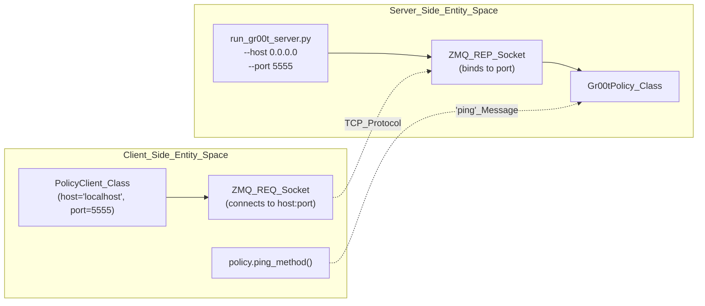
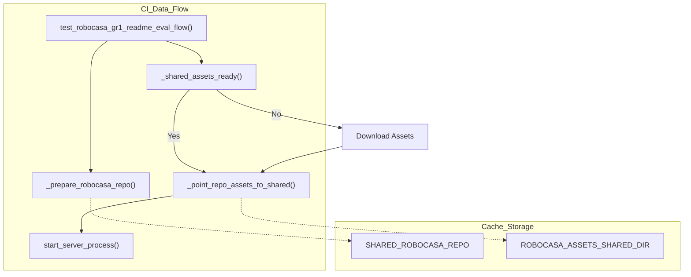

<!-- source: DeepWiki mcp.deepwiki.com · repo NVIDIA/Isaac-GR00T · page 9.5 Troubleshooting and FAQ · fetched 2026-10-26 -->

# Troubleshooting and FAQ

<details>
<summary>Relevant source files</summary>

The following files were used as context for generating this wiki page:

- [.github/ISSUE_TEMPLATE/bug_report.yml](.github/ISSUE_TEMPLATE/bug_report.yml)
- [.github/ISSUE_TEMPLATE/documentation.yml](.github/ISSUE_TEMPLATE/documentation.yml)
- [.github/ISSUE_TEMPLATE/feature_request.yml](.github/ISSUE_TEMPLATE/feature_request.yml)
- [.github/actions/setup-venv/action.yml](.github/actions/setup-venv/action.yml)
- [.github/pull_request_template.md](.github/pull_request_template.md)
- [.github/workflows/main.yml](.github/workflows/main.yml)
- [CONTRIBUTING.md](CONTRIBUTING.md)
- [gr00t/data/dataset/lerobot_episode_loader.py](gr00t/data/dataset/lerobot_episode_loader.py)
- [gr00t/utils/video_utils.py](gr00t/utils/video_utils.py)
- [tests/examples/test_droid.py](tests/examples/test_droid.py)
- [tests/examples/test_libero.py](tests/examples/test_libero.py)
- [tests/examples/test_robocasa.py](tests/examples/test_robocasa.py)
- [tests/examples/test_robocasa_gr1_tabletop.py](tests/examples/test_robocasa_gr1_tabletop.py)
- [tests/examples/test_simplerenv.py](tests/examples/test_simplerenv.py)
- [tests/gr00t/utils/test_video_backend.py](tests/gr00t/utils/test_video_backend.py)

</details>


This page provides solutions to common issues, error messages, and frequently asked questions when using the Isaac GR00T system. It covers installation problems, runtime errors, memory leaks, server-client issues, and the CI/CD testing infrastructure used to validate the codebase.

**Scope:** This page focuses on diagnosing and fixing problems. For initial setup instructions, see [Installation and Setup](#2). For API usage, see [Policy Server Architecture](#5.1) and [Client Integration](#5.3). For configuration details, see [Modality Configuration Reference](#9.1).

---

## Common Installation Issues

### UV Version Compatibility

**Problem:** Build fails with error about `[tool.uv.extra-build-dependencies]` not being recognized.

**Solution:** Upgrade to `uv` version 0.8.4 or later:
```bash
pip install uv>=0.8.4
```

**Why:** The `pyproject.toml` uses `[tool.uv.extra-build-dependencies]` for building `flash-attn`, which requires uv 0.8.4+.

---

### Flash-Attention Build Failures

**Problem:** Installation hangs or fails during `flash-attn` compilation, or encounters CUDA compatibility errors.

**Solution 1 (Recommended):** Use prebuilt wheels for your CUDA version:
```bash
# For CUDA 12.4 (recommended)
uv sync --python 3.10
uv pip install -e .

# For CUDA 11.8
uv pip install flash-attn==2.8.2
```

**Solution 2:** If building from source, ensure you have:
- CUDA toolkit installed (12.4 recommended, 11.8 also verified)
- Sufficient memory (16GB+ RAM recommended during build)
- Matching PyTorch CUDA version

**Common Error Messages:**
- `"RuntimeError: CUDA error: no kernel image is available"` → CUDA version mismatch
- `"Killed"` during build → Insufficient memory, reduce parallel jobs: `MAX_JOBS=2 uv pip install flash-attn`

---

### Video Decoding and FFmpeg Mismatches

**Problem:** `torchcodec` fails to load its native library or crashes during video processing.

**Solution:** Ensure your FFmpeg version is compatible with `torchcodec`. `torchcodec` 0.8.0 requires FFmpeg versions between 4 and 7. It will not function with FFmpeg 8+ (standard on newer Ubuntu releases).

**Error Handling:** The system provides explicit hints when `torchcodec` fails:
- `_TORCHCODEC_INSTALL_HINT`: Instructions to install via deployment scripts or `uv`. [gr00t/utils/video_utils.py:22-26]()
- `_TORCHCODEC_FFMPEG_HINT`: Instructions to downgrade FFmpeg via `conda` if a native library load failure occurs. [gr00t/utils/video_utils.py:28-35]()

**Sources:** [gr00t/utils/video_utils.py:22-61]()

---

## Memory Management Issues

### PyAV and Video Resource Leaks

**Problem:** Long-running video processing tasks (training, evaluation, video recording) experience steadily increasing memory consumption, eventually leading to OOM crashes.

**Symptoms:**
- RSS memory grows continuously during video loading/saving.
- Memory is not released after `del` or garbage collection.

**Root Cause:** PyAV `Container` objects hold native FFmpeg resources that are not automatically released by Python's garbage collector.

```mermaid
graph TB
    subgraph "Memory_Leak_Pattern_Incorrect"
        A1["container = av.open(path)"]
        A2["for frame in container.decode():<br/>process(frame)"]
        A3["Exception occurs"]
        A4["container never closed"]
        A5["FFmpeg resources leaked"]
        
        A1 --> A2
        A2 --> A3
        A3 --> A4
        A4 --> A5
    end
    
    subgraph "Proper_Cleanup_Pattern_Correct"
        B1["with av.open(path) as container:"]
        B2["&nbsp;&nbsp;&nbsp;&nbsp;for frame in container.decode():<br/>&nbsp;&nbsp;&nbsp;&nbsp;&nbsp;&nbsp;&nbsp;&nbsp;process(frame)"]
        B3["Exception occurs"]
        B4["__exit__ calls container.close()"]
        B5["Resources properly released"]
        
        B1 --> B2
        B2 --> B3
        B3 --> B4
        B4 --> B5
    end
    
    style A5 stroke-dasharray: 5 5
    style B5 stroke-width: 2px
```



**Implementation Safeguard:** The `LeRobotEpisodeLoader` and `video_utils` module prioritize robust video handling. For example, `get_frames_by_indices` uses the `torchcodec` backend which manages memory more efficiently for random access than standard PyAV loops. [gr00t/utils/video_utils.py:70-77]()

**Sources:** [gr00t/data/dataset/lerobot_episode_loader.py:47](), [gr00t/utils/video_utils.py:70-77]()

---

## Server-Client Communication Issues

### Connection Refused / Timeout

**Problem:** `PolicyClient` cannot connect to `run_gr00t_server.py`, getting `ConnectionRefusedError` or timeout.



**Diagnostic Steps:**

1. **Verify server is running:**
   ```bash
   ps aux | grep run_gr00t_server
   ```
2. **Check server logs:**
   Server prints `Server listening on tcp://*:5555` on successful startup.
3. **Test connectivity:**
   Use the `wait_for_server_ready` utility function used in CI to verify the server is responding to network requests. [tests/examples/test_droid.py:99-107]()

**Sources:** [tests/examples/test_droid.py:88-107](), [tests/examples/test_simplerenv.py:68-73]()

---

## CI/CD Infrastructure and Testing

The Isaac-GR00T repository uses a robust CI/CD pipeline to ensure stability across updates.

### Automated Readme Testing

Code blocks in README files (e.g., `examples/LIBERO/README.md`) are automatically extracted and executed as tests to ensure documentation never goes stale.

**Key Testing Functions:**
- `extract_code_blocks(README)`: Parses markdown to find bash snippets. [tests/examples/test_libero.py:26]()
- `start_server_process(server_code, ...)`: Launches a background server process for integration testing. [tests/examples/test_droid.py:97]()
- `wait_for_server_ready(...)`: Polls the ZMQ port until the model is fully loaded and ready. [tests/examples/test_droid.py:99]()

### Asset and Repo Caching

For large benchmarks like RoboCasa and LIBERO, the CI infrastructure manages complex submodule initialization and asset caching to prevent network-bound timeouts.



**Implementation Details:**
- **Submodule Versioning:** `_robocasa_submodule_commit()` uses `git ls-tree` to verify if the cached assets match the current submodule commit. [tests/examples/test_robocasa_gr1_tabletop.py:64-78]()
- **Asset Symlinking:** `_point_repo_assets_to_shared()` symlinks cached assets into the repository to avoid slow file copies. [tests/examples/test_robocasa_gr1_tabletop.py:108-119]()

**Sources:** [tests/examples/test_robocasa_gr1_tabletop.py:64-119](), [tests/examples/test_libero.py:112-164]()

---

## Frequently Asked Questions

### Q: Why does my simulation rollout fail with "results:" marker missing?
**A:** This usually indicates the simulation crashed before completion or the output was truncated. In CI, we use `run_subprocess_step` with `output_tail_chars=4000` to capture the end of the log where success rates are printed. [tests/examples/test_simplerenv.py:112-125]()

### Q: How can I run a "smoke test" for fine-tuning?
**A:** You can run a short 2-step fine-tune by overriding `MAX_STEPS` and `SAVE_STEPS`. The CI does this using `replace_once` on the README commands to verify the training pipeline without waiting for full convergence. [tests/examples/test_droid.py:126-142]()

### Q: How are video timestamps handled to prevent float drift?
**A:** The `get_frames_by_timestamps` function in `video_utils.py` rounds requested timestamps to the nearest frame interval and enforces a 1% error tolerance to prevent `torchcodec` from snapping to the wrong frame due to precision issues. [gr00t/utils/video_utils.py:100-113]()

### Q: What if I encounter a bug not listed here?
**A:** Please open an issue on the [GitHub repository](https://github.com/NVIDIA/Isaac-GR00T/issues) using the Bug Report template. [CONTRIBUTING.md:1-7](), [.github/ISSUE_TEMPLATE/bug_report.yml:1-5]()

---

## Getting Help

**Check logs first:**
- **Server:** Look for the "Model loaded successfully" message.
- **Client:** Check for ZMQ timeout exceptions.
- **CI Failures:** Examine the `server_log` captured during `start_server_process`. [tests/examples/test_droid.py:97-107]()

**Sources:** [tests/examples/test_droid.py:97-107](), [tests/examples/test_simplerenv.py:101-107]()

---

