# Page: Introduction to Isaac-GR00T

# Introduction to Isaac-GR00T

<details>
<summary>Relevant source files</summary>

The following files were used as context for generating this wiki page:

- [README.md](README.md)
- [media/header_compress.png](media/header_compress.png)
- [media/model-architecture.png](media/model-architecture.png)
- [scripts/deployment/README.md](scripts/deployment/README.md)

</details>


## Purpose and Scope

This page introduces the NVIDIA Isaac-GR00T system, an open vision-language-action (VLA) foundation model for generalist humanoid and manipulator robot control. This document covers the system's purpose, architecture overview, key features, and the N1.7 architecture update from N1.6.

For detailed information on specific subsystems:
- System architecture and pipelines: see [System Architecture Overview](#1.1)
- Core terminology and concepts: see [Key Concepts and Terminology](#1.2)
- Installation procedures: see [Installation and Setup](#2)
- Data format specifications: see [Data Pipeline and Configuration](#3)
- Model architecture details: see [Model Architecture and Core Components](#4)
- Deployment procedures: see [Inference and Deployment](#5)
- Training procedures: see [Training GR00T Models](#6)

**Sources:** [README.md:1-15](), [README.md:33-47]()

---

## What is Isaac-GR00T?

Isaac-GR00T is a **cross-embodiment vision-language-action (VLA) model** designed to enable generalist robot control across diverse platforms and tasks. The model processes multimodal inputs—video observations, robot proprioceptive state, and natural language instructions—to generate continuous action sequences for manipulation and locomotion tasks [README.md:66-70]().

### Key Characteristics

| Aspect | Description |
|--------|-------------|
| **Model Type** | Vision-Language-Action (VLA) foundation model [README.md:66-67]() |
| **Training Data** | Mixture of humanoid, bimanual, and semi-humanoid data, including 20K hours of EgoScale human video [README.md:68-70]() |
| **Embodiments Supported** | Humanoids (Unitree G1, Agibot G1), manipulators (WidowX, Google Robot, DROID), and bimanual arms [README.md:38-48](), [README.md:68-69]() |
| **Architecture** | Cosmos-Reason2-2B (Qwen3-VL) VLM + Diffusion Transformer (DiT) head [README.md:72-76](), [README.md:99-100]() |
| **Action Generation** | Continuous actions via flow matching / diffusion denoising [README.md:72-73]() |
| **Data Format** | LeRobot v2 compatible (Parquet files with metadata) [README.md:80-81]() |
| **License** | Apache 2.0 (Fully commercially licensable) [README.md:70-71]() |

**Sources:** [README.md:66-77](), [README.md:87-95]()

---

## What's New in GR00T N1.7

GR00T N1.7 is the General Availability release, featuring a modernized VLM backbone and significant code-level improvements for flexible resolution handling and cross-embodiment performance.

### Architectural Evolution

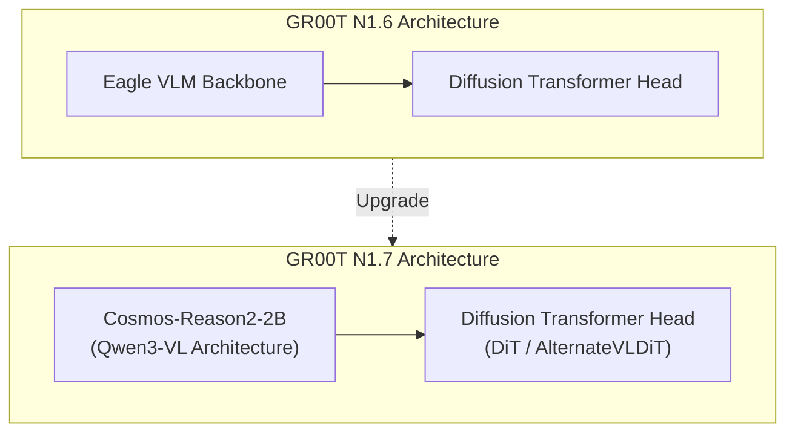

**Key Changes from N1.6:**

| Feature | N1.6 | N1.7 | Impact |
|-----------|------|------|--------|
| **VLM Backbone** | Eagle | **Cosmos-Reason2-2B (Qwen3-VL)** | Native aspect ratio support; no image padding required [README.md:99-100](), [README.md:115-116](). |
| **Action Space** | Absolute | **Relative EEF Action Space** | Improved generalization across human and robot embodiments [README.md:89-91](). |
| **Data Handling** | Single Path | **Multi-dataset mixture weighting** | Easier configuration for multi-dataset training [README.md:101-102](). |
| **Pre-training** | Standard Mixture | **+20K hours EgoScale Video** | Improved generalization and language-following via human priors [README.md:70-71](), [README.md:92-93](). |
| **Deployment** | `dit_only` TRT | **`full_pipeline` TRT Export** | Accelerates backbone (ViT + LLM) for major speedups [scripts/deployment/README.md:90-94](). |

**Sources:** [README.md:49-65](), [README.md:86-105](), [scripts/deployment/README.md:66-100]()

---

## System Architecture Overview

The following diagram bridges the "Natural Language Space" (instructions) and "Code Entity Space" (specific classes and scripts) to show how data flows through the GR00T N1.7 system.

### End-to-End System Flow

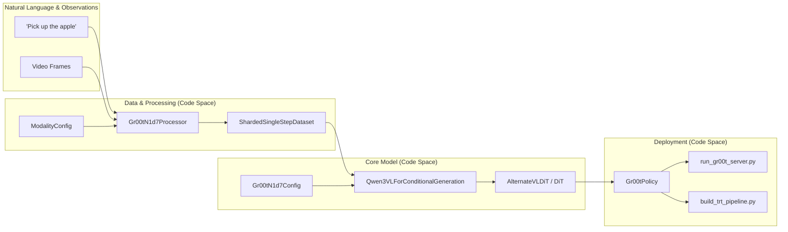

**Sources:** [README.md:78-85](), [README.md:114-116](), [scripts/deployment/README.md:1-4](), [scripts/deployment/README.md:102-105]()

---

## Core Components and Classes

The N1.7 implementation centers around several key classes that manage the lifecycle from data to action.

### Model Architecture: Gr00tN1d7Model

The model integrates the multimodal reasoning of the VLM with the precision of the diffusion head.

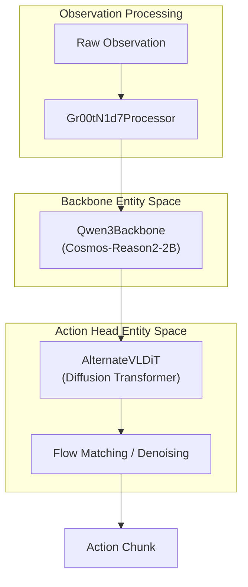

| Component | Class/Entity | Role |
|-----------|-------------|---------|
| **Backbone** | `Qwen3VLForConditionalGeneration` | Processes images at native resolution and instructions [README.md:99-100](). |
| **Action Head** | `AlternateVLDiT` | Denoises continuous actions based on VLM embeddings [scripts/deployment/README.md:83](). |
| **Data Handler** | `Gr00tN1d7Processor` | Handles tokenization, image resizing, and state normalization [README.md:114-116](). |
| **Inference Wrapper**| `Gr00tPolicy` | Provides a high-level API for real-time robot control [README.md:84](). |
| **Deployment Server**| `run_gr00t_server.py` | ZMQ-based server for remote policy inference. |

**Sources:** [README.md:73-77](), [README.md:99-100](), [scripts/deployment/README.md:76-85]()

---

## Primary Workflows

### Workflow 1: Fine-tuning on Custom Data
Users can adapt the base `nvidia/GR00T-N1.7-3B` model to specific tasks using the provided training scripts [README.md:82-83]().
1. **Prepare Data**: Convert raw demonstrations to LeRobot v2 format [README.md:80]().
2. **Compute Stats**: Generate normalization statistics for the specific embodiment.
3. **Launch**: Use `launch_finetune.py` with your own data and modality config [README.md:82]().

### Workflow 2: Inference and Deployment
1. **Standalone**: Use `standalone_inference_script.py` for quick validation on recorded datasets [scripts/deployment/README.md:50-62]().
2. **Server-Client**: Launch the policy server and connect a robot controller via the Policy API [README.md:83-84]().
3. **Optimization**: Use `build_trt_pipeline.py` to compile the model for high-frequency execution on NVIDIA hardware including Thor, Orin, and Spark [scripts/deployment/README.md:102-111]().

**Sources:** [README.md:78-85](), [scripts/deployment/README.md:1-25](), [scripts/deployment/README.md:102-111]()

---

## Hardware and Platform Support

GR00T N1.7 is optimized for a range of NVIDIA hardware, from data center GPUs to edge platforms.

| Platform | Recommended Use | Key Components |
|----------|-----------------|----------------|
| **dGPU** (H100, RTX 4090) | Training & High-perf Inference | PyTorch, Flash-Attn, TensorRT [scripts/deployment/README.md:16]() |
| **Jetson Thor** | Next-gen Humanoid Edge | Docker or Bare Metal deployment [scripts/deployment/README.md:17]() |
| **DGX Spark** | Development & Evaluation | Docker or Bare Metal deployment [scripts/deployment/README.md:18]() |
| **Jetson Orin** | Current-gen Robot Edge | Docker or Bare Metal deployment [scripts/deployment/README.md:19]() |

**Sources:** [scripts/deployment/README.md:14-25](), [scripts/deployment/README.md:151-153]()

---

# Page: System Architecture Overview

# System Architecture Overview

<details>
<summary>Relevant source files</summary>

The following files were used as context for generating this wiki page:

- [README.md](README.md)
- [gr00t/__init__.py](gr00t/__init__.py)
- [gr00t/model/gr00t_n1d7/processing_gr00t_n1d7.py](gr00t/model/gr00t_n1d7/processing_gr00t_n1d7.py)
- [scripts/deployment/README.md](scripts/deployment/README.md)
- [scripts/deployment/build_tensorrt_engine.py](scripts/deployment/build_tensorrt_engine.py)

</details>


## Overview

Isaac-GR00T N1.7 is a vision-language-action (VLA) foundation model system for robot control. The system architecture consists of five primary subsystems updated for the N1.7 release:

1.  **Data Layer**: Raw demonstrations → LeRobot V2 format with embodiment configurations and projector-index assignments [gr00t/model/gr00t_n1d7/processing_gr00t_n1d7.py:69-96]().
2.  **Model Layer**: Pre-trained `nvidia/GR00T-N1.7-3B` checkpoint featuring a **Qwen3-VL (Cosmos-Reason2-2B)** backbone and a **Diffusion Transformer (DiT)** action head [README.md:49-56](), [README.md:99-100]().
3.  **Training Layer**: Fine-tuning infrastructure with DeepSpeed, multi-GPU support, and `Gr00tTrainer` lifecycle [README.md:101-105]().
4.  **Inference Layer**: Policy server (`run_gr00t_server.py`) with ZMQ-based communication and TensorRT acceleration options [README.md:95-96](), [scripts/deployment/README.md:68-74]().
5.  **Evaluation Layer**: Open-loop metrics and closed-loop simulation/hardware testing across benchmarks like LIBERO, SimplerEnv, and real G1 robots [README.md:83-84](), [README.md:102-102]().

This page describes the system architecture at a high level. For terminology definitions, see [Key Concepts and Terminology](#1.2).

**Sources:** [README.md:49-105](), [gr00t/model/gr00t_n1d7/processing_gr00t_n1d7.py:69-96](), [scripts/deployment/README.md:68-74]()

## System Lifecycle and Component Interactions

The Isaac-GR00T system lifecycle flows from data preparation through training to deployment. The N1.7 architecture simplifies the pipeline while adding robust TensorRT support.

### Complete System Architecture (N1.7)

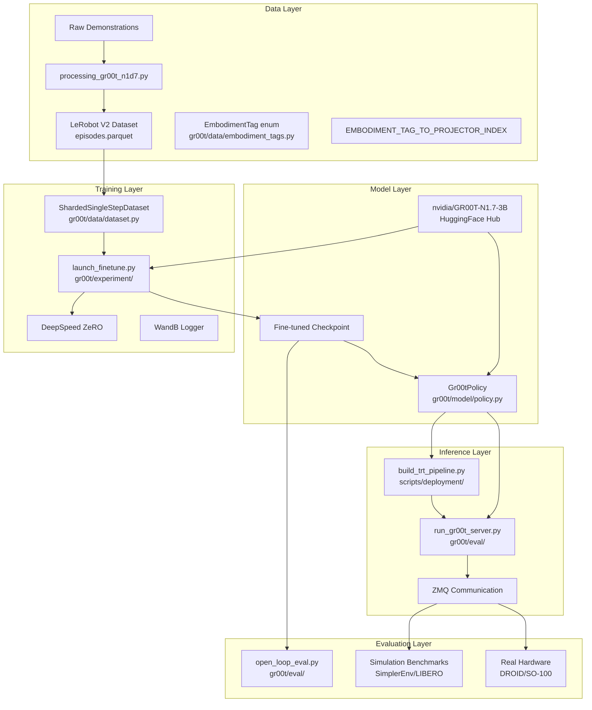

**Key Code Entities by Subsystem:**

| Subsystem | Primary Components | File Paths |
|-----------|-------------------|------------|
| **Data Layer** | `Gr00tN1d7DataCollator`, `EMBODIMENT_TAG_TO_PROJECTOR_INDEX` | [gr00t/model/gr00t_n1d7/processing_gr00t_n1d7.py:118-120](), [gr00t/model/gr00t_n1d7/processing_gr00t_n1d7.py:159-159]() |
| **Model Layer** | `Gr00tPolicy`, `Qwen3VLProcessor` | [gr00t/model/policy.py](), [gr00t/model/gr00t_n1d7/processing_gr00t_n1d7.py:49-51]() |
| **Training Layer** | `launch_finetune.py`, `ShardedSingleStepDataset` | [gr00t/experiment/launch_finetune.py]() |
| **Inference Layer** | `run_gr00t_server.py`, `build_trt_pipeline.py` | [gr00t/eval/run_gr00t_server.py](), [scripts/deployment/build_trt_pipeline.py]() |
| **Evaluation Layer** | `open_loop_eval.py`, `standalone_inference_script.py` | [gr00t/eval/open_loop_eval.py](), [scripts/deployment/standalone_inference_script.py]() |

**Sources:** [README.md:79-96](), [gr00t/model/gr00t_n1d7/processing_gr00t_n1d7.py:118-174](), [scripts/deployment/README.md:94-103]()

## Model Architecture Components

The GR00T N1.7 model is a combination of a vision-language foundation model and a diffusion transformer head. It replaces the Eagle backbone from N1.6 with **Cosmos-Reason2-2B (Qwen3-VL architecture)** [README.md:93-94](), [README.md:115-115]().

### Neural Architecture and Inference Flow

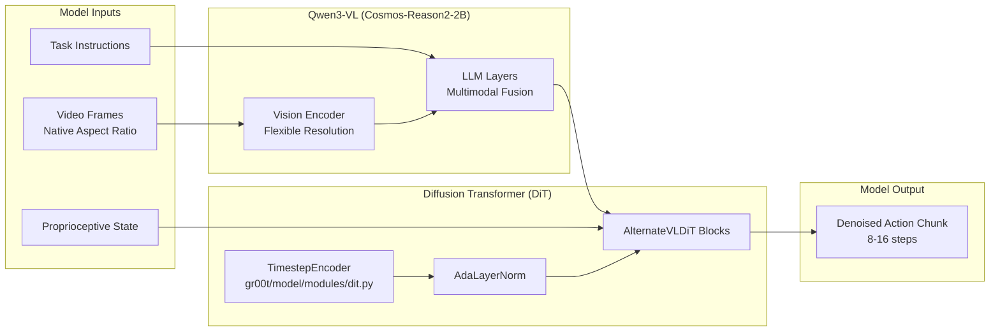

**Key Architecture Features (N1.7):**
* **Flexible Resolution:** Qwen3-VL supports encoding images in their native aspect ratio without padding [README.md:99-99]().
* **DiT Action Head:** Uses `AlternateVLDiT` blocks for denoising continuous actions [scripts/deployment/README.md:83-83]().
* **Flow Matching:** The DiT head uses a flow matching process for efficient action generation [README.md:72-76]().
* **Relative EEF Action Space:** N1.7 adopts a relative end-effector action space shared across human and robot embodiments [README.md:90-90]().

**Sources:** [README.md:72-115](), [scripts/deployment/README.md:76-84]()

## Inference and Performance

N1.7 introduces a "Full Pipeline" TensorRT optimization that accelerates both the VLM backbone and the DiT action head. The `build_trt_pipeline.py` script automates the export of all components including ViT, LLM, and DiT [scripts/deployment/build_trt_pipeline.py:104-111]().

### TensorRT Acceleration Components

| Component | Engine Name | Optimization Note |
|-----------|-------------|-------------------|
| **ViT** | Vision Engine | Qwen3-VL Vision (24 blocks, FP32 for accuracy) [scripts/deployment/README.md:78-78]() |
| **LLM** | LLM Engine | Qwen3-VL Text Model (16 layers) [scripts/deployment/README.md:79-79]() |
| **DiT** | DiT Engine | AlternateVLDiT (32 layers) [scripts/deployment/README.md:83-83]() |
| **Encoders** | State/Action | CategorySpecificMLP / MultiEmbodimentActionEncoder [scripts/deployment/README.md:81-82]() |

**Inference Performance (4 denoising steps, 1 camera):**

| Device | Mode | E2E Latency | Frequency |
|--------|------|-------------|-----------|
| **H100** | PyTorch Eager | 85.8 ms | 11.7 Hz |
| **H100** | TensorRT (Full) | **27.9 ms** | **35.9 Hz** |
| **Jetson Thor** | TensorRT (Full) | **82.3 ms** | **12.2 Hz** |

**Sources:** [scripts/deployment/README.md:76-84](), [scripts/deployment/README.md:151-153](), [scripts/deployment/build_tensorrt_engine.py:22-24]()

## Platform Specifics

Isaac-GR00T N1.7 supports a variety of NVIDIA hardware platforms, from data center GPUs to edge devices.

| Platform | Architecture | OS / CUDA | Key Script |
|----------|--------------|-----------|------------|
| **dGPU** | x86_64 | Ubuntu 22.04 / CUDA 12.8 | `uv sync` [scripts/deployment/README.md:28-30]() |
| **Jetson Thor** | aarch64 | Ubuntu 24.04 / CUDA 13.0 | `scripts/deployment/thor/` [scripts/deployment/README.md:17-17]() |
| **DGX Spark** | aarch64 | Ubuntu 24.04 / CUDA 13.0 | `scripts/activate_spark.sh` [scripts/deployment/README.md:18-18]() |
| **Jetson Orin** | aarch64 | Ubuntu 20.04 / CUDA 12.6 | `scripts/deployment/orin/` [scripts/deployment/README.md:19-19]() |

**Sources:** [scripts/deployment/README.md:14-25](), [scripts/deployment/README.md:28-30]()

---

# Page: Key Concepts and Terminology

# Key Concepts and Terminology

<details>
<summary>Relevant source files</summary>

The following files were used as context for generating this wiki page:

- [README.md](README.md)
- [getting_started/finetune_new_embodiment.md](getting_started/finetune_new_embodiment.md)
- [gr00t/model/gr00t_n1d7/gr00t_n1d7.py](gr00t/model/gr00t_n1d7/gr00t_n1d7.py)
- [scripts/deployment/README.md](scripts/deployment/README.md)
- [tests/gr00t/model/test_action_head.py](tests/gr00t/model/test_action_head.py)

</details>


## Purpose and Scope

This page defines the key concepts, terminology, and abstractions used throughout the Isaac GR00T N1.7 system. This release introduces significant architectural updates, including the transition to the Qwen3-VL (Cosmos-Reason2-2B) backbone and native support for variable image resolutions.

For architectural details about how these components interact, see [System Architecture Overview](1.1). For detailed data format specifications, see [LeRobot Compatible Data Format](3.1).

---

## Core Model Concepts

### Vision-Language-Action (VLA) Model

A **Vision-Language-Action (VLA) model** is a neural network that takes multimodal inputs (images, robot state, language instructions) and produces continuous action predictions. GR00T N1.7 implements this using two primary components:

1.  **VLM Backbone (Cosmos-Reason2-2B):** Based on the `Qwen3VLForConditionalGeneration` architecture. It processes visual observations and language instructions into semantic features. Unlike N1.6, it supports flexible resolutions and encodes images in their native aspect ratio [README.md:93-93](), [README.md:114-115]().
2.  **Diffusion Transformer (DiT) Action Head:** A 32-layer transformer implemented in `Gr00tN1d7ActionHead` [gr00t/model/gr00t_n1d7/gr00t_n1d7.py:38-43]() that denoises continuous actions conditioned on VLM features [README.md:73-77](). It uses flow matching for the action denoising process.

**Architecture Diagram:**

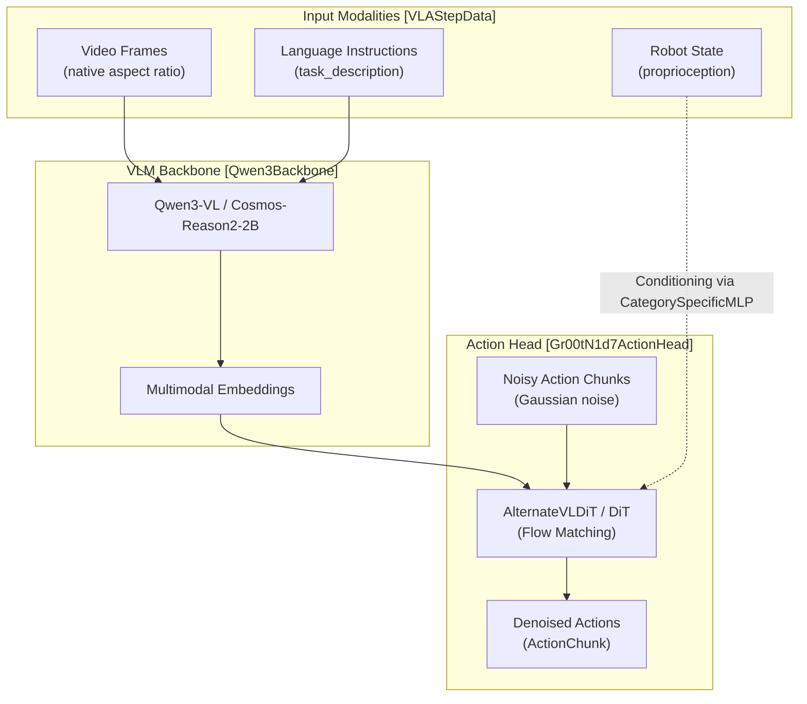
**Sources:** [README.md:73-77](), [README.md:93-93](), [gr00t/model/gr00t_n1d7/gr00t_n1d7.py:38-82](), [tests/gr00t/model/test_action_head.py:25-26]()

---

### Embodiment

An **embodiment** represents a specific robot platform configuration. In N1.7, these are managed via the `EmbodimentTag` enumeration.

| Tag Category | Description | Example Tags |
|--------------|-------------|--------------|
| **Pretrain Tags** | Baked into the base model (`nvidia/GR00T-N1.7-3B`), usable zero-shot. | `OXE_DROID_RELATIVE_EEF_RELATIVE_JOINT`, `XDOF`, `REAL_G1` |
| **Posttrain Tags** | Require a finetuned checkpoint for specific benchmarks. | `UNITREE_G1`, `SIMPLER_ENV_GOOGLE`, `LIBERO_PANDA` |
| **Finetuning Tags** | Used for integrating custom robots. | `NEW_EMBODIMENT` |

Custom embodiments must be registered using `register_modality_config` and associated with `EmbodimentTag.NEW_EMBODIMENT` during the fine-tuning process [getting_started/finetune_new_embodiment.md:71-72]().

**Sources:** [getting_started/finetune_new_embodiment.md:13-21](), [getting_started/finetune_new_embodiment.md:71-72](), [README.md:80-84]()

---

## Data Concepts

### Modality Configuration

A `ModalityConfig` defines how data is sampled and loaded for a specific embodiment.

*   **delta_indices:** Indices to sample relative to the current timestep. For video, this typically defines the current frame (`[0]`). For actions, it defines the prediction horizon (e.g., `list(range(0, 16))`) [getting_started/finetune_new_embodiment.md:27-43]().
*   **modality_keys:** The specific column names in the LeRobot dataset (e.g., `front`, `wrist`, `single_arm`, `gripper`) [getting_started/finetune_new_embodiment.md:28-47]().

### Action Representation

Actions are configured via `ActionConfig` [getting_started/finetune_new_embodiment.md:48-61]() using three key enums:
*   **ActionRepresentation:** `RELATIVE` (delta from current state) or `ABSOLUTE` (target position) [getting_started/finetune_new_embodiment.md:51-57](). N1.7 emphasizes `RELATIVE` end-effector (EEF) space for better generalization [README.md:90-90]().
*   **ActionType:** `EEF` (End-Effector) or `NON_EEF` (e.g., joint-space) [getting_started/finetune_new_embodiment.md:52-58]().
*   **ActionFormat:** `DEFAULT` or specialized formats like `XYZ_ROT6D` [getting_started/finetune_new_embodiment.md:53-59]().

**Sources:** [getting_started/finetune_new_embodiment.md:15-21](), [getting_started/finetune_new_embodiment.md:48-62](), [README.md:90-90]()

---

## Deployment and Inference

### Policy and Inference Pipeline

GR00T N1.7 supports multiple inference modes, including native PyTorch and TensorRT acceleration.

*   **Gr00tPolicy:** The high-level interface that wraps the model and processor for inference [README.md:83-84]().
*   **TensorRT Acceleration:** The `trt_full_pipeline` mode accelerates all model components (ViT, LLM, DiT, etc.) into TRT engines [scripts/deployment/README.md:68-85]().
*   **Denoising Loop:** During inference, the `get_action` method in `Gr00tN1d7ActionHead` performs the iterative denoising process to generate the `action_pred` [tests/gr00t/model/test_action_head.py:130-136]().

**Entity Mapping Diagram:**

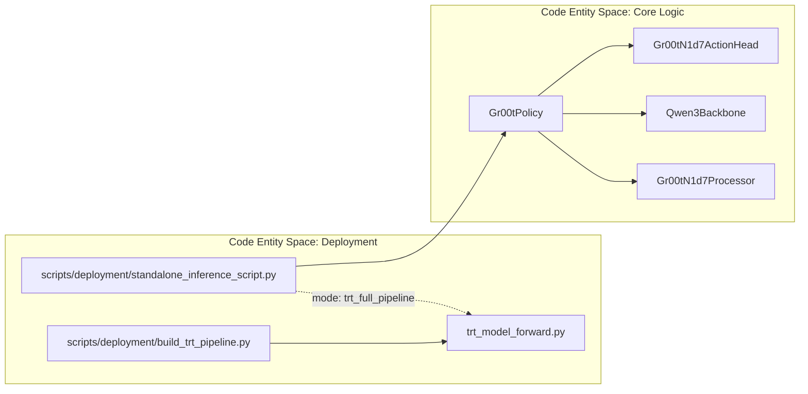
**Sources:** [scripts/deployment/README.md:55-62](), [scripts/deployment/README.md:68-74](), [scripts/deployment/README.md:107-111](), [tests/gr00t/model/test_action_head.py:130-136]()

---

## Summary of Key Terms

| Term | Definition | Code Reference |
|------|------------|----------------|
| **Action Horizon** | The number of future action steps predicted in a single inference pass. | `config.action_horizon` [tests/gr00t/model/test_action_head.py:39-39]() |
| **Flow Matching** | The generative technique used to train the DiT head to map noise to actions. | `Gr00tN1d7ActionHead` [gr00t/model/gr00t_n1d7/gr00t_n1d7.py:39-39]() |
| **Denoising Steps** | The number of iterations used during inference to refine the action prediction. | `num_inference_timesteps` [gr00t/model/gr00t_n1d7/gr00t_n1d7.py:64-64]() |
| **Embodiment Tag** | A unique identifier mapping a robot to its specific modality and action configurations. | `EmbodimentTag` [getting_started/finetune_new_embodiment.md:14-14]() |
| **Relative EEF** | A representation where actions are deltas from the current end-effector pose. | `ActionRepresentation.RELATIVE` [getting_started/finetune_new_embodiment.md:51-51]() |

**Sources:** [gr00t/model/gr00t_n1d7/gr00t_n1d7.py:38-82](), [tests/gr00t/model/test_action_head.py:32-70](), [getting_started/finetune_new_embodiment.md:48-62]()

---

# Page: Installation and Setup

# Installation and Setup

<details>
<summary>Relevant source files</summary>

The following files were used as context for generating this wiki page:

- [docker/Dockerfile](docker/Dockerfile)
- [docker/README.md](docker/README.md)
- [docker/build.sh](docker/build.sh)
- [gr00t/eval/rollout_policy.py](gr00t/eval/rollout_policy.py)
- [pyproject.toml](pyproject.toml)
- [scripts/deployment/spark/Dockerfile](scripts/deployment/spark/Dockerfile)
- [scripts/deployment/spark/uv.lock](scripts/deployment/spark/uv.lock)
- [uv.lock](uv.lock)

</details>


This document provides step-by-step instructions for installing the Isaac GR00T repository and configuring the development environment for GR00T N1.7. It covers repository cloning, dependency installation using `uv`, platform-specific Docker configurations, and hardware recommendations.

## Prerequisites

Before beginning installation, ensure your system meets the requirements for your target platform. GR00T N1.7 supports a variety of NVIDIA hardware, ranging from data center GPUs to edge devices.

| Platform | Python | CUDA | OS |
|----------|--------|------|----|
| **dGPU (x86_64)** | 3.12.* | 12.8 | Ubuntu 24.04 |
| **aarch64 (GB200)** | 3.12.* | 13.0 | Ubuntu 24.04 |
| **Jetson Thor / DGX Spark** | 3.12.* | 13.0 | Ubuntu 24.04 |
| **Jetson Orin** | 3.12.* | 13.2 | JetPack 7.2 |

**Important**: `git-lfs` is required to download parquet data files in `/demo_data`. Install it before cloning: `sudo apt install git-lfs && git lfs install`.

Sources: [pyproject.toml:10](), [pyproject.toml:83-84](), [docker/Dockerfile:16](), [docker/README.md:90](), [scripts/deployment/spark/Dockerfile:1-8]()

---

## Installation Workflow

The following diagram illustrates the complete installation process, highlighting the use of the `uv` package manager to handle complex dependencies like `flash-attn` and `torchcodec`.

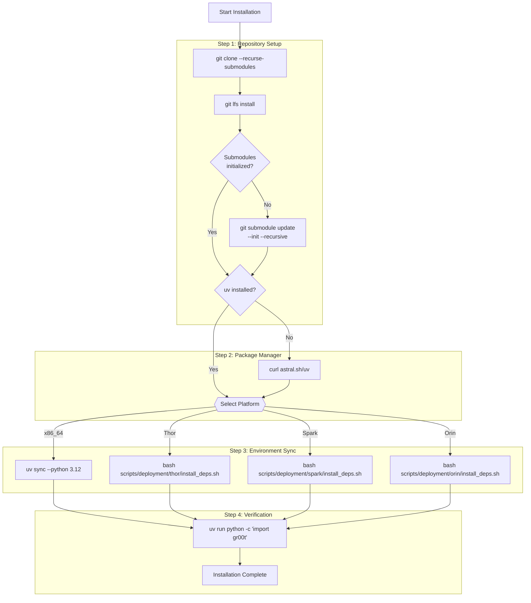

Sources: [pyproject.toml:81-109](), [docker/README.md:18-94](), [scripts/deployment/spark/Dockerfile:18]()

---

## Step 1: Clone Repository with Submodules

The Isaac GR00T repository contains external dependencies managed as Git submodules. These must be initialized during cloning to ensure all model components are available.

```bash
git clone --recurse-submodules https://github.com/NVIDIA/Isaac-GR00T
cd Isaac-GR00T
```

If you have already cloned without submodules, initialize them:
```bash
git submodule update --init --recursive
```

Sources: [docker/README.md:38]()

---

## Step 2: Set Up the Environment with `uv`

GR00T uses [uv](https://github.com/astral-sh/uv) for fast, reproducible dependency management. The repository requires Python 3.12.

### Default Install (x86_64 dGPU)
1. **Install FFmpeg**: Required by `torchcodec` for video processing.
   ```bash
   sudo apt-get update && sudo apt-get install -y ffmpeg
   ```
2. **Install `uv`**:
   ```bash
   curl -LsSf https://astral.sh/uv/install.sh | sh
   ```
3. **Synchronize Environment**:
   ```bash
   uv sync --python 3.12
   ```

For details on platform-specific dependency structures (Thor, Orin, Spark), see [Environment and Dependencies](#2.1).

Sources: [pyproject.toml:10](), [pyproject.toml:42](), [docker/Dockerfile:79](), [docker/Dockerfile:142]()

---

## Dependency Architecture

GR00T N1.7 introduces a streamlined dependency stack optimized for the Qwen3-VL backbone and DiT action head.

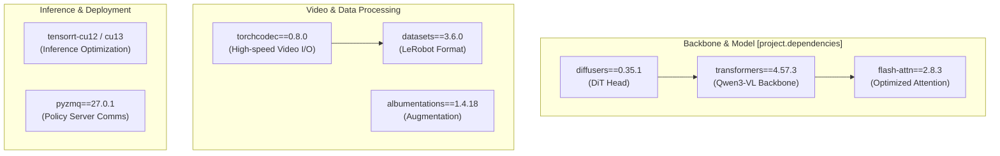

Sources: [pyproject.toml:12-58]()

---

## Docker and Container Setup

For isolated environments, GR00T provides a unified `Dockerfile` that supports both x86_64 and aarch64 (GB200/Grace Hopper). Specialized Dockerfiles are also provided for edge platforms.

### Building the Image
```bash
bash docker/build.sh
```

### Supported Docker Profiles
| Profile | Base Image | Target Hardware |
|---------|------------|-----------------|
| `default` | `nvidia/cuda:12.8.0-devel-ubuntu24.04` | x86_64, GB200, Grace Hopper |
| `thor` | `scripts/deployment/thor/Dockerfile` | Jetson Thor |
| `orin` | `scripts/deployment/orin/Dockerfile` | Jetson Orin |
| `spark` | `nvidia/cuda:13.0.0-devel-ubuntu24.04` | DGX Spark |

For headless rendering configuration and build script details, see [Docker and Container Setup](#2.3).

Sources: [docker/README.md:13-94](), [docker/Dockerfile:16](), [docker/build.sh:26-54](), [scripts/deployment/spark/Dockerfile:1]()

---

## Hardware Recommendations

The N1.7 model performance varies by platform. The `uv.lock` and `pyproject.toml` files specify requirements for high-performance inference and training.

| Device | Precision | Recommended Stack |
|--------|-----------|-------------------|
| **H100 / L40** | PyTorch / DeepSpeed | `deepspeed==0.17.6` |
| **GB200 / aarch64** | PyTorch / Triton | `triton==3.5.0` |
| **Edge Devices** | TensorRT | `tensorrt-cu13` |

**Fine-tuning Requirements**: Multi-GPU setups using DeepSpeed are supported for x86_64 Linux platforms.

Sources: [pyproject.toml:47-58](), [uv.lock:28-40]()

---

## Verification Steps

After installation, verify the setup by running the following commands:

1. **Verify GR00T Installation**:
   ```bash
   uv run python -c "import gr00t; print('GR00T ready')"
   ```
2. **Verify GPU/CUDA**:
   ```bash
   uv run python -c "import torch; print(f'CUDA: {torch.cuda.is_available()}')"
   ```

If verification succeeds, you are ready to proceed to the [Quick Start Guide](#2.2) to run your first inference.

Sources: [docker/README.md:41](), [pyproject.toml:118]()

---

# Page: Environment and Dependencies

# Environment and Dependencies

<details>
<summary>Relevant source files</summary>

The following files were used as context for generating this wiki page:

- [CLAUDE.md](CLAUDE.md)
- [getting_started/hardware_recommendation.md](getting_started/hardware_recommendation.md)
- [gr00t/eval/rollout_policy.py](gr00t/eval/rollout_policy.py)
- [pyproject.toml](pyproject.toml)
- [scripts/activate_jetpack72.sh](scripts/activate_jetpack72.sh)
- [scripts/activate_orin.sh](scripts/activate_orin.sh)
- [scripts/activate_thor.sh](scripts/activate_thor.sh)
- [scripts/deployment/build_flash_attn.sh](scripts/deployment/build_flash_attn.sh)
- [uv.lock](uv.lock)

</details>


## Purpose and Scope

This page documents the complete environment and dependency structure for the Isaac-GR00T repository. It details the transition to **uv** as the primary package manager, platform-specific requirements for NVIDIA hardware (x86_64, Jetson Orin, AGX Thor, and Spark), and the mandatory CUDA configurations for the N1.7 architecture.

---

## Python and CUDA Requirements

The Isaac-GR00T system architecture (N1.7) utilizes specific Python versions and CUDA toolkits depending on the target platform to maximize hardware acceleration. Note that for N1.7, the base Python version has been unified to **3.12** for the majority of platforms.

| Platform | Python Version | CUDA Toolkit | Primary Use Case |
| :--- | :--- | :--- | :--- |
| **dGPU (x86_64 / H100)** | `==3.12.*` | 12.8+ | Training & High-perf Inference |
| **Jetson AGX Thor** | `==3.12.*` | 13.2 (JetPack 7.2) | Next-gen Edge Deployment |
| **Jetson Orin** | `==3.12.*` | 13.2 (JetPack 7.2) | Edge Deployment |
| **DGX Spark** | `==3.12.*` | 13.0 | Mobile/Edge Deployment |

**Sources:** [pyproject.toml:10](), [uv.lock:3](), [getting_started/hardware_recommendation.md:64-67](), [scripts/activate_jetpack72.sh:9-12]()

---

## Package Management with `uv`

The repository utilizes the `uv` package manager for fast, deterministic dependency resolution. The configuration is defined in `pyproject.toml` and locked in `uv.lock`.

### Dependency Resolution Strategy
The system uses `uv sync` to align the virtual environment. Architecture-specific wheels (e.g., `flash-attn` and `torchcodec` for `aarch64`) are handled via `tool.uv.sources` and environment markers in the project file.

```bash
# Standard installation
uv sync --all-extras
```

**Sources:** [pyproject.toml:81-109](), [CLAUDE.md:16](), [CLAUDE.md:8-10]()

---

## Platform-Specific Considerations

### 1. dGPU / x86_64 (Training & Server)
Used for training the Qwen3-VL backbone and DiT action head.
*   **Key Dependencies:** `torch==2.9.0`, `deepspeed==0.17.6`, `accelerate==1.13.0`.
*   **Flash-Attn:** Uses a specific prebuilt wheel for x86_64 CUDA 12.
*   **TensorRT:** Requires `tensorrt-cu12>=10.15.1.29`.

### 2. Jetson AGX Thor & Orin (JetPack 7.2)
These platforms utilize Python 3.12 and CUDA 13.2.
*   **Environment Activation:** Users must source `scripts/activate_jetpack72.sh` (or the symlinked `scripts/activate_thor.sh`/`scripts/activate_orin.sh`) to set `TRITON_PTXAS_PATH` and `LD_LIBRARY_PATH` for `torch.compile` and TensorRT support.
*   **AArch64 Wheels:** `torchcodec==0.8.0` is sourced from local paths in `scripts/deployment/dgpu/wheels/` as it is not available on PyPI for aarch64.
*   **TensorRT:** Requires `tensorrt-cu13>=10.15.1.29`.

### 3. Flash-Attention Build System
For platforms where prebuilt wheels are unavailable, the repository includes `scripts/deployment/build_flash_attn.sh`. This script handles:
*   Pinning the CUTLASS submodule to a stable SHA (`f74fea9c`).
*   Patching `setup.py` to support specific CUDA architectures like `sm_87` (Orin) and `sm_120` (Blackwell/Thor).

**Sources:** [pyproject.toml:42-58](), [scripts/activate_jetpack72.sh:1-25](), [scripts/deployment/build_flash_attn.sh:69-80](), [getting_started/hardware_recommendation.md:23-25]()

---

## Environment Mapping and Data Flow

The following diagram bridges the platform concepts to the specific code entities responsible for environment setup.

**Diagram: Platform-to-Code Entity Mapping**

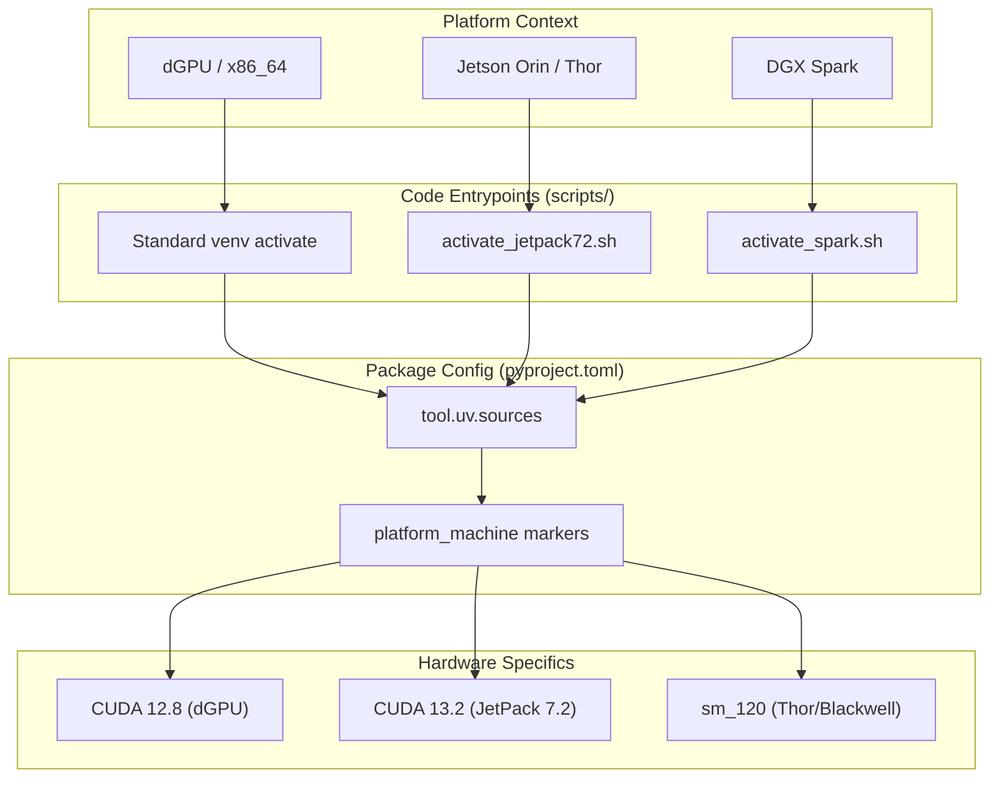

**Sources:** [pyproject.toml:87-109](), [scripts/activate_jetpack72.sh:1-5](), [scripts/activate_thor.sh:1-5](), [scripts/deployment/build_flash_attn.sh:93-113]()

---

## Core Dependency Groups

Dependencies are strictly versioned to support the N1.7 architecture (Qwen3-VL + DiT).

### Inference & Deployment Utilities
| Package | Version | Purpose |
| :--- | :--- | :--- |
| `pyzmq` | 27.0.1 | Messaging for `Gr00tPolicy` server/client communication. |
| `tensorrt-cu1X` | >=10.15.1 | High-speed inference via `build_trt_pipeline.py`. |
| `torchcodec` | 0.8.0 | Efficient video frame extraction for VLA observations. |

### Model Backbone & Head
| Package | Version | Purpose |
| :--- | :--- | :--- |
| `transformers` | 4.57.3 | Qwen3-VL (Cosmos-Reason2-2B) backbone support. |
| `diffusers` | 0.35.1 | Diffusion Transformer (DiT) implementation. |
| `flash-attn` | 2.8.3 | Attention optimization for high-resolution vision inputs. |

**Sources:** [pyproject.toml:11-59](), [CLAUDE.md:61-64]()

---

## Dependency Interaction Diagram

This diagram illustrates how specific library versions support the model components and inference pipelines.

**Diagram: Dependency and Model Component Interaction**

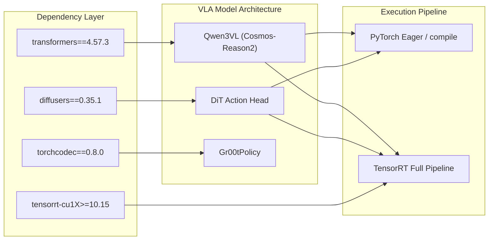

**Sources:** [pyproject.toml:11-59](), [getting_started/hardware_recommendation.md:13-25](), [CLAUDE.md:44-50]()

---

## Evaluation Environments

The system integrates several external simulation environments via specific factory functions in the rollout pipeline.

*   **SimplerEnv:** Integrated via `register_simpler_envs` for WidowX and Google Robot tasks.
*   **LIBERO:** Integrated via `register_libero_envs` for Panda robot manipulation.
*   **RoboCasa:** Integrated via `robocasa.utils.gym_utils.gymnasium_groot` for kitchen tasks.

**Sources:** [gr00t/eval/rollout_policy.py:112-154](), [gr00t/eval/rollout_policy.py:165-170]()

---

## Summary of Platform Activations

After performing a `uv sync`, you must source the correct activation script to ensure hardware-specific paths (like `ptxas` for `torch.compile`) are correctly configured:

*   **Jetson Orin / Thor:** `source scripts/activate_jetpack72.sh`
*   **DGX Spark:** `source scripts/activate_spark.sh`
*   **dGPU / x86_64:** `source .venv/bin/activate`

**Sources:** [scripts/activate_jetpack72.sh:1-5](), [CLAUDE.md:79]()

---

# Page: Quick Start Guide

# Quick Start Guide

<details>
<summary>Relevant source files</summary>

The following files were used as context for generating this wiki page:

- [getting_started/GR00T_inference.ipynb](getting_started/GR00T_inference.ipynb)
- [getting_started/policy.md](getting_started/policy.md)
- [gr00t/eval/sim/LIBERO/setup_libero.sh](gr00t/eval/sim/LIBERO/setup_libero.sh)

</details>


## Purpose and Scope

This guide provides the fastest path to running inference with a pre-trained GR00T N1.7 checkpoint. You will learn how to load a model using the `Gr00tPolicy` API and execute inference using the `GR00T_inference.ipynb` notebook or standalone scripts. This covers zero-shot deployment and verification using the new Qwen3-VL (Cosmos-Reason2-2B) backbone.

For detailed information about:
- Installing dependencies and environment setup, see [Environment and Dependencies](#2.1)
- Fine-tuning on custom data, see [Training GR00T Models](#6)
- Complete policy API documentation, see [Policy Server Architecture](#5.1) and [Client Integration](#5.3)

---

## Prerequisites

Before starting, ensure you have completed the installation steps from [Environment and Dependencies](#2.1):

| Requirement | Status Check |
|-------------|--------------|
| Repository cloned with submodules | `ls -la external_dependencies/` should show submodules [gr00t/eval/sim/LIBERO/setup_libero.sh:8-12]() |
| `uv` package manager installed | `uv --version` |
| Python environment created | `.venv` directory exists [getting_started/GR00T_inference.ipynb:11-11]() |
| CUDA 12.8+ available | `nvidia-smi` shows GPU |

---

## Quick Start Workflow

The following diagram shows the complete zero-shot deployment workflow for GR00T N1.7, bridging the high-level process to specific code entities.

### Deployment Flow: Natural Language to Code Entities

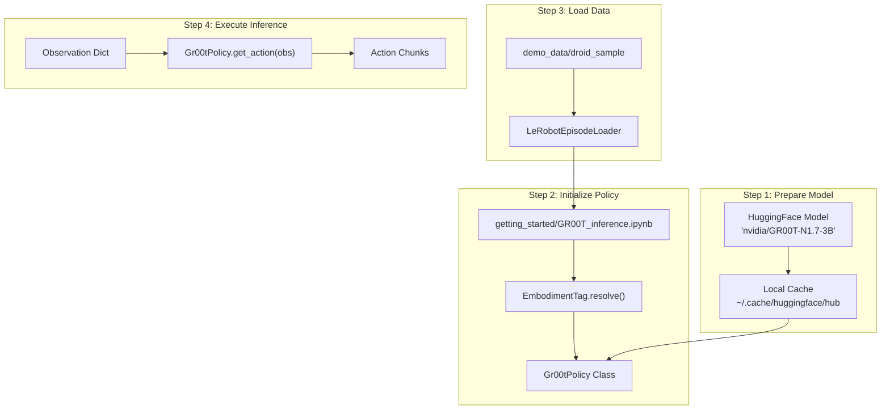

**Sources:** [getting_started/GR00T_inference.ipynb:20-44](), [getting_started/policy.md:14-19]()

---

## Step 1: Download Pre-trained Checkpoint

GR00T N1.7 checkpoints are hosted on HuggingFace Hub and are automatically downloaded when referenced via `model_path` in the `Gr00tPolicy` constructor [getting_started/GR00T_inference.ipynb:89-94]().

### Available Checkpoints (N1.7)

| Model ID | Parameters | Description |
|----------|------------|-------------|
| `nvidia/GR00T-N1.7-3B` | ~2.9B | Base model with Cosmos-Reason2-2B backbone. [getting_started/GR00T_inference.ipynb:37-37](), [getting_started/GR00T_inference.ipynb:83-83]() |
| `nvidia/GR00T-N1.7-DROID` | ~2.9B | Finetuned on DROID dataset. [getting_started/policy.md:66-66]() |
| `nvidia/GR00T-N1.7-LIBERO` | ~2.9B | Finetuned for LIBERO simulation. [getting_started/policy.md:68-68]() |

---

## Step 2: Interactive Inference (Notebook)

The `getting_started/GR00T_inference.ipynb` notebook is the recommended way to start. It demonstrates how to use the `Gr00tPolicy` to predict actions from observations.

### Key Implementation Steps
1.  **Policy Initialization**: The policy is loaded using an `EmbodimentTag` which determines the modality configuration (state/action keys and normalization) [getting_started/policy.md:35-37]().
    ```python
    policy = Gr00tPolicy(
        model_path="nvidia/GR00T-N1.7-3B",
        embodiment_tag=EmbodimentTag.resolve("OXE_DROID_RELATIVE_EEF_RELATIVE_JOINT"),
        device="cuda"
    )
    ```
    *Source: [getting_started/GR00T_inference.ipynb:89-94]()*

2.  **Modality Configuration**: The notebook retrieves the `modality_config` from the policy to ensure the dataset loader matches the model's expected inputs (e.g., `video`, `state`, `language`) [getting_started/GR00T_inference.ipynb:136-146]().

3.  **Data Loading**: Uses `LeRobotEpisodeLoader` to pull sample data from `demo_data/droid_sample` [getting_started/GR00T_inference.ipynb:154-158]().

---

## Step 3: Standalone Inference Script

For non-interactive environments, use the `standalone_inference_script.py`. This script runs inference on local demo data and calculates metrics like Mean Squared Error (MSE) against ground truth.

### Execution Example
```bash
uv run python scripts/deployment/standalone_inference_script.py \
    --model-path nvidia/GR00T-N1.7-3B \
    --dataset-path demo_data/droid_sample \
    --embodiment-tag OXE_DROID_RELATIVE_EEF_RELATIVE_JOINT \
    --traj-ids 1 2 \
    --inference-mode pytorch \
    --execution-horizon 16
```
*Source: [getting_started/policy.md:33-85]()*

### Data Flow: Standalone Inference

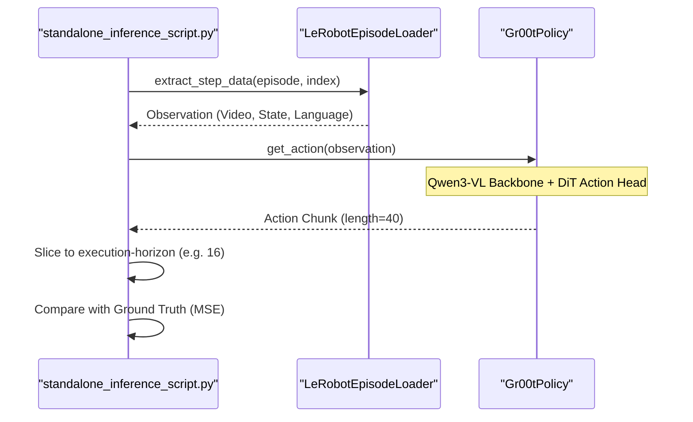

**Sources:** [getting_started/GR00T_inference.ipynb:24-27](), [getting_started/policy.md:82-88]()

---

## Step 4: Understanding Parameters

### Embodiment Tags
The `--embodiment-tag` is critical as it defines how the model interprets state and action vectors.
- **Pretrain tags**: Use `OXE_DROID_RELATIVE_EEF_RELATIVE_JOINT` or `XDOF` with the base `3B` model for zero-shot tasks [getting_started/policy.md:42-42]().
- **Posttrain tags**: Tags like `LIBERO_PANDA` or `SIMPLER_ENV_GOOGLE` require their respective finetuned checkpoints [getting_started/policy.md:43-43]().

### Execution Horizon
The `--execution-horizon` (formerly `--action-horizon`) determines how many steps of the predicted chunk are executed before re-planning. For the N1.7 base model, the predicted chunk length (`action_horizon`) is 40 [getting_started/policy.md:82-90]().

---

## Troubleshooting

### Environment Setup for Simulation
If running simulation benchmarks like LIBERO, you must run the provided setup scripts to patch dependencies for Python 3.12 compatibility [gr00t/eval/sim/LIBERO/setup_libero.sh:17-32]().

### Kernel Selection
When using the Jupyter notebook, ensure the `.venv` kernel is selected to avoid missing dependency errors [getting_started/GR00T_inference.ipynb:11-11]().

### Tag Mismatches
Using a posttrain tag (e.g., `LIBERO_PANDA`) with the base model checkpoint will result in an error, as the base model only supports a specific set of zero-shot tags [getting_started/policy.md:76-76]().

**Sources:** [getting_started/GR00T_inference.ipynb:1-179](), [getting_started/policy.md:1-96](), [gr00t/eval/sim/LIBERO/setup_libero.sh:1-77]()

---

# Page: Docker and Container Setup

# Docker and Container Setup

<details>
<summary>Relevant source files</summary>

The following files were used as context for generating this wiki page:

- [docker/Dockerfile](docker/Dockerfile)
- [docker/README.md](docker/README.md)
- [docker/build.sh](docker/build.sh)
- [scripts/deployment/jetson/Dockerfile](scripts/deployment/jetson/Dockerfile)
- [scripts/deployment/spark/Dockerfile](scripts/deployment/spark/Dockerfile)
- [scripts/deployment/spark/install_deps.sh](scripts/deployment/spark/install_deps.sh)
- [scripts/deployment/spark/uv.lock](scripts/deployment/spark/uv.lock)
- [tests/scripts/deployment/test_install_deps_cleanup_trap.py](tests/scripts/deployment/test_install_deps_cleanup_trap.py)
- [tools/manifest_alignment.toml](tools/manifest_alignment.toml)

</details>


This page describes the Docker-based deployment strategy for the Isaac-GR00T codebase. The system utilizes a unified containerization approach to ensure environment parity across diverse hardware architectures, including standard x86_64 servers and NVIDIA edge platforms like Thor, Orin, and Spark.

## Overview of Container Strategy

The Isaac-GR00T project provides a primary `Dockerfile` that supports both x86_64 and aarch64 (e.g., GB200, Grace Hopper) architectures [docker/Dockerfile:2-4](). For specialized edge deployments, platform-specific Dockerfiles are maintained to handle unique CUDA versions and platform requirements [docker/README.md:66-97]().

### Build and Execution Flow

The build process is managed by a central script, `docker/build.sh`, which selects the appropriate Dockerfile based on a `--profile` argument [docker/build.sh:9-16]().

**Diagram: Build Profile Resolution**
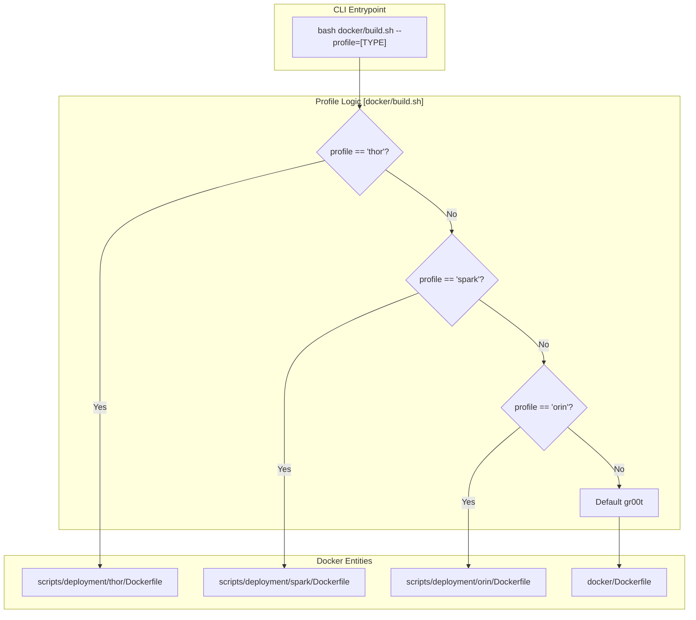
**Sources:** [docker/build.sh:9-54](), [docker/README.md:13-19]()

---

## The Main Dockerfile (x86_64 / aarch64)

The primary `docker/Dockerfile` is based on `nvidia/cuda:12.8.0-devel-ubuntu24.04` [docker/Dockerfile:16](). It automates the installation of system dependencies, including both Python 3.12 (primary) and Python 3.10 (for simulation compatibility), and the `uv` package manager [docker/Dockerfile:69-72](), [docker/Dockerfile:101-125](), [docker/Dockerfile:142]().

### Key Implementation Details
*   **Aarch64 Compatibility:** For Grace Hopper or GB200 systems, the build utilizes a bootstrap process for `torchcodec` using wheels located in `scripts/deployment/dgpu/wheels/` [docker/Dockerfile:5-8](), [docker/Dockerfile:177-180]().
*   **Dependency Management:** It uses `uv sync` to install dependencies into a global virtual environment at `/opt/gr00t-venv` [docker/Dockerfile:22-23](), [docker/Dockerfile:167-182](). A compatibility symlink is created at `/workspace/.venv` [docker/Dockerfile:191]().
*   **Version Tracking:** The image records the SHA256 hash of the `uv.lock` file used during the build to ensure environment consistency [docker/Dockerfile:183]().

**Sources:** [docker/Dockerfile:1-196](), [docker/README.md:3-4](), [docker/README.md:21]()

---

## Headless Rendering Configuration

To support simulation environments like MuJoCo and PyOpenGL within a container, the Dockerfile configures EGL and Vulkan for headless hardware acceleration [docker/Dockerfile:197-208]().

### Implementation of Graphics Drivers in Container
The container manually maps the NVIDIA EGL vendor library to ensure the `libEGL_nvidia.so.0` driver is correctly identified by the GL Vendor-Neutral Dispatch library (GLVND) [docker/Dockerfile:198-206]().

| Environment Variable | Value | Purpose |
| :--- | :--- | :--- |
| `NVIDIA_DRIVER_CAPABILITIES` | `graphics,utility,compute` | Enables GPU graphics features in container [docker/Dockerfile:21]() |
| `GR00T_GLOBAL_VENV` | `/opt/gr00t-venv` | Path to the pre-installed virtual environment [docker/Dockerfile:22]() |
| `UV_PROJECT_ENVIRONMENT` | `/opt/gr00t-venv` | Directs `uv` to use the global venv [docker/Dockerfile:23]() |

**Sources:** [docker/Dockerfile:20-23](), [docker/Dockerfile:197-208]()

---

## Platform-Specific Images

For edge deployment, Isaac-GR00T provides specialized environments tailored to specific hardware constraints and CUDA versions.

### Thor and Spark (CUDA 13)
Both Jetson Thor and DGX Spark environments utilize `nvidia/cuda:13.0.0-devel-ubuntu24.04` as a base [scripts/deployment/spark/Dockerfile:1](). They include a custom `install_deps.sh` script that manages platform-specific dependency resolution before running `uv sync` [scripts/deployment/spark/Dockerfile:18](), [scripts/deployment/spark/install_deps.sh:89-90]().

### Orin (JetPack 7.2)
The Orin container is built from `nvidia/cuda:13.2.1-devel-ubuntu24.04` for JetPack 7.2 compatibility [scripts/deployment/jetson/Dockerfile:1](). It uses a shared virtual environment at `/opt/gr00t-venv` and configures `LD_LIBRARY_PATH` to include `tensorrt_libs` [scripts/deployment/jetson/Dockerfile:18-30]().

**Diagram: Edge Container Environment Mapping**
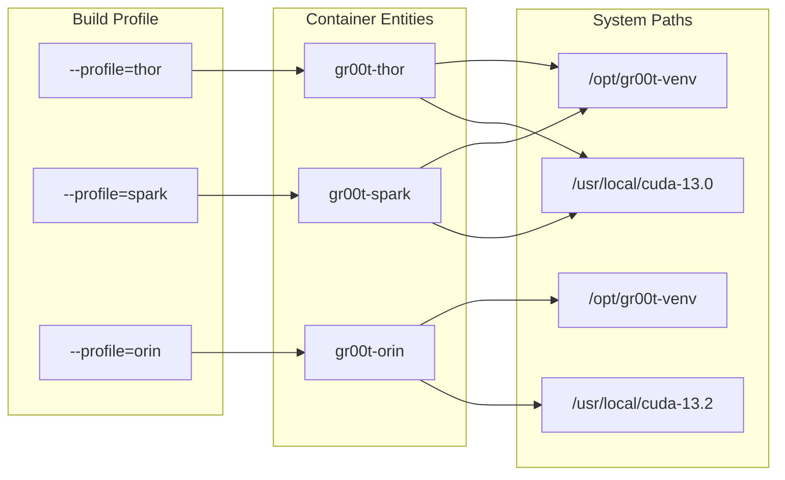
**Sources:** [scripts/deployment/spark/Dockerfile:1-31](), [scripts/deployment/jetson/Dockerfile:1-32](), [docker/README.md:68-97]()

---

## Usage and Deployment

### Development Workflow
The recommended workflow is to start the image and then clone the repository inside it [docker/README.md:25](). If mounting local source for live editing, it should be mounted under a subdirectory to avoid hiding the image's compatibility symlinks [docker/README.md:57-64]().

### Dependency Alignment
The project uses `tools/manifest_alignment.toml` to track and allow intentional version drifts between platforms (e.g., `diffusers` or `transformers` versions) necessitated by hardware-specific wheel stacks [tools/manifest_alignment.toml:1-29]().

### Runtime Resource Limits
To ensure stability during heavy inference or training, containers are launched with specific IPC and memory locking limits:
*   `--ipc=host`: Shared memory for high-speed data transfer [docker/README.md:30-31]().
*   `--ulimit memlock=-1`: Prevents memory from being swapped out [docker/README.md:31]().
*   `--ulimit stack=67108864`: Increases stack size for deep recursive operations [docker/README.md:31]().

**Sources:** [docker/README.md:23-64](), [tools/manifest_alignment.toml:1-29]()

---

# Page: Data Pipeline and Configuration

# Data Pipeline and Configuration

<details>
<summary>Relevant source files</summary>

The following files were used as context for generating this wiki page:

- [examples/DROID/main_gr00t.py](examples/DROID/main_gr00t.py)
- [gr00t/configs/data/data_config.py](gr00t/configs/data/data_config.py)
- [gr00t/data/dataset/factory.py](gr00t/data/dataset/factory.py)
- [gr00t/data/dataset/lerobot_episode_loader.py](gr00t/data/dataset/lerobot_episode_loader.py)
- [gr00t/eval/sim/wrapper/multistep_wrapper.py](gr00t/eval/sim/wrapper/multistep_wrapper.py)
- [gr00t/utils/video_utils.py](gr00t/utils/video_utils.py)
- [tests/gr00t/utils/test_video_backend.py](tests/gr00t/utils/test_video_backend.py)

</details>


## Purpose and Scope

This page provides an overview of the complete data pipeline and configuration system in Isaac-GR00T, explaining how robot demonstration data flows from raw datasets through various processing stages to become model-ready inputs. The pipeline is designed to support multiple robot embodiments with different sensors, action spaces, and control modalities through a flexible configuration system.

For detailed information on specific subsystems:
- Dataset format specifications: see [LeRobot Compatible Data Format](#3.1)
- Robot identification and embodiment tags: see [Robot Embodiment System](#3.2)
- Configuration file structure: see [Modality Configuration Files](#3.3)
- Action representation and transformation: see [Pose and Action Representations](#3.4)
- Processing algorithms and normalization: see [Data Processing Pipeline](#3.5)
- Video frame handling: see [Video and Image Processing](#3.6)

## Overview of the Data Pipeline

The GR00T data pipeline follows a three-layer architecture that transforms raw robot demonstrations into normalized tensors suitable for the Vision-Language-Action model:

1.  **Dataset Layer**: Raw robot data stored in the LeRobot v2 format, consisting of Parquet files for time-series data and JSON files for metadata.
2.  **Configuration Layer**: Embodiment-specific configurations that define what data to load, how to sample temporally, and how to interpret actions.
3.  **Processing Layer**: Transformation and normalization routines that convert raw data into model-ready inputs.

This architecture enables a single codebase to handle diverse robot platforms—from bimanual arms to humanoid robots—without modifying core processing logic.

**Sources:** [gr00t/data/dataset/lerobot_episode_loader.py:18-33](), [gr00t/configs/data/data_config.py:27-50]()

## Complete Data Flow Architecture

The following diagram illustrates the end-to-end data flow with specific code entities:

Title: GR00T Data Flow Architecture
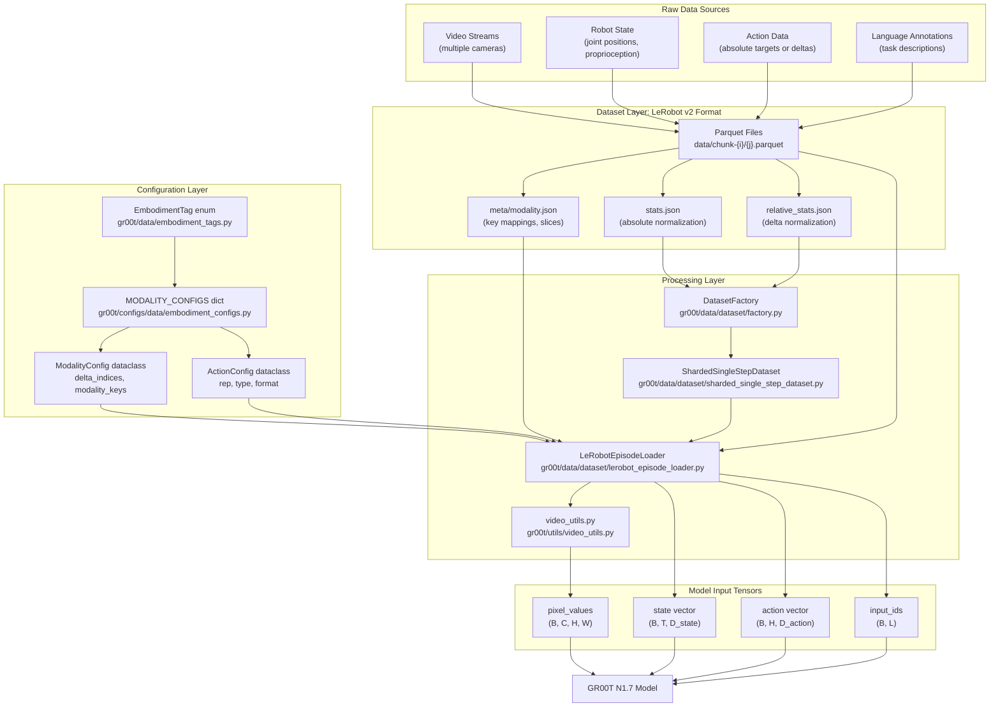

This diagram shows the complete transformation pipeline. Raw sensor data is stored in LeRobot v2 format, loaded according to embodiment-specific configurations, processed through specialized processors, and finally converted into tensors that feed the Vision-Language Model backbone and DiT action head.

**Sources:** [gr00t/data/dataset/lerobot_episode_loader.py:80-114](), [gr00t/data/dataset/factory.py:28-69](), [gr00t/utils/video_utils.py:70-130]()

## The Three-Layer System

### Dataset Layer: LeRobot v2 Format

The **Dataset Layer** uses the LeRobot v2 format as the canonical data representation. This format stores time-series data in Parquet files organized by chunks, with metadata in JSON files:

-   **Data files**: `data/chunk-{i}/{j}.parquet` - Contains timestamped observations, actions, and done flags.
-   **Metadata**: `meta/modality.json` - Defines key mappings and array slicing for state/action vectors. [gr00t/data/dataset/lerobot_episode_loader.py:55]()
-   **Statistics**: `stats.json` and `relative_stats.json` - Precomputed normalization parameters. [gr00t/data/dataset/lerobot_episode_loader.py:56-57]()

All datasets must be converted to this format before training. The `LeRobotEpisodeLoader` handles parsing these metadata files and loading the corresponding data chunks. [gr00t/data/dataset/lerobot_episode_loader.py:144-174]()

**Sources:** [gr00t/data/dataset/lerobot_episode_loader.py:50-58](), [gr00t/data/dataset/factory.py:56-60]()

### Configuration Layer: Embodiment and Modality Configs

The **Configuration Layer** defines how data is loaded and interpreted for each robot embodiment.

#### EmbodimentTag Enumeration
The `EmbodimentTag` enum uniquely identifies each robot platform. It is used to look up the correct modality configuration from the registry. [gr00t/data/dataset/factory.py:53-54]()

#### Modality Configurations
Each `EmbodimentTag` maps to a modality configuration dictionary. The configuration specifies:

```python
{
    "video": ModalityConfig(delta_indices=[0], modality_keys=["front"]),
    "state": ModalityConfig(delta_indices=[0], modality_keys=["observation.state"]),
    "action": ModalityConfig(
        delta_indices=list(range(0, 16)),  # 16-step action horizon
        modality_keys=["action"],
        action_configs=[ActionConfig(...)]
    ),
    "language": ModalityConfig(delta_indices=[0], modality_keys=["task"])
}
```

The `ModalityConfig` class defines:
-   **`delta_indices`**: Temporal sampling offsets (e.g., `[0]` for current frame, `list(range(0,16))` for 16-step action prediction). [gr00t/data/dataset/lerobot_episode_loader.py:102-110]()
-   **`modality_keys`**: Which data keys to load from the dataset (must match `meta/modality.json`). [gr00t/data/dataset/lerobot_episode_loader.py:102-110]()

**Sources:** [gr00t/configs/data/data_config.py:61-72](), [gr00t/data/dataset/lerobot_episode_loader.py:80-114]()

### Processing Layer: Transformations and Normalization

The **Processing Layer** applies transformations to convert raw data into normalized model inputs.

#### LeRobotEpisodeLoader
The `LeRobotEpisodeLoader` class ([gr00t/data/dataset/lerobot_episode_loader.py:80-114]()) is the primary entry point for loading episode data. It handles:
-   Parsing LeRobot metadata.
-   Loading and decoding video data using backends like `torchcodec`. [gr00t/data/dataset/lerobot_episode_loader.py:90-92]()
-   Extracting multi-modal data according to modality configurations.

#### Video and Image Processing
Video processing is handled by `video_utils.py`, which supports multiple backends. `torchcodec` is the officially supported backend for GR00T N1.7. [gr00t/utils/video_utils.py:22-35](), [gr00t/utils/video_utils.py:70-76]()

#### Action Space Transformations
The action representation system provides classes to manage multi-step action sequences. In the DROID example, egocentric frame correction is applied to match the training pipeline. [examples/DROID/main_gr00t.py:51-54](), [examples/DROID/main_gr00t.py:57-70]()

**Sources:** [gr00t/data/dataset/lerobot_episode_loader.py:80-114](), [gr00t/utils/video_utils.py:70-130]()

## Configuration-Driven Processing Pipeline

The following diagram shows how configuration objects drive the processing pipeline:

Title: Configuration-Driven Processing
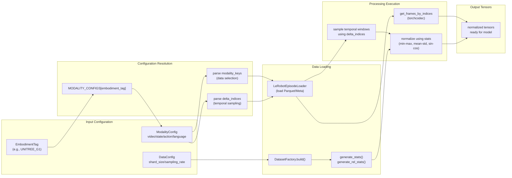

**Sources:** [gr00t/data/dataset/factory.py:28-69](), [gr00t/data/dataset/lerobot_episode_loader.py:115-143]()

## Statistics and Normalization

### Statistics Generation
GR00T uses precomputed statistics for data normalization. The `DatasetFactory` ensures these are generated on Rank 0 during initialization:
-   **`generate_stats(dataset_path)`**: Computes normalization parameters for absolute values. [gr00t/data/dataset/factory.py:59]()
-   **`generate_rel_stats(dataset_path, embodiment_tag)`**: Computes normalization parameters for relative (delta) values. [gr00t/data/dataset/factory.py:60]()

### Video Backend Safety
The system uses a lazy import pattern for video backends to avoid unnecessary dependencies. The `video_utils.py` module provides wrappers that handle `torchcodec` installation hints and FFmpeg version mismatches. [gr00t/utils/video_utils.py:22-35](), [gr00t/utils/video_utils.py:56-61]()

**Sources:** [gr00t/data/dataset/factory.py:56-61](), [gr00t/utils/video_utils.py:44-61]()

## Summary

The GR00T data pipeline is a modular system that enables multi-embodiment robot learning by separating data storage (LeRobot v2), configuration (ModalityConfigs), and processing (LeRobotEpisodeLoader). This architecture provides the flexibility to support diverse robot platforms with a unified Vision-Language-Action model.

For detailed information on each subsystem, refer to the child pages ([LeRobot Compatible Data Format](#3.1) through [Video and Image Processing](#3.6)).

---

# Page: LeRobot Compatible Data Format

# LeRobot Compatible Data Format

<details>
<summary>Relevant source files</summary>

The following files were used as context for generating this wiki page:

- [demo_data/cube_to_bowl_5_with_mask/meta/info.json](demo_data/cube_to_bowl_5_with_mask/meta/info.json)
- [demo_data/droid_sample/meta/relative_stats.json](demo_data/droid_sample/meta/relative_stats.json)
- [demo_data/droid_sample/meta/stats.json](demo_data/droid_sample/meta/stats.json)
- [examples/RoboLab/README.md](examples/RoboLab/README.md)
- [gr00t/data/dataset/lerobot_episode_loader.py](gr00t/data/dataset/lerobot_episode_loader.py)
- [gr00t/eval/real_robot/SO100/pyproject.toml](gr00t/eval/real_robot/SO100/pyproject.toml)
- [gr00t/utils/video_utils.py](gr00t/utils/video_utils.py)
- [scripts/download_droid_sample.py](scripts/download_droid_sample.py)
- [tests/gr00t/data/test_demo_dataset_stats.py](tests/gr00t/data/test_demo_dataset_stats.py)
- [tests/gr00t/utils/test_video_backend.py](tests/gr00t/utils/test_video_backend.py)

</details>


This document describes the LeRobot v2 data schema used by Isaac GR00T for storing robot demonstration data. The format provides a standardized structure for organizing multi-modal robot data including video observations, state information, actions, and language instructions.

**Scope:** This page covers the LeRobot v2 dataset structure, file organization, indexing system, and required metadata fields. For information about modality-specific configurations, see [3.3 Modality Configuration Files](). For data conversion and processing workflows, see [3.5 Data Processing Pipeline]().

## Overview

The Isaac GR00T system requires all training and evaluation data to follow the LeRobot v2 format. This format organizes robot demonstrations into episodes and frames, with each frame containing synchronized multi-modal observations and actions. The core logic for interacting with this format is encapsulated in the `LeRobotEpisodeLoader` class [gr00t/data/dataset/lerobot_episode_loader.py:80-113]().

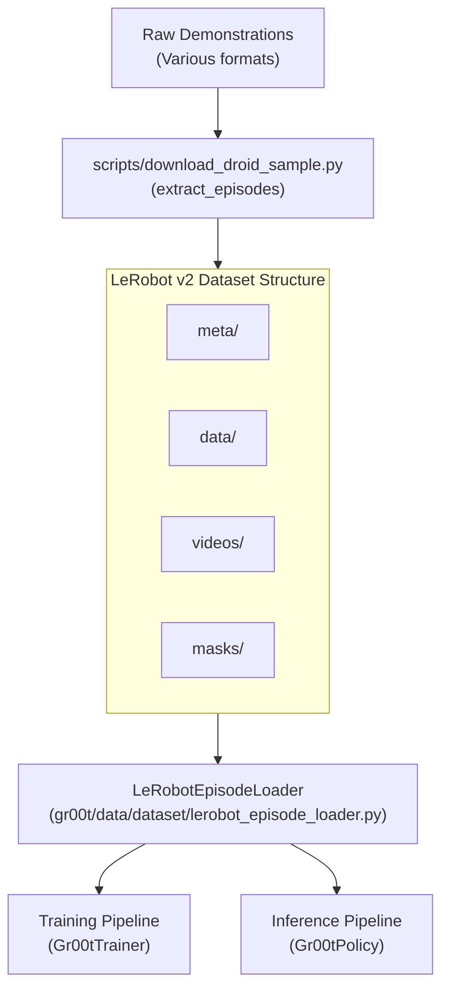
**Sources:** [gr00t/data/dataset/lerobot_episode_loader.py:18-33](), [gr00t/data/dataset/lerobot_episode_loader.py:80-113](), [scripts/download_droid_sample.py:101-102]()

## Dataset Directory Structure

A LeRobot v2 dataset follows a standardized directory layout. Unlike the previous version, v2 uses a `meta/` directory for configuration and `data/` for the actual frame content stored in Parquet format [gr00t/data/dataset/lerobot_episode_loader.py:50-57]().

```
dataset_root/
├── meta/
│   ├── info.json              # Dataset metadata and feature definitions
│   ├── episodes.jsonl         # Per-episode metadata (length, timestamps)
│   ├── tasks.jsonl            # Task descriptions and index mapping
│   ├── modality.json          # Modality structure and data layout
│   ├── stats.json             # Normalization statistics
│   └── relative_stats.json    # Stats for relative action horizons
├── data/
│   └── chunk-000/
│       ├── episode_000000.parquet
│       └── ...
├── videos/
│   └── chunk-000/
│       └── {video_key}/
│           └── episode_000000.mp4
└── masks/
    └── chunk-000/
        └── {mask_key}/
            └── episode_000000_masks.npz
```

### Directory Components

| Directory | Purpose | Required | File Pattern Example |
|-----------|---------|----------|----------------------|
| `meta/` | Dataset configuration | Yes | `info.json`, `modality.json` [gr00t/data/dataset/lerobot_episode_loader.py:51-57]() |
| `data/` | Episode frame data | Yes | `episode_000000.parquet` [demo_data/cube_to_bowl_5_with_mask/meta/info.json:12]() |
| `videos/` | Video observations | Conditional | `episode_000000.mp4` [demo_data/cube_to_bowl_5_with_mask/meta/info.json:13]() |
| `masks/` | Segmentation masks | Optional | `episode_000000_masks.npz` [demo_data/cube_to_bowl_5_with_mask/meta/info.json:14]() |

**Sources:** [gr00t/data/dataset/lerobot_episode_loader.py:51-57](), [demo_data/cube_to_bowl_5_with_mask/meta/info.json:12-14]()

## Metadata Configuration

### info.json
The `info.json` file defines the dataset's global properties and the schema for all features.

- **`features`**: Defines the data types (e.g., `video`, `float32`), shapes, and names for every column in the Parquet files [demo_data/cube_to_bowl_5_with_mask/meta/info.json:15-125]().
- **`video_info`**: Contains encoding details like codec (e.g., `av1`), resolution, and FPS [demo_data/cube_to_bowl_5_with_mask/meta/info.json:56-65]().

### modality.json
This file maps high-level modalities (state, action, video, mask) to specific keys or indices within the features.

- **`state` / `action`**: Often defined as index ranges within a combined vector (e.g., `single_arm` indices 0-5) [demo_data/cube_to_bowl_5_with_mask/meta/modality.json:2-21]().
- **`video` / `mask`**: Maps a friendly name (e.g., `front`) to the `original_key` used in the Parquet/video file system [demo_data/cube_to_bowl_5_with_mask/meta/modality.json:22-42]().

**Sources:** [demo_data/cube_to_bowl_5_with_mask/meta/info.json:1-128](), [demo_data/cube_to_bowl_5_with_mask/meta/modality.json:1-43]()

## Parquet and Video Data Flow

The `LeRobotEpisodeLoader` handles the synchronization between Parquet tabular data and external binary files (videos and masks).

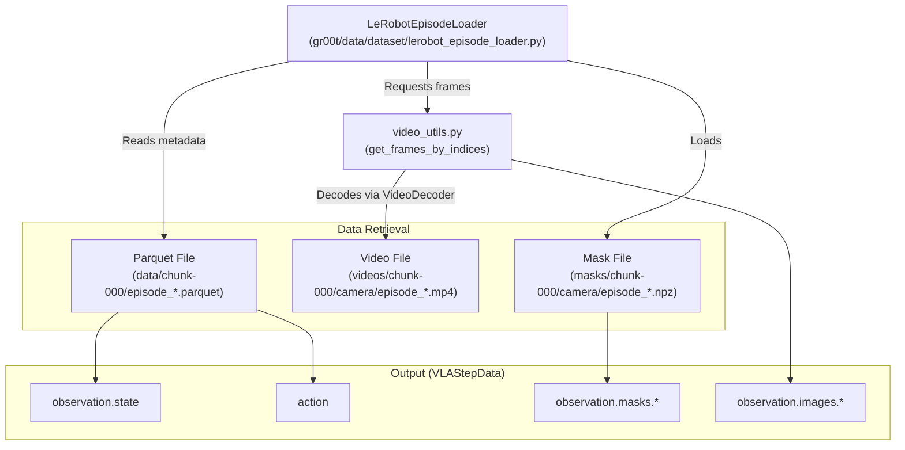

### Video Backend Management
The system utilizes `torchcodec` as the primary video decoding backend, managed by `gr00t/utils/video_utils.py`. 
- **`torchcodec`**: The officially supported backend. `get_frames_by_indices` uses `VideoDecoder.get_frames_at` to retrieve specific frames [gr00t/utils/video_utils.py:70-76]().
- **Lazy Loading**: Video utilities are designed to avoid importing `torchcodec` at the module level to prevent library conflicts [tests/gr00t/utils/test_video_backend.py:45-54]().
- **Timestamp Correction**: `get_frames_by_timestamps` corrects float precision drift by rounding to the nearest frame interval based on the video's average FPS [gr00t/utils/video_utils.py:79-116]().
- **FFmpeg Compatibility**: The system provides hints for FFmpeg version mismatches, as `torchcodec` 0.8.0 requires FFmpeg 4-7 [gr00t/utils/video_utils.py:28-35]().

**Sources:** [gr00t/data/dataset/lerobot_episode_loader.py:47](), [gr00t/utils/video_utils.py:28-35](), [gr00t/utils/video_utils.py:70-116](), [tests/gr00t/utils/test_video_backend.py:42-54]()

## Normalization Statistics

Normalization is critical for VLA training. The `LeRobotEpisodeLoader` parses `stats.json` and `relative_stats.json` to provide statistics for every modality [gr00t/data/dataset/lerobot_episode_loader.py:153-154]().

| Statistic File | Description |
|----------------|-------------|
| `stats.json` | Contains `mean`, `std`, `min`, `max` for global features [demo_data/droid_sample/meta/stats.json:1-217]() |
| `relative_stats.json` | Contains statistics for relative action horizons, typically indexed by timestep [demo_data/droid_sample/meta/relative_stats.json:1-217]() |

The `test_demo_dataset_stats.py` script guards against mismatches between `info.json` shapes and the dimensions found in `stats.json` [tests/gr00t/data/test_demo_dataset_stats.py:59-87]().

**Sources:** [gr00t/data/dataset/lerobot_episode_loader.py:56-57](), [demo_data/droid_sample/meta/stats.json:1-217](), [demo_data/droid_sample/meta/relative_stats.json:1-217](), [tests/gr00t/data/test_demo_dataset_stats.py:59-87]()

## Integration with VLA Pipeline

The `LeRobotEpisodeLoader` acts as the primary interface for higher-level dataset classes. It returns data in the `VLAStepData` format [gr00t/data/dataset/lerobot_episode_loader.py:32-33]().

1.  **Initialization**: The loader is initialized with a `dataset_path` and a dictionary of `ModalityConfig` objects [gr00t/data/dataset/lerobot_episode_loader.py:115-120]().
2.  **Metadata Parsing**: It loads `info.json`, `episodes.jsonl`, `tasks.jsonl`, and `modality.json` [gr00t/data/dataset/lerobot_episode_loader.py:144-174]().
3.  **Episode Loading**: When an episode is requested, it reads the corresponding Parquet file and decodes any required video frames for the specified `delta_indices` using `get_frames_by_indices` [gr00t/data/dataset/lerobot_episode_loader.py:47](), [gr00t/data/dataset/lerobot_episode_loader.py:80-113]().
4.  **Initial Actions**: It can also load `initial_actions.json` if present, which is used for policy initialization [gr00t/data/dataset/lerobot_episode_loader.py:46](), [gr00t/data/dataset/lerobot_episode_loader.py:92-93]().

**Sources:** [gr00t/data/dataset/lerobot_episode_loader.py:32-33](), [gr00t/data/dataset/lerobot_episode_loader.py:80-174](), [gr00t/utils/video_utils.py:70-76]()

---

# Page: Robot Embodiment System

# Robot Embodiment System

<details>
<summary>Relevant source files</summary>

The following files were used as context for generating this wiki page:

- [examples/DROID/server_client.py](examples/DROID/server_client.py)
- [examples/DROID/utils.py](examples/DROID/utils.py)
- [getting_started/data_config.md](getting_started/data_config.md)
- [gr00t/configs/data/embodiment_configs.py](gr00t/configs/data/embodiment_configs.py)
- [gr00t/data/embodiment_tags.py](gr00t/data/embodiment_tags.py)
- [gr00t/policy/gr00t_policy.py](gr00t/policy/gr00t_policy.py)

</details>


The Robot Embodiment System provides the infrastructure for identifying and configuring different robot platforms within Isaac-GR00T. This system enables a single model architecture to work across diverse robots by associating each robot with a unique identifier and corresponding configuration that specifies how its data should be processed.

This page covers the `EmbodimentTag` enumeration, the registration system for robot configurations, and the mapping between simulation environments and embodiments. For detailed information about modality configurations (video, state, action, language processing), see [Modality Configuration Files](3.3). For guidance on creating configurations for new robots, see [Custom Embodiment Development](8.2).

## EmbodimentTag Enumeration

The `EmbodimentTag` enum serves as the primary identifier for robot platforms throughout the codebase. Each enum value represents a distinct robot embodiment with its own kinematic structure, sensor configuration, and control interface.

### Definition and Location

The `EmbodimentTag` enum is defined in [gr00t/data/embodiment_tags.py:29-143]() using Python's standard `Enum` class. Each tag follows the naming convention `<dataset>_<robot_name>` [gr00t/data/embodiment_tags.py:22-26]().

### Pre-Registered Embodiments

The following table lists the embodiment tags supported by the GR00T N1.7 checkpoint:

| Enum Value | String Value | Description | Usage Category |
|-----------|--------------|-------------|----------------|
| `OXE_DROID_RELATIVE_EEF_RELATIVE_JOINT` | `"oxe_droid_relative_eef_relative_joint"` | DROID robot with relative EEF and relative joint actions | Pre-training [gr00t/data/embodiment_tags.py:60-63]() |
| `XDOF` | `"xdof_relative_eef_relative_joint"` | Generic X-DOF robot with relative EEF and joint actions | Pre-training [gr00t/data/embodiment_tags.py:65-68]() |
| `REAL_G1` | `"real_g1_relative_eef_relative_joints"` | Real Unitree G1 with relative EEF and joints | Pre-training [gr00t/data/embodiment_tags.py:75-78]() |
| `REAL_R1_PRO_SHARPA` | `"real_r1_pro_sharpa_relative_eef"` | Real R1 Pro Sharpa with relative EEF actions | Pre-training [gr00t/data/embodiment_tags.py:80-83]() |
| `UNITREE_G1` | `"unitree_g1_full_body_with_waist_height_nav_cmd"` | Sim G1 full-body with waist height and nav commands | Post-training [gr00t/data/embodiment_tags.py:102-105]() |
| `UNITREE_G1_SONIC` | `"unitree_g1_sonic"` | Unitree G1 with SONIC whole-body controller | Post-training [gr00t/data/embodiment_tags.py:107-110]() |
| `SIMPLER_ENV_GOOGLE` | `"simpler_env_google"` | SimplerEnv Google robot | Post-training [gr00t/data/embodiment_tags.py:112-115]() |
| `SIMPLER_ENV_WIDOWX` | `"simpler_env_widowx"` | SimplerEnv WidowX robot | Post-training [gr00t/data/embodiment_tags.py:117-120]() |
| `LIBERO_PANDA` | `"libero_sim"` | LIBERO Panda robot (Goal/Object/Spatial/10) | Post-training [gr00t/data/embodiment_tags.py:122-125]() |
| `NEW_EMBODIMENT` | `"new_embodiment"` | Placeholder for new embodiments during development | Development [gr00t/data/embodiment_tags.py:128-131]() |
| `ROBOCASA_GR1_TABLETOP` | `"robocasa_gr1_tabletop"` | RoboCasa GR1 tabletop tasks | Development [gr00t/data/embodiment_tags.py:133-137]() |
| `ROBOCASA_PANDA_OMRON` | `"robocasa_panda_omron"` | RoboCasa Panda arm tasks | Development [gr00t/data/embodiment_tags.py:139-143]() |

**Sources:** [gr00t/data/embodiment_tags.py:29-143]()

### Embodiment Tag Structure

```mermaid
graph TB
    subgraph "EmbodimentTag Enum"
        Enum["EmbodimentTag Enum Class"]
        
        subgraph "Pretrain Tags (Base Model)"
            DROID["OXE_DROID_RELATIVE_EEF_RELATIVE_JOINT"]
            XDOF["XDOF"]
            G1_REAL["REAL_G1"]
            R1_SHARPA["REAL_R1_PRO_SHARPA"]
        end
        
        subgraph "Posttrain Tags (Finetuned)"
            G1_SIM["UNITREE_G1"]
            G1_SONIC["UNITREE_G1_SONIC"]
            GOOGLE["SIMPLER_ENV_GOOGLE"]
            WIDOWX["SIMPLER_ENV_WIDOWX"]
            LIBERO["LIBERO_PANDA"]
        end
        
        subgraph "Finetuning Tags (Custom)"
            NEW["NEW_EMBODIMENT"]
            RC_GR1["ROBOCASA_GR1_TABLETOP"]
            RC_PANDA["ROBOCASA_PANDA_OMRON"]
        end
        
        Enum --> DROID
        Enum --> XDOF
        Enum --> G1_REAL
        Enum --> G1_SIM
        Enum --> G1_SONIC
        Enum --> GOOGLE
        Enum --> WIDOWX
        Enum --> LIBERO
        Enum --> NEW
        Enum --> RC_GR1
        Enum --> RC_PANDA
    end
    
    Usage1["Used in processor:<br/>BaseProcessor / Gr00tN1d7Processor"]
    Usage2["Used in policy:<br/>Gr00tPolicy"]
    
    Enum --> Usage1
    Enum --> Usage2
```

**Sources:** [gr00t/data/embodiment_tags.py:29-143](), [gr00t/policy/gr00t_policy.py:30-105]()

## Embodiment Configuration Registry

Each `EmbodimentTag` must be associated with a complete modality configuration that specifies how to process video, state, action, and language data for that robot. This mapping is maintained in the `MODALITY_CONFIGS` dictionary.

### MODALITY_CONFIGS Dictionary

The `MODALITY_CONFIGS` dictionary maps embodiment tag string values to configuration dictionaries. Located in [gr00t/configs/data/embodiment_configs.py:26-189](), this registry serves as the central source of truth for all embodiment-specific processing parameters.

Each entry in `MODALITY_CONFIGS` contains four top-level keys:
- `"video"`: `ModalityConfig` specifying camera keys and sampling parameters.
- `"state"`: `ModalityConfig` specifying proprioceptive state keys and encoding.
- `"action"`: `ModalityConfig` specifying action keys, horizon, and `ActionConfig` list.
- `"language"`: `ModalityConfig` specifying task description keys.

**Sources:** [gr00t/configs/data/embodiment_configs.py:26-189](), [getting_started/data_config.md:13-32]()

### Configuration Examples

#### Complex Humanoid: Unitree G1 (Sim)

The Unitree G1 configuration shows a complex locomanipulation setup with multiple action modalities and different representations:

| Modality | Keys | Delta Indices | ActionConfigs |
|----------|------|---------------|---------------|
| video | `["ego_view"]` | `[0]` | Single egocentric camera |
| state | `["left_leg", "right_leg", "waist", "left_arm", "right_arm", "left_hand", "right_hand"]` | `[0]` | 7 joint groups |
| action | `["left_arm", "right_arm", "left_hand", "right_hand", "waist", "base_height_command", "navigate_command"]` | `[0..49]` | 50-step horizon with 7 separate `ActionConfig` objects |
| language | `["annotation.human.task_description"]` | `[0]` | Single task string |

**Sources:** [gr00t/configs/data/embodiment_configs.py:115-189]()

#### Whole-Body Control: Unitree G1 SONIC

The SONIC variant uses latents for the locomotion component:

| Modality | Keys | Delta Indices | Notes |
|----------|------|---------------|-------|
| action | `["motion_token", "left_hand_joints", "right_hand_joints"]` | `[0..39]` | Uses `motion_token` for latent-based control |

**Sources:** [gr00t/configs/data/embodiment_configs.py:67-114]()

#### Open-X-Embodiment: DROID

The DROID configuration used in N1.7 pre-training:

| Modality | Keys | Delta Indices | Notes |
|----------|------|---------------|-------|
| video | `["exterior_image_1_left", "wrist_image_left"]` | `[-15, 0]` | History of 2 frames |
| state | `["eef_9d", "gripper_position", "joint_position"]` | `[0]` | 9D EEF + Joints |
| action | `["eef_9d", "gripper_position", "joint_position"]` | `[0..39]` | 40-step horizon |

**Sources:** [gr00t/configs/data/embodiment_configs.py:28-65]()

## Projector Index Mapping

In the GR00T N1.7 architecture, each embodiment is associated with a specific projector index. This allows the model to use embodiment-specific projection layers if needed. The `Gr00tN1d7Processor` uses an internal mapping `EMBODIMENT_TAG_TO_PROJECTOR_INDEX` to route data from a specific `EmbodimentTag` to its corresponding projector index in the transformer backbone.

When initializing a `Gr00tPolicy`, the system validates that the provided `embodiment_tag` exists within the checkpoint's supported modality configurations [gr00t/policy/gr00t_policy.py:127-160]().

**Sources:** [gr00t/policy/gr00t_policy.py:127-160]()

## Environment to Embodiment Mapping

The evaluation system requires mapping from gym-registered environment names to `EmbodimentTag` values. This enables the policy server to automatically load the correct modality configuration for a given simulation environment.

### Lookup and Resolution

The `EmbodimentTag.resolve()` class method is the primary tool for converting strings to tags [gr00t/data/embodiment_tags.py:146-180](). It performs a case-insensitive search matching by enum **name** first, then by enum **value**.

**Sources:** [gr00t/data/embodiment_tags.py:146-180]()

## Embodiment System Lifecycle

The embodiment system integrates with multiple components throughout the training, inference, and evaluation pipelines.

### Configuration Flow Diagram

```mermaid
graph LR
    subgraph "Configuration Definition"
        Config["ModalityConfig Dict<br/>{video, state, action, language}"]
        Tag["EmbodimentTag Enum<br/>e.g., LIBERO_PANDA"]
    end
    
    subgraph "Registry"
        MODALITY["MODALITY_CONFIGS<br/>Global Dictionary<br/>embodiment_configs.py"]
        REG_FUNC["register_modality_config()"]
    end
    
    subgraph "Usage Points"
        Processor["BaseProcessor<br/>get_modality_configs()"]
        Policy["Gr00tPolicy<br/>self.modality_configs"]
        Stats["stats.py<br/>Normalization generation"]
    end
    
    Config --> REG_FUNC
    Tag --> REG_FUNC
    REG_FUNC --> MODALITY
    
    MODALITY --> Processor
    MODALITY --> Policy
    MODALITY --> Stats
```

**Sources:** [gr00t/configs/data/embodiment_configs.py:26-189](), [gr00t/policy/gr00t_policy.py:129-165](), [getting_started/data_config.md:19-32]()

### Inference Pipeline

The `Gr00tPolicy` class uses embodiment tags throughout inference:

1. **Initialization** [gr00t/policy/gr00t_policy.py:83-106](): The policy constructor accepts an `embodiment_tag` and resolves it using `EmbodimentTag.resolve()`.
2. **Config Loading** [gr00t/policy/gr00t_policy.py:129-165](): It retrieves the specific modality configurations for that tag from the `processor.get_modality_configs()`.
3. **Validation**: The policy checks if the tag is a `POSTTRAIN_TAGS` [gr00t/policy/gr00t_policy.py:142-147]() or `FINETUNE_ONLY_TAGS` [gr00t/policy/gr00t_policy.py:148-152]() to provide helpful error messages if the wrong checkpoint (e.g., base model) is used.

**Sources:** [gr00t/policy/gr00t_policy.py:83-165]()

## DROID Example Integration

The DROID robot integration in `examples/DROID/` demonstrates how embodiment tags enable real robot deployment:

1. **Message Serialization** [examples/DROID/server_client.py:165-167](): The `MsgSerializer` handles `ModalityConfig` objects by converting them to JSON-serializable dictionaries for network transmission.
2. **Action Mapping** [examples/DROID/server_client.py:100-104](): The `ActionConfig` defines the `ActionRepresentation` (e.g., `RELATIVE`) and `ActionType` (e.g., `EEF`) used by the DROID embodiment.
3. **Data Configuration**: The DROID configuration in `embodiment_configs.py` specifies `eef_9d` as the `state_key` for relative end-effector control [gr00t/configs/data/embodiment_configs.py:41-46]().

**Sources:** [examples/DROID/server_client.py:100-172](), [gr00t/configs/data/embodiment_configs.py:28-65]()

---

# Page: Modality Configuration Files

# Modality Configuration Files

<details>
<summary>Relevant source files</summary>

The following files were used as context for generating this wiki page:

- [getting_started/data_config.md](getting_started/data_config.md)
- [getting_started/finetune_new_embodiment.md](getting_started/finetune_new_embodiment.md)
- [gr00t/model/gr00t_n1d7/gr00t_n1d7.py](gr00t/model/gr00t_n1d7/gr00t_n1d7.py)
- [tests/getting_started/test_data_config_md.py](tests/getting_started/test_data_config_md.py)
- [tests/getting_started/test_finetune_new_embodiment_md.py](tests/getting_started/test_finetune_new_embodiment_md.py)
- [tests/gr00t/model/test_action_head.py](tests/gr00t/model/test_action_head.py)

</details>


This document details the structure and usage of modality configuration files in the GR00T system. Modality configurations define how data from different robot embodiments should be loaded, temporally sampled, and transformed for model input. Each configuration bridges your dataset's physical structure (defined in `meta/modality.json`) and the model's data processing pipeline [getting_started/data_config.md:3-6]().

For information about the robot embodiment system and `EmbodimentTag` enumeration, see [3.2 Robot Embodiment System](). For details on action representation conversions and pose transformations, see [3.4 Pose and Action Representations](). For the complete data processing pipeline, see [3.5 Data Processing Pipeline]().

## Core Data Structures

The modality configuration system is built around two primary classes: `ModalityConfig` and `ActionConfig`. These dataclasses define the structure of configuration data that flows through the training and inference pipelines [getting_started/data_config.md:13-16]().

### ModalityConfig Class

The `ModalityConfig` class specifies how data for a particular modality (video, state, action, or language) should be sampled and loaded from the dataset.

**Key attributes:**
- `delta_indices`: List of temporal offsets to sample relative to the current timestep [getting_started/data_config.md:39-44]().
- `modality_keys`: List of keys to load from the dataset (must match keys in `meta/modality.json`) [getting_started/data_config.md:94-97]().
- `sin_cos_embedding_keys`: Optional list of keys for sine/cosine encoding (typically for joint angles in radians) [getting_started/data_config.md:106-109]().
- `mean_std_embedding_keys`: Optional list of keys for mean/std normalization instead of min-max [getting_started/data_config.md:118-121]().
- `action_configs`: Optional list of `ActionConfig` objects (required for action modality) [getting_started/data_config.md:122-125]().

**Sources:** [getting_started/data_config.md:33-126](), [getting_started/finetune_new_embodiment.md:15-21]()

### ActionConfig Class

The `ActionConfig` class defines how each action modality should be interpreted and transformed. Each action key in `modality_keys` requires a corresponding `ActionConfig` in the same order [getting_started/data_config.md:124-126]().

**Key attributes:**
- `rep`: `ActionRepresentation` enum (`RELATIVE` or `ABSOLUTE`) [getting_started/data_config.md:197-203]().
- `type`: `ActionType` enum (`EEF` for end-effector, `NON_EEF` for joint space) [getting_started/data_config.md:205-209]().
- `format`: `ActionFormat` enum (`DEFAULT`, `XYZ_ROT6D`, or `XYZ_ROTVEC`) [getting_started/data_config.md:211-216]().
- `state_key`: Optional reference state key for computing relative actions if the action and state keys differ [getting_started/data_config.md:218-221]().

**Sources:** [getting_started/data_config.md:193-230](), [getting_started/finetune_new_embodiment.md:48-61]()

## Modality Configuration Structure

Each robot embodiment requires a complete modality configuration dictionary with four top-level keys: `"video"`, `"state"`, `"action"`, and `"language"`.

### Configuration Dictionary Structure

```mermaid
graph TB
    subgraph "Embodiment Configuration Dictionary"
        Config["Embodiment Config<br/>{embodiment_tag: config}"]
        
        Video["'video'<br/>ModalityConfig"]
        State["'state'<br/>ModalityConfig"]
        Action["'action'<br/>ModalityConfig"]
        Language["'language'<br/>ModalityConfig"]
        
        Config --> Video
        Config --> State
        Config --> Action
        Config --> Language
        
        Video --> VideoDelta["delta_indices: [0]"]
        Video --> VideoKeys["modality_keys: ['front', 'wrist']"]
        
        State --> StateDelta["delta_indices: [0]"]
        State --> StateKeys["modality_keys: ['single_arm', 'gripper']"]
        State --> StateSinCos["sin_cos_embedding_keys: ['single_arm']"]
        
        Action --> ActionDelta["delta_indices: list(range(16))"]
        Action --> ActionKeys["modality_keys: ['single_arm', 'gripper']"]
        Action --> ActionConfigs["action_configs: [ActionConfig(...), ...]"]
        
        Language --> LangDelta["delta_indices: [0]"]
        Language --> LangKeys["modality_keys: ['annotation.human.task_description']"]
    end
```

**Sources:** [getting_started/data_config.md:13-31](), [getting_started/finetune_new_embodiment.md:24-68]()

### Video Modality Configuration

Defines camera views and temporal sampling. Stick with `[0]` for video unless stacking frames is required [getting_started/data_config.md:45-46]().

**Example from SO-100:**
```python
"video": ModalityConfig(
    delta_indices=[0],
    modality_keys=[
        "front",
        "wrist",
    ],
)
```
**Sources:** [getting_started/finetune_new_embodiment.md:26-32](), [getting_started/data_config.md:128-147]()

### State Modality Configuration

Defines proprioceptive observations. Radians should use `sin_cos_embedding_keys` to double dimensionality and improve learning [getting_started/data_config.md:108-115]().

**Example from SO-100:**
```python
"state": ModalityConfig(
    delta_indices=[0],
    modality_keys=[
        "single_arm",
        "gripper",
    ],
)
```
**Sources:** [getting_started/finetune_new_embodiment.md:34-40](), [getting_started/data_config.md:149-162]()

### Action Modality Configuration

Defines the action space and prediction horizon. If `delta_indices` is modified (e.g., from 16 steps to 8), you **must** regenerate statistics via `gr00t/data/stats.py` or an `IndexError` will occur during normalization [getting_started/data_config.md:57-89]().

**Example from SO-100:**
```python
"action": ModalityConfig(
    delta_indices=list(range(0, 16)),
    modality_keys=["single_arm", "gripper"],
    action_configs=[
        ActionConfig(rep=ActionRepresentation.RELATIVE, type=ActionType.NON_EEF, format=ActionFormat.DEFAULT),
        ActionConfig(rep=ActionRepresentation.ABSOLUTE, type=ActionType.NON_EEF, format=ActionFormat.DEFAULT),
    ],
)
```
**Sources:** [getting_started/finetune_new_embodiment.md:42-62](), [getting_started/data_config.md:164-191]()

### Language Modality Configuration

Defines the task instruction source from the dataset [getting_started/finetune_new_embodiment.md:63-67]().

**Example:**
```python
"language": ModalityConfig(
    delta_indices=[0],
    modality_keys=["annotation.human.task_description"],
)
```
**Sources:** [getting_started/finetune_new_embodiment.md:64-67](), [getting_started/data_config.md:232-241]()

## Configuration Fields Deep Dive

### delta_indices

Defines temporal offsets relative to the current timestep [getting_started/data_config.md:39-44]().

| Value Pattern | Typical Use |
|---------------|-------------|
| `[0]` | Current frame/state/language [getting_started/data_config.md:42]() |
| `[-2, -1, 0]` | Historical context (supported but rarely used in N1.7) [getting_started/data_config.md:45]() |
| `list(range(0, 16))` | 16-step future action horizon [getting_started/data_config.md:54]() |

**Sources:** [getting_started/data_config.md:39-58]()

### modality_keys

Keys must match the `meta/modality.json` definition exactly [getting_started/data_config.md:96-97]().

```mermaid
graph LR
    subgraph "Modality Configuration"
        VideoKeys["modality_keys:<br/>['front', 'wrist']"]
        StateKeys["modality_keys:<br/>['single_arm', 'gripper']"]
    end
    
    subgraph "meta/modality.json"
        VideoMeta["video:<br/>front: {original_key: 'observation.images.front'}<br/>wrist: {original_key: 'observation.images.wrist'}"]
        StateMeta["state:<br/>single_arm: {start: 0, end: 5}<br/>gripper: {start: 5, end: 6}"]
    end
    
    VideoKeys -.->|"must reference"| VideoMeta
    StateKeys -.->|"must reference"| StateMeta
```

**Sources:** [getting_started/data_config.md:94-104]()

## Action Configuration Dimensions

### ActionRepresentation Enum

| Value | Meaning |
|-------|---------|
| `RELATIVE` | Deltas from current state (`action_t = state_t + delta_t`) [getting_started/data_config.md:197-201](). |
| `ABSOLUTE` | Direct target positions/values [getting_started/data_config.md:202-203](). |

### ActionType Enum

| Value | Meaning |
|-------|---------|
| `EEF` | End-effector Cartesian control (requires 9D: pos + 6D rot) [getting_started/data_config.md:205-207](). |
| `NON_EEF` | Joint space or other control (e.g., gripper, mobile base) [getting_started/data_config.md:208-209](). |

### ActionFormat Enum

| Value | Meaning |
|-------|---------|
| `DEFAULT` | Standard values (joints, gripper) [getting_started/data_config.md:211-212](). |
| `XYZ_ROT6D` | 3D position + 6D continuous rotation representation [getting_started/data_config.md:213-214](). |
| `XYZ_ROTVEC` | 3D position + rotation vector [getting_started/data_config.md:215-216](). |

**Sources:** [getting_started/data_config.md:193-216]()

## Configuration Registration

For custom embodiments, configurations must be registered using `register_modality_config` under the `EmbodimentTag.NEW_EMBODIMENT` tag [getting_started/finetune_new_embodiment.md:70-71]().

**Implementation:**
```python
from gr00t.configs.data.embodiment_configs import register_modality_config
from gr00t.data.embodiment_tags import EmbodimentTag

# Register your dictionary
register_modality_config(so100_config, embodiment_tag=EmbodimentTag.NEW_EMBODIMENT)
```

**Sources:** [getting_started/finetune_new_embodiment.md:13-14](), [getting_started/finetune_new_embodiment.md:70-71](), [getting_started/data_config.md:19-20]()

## Configuration Flow Through the System

```mermaid
graph TB
    subgraph "Natural Language Space"
        User["User defines config<br/>in so100_config.py"]
    end

    subgraph "Code Entity Space"
        ModConfig["gr00t.data.types.ModalityConfig"]
        ActConfig["gr00t.data.types.ActionConfig"]
        RegFunc["gr00t.configs.data.embodiment_configs.register_modality_config"]
        GlobalDict["gr00t.configs.data.embodiment_configs.MODALITY_CONFIGS"]
        
        User --> ModConfig
        User --> ActConfig
        ModConfig --> RegFunc
        ActConfig --> RegFunc
        RegFunc --> GlobalDict
    end
    
    subgraph "Data Pipeline"
        Stats["gr00t/data/stats.py<br/>(Regenerate on horizon change)"]
        Dataset["gr00t.data.dataset.ShardedSingleStepDataset"]
        
        GlobalDict --> Stats
        GlobalDict --> Dataset
    end
```

**Sources:** [getting_started/finetune_new_embodiment.md:11-71](), [getting_started/data_config.md:57-89](), [tests/getting_started/test_data_config_md.py:27-33]()

---

# Page: Pose and Action Representations

# Pose and Action Representations

<details>
<summary>Relevant source files</summary>

The following files were used as context for generating this wiki page:

- [gr00t/data/dataset/sharded_mixture_dataset.py](gr00t/data/dataset/sharded_mixture_dataset.py)
- [gr00t/data/state_action/action_chunking.py](gr00t/data/state_action/action_chunking.py)
- [gr00t/data/state_action/pose.py](gr00t/data/state_action/pose.py)
- [gr00t/data/state_action/state_action_processor.py](gr00t/data/state_action/state_action_processor.py)
- [gr00t/data/stats.py](gr00t/data/stats.py)
- [gr00t/eval/sim/LIBERO/libero_env.py](gr00t/eval/sim/LIBERO/libero_env.py)
- [gr00t/eval/sim/SimplerEnv/simpler_env.py](gr00t/eval/sim/SimplerEnv/simpler_env.py)
- [gr00t/experiment/utils.py](gr00t/experiment/utils.py)
- [tests/gr00t/data/state_action/test_eef_action_format.py](tests/gr00t/data/state_action/test_eef_action_format.py)

</details>


This document describes the pose and action representation system in Isaac GR00T, which provides a unified framework for handling robot configurations and trajectories in both joint space and Cartesian space. The system supports multiple rotation representations, automatic conversion between absolute and relative coordinates, and integration with various action formats used across different robot embodiments.

For information about how these representations are used in the broader data processing pipeline, see [Data Processing Pipeline](#3.5). For details on modality configurations that specify which representations to use for each embodiment, see [Modality Configuration Files](#3.3).

---

## Overview of the Pose System

The pose system provides a type-safe abstraction for robot configurations through a class hierarchy rooted in the abstract `Pose` base class [gr00t/data/state_action/pose.py:104-110](). Two concrete implementations handle different control spaces:

- **`JointPose`**: Represents configurations in joint space (angles/positions of robot joints) [gr00t/data/state_action/pose.py:177-184]().
- **`EndEffectorPose`**: Represents poses in Cartesian space (3D position + 3D rotation of end-effector) [gr00t/data/state_action/pose.py:300-307]().

Both classes support computing relative transformations via the subtraction operator (`-`), which enables seamless conversion between absolute and relative action representations [gr00t/data/state_action/pose.py:114-151]().

**Class Hierarchy**

```mermaid
classDiagram
    class Pose {
        <<abstract>>
        +pose_type: str
        +__sub__(other: Pose) Pose
        +_compute_relative(other: Pose) Pose*
        +copy() Pose*
    }
    
    class JointPose {
        +pose_type = "joint"
        +joints: ndarray
        +joint_names: list
        +num_joints: int
        +to_dict() dict
        +_compute_relative(other: JointPose) JointPose
        +copy() JointPose
    }
    
    class EndEffectorPose {
        +pose_type = "end_effector"
        +translation: ndarray
        +_rotation: Rotation
        +homogeneous: ndarray
        +quat_wxyz: ndarray
        +quat_xyzw: ndarray
        +euler_xyz: ndarray
        +rotvec: ndarray
        +rotation_matrix: ndarray
        +rot6d: ndarray
        +xyz_rot6d: ndarray
        +xyz_rotvec: ndarray
        +to_rotation(type, order) ndarray
        +from_action_format(data, format) EndEffectorPose
        +_compute_relative(other) EndEffectorPose
    }
    
    Pose <|-- JointPose
    Pose <|-- EndEffectorPose
```

**Sources:** [gr00t/data/state_action/pose.py:104-151](), [gr00t/data/state_action/pose.py:177-210](), [gr00t/data/state_action/pose.py:300-340]()

---

## JointPose: Joint Space Representation

The `JointPose` class represents robot configurations in joint space as a vector of joint angles or positions. This is the most direct representation for robot control in joint space [gr00t/data/state_action/pose.py:177-184]().

### Key Properties

| Property | Type | Description |
|----------|------|-------------|
| `joints` | `ndarray` | Joint angles/positions as float64 array [gr00t/data/state_action/pose.py:225]() |
| `joint_names` | `list[str]` | Optional names for each joint [gr00t/data/state_action/pose.py:228]() |
| `num_joints` | `int` | Number of joints in the configuration [gr00t/data/state_action/pose.py:251]() |

### Relative Computation

For joint poses, the relative transformation is computed as simple element-wise subtraction [gr00t/data/state_action/pose.py:289-291]():

```python
relative_joints = self.joints - other.joints
```

This represents the joint-space displacement needed to go from `other` to `self`.

**Sources:** [gr00t/data/state_action/pose.py:177-298]()

---

## EndEffectorPose: Cartesian Space Representation

The `EndEffectorPose` class represents end-effector poses in Cartesian space with a 3D translation vector and 3D rotation [gr00t/data/state_action/pose.py:300-307](). Internally, rotation is stored as a `scipy.spatial.transform.Rotation` object, enabling efficient conversion between multiple rotation representations [gr00t/data/state_action/pose.py:341]().

### Supported Rotation Representations

```mermaid
graph TB
    subgraph "Internal Storage"
        Internal["scipy.spatial.transform.Rotation"]
    end
    
    subgraph "Input Formats"
        QUAT["RotationType.QUAT<br/>4 values<br/>wxyz or xyzw"]
        EULER["RotationType.EULER<br/>3 values<br/>xyz, zyx, etc."]
        ROTVEC["RotationType.ROTVEC<br/>3 values<br/>axis-angle"]
        MATRIX["RotationType.MATRIX<br/>3x3 matrix"]
        ROT6D["RotationType.ROT6D<br/>6 values<br/>first 2 rows of matrix"]
    end
    
    subgraph "Output Properties"
        QUAT_WXYZ["quat_wxyz property"]
        QUAT_XYZW["quat_xyzw property"]
        EULER_XYZ["euler_xyz property"]
        ROTVEC_OUT["rotvec property"]
        MATRIX_OUT["rotation_matrix property"]
        ROT6D_OUT["rot6d property"]
        HOMO_OUT["homogeneous property"]
        XYZ_ROT6D["xyz_rot6d property<br/>9 values: xyz + rot6d"]
        XYZ_ROTVEC["xyz_rotvec property<br/>6 values: xyz + rotvec"]
    end
    
    QUAT --> Internal
    EULER --> Internal
    ROTVEC --> Internal
    MATRIX --> Internal
    ROT6D --> Internal
    
    Internal --> QUAT_WXYZ
    Internal --> QUAT_XYZW
    Internal --> EULER_XYZ
    Internal --> ROTVEC_OUT
    Internal --> MATRIX_OUT
    Internal --> ROT6D_OUT
    Internal --> HOMO_OUT
    Internal --> XYZ_ROT6D
    Internal --> XYZ_ROTVEC
```

**Sources:** [gr00t/data/state_action/pose.py:76-84](), [gr00t/data/state_action/pose.py:300-709]()

### Rotation Type Details

| Type | Enum | Size | Description |
|------|------|------|-------------|
| Quaternion | `RotationType.QUAT` | 4 | Unit quaternion (w,x,y,z or x,y,z,w) [gr00t/data/state_action/pose.py:79]() |
| Euler Angles | `RotationType.EULER` | 3 | XYZ, ZYX, etc. conventions [gr00t/data/state_action/pose.py:80]() |
| Rotation Vector | `RotationType.ROTVEC` | 3 | Axis-angle representation [gr00t/data/state_action/pose.py:81]() |
| Rotation Matrix | `RotationType.MATRIX` | 3×3 | Full rotation matrix [gr00t/data/state_action/pose.py:82]() |
| 6D Rotation | `RotationType.ROT6D` | 6 | First 2 rows of rotation matrix [gr00t/data/state_action/pose.py:83]() |

The **6D rotation representation** (rot6d) is particularly important for learning-based methods as it avoids discontinuities. It stores the first two rows of the rotation matrix, and the third row is recovered via cross product [gr00t/data/state_action/pose.py:411-453]().

**Sources:** [gr00t/data/state_action/pose.py:76-84](), [gr00t/data/state_action/pose.py:411-453]()

### Relative Transformation for EndEffectorPose

For end-effector poses, the relative transformation is computed using homogeneous transformation matrices [gr00t/data/state_action/pose.py:656-660]():

```python
T_relative = inv(T_other) @ T_self
```

This represents the transformation in `other`'s coordinate frame that brings it to `self` [gr00t/data/state_action/pose.py:72-73]().

**Sources:** [gr00t/data/state_action/pose.py:58-73](), [gr00t/data/state_action/pose.py:639-660]()

---

## ActionChunk Classes: Trajectory Representation

Action trajectories are represented as sequences of poses using the `ActionChunk` generic class hierarchy [gr00t/data/state_action/action_chunking.py:29-36](). This enables unified handling of temporal action sequences with interpolation and relative/absolute conversion.

**ActionChunk Class Hierarchy**

```mermaid
classDiagram
    class ActionChunk~PoseType~ {
        <<abstract>>
        +_poses: List[PoseType]
        +_times: ndarray
        +poses: List[PoseType]
        +times: ndarray
        +num_poses: int
        +relative_chunking(reference_frame) ActionChunk
        +delta_chunking(reference_frame) ActionChunk
        +to_absolute_chunking(reference_frame) ActionChunk*
        +interpolate(num_points, times) ActionChunk*
        +to(action_format) ndarray*
    }
    
    class JointActionChunk {
        +interpolate(num_points, times) JointActionChunk
        +to_absolute_chunking(ref) JointActionChunk
        +to(format) ndarray
    }
    
    class EndEffectorActionChunk {
        +from_array(data, format) EndEffectorActionChunk
        +interpolate(num_points, times) EndEffectorActionChunk
        +to_absolute_chunking(ref) EndEffectorActionChunk
        +to(format) ndarray
    }
    
    ActionChunk <|-- JointActionChunk
    ActionChunk <|-- EndEffectorActionChunk
```

**Sources:** [gr00t/data/state_action/action_chunking.py:29-192]()

### JointActionChunk

Represents a trajectory in joint space as a sequence of `JointPose` objects [gr00t/data/state_action/action_chunking.py:194-200]().

**Key Features:**
- Linear interpolation of joint values [gr00t/data/state_action/action_chunking.py:250-325]().
- Element-wise addition for absolute conversion [gr00t/data/state_action/action_chunking.py:336-371]().

**Sources:** [gr00t/data/state_action/action_chunking.py:194-393]()

### EndEffectorActionChunk

Represents a trajectory in Cartesian space as a sequence of `EndEffectorPose` objects [gr00t/data/state_action/action_chunking.py:395-401]().

**Key Features:**
- SLERP (Spherical Linear Interpolation) for rotations [gr00t/data/state_action/action_chunking.py:475-562]().
- Support for multiple action formats (homogeneous, xyz_rot6d, xyz_rotvec) [gr00t/data/state_action/action_chunking.py:564-601]().
- Homogeneous matrix composition for absolute conversion [gr00t/data/state_action/action_chunking.py:603-637]().

**Sources:** [gr00t/data/state_action/action_chunking.py:395-660]()

---

## Action Representations and Formats

The codebase defines three primary enums to control how actions are interpreted and stored:

### ActionRepresentation
Defines the coordinate frame reference for the action chunk [gr00t/data/types.py:33-36]():
- **ABSOLUTE**: Poses are in the world/base frame.
- **RELATIVE**: Poses are relative to a fixed reference frame (usually the start of the chunk).
- **DELTA**: Each pose is relative to the immediately preceding pose [gr00t/data/state_action/action_chunking.py:111-141]().

### ActionType
Distinguishes between control spaces [gr00t/data/types.py:39-41]():
- **EEF**: End-effector Cartesian control.
- **NON_EEF**: Joint space control.

### ActionFormat
Defines the serialization format for end-effector actions [gr00t/data/types.py:44-47]():
- **DEFAULT**: Homogeneous transformation matrices (4x4).
- **XYZ_ROT6D**: 3D translation + 6D rotation (9 values total).
- **XYZ_ROTVEC**: 3D translation + rotation vector (6 values total).

**Conversion Flow**

```mermaid
graph LR
    subgraph "ActionRepresentation Conversion"
        Abs["Absolute Action Chunk"]
        Rel["Relative Action Chunk"]
        Delta["Delta Action Chunk"]
        
        Abs -- "relative_chunking()" --> Rel
        Rel -- "to_absolute_chunking()" --> Abs
        Abs -- "delta_chunking()" --> Delta
    end
    
    subgraph "ActionFormat Serialization"
        PoseObj["EndEffectorPose Object"]
        Array["NDArray (9 or 6 dims)"]
        
        PoseObj -- "pose.xyz_rot6d" --> Array
        Array -- "from_action_format()" --> PoseObj
    end
```

**Sources:** [gr00t/data/types.py:33-47](), [gr00t/data/state_action/action_chunking.py:82-141](), [gr00t/data/state_action/pose.py:662-683]()

---

## Action Configuration

The `ActionConfig` dataclass ties these representations together for a specific robot modality [gr00t/data/types.py:77-82]().

```python
@dataclass
class ActionConfig:
    rep: ActionRepresentation  # RELATIVE, DELTA, or ABSOLUTE
    type: ActionType           # EEF or NON_EEF
    format: ActionFormat       # DEFAULT, XYZ_ROT6D, or XYZ_ROTVEC
    state_key: str | None      # Key in states dict to use as reference
```

This configuration is used by the `StateActionProcessor` to automatically convert raw dataset actions into the representation required by the model [gr00t/data/state_action/state_action_processor.py:22-24]().

**Sources:** [gr00t/data/types.py:77-126](), [gr00t/data/state_action/state_action_processor.py:16-61]()

---

# Page: Data Processing Pipeline

# Data Processing Pipeline

<details>
<summary>Relevant source files</summary>

The following files were used as context for generating this wiki page:

- [gr00t/data/dataset/sharded_single_step_dataset.py](gr00t/data/dataset/sharded_single_step_dataset.py)
- [gr00t/data/state_action/action_chunking.py](gr00t/data/state_action/action_chunking.py)
- [gr00t/data/state_action/pose.py](gr00t/data/state_action/pose.py)
- [gr00t/data/state_action/state_action_processor.py](gr00t/data/state_action/state_action_processor.py)
- [gr00t/eval/sim/LIBERO/libero_env.py](gr00t/eval/sim/LIBERO/libero_env.py)
- [gr00t/eval/sim/SimplerEnv/simpler_env.py](gr00t/eval/sim/SimplerEnv/simpler_env.py)
- [gr00t/eval/sim/robocasa/setup_RoboCasa.sh](gr00t/eval/sim/robocasa/setup_RoboCasa.sh)
- [gr00t/eval/sim/robocasa365/__init__.py](gr00t/eval/sim/robocasa365/__init__.py)
- [gr00t/eval/sim/robocasa365/gymnasium_groot.py](gr00t/eval/sim/robocasa365/gymnasium_groot.py)
- [gr00t/eval/sim/robocasa365/setup_RoboCasa365.sh](gr00t/eval/sim/robocasa365/setup_RoboCasa365.sh)
- [gr00t/eval/sim/wrapper/video_recording_wrapper.py](gr00t/eval/sim/wrapper/video_recording_wrapper.py)
- [gr00t/experiment/utils.py](gr00t/experiment/utils.py)
- [tests/gr00t/data/test_sharded_datasets.py](tests/gr00t/data/test_sharded_datasets.py)

</details>


## Purpose and Scope

This page describes the core data processing components that transform raw robot data into normalized, model-ready tensors. The focus is on the `StateActionProcessor` class, normalization strategies, statistics computation, the `ShardedSingleStepDataset`, and the transformation of pose and action representations.

This page covers:
- `StateActionProcessor`: The central class for state and action normalization [gr00t/data/state_action/state_action_processor.py:52-61]()
- Normalization strategies: min/max, mean/std, and sin/cos encoding [gr00t/data/state_action/state_action_processor.py:20-24]()
- Statistics management: Computing and merging normalization parameters [gr00t/data/state_action/state_action_processor.py:112-143]()
- `ShardedSingleStepDataset`: Efficient step-level data loading and sharding [gr00t/data/dataset/sharded_single_step_dataset.py:82-127]()
- Pose representations: `JointPose` and `EndEffectorPose` classes [gr00t/data/state_action/pose.py:177-300]()
- Action chunking: `ActionChunk` base class and its specialized implementations [gr00t/data/state_action/action_chunking.py:29-161]()

---

## Processing Architecture Overview

The data processing system centers around the `StateActionProcessor` class, which coordinates normalization and transformation of state and action data.

**Diagram: StateActionProcessor Data Flow**

```mermaid
graph TB
    RawData["Raw Data<br/>From Parquet Files"]
    
    subgraph "StateActionProcessor"
        Config["Modality Configs<br/>Per-embodiment specs"]
        Stats["Statistics<br/>min/max/mean/std<br/>from stats.json"]
        
        Config --> StateNorm["State Normalization<br/>_compute_normalization_parameters()"]
        Stats --> StateNorm
        Config --> ActionNorm["Action Normalization"]
        Stats --> ActionNorm
        
        StateNorm --> SinCos["Sin/Cos Encoding<br/>apply_sin_cos_encoding()"]
        ActionNorm --> RelConv["Relative Conversion<br/>use_relative_action"]
    end
    
    RawData --> StateNorm
    RawData --> ActionNorm
    
    SinCos --> NormState["Normalized State<br/>[-1, 1] or encoded"]
    RelConv --> NormAction["Normalized Action<br/>[-1, 1]"]
    
    NormState --> Model["Model Input"]
    NormAction --> Model
```

**Sources:** [gr00t/data/state_action/state_action_processor.py:52-61](), [gr00t/data/state_action/state_action_processor.py:145-168](), [gr00t/data/utils.py:37-45]()

---

## StateActionProcessor Class

The `StateActionProcessor` class is the central component for processing state and action data. It handles normalization, denormalization, and conversion between absolute and relative action representations.

### Initialization

**Diagram: StateActionProcessor Initialization**

```mermaid
graph TB
    Init["StateActionProcessor<br/>__init__()"]
    
    ModConfigs["modality_configs<br/>Per-embodiment<br/>state/action specs"]
    Statistics["statistics<br/>Normalization params<br/>from stats.json"]
    Flags["Configuration Flags<br/>use_percentiles<br/>clip_outliers<br/>apply_sincos_state_encoding<br/>use_relative_action"]
    
    ModConfigs --> Init
    Statistics --> Init
    Flags --> Init
    
    Init --> ParseConfigs["parse_modality_configs()<br/>Validate structure"]
    Init --> SetStats["set_statistics()<br/>Update internal dict"]
    SetStats --> ComputeParams["_compute_normalization_parameters()<br/>Extract min/max/mean/std"]
    
    ComputeParams --> NormParams["self.norm_params<br/>Cached normalization<br/>parameters"]
```

### Key Constructor Parameters

| Parameter | Type | Purpose |
|-----------|------|---------|
| `modality_configs` | `dict[str, dict[str, ModalityConfig]]` | Embodiment-specific configurations [gr00t/data/state_action/state_action_processor.py:76-79]() |
| `statistics` | `dict` | Pre-computed normalization statistics [gr00t/data/state_action/state_action_processor.py:80-84]() |
| `use_percentiles` | `bool` | Use q01/q99 instead of min/max for bounds [gr00t/data/state_action/state_action_processor.py:85]() |
| `clip_outliers` | `bool` | Clip normalized values to [-1, 1] [gr00t/data/state_action/state_action_processor.py:86]() |
| `apply_sincos_state_encoding` | `bool` | Enable sin/cos encoding for state [gr00t/data/state_action/state_action_processor.py:87]() |
| `use_relative_action` | `bool` | Convert absolute actions to relative [gr00t/data/state_action/state_action_processor.py:94]() |

**Sources:** [gr00t/data/state_action/state_action_processor.py:63-102](), [gr00t/data/state_action/state_action_processor.py:145-168]()

---

## ShardedSingleStepDataset

The `ShardedSingleStepDataset` is the primary dataset implementation for VLA training. It provides step-level data access by sharding individual timesteps across episodes to ensure balanced and randomized data loading.

### Sharding Strategy

The dataset uses a `LeRobotEpisodeLoader` to read raw data and then distributes timesteps into shards based on a `shard_size` parameter [gr00t/data/dataset/sharded_single_step_dataset.py:129-155]().

**Key Features:**
- **Step-level access:** Unlike episode-level loaders, it allows sampling individual steps for training [gr00t/data/dataset/sharded_single_step_dataset.py:97]().
- **Balanced Sharding:** Distributes timesteps across shards to maintain consistent batch sizes [gr00t/data/dataset/sharded_single_step_dataset.py:98]().
- **Sampling Rate:** Supports `episode_sampling_rate` to use only a fraction of available data for efficiency [gr00t/data/dataset/sharded_single_step_dataset.py:99]().
- **Step Extraction:** The `extract_step_data` function handles the specific logic of loading delta indices for each modality [gr00t/data/dataset/sharded_single_step_dataset.py:27-79]().

**Diagram: Dataset to Shard Transformation**

```mermaid
graph LR
    LeRobot["LeRobot Dataset<br/>Episodes 1...N"]
    Loader["LeRobotEpisodeLoader"]
    Sharder["ShardedSingleStepDataset<br/>shard_dataset()"]
    ExtStep["extract_step_data()"]
    Shard1["Shard 0<br/>Steps from Ep 1, 5, 12..."]
    Shard2["Shard 1<br/>Steps from Ep 2, 8, 15..."]
    
    LeRobot --> Loader
    Loader --> Sharder
    Sharder --> ExtStep
    ExtStep --> Shard1
    ExtStep --> Shard2
```

**Sources:** [gr00t/data/dataset/sharded_single_step_dataset.py:27-79](), [gr00t/data/dataset/sharded_single_step_dataset.py:82-127](), [gr00t/data/dataset/sharded_single_step_dataset.py:160-165]()

---

## Normalization Strategies

The `StateActionProcessor` supports three normalization strategies, selected per modality key based on configuration.

### Strategy 1: Min-Max Normalization

Scales values to the range [-1, 1] using minimum and maximum values from dataset statistics.

**Formula:**
`normalized = 2 * (value - min) / (max - min) - 1`

**When to Use:**
- State modalities without periodic structure (e.g., Cartesian positions, gripper states) [gr00t/data/state_action/state_action_processor.py:20](). Implementation found in `normalize_values_minmax` [gr00t/data/utils.py:41]().

### Strategy 2: Mean-Std Normalization

Standardizes values using mean and standard deviation.

**Formula:**
`normalized = (value - mean) / std`

**When to Use:**
- State modalities with Gaussian distributions (e.g., velocities) [gr00t/data/state_action/state_action_processor.py:20](). Implementation found in `normalize_values_meanstd` [gr00t/data/utils.py:40]().

### Strategy 3: Sin-Cos Encoding

Encodes angular values using sine and cosine functions to preserve periodicity.

**Formula:**
`encoded = [sin(value), cos(value)]`

**When to Use:**
- State modalities representing angles in radians [gr00t/data/state_action/state_action_processor.py:20](). Implementation found in `apply_sin_cos_encoding` [gr00t/data/utils.py:38]().

**Sources:** [gr00t/data/state_action/state_action_processor.py:145-168](), [gr00t/data/utils.py:37-45]()

---

## Statistics Management

Statistics are often pre-computed and merged when dealing with multi-embodiment datasets.

### Merging Statistics

The `merge_statistics` function is used by `ShardedMixtureDataset` to combine statistics from multiple datasets using weighted averages for means and global min/max for bounds [tests/gr00t/data/test_sharded_datasets.py:92-140]().

**Diagram: Statistics Merging Flow**

```mermaid
graph TB
    DatasetA["Dataset A Stats"]
    DatasetB["Dataset B Stats"]
    Weights["Mixture Weights"]
    MergeFunc["merge_statistics()"]
    FinalStats["Merged Stats Dict"]
    
    DatasetA --> MergeFunc
    DatasetB --> MergeFunc
    Weights --> MergeFunc
    MergeFunc --> FinalStats
```

**Sources:** [tests/gr00t/data/test_sharded_datasets.py:26-30](), [tests/gr00t/data/test_sharded_datasets.py:92-140](), [tests/gr00t/data/test_sharded_datasets.py:168-195]()

---

## Pose and Action Representations

The pipeline uses specialized classes to handle robot-specific geometry and trajectory chunking.

### Pose Classes

- **`Pose`**: Abstract base class defining the subtraction operator for relative transformations [gr00t/data/state_action/pose.py:104-175]().
- **`JointPose`**: Represents a configuration in joint space (e.g., motor angles) [gr00t/data/state_action/pose.py:177-219]().
- **`EndEffectorPose`**: Represents a 6-DOF pose in Cartesian space [gr00t/data/state_action/pose.py:27-29]().

### ActionChunk Classes

- **`ActionChunk`**: Abstract base class for robot action sequences, supporting relative and delta chunking [gr00t/data/state_action/action_chunking.py:29-57]().
- **`JointActionChunk`**: A sequence of `JointPose` objects [gr00t/data/state_action/action_chunking.py:18-19]().
- **`EndEffectorActionChunk`**: A sequence of `EndEffectorPose` objects [gr00t/data/state_action/action_chunking.py:18-19]().

**Key Methods:**
- `relative_chunking(reference_frame)`: Transforms all poses in the chunk to be relative to a reference [gr00t/data/state_action/action_chunking.py:82-110]().
- `delta_chunking(reference_frame)`: Computes a sequence where each pose is relative to the previous one [gr00t/data/state_action/action_chunking.py:111-141]().
- `to_absolute_chunking(reference_frame)`: Reconstructs absolute targets from relative poses [gr00t/data/state_action/action_chunking.py:143-160]().

**Sources:** [gr00t/data/state_action/pose.py:104-219](), [gr00t/data/state_action/action_chunking.py:29-160]()

---

# Page: Video and Image Processing

# Video and Image Processing

<details>
<summary>Relevant source files</summary>

The following files were used as context for generating this wiki page:

- [gr00t/data/dataset/lerobot_episode_loader.py](gr00t/data/dataset/lerobot_episode_loader.py)
- [gr00t/model/gr00t_n1d7/image_augmentations.py](gr00t/model/gr00t_n1d7/image_augmentations.py)
- [gr00t/utils/video_utils.py](gr00t/utils/video_utils.py)
- [tests/examples/test_so100.py](tests/examples/test_so100.py)
- [tests/gr00t/utils/test_torchcodec_import.py](tests/gr00t/utils/test_torchcodec_import.py)
- [tests/gr00t/utils/test_video_backend.py](tests/gr00t/utils/test_video_backend.py)

</details>


This page describes the video and image processing subsystems in Isaac-GR00T, including image augmentation pipelines, variable resolution support, video frame extraction utilities, mask-guided background suppression, and the `Gr00tN1d7Processor` that prepares visual inputs for the Qwen3-VL (Cosmos-Reason2-2B) backbone.

## Overview

GR00T's video and image processing system consists of five main components:

1.  **Image Transformation Pipeline**: Uses `albumentations` for training/evaluation augmentations, supporting complex multi-view consistency [gr00t/model/gr00t_n1d7/image_augmentations.py:26-95]().
2.  **Variable Resolution Support**: Native aspect ratio preservation via the Qwen3-VL processor, handling diverse camera views without distortion.
3.  **Video Frame Extraction**: A high-performance utility based on `torchcodec` for extracting frames from video files with timestamp precision [gr00t/utils/video_utils.py:70-130]().
4.  **Mask-Guided Augmentation**: Region-specific transformations (noise/tinting) using segmentation masks for domain randomization [gr00t/model/gr00t_n1d7/image_augmentations.py:98-175]().
5.  **Gr00tN1d7Processor**: The processor that handles data collation, transformation, and preparation for model input [gr00t/data/dataset/lerobot_episode_loader.py:80-143]().

### Data Flow: From Raw Video to VLM Input

The following diagram bridges the high-level data flow to the specific code entities responsible for processing.

**Visual Data Processing Flow**

```mermaid
graph TB
    subgraph "Input Layer"
        RawVideo["Video File (.mp4)"]
        RawImage["PIL Image"]
        MaskFile["Mask Data (.npz)"]
    end
    
    subgraph "Extraction [gr00t/utils/video_utils.py]"
        GetFrames["get_frames_by_indices()"]
        BuildDec["_build_decoder()"]
        TorchCodec["torchcodec.decoders.VideoDecoder"]
        
        RawVideo --> GetFrames
        GetFrames --> BuildDec
        BuildDec --> TorchCodec
    end
    
    subgraph "Augmentation [gr00t/model/gr00t_n1d7/image_augmentations.py]"
        ApplyReplay["apply_with_replay()"]
        MaskColor["MaskedColorTransform"]
        BGNoise["BackgroundNoiseTransform"]
        
        TorchCodec --> ApplyReplay
        RawImage --> ApplyReplay
        MaskFile --> MaskColor
        MaskFile --> BGNoise
        MaskColor --> ApplyReplay
        BGNoise --> ApplyReplay
    end
    
    subgraph "Processor [gr00t/data/dataset/lerobot_episode_loader.py]"
        EpLoader["LeRobotEpisodeLoader"]
        Modality["ModalityConfig"]
        
        ApplyReplay --> EpLoader
        Modality --> EpLoader
    end
    
    subgraph "Output"
        VLAStep["VLAStepData"]
        PixelValues["pixel_values (Tensor)"]
    end
    
    EpLoader --> VLAStep
    VLAStep --> PixelValues
```

Sources:
- [gr00t/utils/video_utils.py:64-77]()
- [gr00t/model/gr00t_n1d7/image_augmentations.py:26-95]()
- [gr00t/data/dataset/lerobot_episode_loader.py:80-143]()

---

## Image Transformation Pipelines

GR00T N1.7 utilizes an `albumentations`-based pipeline to handle image transformations. This approach is preferred for its efficiency and native support for "replay" functionality, which is critical for multi-camera robot embodiments.

### Albumentations and Replay Functionality

The `apply_with_replay` function ensures that if a robot has multiple cameras (e.g., `front` and `wrist`), the same random augmentations (like color jitter or crops) are applied consistently across all views for a given timestep [gr00t/model/gr00t_n1d7/image_augmentations.py:26-95]().

| Feature | Description | Implementation |
| :--- | :--- | :--- |
| **ReplayCompose** | Saves augmentation parameters from the first image to apply to subsequent images. | [gr00t/model/gr00t_n1d7/image_augmentations.py:68-79]() |
| **Mask-Based Transforms** | Applied per-frame before the main transform if masks are provided. | [gr00t/model/gr00t_n1d7/image_augmentations.py:63-66]() |
| **Type Conversion** | Ensures output is `uint8` and converted to `(C, H, W)` Torch tensors. | [gr00t/model/gr00t_n1d7/image_augmentations.py:85-93]() |

Sources:
- [gr00t/model/gr00t_n1d7/image_augmentations.py:26-95]()

---

## Mask-Guided Background Suppression

Mask-guided augmentations leverage per-frame segmentation masks to apply targeted transformations, primarily for **domain randomization** and sim-to-real transfer.

### Supported Augmentation Types

1.  **Masked Color Transform**: Applies a random color tint to specific mask regions (e.g., target objects) to improve color generalization. It uses an `alpha_range` to control the overlay intensity [gr00t/model/gr00t_n1d7/image_augmentations.py:98-145]().
2.  **Background Noise Transform**: Replaces specified mask regions (typically background pixels with value `0`) with random RGB noise to prevent the model from overfitting to static environment backgrounds [gr00t/model/gr00t_n1d7/image_augmentations.py:147-175]().

The `LeRobotEpisodeLoader` identifies these requirements via the `modality.json` configuration, specifically looking for the `"mask"` modality [gr00t/data/dataset/lerobot_episode_loader.py:59-174]().

Sources:
- [gr00t/model/gr00t_n1d7/image_augmentations.py:98-175]()
- [gr00t/data/dataset/lerobot_episode_loader.py:59-174]()

---

## Video Frame Extraction

Video processing is handled by the `video_utils.py` module, which leverages `torchcodec` for high-performance decoding. The system is designed to be "import-safe," meaning `torchcodec` is only loaded when a decoding function is actually called to avoid environment conflicts [tests/gr00t/utils/test_video_backend.py:42-71]().

### Key Functions

*   **`get_frames_by_indices`**: Retrieves specific frames by their integer index. It returns an `NHWC` `uint8` numpy array [gr00t/utils/video_utils.py:70-77]().
*   **`get_frames_by_timestamps`**: Retrieves frames at specific time points in seconds. It includes a critical **1% tolerance check** to correct for floating-point drift in timestamps, ensuring the decoder doesn't snap to the wrong frame [gr00t/utils/video_utils.py:79-116]().
*   **`get_all_frames`**: Decodes the entire video sequence and returns both the frames and their corresponding Presentation Time Stamps (PTS) [gr00t/utils/video_utils.py:119-130]().

### Timestamp Accumulation Logic
The `get_accumulate_timestamp_idxs` function handles mapping sparse or irregular video timestamps to a fixed control frequency (`dt`). It ensures that for each time window, the first available timestamp is chosen, and can handle dropped frames by repeating the last valid index [gr00t/utils/video_utils.py:133-168]().

**Video Decoding Logic**
```mermaid
graph TD
    subgraph "video_utils.py"
        Call["get_frames_by_timestamps(video_path, timestamps)"]
        Build["_build_decoder()"]
        Meta["decoder.metadata.average_fps"]
        Round["Round to nearest interval<br/>(1% tolerance check)"]
        Exec["decoder.get_frames_played_at()"]
        
        Call --> Build
        Build --> Meta
        Meta --> Round
        Round --> Exec
    end
    
    subgraph "Error Handling"
        ValErr["ValueError: invalid timestamps"]
        ImpErr["ImportError: torchcodec missing/broken"]
        
        Round -- "Error > 0.01" --> ValErr
        Build -- "No torchcodec" --> ImpErr
    end
```

Sources:
- [gr00t/utils/video_utils.py:70-168]()
- [tests/gr00t/utils/test_video_backend.py:83-130]()

---

## Variable Resolution and Qwen3-VL

GR00T N1.7 introduces native support for variable image resolutions, moving away from forced square letterboxing. This is facilitated by the Qwen3-VL (Cosmos-Reason2-2B) backbone.

The `LeRobotEpisodeLoader` and associated processors handle different resolutions by parsing the `modality.json` and `info.json` metadata. This allows the model to process wide-angle front cameras and narrow-field wrist cameras in their native aspect ratios, which is crucial for preserving spatial relationships in manipulation tasks [gr00t/data/dataset/lerobot_episode_loader.py:144-174]().

### Deployment Considerations
When deploying on edge platforms like **NVIDIA Orin** or **Thor**, specific installation scripts (`install_deps.sh`) ensure that the correct version of `torchcodec` (compatible with the system's FFmpeg) is installed to maintain this processing pipeline [gr00t/utils/video_utils.py:22-35]().

Sources:
- [gr00t/data/dataset/lerobot_episode_loader.py:144-174]()
- [gr00t/utils/video_utils.py:22-35]()

---

# Page: Model Architecture and Core Components

# Model Architecture and Core Components

<details>
<summary>Relevant source files</summary>

The following files were used as context for generating this wiki page:

- [getting_started/finetune_new_embodiment.md](getting_started/finetune_new_embodiment.md)
- [gr00t/model/gr00t_n1d7/gr00t_n1d7.py](gr00t/model/gr00t_n1d7/gr00t_n1d7.py)
- [gr00t/model/modules/qwen3_backbone.py](gr00t/model/modules/qwen3_backbone.py)
- [tests/gr00t/model/test_action_head.py](tests/gr00t/model/test_action_head.py)

</details>


## Purpose and Scope

This page provides a technical overview of the **GR00T N1.7** model architecture and its core components. GR00T N1.7 represents a significant update over N1.6, moving to a **Qwen3-VL** (Cosmos-Reason2-2B) backbone and introducing native aspect ratio support. This page covers the high-level design, the integration of the Vision-Language Model (VLM) and Diffusion Transformer (DiT), and the data flow through the system. For detailed implementation specifics, refer to the sub-pages:

- For architectural details and N1.7 improvements: [GR00T N1.7 Architecture](#4.1)
- For the Qwen3-VL backbone implementation: [Qwen3-VL Backbone (Cosmos-Reason2-2B)](#4.2)
- For the action head and flow matching process: [Diffusion Transformer (DiT) and Flow Matching](#4.3)
- For the data collation and image augmentation pipeline: [Gr00tN1d7Processor](#4.4)
- For the inference interface and usage: [Gr00tPolicy Interface](#4.5)

For data preparation and embodiment configurations, see [Data Pipeline and Configuration](#3). For fine-tuning procedures, see [Training GR00T Models](#6). For deployment, see [Inference and Deployment](#5).

---

## High-Level Architecture

GR00T N1.7 is a vision-language-action (VLA) model that combines a Qwen3-VL foundation model with a Diffusion Transformer (DiT) action head optimized for flow matching. The model is configured via `Gr00tN1d7Config` [gr00t/model/gr00t_n1d7/gr00t_n1d7.py:27](), which defines parameters for both the backbone and the action head.

### GR00T N1.7 Architecture Diagram

```mermaid
graph TB
    subgraph "Input Processing"
        Video["Video Frames<br/>(Multiple Cameras)"]
        State["Robot State<br/>(Joint Positions/Velocities)"]
        Lang["Language Instruction<br/>(Task Description)"]
    end
    
    subgraph "Qwen3-VL Backbone"
        ImgProc["Visual Encoder<br/>Native Aspect Ratio<br/>No Padding"]
        VLMCore["Qwen3VLForConditionalGeneration<br/>(Cosmos-Reason2-2B)"]
        
        ImgProc --> VLMCore
    end
    
    subgraph "Gr00tN1d7ActionHead"
        StateEnc["CategorySpecificMLP<br/>(State Encoder)"]
        DiTCore["AlternateVLDiT or DiT<br/>Diffusion Model"]
        FlowMatch["Flow Matching<br/>Action Denoising"]
        ActDec["CategorySpecificMLP<br/>(Action Decoder)"]
        
        StateEnc --> DiTCore
        DiTCore --> ActDec
        ActDec --> FlowMatch
    end
    
    subgraph "Output"
        Actions["Action Chunks<br/>(Horizon: e.g., 16 Steps)"]
    end
    
    Video --> ImgProc
    State --> StateEnc
    Lang --> VLMCore
    
    VLMCore -->|"backbone_features"| DiTCore
    
    FlowMatch --> Actions
```

**Sources:** [gr00t/model/gr00t_n1d7/gr00t_n1d7.py:38-82](), [gr00t/model/modules/qwen3_backbone.py:135-156]()

### Component Breakdown

| Component | Class / Implementation | Description |
|-----------|------------------------|-------------|
| **VLM Backbone** | `Qwen3Backbone` | Wrapper for `Qwen3VLForConditionalGeneration` supporting variable resolutions [gr00t/model/modules/qwen3_backbone.py:135](). |
| **Action Head** | `Gr00tN1d7ActionHead` | Orchestrates state encoding, diffusion denoising, and action decoding [gr00t/model/gr00t_n1d7/gr00t_n1d7.py:38](). |
| **Diffusion Model** | `AlternateVLDiT` / `DiT` | Transformer-based denoising core [gr00t/model/gr00t_n1d7/gr00t_n1d7.py:49-61](). |
| **State Encoder** | `CategorySpecificMLP` | Encodes proprioceptive state history, conditioned on embodiment [gr00t/model/gr00t_n1d7/gr00t_n1d7.py:66-71](). |
| **Action Decoder** | `CategorySpecificMLP` | Maps diffusion features back to action space [gr00t/model/gr00t_n1d7/gr00t_n1d7.py:77-82](). |

**Sources:** [gr00t/model/gr00t_n1d7/gr00t_n1d7.py:38-82](), [gr00t/model/modules/qwen3_backbone.py:135-156]()

---

## Data Flow Through the Model

The following diagram illustrates how observations flow through the code entities to generate robot actions during inference.

### Code Entity Data Flow

```mermaid
flowchart LR
    subgraph "Observation Input"
        Obs["Observation Dict"]
    end
    
    subgraph "Processing"
        Proc["Gr00tN1d7Processor"]
    end
    
    subgraph "Backbone Inference"
        Backbone["Qwen3Backbone"]
        QwenCore["Qwen3VLForConditionalGeneration"]
    end
    
    subgraph "Action Head Inference"
        Head["Gr00tN1d7ActionHead"]
        GetAct["get_action()"]
        Denoise["Flow Matching Loop"]
        DiT["AlternateVLDiT"]
    end
    
    subgraph "Output"
        Act["Action Trajectory"]
    end
    
    Obs --> Proc
    Proc -->|"BatchFeature"| Backbone
    Backbone --> QwenCore
    QwenCore -->|"backbone_features"| Head
    Head --> GetAct
    GetAct --> Denoise
    Denoise --> DiT
    Denoise --> Act
```

**Sources:** [gr00t/model/gr00t_n1d7/gr00t_n1d7.py:127-154](), [tests/gr00t/model/test_action_head.py:127-154]()

---

## Core Components Overview

### Qwen3-VL Backbone (Cosmos-Reason2-2B)

The backbone is managed by the `Qwen3Backbone` class [gr00t/model/modules/qwen3_backbone.py:135](). It utilizes the `nvidia/Cosmos-Reason2-2B` model [gr00t/model/modules/qwen3_backbone.py:138](). Unlike previous versions, it supports **native aspect ratios**, avoiding padding and preserving spatial information.

**Key Characteristics:**
- **Layer Selection**: Can output features from specific LLM layers [gr00t/model/modules/qwen3_backbone.py:141]().
- **Unfreezing Strategy**: Supports fine-tuning specific parts of the LLM or visual tower via `tune_llm` and `tune_visual` flags [gr00t/model/modules/qwen3_backbone.py:139-140]().
- **Rotary Embeddings**: Includes specialized logic to recompute vision and text rotary inverse frequencies for different devices [gr00t/model/modules/qwen3_backbone.py:79-105]().

For details, see [Qwen3-VL Backbone (Cosmos-Reason2-2B)](#4.2).

### Diffusion Transformer (DiT) and Flow Matching

The action head, `Gr00tN1d7ActionHead`, implements a **Flow Matching** diffusion policy [gr00t/model/gr00t_n1d7/gr00t_n1d7.py:39](). It defaults to using `AlternateVLDiT` for the diffusion model [gr00t/model/gr00t_n1d7/gr00t_n1d7.py:50]().

**Key Characteristics:**
- **Embodiment Conditioning**: Uses `CategorySpecificMLP` for state and action encoding/decoding, allowing the model to handle multiple robot types simultaneously [gr00t/model/gr00t_n1d7/gr00t_n1d7.py:66-82]().
- **Training Objective**: The `forward` method returns a flow matching loss during training [tests/gr00t/model/test_action_head.py:105-111]().
- **Inference**: The `get_action` method performs an iterative denoising loop to generate predicted actions [tests/gr00t/model/test_action_head.py:130-136]().
- **State Dropout**: Supports `state_dropout_prob` to improve robustness during training [gr00t/model/gr00t_n1d7/gr00t_n1d7.py:99]().

For details, see [Diffusion Transformer (DiT) and Flow Matching](#4.3).

### Gr00tN1d7Processor

The processor handles the transformation of raw observations (images, states, language) into the specific tensor formats required by the Qwen3-VL backbone and the action head. It is critical for maintaining consistency between training data (often in LeRobot v2 format) and real-time inference inputs.

For details, see [Gr00tN1d7Processor](#4.4).

### Gr00tPolicy Interface

`Gr00tPolicy` is the top-level class that integrates the backbone and action head. It provides a standardized interface for inference, supporting both standard PyTorch execution and optimized TensorRT pipelines.

For details, see [Gr00tPolicy Interface](#4.5).

---

## Summary

The GR00T N1.7 architecture leverages the **Qwen3-VL** backbone for advanced multimodal reasoning and a **Flow Matching DiT** head for precise action generation. The system is designed for multi-embodiment support, allowing a single model to control various robots by conditioning on embodiment tags and using specialized MLP projectors.

For component-specific details, see sub-pages [GR00T N1.7 Architecture](#4.1), [Qwen3-VL Backbone (Cosmos-Reason2-2B)](#4.2), [Diffusion Transformer (DiT) and Flow Matching](#4.3), [Gr00tN1d7Processor](#4.4), and [Gr00tPolicy Interface](#4.5).

---

# Page: GR00T N1.7 Architecture

# GR00T N1.7 Architecture

<details>
<summary>Relevant source files</summary>

The following files were used as context for generating this wiki page:

- [getting_started/finetune_new_embodiment.md](getting_started/finetune_new_embodiment.md)
- [gr00t/configs/model/gr00t_n1d7.py](gr00t/configs/model/gr00t_n1d7.py)
- [gr00t/model/gr00t_n1d7/gr00t_n1d7.py](gr00t/model/gr00t_n1d7/gr00t_n1d7.py)
- [gr00t/model/gr00t_n1d7/setup.py](gr00t/model/gr00t_n1d7/setup.py)
- [tests/gr00t/model/test_action_head.py](tests/gr00t/model/test_action_head.py)

</details>


## Purpose and Scope

This document details the neural network architecture of **GR00T N1.7**, a vision-language-action (VLA) model designed for generalized humanoid robot control. N1.7 represents a significant upgrade over N1.6, replacing the previous backbone with the **Cosmos-Reason2-2B** (Qwen3-VL architecture) and introducing a more streamlined processing pipeline.

The model is a hybrid architecture consisting of a Vision-Language Model (VLM) backbone for multimodal perception and a Diffusion Transformer (DiT) head for high-fidelity action generation through flow matching.

---

## Architecture Overview

GR00T N1.7 processes interleaved multimodal inputs—including multiple camera streams, robot proprioceptive state, and natural language instructions—to produce continuous action sequences.

### High-Level Architecture Diagram

```mermaid
graph TB
    subgraph InputModalities["Input Space"]
        VideoInput["Video Frames<br/>(Multiple cameras,<br/>Native Aspect Ratio)"]
        StateInput["Robot State<br/>(Joints, EEF Pose,<br/>Gripper)"]
        LangInput["Language Instruction<br/>(Task description)"]
    end
    
    subgraph VLMBackbone["VLM Backbone (Cosmos-Reason2-2B)"]
        Qwen3VL["Qwen3-VL ViT + LLM"]
        FlexRes["Flexible Resolution<br/>(No Padding)"]
        VLMFeatures["Visual-Linguistic<br/>Token Embeddings"]
        
        VideoInput --> FlexRes
        FlexRes --> Qwen3VL
        LangInput --> Qwen3VL
        Qwen3VL --> VLMFeatures
    end
    
    subgraph ActionHead["Action Head (Gr00tN1d7ActionHead)"]
        StateEnc["State Encoder<br/>(CategorySpecificMLP)"]
        DiT32["AlternateVLDiT<br/>(16-32 Layers)"]
        FlowMatch["Flow Matching<br/>(Iterative Denoising)"]
        
        StateInput --> StateEnc
        StateEnc --> DiT32
        VLMFeatures --> DiT32
        DiT32 --> FlowMatch
    end
    
    subgraph OutputSpace["Output Space"]
        ActionChunks["State-Relative Actions<br/>(Action Horizon: 16-40)"]
    end
    
    FlowMatch --> ActionChunks
```

**Sources:** [gr00t/configs/model/gr00t_n1d7.py:28-33](), [gr00t/model/gr00t_n1d7/gr00t_n1d7.py:38-83](), [gr00t/model/gr00t_n1d7/setup.py:47-50]()

---

## Key Changes from N1.6 to N1.7

The transition from N1.6 to N1.7 involves several fundamental architectural shifts aimed at improving generalization and inference efficiency.

| Feature | GR00T N1.6 | GR00T N1.7 | Impact |
| :--- | :--- | :--- | :--- |
| **VLM Backbone** | Eagle (Cosmos-Reason-2B) | **Cosmos-Reason2-2B (Qwen3-VL)** | Native aspect ratio support; better spatial reasoning. |
| **Action Head** | Diffusion (VP-ODE) | **Flow Matching (Beta-Schedule)** | More stable training; better time-sampling distribution. |
| **Action Horizon** | 8-16 steps | **Up to 40 steps** | Longer-term planning capability. |
| **Config Class** | `Gr00tN1d6Config` | `Gr00tN1d7Config` | Unified config for backbone and action head. |
| **Training** | Standard Diffusion | **Flow Matching + Beta Dist** | Uses `Beta(1.5, 1.0)` for noise scheduling. |

**Sources:** [gr00t/configs/model/gr00t_n1d7.py:28-110](), [gr00t/model/gr00t_n1d7/gr00t_n1d7.py:112-115]()

---

## Core Components

### 1. VLM Backbone: Cosmos-Reason2-2B
The backbone utilizes the **Qwen3-VL** architecture. Unlike traditional VLMs that resize images to fixed squares, this backbone encodes images in their **native aspect ratio**.

*   **Implementation**: Configured via `Gr00tN1d7Config` with `model_name="nvidia/Cosmos-Reason2-2B"` [gr00t/configs/model/gr00t_n1d7.py:40-41]().
*   **Feature Extraction**: Produces visual-linguistic tokens with an embedding dimension of 2048 [gr00t/configs/model/gr00t_n1d7.py:44]().
*   **Trainability**: Supports freezing the LLM (`tune_llm=False`) or visual encoder (`tune_visual=False`) while tuning only the top LLM layers [gr00t/configs/model/gr00t_n1d7.py:43-46]().

### 2. Diffusion Transformer (DiT) Action Head
The `Gr00tN1d7ActionHead` is the core action generation module, utilizing Flow Matching.

*   **Architecture**: Can use `DiT` or `AlternateVLDiT` [gr00t/model/gr00t_n1d7/gr00t_n1d7.py:49-61]().
*   **Configuration**: Defaults to 16 layers and 32 attention heads [gr00t/configs/model/gr00t_n1d7.py:94-95]().
*   **Conditioning**: The head uses `AdaLayerNorm` for timestep conditioning and integrates backbone features via cross-attention [gr00t/configs/model/gr00t_n1d7.py:91-103]().
*   **Noise Schedule**: Uses a Beta distribution for time sampling during training: `Beta(noise_beta_alpha=1.5, noise_beta_beta=1.0)` [gr00t/configs/model/gr00t_n1d7.py:107-108]().

**Sources:** [gr00t/model/gr00t_n1d7/gr00t_n1d7.py:38-120](), [gr00t/configs/model/gr00t_n1d7.py:73-110]()

### 3. State and Action Encoders
The model uses embodiment-aware MLPs to handle diverse robot configurations.

*   **State Encoder**: `CategorySpecificMLP` projects raw proprioceptive state into the `input_embedding_dim` (default 1536) [gr00t/model/gr00t_n1d7/gr00t_n1d7.py:66-71]().
*   **Action Encoder**: `MultiEmbodimentActionEncoder` handles noisy action inputs during the flow matching process [gr00t/model/gr00t_n1d7/gr00t_n1d7.py:72-76]().
*   **Action Decoder**: `CategorySpecificMLP` maps DiT latents back to the target action dimension [gr00t/model/gr00t_n1d7/gr00t_n1d7.py:77-82]().

**Sources:** [gr00t/model/gr00t_n1d7/gr00t_n1d7.py:66-82](), [gr00t/configs/model/gr00t_n1d7.py:77-78]()

---

## Data Flow: From Perception to Action

The following diagram maps the logical flow of data to the specific code entities responsible for processing it.

```mermaid
graph LR
    subgraph DataSpace["Data Space"]
        RawObs["Observations<br/>(Images/State)"]
    end

    subgraph ProcessorSpace["Processor Space (Code Entities)"]
        Processor["Gr00tN1d7Processor"]
        Collate["Gr00tN1d7Pipeline._create_collator"]
    end

    subgraph ModelSpace["Model Space (Code Entities)"]
        Backbone["Qwen3VL (Backbone)"]
        Head["Gr00tN1d7ActionHead"]
        DiT["AlternateVLDiT"]
    end

    RawObs --> Processor
    Processor --> Collate
    Collate --> Backbone
    Backbone --> Head
    Head --> DiT
    DiT --> FinalAction["Action Trajectory"]
```

**Sources:** [gr00t/model/gr00t_n1d7/setup.py:47-50](), [gr00t/model/gr00t_n1d7/gr00t_n1d7.py:105-154]()

---

## Configuration: Gr00tN1d7Config

The model is driven by a unified `Gr00tN1d7Config` class which inherits from HuggingFace's `PretrainedConfig`.

| Parameter | Default | Description |
| :--- | :--- | :--- |
| `max_state_dim` | 132 | Maximum dimension for robot proprioception state. |
| `max_action_dim` | 132 | Maximum dimension for output actions. |
| `action_horizon` | 40 | Number of future action steps predicted. |
| `state_history_length`| 1 | Number of past states included in input. |
| `num_inference_timesteps` | 4 | Number of denoising steps for flow matching inference. |
| `state_dropout_prob` | 0.8 | Probability of zeroing out state during training for vision-only robustness. |

**Sources:** [gr00t/configs/model/gr00t_n1d7.py:28-123]()

---

## Multi-Embodiment Support

N1.7 is designed to be trained on a mix of robot platforms. It supports up to 32 distinct embodiments (`max_num_embodiments`) [gr00t/configs/model/gr00t_n1d7.py:123](). 

*   **Embodiment Tagging**: Each dataset sample is associated with an `EmbodimentTag` [getting_started/finetune_new_embodiment.md:14]().
*   **Projector Indexing**: The `Gr00tN1d7ActionHead` uses the `embodiment_id` to select the appropriate MLP weights in `CategorySpecificMLP` [gr00t/model/gr00t_n1d7/gr00t_n1d7.py:67-82]().

**Sources:** [gr00t/model/gr00t_n1d7/gr00t_n1d7.py:66-82](), [getting_started/finetune_new_embodiment.md:71-72]()

---

# Page: Qwen3-VL Backbone (Cosmos-Reason2-2B)

# Qwen3-VL Backbone (Cosmos-Reason2-2B)

<details>
<summary>Relevant source files</summary>

The following files were used as context for generating this wiki page:

- [gr00t/model/modules/qwen3_backbone.py](gr00t/model/modules/qwen3_backbone.py)
- [tests/gr00t/model/test_qwen3_rope.py](tests/gr00t/model/test_qwen3_rope.py)

</details>


## Purpose and Scope

This document describes the **Qwen3-VL (Cosmos-Reason2-2B)** backbone, which serves as the core Vision-Language foundation for the **GR00T N1.7** architecture. Replacing the Eagle-based backbone from N1.6, the Qwen3-VL model provides native support for variable aspect ratios, enhanced reasoning capabilities, and a streamlined integration with the Diffusion Transformer (DiT) action head. It processes multimodal inputs—camera frames and natural language instructions—to generate contextual embeddings used for action prediction.

**Sources:** [gr00t/model/modules/qwen3_backbone.py:150-156](), [gr00t/model/modules/qwen3_backbone.py:138-138]()

---

## Cosmos-Reason2-2B Backbone

The GR00T N1.7 system utilizes the `Qwen3VLForConditionalGeneration` architecture [gr00t/model/modules/qwen3_backbone.py:27-27](). This model is optimized for embodied AI, providing spatial reasoning and temporal understanding across multiple camera streams. The implementation is wrapped in the `Qwen3Backbone` class [gr00t/model/modules/qwen3_backbone.py:135-135]().

### Key Technical Specifications

| Property | Description |
|----------|-------------|
| **Model Family** | Qwen3-VL (Cosmos-Reason2-2B) |
| **Vision Encoder** | ViT-based, typically loaded in BF16 or FP32 [gr00t/model/modules/qwen3_backbone.py:145-145]() |
| **Language Model** | Transformer-based with Flash Attention support [gr00t/model/modules/qwen3_backbone.py:168-178]() |
| **Resolution** | Native aspect ratio support via Qwen3-VL processor |
| **RoPE Repair** | Automatic analytic re-computation of `inv_freq` for `meta` device loads [gr00t/model/modules/qwen3_backbone.py:79-105]() |

**Sources:** [gr00t/model/modules/qwen3_backbone.py:27-31](), [gr00t/model/modules/qwen3_backbone.py:135-149]()

---

## Multimodal Input Processing

The `Qwen3Backbone` wrapper class manages the data flow between raw observations and the transformer layers. It handles the alignment of visual tokens from multiple cameras with textual instruction tokens.

### Native Aspect Ratio Support

Unlike traditional VLMs that crop or pad images to square dimensions, Qwen3-VL processes images at their native aspect ratio. This is critical for robotics where peripheral information is vital for safety and task completion. The system uses a specialized `inv_freq` repair mechanism to ensure Rotary Positional Embeddings (RoPE) are correctly initialized across different hardware backends, preventing the "NaN garbage" bug common in `meta` device loading [tests/gr00t/model/test_qwen3_rope.py:18-33]().

```mermaid
graph TD
    subgraph "Natural Language & Visual Space"
        Instr["Language Instruction<br/>'Pick up the block'"]
        Cam1["Wrist Camera<br/>(1:1 Aspect)"]
        Cam2["Front Camera<br/>(4:3 Aspect)"]
    end

    subgraph "Code Entity Space: Gr00tN1d7Processor"
        Proc["Gr00tN1d7Processor"]
        Tokenize["tokenizer.encode()"]
        ImgProc["image_processor()"]
    end

    subgraph "Code Entity Space: Qwen3Backbone"
        Backbone["Qwen3Backbone [gr00t/model/modules/qwen3_backbone.py]"]
        ViT["Qwen3VLForConditionalGeneration.visual"]
        LLM["Qwen3VLForConditionalGeneration.language_model"]
        RoPE["recompute_vision_rotary_inv_freq [gr00t/model/modules/qwen3_backbone.py:79]"]
    end

    Instr --> Tokenize
    Cam1 --> ImgProc
    Cam2 --> ImgProc
    Tokenize --> Backbone
    ImgProc --> Backbone
    Backbone --> RoPE
    RoPE --> ViT
    ViT --> LLM
```
**Diagram: Multimodal Data Flow and RoPE Initialization**

**Sources:** [gr00t/model/modules/qwen3_backbone.py:79-105](), [tests/gr00t/model/test_qwen3_rope.py:18-33]()

---

## Layer Unfreezing Strategy

To balance general-purpose reasoning with task-specific robot control, GR00T N1.7 employs a selective unfreezing strategy during initialization.

### Training Configurations

| Parameter | Component | Behavior |
|------|-----------|----------|
| `tune_llm` | Qwen3 LLM Layers | If true, allows gradients to update the language transformer weights [gr00t/model/modules/qwen3_backbone.py:139](). |
| `tune_visual` | Qwen3 ViT | If true, updates the vision encoder to better recognize robot-specific objects [gr00t/model/modules/qwen3_backbone.py:140](). |
| `tune_top_llm_layers` | Selective LLM | Allows tuning only the top $N$ layers of the LLM for efficient fine-tuning [gr00t/model/modules/qwen3_backbone.py:146](). |

**Sources:** [gr00t/model/modules/qwen3_backbone.py:136-149]()

---

## Implementation Detail: The Qwen3Backbone Wrapper

The `Qwen3Backbone` class encapsulates the complex RoPE handling required for Qwen3-VL. Because Qwen3-VL registers its vision and text RoPE `inv_freq` with `persistent=False`, these buffers are not restored from checkpoints and can be left uninitialized when loaded under a `meta` context [tests/gr00t/model/test_qwen3_rope.py:18-23]().

### RoPE Analytic Repair

The class provides functions to re-derive the frequencies via the module's own constructor to ensure the analytic formula remains the single source of truth:
*   `recompute_vision_rotary_inv_freq`: Specifically for the ViT tower [gr00t/model/modules/qwen3_backbone.py:79-90]().
*   `recompute_text_rotary_inv_freq`: Handles the text model, including `attention_scaling` for different RoPE types (default, scaled, or dynamic) [gr00t/model/modules/qwen3_backbone.py:92-105]().

```mermaid
graph LR
    subgraph "Qwen3Backbone Logic [gr00t/model/modules/qwen3_backbone.py]"
        Init["__init__"]
        Dev["_real_inference_device"]
        Assign["_assign_inv_freq"]
    end

    subgraph "Transformers Module"
        RotVis["Qwen3VLVisionRotaryEmbedding"]
        RotTxt["Qwen3VLTextRotaryEmbedding"]
    end

    Init --> Dev
    Dev --> Assign
    Assign --> RotVis
    Assign --> RotTxt
```
**Diagram: RoPE Buffer Repair Workflow**

**Sources:** [gr00t/model/modules/qwen3_backbone.py:64-133](), [tests/gr00t/model/test_qwen3_rope.py:18-33]()

---

## Gated Repository Handling

Since `Cosmos-Reason2-2B` is a gated Hugging Face repository, the backbone includes explicit error handling for authentication issues. If the model cannot be downloaded, `Qwen3Backbone` provides a descriptive hint instructing the user to authenticate via `hf auth login` or the `HF_TOKEN` environment variable [gr00t/model/modules/qwen3_backbone.py:34-41]().

**Sources:** [gr00t/model/modules/qwen3_backbone.py:34-61]()

---

# Page: Diffusion Transformer (DiT) and Flow Matching

# 4.3. Diffusion Transformer (DiT) and Flow Matching

<details>
<summary>Relevant source files</summary>

The following files were used as context for generating this wiki page:

- [getting_started/finetune_new_embodiment.md](getting_started/finetune_new_embodiment.md)
- [gr00t/model/gr00t_n1d7/gr00t_n1d7.py](gr00t/model/gr00t_n1d7/gr00t_n1d7.py)
- [gr00t/model/modules/dit.py](gr00t/model/modules/dit.py)
- [scripts/activate_spark.sh](scripts/activate_spark.sh)
- [scripts/deployment/spark/pyproject.toml](scripts/deployment/spark/pyproject.toml)
- [tests/gr00t/model/test_action_head.py](tests/gr00t/model/test_action_head.py)
- [tests/scripts/deployment/test_dit_only_forward_signature.py](tests/scripts/deployment/test_dit_only_forward_signature.py)

</details>


## Purpose and Scope

This document details the Diffusion Transformer (DiT) and Flow Matching action generation head in the Isaac-GR00T N1.7 architecture. In N1.7, the action head has been upgraded to support **Flow Matching**, a simulation-free alternative to traditional Diffusion, and features an **AlternateVLDiT** architecture that interleaves self-attention with cross-attention to the Vision-Language Model (VLM) backbone.

The DiT is responsible for taking multimodal contextual embeddings from the Qwen3-VL (Cosmos-Reason2-2B) backbone and iteratively denoising a Gaussian noise distribution into a sequence of continuous robot actions (action chunks).

**Sources:** [gr00t/model/gr00t_n1d7/gr00t_n1d7.py:38-61](), [gr00t/model/modules/dit.py:1-25]()

---

## Architecture: AlternateVLDiT

The core of the N1.7 action head is the `AlternateVLDiT` class. Unlike standard transformers, it uses a specific interleaving of attention mechanisms to ground action generation in the multimodal context provided by the backbone.

### Component Breakdown

1.  **TimestepEncoder**: Converts the continuous scalar timestep $t \in [0, 1]$ into a high-dimensional embedding using `Timesteps` projections (256 channels) and a `TimestepEmbedding` MLP [gr00t/model/modules/dit.py:61-71]().
2.  **AdaLayerNorm**: An Adaptive Layer Normalization layer that modulates the hidden states based on the timestep embedding (`temb`). It computes a scale and shift via a linear layer to condition the normalization process [gr00t/model/modules/dit.py:74-97]().
3.  **BasicTransformerBlock**: The fundamental building block of the DiT. It contains:
    *   **Self-Attention**: Models temporal dependencies within the action chunk [gr00t/model/modules/dit.py:154-163]().
    *   **Cross-Attention**: Attends to the `encoder_hidden_states` (the VLM embeddings) to ground actions in the visual/language context [gr00t/model/modules/dit.py:180-200]().
    *   **Feed-Forward Network (FFN)**: A standard MLP with configurable activation functions (e.g., GEGLU) [gr00t/model/modules/dit.py:167-174]().

### Natural Language to Code Mapping

```mermaid
graph TD
    subgraph "Natural Language Space"
        Flow["Flow Matching Process"]
        Time["Timestep Conditioning"]
        Context["VLM Context"]
        Action["Action Sequence"]
    end

    subgraph "Code Entity Space (gr00t/model/modules/dit.py)"
        TE["TimestepEncoder"]
        ALN["AdaLayerNorm"]
        BTB["BasicTransformerBlock"]
        Attn["diffusers.models.attention.Attention"]
    end

    Flow -- "drives" --> TE
    Time -- "input to" --> ALN
    Context -- "K/V for" --> BTB
    Action -- "Hidden States" --> BTB
    
    TE -- "produces temb" --> ALN
    ALN -- "modulates" --> BTB
```

**Sources:** [gr00t/model/modules/dit.py:61-100](), [gr00t/model/modules/dit.py:180-210]()

---

## Flow Matching Action Denoising

GR00T N1.7 utilizes **Flow Matching** for action generation. This approach defines a probability path between a noise distribution and the data distribution and trains the DiT to predict the velocity field (vector field) that transforms noise into clean actions.

### The Denoising Loop (`get_action`)

During inference, the `Gr00tN1d7ActionHead.get_action` method performs iterative refinement over a set number of timesteps (defaulting to `num_inference_timesteps`).

```mermaid
sequenceDiagram
    participant H as Gr00tN1d7ActionHead
    participant M as AlternateVLDiT
    participant T as TimestepEncoder
    participant L as AdaLayerNorm

    Note over H: Initialize action_pred as Gaussian Noise
    
    loop Denoising Steps (e.g., 4 steps)
        H->>M: forward(action_pred, timestep_t, context)
        M->>T: forward(t)
        T-->>M: temb
        M->>L: forward(x, temb)
        Note over M: Self-Attention & Cross-Attention
        M-->>H: Predicted Velocity (v)
        Note over H: Euler Step: x = x + v * dt
    end
    Note over H: Final action_pred is the Action Chunk
```

### Key Classes and Data Structures

*   **Gr00tN1d7ActionHead**: The top-level container that manages the diffusion process, including the `state_encoder`, `action_encoder`, and `action_decoder` [gr00t/model/gr00t_n1d7/gr00t_n1d7.py:38-82]().
*   **CategorySpecificMLP**: Used for state encoding and action decoding, allowing the model to handle multiple robot embodiments by indexing into specific MLP weights [gr00t/model/gr00t_n1d7/gr00t_n1d7.py:66-82]().
*   **MultiEmbodimentActionEncoder**: Encodes action sequences with embodiment-specific parameters [gr00t/model/gr00t_n1d7/gr00t_n1d7.py:72-76]().

**Sources:** [gr00t/model/gr00t_n1d7/gr00t_n1d7.py:38-119](), [tests/gr00t/model/test_action_head.py:127-154]()

---

## Action Chunk Generation

The DiT generates a sequence of future actions, allowing the robot to plan smooth trajectories.

### Data Flow: From Noise to Poses

The output of the DiT is a tensor of shape `[Batch, Horizon, Action_Dim]`.

1.  **Time Sampling**: During training, timesteps are sampled from a `Beta` distribution defined in the config (`noise_beta_alpha`, `noise_beta_beta`) [gr00t/model/gr00t_n1d7/gr00t_n1d7.py:112-115]().
2.  **Loss Computation**: The model minimizes the MSE between the predicted velocity and the ground truth conditional flow [tests/gr00t/model/test_action_head.py:102-118]().
3.  **Embodiment Tagging**: Actions are processed according to the `EmbodimentTag` to ensure the correct `ActionConfig` (Relative vs. Absolute) is applied [getting_started/finetune_new_embodiment.md:42-62]().

### Implementation Mapping

```mermaid
graph LR
    subgraph "Model Components"
        SE["state_encoder (CategorySpecificMLP)"]
        AE["action_encoder (MultiEmbodimentActionEncoder)"]
        AD["action_decoder (CategorySpecificMLP)"]
    end

    subgraph "Diffusion Head (gr00t/model/gr00t_n1d7/)"
        AH["Gr00tN1d7ActionHead"]
        FM["Flow Matching Logic"]
    end

    SE --> AH
    AE --> AH
    AH --> FM
    FM --> AD
    AD -- "Output" --> Final["Action Chunk [B, H, D]"]
```

**Sources:** [gr00t/model/gr00t_n1d7/gr00t_n1d7.py:66-82](), [tests/gr00t/model/test_action_head.py:156-167]()

---

## Platform-Specific Optimizations

### Spark (sm121) SDPA Context
On DGX Spark (sm121 architecture), the codebase includes a specific context manager `_sdpa_context` to force the `math` backend for Scaled Dot Product Attention (SDPA). This avoids issues with memory-efficient kernels on that specific hardware [gr00t/model/modules/dit.py:29-58](). This is activated by sourcing the platform-specific script [scripts/activate_spark.sh:1-47]().

### Deployment and Signature Contracts
For TensorRT deployment, the `dit_only` export mode monkey-patches `get_action_with_features`. A strict signature contract is maintained to ensure all necessary keywords (`backbone_features`, `state_features`, `embodiment_id`, `action_input`, etc.) are correctly forwarded during inference [tests/scripts/deployment/test_dit_only_forward_signature.py:41-74]().

**Sources:** [gr00t/model/modules/dit.py:47-58](), [scripts/activate_spark.sh:22-42](), [tests/scripts/deployment/test_dit_only_forward_signature.py:41-49]()

---

# Page: Gr00tN1d7Processor

# Gr00tN1d7Processor

<details>
<summary>Relevant source files</summary>

The following files were used as context for generating this wiki page:

- [gr00t/__init__.py](gr00t/__init__.py)
- [gr00t/model/gr00t_n1d7/processing_gr00t_n1d7.py](gr00t/model/gr00t_n1d7/processing_gr00t_n1d7.py)
- [scripts/deployment/build_tensorrt_engine.py](scripts/deployment/build_tensorrt_engine.py)
- [tests/getting_started/test_policy_md.py](tests/getting_started/test_policy_md.py)
- [tests/gr00t/experiment/test_trainer_resume_strictness.py](tests/gr00t/experiment/test_trainer_resume_strictness.py)
- [tests/gr00t/model/test_vlm_image_input_parity.py](tests/gr00t/model/test_vlm_image_input_parity.py)
- [tests/scripts/deployment/test_trt_pipeline.py](tests/scripts/deployment/test_trt_pipeline.py)

</details>


## Purpose and Scope

The `Gr00tN1d7Processor` is the core data processing component for the GR00T N1.7 architecture. It transforms raw robot observations—including multi-view images, joint states, and natural language instructions—into model-ready inputs for the Qwen3-VL (Cosmos-Reason2-2B) backbone and the Diffusion Transformer (DiT) action head. [gr00t/model/gr00t_n1d7/processing_gr00t_n1d7.py:123-157]()

Compared to N1.6, the N1.7 processor is specifically optimized for:
- **Native Aspect Ratio Support**: Handling variable image sizes across different camera views without forced resizing to square dimensions by utilizing the `Qwen3VLProcessor`. [gr00t/model/gr00t_n1d7/processing_gr00t_n1d7.py:123-129](), [tests/gr00t/model/test_vlm_image_input_parity.py:85-93]()
- **Qwen3-VL Integration**: Preparing multimodal content for the Cosmos-Reason2-2B backbone, including direct support for CHW uint8 tensors to avoid PIL round-trip overhead. [tests/gr00t/model/test_vlm_image_input_parity.py:16-22]()
- **Enhanced Augmentation**: Advanced image transformations using the Albumentations backend, including mask-guided background suppression. [gr00t/model/gr00t_n1d7/processing_gr00t_n1d7.py:41-45]()

**Sources:** [gr00t/model/gr00t_n1d7/processing_gr00t_n1d7.py:1-157](), [tests/gr00t/model/test_vlm_image_input_parity.py:16-115]()

---

## Architecture Overview

The `Gr00tN1d7Processor` coordinates several sub-systems to prepare a unified batch for the VLA model.

```mermaid
graph TB
    subgraph "Input Data Space"
        RawImages["Raw Images<br/>(PIL/Numpy/Tensor)"]
        RawState["Raw State<br/>(Joint/EEF dict)"]
        RawAction["Raw Action<br/>(Trajectory dict)"]
        Language["Language<br/>(Instruction string)"]
    end
    
    subgraph "Code Entity: Gr00tN1d7Processor"
        StateActionProc["StateActionProcessor<br/>(Normalization/Encoding)"]
        ImageTransform["Image Transforms<br/>(Albumentations/Torchvision)"]
        VLMPrep["_apply_vlm_processing<br/>(Multimodal formatting)"]
        EmbodimentMap["EMBODIMENT_TAG_TO_PROJECTOR_INDEX<br/>(Projector IDs)"]
    end
    
    subgraph "Code Entity: Gr00tN1d7DataCollator"
        QwenProcessor["Qwen3VLProcessor<br/>(Tokenization & Vision Info)"]
        BatchAssembly["__call__<br/>(Tensor stacking)"]
    end
    
    subgraph "Model Input Space"
        VLMInputs["VLM Inputs<br/>(pixel_values, input_ids)"]
        StateVector["State Vector<br/>(max_state_dim)"]
        ActionVector["Action Vector<br/>(max_action_dim)"]
        EmbodimentID["Embodiment ID<br/>(int)"]
    end
    
    RawImages --> ImageTransform
    RawState --> StateActionProc
    RawAction --> StateActionProc
    Language --> VLMPrep
    
    ImageTransform --> VLMPrep
    StateActionProc --> StateVector
    StateActionProc --> ActionVector
    VLMPrep --> QwenProcessor
    
    QwenProcessor --> VLMInputs
    StateVector --> BatchAssembly
    ActionVector --> BatchAssembly
    VLMInputs --> BatchAssembly
    EmbodimentMap --> EmbodimentID
    
    BatchAssembly --> FinalBatch["BatchFeature"]
```

**Diagram: Gr00tN1d7Processor data transformation pipeline**

**Sources:** [gr00t/model/gr00t_n1d7/processing_gr00t_n1d7.py:159-174](), [gr00t/model/gr00t_n1d7/processing_gr00t_n1d7.py:58-120](), [gr00t/data/state_action/state_action_processor.py:38-40]()

---

## Core Components

### Gr00tN1d7Processor Class
The main entry point for processing individual samples. It manages the `StateActionProcessor` for numerical data and handles the image augmentation pipeline. It also validates that embodiment action horizons do not exceed the model's `max_action_horizon`. [gr00t/model/gr00t_n1d7/processing_gr00t_n1d7.py:132-157]()

| Attribute | Type | Description |
|-----------|------|-------------|
| `state_action_processor` | `StateActionProcessor` | Handles normalization (min/max, mean/std) and relative action conversion. [gr00t/model/gr00t_n1d7/processing_gr00t_n1d7.py:38-40]() |
| `processor` | `Qwen3VLProcessor` | Backend processor for the Qwen3-VL (Cosmos) backbone. [gr00t/model/gr00t_n1d7/processing_gr00t_n1d7.py:123-129]() |
| `EMBODIMENT_TAG_TO_PROJECTOR_INDEX` | `dict[str, int]` | Public lookup mapping embodiment tags to specific projector indices (e.g., `libero_sim` maps to 2). [gr00t/model/gr00t_n1d7/processing_gr00t_n1d7.py:69-120]() |

**Sources:** [gr00t/model/gr00t_n1d7/processing_gr00t_n1d7.py:58-157]()

### Gr00tN1d7DataCollator Class
The collator is responsible for merging multiple processed samples into a single batch. It initializes the `Qwen3VLProcessor` with `padding_side = "left"` to ensure compatibility with Flash Attention during training and inference. [gr00t/model/gr00t_n1d7/processing_gr00t_n1d7.py:159-172]()

**Sources:** [gr00t/model/gr00t_n1d7/processing_gr00t_n1d7.py:159-174]()

---

## Data Processing Pipeline

### 1. State and Action Transformation
The processor utilizes `StateActionProcessor` to normalize inputs. States are often sin/cos encoded for angular values and padded to a fixed length. During inference, the `decode_action` method reverses these transforms to produce robot-executable commands. [tests/getting_started/test_policy_md.py:131-137]()

**Sources:** [gr00t/data/state_action/state_action_processor.py:38-40](), [tests/getting_started/test_policy_md.py:131-137]()

### 2. Variable Resolution Image Processing
Unlike previous versions, N1.7 supports variable aspect ratios. The processor now passes CHW uint8 tensors directly to the VLM processor, eliminating the PIL round-trip to maintain bitwise parity and improve performance. [tests/gr00t/model/test_vlm_image_input_parity.py:16-22]()

**Transform Logic:**
- **Parity Assertion**: Direct tensor inputs are verified to be bitwise identical to the legacy PIL-based path. [tests/gr00t/model/test_vlm_image_input_parity.py:94-104]()
- **Smart Resize**: Handles non-square inputs (e.g., 240x320) and non-patch-multiple dimensions (e.g., 243x243) through the Qwen3VL backend. [tests/gr00t/model/test_vlm_image_input_parity.py:85-91]()

**Sources:** [tests/gr00t/model/test_vlm_image_input_parity.py:16-115](), [gr00t/model/gr00t_n1d7/processing_gr00t_n1d7.py:41-45]()

### 3. VLM Input Preparation
The `_apply_vlm_processing` logic prepares the multimodal conversation for the Qwen3-VL backbone.

```python
# The internal representation used to generate input_ids and pixel_values
conversation = [
    {
        "role": "user",
        "content": [
            *[{"type": "image", "image": img} for img in frames],
            {"type": "text", "text": language_instruction},
        ],
    }
]
```

**Sources:** [tests/gr00t/model/test_vlm_image_input_parity.py:69-82]()

---

## Projector Index Mapping

N1.7 uses a structured `_PROJECTOR_INDEX_GROUPS` to manage how different embodiments share visual projectors. Multiple tags share an index only if they describe the same physical embodiment (e.g., different data sources for the same robot). [gr00t/model/gr00t_n1d7/processing_gr00t_n1d7.py:58-68]()

| Projector Index | Embodiment Tags |
|-----------------|-----------------|
| 0               | `simpler_env_google` |
| 1               | `simpler_env_widowx` |
| 2               | `libero_sim` |
| 10              | `new_embodiment`, `robocasa_panda_omron`, `robocasa_gr1_tabletop` |
| 11              | `unitree_g1_sonic` |
| 24              | `oxe_droid_relative_eef_relative_joint` |
| 25              | `real_g1_*`, `unitree_g1_full_body_*` |

**Sources:** [gr00t/model/gr00t_n1d7/processing_gr00t_n1d7.py:69-96]()

---

## Deployment Integration

For high-performance inference, the processor's output is compatible with the TensorRT deployment pipeline. The `build_trt_pipeline.py` script verifies that TRT engine outputs maintain a cosine similarity of $\ge 0.99$ compared to the PyTorch processor/model output. [tests/scripts/deployment/test_trt_pipeline.py:77-82]()

The deployment pipeline supports:
- **Full Pipeline Export**: Exporting ViT, LLM, State/Action Encoders, and DiT. [scripts/deployment/build_tensorrt_engine.py:22-24]()
- **Auto Shape Profiling**: Deriving TensorRT min/opt/max shapes directly from the ONNX models produced by the processor-guided export. [scripts/deployment/build_tensorrt_engine.py:121-166]()

**Sources:** [tests/scripts/deployment/test_trt_pipeline.py:17-82](), [scripts/deployment/build_tensorrt_engine.py:18-35]()

---

## Key Differences from N1.6

| Feature | N1.6 (Gr00tN1d6Processor) | N1.7 (Gr00tN1d7Processor) |
|-----------|---------------------------|---------------------------|
| **Backbone** | Eagle (Clip/SigLIP) | Qwen3-VL (Cosmos-Reason2) |
| **Image Input** | PIL-based CHW | Direct CHW uint8 Tensor [tests/gr00t/model/test_vlm_image_input_parity.py:18-20]() |
| **Resolution** | Fixed Square (224/336) | Dynamic Aspect Ratio [tests/gr00t/model/test_vlm_image_input_parity.py:85-93]() |
| **Action Head** | MLP / Deterministic | Diffusion Transformer (DiT) [tests/scripts/deployment/test_trt_pipeline.py:79-82]() |
| **Padding Side** | Default | Left (Flash Attention compatible) [gr00t/model/gr00t_n1d7/processing_gr00t_n1d7.py:169]() |

**Sources:** [gr00t/model/gr00t_n1d7/processing_gr00t_n1d7.py:159-172](), [tests/gr00t/model/test_vlm_image_input_parity.py:16-115]()

---

# Page: Gr00tPolicy Interface

# Gr00tPolicy Interface

<details>
<summary>Relevant source files</summary>

The following files were used as context for generating this wiki page:

- [gr00t/eval/open_loop_eval.py](gr00t/eval/open_loop_eval.py)
- [gr00t/policy/replay_policy.py](gr00t/policy/replay_policy.py)
- [gr00t/policy/server_client.py](gr00t/policy/server_client.py)
- [tests/gr00t/policy/test_gr00t_policy.py](tests/gr00t/policy/test_gr00t_policy.py)

</details>


This page documents the `Gr00tPolicy` class and related policy interfaces used for model inference in the GR00T N1.7 system. The policy interface provides the primary API for loading trained models and generating robot actions from observations, supporting both local inference and remote server-client architectures.

---

## Policy Interface Architecture

The GR00T policy system is built on an abstract base class that defines a standard interface for all policies. This enables consistent usage patterns across different policy implementations, including the core VLA inference, simulation wrappers, and replay policies.

### Policy Class Hierarchy

"The following diagram illustrates the relationship between the base policy abstractions and their concrete implementations."

```mermaid
graph TB
    subgraph "Abstract Interface"
        BasePolicy["BasePolicy<br/>gr00t.policy.policy"]
    end
    
    subgraph "Core Implementation"
        Gr00tPolicy["Gr00tPolicy<br/>gr00t.policy.gr00t_policy<br/>VLA model inference"]
    end
    
    subgraph "Compatibility Layer"
        Gr00tSimPolicyWrapper["Gr00tSimPolicyWrapper<br/>gr00t.policy.gr00t_policy<br/>Flat observation format"]
    end

    subgraph "Utility Policies"
        ReplayPolicy["ReplayPolicy<br/>gr00t.policy.replay_policy<br/>Dataset playback"]
    end
    
    subgraph "Network Client"
        PolicyClient["PolicyClient<br/>gr00t.eval.open_loop_eval<br/>ZMQ-based remote inference"]
    end
    
    BasePolicy --> Gr00tPolicy
    BasePolicy --> ReplayPolicy
    BasePolicy --> PolicyClient
    Gr00tPolicy --> Gr00tSimPolicyWrapper
    
    subgraph "Key Methods"
        M1["get_action(observation) -> (action, info)"]
        M2["reset(options) -> info"]
        M3["check_observation(observation)"]
        M4["check_action(action)"]
    end
    
    BasePolicy -.implements.-> M1
    BasePolicy -.implements.-> M2
    BasePolicy -.implements.-> M3
    BasePolicy -.implements.-> M4
```

**Sources**: [gr00t/policy/policy.py:16-132](), [gr00t/policy/gr00t_policy.py:61-418](), [gr00t/policy/replay_policy.py:33-114](), [gr00t/eval/open_loop_eval.py:31-31]()

The policy interface follows a consistent pattern:

| Component | File Location | Purpose |
|-----------|---------------|---------|
| `BasePolicy` | [gr00t/policy/policy.py:16-132]() | Abstract interface defining the policy contract and validation logic. |
| `Gr00tPolicy` | [gr00t/policy/gr00t_policy.py:61-418]() | Main policy implementation for N1.7 VLA model inference. |
| `Gr00tSimPolicyWrapper` | [gr00t/policy/gr00t_policy.py:420-673]() | Wrapper for compatibility with Gr00t simulation environments (flat observation format). |
| `ReplayPolicy` | [gr00t/policy/replay_policy.py:33-114]() | Policy that replays recorded actions from a LeRobot-style dataset for debugging/validation. |
| `PolicyClient` | [gr00t/eval/open_loop_eval.py:31-31]() | Network client for remote inference via ZMQ. |

---

## Gr00tPolicy Class

The `Gr00tPolicy` class is the primary implementation for running inference with trained GR00T N1.7 models. It loads a pretrained model checkpoint, handles device placement, and manages the processor pipeline.

### Gr00tPolicy Data Flow

"This diagram maps the inference process from input observations to the neural network execution."

```mermaid
graph LR
    subgraph "Initialization - Gr00tPolicy.__init__"
        A1["model_path<br/>(checkpoint dir)"]
        A2["embodiment_tag<br/>(EmbodimentTag)"]
        A3["device<br/>(cuda:0, cpu)"]
    end
    
    subgraph "Loaded Components"
        B1["AutoModel<br/>(VLA model)"]
        B2["AutoProcessor<br/>(Gr00tN1d7Processor)"]
        B3["modality_configs<br/>(per embodiment)"]
    end
    
    subgraph "Inference Pipeline - _get_action"
        C1["Unbatch<br/>observations"]
        C2["Convert to<br/>VLAStepData"]
        C3["Process with<br/>processor"]
        C4["Collate<br/>batch"]
        C5["Model<br/>inference<br/>(model.get_action)"]
        C6["Decode &<br/>unnormalize"]
    end
    
    A1 --> B1
    A1 --> B2
    A2 --> B3
    B2 --> B3
    
    C1 --> C2
    C2 --> C3
    C3 --> C4
    C4 --> C5
    C5 --> C6
    
    B1 -.used by.-> C5
    B2 -.used by.-> C3
    B2 -.used by.-> C6
    B3 -.used by.-> C1
    B3 -.used by.-> C2
```

**Sources**: [gr00t/policy/gr00t_policy.py:61-418]()

### Initialization and Tag Resolution

The `Gr00tPolicy` constructor loads the model and processor, then validates that the provided `EmbodimentTag` is supported by the specific checkpoint.

```python
# From gr00t/policy/gr00t_policy.py
policy = Gr00tPolicy(
    embodiment_tag=EmbodimentTag.LIBERO_PANDA,
    model_path="nvidia/GR00T-N1.7-3B",
    device="cuda:0",
    strict=True
)
```

**Key initialization steps**:
1. **Model Loading**: Loads model using `AutoModel.from_pretrained()` and sets to `bfloat16` precision [gr00t/policy/gr00t_policy.py:100-103]().
2. **Processor Loading**: Loads the processor (typically `Gr00tN1d7Processor`) from the model directory or a `processor/` subdirectory [gr00t/policy/gr00t_policy.py:109-116]().
3. **Tag Validation**: Checks if the `embodiment_tag` exists in the checkpoint's modality configuration [gr00t/policy/gr00t_policy.py:121-151]().
4. **Modality Extraction**: Extracts specific configs for video, state, and action for the resolved embodiment [gr00t/policy/gr00t_policy.py:152-156]().

**Sources**: [gr00t/policy/gr00t_policy.py:74-167]()

---

### Observation and Action Formats

`Gr00tPolicy` expects observations in a nested dictionary format. This format allows for multiple sensors (e.g., multiple cameras or state groups) per modality.

#### Observation Format
```python
observation = {
    "video": {
        "camera_name": np.ndarray[np.uint8, (B, T, H, W, C)]
    },
    "state": {
        "state_name": np.ndarray[np.float32, (B, T, D)]
    },
    "language": {
        "language_key": list[list[str]]  # (B, T)
    }
}
```
- **B**: Batch size.
- **T**: Temporal horizon (number of frames/steps).
- **H, W, C**: Image dimensions and channels (RGB).
- **D**: State dimension.

**Sources**: [gr00t/policy/gr00t_policy.py:169-231](), [gr00t/policy/replay_policy.py:132-145]()

#### Action Format
The policy returns a dictionary where each key matches an action modality defined in the `ModalityConfig`.
- **Shape**: `(B, T_action, D_action)`
- **T_action**: The prediction horizon (e.g., 16 or 50 steps depending on embodiment).

**Sources**: [gr00t/policy/gr00t_policy.py:360-403](), [gr00t/policy/replay_policy.py:48-52]()

---

### Inference Pipeline

The `_get_action` method implements the core inference flow, bridging the raw observation inputs to the model's tensor inputs.

1. **Unbatching**: Observations are split into individual samples for processing [gr00t/policy/gr00t_policy.py:104-125]().
2. **Step Data Conversion**: Each sample is converted into a `VLAStepData` object [gr00t/policy/gr00t_policy.py:127-142]().
3. **Processor Call**: The processor transforms raw images and states into normalized tensors [gr00t/policy/gr00t_policy.py:335]().
4. **Collation**: Processed samples are collated back into a batch [gr00t/policy/gr00t_policy.py:338]().
5. **Dtype Conversion**: Floating point tensors are converted to `bfloat16` to match the model weights [gr00t/policy/gr00t_policy.py:339]().
6. **Model Execution**: `model.get_action()` is called, triggering the flow matching/diffusion denoising process [gr00t/policy/gr00t_policy.py:342-344]().
7. **Decoding**: The model's normalized output is decoded back into the robot's action space via `processor.decode_action()` [gr00t/policy/gr00t_policy.py:350-352]().

**Sources**: [gr00t/policy/gr00t_policy.py:306-358]()

---

## Simulation and Compatibility Layers

### Gr00tSimPolicyWrapper
The `Gr00tSimPolicyWrapper` acts as a translation layer for simulation environments that use flat observation keys (e.g., `video.image` instead of nested dictionaries).

- **Input Translation**: Maps flat keys from the environment to the nested structure required by `Gr00tPolicy` [gr00t/policy/gr00t_policy.py:562-617]().
- **Output Translation**: Maps nested action outputs back to flat keys (e.g., `action.joint_position`) [gr00t/policy/gr00t_policy.py:619-637]().
- **Legacy Support**: Handles mapping between `task` and `annotation.human.task_description` to support various dataset versions [gr00t/policy/gr00t_policy.py:540-542]().

**Sources**: [gr00t/policy/gr00t_policy.py:420-673]()

### ReplayPolicy
The `ReplayPolicy` allows for deterministic testing by playing back actions directly from a LeRobot-style dataset while still performing the same observation validation as the live model.

- **Initialization**: Loads an episode using `LeRobotEpisodeLoader` [gr00t/policy/replay_policy.py:98-103]().
- **Action Preloading**: Extracts all actions from the episode for efficient access during the rollout [gr00t/policy/replay_policy.py:115-131]().
- **Validation**: Implements `check_observation` to ensure the simulation environment provides data matching the dataset's configuration [gr00t/policy/replay_policy.py:132-157]().

**Sources**: [gr00t/policy/replay_policy.py:33-200]()

---

## Remote Inference Server

The `PolicyServer` class wraps a `BasePolicy` (typically `Gr00tPolicy`) to provide inference over a network using ZeroMQ.

### Server-Client Serialization

"This diagram shows how complex objects like ModalityConfig and NumPy arrays are serialized for network transport."

```mermaid
sequenceDiagram
    participant C as PolicyClient
    participant S as PolicyServer
    participant MS as MsgSerializer
    
    C->>MS: to_bytes(observation)
    MS-->>C: bytes (msgpack + custom encoding)
    C->>S: ZMQ Request
    S->>MS: from_bytes(payload)
    MS-->>S: observation (dict + ModalityConfig)
    S->>S: policy.get_action(observation)
    S->>MS: to_bytes(action)
    MS-->>S: bytes
    S->>C: ZMQ Reply
```

**Sources**: [gr00t/policy/server_client.py:33-170]()

- **MsgSerializer**: A specialized serializer using `msgpack` and `msgpack_numpy` with strict safety boundaries [gr00t/policy/server_client.py:33-45]().
- **Safety Boundaries**: Explicitly refuses to decode `object-dtype` ndarrays to prevent arbitrary code execution via pickle [gr00t/policy/server_client.py:65-72](), [gr00t/policy/server_client.py:95-102]().
- **Custom Encoders**: Handles `ModalityConfig` by converting to/from JSON within the msgpack stream [gr00t/policy/server_client.py:106-136]().

**Sources**: [gr00t/policy/server_client.py:33-170]()

---

## Policy Validation

The `BasePolicy` provides a `strict` mode that enforces data integrity checks before and after inference.

| Method | Validation Checks |
|--------|-------------------|
| `check_observation` | Validates that all required video/state keys are present, dtypes are correct (`uint8` for video, `float32` for state), and temporal horizons match the config [gr00t/policy/gr00t_policy.py:169-304](), [gr00t/policy/replay_policy.py:126-157](). |
| `check_action` | Validates that the model output contains all expected action keys and matches the required output dimensions [gr00t/policy/gr00t_policy.py:360-403](). |

**Sources**: [gr00t/policy/policy.py:70-132](), [gr00t/policy/gr00t_policy.py:169-403](), [gr00t/policy/replay_policy.py:126-157]()

---

# Page: Inference and Deployment

# Inference and Deployment

<details>
<summary>Relevant source files</summary>

The following files were used as context for generating this wiki page:

- [README.md](README.md)
- [gr00t/eval/run_gr00t_server.py](gr00t/eval/run_gr00t_server.py)
- [scripts/deployment/README.md](scripts/deployment/README.md)

</details>


This page provides technical documentation for deploying trained GR00T models for inference on robots or in simulation environments. The system primarily utilizes a **server-client architecture** built on ZeroMQ to decouple model computation from environment execution, enabling flexible deployment across different hardware configurations.

For information about training and fine-tuning models, see [Training GR00T Models](#6). For evaluation methodologies, see [Evaluation and Benchmarking](#7). For detailed API reference on the `Gr00tPolicy` class and observation formatting, see [Gr00tPolicy Interface](#4.5).

**Scope:** This page covers the high-level architecture, deployment modes, inference flow, and performance characteristics. Detailed instructions for starting servers, writing client code, and using standalone scripts are covered in sub-pages [Policy Server Architecture](#5.1), [Starting an Inference Server](#5.2), [Client Integration](#5.3), [Standalone Inference Script](#5.4), [Real-World Deployment Guide](#5.5), and [RoboLab Integration](#5.6).

---

## Deployment Architecture Overview

The GR00T inference system supports both GPU-accelerated inference servers and local standalone execution. The core communication layer is implemented in `gr00t/policy/server_client.py`, which provides a robust `PolicyServer` and `PolicyClient` implementation using `msgpack` for serialization.

### Deployment Modes

| Mode | Use Case | Primary Script | Key Classes |
|------|----------|----------------|-------------|
| **Server-Client** | Remote inference, GPU server with lightweight robot client | [gr00t/eval/run_gr00t_server.py:167-171]() | `PolicyServer`, `PolicyClient`, `Gr00tPolicy` |
| **Standalone** | Local inference, testing, single-machine deployment | [scripts/deployment/standalone_inference_script.py:55-62]() | `Gr00tPolicy` |
| **Replay (Debugging)** | Environment integration testing without a trained model | [gr00t/eval/run_gr00t_server.py:152-157]() | `ReplayPolicy`, `PolicyServer` |

The server-client mode is recommended for production deployment where GPU resources are centralized (e.g., a workstation or cloud), while standalone mode is useful for rapid prototyping.

**Sources:** [gr00t/policy/server_client.py:27-27](), [gr00t/eval/run_gr00t_server.py:54-90](), [scripts/deployment/standalone_inference_script.py:55-62]()

---

## Diagram 1: System Entity Mapping

This diagram bridges the conceptual deployment components to the specific code entities that implement them in the N1.7 stack.

```mermaid
graph TD
    subgraph "Communication Layer (gr00t/policy/server_client.py)"
        Serializer["MsgSerializer<br/>(msgpack + custom hooks)"]
        ServerClass["PolicyServer<br/>(ZMQ.REP socket)"]
        ClientClass["PolicyClient<br/>(ZMQ.REQ socket)"]
    end

    subgraph "Logic Layer (gr00t/policy/)"
        GP["Gr00tPolicy<br/>(VLA Inference)"]
        RP["ReplayPolicy<br/>(Dataset Playback)"]
        SW["Gr00tSimPolicyWrapper<br/>(Sim compatibility)"]
    end

    subgraph "Entrypoints"
        ServerScript["run_gr00t_server.py<br/>(gr00t/eval/)"]
        StandaloneScript["standalone_inference_script.py<br/>(scripts/deployment/)"]
    end

    ServerScript -->|"instantiates"| GP
    ServerScript -->|"instantiates"| RP
    ServerScript -->|"wraps with"| ServerClass
    
    StandaloneScript -->|"instantiates"| GP
    
    ServerClass -->|"uses"| Serializer
    ClientClass -->|"uses"| Serializer
    
    GP -.->|"implements"| BasePolicy["BasePolicy interface"]
    RP -.->|"implements"| BasePolicy
    ClientClass -.->|"implements"| BasePolicy
    
    ServerScript -.->|"optional wrap"| SW
```

**Sources:** [gr00t/policy/server_client.py:27-27](), [gr00t/eval/run_gr00t_server.py:105-110](), [gr00t/eval/run_gr00t_server.py:152-157](), [gr00t/eval/run_gr00t_server.py:163-165]()

---

## Diagram 2: Inference Request Lifecycle

This sequence illustrates how a request flows through the `PolicyServer` and `Gr00tPolicy` entities during a live robot deployment.

```mermaid
sequenceDiagram
    participant C as "PolicyClient"
    participant S as "PolicyServer"
    participant MS as "MsgSerializer"
    participant P as "Gr00tPolicy / ReplayPolicy"

    Note over C, P: Request Phase
    C->>MS: "encode_custom_classes(obs_dict)"
    MS-->>C: "msgpack bytes"
    C->>S: "ZMQ.REQ (endpoint='get_action', data=...)"
    
    Note over S, P: Processing Phase
    S->>MS: "from_bytes(message)"
    MS-->>S: "request_dict"
    S->>S: "_validate_token(request)"
    S->>P: "handler.handler(**request['data'])"
    P->>P: "model.forward()"
    P-->>S: "action_result"

    Note over S, C: Response Phase
    S->>MS: "to_bytes(action_result)"
    MS-->>S: "response bytes"
    S->>C: "ZMQ.REP"
    C->>MS: "decode_custom_classes(response)"
    MS-->>C: "unpacked_action"
```

**Sources:** [gr00t/policy/server_client.py:27-27](), [gr00t/policy/server_client.py:69-100]()

---

## Core Components

### PolicyServer
The `PolicyServer` is a ZeroMQ-based inference server that listens for incoming requests on a specified port (default 5555). It uses a `ZMQ.REP` socket to handle requests synchronously.
- **Endpoints**: Automatically registers `ping`, `kill`, `get_action`, `reset`, and `get_modality_config`.
- **Serialization**: Uses a custom serializer to handle complex types like `numpy.ndarray` and `ModalityConfig` [gr00t/eval/run_gr00t_server.py:34-50]().

### Gr00tPolicy
The primary policy class for VLA inference. In N1.7, it handles the `Qwen3-VL` (Cosmos-Reason2-2B) backbone and the `AlternateVLDiT` action head.
- **Server Integration**: In `run_gr00t_server.py`, the `Gr00tPolicy` is instantiated with an `embodiment_tag` and `model_path` [gr00t/eval/run_gr00t_server.py:105-110]().

### PolicyClient
A client-side implementation of the `BasePolicy` interface. It abstracts the network communication, allowing robot code to call `get_action()` as if the model were local.

### ReplayPolicy
Used for system integration testing. It reads from a LeRobot dataset and "replays" the recorded actions for a given episode.
- **Activation**: Triggered in the server script by providing a `--dataset-path` instead of a `--model-path` [gr00t/eval/run_gr00t_server.py:152-157]().

---

## Inference Performance and Acceleration

GR00T N1.7 supports significant acceleration via TensorRT, which is critical for real-time robot control.

| Mode | Components Accelerated | Typical Use Case |
|------|------------------------|------------------|
| **PyTorch** | None (Eager mode) | Prototyping, debugging accuracy |
| **TRT dit_only** | DiT Action Head | Legacy N1.6 path, minimal speedup |
| **TRT full_pipeline** | Backbone (ViT+LLM) + Action Head | Recommended for dGPU, Thor, and Orin |

The `full_pipeline` mode accelerates the `Qwen3-VL` vision and text components, which otherwise dominate inference time [scripts/deployment/README.md:94-95](). Users can build these engines using the `build_trt_pipeline.py` utility [scripts/deployment/README.md:107-111]().

For detailed benchmarking on platforms like Thor, Orin, and H100, see [Hardware Recommendations and Platform-Specific Setup](#8.6).

---

## Detailed Sub-Pages

For comprehensive documentation on specific deployment aspects:

- **[Policy Server Architecture](#5.1)**: Deep dive into the ZMQ protocol, `MsgSerializer` implementation, and endpoint registration.
- **[Starting an Inference Server](#5.2)**: Step-by-step guide for using `run_gr00t_server.py` with different `EmbodimentTag` values.
- **[Client Integration](#5.3)**: How to integrate the `PolicyClient` into robot control loops and simulation environments.
- **[Standalone Inference Script](#5.4)**: Running inference without the server-client overhead using local scripts and TensorRT modes.
- **[Real-World Deployment Guide](#5.5)**: End-to-end workflow for hardware setup, teleoperation, and closed-loop testing on physical robots.
- **[RoboLab Integration](#5.6)**: Guide for deploying GR00T N1.7 within the Isaac Sim/RoboLab framework for simulated evaluation.

**Sources:** [gr00t/policy/server_client.py:1-220](), [gr00t/eval/run_gr00t_server.py:1-174](), [scripts/deployment/README.md:1-153]()

---

# Page: Policy Server Architecture

# Policy Server Architecture

<details>
<summary>Relevant source files</summary>

The following files were used as context for generating this wiki page:

- [gr00t/eval/open_loop_eval.py](gr00t/eval/open_loop_eval.py)
- [gr00t/eval/run_gr00t_server.py](gr00t/eval/run_gr00t_server.py)
- [gr00t/policy/server_client.py](gr00t/policy/server_client.py)

</details>


## Purpose and Scope

This document describes the architecture of the GR00T policy server system, which enables remote inference by exposing trained models through a high-performance ZeroMQ (ZMQ) interface. The server-client architecture decouples model execution from environment interaction, allowing compute-intensive VLA models to run on powerful GPU hardware while clients (such as robot controllers or simulators) consume actions over a network.

For instructions on starting and configuring a server instance, see [Starting an Inference Server](5.2). For details on implementing client code, see [Client Integration](5.3).

## Architecture Overview

The policy server system follows a Request-Reply pattern using **ZeroMQ (ZMQ)**. Unlike standard REST APIs, this implementation uses a binary serialization protocol (**MessagePack**) to minimize latency and overhead when transmitting high-dimensional sensor data like video frames and robot states.

The following diagram maps the logical architecture to the specific code entities responsible for execution:

**Figure 1: System Component Mapping**
```mermaid
graph TB
    subgraph "Server Process (GPU Host)"
        Entry["run_gr00t_server.py"]
        ServerClass["PolicyServer [gr00t/policy/server_client.py]"]
        
        subgraph "Policy Implementation"
            BasePol["BasePolicy [gr00t/policy/policy.py]"]
            Gr00tPol["Gr00tPolicy [gr00t/policy/gr00t_policy.py]"]
            ReplayPol["ReplayPolicy [gr00t/policy/replay_policy.py]"]
        end
        
        ZMQ_REP["ZMQ.REP Socket<br/>(port: 5555)"]
        Serializer["MsgSerializer [gr00t/policy/server_client.py]"]
        
        Entry --> ServerClass
        ServerClass --> ZMQ_REP
        ServerClass --> Serializer
        ServerClass --> Gr00tPol
        ServerClass --> ReplayPol
        Gr00tPol --|> BasePol
        ReplayPol --|> BasePol
    end
    
    subgraph "Client Process (Robot/Sim)"
        ClientClass["PolicyClient [gr00t/policy/server_client.py]"]
        ZMQ_REQ["ZMQ.REQ Socket"]
    end
    
    ZMQ_REQ <== "ZMQ TCP Protocol (MsgPack)" ==> ZMQ_REP
```
**Sources:** [gr00t/policy/server_client.py:145-170](), [gr00t/eval/run_gr00t_server.py:91-174]()

## Server Components

### Entrypoint: run_gr00t_server.py
The script `run_gr00t_server.py` is the primary entrypoint for deploying a policy. It uses `tyro` to parse `ServerConfig` and instantiates the appropriate policy backend based on the provided arguments.

| Configuration Field | Code Entity | Description |
|:---|:---|:---|
| `model_path` | `ServerConfig.model_path` | Path to the model checkpoint. If provided, starts `Gr00tPolicy`. [gr00t/eval/run_gr00t_server.py:58-59]() |
| `dataset_path` | `ServerConfig.dataset_path` | Path to a LeRobot dataset. If provided, starts `ReplayPolicy`. [gr00t/eval/run_gr00t_server.py:68-69]() |
| `embodiment_tag` | `EmbodimentTag` | Resolves the robot type to load correct modality configs. [gr00t/eval/run_gr00t_server.py:92-92]() |
| `use_sim_policy_wrapper` | `Gr00tSimPolicyWrapper` | Wraps the policy for compatibility with simulation environments. [gr00t/eval/run_gr00t_server.py:162-165]() |

**Sources:** [gr00t/eval/run_gr00t_server.py:54-90](), [gr00t/eval/run_gr00t_server.py:101-157]()

### The PolicyServer Class
The `PolicyServer` class manages the ZMQ lifecycle. It binds a `zmq.REP` socket to the specified host and port and enters a listening loop.

*   **Socket Initialization**: The constructor creates a `zmq.Context` and binds a `zmq.REP` socket to `tcp://{host}:{port}`. [gr00t/policy/server_client.py:167-169]()
*   **Endpoint Registration**: The server uses a registry pattern via `_endpoints`, mapping string keys to `EndpointHandler` objects. [gr00t/policy/server_client.py:140-143](), [gr00t/policy/server_client.py:170-170]()
*   **Linger Behavior**: The server implements a bounded linger (`_CLOSE_LINGER_MS = 1000`) to ensure pending replies are flushed before the port is released. [gr00t/policy/server_client.py:153-153]()

**Sources:** [gr00t/policy/server_client.py:145-170]()

## Message Serialization and Protocol

To handle complex Python objects and large numpy arrays efficiently, the system uses a custom `MsgSerializer` built on top of `msgpack`.

### Serialization Logic
The `MsgSerializer` handles the conversion between Python objects and bytes while enforcing a strict `allow_pickle=False` policy for security. [gr00t/policy/server_client.py:33-45]()

1.  **Numpy Arrays**: The serializer uses `msgpack_numpy` but wraps it with `_safe_encode` and `_safe_decode`. It explicitly refuses `object-dtype` ndarrays to prevent arbitrary code execution via `pickle`. [gr00t/policy/server_client.py:60-72](), [gr00t/policy/server_client.py:95-102]()
2.  **ModalityConfig**: Custom hooks `_encode_custom` and `_decode_custom` handle the serialization of `ModalityConfig` objects to and from JSON-serializable dictionaries. [gr00t/policy/server_client.py:106-136]()

### Data Flow Diagram
The following diagram illustrates the serialization and routing logic within the server's processing pipeline.

**Figure 2: Server Request Processing Flow**
```mermaid
sequenceDiagram
    participant C as PolicyClient
    participant S as PolicyServer
    participant MS as MsgSerializer
    participant P as BasePolicy
    
    C->>S: ZMQ.send(bytes)
    S->>MS: from_bytes(bytes)
    Note over MS: _safe_decode (allow_pickle=False)
    MS-->>S: dict {endpoint, data, api_token}
    
    alt endpoint == "get_action"
        S->>P: get_action(**data)
        P-->>S: action_result
    else endpoint == "reset"
        S->>P: reset(**data)
        P-->>S: None
    end
    
    S->>MS: to_bytes(result)
    Note over MS: _safe_encode (check dtype)
    MS-->>S: bytes
    S->>C: ZMQ.send(bytes)
```
**Sources:** [gr00t/policy/server_client.py:47-57](), [gr00t/policy/server_client.py:60-103]()

## Policy Client

The `PolicyClient` (referenced in `open_loop_eval.py`) allows remote scripts to interact with the server as if it were a local policy. [gr00t/eval/open_loop_eval.py:31-31]()

*   **Usage in Evaluation**: In `open_loop_eval.py`, if a `model_path` is not provided, the system defaults to using a `PolicyClient` to communicate with a running server. [gr00t/eval/open_loop_eval.py:40-46]()
*   **Observation Parsing**: Clients are responsible for formatting observations using `parse_observation_gr00t` before sending them to the server's `get_action` endpoint. [gr00t/eval/open_loop_eval.py:181-182]()

**Sources:** [gr00t/eval/open_loop_eval.py:27-31](), [gr00t/eval/open_loop_eval.py:181-183]()

## Supported Endpoints

The server architecture supports a flexible endpoint system defined by the `EndpointHandler` dataclass. [gr00t/policy/server_client.py:139-143]()

| Endpoint | Handler Logic | Input Requirement |
|:---|:---|:---|
| `get_action` | Calls `policy.get_action` | `requires_input=True` |
| `reset` | Calls `policy.reset` | `requires_input=True` |
| `ping` | Internal status check | `requires_input=False` |
| `get_modality_config` | Returns policy config | `requires_input=False` |

**Sources:** [gr00t/policy/server_client.py:140-143](), [gr00t/eval/run_gr00t_server.py:167-171]()

---

# Page: Starting an Inference Server

# Starting an Inference Server

<details>
<summary>Relevant source files</summary>

The following files were used as context for generating this wiki page:

- [gr00t/eval/run_gr00t_server.py](gr00t/eval/run_gr00t_server.py)
- [gr00t/policy/__init__.py](gr00t/policy/__init__.py)
- [tests/conftest.py](tests/conftest.py)
- [tests/getting_started/test_real_world_deployment_md.py](tests/getting_started/test_real_world_deployment_md.py)

</details>


This page provides step-by-step instructions for launching the GR00T inference server using `run_gr00t_server.py`. It covers command-line arguments, checkpoint loading options, and configuration for both simulation and real-world deployment.

**Scope:** This page focuses on starting the server process. For architectural details about the communication protocol, see [Policy Server Architecture](5.1). For connecting clients to the running server, see [Client Integration](5.3).

---

## Server Script Overview

The inference server is launched using the `run_gr00t_server.py` script. This script acts as the primary entry point for deploying GR00T N1.7 models, providing a network-accessible interface for policy inference.

**Primary Script:** [gr00t/eval/run_gr00t_server.py:1-180]()

The server supports two main policy backends:
1. **`Gr00tPolicy`**: Runs neural network inference using the Qwen3-VL backbone and DiT action head [gr00t/eval/run_gr00t_server.py:105-110]().
2. **`ReplayPolicy`**: Replays recorded actions from a dataset, which is essential for verifying data pipelines and environment synchronization [gr00t/eval/run_gr00t_server.py:152-157]().

### Launch Configuration Mapping

The following diagram maps command-line arguments to the internal code entities and initialization flow:

```mermaid
graph TB
    subgraph "CLI Arguments [ServerConfig]"
        ArgModel["--model-path"]
        ArgEmb["--embodiment-tag"]
        ArgHost["--host"]
        ArgPort["--port"]
        ArgSim["--use-sim-policy-wrapper"]
        ArgModality["--modality-config-path"]
    end

    subgraph "Logic [run_gr00t_server.py]"
        ResolveTag["EmbodimentTag.resolve()"]
        CheckMode{"model_path exists?"}
        
        subgraph "Policy Creation"
            InitGr00t["Gr00tPolicy(...)"]
            InitReplay["ReplayPolicy(...)"]
            WrapSim["Gr00tSimPolicyWrapper(...)"]
        end
        
        InitServer["PolicyServer(...)"]
        RunServer["server.run()"]
    end

    ArgEmb --> ResolveTag
    ArgModel --> CheckMode
    ArgModality --> InitReplay
    
    CheckMode -->|Yes| InitGr00t
    CheckMode -->|No| InitReplay
    
    ArgSim --> WrapSim
    InitGr00t --> WrapSim
    InitReplay --> WrapSim
    
    WrapSim --> InitServer
    ArgHost --> InitServer
    ArgPort --> InitServer
    InitServer --> RunServer
```
**Sources:** [gr00t/eval/run_gr00t_server.py:54-89](), [gr00t/eval/run_gr00t_server.py:91-171]()

---

## Basic Server Launch

### Minimal Example (HuggingFace Model)
To launch a server using a pre-trained model from HuggingFace for a specific embodiment:

```bash
uv run python gr00t/eval/run_gr00t_server.py \
    --model-path nvidia/GR00T-N1.7-SimplerEnv-Fractal \
    --embodiment-tag SIMPLER_ENV_GOOGLE \
    --use-sim-policy-wrapper
```

### Parameters Explained

| Parameter | Type | Default | Description |
|-----------|------|---------|-------------|
| `--model-path` | `str` | `None` | Path to checkpoint directory or HF repo ID [gr00t/eval/run_gr00t_server.py:58-59](). |
| `--embodiment-tag` | `str` | `new_embodiment` | Tag resolved via `EmbodimentTag` [gr00t/eval/run_gr00t_server.py:61-62](). |
| `--use-sim-policy-wrapper`| `bool` | `False` | Wraps policy for simulation compatibility [gr00t/eval/run_gr00t_server.py:87-88](). |
| `--host` | `str` | `0.0.0.0` | Network interface to bind to [gr00t/eval/run_gr00t_server.py:78-79](). |
| `--port` | `int` | `5555` | ZMQ/Network port [gr00t/eval/run_gr00t_server.py:81-82](). |
| `--device` | `str` | `cuda` | Hardware device for inference [gr00t/eval/run_gr00t_server.py:64-65](). |

**Sources:** [gr00t/eval/run_gr00t_server.py:54-89]()

---

## Common Deployment Scenarios

### 1. SimplerEnv Evaluation
For evaluation in simulation, the `Gr00tSimPolicyWrapper` is required to ensure the policy correctly interprets the simulation's observation space.

```bash
uv run python gr00t/eval/run_gr00t_server.py \
    --model-path nvidia/GR00T-N1.7-SimplerEnv-Bridge \
    --embodiment-tag SIMPLER_ENV_WIDOWX \
    --use-sim-policy-wrapper
```
**Sources:** [gr00t/eval/run_gr00t_server.py:162-165]()

### 2. Real Robot (SO-100)
When deploying to a custom robot like SO-100, the `new_embodiment` tag is often used with a locally fine-tuned checkpoint.

```bash
uv run python gr00t/eval/run_gr00t_server.py \
  --model-path /tmp/so100_finetune/checkpoint-10000 \
  --embodiment-tag new_embodiment 
```
**Sources:** [gr00t/eval/run_gr00t_server.py:61-62](), [gr00t/eval/run_gr00t_server.py:105-110]()

---

## Policy Initialization Logic

The server determines which policy class to instantiate based on the provided arguments in `ServerConfig`.

### Gr00tPolicy vs. ReplayPolicy Flow

```mermaid
graph TD
    subgraph "main(config: ServerConfig)"
        Resolve["EmbodimentTag.resolve(config.embodiment_tag)"]
        CheckModel{"config.model_path is not None?"}
        
        subgraph "Gr00tPolicy Path"
            InstantiateGr00t["Gr00tPolicy(embodiment_tag, model_path, device)"]
        end
        
        subgraph "ReplayPolicy Path"
            CheckHorizon{"config.execution_horizon set?"}
            LoadModality["Load ModalityConfig (.py or .json)"]
            InstantiateReplay["ReplayPolicy(dataset_path, modality_configs, ...)"]
        end
    end

    Resolve --> CheckModel
    CheckModel -->|Yes| InstantiateGr00t
    
    CheckModel -->|No| CheckHorizon
    CheckHorizon -->|Yes| LoadModality
    LoadModality --> InstantiateReplay
```
**Sources:** [gr00t/eval/run_gr00t_server.py:91-157]()

### Modality Configuration for Replay
If starting a `ReplayPolicy` server (using `--dataset-path`), you must provide a modality configuration. The script supports:
- **Python Files (.py)**: The file is imported, and its side effects (calling `register_modality_config`) are used to populate the registry [gr00t/eval/run_gr00t_server.py:125-131]().
- **JSON Files (.json)**: Parsed directly into `ModalityConfig` instances via `_load_json_modality_configs` [gr00t/eval/run_gr00t_server.py:132-133]().
- **Built-in Registry**: If no path is provided, it attempts to look up the configuration using the `embodiment_tag` in the global `MODALITY_CONFIGS` registry [gr00t/eval/run_gr00t_server.py:141-143]().

---

## Server Execution

Once the policy is initialized, the script creates a `PolicyServer` instance within a context manager.

```python
with PolicyServer(
    policy=policy,
    host=config.host,
    port=config.port,
) as server:
    server.run()
```
**Sources:** [gr00t/eval/run_gr00t_server.py:167-173]()

### Startup Verification
When the server starts successfully, it prints the configuration:
```text
Starting GR00T inference server...
  Embodiment tag: EmbodimentTag.SIMPLER_ENV_GOOGLE
  Model path: nvidia/GR00T-N1.7-SimplerEnv-Fractal
  Device: cuda
  Host: 0.0.0.0
  Port: 5555
```
**Sources:** [gr00t/eval/run_gr00t_server.py:93-98]()

---

# Page: Client Integration

# Client Integration

<details>
<summary>Relevant source files</summary>

The following files were used as context for generating this wiki page:

- [examples/DROID/server_client.py](examples/DROID/server_client.py)
- [examples/DROID/utils.py](examples/DROID/utils.py)
- [gr00t/configs/data/embodiment_configs.py](gr00t/configs/data/embodiment_configs.py)
- [gr00t/data/embodiment_tags.py](gr00t/data/embodiment_tags.py)
- [gr00t/eval/open_loop_eval.py](gr00t/eval/open_loop_eval.py)
- [gr00t/policy/gr00t_policy.py](gr00t/policy/gr00t_policy.py)
- [gr00t/policy/server_client.py](gr00t/policy/server_client.py)

</details>


## Purpose and Scope

This document explains how to integrate GR00T policies into robotic environments using the `PolicyClient` class. The client acts as the interface between a robot controller or simulation environment and the remote `PolicyServer` hosting the GR00T model. This page details the implementation of client-side logic, including connection management, observation formatting, action handling, and integration with real-world platforms like DROID.

For information about starting and configuring the policy server, see [Starting an Inference Server](#5.2). For the overall server-client architecture design, see [Policy Server Architecture](#5.1).

---

## PolicyClient Implementation

The `PolicyClient` class ([gr00t/policy/server_client.py:172-248]()) inherits from `BasePolicy` and provides a synchronous interface to communicate with a `PolicyServer` via ZeroMQ. It abstracts the serialization of multimodal data and the request-response cycle.

### Key Components

- **ZeroMQ Socket**: Uses a `zmq.REQ` (Request) socket to send commands to the server ([gr00t/policy/server_client.py:168-169]()).
- **Message Serialization**: Utilizes `MsgSerializer` to pack data into `msgpack` format. In the main codebase, this includes specialized guards against arbitrary code execution by refusing object-dtype ndarrays that would trigger `pickle.loads` ([gr00t/policy/server_client.py:33-103]()).
- **Endpoint Handling**: Methods like `get_action`, `reset`, and `ping` wrap calls to the server-side `EndpointHandler` ([gr00t/policy/server_client.py:140-142]()) via the ZMQ request-reply pattern.

**Key Class Reference:**

| **Class** | **Role** | **Source** |
|-----------|----------|------------|
| `PolicyClient` | Synchronous client for model inference | [gr00t/policy/server_client.py:172]() |
| `MsgSerializer` | Handles binary serialization for ZMQ with security guards | [gr00t/policy/server_client.py:33]() |
| `ModalityConfig` | Defines expected input/output keys and sampling indices | [gr00t/data/types.py:32]() |
| `PolicyServer` | ZMQ server hosting the `BasePolicy` implementation | [gr00t/policy/server_client.py:145]() |

Sources: [gr00t/policy/server_client.py:33-170](), [gr00t/policy/gr00t_policy.py:70-167]()

---

## Client-Server Data Flow

The following diagram illustrates how the `PolicyClient` interacts with the `PolicyServer` and the underlying `Gr00tPolicy`.

### Communication Sequence

```mermaid
sequenceDiagram
    participant App as "Robot Application"
    participant PC as "PolicyClient"
    participant PS as "PolicyServer"
    participant GP as "Gr00tPolicy"
    
    App->>PC: "get_action(observation)"
    PC->>PC: "MsgSerializer.to_bytes(data)"
    PC->>PS: "ZMQ REQ (endpoint='get_action')"
    PS->>PS: "MsgSerializer.from_bytes(msg)"
    PS->>GP: "get_action(**data)"
    GP->>GP: "Model Inference (Qwen3-VL + DiT)"
    GP-->>PS: "Action Array (ActionChunk)"
    PS-->>PC: "ZMQ REP (serialized action)"
    PC-->>App: "action, info"
```

**Endpoint Registry:**
The `PolicyServer` uses `EndpointHandler` to manage callable routes ([gr00t/policy/server_client.py:140-142]()). By default, it supports:
- `ping`: Health check.
- `get_action`: Triggers model inference via `self.policy.get_action` ([gr00t/policy/server_client.py:162]()).
- `reset`: Resets policy state/buffers.
- `get_modality_config`: Returns the embodiment's configuration mapping.

Sources: [gr00t/policy/server_client.py:140-170](), [gr00t/policy/gr00t_policy.py:70-126]()

---

## Observation Formatting

To receive valid actions, the client must provide observations matching the `ModalityConfig` of the active `EmbodimentTag` ([gr00t/data/embodiment_tags.py:29]()).

### Mapping Observations to Code Entities

```mermaid
graph TD
    subgraph "Input Space"
        IMG["Camera Frames (H, W, 3)"]
        ST["Robot State (Joints/EEF)"]
        TXT["Task Instruction"]
    end

    subgraph "Code Entity Space"
        MC["gr00t.data.types.ModalityConfig"]
        ET["gr00t.data.embodiment_tags.EmbodimentTag"]
        GP["gr00t.policy.gr00t_policy.Gr00tPolicy"]
    end

    IMG -->|Key: 'exterior_image_1_left'| GP
    ST -->|Key: 'joint_position'| GP
    TXT -->|Key: 'language_instruction'| GP
    
    MC -.->|modality_keys| ET
    ET -.->|embodiment_tag| GP
```

### Observation Structure Example (DROID)
For the `OXE_DROID_RELATIVE_EEF_RELATIVE_JOINT` tag ([gr00t/data/embodiment_tags.py:60]()), the expected observation dictionary includes:

- **Video**: `exterior_image_1_left` and `wrist_image_left` ([gr00t/configs/data/embodiment_configs.py:31]()).
- **State**: `eef_9d`, `gripper_position`, and `joint_position` ([gr00t/configs/data/embodiment_configs.py:35]()).
- **Language**: `annotation.language.language_instruction` ([gr00t/configs/data/embodiment_configs.py:63]()).

In evaluation scripts, `parse_observation_gr00t` is used to align these keys with the model's expected format ([gr00t/eval/open_loop_eval.py:181]()).

Sources: [gr00t/configs/data/embodiment_configs.py:28-65](), [gr00t/data/embodiment_tags.py:57-144](), [gr00t/eval/open_loop_eval.py:171-184]()

---

## Integration Example: DROID Robot

The DROID integration provides a reference for real-world deployment. The example client uses a custom `MsgSerializer` that handles `ModalityConfig` and `numpy` arrays ([examples/DROID/server_client.py:144-172]()).

### Key Integration Steps

1. **Client Initialization**: Connects to the server and retrieves `ModalityConfig` to determine `delta_indices` for history ([examples/DROID/server_client.py:108-115]()).
2. **Frame Preprocessing**: Images are resized using `resize_with_pad` to maintain aspect ratio with zero padding ([examples/DROID/utils.py:34-59]()).
3. **Action Handling**: The model returns an action chunk. In open-loop evaluation, the `execution_horizon` determines how many steps of the chunk are used before the next inference ([gr00t/eval/open_loop_eval.py:143-171]()).
4. **Data Types**: The `convert_to_uint8` utility is used to reduce network payload size for image transmission ([examples/DROID/utils.py:24-31]()).

### Action Configuration
The DROID embodiment uses a mix of relative and absolute actions:
- **EEF**: `ActionRepresentation.RELATIVE` in `XYZ_ROT6D` format ([gr00t/configs/data/embodiment_configs.py:42-44]()).
- **Gripper**: `ActionRepresentation.ABSOLUTE` ([gr00t/configs/data/embodiment_configs.py:48]()).
- **Joints**: `ActionRepresentation.RELATIVE` ([gr00t/configs/data/embodiment_configs.py:54]()).

Sources: [examples/DROID/server_client.py:144-172](), [examples/DROID/utils.py:24-81](), [gr00t/configs/data/embodiment_configs.py:37-60]()

---

## Connection and State Management

### Health Checks and Resets
Before starting a rollout, the client should verify connectivity and reset the policy state:
- **Ping**: The `PolicyClient` provides a `ping` method to verify the ZMQ connection.
- **Reset**: The `reset` method clears internal action buffers and recurrent states on the server ([gr00t/policy/server_client.py:165]()).

### Message Serialization Contract
The `MsgSerializer` enforces a strict contract:
- **Encoding**: Converts `ModalityConfig` to JSON-serializable dictionaries using `to_json_serializable` ([gr00t/policy/server_client.py:106-109]()).
- **Decoding**: Reconstructs `ModalityConfig` and `numpy` arrays from their tagged message markers (`__ModalityConfig__`, `__ndarray_class__`) ([gr00t/policy/server_client.py:112-136]()).
- **Security**: Specifically checks for `allow_pickle=False` when loading `numpy` arrays from bytes to prevent remote code execution ([gr00t/policy/server_client.py:75-84]()).

Sources: [gr00t/policy/server_client.py:33-136](), [gr00t/data/utils.py:28-29]()

---

# Page: Standalone Inference Script

# Standalone Inference Script

<details>
<summary>Relevant source files</summary>

The following files were used as context for generating this wiki page:

- [.gitattributes](.gitattributes)
- [gr00t/deployment/modes.py](gr00t/deployment/modes.py)
- [scripts/deployment/benchmark_inference.py](scripts/deployment/benchmark_inference.py)
- [scripts/deployment/standalone_inference_script.py](scripts/deployment/standalone_inference_script.py)

</details>


## Purpose and Scope

The standalone inference script (`scripts/deployment/standalone_inference_script.py`) provides a mechanism to run GR00T model inference directly without setting up a policy server. This script is optimized for quick model testing, benchmarking, and development workflows where you need to validate model outputs on existing datasets. It supports the N1.7 architecture (Qwen3-VL/Cosmos-Reason2-2B backbone) and offers multiple execution backends including native PyTorch and TensorRT.

For production deployment using a server-client architecture with ZMQ communication, see [5.1 Policy Server Architecture](), [5.2 Starting an Inference Server](), and [5.3 Client Integration]().

**Sources:** [scripts/deployment/standalone_inference_script.py:48-78]()

---

## Overview

The standalone inference script is a self-contained utility that loads a GR00T model, processes observations from a dataset, and generates action predictions. Unlike the server-client architecture which separates model inference (GPU server) from environment execution (client), this script executes the entire pipeline in a single process.

### Key Characteristics

| Aspect | Standalone Script | Server-Client (see [5.1]()) |
|--------|------------------|----------------------------------|
| **Process Model** | Single process | Distributed (server + client) |
| **Use Case** | Testing, benchmarking, development | Production, real robots, simulation |
| **Setup Complexity** | Minimal | Requires server startup + client connection |
| **Observation Source** | Dataset replay | Live environments or datasets |
| **Backends** | PyTorch, TRT Full Pipeline, TRT DiT-only | PyTorch, TRT Full Pipeline, TRT DiT-only |

**Sources:** [scripts/deployment/standalone_inference_script.py:48-78](), [gr00t/deployment/modes.py:89-99]()

---

## Command-Line Interface

The script accepts several command-line arguments that configure the inference process, utilizing `tyro` for argument parsing.

### Basic Invocation

```bash
python scripts/deployment/standalone_inference_script.py \
  --model-path nvidia/GR00T-N1.7-3B \
  --dataset-path demo_data/droid_sample \
  --embodiment-tag OXE_DROID_RELATIVE_EEF_RELATIVE_JOINT \
  --traj-ids 1 2 \
  --inference-mode pytorch \
  --execution-horizon 8
```

### Command-Line Arguments

| Argument | Type | Description | Example Values |
|----------|------|-------------|----------------|
| `--model-path` | str | Path or HuggingFace model ID for checkpoint | `nvidia/GR00T-N1.7-3B` |
| `--dataset-path` | str | Path to LeRobot v2 formatted dataset | `demo_data/droid_sample` |
| `--embodiment-tag` | `EmbodimentTag` | Enum identifying the robot embodiment | `LIBERO_PANDA` |
| `--traj-ids` | list[int] | Trajectory indices to process from dataset | `0 1 2` |
| `--inference-mode` | `InferenceMode` | Backend selection (PyTorch or TRT variants) | `pytorch`, `trt_full_pipeline` |
| `--execution-horizon` | int | Number of action steps to execute per inference | `8`, `16` |
| `--trt-engine-path`| str | Path to directory containing TRT engines | `./gr00t_trt_deployment/engines` |

**Sources:** [scripts/deployment/standalone_inference_script.py:53-78](), [gr00t/deployment/modes.py:89-99]()

---

## Execution Flow

The following diagram illustrates how the standalone inference script processes data and generates predictions for the N1.7 architecture:

### Standalone Inference Data Flow (N1.7)

```mermaid
graph TB
    subgraph "Input Layer"
        CLI["Command-Line Arguments<br/>model-path, dataset-path<br/>embodiment-tag, traj-ids"]
        Dataset["LeRobot v2 Dataset<br/>Parquet files<br/>LeRobotEpisodeLoader"]
    end
    
    subgraph "Initialization Phase"
        LoadModel["Load Model Checkpoint<br/>Gr00tPolicy Wrapper<br/>Qwen3-VL + DiT"]
        TRTSetup["setup_tensorrt_engines()<br/>Optional TRT Swap"]
        LoadProcessor["Initialize Gr00tN1d7Processor<br/>Normalization stats"]
    end
    
    subgraph "Inference Loop - Per Trajectory"
        ReadObs["LeRobotEpisodeLoader<br/>extract_step_data()"]
        ProcessData["Gr00tN1d7Processor<br/>Native aspect ratio<br/>Normalize, encode"]
        ModelInfer["Model Forward Pass<br/>Qwen3-VL Backbone<br/>DiT flow matching"]
        DecodeAction["Decode Actions<br/>Denormalize<br/>ActionChunk format"]
    end
    
    CLI --> LoadModel
    CLI --> LoadProcessor
    Dataset --> ReadObs
    
    LoadModel --> TRTSetup
    TRTSetup --> ReadObs
    
    ReadObs --> ProcessData
    ProcessData --> ModelInfer
    ModelInfer --> DecodeAction
    
    ReadObs -.->|Next trajectory| ReadObs
```

**Sources:** [scripts/deployment/standalone_inference_script.py:30-36](), [scripts/deployment/standalone_inference_script.py:108-177](), [gr00t/deployment/modes.py:126-134]()

---

## Inference Modes

The script supports multiple inference backends defined in `InferenceMode`.

### PyTorch Mode
Uses native PyTorch execution. In N1.7, this utilizes the `Qwen3-VL` architecture for multimodal processing and the `DiT` head for action generation.

### TensorRT Modes
The script can swap PyTorch modules for TensorRT engines using `InferenceMode` flags:
*   `n17_full_pipeline`: Accelerates all components including ViT, LLM, and Action Head.
*   `dit_only`: Accelerates only the Diffusion Transformer action head.
*   `vit_llm_only`: Accelerates the VLM backbone while keeping the action head in PyTorch (useful for platforms like Spark/sm121).

**Sources:** [gr00t/deployment/modes.py:89-99](), [gr00t/deployment/modes.py:126-134](), [scripts/deployment/benchmark_inference.py:27-33]()

---

## Code Entity Mapping

The following diagram bridges the script logic to the internal classes and functions.

### Script Component Architecture

```mermaid
graph LR
    subgraph "Entrypoint"
        Main["standalone_inference_script.py"]
    end

    subgraph "Data Handling"
        Loader["LeRobotEpisodeLoader"]
        Extractor["extract_step_data()"]
    end

    subgraph "Policy Logic"
        Policy["Gr00tPolicy"]
        BaseP["BasePolicy"]
        TRTWrap["TensorRTDiTWrapper"]
    end

    subgraph "Configuration"
        ETag["EmbodimentTag"]
        IMode["InferenceMode"]
    end

    Main --> Loader
    Main --> Policy
    Loader --> Extractor
    Policy --> TRTWrap
    Main --> ETag
    Main --> IMode
```

**Sources:** [scripts/deployment/standalone_inference_script.py:29-41](), [gr00t/deployment/modes.py:89-99]()

---

## Implementation Details

### Seed Management
The script includes a `set_seed` function to ensure deterministic behavior across Python, NumPy, and PyTorch, including setting `CUBLAS_WORKSPACE_CONFIG` for deterministic CUDA kernels.
[scripts/deployment/standalone_inference_script.py:85-105]()

### TensorRT DiT Wrapper
When accelerating only the DiT component, `TensorRTDiTWrapper` is used to:
1.  **Initialize**: Load the serialized engine via `trt.Runtime`. [scripts/deployment/standalone_inference_script.py:111-134]()
2.  **Input Handling**: Set input shapes for `sa_embs`, `vl_embs`, and `timestep` tensors. [scripts/deployment/standalone_inference_script.py:138-154]()
3.  **Execution**: Bind CUDA memory addresses and execute asynchronously on the current PyTorch stream. [scripts/deployment/standalone_inference_script.py:156-177]()

### Benchmarking Support
A sibling script, `scripts/deployment/benchmark_inference.py`, provides more granular timing for:
*   **Data Processing**: `VLAStepData` preparation and collation. [scripts/deployment/benchmark_inference.py:22]()
*   **Backbone**: Qwen3-VL forward pass latency. [scripts/deployment/benchmark_inference.py:23]()
*   **Action Head**: Flow-matching diffusion model latency. [scripts/deployment/benchmark_inference.py:24]()

**Sources:** [scripts/deployment/standalone_inference_script.py:108-177](), [scripts/deployment/benchmark_inference.py:18-49]()

---

# Page: Real-World Deployment Guide

# Real-World Deployment Guide

<details>
<summary>Relevant source files</summary>

The following files were used as context for generating this wiki page:

- [getting_started/real_world_deployment.md](getting_started/real_world_deployment.md)
- [gr00t/policy/__init__.py](gr00t/policy/__init__.py)
- [tests/conftest.py](tests/conftest.py)
- [tests/getting_started/test_real_world_deployment_md.py](tests/getting_started/test_real_world_deployment_md.py)

</details>


This guide covers the end-to-end workflow for deploying Isaac-GR00T N1.7 on physical robot hardware. The process spans hardware preparation, data collection, model training, and closed-loop execution using a server-client architecture.

## Deployment Workflow Overview

The real-world deployment of a Vision-Language-Action (VLA) model involves several distinct engineering phases to ensure stability and performance.

| Phase | Description |
| :--- | :--- |
| **Hardware Preparation** | Verifying sensors (wrist/third-person cameras), compute (Jetson/GPU), and robot SDKs `[getting_started/real_world_deployment.md:18-43]()`. |
| **Data Collection** | Using teleoperation (Master-Slave, VR, or UMI) to collect ~100+ episodes `[getting_started/real_world_deployment.md:45-92]()`. |
| **Preprocessing** | Filtering trajectories, aligning timestamps, and converting to LeRobot format `[getting_started/real_world_deployment.md:93-129]()`. |
| **Training** | Fine-tuning the GR00T N1.7 backbone on embodiment-specific data `[getting_started/real_world_deployment.md:12-12]()`. |
| **Deployment** | Setting up a ZMQ-based Server-Client architecture for real-time inference `[getting_started/real_world_deployment.md:14-15]()`. |

Sources: `[getting_started/real_world_deployment.md:5-17]()`, `[getting_started/real_world_deployment.md:18-43]()`, `[getting_started/real_world_deployment.md:45-92]()`, `[getting_started/real_world_deployment.md:93-129]()`.

## Hardware and Teleoperation

Successful deployment requires high-frequency action execution (30 FPS recommended) and stable real-time joint state feedback `[getting_started/real_world_deployment.md:24-28]()`. Note that 30 FPS refers to the execution and capture rate; the model inference rate can be lower (e.g., ~10 Hz) by utilizing multi-step action chunking `[getting_started/real_world_deployment.md:30-30]()`.

### Teleoperation Device Selection
The choice of teleoperation device impacts data quality and the ease of cross-embodiment transfer.

*   **Master-Slave Arms:** High operational intuition but high embodiment dependency (requires similar kinematics) `[getting_started/real_world_deployment.md:60-60]()`.
*   **UMI / Fast-UMI:** Low embodiment dependency and hardware-agnostic, making it suitable for general VLA training `[getting_started/real_world_deployment.md:61-61]()`.
*   **VR/Glove/Exoskeleton:** Flexible for complex tasks but involves higher integration overhead `[getting_started/real_world_deployment.md:62-64]()`.

### Sensor Configuration
Standard deployments utilize a multi-camera setup:
1.  **Wrist-mounted camera:** Captures close-range manipulation visuals `[getting_started/real_world_deployment.md:36-36]()`.
2.  **Third-person camera:** Captures global scene context `[getting_started/real_world_deployment.md:37-37]()`.
3.  **Proprioception:** Real-time acquisition of joint states and gripper positions `[getting_started/real_world_deployment.md:38-38]()`.

Sources: `[getting_started/real_world_deployment.md:32-38]()`, `[getting_started/real_world_deployment.md:49-65]()`.

## Data Collection and Preprocessing

Data quality is the primary driver of real-world performance. 

### Critical Collection Rules
*   **Timestamp Synchronization:** Camera streams must be strictly matched, and joint state sampling should exceed camera FPS for accurate alignment `[getting_started/real_world_deployment.md:70-74]()`.
*   **Action Representation:** For same-embodiment setups, log `Joint States`. For cross-embodiment (e.g., UMI to Piper), record task-space End-Effector (EEF) poses `[getting_started/real_world_deployment.md:76-80]()`.
*   **Scene Consistency:** In early stages, keep third-person camera extrinsics fixed and avoid varying lighting `[getting_started/real_world_deployment.md:86-90]()`.

### Preprocessing Pipeline
Raw data must be converted to the LeRobot format before it can be processed by the model pipeline `[getting_started/real_world_deployment.md:95-97]()`.

**Data Flow: Raw to Model-Ready**
```mermaid
graph TD
    A["Raw Teleop Data (HDF5/Rosbag)"] --> B["Script Filtering (Timestamp/Jumps)"]
    B --> C["Manual Review (Failed Tasks/Blur)"]
    C --> D["Timestamp Alignment & Trimming"]
    D --> E["LeRobot Format Conversion"]
    E --> F["Gr00tN1d7Processor"]
    F --> G["Model Input (Tensors)"]
```
Sources: `[getting_started/real_world_deployment.md:68-94]()`, `[getting_started/real_world_deployment.md:95-116]()`.

## Deployment Setup (Server-Client)

GR00T uses a ZMQ-based architecture to separate heavy model inference from the real-time robot control loop.

### Policy Server Implementation
The `PolicyServer` (typically running on a high-end GPU or Jetson Thor) hosts the `Gr00tPolicy`. It listens for observation data and returns action chunks.

**Key Components:**
*   **`Gr00tPolicy`**: Wraps the model for inference and handles the interface for action generation `[gr00t/policy/__init__.py:16-24]()`.
*   **`BasePolicy` / `PolicyWrapper`**: Provide abstractions for integrating policies into different environments or simulation frameworks `[gr00t/policy/policy.py:17-17]()`.

### Policy Client Implementation
The client (running on the robot's local compute) collects observations, sends them to the server, and executes the returned action chunk.

**Code Entity Association: System Integration**
```mermaid
graph LR
    subgraph "Robot Environment (Local Compute)"
        RE["Robot Controller/SDK"]
        PC["Policy Client (ZMQ)"]
    end

    subgraph "Inference Server (Remote/Local GPU)"
        PS["run_gr00t_server.py"]
        GP["Gr00tPolicy"]
    end

    RE -- "Observation (Images/Joints)" --> PC
    PC -- "ZMQ Request" --> PS
    PS -- "Forward Pass" --> GP
    GP -- "Action Chunk" --> PS
    PS -- "ZMQ Response" --> PC
    PC -- "Step(action)" --> RE
```

Sources: `[gr00t/policy/__init__.py:1-24]()`, `[getting_started/real_world_deployment.md:14-16]()`.

## Closed-Loop Testing and Optimization

Once the pipeline is running, performance tuning is required to handle real-world latency and mechanical jitter.

### Quantitative Diagnostic Metrics
During validation, three key metrics are used to assess trajectory quality `[tests/getting_started/test_real_world_deployment_md.py:26-32]()`:
1.  **Intra-Acceleration (`metric_intra_accel`):** Measures the smoothness within a single generated action chunk.
2.  **Boundary Jump (`metric_boundary_jump`):** Detects discontinuities between consecutive action chunks.
3.  **Momentum Shift (`metric_momentum_shift`):** Evaluates how well the model maintains physical consistency across execution steps.

### Handling Jitter and Latency
*   **Stop-and-Go Behavior:** If inference latency exceeds the execution time of an action chunk, the robot will pause. Optimization (e.g., TensorRT) or increasing the action chunk size can mitigate this `[getting_started/real_world_deployment.md:15-16, 30-30]()`.
*   **Environment Configuration:** Test environments often use `conftest.py` to pin workers to specific GPUs to avoid memory contention during multi-process execution `[tests/conftest.py:29-58]()`.

Sources: `[getting_started/real_world_deployment.md:15-16]()`, `[tests/getting_started/test_real_world_deployment_md.py:26-48]()`, `[tests/conftest.py:29-58]()`.

---

# Page: RoboLab Integration

# RoboLab Integration

<details>
<summary>Relevant source files</summary>

The following files were used as context for generating this wiki page:

- [demo_data/droid_sample/meta/relative_stats.json](demo_data/droid_sample/meta/relative_stats.json)
- [demo_data/droid_sample/meta/stats.json](demo_data/droid_sample/meta/stats.json)
- [examples/DROID/README.md](examples/DROID/README.md)
- [examples/RoboLab/README.md](examples/RoboLab/README.md)
- [examples/robocasa-gr1-tabletop-tasks/README.md](examples/robocasa-gr1-tabletop-tasks/README.md)
- [examples/robocasa/README.md](examples/robocasa/README.md)
- [gr00t/eval/open_loop_eval.py](gr00t/eval/open_loop_eval.py)
- [gr00t/eval/real_robot/SO100/pyproject.toml](gr00t/eval/real_robot/SO100/pyproject.toml)
- [gr00t/policy/server_client.py](gr00t/policy/server_client.py)
- [scripts/download_droid_sample.py](scripts/download_droid_sample.py)
- [tests/gr00t/data/test_demo_dataset_stats.py](tests/gr00t/data/test_demo_dataset_stats.py)

</details>


The GR00T N1.7 framework integrates with the **RoboLab** (Isaac Sim) environment to facilitate large-scale closed-loop evaluation of vision-language-action (VLA) policies. This integration utilizes the N1.7 DROID checkpoint, allowing for zero-shot or fine-tuned evaluation across diverse household manipulation tasks within a high-fidelity simulation.

## System Architecture

The integration follows a server-client model where the GR00T inference server hosts the model, and the RoboLab environment acts as a client that provides observations and executes predicted actions.

### Data Flow and Observation Contract

RoboLab interacts with the `PolicyServer` [gr00t/policy/server_client.py:145-170]() using a specific observation contract. The server expects observations to be serialized via `MsgSerializer` [gr00t/policy/server_client.py:33-45](), which handles `numpy` arrays and `ModalityConfig` objects.

| Component | Responsibility |
| :--- | :--- |
| **RoboLab Client** | Captures Isaac Sim camera frames (180x320), retrieves robot state (EEF 9D, gripper, joints), and sends them to the server. |
| **Policy Server** | Receives observations, processes them through the `Gr00tPolicy` [gr00t/policy/gr00t_policy.py:30](), and returns an action chunk. |
| **Execution Horizon** | RoboLab executes a fixed number of steps (`--open-loop-horizon 8`) from the returned chunk before requesting a new inference [examples/RoboLab/README.md:15-24](). |

### Code Entity Mapping

The following diagram bridges the conceptual RoboLab components to the specific classes and scripts in the `Isaac-GR00T` codebase.

**RoboLab to Code Entity Mapping**
```mermaid
graph TD
    subgraph "Natural Language Space"
        A["Simulation Environment"]
        B["Observation Contract"]
        C["Action Execution"]
    end

    subgraph "Code Entity Space"
        A --> D["gr00t/eval/rollout_policy.py"]
        B --> E["gr00t/policy/server_client.py:PolicyClient"]
        C --> F["gr00t/eval/_horizon_contract.py:PolicyHorizonSpec"]
        
        D -- "requests action" --> G["gr00t/eval/run_gr00t_server.py"]
        G -- "wraps" --> H["gr00t/policy/gr00t_policy.py:Gr00tPolicy"]
    end
```
Sources: [gr00t/policy/server_client.py:145-170](), [gr00t/eval/run_gr00t_server.py:69-72](), [examples/RoboLab/README.md:11-24](), [gr00t/eval/_horizon_contract.py:28-29]()

## DROID Checkpoint Setup

RoboLab evaluation for N1.7 is validated using the `nvidia/GR00T-N1.7-DROID` checkpoint [examples/RoboLab/README.md:13-14](). This model uses the `OXE_DROID_RELATIVE_EEF_RELATIVE_JOINT` embodiment tag, which defines the following modality structure:

*   **Video:** `exterior_image_1_left` and `wrist_image_left` [examples/DROID/README.md:13]().
*   **State/Action (17D):** 9D Relative End-Effector (`eef_9d`) + 1D Absolute Gripper + 7D Relative Joints [examples/DROID/README.md:14-21]().

### Image Handling
For RoboLab, images must be provided in `HWC uint8` format at a resolution of `180x320` without letterboxing or black padding [examples/RoboLab/README.md:92](). The DROID model specifically uses the **left exterior** and **left wrist** cameras [examples/RoboLab/README.md:91]().

Sources: [examples/DROID/README.md:3-21](), [examples/RoboLab/README.md:86-92]()

## Multi-GPU Evaluation Layout

To handle the computational load of 120+ tasks and thousands of episodes, the evaluation is typically distributed across multiple GPUs using a server-client layout.

1.  **Server Side:** A single GPU (or a dedicated node) runs `run_gr00t_server.py` with the `--use-sim-policy-wrapper` flag [examples/robocasa/README.md:114-118]().
2.  **Client Side:** Multiple Isaac Sim instances (RoboLab) run `rollout_policy.py`, specifying the `--policy-client-host` and `--n-envs` to parallelize episode collection [examples/robocasa/README.md:121-130]().

**Inference Flow Diagram**
```mermaid
sequenceDiagram
    participant RL as RoboLab (Isaac Sim)
    participant PC as PolicyClient (ZMQ)
    participant PS as PolicyServer (run_gr00t_server.py)
    participant GP as Gr00tPolicy

    RL->>PC: get_action(observation)
    PC->>PS: Request (msgpack serialized)
    PS->>GP: forward(parsed_obs)
    GP-->>PS: Action Chunk (T, 17)
    PS-->>PC: Reply (msgpack serialized)
    PC-->>RL: Action Chunk
    loop Execution Horizon (8 steps)
        RL->>RL: Apply Action[i] in Sim
    end
```
Sources: [gr00t/policy/server_client.py:48-57](), [gr00t/eval/open_loop_eval.py:181-183](), [examples/robocasa/README.md:121-130]()

## Performance and Benchmarks

The N1.7 DROID checkpoint achieves an average success rate of **8.58%** across 120 RoboLab tasks (4,800 episodes), outperforming the N1.6 reference (7.25%) [examples/RoboLab/README.md:19-22]().

### Success Highlights
Successes are concentrated in visually clear manipulation tasks:
*   **BananaOnPlateTask:** 100% (40/40)
*   **UnstackRubiksCubeTask:** 95% (38/40)
*   **SauceBottlesCrateTask:** 82.5% (33/40)

Sources: [examples/RoboLab/README.md:19-45]()

---

# Page: Training GR00T Models

# Training GR00T Models

<details>
<summary>Relevant source files</summary>

The following files were used as context for generating this wiki page:

- [ATTRIBUTIONS.md](ATTRIBUTIONS.md)
- [examples/finetune.sh](examples/finetune.sh)
- [gr00t/configs/finetune_config.py](gr00t/configs/finetune_config.py)
- [gr00t/experiment/experiment.py](gr00t/experiment/experiment.py)
- [gr00t/experiment/launch_finetune.py](gr00t/experiment/launch_finetune.py)
- [gr00t/experiment/trainer.py](gr00t/experiment/trainer.py)

</details>


## Purpose and Scope

This page provides an overview of the training processes for GR00T models, specifically focusing on the N1.7 architecture (using the `Qwen3-VL/Cosmos-Reason2-2B` backbone). Training in the GR00T system occurs in two distinct phases: large-scale pre-training and task-specific fine-tuning.

**Scope of this document:**
- Distinction between pre-training and fine-tuning processes.
- Overview of the training infrastructure and the `Gr00tTrainer` lifecycle.
- High-level overview of training entry points (`launch_finetune.py`).
- Hardware infrastructure and distributed training setup.

**Related documentation:**
- [Pre-training Overview](#6.1) — Multi-embodiment data requirements and the `MODEL_REGISTRY` pipeline.
- [Fine-tuning Overview](#6.2) — The `Gr00tTrainer` lifecycle and when to fine-tune.
- [Fine-tuning Configuration](#6.3) — Detail the `FinetuneConfig` dataclass parameters.
- [Fine-tuning Examples](#6.4) — Concrete examples for SimplerEnv, SO-100, and LIBERO.
- [Distributed Training with DeepSpeed](#6.5) — Multi-GPU training and ZeRO optimization.

---

## Training Phases: Pre-training vs Fine-tuning

GR00T model development follows a two-stage training paradigm to balance general robotic intelligence with specific task precision.

### Pre-training Phase
**Purpose:** Learn general-purpose robotic manipulation skills and cross-embodiment knowledge.
- **Backbone:** N1.7 utilizes the `nvidia/Cosmos-Reason2-2B` (Qwen3-VL) model [gr00t/experiment/launch_finetune.py:100-100]().
- **Pipeline:** Managed via the `MODEL_REGISTRY`, which instantiates the appropriate model pipeline based on the configuration [gr00t/experiment/experiment.py:36-36]().
- **Outcome:** A base foundation model capable of zero-shot reasoning across various robot types.

### Fine-tuning Phase
**Purpose:** Adapt the pre-trained base model to specific robot embodiments, tasks, or environments.
- **Logic:** Handled by the `launch_finetune.py` script [gr00t/experiment/launch_finetune.py:16-17]().
- **Scope:** Typically involves unfreezing the multimodal projector and the Diffusion Transformer (DiT) action head [gr00t/configs/finetune_config.py:55-59]().
- **Data:** Requires task-specific datasets in LeRobot V2 format [gr00t/configs/finetune_config.py:36-37]().

**Sources:** [gr00t/experiment/launch_finetune.py:16-27](), [gr00t/configs/finetune_config.py:22-64](), [gr00t/experiment/experiment.py:36-36]()

---

## Training Architecture: Code to System Mapping

The training system bridges the high-level goal of "learning actions" with specific code entities that manage data flow and optimization.

**Diagram: Training System Entity Mapping**
This diagram associates natural language training concepts with the specific Python classes and scripts responsible for them.

```mermaid
graph TD
    subgraph "Configuration Space"
        FC["FinetuneConfig<br/>(gr00t/configs/finetune_config.py)"]
        MC["ModalityConfig<br/>(gr00t/configs/data/embodiment_configs.py)"]
    end

    subgraph "Execution Space"
        LF["launch_finetune.py<br/>(Entry Point)"]
        EXP["experiment.py<br/>(run function)"]
        GT["Gr00tTrainer<br/>(gr00t/experiment/trainer.py)"]
    end

    subgraph "Data & Model Space"
        PROC["Gr00tN1d7Processor<br/>(Data Collation)"]
        MODEL["Gr00tForVLAModelingN1d7<br/>(MODEL_REGISTRY)"]
    end

    FC --> LF
    MC --> LF
    LF --> EXP
    EXP --> GT
    EXP --> MODEL
    GT --> PROC
    GT --> MODEL
```

**Sources:** [gr00t/experiment/launch_finetune.py:49-59](), [gr00t/experiment/experiment.py:34-36](), [gr00t/experiment/trainer.py:152-167]()

---

## The Training Lifecycle

The training process is orchestrated by the `run` function in `experiment.py`, which sets up the environment and initializes the `Gr00tTrainer`.

### 1. Configuration and Setup
The system validates the configuration, ensuring `global_batch_size` is divisible by the number of GPUs [gr00t/experiment/experiment.py:74-77](). It initializes distributed process groups using the NCCL backend for multi-GPU communication [gr00t/experiment/experiment.py:142-157]().

### 2. Model and Pipeline Initialization
The training script prepares the model configuration, including unfreezing flags for the LLM backbone, visual encoder, and diffusion action head [gr00t/experiment/launch_finetune.py:78-81](). It also handles specialized image preprocessing parameters like `shortest_image_edge` and `crop_fraction` [gr00t/experiment/launch_finetune.py:86-92]().

### 3. Training Execution (Gr00tTrainer)
The `Gr00tTrainer` subclass of HuggingFace's `Trainer` is used to manage the optimization loop [gr00t/experiment/trainer.py:152-152](). It includes specialized features:
- **Async Data Loading:** Utilizes `_PrefetchIterator` to sample and collate batches in a background thread to maximize GPU utilization [gr00t/experiment/trainer.py:77-91]().
- **Profiling:** The `ProfCallback` monitors step performance [gr00t/experiment/trainer.py:43-49]().
- **Accuracy Metrics:** The `_batch_accuracy` function computes token-level accuracy, specifically handling causal prediction shifts and ignoring padding/masked tokens [gr00t/experiment/trainer.py:118-149]().

**Diagram: Data Flow in Gr00tTrainer**

```mermaid
graph LR
    subgraph "Input"
        DS["ShardedSingleStepDataset"]
        BUF["_PrefetchIterator<br/>(gr00t/experiment/trainer.py)"]
    end

    subgraph "Processing"
        COLL["Data Collator<br/>(gr00t/model/processor.py)"]
        GT["Gr00tTrainer.training_step"]
    end

    subgraph "Optimization"
        BACK["Backward Pass"]
        OPT["DeepSpeed/AdamW"]
    end

    DS --> BUF
    BUF --> COLL
    COLL --> GT
    GT --> BACK
    BACK --> OPT
```

**Sources:** [gr00t/experiment/experiment.py:72-157](), [gr00t/experiment/trainer.py:16-28](), [gr00t/experiment/trainer.py:77-116](), [gr00t/experiment/launch_finetune.py:78-92]()

---

## Distributed Training and DeepSpeed

For multi-GPU setups, GR00T utilizes `torchrun` and DeepSpeed to manage model sharding and gradient synchronization.

- **Launch Command:** Multi-GPU training is triggered via `torchrun --nproc_per_node="$NUM_GPUS"` [examples/finetune.sh:223-223]().
- **Batch Management:** The system enforces that `global_batch_size` is divisible by `num_gpus` to ensure consistent per-device batches [gr00t/experiment/experiment.py:74-77]().
- **Callbacks:** `BestMetricCheckpointCallback` and `CheckpointFormatCallback` manage the persistence of model weights during the training run [gr00t/experiment/experiment.py:35-35]().

**Typical Fine-tuning Entry Point:**
Users typically interact with the `examples/finetune.sh` wrapper script, which handles environment variables and constructs the `launch_finetune.py` command [examples/finetune.sh:143-223]().

| Parameter | Code Reference | Description |
| :--- | :--- | :--- |
| `base_model_path` | `FinetuneConfig.base_model_path` | Path to pre-trained weights [gr00t/configs/finetune_config.py:33-34]() |
| `embodiment_tag` | `FinetuneConfig.embodiment_tag` | Target robot identifier [gr00t/configs/finetune_config.py:39-40]() |
| `tune_llm` | `FinetuneConfig.tune_llm` | Whether to unfreeze the VLM backbone [gr00t/configs/finetune_config.py:49-50]() |
| `state_dropout_prob` | `FinetuneConfig.state_dropout_prob` | Regularization for state inputs [gr00t/configs/finetune_config.py:61-64]() |

**Sources:** [examples/finetune.sh:143-223](), [gr00t/experiment/launch_finetune.py:104-120](), [gr00t/configs/finetune_config.py:32-64]()

---

# Page: Pre-training Overview

# Pre-training Overview

<details>
<summary>Relevant source files</summary>

The following files were used as context for generating this wiki page:

- [examples/finetune.sh](examples/finetune.sh)
- [gr00t/configs/finetune_config.py](gr00t/configs/finetune_config.py)
- [gr00t/experiment/experiment.py](gr00t/experiment/experiment.py)
- [gr00t/experiment/launch_finetune.py](gr00t/experiment/launch_finetune.py)
- [gr00t/model/base/model_pipeline.py](gr00t/model/base/model_pipeline.py)

</details>


## Purpose and Scope

This page explains the **pre-training process** for GR00T foundation models, which creates general-purpose base models from diverse multi-embodiment robot data. Pre-training produces checkpoints like `nvidia/Cosmos-Reason2-2B` that serve as starting points for downstream task-specific adaptation.

**Scope of this page:**
- Pre-training objectives and multi-embodiment data requirements.
- Training infrastructure and the `MODEL_REGISTRY` pipeline.
- Model architecture configuration and the `run` lifecycle in `gr00t/experiment/experiment.py` [gr00t/experiment/experiment.py:226-385]().
- Data flow from sharded datasets to the training loop.

**For related topics, see:**
- Fine-tuning pre-trained models: [Fine-tuning Overview](#6.2)
- Fine-tuning configuration: [Fine-tuning Configuration](#6.3)
- Distributed training: [Distributed Training with DeepSpeed](#6.5)

---

## What is Pre-training?

Pre-training is the initial phase where GR00T learns general robot manipulation skills from a large, diverse dataset spanning multiple robot embodiments. In N1.7, this process utilizes the **Qwen3-VL (Cosmos-Reason2-2B)** backbone combined with a **Diffusion Transformer (DiT)** action head.

**Key differences from fine-tuning in N1.7:**

| Aspect | Pre-training | Fine-tuning |
|--------|-------------|-------------|
| **Data Scale** | 10,000+ hours (multi-embodiment) | 10-100 hours (single embodiment) |
| **Backbone** | `nvidia/Cosmos-Reason2-2B` [gr00t/experiment/launch_finetune.py:100]() | Pre-trained GR00T checkpoint |
| **Training Duration** | Days to weeks | Hours to days |
| **Tunable Params** | Full model or large subsets | Typically `tune_projector` and `tune_diffusion_model` [gr00t/configs/finetune_config.py:55-58]() |
| **Output** | General-purpose base model | Task-specific checkpoint |

**Sources:** [gr00t/experiment/launch_finetune.py:78-102](), [gr00t/configs/finetune_config.py:49-61]()

---

## Pre-training Architecture and Model Registry

The pre-training process is orchestrated through a pipeline retrieved from the `MODEL_REGISTRY` [gr00t/experiment/experiment.py:36](). This registry maps configuration types to specific model training pipelines, such as the `BasicPipeline` [gr00t/model/base/model_pipeline.py:68]().

### Model Pipeline Initialization
The `run` function in `gr00t/experiment/experiment.py` initializes the training pipeline:
1. **Pipeline Retrieval**: `pipeline = MODEL_REGISTRY.get(type(config.model))(config, save_cfg_dir)` [gr00t/experiment/experiment.py:226-228]().
2. **Setup**: `pipeline.setup()` prepares the model and processor [gr00t/model/base/model_pipeline.py:79-82]().
3. **Model Access**: `model = pipeline.return_model()` [gr00t/model/base/model_pipeline.py:42-43]().

### N1.7 Pre-training Architecture
```mermaid
graph TB
    subgraph "Input Modalities"
        Video["Video Frames<br/>(Variable Resolution)"]
        Language["Language Tokens<br/>(Task Instruction)"]
        State["Proprioceptive State"]
    end
    
    subgraph "Code Entity Space: Backbone"
        Qwen3["Qwen3VLForConditionalGeneration<br/>(Cosmos-Reason2-2B)"]
    end
    
    subgraph "Code Entity Space: Action Head"
        DiT["AlternateVLDiT<br/>(Diffusion Transformer)"]
        FlowMatch["Flow Matching Objective"]
    end
    
    subgraph "Output"
        Actions["Action Chunks<br/>(State-Relative)"]
    end
    
    Video --> Qwen3
    Language --> Qwen3
    Qwen3 --> DiT
    State --> DiT
    DiT --> FlowMatch
    FlowMatch --> Actions
```
**Sources:** [gr00t/experiment/experiment.py:226-230](), [gr00t/experiment/launch_finetune.py:78-103](), [gr00t/model/base/model_pipeline.py:84-101]()

---

## Data Pipeline and Multi-Embodiment Requirements

Pre-training requires a mixture of datasets from different robots, managed via `EmbodimentTag` and `ModalityConfig`.

### Data Flow for Pre-training
The data is loaded using a sharded strategy to handle massive datasets efficiently.

```mermaid
graph LR
    subgraph "Data Sources"
        DS1["Dataset A<br/>(e.g. YAM)"]
        DS2["Dataset B<br/>(e.g. Unitree G1)"]
        DS3["Dataset C<br/>(e.g. AGIBot)"]
    end

    subgraph "Data Loading Entities"
        Factory["DatasetFactory"]
        ShardedDS["ShardedSingleStepDataset"]
        Loader["DataLoader<br/>(num_workers)"]
    end

    subgraph "Processing: Gr00tN1d7Processor"
        Norm["Normalization<br/>(dataset_statistics.json)"]
        Aug["Augmentations<br/>(Color Jitter)"]
    end

    DS1 --> Factory
    DS2 --> Factory
    DS3 --> Factory
    Factory --> ShardedDS
    ShardedDS --> Loader
    Loader --> Norm
    Norm --> Aug
    Aug --> Trainer["Gr00tTrainer"]
```

### Configuration Parameters
Key data parameters defined in `FinetuneConfig` (and shared with pre-training logic):
- `shard_size`: Size of shards for preloading (default: 1024) [gr00t/configs/finetune_config.py:176]().
- `num_shards_per_epoch`: Limits memory usage by controlling active shards [gr00t/configs/finetune_config.py:182]().
- `episode_sampling_rate`: Frequency of sampling from trajectories [gr00t/configs/finetune_config.py:179]().
- `ds_weights_alpha`: Power-law exponent for dataset soup weighting [gr00t/configs/finetune_config.py:172-175]().

**Sources:** [gr00t/configs/finetune_config.py:172-182](), [gr00t/experiment/launch_finetune.py:121-124](), [gr00t/model/base/model_pipeline.py:103-121]()

---

## Training Infrastructure

### Checkpointing and Standalone Artifacts
The training system uses specialized callbacks to ensure that every saved checkpoint is "standalone," containing all necessary configuration for future inference or fine-tuning.

**Standalone Artifacts saved by `save_run_config_artifacts`:**
- `config.yaml`: The resolved OmegaConf configuration [gr00t/experiment/experiment.py:165]().
- `dataset_statistics.json`: Statistics computed by the `BasicPipeline` for action normalization [gr00t/model/base/model_pipeline.py:113-120]().

### Logging and Profiling
The `Gr00tTrainer` utilizes `ProfCallback` to profile data loading and forward pass times [gr00t/experiment/experiment.py:34](). Logging is configured to reduce verbosity for external libraries like `transformers` and `datasets` [gr00t/experiment/experiment.py:49-50]().

**Sources:** [gr00t/experiment/experiment.py:34-50](), [gr00t/experiment/experiment.py:160-165](), [gr00t/model/base/model_pipeline.py:113-120]()

---

## Launching Pre-training

While `launch_finetune.py` is the primary user-facing script, it demonstrates how to configure the underlying `run` function for large-scale training.

### Execution Flow
1. **Config Setup**: Load default config and override with experiment-specific paths [gr00t/experiment/launch_finetune.py:61-74]().
2. **Modality Registration**: Import custom Python modality configs via `load_modality_config` [gr00t/experiment/launch_finetune.py:31-41]().
3. **Distributed Init**: Initialize the NCCL process group via `_init_distributed_process_group` [gr00t/experiment/experiment.py:142-157]().
4. **Trainer Loop**: Execute `Gr00tTrainer` within the `run` function [gr00t/experiment/experiment.py:242]().

### Example Launch (Distributed)
Pre-training is typically launched via `torchrun` to utilize multiple GPUs:
```bash
exec torchrun --nproc_per_node="$NUM_GPUS" --master_port="$MASTER_PORT" \
    gr00t/experiment/launch_finetune.py \
    --base_model_path "nvidia/Cosmos-Reason2-2B" \
    --global_batch_size 128 \
    --num_gpus 8 \
    ...
```
**Sources:** [examples/finetune.sh:223](), [gr00t/experiment/experiment.py:142-157](), [gr00t/experiment/launch_finetune.py:104-120]()

---

## Output Artifacts

Successful pre-training results in a model directory containing:

| File | Description |
|------|-------------|
| `model.safetensors` | Trained weights for Qwen3 backbone and DiT head. |
| `config.yaml` | The exact configuration used during the run [gr00t/experiment/experiment.py:165](). |
| `dataset_statistics.json` | Statistics for action normalization [gr00t/model/base/model_pipeline.py:117](). |
| `initial_actions.npz` | Initial state/action information for tracking [gr00t/experiment/experiment.py:38](). |

**Sources:** [gr00t/experiment/experiment.py:160-165](), [gr00t/model/base/model_pipeline.py:113-121](), [gr00t/experiment/experiment.py:38]()

---

# Page: Fine-tuning Overview

# Fine-tuning Overview

<details>
<summary>Relevant source files</summary>

The following files were used as context for generating this wiki page:

- [ATTRIBUTIONS.md](ATTRIBUTIONS.md)
- [examples/finetune.sh](examples/finetune.sh)
- [gr00t/configs/finetune_config.py](gr00t/configs/finetune_config.py)
- [gr00t/experiment/experiment.py](gr00t/experiment/experiment.py)
- [gr00t/experiment/launch_finetune.py](gr00t/experiment/launch_finetune.py)
- [gr00t/experiment/trainer.py](gr00t/experiment/trainer.py)

</details>


This page explains the fine-tuning process for GR00T N1.7, including when fine-tuning is needed, the overall workflow from data to trained checkpoint, and the key components involved. Fine-tuning adapts the pre-trained cross-embodiment base model to specific robot platforms, tasks, or environments using custom demonstration data.

For detailed configuration parameters, see [Fine-tuning Configuration (6.3)](). For concrete examples with specific embodiments, see [Fine-tuning Examples (6.4)](). For advanced training topics including DeepSpeed, see [Distributed Training with DeepSpeed (6.5)]().

## When Fine-tuning is Needed

The GR00T N1.7 base model is pre-trained on diverse robot data across multiple embodiments, enabling strong zero-shot performance on many tasks. However, fine-tuning is necessary when:

| Scenario | Zero-shot Viable | Fine-tuning Required |
|----------|------------------|---------------------|
| **Supported Embodiment, Pre-trained Task** | Yes - Model has seen similar data during pre-training | No - Deploy directly with zero-shot |
| **Supported Embodiment, New Task** | Sometimes - Try zero-shot first | Usually - Fine-tune for task-specific behavior |
| **Custom Robot Embodiment** | No - Embodiment not in training data | Yes - Essential for new morphology |
| **Custom Sensory Setup** | No - Camera/state configuration differs | Yes - Required for observation adaptation |
| **Domain-Specific Requirements** | No - Unique environment or constraints | Yes - Adapt to specific conditions |

Fine-tuning typically targets specific model components like the Diffusion Transformer (DiT) and multimodal projectors, while optionally unfreezing parts of the LLM backbone [gr00t/configs/finetune_config.py:48-59]().

## Fine-tuning Workflow

The complete fine-tuning workflow progresses through five stages: data collection, format conversion, configuration, training, and validation.

### End-to-End Fine-tuning Pipeline

```mermaid
graph TB
    Stage1["Stage 1: Data Collection"]
    Stage2["Stage 2: Format Conversion"]
    Stage3["Stage 3: Configuration"]
    Stage4["Stage 4: Fine-tuning"]
    Stage5["Stage 5: Validation"]
    
    Stage1 --> S1A["Raw Robot Data<br/>(video, state, action, language)"]
    S1A --> Stage2
    
    Stage2 --> S2A["Data Pipeline"]
    S2A --> S2B["LeRobot V2 Dataset<br/>(episodes.parquet, videos/)"]
    S2B --> Stage3
    
    Stage3 --> S3A{"Embodiment Type?"}
    S3A -->|"Pre-registered"| S3B["Select Tag<br/>(SO100, LIBERO, etc.)"]
    S3A -->|"Custom"| S3C["Create modality config<br/>(register_modality_config)"]
    S3B --> Stage4
    S3C --> Stage4
    
    Stage4 --> S4A["launch_finetune.py"]
    S4A --> S4B["Load Base Model<br/>(Cosmos-Reason2-2B)"]
    S4B --> S4C["Train on Dataset<br/>(Gr00tTrainer)"]
    S4D["Save Checkpoint<br/>(--output_dir)"]
    S4C --> S4D
    S4D --> Stage5
    
    Stage5 --> S5A["Open-Loop Eval<br/>(MSE Metrics)"]
    S5B{"Performance<br/>Acceptable?"}
    S5A --> S5B
    S5B -->|"No"| Iterate["Adjust Config<br/>& Retrain"]
    S5B -->|"Yes"| S5C["Closed-Loop Eval<br/>(Simulation/Hardware)"]
    
    Iterate -.-> Stage4
```

**Sources:** [gr00t/experiment/launch_finetune.py:44-130](), [examples/finetune.sh:143-223]()

## Embodiment Configuration Paths

GR00T supports two fine-tuning paths depending on whether your robot matches a pre-registered configuration or requires a custom setup.

| Configuration Type | Description | Required Files |
|-------------------|-------------|----------------|
| **Pre-registered** | Built-in configurations for common embodiments | Dataset in LeRobot V2 format |
| **Custom** | User-defined configuration for custom robots | LeRobot V2 dataset + `.py` modality config |

### Custom Embodiment Configuration
For custom robots, use the `--modality_config_path` argument to point to a Python file defining the `ModalityConfig` [gr00t/experiment/launch_finetune.py:56-57](). The `load_modality_config` function dynamically imports this file to register the embodiment before training starts [gr00t/experiment/launch_finetune.py:31-41]().

## Fine-tuning Script Overview

Fine-tuning is executed using `launch_finetune.py`, which populates a `FinetuneConfig` object [gr00t/configs/finetune_config.py:21-181]() and passes it to the core `run()` function [gr00t/experiment/experiment.py:130]() (referenced via `run(config)` call in `launch_finetune.py`).

### Basic Fine-tuning Command (via Shell Wrapper)
The `examples/finetune.sh` script provides a convenient interface for launching jobs:

```bash
bash examples/finetune.sh \
  --base-model-path nvidia/Cosmos-Reason2-2B \
  --dataset-path /path/to/dataset \
  --embodiment-tag SO100 \
  --output-dir ./outputs/my_experiment \
  --num-gpus 1
```
**Sources:** [examples/finetune.sh:31-49]()

### Key Hyperparameters
The `FinetuneConfig` class defines several critical tuning flags:

| Parameter | Default | Description |
|-----------|---------|-------------|
| `tune_llm` | `False` | Fine-tune the language model backbone [gr00t/configs/finetune_config.py:49-50]() |
| `tune_visual` | `False` | Fine-tune the visual encoder [gr00t/configs/finetune_config.py:52-53]() |
| `tune_projector` | `True` | Fine-tune multimodal projector layers [gr00t/configs/finetune_config.py:55-56]() |
| `tune_diffusion_model` | `True` | Fine-tune the DiT action head [gr00t/configs/finetune_config.py:58-59]() |
| `state_dropout_prob` | `0.2` | Regularization for state inputs [gr00t/configs/finetune_config.py:61-64]() |

## The Gr00tTrainer Lifecycle

The training process is managed by `Gr00tTrainer`, which inherits from the Hugging Face `Trainer` but implements a custom data flow to optimize robotics workloads [gr00t/experiment/trainer.py:152-167]().

### Data Flow and Prefetching
`Gr00tTrainer` bypasses standard PyTorch `DataLoader` objects in favor of an asynchronous prefetching iterator `_PrefetchIterator` [gr00t/experiment/trainer.py:77-116]().

```mermaid
graph LR
    subgraph "Gr00tTrainer_Process"
        TrainLoop["training_step()"]
        BatchIter["_PrefetchIterator"]
    end

    subgraph "Background_Thread"
        Fill["_fill()"]
        Queue["queue.Queue(maxsize=4)"]
    end

    Dataset["ShardedSingleStepDataset"] --> Fill
    Fill --> Queue
    Queue --> BatchIter
    BatchIter --> TrainLoop
```

1.  **Initialization**: `Gr00tTrainer` sets up a `_PrefetchIterator` which starts a background worker thread [gr00t/experiment/trainer.py:89-91]().
2.  **Prefetching**: The background thread samples batches from the buffer and applies the data collator [gr00t/experiment/trainer.py:98-100]().
3.  **Consumption**: The main training loop pulls pre-collated batches from the queue, blocking only if the queue is empty [gr00t/experiment/trainer.py:113-115]().
4.  **Profiling**: The `ProfCallback` measures step completion to confirm whether the training pipeline is bottlenecked by data loading or computation [gr00t/experiment/trainer.py:16-28](), [gr00t/experiment/trainer.py:43-49]().

**Sources:** [gr00t/experiment/trainer.py:77-116](), [gr00t/experiment/experiment.py:34]()

## Execution Flow: From Script to Model

The `run()` function in `experiment.py` serves as the entry point for both pre-training and fine-tuning.

```mermaid
graph TD
    Start["launch_finetune.py"] --> Run["experiment.run(config)"]
    Run --> Dist["_init_distributed_process_group()"]
    Run --> SaveCfg["save_run_config_artifacts()"]
    Run --> Registry["MODEL_REGISTRY.get()"]
    Registry --> Pipeline["Gr00tN1d7TrainingPipeline"]
    Pipeline --> Setup["pipeline.setup()"]
    Setup --> Model["pipeline.return_model()"]
    Model --> Trainer["Gr00tTrainer"]
    Trainer --> Train["trainer.train()"]
```

1.  **Setup**: `run()` initializes distributed process groups and logging [gr00t/experiment/experiment.py:142-157]().
2.  **Artifacts**: It saves the configuration and initial actions for reproducibility [gr00t/experiment/experiment.py:160-165]().
3.  **Model Loading**: The model is retrieved via the `MODEL_REGISTRY` and configured for fine-tuning by unfreezing specified parameters [gr00t/experiment/launch_finetune.py:78-85]().
4.  **Training**: `Gr00tTrainer` executes the loop, using `ProfCallback` to monitor performance [gr00t/experiment/trainer.py:43-49]().

**Sources:** [gr00t/experiment/experiment.py:1-165](), [gr00t/experiment/launch_finetune.py:44-130]()

---

# Page: Fine-tuning Configuration

# Fine-tuning Configuration

<details>
<summary>Relevant source files</summary>

The following files were used as context for generating this wiki page:

- [demo_data/libero_demo/meta/stats.json](demo_data/libero_demo/meta/stats.json)
- [examples/finetune.sh](examples/finetune.sh)
- [gr00t/configs/base_config.py](gr00t/configs/base_config.py)
- [gr00t/configs/finetune_config.py](gr00t/configs/finetune_config.py)
- [gr00t/configs/training/training_config.py](gr00t/configs/training/training_config.py)
- [gr00t/experiment/experiment.py](gr00t/experiment/experiment.py)
- [gr00t/experiment/launch_finetune.py](gr00t/experiment/launch_finetune.py)

</details>


This page provides detailed documentation for configuring fine-tuning experiments with GR00T models. It covers the `FinetuneConfig` dataclass, which defines the parameters for the `launch_finetune.py` entry point, including hyperparameters, dataset paths, embodiment settings, and model tuning flags.

## Configuration Infrastructure

GR00T N1.7 utilizes a structured configuration system based on Python dataclasses and `tyro` for CLI parsing. The primary interface for fine-tuning is `launch_finetune.py`, which populates a `FinetuneConfig` object and converts it into the internal `Config` format used by the `Gr00tTrainer`.

### FinetuneConfig Dataclass
The `FinetuneConfig` class in `gr00t/configs/finetune_config.py` defines the schema for fine-tuning parameters. It is designed to provide a simplified user experience compared to the full training pipeline while still exposing critical controls for model adaptation.

**Key Components of FinetuneConfig:**
*   **Data and Model Paths**: Pointers to base checkpoints and training data.
*   **Model Tuning Flags**: Boolean flags to unfreeze specific model components (LLM, Visual Encoder, Projector, Diffusion Head).
*   **Augmentation Settings**: Parameters for color jitter, random rotations, and mask-guided background suppression.
*   **Training Hyperparameters**: Learning rates, batch sizes, and optimization schedules.

**Sources:** [gr00t/configs/finetune_config.py:22-30](), [gr00t/experiment/launch_finetune.py:49-53]()

---

## Core Configuration Parameters

### Model and Data Paths
| Parameter | Type | Description |
| :--- | :--- | :--- |
| `base_model_path` | `str` | Path to the pretrained base model (Hugging Face ID or local directory). [gr00t/configs/finetune_config.py:33-34]() |
| `dataset_path` | `str` | Path to the dataset root directory containing trajectory data. [gr00t/configs/finetune_config.py:36-37]() |
| `embodiment_tag` | `str` | Name or value of the robot embodiment (e.g., `SO100`, `UNITREE_G1`). [gr00t/configs/finetune_config.py:39-40]() |
| `modality_config_path`| `str \| None`| Optional path to a Python file defining a custom modality config. [gr00t/configs/finetune_config.py:42-46]() |

### Model Tuning Flags
These flags determine which parts of the N1.7 architecture are updated during backpropagation.

*   **`tune_llm`** (`bool`, default: `False`): If `True`, the language model backbone is fine-tuned. [gr00t/configs/finetune_config.py:49-50]()
*   **`tune_visual`** (`bool`, default: `False`): If `True`, the visual encoder (e.g., ViT) is fine-tuned. [gr00t/configs/finetune_config.py:52-53]()
*   **`tune_projector`** (`bool`, default: `True`): Controls tuning of the multimodal projector layers. [gr00t/configs/finetune_config.py:55-56]()
*   **`tune_diffusion_model`** (`bool`, default: `True`): Controls tuning of the diffusion-based action decoder. [gr00t/configs/finetune_config.py:58-59]()

### Training Hyperparameters
| Parameter | Default | Description |
| :--- | :--- | :--- |
| `global_batch_size` | `64` | Total effective batch size across all GPUs. [gr00t/configs/finetune_config.py:124-126]() |
| `learning_rate` | `1e-4` | Initial learning rate for the optimizer. [gr00t/configs/finetune_config.py:131-132]() |
| `max_steps` | `10000` | Total training iterations. [gr00t/configs/finetune_config.py:163-164]() |
| `warmup_ratio` | `0.05` | Proportion of steps used for LR warm-up. [gr00t/configs/finetune_config.py:169-170]() |
| `state_dropout_prob`| `0.2` | Dropout applied to robot state inputs for regularization. [gr00t/configs/finetune_config.py:61-64]() |
| `use_percentiles` | `True` | Use q01/q99 statistics for state/action normalization. [gr00t/configs/finetune_config.py:84-88]() |

**Sources:** [gr00t/configs/finetune_config.py:32-181]()

---

## Data Augmentation Configuration

GR00T N1.7 supports standard image augmentations and advanced mask-guided background suppression.

### Standard Augmentations
*   **`random_rotation_angle`**: Maximum rotation in degrees. [gr00t/configs/finetune_config.py:67-68]()
*   **`color_jitter_params`**: Dictionary with keys `brightness`, `contrast`, `saturation`, and `hue`. [gr00t/configs/finetune_config.py:70-82]()
*   **`shortest_image_edge`** and **`crop_fraction`**: Used for aspect-ratio aware resizing and cropping. [gr00t/configs/finetune_config.py:90-102]()

### Mask-Guided Background Suppression
The `extra_augmentation_config` parameter accepts a JSON string to configure noise and color transforms on specific masked regions.

```json
{
  "background_noise_transforms": [{"target_mask_values": [0], "p": 0.9}],
  "masked_region_transforms": [{"target_mask_values": [4], "p": 1.0, "alpha_range": [0, 1]}]
}
```
**Sources:** [gr00t/configs/finetune_config.py:104-121]()

---

## Configuration Data Flow

The following diagram illustrates how user-provided `FinetuneConfig` parameters are processed and applied to the training pipeline.

### From CLI to Model Entities
```mermaid
graph TD
    User["User CLI / Shell Script"] -- "tyro.cli(FinetuneConfig)" --> FTConfig["FinetuneConfig Object"]
    
    subgraph "launch_finetune.py Logic"
        FTConfig -- "Resolve Tag" --> EmbTag["EmbodimentTag Enum"]
        FTConfig -- "Import Script" --> Modality["Custom Modality Registry"]
        FTConfig -- "Map to internal Config" --> InternalConfig["BaseConfig (Config)"]
    end
    
    subgraph "Internal Config Mapping"
        InternalConfig -- "config.model.tune_llm" --> Model["Qwen3Backbone"]
        InternalConfig -- "config.model.tune_diffusion_model" --> Head["AlternateVLDiT"]
        InternalConfig -- "config.data.datasets" --> DataPipe["ShardedSingleStepDataset"]
        InternalConfig -- "config.training.global_batch_size" --> Trainer["Gr00tTrainer"]
    end

    Trainer -- "Orchestrates" --> Model
    Trainer -- "Orchestrates" --> Head
    Trainer -- "Loads" --> DataPipe
```
**Sources:** [gr00t/experiment/launch_finetune.py:49-130](), [gr00t/experiment/experiment.py:72-140]()

---

## Implementation Detail: launch_finetune.py

The `launch_finetune.py` script serves as the bridge between the high-level `FinetuneConfig` and the low-level `Gr00tTrainer`.

### Key Functions
*   **`load_modality_config(path)`**: Dynamically imports a Python file to register new robot modalities at runtime. [gr00t/experiment/launch_finetune.py:31-41]()
*   **Embodiment Resolution**: Converts string tags into `EmbodimentTag` enums to ensure consistency with the internal registry. [gr00t/experiment/launch_finetune.py:52-53]()
*   **Config Overwriting**: The script initializes a default system config via `get_default_config()` and overwrites specific fields based on the `FinetuneConfig` values before calling `run(config)`. [gr00t/experiment/launch_finetune.py:61-130]()

### Execution and Distributed Training
```mermaid
graph LR
    subgraph "Initialization"
        A["launch_finetune.py"] --> B["get_default_config()"]
        B --> C["Apply FinetuneConfig Overrides"]
    end
    
    subgraph "Execution (experiment.run)"
        C --> D{"dist.is_initialized?"}
        D -- "Yes (torchrun)" --> E["Global Rank Check"]
        D -- "No (python)" --> F["Single GPU Setup"]
        E & F --> G["MODEL_REGISTRY.get()"]
        G --> H["Gr00tTrainer.train()"]
    end

    subgraph "Output"
        H --> I["Checkpoints (safetensors)"]
        H --> J["W&B Logs"]
    end
```
**Sources:** [gr00t/experiment/launch_finetune.py:130](), [gr00t/experiment/experiment.py:142-165]()

---

## Practical Examples

### Simplified Fine-tuning via Bash
The `examples/finetune.sh` script provides a wrapper around `launch_finetune.py` to handle `torchrun` and environment variables automatically.

```bash
bash examples/finetune.sh \
  --base-model-path /path/to/checkpoint \
  --dataset-path /path/to/lerobot_data \
  --embodiment-tag SO100 \
  --output-dir ./outputs/so100_ft \
  --max-steps 5000
```
**Sources:** [examples/finetune.sh:33-48](), [examples/finetune.sh:143-223]()

### Resume and Save Options
*   **`resume_from_checkpoint`**: Allows continuing training from a saved state. [gr00t/configs/training/training_config.py:76-77]()
*   **`save_only_model`**: Skips saving optimizer/scheduler states to reduce checkpoint size. [gr00t/configs/training/training_config.py:73-74]()

**Sources:** [gr00t/configs/training/training_config.py:165-178]()

---

## Validation and Logging

### Validation Rules
The system performs validation in `warn_configs` to catch common errors:
*   **Batch Size**: `global_batch_size` must be divisible by the number of GPUs. [gr00t/experiment/experiment.py:75-77]()
*   **GPU Mismatch**: `num_gpus` must match the launcher's `WORLD_SIZE`. [gr00t/experiment/experiment.py:62-69]()
*   **Augmentation Consistency**: `use_albumentations_transforms` must be True if `shortest_image_edge` is set. [gr00t/experiment/experiment.py:137-139]()

### Config Persistence
Every experiment saves a resolved `config.yaml` to the output directory for reproducibility. [gr00t/experiment/experiment.py:160-165]()

**Sources:** [gr00t/experiment/experiment.py:53-140]()

---

# Page: Fine-tuning Examples

# Fine-tuning Examples

<details>
<summary>Relevant source files</summary>

The following files were used as context for generating this wiki page:

- [examples/LIBERO/README.md](examples/LIBERO/README.md)
- [examples/SO100/README.md](examples/SO100/README.md)
- [examples/SimplerEnv/README.md](examples/SimplerEnv/README.md)
- [examples/rebot-arm-dm/README.md](examples/rebot-arm-dm/README.md)
- [examples/rebot-arm-dm/modality.json](examples/rebot-arm-dm/modality.json)
- [examples/rebot-arm-dm/pyproject.toml](examples/rebot-arm-dm/pyproject.toml)
- [examples/rebot-arm-dm/rebot_config.py](examples/rebot-arm-dm/rebot_config.py)
- [media/open_loop_eval_rebot_arm_dm.jpg](media/open_loop_eval_rebot_arm_dm.jpg)
- [tests/getting_started/test_data_config_md.py](tests/getting_started/test_data_config_md.py)
- [tests/getting_started/test_finetune_new_embodiment_md.py](tests/getting_started/test_finetune_new_embodiment_md.py)

</details>


This page provides concrete, reproducible examples of fine-tuning GR00T N1.7 for different robot embodiments and task domains. Each example demonstrates the complete workflow from dataset preparation to model evaluation, with specific commands, file paths, and configuration references.

For general fine-tuning concepts and workflows, see [Fine-tuning Overview](#6.2). For detailed documentation of configuration parameters, see [Fine-tuning Configuration](#6.3). For distributed training with DeepSpeed, see [Distributed Training with DeepSpeed](#6.5).

## Fine-tuning Scenario Overview

GR00T N1.7 supports two primary fine-tuning scenarios:

| Scenario | Embodiment Tag Type | Modality Config Required | Example Use Cases |
|----------|-------------------|-------------------------|-------------------|
| **Pre-registered Embodiments** | Built-in tag (e.g., `SIMPLER_ENV_GOOGLE`, `LIBERO_PANDA`) | No - config included | SimplerEnv benchmarks, LIBERO |
| **Custom Embodiments** | `NEW_EMBODIMENT` | Yes - user provides `modality.json` or config file | SO-100, reBot Arm DM |

Sources: [examples/SimplerEnv/README.md:63-84](), [examples/SO100/README.md:49](), [examples/rebot-arm-dm/README.md:35-36]()

## Example 1: SimplerEnv Bridge Dataset (WidowX Robot)

The Bridge dataset provides real-world manipulation demonstrations for the WidowX robot. This example uses the pre-registered `SIMPLER_ENV_WIDOWX` embodiment tag [examples/SimplerEnv/README.md:63]().

### Dataset Preparation

```mermaid
graph LR
    HF["uv run hf download<br/>IPEC-COMMUNITY/bridge_orig_lerobot"]
    Local["examples/SimplerEnv/<br/>bridge_orig_lerobot/"]
    Modality["examples/SimplerEnv/<br/>bridge_modality.json"]
    Meta["bridge_orig_lerobot/<br/>meta/modality.json"]
    
    HF --> Local
    Modality --> Meta
    
    Meta --> FT["examples/finetune.sh<br/>--embodiment-tag SIMPLER_ENV_WIDOWX"]
```

**Dataset Download and Configuration:**

```bash
# Download Bridge dataset from HuggingFace
uv run hf download \
    --repo-type dataset IPEC-COMMUNITY/bridge_orig_lerobot \
    --local-dir examples/SimplerEnv/bridge_orig_lerobot/

# Copy pre-configured modality file to the dataset meta directory
cp examples/SimplerEnv/bridge_modality.json examples/SimplerEnv/bridge_orig_lerobot/meta/modality.json
```

Sources: [examples/SimplerEnv/README.md:50-57]()

### Fine-tuning Configuration

The fine-tuning script `examples/finetune.sh` is a shared launcher. For Bridge, it is invoked with high state dropout to prevent overfitting on proprioception [examples/SimplerEnv/README.md:65]().

| Parameter | Value | Purpose |
|-----------|-------|---------|
| `NUM_GPUS` | 8 | Distributed training count |
| `--base-model-path` | `nvidia/GR00T-N1.7-3B` | Pre-trained N1.7 base model |
| `--embodiment-tag` | `SIMPLER_ENV_WIDOWX` | Pre-registered WidowX configuration |
| `GLOBAL_BATCH_SIZE` | 1024 | Effective batch size across GPUs |
| `MAX_STEPS` | 20000 | Total training iterations |
| `--state-dropout-prob` | 0.8 | High dropout for Bridge (WidowX) |

**Execution Command:**

```bash
NUM_GPUS=8 MAX_STEPS=20000 GLOBAL_BATCH_SIZE=1024 SAVE_STEPS=1000 uv run bash examples/finetune.sh \
    --base-model-path nvidia/GR00T-N1.7-3B \
    --dataset-path examples/SimplerEnv/bridge_orig_lerobot/ \
    --embodiment-tag SIMPLER_ENV_WIDOWX \
    --output-dir /tmp/bridge_finetune \
    --state-dropout-prob 0.8
```

Sources: [examples/SimplerEnv/README.md:60-66]()

### Evaluation Workflow

Evaluation uses a server-client architecture. The server hosts the `Gr00tPolicy` while the client runs the simulation rollout [examples/SimplerEnv/README.md:133-163]().

**Server Setup (Terminal 1):**
```bash
uv run python gr00t/eval/run_gr00t_server.py \
    --model-path /tmp/bridge_finetune/checkpoint-30000 \
    --embodiment-tag SIMPLER_ENV_WIDOWX \
    --use-sim-policy-wrapper
```

**Client Evaluation (Terminal 2):**
```bash
gr00t/eval/sim/SimplerEnv/simpler_uv/.venv/bin/python gr00t/eval/rollout_policy.py \
    --n-episodes 10 \
    --policy-client-host 127.0.0.1 \
    --policy-client-port 5555 \
    --max-episode-steps 300 \
    --env-name simpler_env_widowx/widowx_spoon_on_towel \
    --n-action-steps 4 \
    --n-envs 5
```

Sources: [examples/SimplerEnv/README.md:138-163]()

## Example 2: LIBERO (Multi-Suite Evaluation)

LIBERO is a benchmark for lifelong robot learning. GR00T N1.7 supports all four suites: Spatial, Object, Goal, and 10-Long [examples/LIBERO/README.md:1-5]().

### Fine-tuning Results (N1.7)

All LIBERO suites were fine-tuned with `--state-dropout-prob 0.2` [examples/LIBERO/README.md:13-15]().

| Suite | Success Rate | Max Steps | Batch Size |
|-------|--------------|-----------|------------|
| Spatial | 97.65% | 20K | 640 |
| Goal | 97.5% | 20K | 640 |
| Object | 98.45% | 20K | 640 |
| 10 (Long) | 94.35% | 20K | 640 |

Sources: [examples/LIBERO/README.md:17-22]()

### Fine-tuning LIBERO 10-Long

```bash
# Download and patch
uv run hf download --repo-type dataset IPEC-COMMUNITY/libero_10_no_noops_1.0.0_lerobot --local-dir examples/LIBERO/libero_10_no_noops_1.0.0_lerobot/
cp -r examples/LIBERO/modality.json examples/LIBERO/libero_10_no_noops_1.0.0_lerobot/meta/

# Launch
NUM_GPUS=8 MAX_STEPS=20000 GLOBAL_BATCH_SIZE=640 SAVE_STEPS=1000 uv run bash examples/finetune.sh \
    --base-model-path nvidia/GR00T-N1.7-3B \
    --dataset-path examples/LIBERO/libero_10_no_noops_1.0.0_lerobot/ \
    --embodiment-tag LIBERO_PANDA \
    --output-dir /tmp/libero_10 \
    --state-dropout-prob 0.2
```

Sources: [examples/LIBERO/README.md:29-45]()

## Example 3: reBot Arm DM (Custom Embodiment)

The reBot Arm B601 DM example demonstrates how to integrate a new robot using the `NEW_EMBODIMENT` tag and a Python-based modality configuration [examples/rebot-arm-dm/README.md:31-38]().

### Custom Modality Configuration

For custom embodiments, a Python script defines the mapping between dataset keys and model modalities. The `rebot_config.py` uses `register_modality_config` to bind the configuration to the `NEW_EMBODIMENT` tag [examples/rebot-arm-dm/rebot_config.py:16-70]().

```python
# rebot_config.py snippet
rebot_config = {
    "video": ModalityConfig(delta_indices=[0], modality_keys=["front", "side"]),
    "state": ModalityConfig(delta_indices=[0], modality_keys=["single_arm", "gripper"]),
    "action": ModalityConfig(
        delta_indices=list(range(0, 16)),
        modality_keys=["single_arm", "gripper"],
        action_configs=[
            ActionConfig(rep=ActionRepresentation.RELATIVE, type=ActionType.NON_EEF),
            ActionConfig(rep=ActionRepresentation.ABSOLUTE, type=ActionType.NON_EEF),
        ],
    ),
    "language": ModalityConfig(delta_indices=[0], modality_keys=["annotation.human.task_description"]),
}
register_modality_config(rebot_config, embodiment_tag=EmbodimentTag.NEW_EMBODIMENT)
```

Sources: [examples/rebot-arm-dm/rebot_config.py:27-70]()

### Fine-tuning and Open-Loop Eval

```bash
# Fine-tune
CUDA_VISIBLE_DEVICES=0 NUM_GPUS=1 uv run bash examples/finetune.sh \
  --base-model-path nvidia/GR00T-N1.7-3B \
  --dataset-path <path-to-lerobot-dataset> \
  --modality-config-path examples/rebot-arm-dm/rebot_config.py \
  --embodiment-tag NEW_EMBODIMENT \
  --output-dir /tmp/rebot-arm-dm_finetune

# Open-loop evaluation
uv run python gr00t/eval/open_loop_eval.py \
  --dataset-path <path-to-lerobot-dataset> \
  --embodiment-tag NEW_EMBODIMENT \
  --model-path /tmp/rebot-arm-dm_finetune/checkpoint-10000 \
  --traj-ids 0 \
  --action-horizon 16 \
  --steps 400
```

Sources: [examples/rebot-arm-dm/README.md:31-50]()

## Example 4: SO-100 Robot

The SO-100 example follows a similar workflow for real-world robot deployment [examples/SO100/README.md:1-3]().

### Custom Embodiment Workflow

```mermaid
graph TB
    Collect["Teleoperation<br/>izuluaga/finish_sandwich"]
    
    Convert["convert_v3_to_v2.py<br/>LeRobot V3 → V2 format"]
    
    Config["examples/SO100/so100_config.py<br/>Python Modality Config"]
    
    ModMeta["finish_sandwich_lerobot/<br/>meta/modality.json"]
    
    Finetune["finetune.sh<br/>--embodiment-tag NEW_EMBODIMENT<br/>--modality-config-path so100_config.py"]
    
    OpenLoop["open_loop_eval.py<br/>MSE Trajectory Plots"]
    
    RealRobot["eval_so100.py<br/>SO-100 Hardware Client"]
    
    Collect --> Convert
    Convert --> Config
    Config --> ModMeta
    ModMeta --> Finetune
    Finetune --> OpenLoop
    OpenLoop --> RealRobot
```

**Dataset Conversion:**
SO-100 data collected via LeRobot teleoperation often uses the V3 format. It must be converted to V2 for GR00T compatibility [examples/SO100/README.md:28-34]().

```bash
uv run --project scripts/lerobot_conversion \
  python scripts/lerobot_conversion/convert_v3_to_v2.py \
  --repo-id izuluaga/finish_sandwich \
  --root examples/SO100/finish_sandwich_lerobot

# Copy the modality schema
cp examples/SO100/modality.json examples/SO100/finish_sandwich_lerobot/izuluaga/finish_sandwich/meta/modality.json
```

Sources: [examples/SO100/README.md:28-39]()

### Closed-Loop Real Robot Deployment

After fine-tuning, the model is served via `run_gr00t_server.py`, and a hardware-specific client (`eval_so100.py`) handles the control loop [examples/SO100/README.md:93-124]().

**Server:**
```bash
uv run python gr00t/eval/run_gr00t_server.py \
  --model-path /tmp/so100_finetune/checkpoint-10000 \
  --embodiment-tag NEW_EMBODIMENT 
```

**Client:**
```bash
uv run --no-sync python eval_so100.py \
  --robot.type=so101_follower \
  --robot.port="$ROBOT_PORT" \
  --policy_host=localhost \
  --policy_port=5555 \
  --lang_instruction="finish the ham cheese olives sandwich"
```

Sources: [examples/SO100/README.md:96-124]()

## Summary of Configuration Parameters

| Feature | SimplerEnv (Fractal) | LIBERO | SO-100 / reBot |
|---------|----------------------|--------|--------|
| **Embodiment Tag** | `SIMPLER_ENV_GOOGLE` | `LIBERO_PANDA` | `NEW_EMBODIMENT` |
| **State Dropout** | 0.5 | 0.2 | Default (0.0) |
| **Batch Size** | 1024 | 640 | Default |
| **Steps** | 20,000 | 20,000 | 10,000 (typical) |
| **Action Horizon** | 1 | 8 | 16 |

Sources: [examples/SimplerEnv/README.md:81-87](), [examples/LIBERO/README.md:17-22](), [examples/rebot-arm-dm/README.md:43-50](), [examples/SO100/README.md:58-65]()

---

# Page: Distributed Training with DeepSpeed

# Distributed Training with DeepSpeed

<details>
<summary>Relevant source files</summary>

The following files were used as context for generating this wiki page:

- [examples/finetune.sh](examples/finetune.sh)
- [gr00t/configs/finetune_config.py](gr00t/configs/finetune_config.py)
- [gr00t/experiment/experiment.py](gr00t/experiment/experiment.py)
- [gr00t/experiment/launch_finetune.py](gr00t/experiment/launch_finetune.py)
- [tests/gr00t/experiment/_run_distributed_experiment.py](tests/gr00t/experiment/_run_distributed_experiment.py)

</details>


## Purpose and Scope

This page explains how GR00T integrates DeepSpeed for distributed multi-GPU training. It covers DeepSpeed configuration, ZeRO optimization stages, multi-GPU setup, and performance tuning strategies for both pre-training and fine-tuning workflows. GR00T N1.7 utilizes the `Hugging Face Trainer` as a high-level abstraction, which in turn leverages DeepSpeed to handle large-scale VLA model training.

For general training concepts and single-GPU training, see [Pre-training Overview]() and [Fine-tuning Overview](). For specific fine-tuning examples, see [Fine-tuning Examples]().

**Note:** DeepSpeed is the primary backend for distributed training in GR00T. While single-GPU training is supported, multi-GPU training requires `torchrun` to manage the process group and DeepSpeed for memory optimization.

---

## DeepSpeed Integration Architecture

GR00T uses DeepSpeed as the distributed training backend. The integration provides automatic data parallelism, gradient accumulation, and memory optimization through ZeRO (Zero Redundancy Optimizer). The training lifecycle is managed by the `Gr00tTrainer` class.

### Training Launch Flow

The following diagram maps the execution flow from the shell entrypoint to the core training classes.

```mermaid
graph TB
    subgraph "Entrypoints"
        FinetuneSh["examples/finetune.sh"]
        LaunchFinetune["gr00t/experiment/launch_finetune.py"]
    end
    
    subgraph "Distributed Management"
        TorchRun["torchrun --nproc_per_node"]
        NCCL["NCCL Backend"]
        DeepSpeed["DeepSpeed / ZeRO"]
    end
    
    subgraph "Core Logic"
        ExperimentRun["gr00t/experiment/experiment.py: run()"]
        Gr00tTrainer["gr00t.experiment.trainer: Gr00tTrainer"]
    end
    
    subgraph "Model Components"
        Backbone["Qwen3VLForConditionalGeneration"]
        ActionHead["AlternateVLDiT"]
    end

    FinetuneSh -- "calls" --> TorchRun
    TorchRun -- "spawns" --> LaunchFinetune
    LaunchFinetune -- "calls" --> ExperimentRun
    ExperimentRun -- "instantiates" --> Gr00tTrainer
    Gr00tTrainer -- "coordinates" --> DeepSpeed
    DeepSpeed -- "uses" --> NCCL
    Gr00tTrainer -- "trains" --> Backbone
    Gr00tTrainer -- "trains" --> ActionHead
```

**Sources:** [examples/finetune.sh:223](), [gr00t/experiment/launch_finetune.py:130](), [gr00t/experiment/experiment.py:34](), [gr00t/experiment/experiment.py:142-157]()

---

## Multi-GPU Setup

### Environment Configuration

The repository provides a utility script `examples/finetune.sh` that simplifies the `torchrun` command generation. It handles the mapping between global batch size and local device batch sizes.

**Multi-GPU Training Execution (e.g., 8 GPUs):**
```bash
export NUM_GPUS=8
export GLOBAL_BATCH_SIZE=128

bash examples/finetune.sh \
  --base-model-path nvidia/Cosmos-Reason2-2B \
  --dataset-path /data/my_dataset \
  --embodiment-tag SO100 \
  --output-dir ./outputs/my_experiment
```

Inside `finetune.sh`, if `NUM_GPUS` is greater than 1, it executes the training via `torchrun` with `--nproc_per_node` [examples/finetune.sh:216-223]().

### Process Group Initialization
The `_init_distributed_process_group` function in `experiment.py` initializes the NCCL process group. It binds the communicator to the local rank using `torch.cuda.set_device(local_rank)` to ensure efficient device-to-rank mapping [gr00t/experiment/experiment.py:142-157]().

### Batch Size Validation
The system enforces strict consistency between the launcher and the configuration. The `_assert_num_gpus_matches_world_size` function checks that `config.training.num_gpus` matches the environment's `WORLD_SIZE` to prevent silent rescaling of the effective batch size [gr00t/experiment/experiment.py:53-70]().

**Sources:** [gr00t/experiment/experiment.py:53-70](), [gr00t/experiment/experiment.py:142-157](), [examples/finetune.sh:216-223]()

---

## Distributed Data Flow

Data is sharded across GPUs to ensure that each rank processes unique trajectories. This is managed by the `HF Trainer` integration and the `ShardedSingleStepDataset`.

```mermaid
graph LR
    subgraph "Data Storage"
        DS["LeRobot Dataset<br/>(Parquet Shards)"]
    end
    
    subgraph "Distributed Ranks"
        Rank0["Rank 0 (Master)<br/>gr00t/experiment/experiment.py"]
        Rank1["Rank 1<br/>gr00t/experiment/experiment.py"]
        RankN["Rank N<br/>gr00t/experiment/experiment.py"]
    end
    
    DS -- "Shard Partition" --> Rank0
    DS -- "Shard Partition" --> Rank1
    DS -- "Shard Partition" --> RankN
    
    Rank0 -- "All-Reduce Gradients" --> Rank1
    Rank1 -- "All-Reduce Gradients" --> RankN
    RankN -- "All-Reduce Gradients" --> Rank0
```

**Sources:** [gr00t/experiment/experiment.py:53-60](), [gr00t/configs/finetune_config.py:124-129](), [tests/gr00t/experiment/_run_distributed_experiment.py:125-136]()

---

## Performance Tuning and ZeRO

GR00T leverages DeepSpeed ZeRO to manage the memory footprint of the Cosmos-Reason2-2B backbone.

### ZeRO Stage Configuration
The training pipeline is optimized for:
*   **ZeRO Stage 2:** Partitions gradients and optimizer states. This is the recommended default for N1.7 fine-tuning to balance speed and memory.
*   **ZeRO Stage 3:** Partitions model parameters as well. Required if fine-tuning the full LLM backbone (`tune_llm=True`) on hardware with limited VRAM.

### Precision and Memory Flags
In `launch_finetune.py`, several flags directly impact distributed performance:
*   `tune_llm`: When `False` (default), the backbone is frozen, significantly reducing memory requirements on distributed ranks [gr00t/configs/finetune_config.py:49]().
*   `backbone_trainable_params_fp32`: Set to `True` to ensure stability during mixed-precision training by keeping trainable parameters in FP32 [gr00t/experiment/launch_finetune.py:101]().
*   `gradient_accumulation_steps`: Multiplies `global_batch_size` to produce the post-accumulation per-optimizer-step batch [gr00t/configs/finetune_config.py:134-136]().

**Sources:** [gr00t/experiment/launch_finetune.py:78-101](), [gr00t/configs/finetune_config.py:49-59](), [gr00t/configs/finetune_config.py:134-136]()

---

## Checkpointing in Distributed Training

When training with DeepSpeed, checkpoints are handled by the `Gr00tTrainer`. On the main process (rank 0), configuration and metadata are saved, while model weights are synchronized across the process group.

| File/Entity | Rank Responsibility | Description |
| :--- | :--- | :--- |
| `config.yaml` | Rank 0 | The full experiment configuration [gr00t/experiment/experiment.py:165](). |
| `wandb` logs | Rank 0 | Metrics and artifacts logged to Weights & Biases [gr00t/configs/finetune_config.py:156-161](). |
| `pytorch_model.bin` | All (Distributed) | Sharded or merged model weights depending on ZeRO stage. |
| `initial_actions.json` | Rank 0 | Saved via `save_initial_actions` for evaluation baseline [gr00t/experiment/experiment.py:38](). |

The `save_only_model` flag in `FinetuneConfig` allows users to skip saving optimizer and scheduler states, which significantly reduces disk usage in distributed runs [gr00t/configs/finetune_config.py:205]().

**Sources:** [gr00t/experiment/experiment.py:160-165](), [gr00t/configs/finetune_config.py:156-161](), [gr00t/experiment/launch_finetune.py:126]()

---

## Hardware and Execution Tuning

### Multi-GPU Coordination
The `run_on_rank0` and `run_or_wait_on_rank0` utilities are used to ensure that certain operations (like dataset downloading or directory creation) are only performed once per node or cluster [gr00t/experiment/experiment.py:37]().

### Dataloader Optimization
`dataloader_num_workers` should be tuned based on the number of CPU cores per GPU to prevent data starvation. In distributed settings, this is defined per-GPU [gr00t/configs/finetune_config.py:128-129]().

### Testing Distributed Logic
The codebase includes a specialized entry point `_run_distributed_experiment.py` used by pytest to validate multi-GPU functionality. It performs an `all_reduce` check to ensure the NCCL process group is communicating correctly before proceeding with the training loop [tests/gr00t/experiment/_run_distributed_experiment.py:125-132]().

**Sources:** [gr00t/experiment/experiment.py:37](), [gr00t/configs/finetune_config.py:128-129](), [tests/gr00t/experiment/_run_distributed_experiment.py:125-132]()

---

# Page: Evaluation and Benchmarking

# Evaluation and Benchmarking

<details>
<summary>Relevant source files</summary>

The following files were used as context for generating this wiki page:

- [gr00t/eval/rollout_policy.py](gr00t/eval/rollout_policy.py)
- [pyproject.toml](pyproject.toml)
- [tests/examples/test_droid.py](tests/examples/test_droid.py)
- [tests/examples/test_libero.py](tests/examples/test_libero.py)
- [tests/examples/test_robocasa.py](tests/examples/test_robocasa.py)
- [tests/examples/test_robocasa_gr1_tabletop.py](tests/examples/test_robocasa_gr1_tabletop.py)
- [tests/examples/test_simplerenv.py](tests/examples/test_simplerenv.py)
- [uv.lock](uv.lock)

</details>


This section covers the evaluation and benchmarking capabilities of Isaac-GR00T N1.7, including open-loop trajectory analysis, closed-loop simulation rollouts, and integration with standard robotics benchmarks like SimplerEnv, LIBERO, and RoboCasa.

**Scope**: This page provides a high-level overview of evaluation methodologies and the system architecture for assessing model performance. For detailed information about specific topics, see the following child pages:

*   **[Evaluation Pipeline Overview](#7.1)**: Open-loop vs closed-loop concepts, metrics (MSE, Success Rate), and general workflow.
*   **[Open-Loop Evaluation](#7.2)**: Using trajectory analysis to compare predicted actions against ground truth.
*   **[Closed-Loop Evaluation](#7.3)**: Simulation and real-world rollouts using the `rollout_policy.py` framework [gr00t/eval/rollout_policy.py:1-206]().
*   **[SimplerEnv Benchmarks](#7.4)**: Evaluating on Google Robot and WidowX tasks [tests/examples/test_simplerenv.py:142-169]().
*   **[LIBERO Benchmarks](#7.5)**: Testing on the LIBERO-Spatial, Object, Goal, and 10-Long suites [tests/examples/test_libero.py:112-165]().
*   **[SO-100 Robot Evaluation](#7.6)**: Specific procedures for the SO-100 low-cost humanoid arm.
*   **[DROID and Other Real Robot Integration](#7.7)**: Working with DROID datasets and ZED camera integration [tests/examples/test_droid.py:120-189]().
*   **[Environment-to-Embodiment Mapping](#7.8)**: How the system maps simulation environment strings to `EmbodimentTag` configurations via `get_embodiment_tag_from_env_name` [gr00t/eval/rollout_policy.py:159-174]().
*   **[RoboCasa Benchmarks](#7.9)**: Detail RoboCasa and RoboCasa GR1 Tabletop Tasks setup and evaluation [tests/examples/test_robocasa.py:182-182](), [tests/examples/test_robocasa_gr1_tabletop.py:168-178]().
*   **[GR00T Whole-Body Control (SONIC)](#7.10)**: Explain the GR00T Whole-Body Control benchmark with Unitree G1 and SONIC integration.

## Evaluation System Architecture

The evaluation architecture bridges the gap between the high-level task specification (Natural Language) and the low-level robot execution (Code Entity Space). It utilizes a `BasePolicy` [gr00t/eval/rollout_policy.py:31-31]() abstraction that can be backed by a local model or a remote inference server.

### Evaluation Data Flow

The following diagram illustrates how evaluation scripts interact with the model and environments.

```mermaid
graph TD
    subgraph "Natural Language Space"
        Task["Task Instruction: 'pick up the red block'"]
    end

    subgraph "Code Entity Space (Evaluation)"
        EvalScript["rollout_policy.py"]
        Policy["BasePolicy / Gr00tPolicy"]
        Env["gym.Env (SimplerEnv / LIBERO / RoboCasa)"]
        EnvFn["get_gym_env()"]
    end

    subgraph "Action Space"
        PredAction["Predicted ActionChunk"]
        GTAction["Ground Truth Action"]
    end

    Task -->|Text Input| Policy
    EvalScript -->|Calls| EnvFn
    EnvFn -->|Creates| Env
    EvalScript -->|Step Data| Policy
    Policy -->|get_action()| PredAction
    
    EvalScript -->|Closed-Loop| Env
    Env -->|Next Obs| EvalScript
    PredAction -->|execute via MultiStepWrapper| Env
    
    EvalScript -->|Open-Loop Comparison| GTAction
    GTAction -->|Metrics Calculation| Metrics["MSE / Success Rate"]
```

**Sources**: [gr00t/eval/rollout_policy.py:156-174](), [gr00t/eval/rollout_policy.py:30-31]()

## Open-Loop vs. Closed-Loop Evaluation

The codebase distinguishes between evaluating a model's prediction accuracy on static data and its functional success in a dynamic environment.

### Comparison Table

| Feature | Open-Loop Evaluation | Closed-Loop Evaluation |
| :--- | :--- | :--- |
| **Primary Framework** | Static Trajectory Comparison | `rollout_policy.py` [gr00t/eval/rollout_policy.py:1-206]() |
| **Data Source** | Dataset (e.g., LeRobot format) | `gym.Env` (Dynamic Sim/Real) [gr00t/eval/rollout_policy.py:33-33]() |
| **Key Metrics** | MSE, MAE, Q-Score | Success Rate, Time to Completion |
| **Visualization** | Trajectory Plots | `VideoRecordingWrapper` [gr00t/eval/rollout_policy.py:196-206]() |
| **Code Entity** | Data Loaders | `create_eval_env` [gr00t/eval/rollout_policy.py:177-206]() |

**Sources**: [gr00t/eval/rollout_policy.py:61-110](), [gr00t/eval/rollout_policy.py:177-206]()

## Environment and Embodiment Mapping

A critical component of the evaluation pipeline is the mapping system, which ensures that when a benchmark is initialized, the policy uses the correct `EmbodimentTag` [gr00t/eval/rollout_policy.py:26-26]() and modality configuration.

```mermaid
graph LR
    subgraph "Environment Identification"
        EnvName["'robocasa_panda_omron/...'"]
        Mapping["get_embodiment_tag_from_env_name()"]
    end

    subgraph "Embodiment Configuration"
        Tag["EmbodimentTag.LIBERO_PANDA"]
        Modality["ModalityConfig (Video/State/Action)"]
    end

    EnvName --> Mapping
    Mapping --> Tag
    Tag --> Modality
```

**Sources**: [gr00t/eval/rollout_policy.py:159-174](), [gr00t/eval/rollout_policy.py:26-29]()

## Key Evaluation Components

### 1. Multi-Step Rollouts
For closed-loop evaluation, the `MultiStepWrapper` [gr00t/eval/rollout_policy.py:30-30]() handles the execution of action chunks. Since GR00T N1.7 outputs a chunk of actions, the wrapper manages the temporal execution of these steps within the simulation environment before requesting a new inference.
**Sources**: [gr00t/eval/rollout_policy.py:83-96]()

### 2. Video Recording
The `VideoRecordingWrapper` is used during benchmarks to capture model performance. It supports configurable FPS, codecs, and specific video keys for different environments like RoboCasa [gr00t/eval/rollout_policy.py:39-54]().
**Sources**: [gr00t/eval/rollout_policy.py:62-80](), [gr00t/eval/rollout_policy.py:196-206]()

### 3. Benchmark Suites
Isaac-GR00T integrates several external benchmarks:
*   **SimplerEnv**: Handled via `get_simpler_env_fn` [gr00t/eval/rollout_policy.py:112-121]().
*   **LIBERO**: Handled via `get_libero_env_fn` [gr00t/eval/rollout_policy.py:124-133]().
*   **RoboCasa**: Handled via `get_robocasa_env_fn` [gr00t/eval/rollout_policy.py:136-153]().

For details on running these benchmarks, see the specific child pages listed at the top of this page.

**Sources**: [gr00t/eval/rollout_policy.py:112-153](), [tests/examples/test_simplerenv.py:142-169](), [tests/examples/test_libero.py:112-165]()

---

# Page: Evaluation Pipeline Overview

# Evaluation Pipeline Overview

<details>
<summary>Relevant source files</summary>

The following files were used as context for generating this wiki page:

- [gr00t/eval/_horizon_contract.py](gr00t/eval/_horizon_contract.py)
- [gr00t/eval/open_loop_eval.py](gr00t/eval/open_loop_eval.py)
- [gr00t/policy/server_client.py](gr00t/policy/server_client.py)

</details>


The GR00T evaluation system provides two complementary approaches for validating model performance: **open-loop evaluation** compares predicted actions against ground-truth trajectories from datasets, while **closed-loop evaluation** executes policies in simulation or hardware environments to measure task success rates.

## Purpose and Scope

The evaluation pipeline implements a two-stage validation workflow:

1.  **Open-Loop Evaluation:** Offline action prediction comparison using `gr00t/eval/open_loop_eval.py` [gr00t/eval/open_loop_eval.py:1-46]() against recorded LeRobot v2 datasets.
2.  **Closed-Loop Evaluation:** Real-time policy execution using the rollout framework and environment-specific wrappers.

This staged approach enables rapid iteration: open-loop evaluation identifies model issues (like poor action distribution matching) without environment setup, while closed-loop evaluation validates actual task completion through physical interaction.

**Sources:** [gr00t/eval/open_loop_eval.py:1-46]()

## Two-Stage Evaluation Workflow

**Diagram: Evaluation Pipeline Stage Progression**

```mermaid
graph TB
    Checkpoint["Model Checkpoint<br/>pytorch_model.bin"]
    
    subgraph "Stage 1: Open-Loop"
        OpenLoop["open_loop_eval.py"]
        Dataset["LeRobotEpisodeLoader<br/>data/*.parquet"]
        MSE["evaluate_single_trajectory()<br/>MSE / MAE / Plots"]
    end
    
    Decision{"MSE < threshold?"}
    
    subgraph "Stage 2: Closed-Loop"
        Rollout["rollout_policy.py / eval scripts"]
        Horizon["PolicyHorizonSpec<br/>Execution Stride"]
        SimEnv["SimplerEnv / LIBERO<br/>gym.make()"]
        RealEnv["Hardware Interface<br/>DROID / SO-100"]
    end
    
    Success["Success Rate<br/>Episode Metrics"]
    
    Checkpoint --> OpenLoop
    Dataset --> OpenLoop
    OpenLoop --> MSE
    MSE --> Decision
    
    Decision -->|No| OpenLoop
    Decision -->|Yes| Rollout
    
    Rollout --> Horizon
    Horizon --> SimEnv
    Horizon --> RealEnv
    
    SimEnv --> Success
    RealEnv --> Success
```

**Sources:** [gr00t/eval/open_loop_eval.py:136-184](), [gr00t/eval/_horizon_contract.py:72-98]()

### Evaluation Stage Comparison

| Stage | Implementation | Execution Context | Infrastructure | Output Metrics |
| :--- | :--- | :--- | :--- | :--- |
| **Open-Loop** | `open_loop_eval.py` | Offline dataset replay | `LeRobotEpisodeLoader` | MSE, MAE, Trajectory Plots |
| **Closed-Loop** | `rollout_policy.py` / `main_gr00t.py` | Real-time interaction | `PolicyHorizonSpec` | Success Rate, Q-Score |

**Sources:** [gr00t/eval/open_loop_eval.py:49-71](), [gr00t/eval/_horizon_contract.py:72-98]()

## Stage 1: Open-Loop Evaluation

Open-loop evaluation performs model inference on recorded trajectories and computes action prediction error. It uses `LeRobotEpisodeLoader` [gr00t/eval/open_loop_eval.py:24-24]() to fetch observations and compares the model's output against the dataset's ground truth.

### Open-Loop Components

*   **Trajectory Plotting**: `plot_trajectory_results` [gr00t/eval/open_loop_eval.py:49-128]() generates visual comparisons between ground truth (`gt_action`) and predicted actions (`pred_action`) across time for specific joints/dimensions. It marks inference points every `execution_horizon` steps [gr00t/eval/open_loop_eval.py:108-117]().
*   **Observation Parsing**: `parse_observation_gr00t` [gr00t/eval/open_loop_eval.py:181-181]() converts raw dataset steps into the multimodal dictionary format required by `Gr00tPolicy`.
*   **Single Trajectory Eval**: `evaluate_single_trajectory` [gr00t/eval/open_loop_eval.py:136-184]() iterates through a trajectory at a fixed `execution_horizon`, performing inference and accumulating results. It validates the open-loop stride against the model's predicted chunk using `PolicyHorizonSpec` [gr00t/eval/open_loop_eval.py:165-167]().

**Sources:** [gr00t/eval/open_loop_eval.py:49-184](), [gr00t/eval/_horizon_contract.py:141-155]()

## Stage 2: Closed-Loop Evaluation

Closed-loop evaluation involves running the policy in a live environment. A critical component for both simulation and real-robot clients is the `PolicyHorizonSpec`, which acts as the "contract" for temporal execution.

### The Horizon Contract

**Diagram: Policy-Environment Interface Contract**

```mermaid
graph TD
    subgraph "Code Entity Space"
        PHS["PolicyHorizonSpec<br/>gr00t/eval/_horizon_contract.py"]
        MC["ModalityConfig<br/>gr00t/data/types.py"]
        PC["PolicyClient<br/>gr00t/policy/server_client.py"]
    end

    subgraph "Natural Language Space"
        EH["Execution Horizon<br/>(n_action_steps)"]
        AH["Action Horizon<br/>(Predicted Chunk)"]
        VDI["Video Delta Indices<br/>(Observation Window)"]
    end

    PC -- "get_modality_config()" --> PHS
    PHS -- "Validates Contiguous Range" --> AH
    PHS -- "Determines" --> EH
    PHS -- "Exposes" --> VDI
```

**Sources:** [gr00t/eval/_horizon_contract.py:72-155](), [gr00t/policy/server_client.py:145-170]()

### Key Classes and Functions

*   **`PolicyHorizonSpec`**: The single source of truth for policy-coupled horizons [gr00t/eval/_horizon_contract.py:72-98](). It ensures that the `n_action_steps` (execution stride) is valid relative to the model's `action_horizon` (predicted chunk length).
*   **`from_modality_config`**: Resolves the spec from a raw config dict. It enforces that `action.delta_indices` is a contiguous range starting at 0 to prevent silent mis-execution of sparse windows [gr00t/eval/_horizon_contract.py:122-155]().
*   **`PolicyServer` / `PolicyClient`**: Facilitates remote evaluation. The server hosts the `BasePolicy` [gr00t/policy/server_client.py:162-162]() and uses `MsgSerializer` to handle high-performance NumPy array transmission via ZeroMQ [gr00t/policy/server_client.py:33-57]().
*   **`MsgSerializer`**: A specialized serializer that prevents unsafe pickle usage while supporting `ModalityConfig` and NumPy objects [gr00t/policy/server_client.py:33-136]().

**Sources:** [gr00t/eval/_horizon_contract.py:72-163](), [gr00t/policy/server_client.py:33-170]()

## Evaluation Metrics

| Metric | Context | Implementation | Description |
| :--- | :--- | :--- | :--- |
| **MSE** | Open-Loop | `np.mean((gt - pred)**2)` | Mean Squared Error between predicted and actual action chunks. |
| **MAE** | Open-Loop | `np.mean(np.abs(gt - pred))` | Mean Absolute Error; less sensitive to outliers than MSE. |
| **Success Rate** | Closed-Loop | Env Step Info | Percentage of episodes where the environment returned a "success" signal. |
| **q_score** | Both | `ActionChunk.q_score` | The confidence or quality score output by the VLA head for a generated action chunk. |

**Sources:** [gr00t/eval/open_loop_eval.py:49-71](), [gr00t/eval/open_loop_eval.py:182-182]()

---

# Page: Open-Loop Evaluation

# Open-Loop Evaluation

<details>
<summary>Relevant source files</summary>

The following files were used as context for generating this wiki page:

- [getting_started/finetune_new_embodiment.md](getting_started/finetune_new_embodiment.md)
- [gr00t/eval/open_loop_eval.py](gr00t/eval/open_loop_eval.py)
- [gr00t/model/gr00t_n1d7/gr00t_n1d7.py](gr00t/model/gr00t_n1d7/gr00t_n1d7.py)
- [gr00t/policy/server_client.py](gr00t/policy/server_client.py)
- [tests/gr00t/model/test_action_head.py](tests/gr00t/model/test_action_head.py)

</details>


## Purpose and Scope

This document describes the open-loop evaluation system in Isaac-GR00T, which provides **offline assessment** of trained models by comparing predicted actions against ground truth demonstrations. Open-loop evaluation serves as the first validation stage after training or fine-tuning, offering rapid feedback on model accuracy and trajectory alignment without requiring simulation environments or physical hardware.

The evaluation process uses the `gr00t/eval/open_loop_eval.py` script to load a `Gr00tPolicy`, process a sequence of observations from a dataset, and visualize the predicted action chunks against the actual recorded actions.

Sources: [gr00t/eval/open_loop_eval.py:40-46](), [getting_started/finetune_new_embodiment.md:129-132]()

## System Architecture and Data Flow

The open-loop evaluation pipeline bridges the gap between stored dataset modalities and the model's inference interface. It utilizes the `LeRobotEpisodeLoader` to pull trajectories and the `Gr00tPolicy` to generate predictions.

### Natural Language to Code Entity Mapping

The following diagram illustrates how high-level evaluation concepts map to specific classes and functions in the codebase.

**Evaluation Entity Mapping**
```mermaid
graph TD
    subgraph "Data Space"
        Dataset["LeRobot V2 Dataset"] -- "loads" --> Loader["LeRobotEpisodeLoader<br/>gr00t.data.dataset.lerobot_episode_loader"]
        Loader -- "provides" --> Traj["Episode Trajectory<br/>List of Steps"]
    end

    subgraph "Logic Space"
        EvalScript["open_loop_eval.py"] -- "calls" --> EvalFunc["evaluate_single_trajectory"]
        EvalFunc -- "invokes" --> Policy["Gr00tPolicy<br/>gr00t.policy.gr00t_policy"]
        EvalFunc -- "uses" --> Plotter["plot_trajectory_results"]
    end

    subgraph "Inference Space"
        Policy -- "get_action()" --> RawAction["Model Action Chunk"]
        RawAction -- "parsed by" --> ParseFunc["parse_action_gr00t"]
    end

    Traj --> EvalFunc
    ParseFunc --> Plotter
```
Sources: [gr00t/eval/open_loop_eval.py:24-31](), [gr00t/eval/open_loop_eval.py:136-145](), [gr00t/eval/open_loop_eval.py:182-183]()

### Detailed Data Transformation Flow

The evaluation script performs several transformations to align dataset formats with the expected `Gr00tPolicy` input dictionary.

**Data Transformation Pipeline**
```mermaid
graph LR
    subgraph "Input Processing"
        RawData["extract_step_data()"] --> ObsDict["Observation Dict<br/>(video.*, state.*)"]
        ObsDict --> ParseObs["parse_observation_gr00t()"]
    end

    subgraph "Policy Execution"
        ParseObs -- "input to" --> GetAction["Gr00tPolicy.get_action()"]
        GetAction -- "returns" --> PredChunk["Action Chunk<br/>(horizon, dim)"]
    end

    subgraph "Metric Generation"
        PredChunk --> Comp["Compare vs GT"]
        Comp --> MSE["Calculate MSE"]
        Comp --> SavePlot["plt.savefig()"]
    end
```
Sources: [gr00t/eval/open_loop_eval.py:171-182](), [gr00t/eval/open_loop_eval.py:182-183](), [gr00t/eval/open_loop_eval.py:125-126]()

## Running Evaluation

The evaluation is typically executed via the CLI. It requires a path to a trained checkpoint and a dataset in LeRobot format.

### Execution Command
The following command structure is used to evaluate a specific embodiment (e.g., SO-100) against a checkpoint:

```bash
uv run python gr00t/eval/open_loop_eval.py \
    --dataset-path ./demo_data/cube_to_bowl_5 \
    --embodiment-tag NEW_EMBODIMENT \
    --model-path /tmp/so100/checkpoint-2000 \
    --traj-ids 0 \
    --execution-horizon 16 \
    --steps 400 \
    --modality-keys single_arm gripper
```
Sources: [getting_started/finetune_new_embodiment.md:133-141]()

### Key Parameters in `open_loop_eval.py`

| Parameter | Default | Description |
|-----------|---------|-------------|
| `--dataset-path` | `demo_data/cube_to_bowl_5/` | Path to LeRobot-format dataset |
| `--embodiment-tag` | `new_embodiment` | Robot embodiment tag (case-insensitive) |
| `--model-path` | `None` | Path to checkpoint. If omitted, connects to a running server |
| `--traj-ids` | `[0]` | Episode indices to evaluate (space-separated) |
| `--execution-horizon` | `16` | Steps of each predicted chunk to execute per inference |
| `--steps` | `200` | Max steps per trajectory (capped by actual trajectory length) |
| `--denoising-steps` | `4` | Diffusion denoising iterations |
| `--save-plot-path` | `None` | Directory to save GT-vs-predicted comparison plots |

Sources: [getting_started/finetune_new_embodiment.md:143-157](), [gr00t/eval/open_loop_eval.py:146-152]()

## Interpreting Results

### Action Chunking and Horizons
The script validates the model's prediction horizon against the execution stride. The `PolicyHorizonSpec` class ensures that the `execution_horizon` requested in evaluation is compatible with the `ModalityConfig` used by the model.

*   **Fast Failure**: The script calls `PolicyHorizonSpec.from_modality_config` to reject non-contiguous action windows or strides that don't fit the model's predicted chunk.
*   **Stride Logic**: The evaluation loops through the trajectory using `range(0, actual_steps, execution_horizon)`, performing one inference per chunk.

Sources: [gr00t/eval/open_loop_eval.py:165-171]()

### Visualization Plots
The function `plot_trajectory_results` generates a multi-panel figure saved to the path specified by `--save-plot-path`.

*   **State Joints**: Plotted if the robot uses direct joint commands (where state and action dimensions match).
*   **GT Action**: The ground truth demonstration recorded in the dataset.
*   **Pred Action**: The model's predicted action trajectory.
*   **Inference Points**: Marked with red dots (`"ro"`) to indicate the specific timesteps where the model was queried.

Sources: [gr00t/eval/open_loop_eval.py:49-71](), [gr00t/eval/open_loop_eval.py:102-117]()

## Implementation Details

### Observation Parsing
The `parse_observation_gr00t` function is critical for bridging the dataset loader to the model. It organizes keys into modalities defined in the `ModalityConfig`.
*   **Video**: Images are extracted and converted to `np.array` with shape `(T, H, W, C)`.
*   **State**: Proprioceptive readings are mapped to `state.*` keys.
*   **Language**: Task instructions are retrieved from the dataset's annotation columns.

Sources: [gr00t/eval/open_loop_eval.py:174-181]()

### Action Parsing
The `parse_action_gr00t` function unbatches the model's output and adds the `action.` prefix to keys, ensuring compatibility with the evaluation logic and plotting functions.

Sources: [gr00t/eval/open_loop_eval.py:131-133]()

### Diffusion Denoising
During open-loop evaluation, the `Gr00tN1d7ActionHead` uses a flow-matching denoising loop to generate actions. The number of iterations is controlled by `--denoising-steps`, which defaults to 4.

Sources: [getting_started/finetune_new_embodiment.md:153](), [gr00t/model/gr00t_n1d7/gr00t_n1d7.py:64]()

## Common Issues and Debugging

1.  **Trajectory Length**: The script automatically caps evaluation steps at the actual length of the trajectory if the requested `--steps` exceeds the dataset episode size.
2.  **Horizon Mismatch**: If `execution_horizon` does not align with the model's `action_horizon` (defined in `Gr00tN1d7Config`), the `PolicyHorizonSpec` will raise an error.
3.  **Object-Dtype Serialization**: If using a `PolicyClient` to connect to a remote `PolicyServer`, the `MsgSerializer` will refuse to encode `object-dtype` ndarrays to prevent arbitrary code execution via pickle.

Sources: [gr00t/eval/open_loop_eval.py:146-152](), [gr00t/eval/open_loop_eval.py:165-167](), [gr00t/policy/server_client.py:65-72]()

---

# Page: Closed-Loop Evaluation

# Closed-Loop Evaluation

<details>
<summary>Relevant source files</summary>

The following files were used as context for generating this wiki page:

- [gr00t/data/dataset/sharded_single_step_dataset.py](gr00t/data/dataset/sharded_single_step_dataset.py)
- [gr00t/eval/rollout_policy.py](gr00t/eval/rollout_policy.py)
- [gr00t/eval/sim/wrapper/video_recording_wrapper.py](gr00t/eval/sim/wrapper/video_recording_wrapper.py)
- [pyproject.toml](pyproject.toml)
- [tests/gr00t/eval/sim/test_video_recording_wrapper.py](tests/gr00t/eval/sim/test_video_recording_wrapper.py)
- [uv.lock](uv.lock)

</details>


## Purpose and Scope

This document describes closed-loop evaluation in the GR00T system, where trained policies are executed in real-time within simulation environments or on physical hardware to measure task success rates. Closed-loop evaluation validates that the model can successfully control the robot through continuous observation-action loops, as opposed to offline prediction metrics.

For offline validation without environment interaction, see [Open-Loop Evaluation](#7.2). For specific benchmark setups and task configurations, see [SimplerEnv Benchmarks](#7.4), [LIBERO Benchmarks](#7.5), [SO-100 Robot Evaluation](#7.6), and [DROID and Other Real Robot Integration](#7.7). For policy server deployment details, see [Policy Server Architecture](#5.1) and [Starting an Inference Server](#5.2).

---

## Overview

Closed-loop evaluation tests a policy's ability to complete tasks through continuous interaction with an environment. Unlike open-loop evaluation which compares predicted actions against ground truth offline, closed-loop evaluation executes actions in the environment, observes the resulting states, and uses those observations to generate subsequent actions in a feedback loop.

### Key Characteristics

| Aspect | Closed-Loop Evaluation |
|--------|----------------------|
| **Execution Mode** | Real-time interaction |
| **Environment** | Simulation or physical hardware |
| **Metrics** | Success rate, episode completion |
| **Feedback** | Observation → Action → Execution → New Observation |
| **Duration** | Full episode rollouts (typically 200-720 steps) |
| **Purpose** | Validate real-world task performance |

Closed-loop evaluation is the second stage of the two-stage evaluation workflow recommended for GR00T models. After confirming reasonable open-loop metrics, closed-loop testing determines whether the policy can successfully complete tasks in realistic conditions.

**Sources:** [gr00t/eval/rollout_policy.py:83-96](), [gr00t/eval/sim/wrapper/video_recording_wrapper.py:36-78]()

---

## Rollout Policy Framework

The evaluation framework is centered around `rollout_policy.py`, which provides a standardized way to execute policies in various environments using Gymnasium wrappers for video recording and multi-step action execution.

### Environment Wrappers and Configuration

Evaluation environments are typically wrapped to handle specific GR00T requirements like temporal stacking of observations and action chunking.

```mermaid
graph TD
    subgraph "Environment Construction"
        EnvFn["get_gym_env()"]
        Simpler["get_simpler_env_fn()"]
        Libero["get_libero_env_fn()"]
        Robocasa["get_robocasa_env_fn()"]
        EnvFn --> Simpler
        EnvFn --> Libero
        EnvFn --> Robocasa
    end

    subgraph "Wrapper Stack"
        BaseEnv["gym.Env"]
        VideoWrap["VideoRecordingWrapper<br/>(ffmpeg)"]
        MultiStepWrap["MultiStepWrapper<br/>(Action Chunking)"]
        
        BaseEnv --> VideoWrap
        VideoWrap --> MultiStepWrap
    end

    subgraph "Data Entities"
        VConfig["VideoConfig"]
        MSConfig["MultiStepConfig"]
        WConfigs["WrapperConfigs"]
    end

    WConfigs --> VConfig
    WConfigs --> MSConfig
    MSConfig -.-> MultiStepWrap
    VConfig -.-> VideoWrap
```
**Diagram: Environment Wrapper Pipeline**

The `create_eval_env` function [gr00t/eval/rollout_policy.py:177-206]() initializes the environment and applies the following wrappers:
1.  **VideoRecordingWrapper**: Uses `ffmpeg` to save H.264 compressed videos of the rollout [gr00t/eval/sim/wrapper/video_recording_wrapper.py:104-156]().
2.  **MultiStepWrapper**: Handles observation stacking and manages the execution of action chunks (e.g., executing steps based on the policy contract) [gr00t/eval/rollout_policy.py:83-96]().

**Sources:** [gr00t/eval/rollout_policy.py:61-109](), [gr00t/eval/sim/wrapper/video_recording_wrapper.py:36-78]()

---

## Video Recording and Visualization

To analyze failures, the `VideoRecordingWrapper` captures the rollout. It supports capturing specific observation keys (e.g., side views and wrist views) and concatenating them into a single frame.

### VideoRecorder Implementation
The `VideoRecordingWrapper` class [gr00t/eval/sim/wrapper/video_recording_wrapper.py:36-84]() manages an `ffmpeg` subprocess for efficient encoding.
- **Codec**: Defaults to `h264` with `yuv420p` pixel format [gr00t/eval/sim/wrapper/video_recording_wrapper.py:30-33]().
- **FFmpeg Integration**: The wrapper opens a pipe to `ffmpeg` and writes raw RGB24 frames [gr00t/eval/sim/wrapper/video_recording_wrapper.py:112-144]().
- **Observation Filtering**: Users can specify `record_video_keys` to determine which visual modalities are recorded [gr00t/eval/sim/wrapper/video_recording_wrapper.py:73]().

**Sources:** [gr00t/eval/sim/wrapper/video_recording_wrapper.py:104-156](), [gr00t/eval/sim/wrapper/video_recording_wrapper.py:171-190](), [tests/gr00t/eval/sim/test_video_recording_wrapper.py:46-68]()

---

## Evaluation Environments

GR00T supports closed-loop evaluation across multiple simulation platforms. The `get_gym_env` function maps environment names to their respective registration and creation functions.

### Supported Simulation Suites
- **SimplerEnv**: Integrated via `get_simpler_env_fn` [gr00t/eval/rollout_policy.py:112-121](). It supports `SIMPLER_ENV_GOOGLE` and `SIMPLER_ENV_WIDOWX` embodiments [gr00t/eval/rollout_policy.py:165-166]().
- **LIBERO**: Integrated via `get_libero_env_fn` [gr00t/eval/rollout_policy.py:124-133](). It supports the `LIBERO_PANDA` embodiment [gr00t/eval/rollout_policy.py:168-169]().
- **RoboCasa**: Integrated via `get_robocasa_env_fn` [gr00t/eval/rollout_policy.py:136-153](). It handles specific camera keys like `robot0_agentview_left` [gr00t/eval/rollout_policy.py:45-49]().

**Sources:** [gr00t/eval/rollout_policy.py:156-174](), [gr00t/eval/rollout_policy.py:39-54]()

---

## Success Metrics and Data Flow

During closed-loop evaluation, the primary metric is the **Success Rate**.

```mermaid
sequenceDiagram
    participant C as Rollout Script
    participant P as Gr00tPolicy / Server
    participant E as gym.Env (Wrapped)
    
    C->>E: reset()
    E-->>C: obs (images + states)
    C->>P: get_action(obs)
    P-->>C: action_chunk (e.g., 8-16 steps)
    
    loop For each step in chunk
        C->>E: step(action)
        E-->>C: obs, reward, done, info
        Note over E: VideoRecordingWrapper writes frame
    end
    
    C->>C: Record info['success']
    Note over C: Compute aggregate Success Rate
```
**Diagram: Evaluation Data Flow**

### Multi-Step Execution
The `MultiStepConfig` determines the temporal behavior of the evaluation:
- `contract`: A `PolicyHorizonSpec` carrying `n_action_steps` and delta-indices [gr00t/eval/rollout_policy.py:93]().
- `max_episode_steps`: Caps the rollout length, defaulting to 720 [gr00t/eval/rollout_policy.py:58](), [gr00t/eval/rollout_policy.py:94]().
- `terminate_on_success`: Allows early termination if the task is reported solved [gr00t/eval/rollout_policy.py:95]().

**Sources:** [gr00t/eval/rollout_policy.py:83-96](), [gr00t/eval/sim/wrapper/video_recording_wrapper.py:63-64]()

---

## Summary of Key Components

| Component | Code Entity | Role |
|-----------|-------------|------|
| **Evaluation Entry** | `rollout_policy.py` | Main entry point for environment rollouts |
| **Env Factory** | `get_gym_env` | Dispatches to SimplerEnv, LIBERO, or RoboCasa |
| **Video Engine** | `VideoRecordingWrapper` | Manages `ffmpeg` subprocess and frame recording |
| **Action Handler** | `MultiStepWrapper` | Manages action chunking and temporal observation logic |
| **Data Extraction** | `extract_step_data` | Samples timesteps according to `ModalityConfig` |

**Sources:** [gr00t/eval/rollout_policy.py:156-174](), [gr00t/eval/sim/wrapper/video_recording_wrapper.py:36-49](), [gr00t/data/dataset/sharded_single_step_dataset.py:27-79]()

---

# Page: SimplerEnv Benchmarks

# SimplerEnv Benchmarks

<details>
<summary>Relevant source files</summary>

The following files were used as context for generating this wiki page:

- [examples/LIBERO/README.md](examples/LIBERO/README.md)
- [examples/SO100/README.md](examples/SO100/README.md)
- [examples/SimplerEnv/README.md](examples/SimplerEnv/README.md)
- [examples/SimplerEnv/bridge_modality.json](examples/SimplerEnv/bridge_modality.json)
- [examples/SimplerEnv/fractal_modality.json](examples/SimplerEnv/fractal_modality.json)
- [gr00t/eval/sim/SimplerEnv/setup_SimplerEnv.sh](gr00t/eval/sim/SimplerEnv/setup_SimplerEnv.sh)
- [gr00t/eval/sim/robocasa-gr1-tabletop-tasks/setup_RoboCasaGR1TabletopTasks.sh](gr00t/eval/sim/robocasa-gr1-tabletop-tasks/setup_RoboCasaGR1TabletopTasks.sh)

</details>


This page describes the SimplerEnv simulation benchmark, which evaluates GR00T policies on standardized robot manipulation tasks. SimplerEnv provides GPU-accelerated simulation environments that replicate real-world setups for the WidowX robot (using the Bridge dataset) and Google Robot (using the Fractal dataset). This benchmark is used for closed-loop evaluation of finetuned GR00T models.

For general evaluation concepts including open-loop vs closed-loop evaluation, see [Evaluation Pipeline Overview](#7.1). For details on the server-client architecture used during evaluation, see [Policy Server Architecture](#5.1). For fine-tuning GR00T on SimplerEnv datasets before evaluation, see [Fine-tuning Overview](#6.2).

**Sources:** [examples/SimplerEnv/README.md:1-6]()

---

## Overview

SimplerEnv is a framework for evaluating robot manipulation policies in GPU-accelerated simulation. It replicates common experimental setups from real robot research, providing visual matching and variant aggregation evaluation methods for robust policy assessment. The framework achieves 10-15x speedup over CPU-only simulation [examples/SimplerEnv/README.md:3-3]().

GR00T provides finetuned checkpoints for SimplerEnv evaluation (N1.7 architecture):
- **nvidia/GR00T-N1.7-SimplerEnv-Bridge**: Fine-tuned on the Bridge dataset for WidowX robot manipulation [examples/SimplerEnv/README.md:148-148]().
- **nvidia/GR00T-N1.6-bridge**: Previous generation N1.6 checkpoint [examples/SimplerEnv/README.md:16-16]().
- **nvidia/GR00T-N1.7-SimplerEnv-Fractal**: Fine-tuned on the Fractal dataset for Google Robot manipulation [examples/SimplerEnv/README.md:116-116]().

**Sources:** [examples/SimplerEnv/README.md:1-44](), [examples/SimplerEnv/README.md:116-148]()

---

## SimplerEnv Architecture and Evaluation Flow

The evaluation uses a client-server pattern where the policy server handles model inference and the client manages the simulation physics and observation gathering.

### System Interaction Diagram

```mermaid
graph TB
    subgraph "Finetuned Checkpoints (N1.7)"
        BridgeCkpt["nvidia/GR00T-N1.7-SimplerEnv-Bridge<br/>WidowX embodiment"]
        FractalCkpt["nvidia/GR00T-N1.7-SimplerEnv-Fractal<br/>Google Robot embodiment"]
    end
    
    subgraph "Policy Server (Main Env)"
        Server["run_gr00t_server.py<br/>Port 5555<br/>ZMQ REQ-REP"]
        Policy["Gr00tPolicy"]
        Wrapper["Gr00tSimPolicyWrapper<br/>--use-sim-policy-wrapper"]
    end
    
    subgraph "Simulation Client (SimplerEnv Env)"
        Client["rollout_policy.py<br/>PolicyClient"]
        SimplerEnvSetup["SimplerEnv uv environment<br/>setup_SimplerEnv.sh"]
        WidowXEnvs["WidowXBridgeEnv<br/>simpler_env_widowx/*"]
        GoogleEnvs["GoogleFractalEnv<br/>simpler_env_google/*"]
    end
    
    subgraph "Embodiment Tags"
        WidowXTag["SIMPLER_ENV_WIDOWX<br/>env prefix: simpler_env_widowx"]
        GoogleTag["SIMPLER_ENV_GOOGLE<br/>env prefix: simpler_env_google"]
    end
    
    BridgeCkpt --> Server
    FractalCkpt --> Server
    
    Server --> Policy
    Policy --> Wrapper
    
    SimplerEnvSetup --> WidowXEnvs
    SimplerEnvSetup --> GoogleEnvs
    
    WidowXEnvs --> Client
    GoogleEnvs --> Client
    
    Server <--> Client
    
    WidowXTag -.->|maps to| WidowXEnvs
    GoogleTag -.->|maps to| GoogleEnvs
```

**Sources:** [examples/SimplerEnv/README.md:91-163](), [gr00t/eval/sim/SimplerEnv/setup_SimplerEnv.sh:1-74]()

---

## Benchmark Results

The N1.7 architecture shows significant improvements over N1.6 across most tasks.

### Bridge (WidowX Robot) Results
| Task | N1.6 success rate | N1.7 success rate |
| --- | ---: | ---: |
| `widowx_spoon_on_towel` | 55.4% | 78.0% |
| `widowx_carrot_on_plate` | 46.0% | 58.0% |
| `widowx_stack_cube` | 5.0% | 48.0% |
| `widowx_open_drawer` | 95.0% | 100.0% |
| **Average** | **56.6%** | **62.3%** |

### Fractal (Google Robot) Results
| Task | N1.6 success rate | N1.7 success rate |
| --- | ---: | ---: |
| `google_robot_pick_coke_can` | 95.0% | 100.0% |
| `google_robot_pick_object` | 87.0% | 94.0% |
| `google_robot_move_near` | 81.0% | 100.0% |
| `google_robot_open_drawer` | 0.0% | 65.0% |
| **Average** | **52.0%** | **72.5%** |

**Sources:** [examples/SimplerEnv/README.md:19-44]()

---

## Environment Setup

SimplerEnv requires a separate `uv` environment from the main GR00T repository because of conflicting dependencies, particularly `numpy` and `gymnasium` versions.

### Setup Script
Run the provided setup script from the project root:
```bash
bash gr00t/eval/sim/SimplerEnv/setup_SimplerEnv.sh
```
This script initializes the SimplerEnv submodule [gr00t/eval/sim/SimplerEnv/setup_SimplerEnv.sh:9](), creates a Python 3.10 virtual environment [gr00t/eval/sim/SimplerEnv/setup_SimplerEnv.sh:18](), and installs specialized dependencies including `ManiSkill2_real2sim` [gr00t/eval/sim/SimplerEnv/setup_SimplerEnv.sh:36]().

**Sources:** [gr00t/eval/sim/SimplerEnv/setup_SimplerEnv.sh:1-74]()

---

## Running Evaluation

### Starting the Policy Server
Run the policy server in **Terminal 1** using the main project's `uv` environment.

**Fractal (Google Robot):**
```bash
uv run python gr00t/eval/run_gr00t_server.py \
    --model-path nvidia/GR00T-N1.7-SimplerEnv-Fractal \
    --embodiment-tag SIMPLER_ENV_GOOGLE \
    --use-sim-policy-wrapper
```
[examples/SimplerEnv/README.md:115-119]()

**Bridge (WidowX):**
```bash
uv run python gr00t/eval/run_gr00t_server.py \
    --model-path nvidia/GR00T-N1.7-SimplerEnv-Bridge \
    --embodiment-tag SIMPLER_ENV_WIDOWX \
    --use-sim-policy-wrapper
```
[examples/SimplerEnv/README.md:147-151]()

### Running the Simulation Client
Run the rollout script in **Terminal 2** using the specialized SimplerEnv `uv` environment. Note the difference in `n-action-steps` (1 for Google Robot, 4 for WidowX):

```bash
# Example for WidowX
gr00t/eval/sim/SimplerEnv/simpler_uv/.venv/bin/python gr00t/eval/rollout_policy.py \
    --n-episodes 10 \
    --policy-client-host 127.0.0.1 \
    --policy-client-port 5555 \
    --max-episode-steps 300 \
    --env-name simpler_env_widowx/widowx_spoon_on_towel \
    --n-action-steps 4 \
    --n-envs 5
```
[examples/SimplerEnv/README.md:155-163]()

---

## Fine-tuning on SimplerEnv Datasets

Users can reproduce the benchmark models by fine-tuning the base `GR00T-N1.7-3B` model on the LeRobot-formatted datasets.

### Data Flow: Natural Language to Code Entities

```mermaid
sequenceDiagram
    participant CLI as "finetune.sh"
    participant DS as "ShardedSingleStepDataset"
    participant Mod as "modality.json"
    participant Proc as "Gr00tN1d7Processor"
    participant Model as "Gr00tN1d7 (Qwen3-VL + DiT)"

    CLI->>Mod: Load meta/modality.json
    Note over Mod: bridge_modality.json defines<br/>"observation.images.image_0"
    CLI->>DS: Initialize with dataset-path
    DS->>Proc: Pass raw tensors & images
    Proc->>Proc: Normalize actions via statistics.json
    Proc->>Model: Formatted input_ids, pixel_values, actions
    Model->>Model: Flow Matching (DiT Head)
```

### Fine-tuning Commands

**Bridge (WidowX):**
Requires patching the `modality.json` [examples/SimplerEnv/README.md:56-56]().
```bash
NUM_GPUS=8 MAX_STEPS=20000 GLOBAL_BATCH_SIZE=1024 SAVE_STEPS=1000 uv run bash examples/finetune.sh \
    --base-model-path nvidia/GR00T-N1.7-3B \
    --dataset-path examples/SimplerEnv/bridge_orig_lerobot/ \
    --embodiment-tag SIMPLER_ENV_WIDOWX \
    --output-dir /tmp/bridge_finetune \
    --state-dropout-prob 0.8
```
[examples/SimplerEnv/README.md:60-66]()

**Fractal (Google Robot):**
Requires converting AV1 videos to H.264 for compatibility [examples/SimplerEnv/README.md:77-77]().
```bash
NUM_GPUS=8 MAX_STEPS=20000 GLOBAL_BATCH_SIZE=1024 SAVE_STEPS=1000 uv run bash examples/finetune.sh \
    --base-model-path nvidia/GR00T-N1.7-3B \
    --dataset-path examples/SimplerEnv/fractal20220817_data_lerobot/ \
    --embodiment-tag SIMPLER_ENV_GOOGLE \
    --output-dir /tmp/fractal_finetune \
    --state-dropout-prob 0.5
```
[examples/SimplerEnv/README.md:81-87]()

**Sources:** [examples/SimplerEnv/README.md:46-87](), [examples/SimplerEnv/bridge_modality.json:1-77](), [examples/SimplerEnv/fractal_modality.json:1-77]()

---

## Summary of Configuration

The following table summarizes the key configurations for the two SimplerEnv embodiments:

| Parameter | SIMPLER_ENV_WIDOWX | SIMPLER_ENV_GOOGLE |
|-----------|--------------------|--------------------|
| **Robot** | WidowX | Google Robot |
| **Dataset** | Bridge | Fractal |
| **State Dim** | 8 (x,y,z,roll,pitch,yaw,pad,gripper) | 8 (x,y,z,rx,ry,rz,rw,gripper) |
| **Action Dim** | 7 (x,y,z,roll,pitch,yaw,gripper) | 7 (x,y,z,roll,pitch,yaw,gripper) |
| **Video Key** | `observation.images.image_0` | `observation.images.image` |
| **Dropout** | 0.8 | 0.5 |

**Sources:** [examples/SimplerEnv/bridge_modality.json:1-77](), [examples/SimplerEnv/fractal_modality.json:1-77](), [examples/SimplerEnv/README.md:65-86]()

---

# Page: LIBERO Benchmarks

# LIBERO Benchmarks

<details>
<summary>Relevant source files</summary>

The following files were used as context for generating this wiki page:

- [examples/LIBERO/README.md](examples/LIBERO/README.md)
- [examples/SO100/README.md](examples/SO100/README.md)
- [examples/SimplerEnv/README.md](examples/SimplerEnv/README.md)
- [gr00t/data/state_action/action_chunking.py](gr00t/data/state_action/action_chunking.py)
- [gr00t/data/state_action/pose.py](gr00t/data/state_action/pose.py)
- [gr00t/data/state_action/state_action_processor.py](gr00t/data/state_action/state_action_processor.py)
- [gr00t/eval/sim/LIBERO/libero_env.py](gr00t/eval/sim/LIBERO/libero_env.py)
- [gr00t/eval/sim/SimplerEnv/simpler_env.py](gr00t/eval/sim/SimplerEnv/simpler_env.py)
- [gr00t/experiment/utils.py](gr00t/experiment/utils.py)
- [tests/examples/test_droid.py](tests/examples/test_droid.py)
- [tests/examples/test_libero.py](tests/examples/test_libero.py)
- [tests/examples/test_robocasa.py](tests/examples/test_robocasa.py)
- [tests/examples/test_robocasa_gr1_tabletop.py](tests/examples/test_robocasa_gr1_tabletop.py)
- [tests/examples/test_simplerenv.py](tests/examples/test_simplerenv.py)

</details>


This page documents the integration of Isaac-GR00T with the LIBERO benchmark suite for evaluating robot manipulation policies. LIBERO (Lifelong Benchmark for Robot Learning) is a standardized benchmark consisting of four primary task suites designed to test different aspects of robot manipulation capabilities in simulation using a Franka Panda robot arm.

## Overview

LIBERO provides a comprehensive benchmark suite with four distinct categories, each testing different manipulation capabilities. The benchmark uses the MuJoCo-based Robosuite simulation environment. GR00T N1.7 demonstrates strong performance across all suites through fine-tuning on LeRobot-formatted datasets.

### Task Suites

The LIBERO benchmark consists of four main task suites [examples/LIBERO/README.md:1-5]():

| Task Suite | Description | Max Episode Steps |
|------------|-------------|-------------------|
| **Spatial** | Spatial reasoning tasks (e.g., "put the object to the left of the target") | 720 |
| **Object** | Object generalization with different object types | 720 |
| **Goal** | Goal-conditioned learning with varying objectives | 720 |
| **10 Long** | Long-horizon multi-step tasks | 720 |

**Sources:** [examples/LIBERO/README.md:1-22](), [gr00t/eval/sim/LIBERO/libero_env.py:140-146]()

## System Architecture

The integration utilizes a client-server architecture. The simulation environment runs in a specialized Python environment (typically `libero_uv`), while the GR00T model runs in a separate policy server.

### Evaluation Data Flow

The following diagram bridges the high-level evaluation concepts to the specific code entities used in the LIBERO pipeline.

```mermaid
graph TD
    subgraph "Simulation Environment (Client)"
        Rollout["gr00t/eval/rollout_policy.py"]
        LiberoEnv["gr00t/eval/sim/LIBERO/libero_env.py:LiberoEnv"]
        LiberoCore["libero.libero.envs.OffScreenRenderEnv"]
    end
    
    subgraph "Communication Layer"
        ZMQ["gr00t/eval/policy_client.py:PolicyClient"]
    end
    
    subgraph "Inference Server"
        Server["gr00t/eval/run_gr00t_server.py"]
        SimWrapper["gr00t/eval/rollout_policy.py:SimPolicyWrapper"]
        Gr00tModel["gr00t/model/gr00t_policy.py:Gr00tPolicy"]
    end

    Rollout --> LiberoEnv
    LiberoEnv --> LiberoCore
    LiberoCore -- "obs (dict)" --> LiberoEnv
    LiberoEnv -- "Request (ZMQ)" --> ZMQ
    ZMQ -- "Inference" --> Server
    Server --> SimWrapper
    SimWrapper --> Gr00tModel
    Gr00tModel -- "ActionChunk" --> SimWrapper
    SimWrapper -- "n_action_steps" --> ZMQ
    ZMQ -- "Response" --> LiberoEnv
    LiberoEnv -- "step(action)" --> LiberoCore
```

**Sources:** [gr00t/eval/sim/LIBERO/libero_env.py:98-178](), [examples/LIBERO/README.md:126-144]()

### LIBERO Environment Integration

The `LiberoEnv` class [gr00t/eval/sim/LIBERO/libero_env.py:98]() wraps the original LIBERO `OffScreenRenderEnv` [gr00t/eval/sim/LIBERO/libero_env.py:36]() as a Gymnasium-compatible environment.

**Key Implementation Details:**
*   **Observation Processing**: The `_process_observation` method [gr00t/eval/sim/LIBERO/libero_env.py:143-159]() extracts the end-effector position (`robot0_eef_pos`), orientation (`robot0_eef_quat`), and gripper state (`robot0_gripper_qpos`). It also flips the images (`agentview_image` and `robot0_eye_in_hand_image`) using `[::-1, ::-1]` to match the expected coordinate frame [gr00t/eval/sim/LIBERO/libero_env.py:148-149]().
*   **Action Handling**: The `step` method [gr00t/eval/sim/LIBERO/libero_env.py:170-178]() concatenates the action components (x, y, z, roll, pitch, yaw, gripper) into a single vector for the underlying Robosuite environment.
*   **Gripper Normalization**: Gripper actions are normalized from `[0, 1]` to `[-1, 1]` via `normalize_gripper_action` [gr00t/eval/sim/LIBERO/libero_env.py:68-85]() and then inverted via `invert_gripper_action` [gr00t/eval/sim/LIBERO/libero_env.py:88-95]() to match LIBERO's internal convention where -1 is open and +1 is closed.

**Sources:** [gr00t/eval/sim/LIBERO/libero_env.py:41-95](), [gr00t/eval/sim/LIBERO/libero_env.py:143-178]()

## Evaluation Methodology

### Reported Success Rates

GR00T N1.7 achieves high success rates across all LIBERO suites using a consistent fine-tuning setup (20K steps, batch size 640, `state-dropout-prob 0.2`) [examples/LIBERO/README.md:13-22]().

| Task Suite | Success Rate | Max Steps | Batch Size |
|------------|--------------|-----------|------------|
| Spatial    | 195/200 (97.65%) | 20K       | 640        |
| Goal       | 195/200 (97.5%)  | 20K       | 640        |
| Object     | 197/200 (98.45%) | 20K       | 640        |
| 10 (Long)  | 189/200 (94.35%) | 20K       | 640        |

**Sources:** [examples/LIBERO/README.md:17-22]()

### Environment-to-Code Mapping

This diagram maps simulation environment names to the internal data structures and processors used to handle them.

```mermaid
graph LR
    EnvName["'libero_sim/KITCHEN_SCENE3...'"] --> Processor["gr00t/data/state_action/state_action_processor.py:StateActionProcessor"]
    Processor --> Config["gr00t/configs/data/embodiment_configs.py:ModalityConfig"]
    Config --> Tag["'LIBERO_PANDA'"]
    Tag --> Action["gr00t/data/state_action/action_chunking.py:ActionChunk"]
```

**Sources:** [gr00t/data/state_action/state_action_processor.py:52-105](), [gr00t/data/state_action/action_chunking.py:29-80](), [examples/LIBERO/README.md:42]()

## Running Benchmarks

### 1. Fine-tuning
Datasets are available in LeRobot format. After downloading, a `modality.json` patch must be applied to the `meta/` directory [examples/LIBERO/README.md:34-35]().

```bash
# Example for LIBERO 10 (Long)
NUM_GPUS=8 MAX_STEPS=20000 GLOBAL_BATCH_SIZE=640 uv run bash examples/finetune.sh \
    --base-model-path nvidia/GR00T-N1.7-3B \
    --dataset-path examples/LIBERO/libero_10_no_noops_1.0.0_lerobot/ \
    --embodiment-tag LIBERO_PANDA \
    --output-dir /tmp/libero_10 \
    --state-dropout-prob 0.2
```

**Sources:** [examples/LIBERO/README.md:37-45]()

### 2. Inference Server
Start the server with the `LIBERO_PANDA` embodiment tag and the `--use-sim-policy-wrapper` flag [examples/LIBERO/README.md:126-130]().

```bash
uv run python gr00t/eval/run_gr00t_server.py \
    --model-path checkpoints/GR00T-N1.7-LIBERO/libero_10 \
    --embodiment-tag LIBERO_PANDA \
    --use-sim-policy-wrapper
```

### 3. Client Rollout
Run the rollout script pointing to a specific LIBERO task. Note the use of the `libero_uv` virtual environment [examples/LIBERO/README.md:136-144]().

```bash
gr00t/eval/sim/LIBERO/libero_uv/.venv/bin/python gr00t/eval/rollout_policy.py \
    --n-episodes 10 \
    --policy-client-host 127.0.0.1 \
    --policy-client-port 5555 \
    --max-episode-steps 720 \
    --env-name libero_sim/KITCHEN_SCENE3_turn_on_the_stove_and_put_the_moka_pot_on_it \
    --n-action-steps 8 \
    --n-envs 5
```

**Sources:** [examples/LIBERO/README.md:126-144](), [tests/examples/test_libero.py:60]()

## Task Mappings

The benchmark registers tasks with a `libero_sim/` prefix.

**Example Tasks:**
*   **LIBERO 10 (Long)**: `libero_sim/LIVING_ROOM_SCENE2_put_both_the_alphabet_soup_and_the_tomato_sauce_in_the_basket` [examples/LIBERO/README.md:149]()
*   **LIBERO 10 (Long)**: `libero_sim/KITCHEN_SCENE3_turn_on_the_stove_and_put_the_moka_pot_on_it` [examples/LIBERO/README.md:151]()
*   **LIBERO 10 (Long)**: `libero_sim/STUDY_SCENE1_pick_up_the_book_and_place_it_in_the_back_compartment_of_the_caddy` [examples/LIBERO/README.md:154]()

**Sources:** [examples/LIBERO/README.md:148-156]()

---

# Page: SO-100 Robot Evaluation

# SO-100 Robot Evaluation

<details>
<summary>Relevant source files</summary>

The following files were used as context for generating this wiki page:

- [demo_data/droid_sample/meta/relative_stats.json](demo_data/droid_sample/meta/relative_stats.json)
- [demo_data/droid_sample/meta/stats.json](demo_data/droid_sample/meta/stats.json)
- [examples/LIBERO/README.md](examples/LIBERO/README.md)
- [examples/RoboLab/README.md](examples/RoboLab/README.md)
- [examples/SO100/README.md](examples/SO100/README.md)
- [examples/SimplerEnv/README.md](examples/SimplerEnv/README.md)
- [gr00t/eval/real_robot/SO100/pyproject.toml](gr00t/eval/real_robot/SO100/pyproject.toml)
- [scripts/download_droid_sample.py](scripts/download_droid_sample.py)
- [tests/examples/test_so100.py](tests/examples/test_so100.py)
- [tests/gr00t/data/test_demo_dataset_stats.py](tests/gr00t/data/test_demo_dataset_stats.py)
- [tests/gr00t/utils/test_torchcodec_import.py](tests/gr00t/utils/test_torchcodec_import.py)

</details>


This document covers the complete workflow for evaluating GR00T N1.7 on the SO-100 robot platform, including dataset preparation, fine-tuning, and deployment on real hardware. The SO-100 is a low-cost, open-source robot arm developed for imitation learning research.

The evaluation process follows a two-stage approach: open-loop validation against recorded datasets and closed-loop testing on physical hardware using the `eval_so100.py` deployment script.

## SO-100 Robot Platform

The SO-100 (also referred to as SO-101 in some documentation) is a compact robotic arm designed for tabletop manipulation tasks. The platform features:

- **Control Interface**: Single-arm configuration with joint position control.
- **Cameras**: Multi-camera setup including wrist-mounted and external front cameras.
- **Data Collection**: Teleoperation support via the LeRobot library.
- **Use Case**: Manipulation tasks such as object placement and assembly.

The robot integrates with the LeRobot ecosystem for data collection and provides a platform for testing learned manipulation policies.

**Sources:** [examples/SO100/README.md:1-12]()

## End-to-End Workflow

The following diagram illustrates the complete workflow for SO-100 evaluation, from data collection through real robot deployment:

### SO-100 Evaluation Workflow
```mermaid
graph TB
    subgraph "Data Collection"
        Teleop["Teleoperation<br/>LeRobot SO-101"]
        RawData["Raw Dataset<br/>izuluaga/finish_sandwich<br/>HuggingFace format"]
        Teleop --> RawData
    end
    
    subgraph "Data Preparation"
        Convert["convert_v3_to_v2.py<br/>LeRobot V3 → V2"]
        ModalityFile["so100_config.py<br/>Modality configuration"]
        LeRobotV2["LeRobot V2 Dataset<br/>finish_sandwich_lerobot/"]
        
        RawData --> Convert
        Convert --> LeRobotV2
        ModalityFile --> LeRobotV2
    end
    
    subgraph "Fine-tuning"
        BaseModel["nvidia/GR00T-N1.7-3B<br/>Base checkpoint"]
        FinetuneScript["finetune.sh<br/>launch_finetune.py<br/>NEW_EMBODIMENT tag"]
        Checkpoint["Trained Model<br/>/tmp/so100_finetune/checkpoint-10000"]
        
        BaseModel --> FinetuneScript
        LeRobotV2 --> FinetuneScript
        ModalityFile --> FinetuneScript
        FinetuneScript --> Checkpoint
    end
    
    subgraph "Evaluation"
        OpenLoop["open_loop_eval.py<br/>MSE metrics<br/>Trajectory visualization"]
        ClosedLoop["Closed-Loop<br/>Real Hardware"]
        
        Checkpoint --> OpenLoop
        LeRobotV2 --> OpenLoop
        Checkpoint --> ClosedLoop
    end
    
    subgraph "Real Robot Deployment"
        PolicyServer["run_gr00t_server.py<br/>GPU server<br/>Port 5555"]
        PolicyClient["eval_so100.py<br/>Robot controller"]
        RealSO100["SO-100 Hardware<br/>/dev/ttyACM2<br/>Cameras: wrist, front"]
        
        Checkpoint --> PolicyServer
        PolicyServer <-->|ZMQ Communication| PolicyClient
        PolicyClient --> RealSO100
    end
    
    OpenLoop --> ClosedLoop
```

**Sources:** [examples/SO100/README.md:1-124]()

## Dataset Preparation

### Dataset Source

The reference dataset for SO-100 fine-tuning is hosted on HuggingFace:

- **Dataset Repository**: `izuluaga/finish_sandwich` [examples/SO100/README.md:20-20]()
- **Task**: Sandwich assembly manipulation.
- **Collection Method**: Teleoperation using LeRobot's SO-101 interface [examples/SO100/README.md:16-16]().

### Data Conversion Process

The SO-100 dataset requires conversion from LeRobot V3 format to the V2 format used by GR00T N1.7. This is handled by a specialized conversion script:

```bash
uv run --project scripts/lerobot_conversion \
  python scripts/lerobot_conversion/convert_v3_to_v2.py \
  --repo-id izuluaga/finish_sandwich \
  --root examples/SO100/finish_sandwich_lerobot
```
[examples/SO100/README.md:30-34]()

After conversion, the `modality.json` patch must be applied to the dataset's metadata directory:

```bash
cp examples/SO100/modality.json examples/SO100/finish_sandwich_lerobot/izuluaga/finish_sandwich/meta/modality.json
```
[examples/SO100/README.md:37-39]()

### Modality Configuration

The SO-100 robot uses a custom modality configuration file (`so100_config.py`) that defines camera setups, state spaces (joint positions), and action spaces. During fine-tuning, this is passed via `--modality-config-path` [examples/SO100/README.md:48-48]().

## Fine-tuning Process

Fine-tuning is performed using the shared `finetune.sh` script. For SO-100, the `NEW_EMBODIMENT` tag is typically used to signal a custom configuration [examples/SO100/README.md:49-49]().

```bash
CUDA_VISIBLE_DEVICES=0 NUM_GPUS=1 uv run bash examples/finetune.sh \
  --base-model-path nvidia/GR00T-N1.7-3B \
  --dataset-path examples/SO100/finish_sandwich_lerobot/izuluaga/finish_sandwich \
  --modality-config-path examples/SO100/so100_config.py \
  --embodiment-tag NEW_EMBODIMENT \
  --output-dir /tmp/so100_finetune
```
[examples/SO100/README.md:45-51]()

## Open-Loop Evaluation

Open-loop evaluation validates the fine-tuned model by comparing predicted actions against ground truth trajectories from the dataset without executing them on the robot.

### Running Open-Loop Evaluation

The script `gr00t/eval/open_loop_eval.py` generates MSE metrics and trajectory visualizations:

```bash
uv run python gr00t/eval/open_loop_eval.py \
  --dataset-path examples/SO100/finish_sandwich_lerobot/izuluaga/finish_sandwich/ \
  --embodiment-tag NEW_EMBODIMENT \
  --model-path /tmp/so100_finetune/checkpoint-10000 \
  --traj-ids 0 \
  --execution-horizon 16 \
  --steps 400
```
[examples/SO100/README.md:58-65]()

The evaluation produces plots (e.g., `open_loop_eval_so100.jpg`) comparing predicted vs. ground truth joint trajectories [examples/SO100/README.md:75-77]().

## Closed-Loop Evaluation on Real Hardware

Closed-loop evaluation deploys the model to the physical SO-100 robot, where the policy receives live camera feeds and joint states to generate actions.

### Deployment Architecture

The system uses a server-client architecture where the model runs on a GPU-enabled server while the robot control logic runs on a local client machine.

### Natural Language to Code Entity Space: Deployment
```mermaid
graph LR
    subgraph "Natural Language Space"
        Instruction["'finish the sandwich'"]
        RobotState["Current Joint Angles"]
        CameraFeed["Wrist + Front Video"]
    end

    subgraph "Code Entity Space"
        Client["eval_so100.py<br/>(Policy Client)"]
        Server["run_gr00t_server.py<br/>(Policy Server)"]
        Policy["Gr00tPolicy"]
        
        Instruction --> Client
        RobotState --> Client
        CameraFeed --> Client
        
        Client -- "ZMQ Request" --> Server
        Server --> Policy
        Policy -- "Inference" --> Server
        Server -- "Action Chunks" --> Client
    end
```

### Environment Setup

The SO-100 evaluation environment requires specific client-side dependencies, including the `lerobot[feetech]` package:

```bash
cd "$GR00T_REPO/gr00t/eval/real_robot/SO100"
uv sync
uv pip install --no-deps -e ../../../../
```
[examples/SO100/README.md:88-91]()

The `pyproject.toml` in the SO100 directory defines the necessary dependencies like `zmq`, `draccus`, and the specific `lerobot` git revision [gr00t/eval/real_robot/SO100/pyproject.toml:10-19]().

### Server Startup

Start the policy server on the GPU machine:

```bash
cd "$GR00T_REPO"
uv run python gr00t/eval/run_gr00t_server.py \
  --model-path /tmp/so100_finetune/checkpoint-10000 \
  --embodiment-tag NEW_EMBODIMENT 
```
[examples/SO100/README.md:95-99]()

### Client Execution

Run the evaluation script on the machine connected to the SO-100 hardware. This script handles the control loop, camera capture, and communication with the server.

```bash
uv run --no-sync python eval_so100.py \
  --robot.type=so101_follower \
  --robot.port="/dev/ttyACM2" \
  --robot.id="orange_follower" \
  --robot.cameras="{ front: {type: opencv, index_or_path: 6, width: 640, height: 480, fps: 30}, wrist: {type: opencv, index_or_path: 2, width: 640, height: 480, fps: 30}}" \
  --policy_host=localhost \
  --policy_port=5555 \
  --lang_instruction="finish the ham cheese olives sandwich"
```
[examples/SO100/README.md:116-124]()

**Sources:**
- [examples/SO100/README.md:1-124]()
- [gr00t/eval/real_robot/SO100/pyproject.toml:1-21]()
- [tests/examples/test_so100.py:1-178]() (CI workflow validation)

---

# Page: DROID and Other Real Robot Integration

# DROID and Other Real Robot Integration

<details>
<summary>Relevant source files</summary>

The following files were used as context for generating this wiki page:

- [demo_data/droid_sample/meta/relative_stats.json](demo_data/droid_sample/meta/relative_stats.json)
- [demo_data/droid_sample/meta/stats.json](demo_data/droid_sample/meta/stats.json)
- [examples/DROID/README.md](examples/DROID/README.md)
- [examples/DROID/main_gr00t.py](examples/DROID/main_gr00t.py)
- [examples/RoboLab/README.md](examples/RoboLab/README.md)
- [examples/robocasa-gr1-tabletop-tasks/README.md](examples/robocasa-gr1-tabletop-tasks/README.md)
- [examples/robocasa/README.md](examples/robocasa/README.md)
- [gr00t/configs/data/data_config.py](gr00t/configs/data/data_config.py)
- [gr00t/data/dataset/factory.py](gr00t/data/dataset/factory.py)
- [gr00t/eval/real_robot/SO100/pyproject.toml](gr00t/eval/real_robot/SO100/pyproject.toml)
- [gr00t/eval/sim/wrapper/multistep_wrapper.py](gr00t/eval/sim/wrapper/multistep_wrapper.py)
- [scripts/download_droid_sample.py](scripts/download_droid_sample.py)
- [tests/gr00t/data/test_demo_dataset_stats.py](tests/gr00t/data/test_demo_dataset_stats.py)

</details>


This page documents real robot integration with GR00T N1.7, focusing on the DROID (Distributed Robot Interaction Dataset) platform and the general patterns for connecting the VLA model to physical hardware. GR00T N1.7 uses a server-client architecture where the model runs on a high-performance GPU server while a lightweight client script interfaces with the robot's sensors and actuators.

---

## DROID Platform Overview

DROID is a standardized desktop manipulation setup featuring a Franka Emika Panda arm and ZED cameras. The GR00T N1.7 system provides a pre-trained checkpoint specifically optimized for this platform using relative end-effector and joint position actions. The model supports DROID out of the box via the `OXE_DROID_RELATIVE_EEF_RELATIVE_JOINT` tag [examples/DROID/README.md:1-3]().

**DROID System Components**

```mermaid
graph TB
    subgraph "DROID_Hardware_Space"
        PandaArm["Franka_Emika_Panda<br/>7-DOF_Arm"]
        ZED_Ext["ZED_External_Cameras<br/>Left/Right_Views"]
        ZED_Wrist["ZED_Wrist_Camera<br/>Hand_View"]
    end
    
    subgraph "Code_Entity_Space"
        RobotEnv["droid.robot_env.RobotEnv<br/>Hardware_Interface"]
        MainGr00t["examples/DROID/main_gr00t.py<br/>Control_Loop"]
        PolicyClient["examples/DROID/server_client.py:PolicyClient<br/>Network_Client"]
        Gr00tServer["gr00t/eval/run_gr00t_server.py<br/>Inference_Server"]
        EmbodimentTag["gr00t/data/embodiment_tags.py:EmbodimentTag.OXE_DROID_..."]
    end
    
    PandaArm <--> RobotEnv
    ZED_Ext --> MainGr00t
    ZED_Wrist --> MainGr00t
    
    RobotEnv --> MainGr00t
    MainGr00t --> PolicyClient
    PolicyClient <--> Gr00tServer
    EmbodimentTag -.-> Gr00tServer
```

**Sources:** [examples/DROID/main_gr00t.py:43-44](), [examples/DROID/README.md:98-110](), [gr00t/data/embodiment_tags.py:22]()

---

## DROID Embodiment Configuration

The DROID embodiment uses the `OXE_DROID_RELATIVE_EEF_RELATIVE_JOINT` tag. This configuration defines a multi-modal input space and a hybrid action space consisting of 17 dimensions: 9D relative EEF (XYZ + rot6d), 1D absolute gripper, and 7D relative joint positions [examples/DROID/README.md:9-22]().

**DROID Modality Mapping**

```mermaid
graph LR
    subgraph "Observation_Space"
        V1["video.exterior_image_1_left"]
        V2["video.wrist_image_left"]
        S1["state.eef_9d"]
        S2["state.gripper_position"]
        S3["state.joint_position"]
        L1["annotation.language.language_instruction"]
    end
    
    subgraph "Action_Space"
        A1["action.eef_9d<br/>RELATIVE_XYZ_ROT6D"]
        A2["action.gripper_position<br/>ABSOLUTE"]
        A3["action.joint_position<br/>RELATIVE"]
    end

    V1 & V2 & S1 & S2 & S3 & L1 --> ActionChunk["Action_Chunk_Prediction<br/>N_Steps"]
    ActionChunk --> A1 & A2 & A3
```

**Modality Table**

| Modality | Keys | Dimensions | Representation |
|----------|------|------------|----------------|
| **Video** | `exterior_image_1_left`, `wrist_image_left` | 2 cameras | RGB |
| **State** | `eef_9d`, `gripper_position`, `joint_position` | 17D total | Absolute/Relative mix |
| **Action** | `eef_9d`, `gripper_position`, `joint_position` | 17D total | Relative (EEF/Joints), Absolute (Gripper) |
| **Language** | `annotation.language.language_instruction` | Text | Tokenized |

**Sources:** [examples/DROID/README.md:9-22](), [examples/DROID/main_gr00t.py:57-70]()

---

## Data Preparation and Stats

Before running inference or fine-tuning, DROID data must be converted from LeRobot v3.0 to GR00T's LeRobot v2.0 format. The `scripts/download_droid_sample.py` script automates this, including the computation of `eef_9d` from Cartesian Euler angles [scripts/download_droid_sample.py:19-50]().

The dataset includes comprehensive statistics for normalization, stored in `stats.json` and `relative_stats.json` [demo_data/droid_sample/meta/stats.json:1-217](), [demo_data/droid_sample/meta/relative_stats.json:1-217](). The `DatasetFactory` ensures these statistics are generated or loaded before training [gr00t/data/dataset/factory.py:57-60]().

**Sources:** [scripts/download_droid_sample.py:101-184](), [gr00t/data/dataset/factory.py:28-69]()

---

## Setting Up DROID Inference

### 1. Start the Policy Server
On the GPU machine, launch the inference server using the DROID-specific checkpoint:

```bash
uv run python gr00t/eval/run_gr00t_server.py \
    --model-path nvidia/GR00T-N1.7-DROID \
    --embodiment-tag OXE_DROID_RELATIVE_EEF_RELATIVE_JOINT
```

**Sources:** [examples/DROID/README.md:77-80]()

### 2. Configure Robot Workstation
The DROID control script [examples/DROID/main_gr00t.py]() requires ZED camera IDs to be configured in the `Args` dataclass:

```python
@dataclasses.dataclass
class Args:
    left_camera_id: str = "<SET THIS>"
    right_camera_id: str = "<SET THIS>"
    wrist_camera_id: str = "<SET THIS>"
```

**Sources:** [examples/DROID/main_gr00t.py:73-80]()

---

## Control Script Implementation

The [examples/DROID/main_gr00t.py]() script implements the control loop that manages observation collection and action execution at the DROID control frequency of 15Hz [examples/DROID/main_gr00t.py:43]().

### Observation Preprocessing
Images are resized to `(180, 320)` to match the policy server requirements [examples/DROID/main_gr00t.py:44](). The script uses `resize_with_pad` to maintain the correct aspect ratio [examples/DROID/main_gr00t.py:119]().

### EEF Frame Correction
DROID uses a post-multiplication matrix `DROID_EEF_ROTATION_CORRECT` to align raw robot Euler angles with the OXE DROID training pipeline convention [examples/DROID/main_gr00t.py:46-54]().

```python
def compute_eef_9d(cartesian_position: np.ndarray) -> np.ndarray:
    # ...
    rot_robot = Rotation.from_euler("XYZ", euler).as_matrix()
    rot_mat = rot_robot @ DROID_EEF_ROTATION_CORRECT
    rot6d = rot_mat[:2, :].reshape(6)
    return np.concatenate([xyz, rot6d]).astype(np.float32)
```

**Sources:** [examples/DROID/main_gr00t.py:57-71]()

### Action Chunking and Open-Loop Execution
The script implements a receding horizon control strategy. It sources the `action_chunk_size` from the policy server's modality config and executes a locally defined `open_loop_horizon` (default 15 steps) before requesting a new chunk [examples/DROID/main_gr00t.py:92-180]().

---

## Integrating Other Real Robot Platforms

Integrating custom robots (like the SO-100 or RoboCasa Panda) follows a similar architectural pattern.

### 1. Environment Setup
Custom robots typically require specific dependencies (e.g., `lerobot[feetech]` for SO-100) [gr00t/eval/real_robot/SO100/pyproject.toml:10-19](). Simulation environments like RoboCasa require specific setup scripts to install `robosuite` and other physics dependencies [examples/robocasa/README.md:88-92]().

### 2. Embodiment Tagging
Every new integration must be mapped to an `EmbodimentTag`. For example, RoboCasa uses `ROBOCASA_PANDA_OMRON` [examples/robocasa/README.md:47](), and the GR1 tabletop tasks use `ROBOCASA_GR1_TABLETOP` [examples/robocasa-gr1-tabletop-tasks/README.md:51]().

### 3. Simulation to Real Bridge
For simulation environments like RoboLab, a `sim-policy-wrapper` is used to bridge the server and simulation client [examples/RoboLab/README.md:88-90]().

**Integration Flow**

```mermaid
graph TB
    subgraph "Robot_Client_Loop"
        ReadSensors["Read_Hardware_Sensors<br/>(ZED, Encoders)"]
        BuildObs["Build_VLAStepData_Dict<br/>(video.*, state.*)"]
        CallServer["PolicyClient.get_action()"]
        PostProcess["Post-process_Actions<br/>(Binarize_Gripper)"]
        Execute["Write_to_Hardware<br/>(Joint_Commands)"]
    end

    ReadSensors --> BuildObs
    BuildObs --> CallServer
    CallServer --> PostProcess
    PostProcess --> Execute
    Execute --> ReadSensors
```

**Sources:** [examples/DROID/main_gr00t.py:144-180](), [examples/RoboLab/README.md:11-24](), [examples/robocasa/README.md:112-130]()

---

# Page: Environment-to-Embodiment Mapping

# Environment-to-Embodiment Mapping

<details>
<summary>Relevant source files</summary>

The following files were used as context for generating this wiki page:

- [gr00t/eval/sim/env_utils.py](gr00t/eval/sim/env_utils.py)
- [tests/gr00t/eval/sim/test_env_utils.py](tests/gr00t/eval/sim/test_env_utils.py)

</details>


## Purpose and Scope

This page documents the **Environment-to-Embodiment Mapping** system, which translates gym-registered simulation environment names into `EmbodimentTag` enum values. This mapping is essential for evaluation workflows, ensuring that when a policy is deployed in a simulation environment, the correct embodiment configuration (action space, observation keys, normalization parameters) is automatically selected.

For information about embodiment configurations themselves, see [Robot Embodiment System](3.2). For overall evaluation workflows, see [Evaluation Pipeline Overview](7.1). For specific benchmark setups, see [SimplerEnv Benchmarks](7.4), [LIBERO Benchmarks](7.5), and [RoboCasa Benchmarks](7.9).

## System Overview

When running closed-loop evaluation in simulation environments, the system must determine which robot embodiment configuration to use. Simulation environments are registered with gym using names like `"libero_sim/KITCHEN_SCENE3_pick_up_the_black_bowl"` or `"simpler_env_widowx/widowx_spoon_on_towel"`. The environment-to-embodiment mapping system extracts the prefix (the part before the first `/`) and maps it to the appropriate `EmbodimentTag`.

Title: Environment Name to Embodiment Tag Flow
```mermaid
graph TB
    EnvName["Environment Name<br/>'libero_sim/KITCHEN_SCENE3_pick_up_the_black_bowl'"]
    ExtractPrefix["Extract Prefix<br/>Split on '/'<br/>Take first segment"]
    Prefix["Prefix<br/>'libero_sim'"]
    Lookup["Dictionary Lookup<br/>ENV_PREFIX_TO_EMBODIMENT_TAG"]
    Tag["EmbodimentTag<br/>LIBERO_PANDA"]
    Config["Modality Configuration<br/>Action space, obs keys,<br/>normalization params"]
    
    EnvName --> ExtractPrefix
    ExtractPrefix --> Prefix
    Prefix --> Lookup
    Lookup --> Tag
    Tag --> Config
```

Sources: [gr00t/eval/sim/env_utils.py:22-34](), [gr00t/eval/sim/env_utils.py:53-55]()

## The Mapping Dictionary

The core of this system is the `ENV_PREFIX_TO_EMBODIMENT_TAG` dictionary defined in `gr00t/eval/sim/env_utils.py`. This dictionary explicitly maps environment name prefixes to their corresponding embodiment tags.

### Complete Mapping Table

| Environment Prefix | EmbodimentTag | Benchmark Category | Description |
|-------------------|---------------|-------------------|-------------|
| `gr00tlocomanip_g1` | `UNITREE_G1` | Locomanipulation | Unitree G1 locomotion + manipulation |
| `gr00tlocomanip_g1_sim` | `UNITREE_G1` | Locomanipulation | Unitree G1 sim variant |
| `gr00tlocomanip_g1_new` | `UNITREE_G1` | Locomanipulation | Unitree G1 new task suite |
| `simpler_env_google` | `SIMPLER_ENV_GOOGLE` | Posttrain | SimplerEnv with Google Robot |
| `simpler_env_widowx` | `SIMPLER_ENV_WIDOWX` | Posttrain | SimplerEnv with WidowX bridge robot |
| `libero_sim` | `LIBERO_PANDA` | Posttrain | LIBERO kitchen tasks with Franka Panda |
| `robocasa_panda_omron` | `ROBOCASA_PANDA_OMRON` | RoboCasa | RoboCasa Panda robot on Omron mobile base |
| `robocasa365_panda_omron`| `ROBOCASA_PANDA_OMRON` | RoboCasa | RoboCasa365 variant for Panda Omron |
| `gr1_unified` | `ROBOCASA_GR1_TABLETOP`| RoboCasa | Fourier GR1 robot in RoboCasa tabletop tasks |

Sources: [gr00t/eval/sim/env_utils.py:22-34](), [tests/gr00t/eval/sim/test_env_utils.py:41-52]()

### Prefix Variants and Consistency

Multiple prefixes can map to the same `EmbodimentTag`. This is intentional for benchmarks that have multiple variants, such as the Unitree G1 suites (`gr00tlocomanip_g1`, `gr00tlocomanip_g1_sim`, and `gr00tlocomanip_g1_new`) which all map to `EmbodimentTag.UNITREE_G1` [gr00t/eval/sim/env_utils.py:24-26](). Similarly, RoboCasa variants map to the same tag [gr00t/eval/sim/env_utils.py:31-32]().

The test suite enforces that related prefixes (those sharing a common root) must map to the same tag to prevent configuration conflicts [tests/gr00t/eval/sim/test_env_utils.py:54-67]().

Sources: [gr00t/eval/sim/env_utils.py:22-34](), [tests/gr00t/eval/sim/test_env_utils.py:54-67]()

## Lookup Function Implementation

The `get_embodiment_tag_from_env_name()` function performs the actual mapping logic [gr00t/eval/sim/env_utils.py:37-69]().

Title: get_embodiment_tag_from_env_name() Logic Flow
```mermaid
graph TB
    Input["Input: env_name<br/>'simpler_env_widowx/widowx_spoon_on_towel'"]
    Split["Split by '/'<br/>prefix = env_name.split('/')[0]"]
    Check{"Prefix in<br/>ENV_PREFIX_TO_EMBODIMENT_TAG?"}
    DictLookup["Return<br/>ENV_PREFIX_TO_EMBODIMENT_TAG[prefix]"]
    Fallback["Fallback:<br/>EmbodimentTag(prefix)"]
    Error["ValueError:<br/>Actionable fix message"]
    
    Input --> Split
    Split --> Check
    Check -->|Yes| DictLookup
    Check -->|No| Fallback
    Fallback -->|ValueError| Error
```

### Function Behavior

1. **Extract Prefix**: Splits the environment name on `/` and takes the first segment [gr00t/eval/sim/env_utils.py:53]().
2. **Dictionary Lookup**: Checks if the prefix exists in `ENV_PREFIX_TO_EMBODIMENT_TAG` [gr00t/eval/sim/env_utils.py:54]().
3. **Return Mapped Tag**: If found, returns the corresponding `EmbodimentTag` [gr00t/eval/sim/env_utils.py:55]().
4. **Fallback**: If not found, attempts to create an `EmbodimentTag` directly from the prefix string [gr00t/eval/sim/env_utils.py:57](). This works for prefixes that are identical to their enum values.
5. **Fail-Fast**: If the fallback fails, it raises a `ValueError` with a list of known prefixes and valid tag values, pointing the developer to `env_utils.py` to add the missing entry [gr00t/eval/sim/env_utils.py:58-69]().

### Edge Cases

The implementation handles several edge cases verified by the test suite:

| Case | Example | Behavior |
|------|---------|----------|
| Multiple slashes | `"simpler_env_google/task/subtask"` | Uses only first segment (`simpler_env_google`) [tests/gr00t/eval/sim/test_env_utils.py:122-125]() |
| Unknown prefix | `"totally_unknown_env/some_task"` | Raises `ValueError` [tests/gr00t/eval/sim/test_env_utils.py:114-116]() |
| Empty string | `""` | Raises `ValueError` [tests/gr00t/eval/sim/test_env_utils.py:118-120]() |

Sources: [gr00t/eval/sim/env_utils.py:53-69](), [tests/gr00t/eval/sim/test_env_utils.py:114-126]()

## Code-to-Benchmark Mapping

The following diagram maps code entities to their corresponding real-world benchmarks:

Title: Natural Language Benchmarks to Code Entities
```mermaid
graph LR
    subgraph "Code Entities"
        EP1["ENV_PREFIX_TO_EMBODIMENT_TAG"]
        Tag1["EmbodimentTag.LIBERO_PANDA"]
        Tag2["EmbodimentTag.SIMPLER_ENV_WIDOWX"]
        Tag3["EmbodimentTag.SIMPLER_ENV_GOOGLE"]
        Tag4["EmbodimentTag.ROBOCASA_PANDA_OMRON"]
        Tag5["EmbodimentTag.ROBOCASA_GR1_TABLETOP"]
        Tag6["EmbodimentTag.UNITREE_G1"]
    end
    
    subgraph "Simulation Benchmarks"
        B1["LIBERO<br/>Kitchen tasks"]
        B2["SimplerEnv WidowX<br/>Bridge robot tasks"]
        B3["SimplerEnv Google<br/>Coke can pick tasks"]
        B4["RoboCasa<br/>Panda Omron tasks"]
        B5["RoboCasa GR1<br/>Tabletop tasks"]
        B6["G1 LocoManip<br/>Walk + manipulate"]
    end
    
    subgraph "Registered Env Prefixes"
        Prefix1["'libero_sim'"]
        Prefix2["'simpler_env_widowx'"]
        Prefix3["'simpler_env_google'"]
        Prefix4["'robocasa_panda_omron'<br/>'robocasa365_panda_omron'"]
        Prefix5["'gr1_unified'"]
        Prefix6["'gr00tlocomanip_g1'<br/>'gr00tlocomanip_g1_sim'<br/>'gr00tlocomanip_g1_new'"]
    end
    
    B1 --> Prefix1
    B2 --> Prefix2
    B3 --> Prefix3
    B4 --> Prefix4
    B5 --> Prefix5
    B6 --> Prefix6
    
    Prefix1 --> EP1
    Prefix2 --> EP1
    Prefix3 --> EP1
    Prefix4 --> EP1
    Prefix5 --> EP1
    Prefix6 --> EP1
    
    EP1 --> Tag1
    EP1 --> Tag2
    EP1 --> Tag3
    EP1 --> Tag4
    EP1 --> Tag5
    EP1 --> Tag6
```

Sources: [gr00t/eval/sim/env_utils.py:22-34](), [tests/gr00t/eval/sim/test_env_utils.py:70-111]()

## Historical Context: Issue #479 Fix

The explicit mapping dictionary was updated to resolve GitHub Issue #479, which identified that LIBERO and SimplerEnv benchmarks were failing to resolve correctly [tests/gr00t/eval/sim/test_env_utils.py:18-20]().

Prior to the fix, the system relied solely on the fallback mechanism. However, the prefix names (e.g., `simpler_env_google`) did not match the enum values exactly (e.g., `SIMPLER_ENV_GOOGLE`), causing `ValueError` exceptions. The solution was to add explicit entries in `ENV_PREFIX_TO_EMBODIMENT_TAG` for these prefixes [gr00t/eval/sim/env_utils.py:28-30]().

Sources: [gr00t/eval/sim/env_utils.py:28-30](), [tests/gr00t/eval/sim/test_env_utils.py:18-20]()

## Static Analysis and Closure Testing

The repository includes a specialized test class, `TestRegisteredPrefixClosure`, which uses Python's `ast` (Abstract Syntax Tree) module to scan `gr00t/eval/sim/**/*.py` for `register(id="<prefix>/...")` calls [tests/gr00t/eval/sim/test_env_utils.py:128-158]().

This static scan ensures that every prefix registered in the codebase has a corresponding entry in `ENV_PREFIX_TO_EMBODIMENT_TAG` or a matching `EmbodimentTag` value. This catches "categorical drift" where a developer adds a new simulation environment but forgets to update the mapping, preventing runtime errors during evaluation [tests/gr00t/eval/sim/test_env_utils.py:136-140]().

Sources: [tests/gr00t/eval/sim/test_env_utils.py:128-158]()

## Adding Support for New Environments

To add support for a new simulation benchmark:

1.  **Register the Prefix Mapping**: Add an entry to `ENV_PREFIX_TO_EMBODIMENT_TAG` in `gr00t/eval/sim/env_utils.py` [gr00t/eval/sim/env_utils.py:22-34]().
2.  **Ensure Consistency**: If the benchmark has multiple variants, map them all to the same `EmbodimentTag`.
3.  **Verify Embodiment Tag**: Ensure the `EmbodimentTag` exists in `gr00t/data/embodiment_tags.py`.
4.  **Add Tests**: Add regression tests to `tests/gr00t/eval/sim/test_env_utils.py` following the existing patterns for `test_locomanip_g1` or `test_simpler_env_google` [tests/gr00t/eval/sim/test_env_utils.py:70-111]().

Sources: [gr00t/eval/sim/env_utils.py:22-34](), [tests/gr00t/eval/sim/test_env_utils.py:54-67]()

---

# Page: RoboCasa Benchmarks

# RoboCasa Benchmarks

<details>
<summary>Relevant source files</summary>

The following files were used as context for generating this wiki page:

- [examples/DROID/README.md](examples/DROID/README.md)
- [examples/robocasa-gr1-tabletop-tasks/README.md](examples/robocasa-gr1-tabletop-tasks/README.md)
- [examples/robocasa/README.md](examples/robocasa/README.md)
- [gr00t/eval/sim/robocasa/setup_RoboCasa.sh](gr00t/eval/sim/robocasa/setup_RoboCasa.sh)
- [gr00t/eval/sim/robocasa365/__init__.py](gr00t/eval/sim/robocasa365/__init__.py)
- [gr00t/eval/sim/robocasa365/gymnasium_groot.py](gr00t/eval/sim/robocasa365/gymnasium_groot.py)
- [gr00t/eval/sim/robocasa365/setup_RoboCasa365.sh](gr00t/eval/sim/robocasa365/setup_RoboCasa365.sh)
- [tests/examples/test_droid.py](tests/examples/test_droid.py)
- [tests/examples/test_libero.py](tests/examples/test_libero.py)
- [tests/examples/test_robocasa.py](tests/examples/test_robocasa.py)
- [tests/examples/test_robocasa_gr1_tabletop.py](tests/examples/test_robocasa_gr1_tabletop.py)
- [tests/examples/test_simplerenv.py](tests/examples/test_simplerenv.py)
- [tests/gr00t/data/test_sharded_datasets.py](tests/gr00t/data/test_sharded_datasets.py)

</details>


The RoboCasa benchmarks provide a large-scale simulation framework for evaluating GR00T N1.7 models on household manipulation tasks. Featuring realistic kitchen environments with over 2,500 3D assets, these benchmarks test the model's ability to operate appliances, perform pick-and-place operations, and interact with articulated objects like doors and drawers [examples/robocasa/README.md:1-5]().

## System Overview

The evaluation pipeline for RoboCasa utilizes a server-client architecture where the GR00T model runs in a high-performance environment while the simulation environment (RoboCasa) runs in a specialized virtual environment due to strict dependency requirements [examples/robocasa/README.md:110-130]().

### Data Flow and Code Entity Mapping

The following diagram illustrates the relationship between the natural language task definitions and the code entities that manage the simulation and evaluation lifecycle.

**Natural Language to Code Entity Space**
```mermaid
graph TD
    subgraph "Natural Language Space"
        Task["Kitchen Task (e.g., Open Drawer)"]
        Robot["Panda Omron / GR1"]
        Instruction["'open the top drawer'"]
    end

    subgraph "Code Entity Space"
        ET["EmbodimentTag: ROBOCASA_PANDA_OMRON"]
        ENV["gym.make('robocasa_panda_omron/OpenDrawer_PandaOmron_Env')"]
        Server["run_gr00t_server.py"]
        Client["rollout_policy.py"]
        Setup["setup_RoboCasa.sh"]
    end

    Task --> ENV
    Robot --> ET
    Instruction --> Client
    ET -.-> Server
    Setup -.-> ENV
```
Sources: [examples/robocasa/README.md:47-60](), [gr00t/eval/sim/robocasa/setup_RoboCasa.sh:89-107]()

## Benchmark Configurations

GR00T supports two primary RoboCasa configurations, each targeting different robot embodiments and task suites.

### 1. RoboCasa Panda Omron
This configuration uses a Franka Panda robot equipped with an Omron gripper. It is designed for general kitchen manipulation [examples/robocasa/README.md:1-5]().

*   **Embodiment Tag:** `ROBOCASA_PANDA_OMRON` [examples/robocasa/README.md:47-48]()
*   **Action Space:** 8-step action chunks [examples/robocasa/README.md:128]()
*   **Key Environments:** `CoffeeSetupMug`, `OpenSingleDoor`, `TurnOnMicrowave`, `PnPCounterToCab` [examples/robocasa/README.md:16-39]()

### 2. RoboCasa GR1 Tabletop Tasks
This configuration evaluates generalist policies on a humanoid GR1 robot performing tabletop manipulation tasks [examples/robocasa-gr1-tabletop-tasks/README.md:1-5]().

*   **Embodiment Tag:** `ROBOCASA_GR1_TABLETOP` [examples/robocasa-gr1-tabletop-tasks/README.md:51]()
*   **Action Space:** 8-step action target to match closed-loop evaluation [examples/robocasa-gr1-tabletop-tasks/README.md:57]()
*   **Key Environments:** `PnPBottleToCabinetClose`, `PosttrainPnPNovelFromPlacematToBowl` [examples/robocasa-gr1-tabletop-tasks/README.md:15-38]()

## Environment Setup and Implementation

RoboCasa requires specific versions of `mujoco` and `robosuite` that conflict with the main GR00T dependencies. Consequently, the benchmark uses a dedicated virtual environment (`robocasa_uv`) [gr00t/eval/sim/robocasa/setup_RoboCasa.sh:93]().

### Implementation Details
The setup script `setup_RoboCasa.sh` handles the installation of dependencies like `mujoco==3.2.6` and `robosuite` from a specific git commit to ensure compatibility with the `mj_fullM` signature [gr00t/eval/sim/robocasa/setup_RoboCasa.sh:33-43]().

**Simulation Environment Architecture**
```mermaid
graph LR
    subgraph "Main GR00T Environment"
        Server["run_gr00t_server.py"]
        Model["GR00T N1.7 (PyTorch/TRT)"]
    end

    subgraph "RoboCasa Island (robocasa_uv)"
        Client["rollout_policy.py"]
        Env["RoboCasa Gymnasium Env"]
        MuJoCo["MuJoCo 3.2.6 / 3.3.1"]
    end

    Client -- "ZMQ (Obs/Action)" --> Server
    Server -- "Action Chunk" --> Client
    Env -- "Step" --> MuJoCo
```
Sources: [gr00t/eval/sim/robocasa/setup_RoboCasa.sh:17-56](), [examples/robocasa/README.md:110-130]()

### RoboCasa365
The `robocasa365` variant is a specialized setup for large-scale evaluation, pinning a specific commit of the RoboCasa repository and including additional dependencies like `ray`, `openai`, and `sqlalchemy` for distributed execution and logging [gr00t/eval/sim/robocasa/setup_RoboCasa.sh:57-84, 108-125]().

## Evaluation Procedure

Evaluation is performed in a closed-loop manner using the `rollout_policy.py` script.

### Steps to Evaluate
1.  **Start Server:** Launch the inference server with the appropriate embodiment tag and sim policy wrapper [examples/robocasa/README.md:112-118]().
    ```bash
    uv run python gr00t/eval/run_gr00t_server.py \
        --model-path <checkpoint> \
        --embodiment-tag ROBOCASA_PANDA_OMRON \
        --use-sim-policy-wrapper
    ```
2.  **Start Client:** Run the rollout script from within the `robocasa_uv` virtual environment [examples/robocasa/README.md:120-130]().
    ```bash
    gr00t/eval/sim/robocasa/robocasa_uv/.venv/bin/python gr00t/eval/rollout_policy.py \
        --n-episodes 10 \
        --env-name robocasa_panda_omron/OpenDrawer_PandaOmron_Env \
        --n-action-steps 8
    ```

## Benchmark Results

### Panda Omron Results
Comparison between GR00T N1.6 and N1.7 (finetuned) across 24 kitchen tasks.

| Task Category | N1.6 Success | N1.7 Success |
| :--- | :--- | :--- |
| Appliances (Coffee/Microwave) | 78.5% | 84.2% |
| Articulated (Doors/Drawers) | 80.1% | 78.3% |
| Pick-and-Place (PnP) | 41.9% | 49.3% |
| **Average** | **66.22%** | **70.8%** |

Sources: [examples/robocasa/README.md:14-40]()

### GR1 Tabletop Results
N1.7 performance on humanoid tabletop manipulation.

| Metric | Value |
| :--- | :--- |
| Average Success Rate | 44.5% |
| Highest Success (PnP Plate to Plate) | 75.0% |
| Lowest Success (PnP Novel Cuttingboard to Basket) | 10.0% |

Sources: [examples/robocasa-gr1-tabletop-tasks/README.md:13-39]()

## Fine-tuning for RoboCasa

Since RoboCasa is not part of the base N1.7 pretraining set, models must be finetuned using the `ROBOCASA_PANDA_OMRON` or `ROBOCASA_GR1_TABLETOP` tags [examples/robocasa/README.md:5-6]().

*   **Data Format:** LeRobot v2.0 (parquet metadata + mp4 videos) [examples/robocasa/README.md:47-48]().
*   **Metadata Repair:** The `scripts/repair_lerobot_metadata.py` script is used to inject the correct embodiment tags into the dataset before training [examples/robocasa/README.md:58-60]().
*   **Training Command:**
    ```bash
    NUM_GPUS=8 MAX_STEPS=60000 GLOBAL_BATCH_SIZE=512 uv run bash examples/finetune.sh \
      --base-model-path nvidia/GR00T-N1.7-3B \
      --embodiment-tag ROBOCASA_PANDA_OMRON \
      --output-dir /tmp/robocasa_finetune
    ```
Sources: [examples/robocasa/README.md:76-82](), [examples/robocasa-gr1-tabletop-tasks/README.md:47-53]()

---

# Page: GR00T Whole-Body Control (SONIC)

# GR00T Whole-Body Control (SONIC)

<details>
<summary>Relevant source files</summary>

The following files were used as context for generating this wiki page:

- [examples/DROID/server_client.py](examples/DROID/server_client.py)
- [examples/DROID/utils.py](examples/DROID/utils.py)
- [examples/GR00TWholeBodyControl/README.md](examples/GR00TWholeBodyControl/README.md)
- [getting_started/real_world_deployment.md](getting_started/real_world_deployment.md)
- [gr00t/configs/data/embodiment_configs.py](gr00t/configs/data/embodiment_configs.py)
- [gr00t/data/embodiment_tags.py](gr00t/data/embodiment_tags.py)
- [gr00t/policy/gr00t_policy.py](gr00t/policy/gr00t_policy.py)

</details>


The GR00T Whole-Body Control benchmark leverages the **GEAR-SONIC** (Stacked Output-based Network for Incremental Control) framework to enable closed-loop, whole-body manipulation and locomotion on humanoid platforms, specifically the Unitree G1 [examples/GR00TWholeBodyControl/README.md:1-3](). By integrating the Isaac-GR00T N1.7 VLA model with SONIC, the system can execute complex sequences such as walking to a table, localizing objects, and performing whole-body grasping under varying environmental conditions [examples/GR00TWholeBodyControl/README.md:5-7]().

## System Architecture

The integration utilizes a hierarchical control strategy where the GR00T VLA model acts as a high-level policy, outputting latents for the SONIC whole-body controller. This allows the model to handle high-dimensional humanoid control through a compressed action space.

### Code-to-System Mapping: SONIC Integration

The following diagram illustrates how the conceptual SONIC integration maps to specific code entities and data structures within the Isaac-GR00T repository.

**Diagram: SONIC Integration Architecture**
```mermaid
graph TD
    subgraph "Natural Language & Vision Space"
        Task["'Walk to table and pick up the apple'"]
        Obs["Ego-centric Video Stream"]
    end

    subgraph "GR00T N1.7 VLA (Code Space)"
        Policy["Gr00tPolicy (gr00t.policy.gr00t_policy)"]
        Proc["Gr00tN1d7Processor"]
        Backbone["Qwen3Backbone"]
        Head["AlternateVLDiT Head"]
    end

    subgraph "Action Space (SONIC)"
        Tag["UNITREE_G1_SONIC (EmbodimentTag)"]
        Config["unitree_g1_sonic (MODALITY_CONFIGS)"]
        Latents["SONIC Motion Tokens"]
    end

    Task --> Policy
    Obs --> Proc
    Proc --> Backbone
    Backbone --> Head
    Head --> Latents
    Latents --> Tag
    Tag --> Config
```
**Sources:** [gr00t/policy/gr00t_policy.py:70-81](), [gr00t/data/embodiment_tags.py:107-110](), [gr00t/configs/data/embodiment_configs.py:67-114]()

## Embodiment Configuration: `UNITREE_G1_SONIC`

The `UNITREE_G1_SONIC` embodiment tag is a pre-registered post-training tag that defines the specific modality requirements for the SONIC-enabled Unitree G1 [gr00t/data/embodiment_tags.py:44](). Unlike standard joint-space or EEF-space policies, the SONIC variant uses **motion tokens** as the primary action output.

### Modality Definition
The configuration for `unitree_g1_sonic` in `MODALITY_CONFIGS` specifies the following structure:

| Modality | Keys | Description |
| :--- | :--- | :--- |
| **Video** | `ego_view` | Single ego-centric camera stream [gr00t/configs/data/embodiment_configs.py:68-71](). |
| **State** | `left_leg`, `right_leg`, `waist`, `left_arm`, `right_arm`, `left_hand`, `right_hand`, `projected_gravity` | Comprehensive proprioceptive state including gravity vector [gr00t/configs/data/embodiment_configs.py:72-84](). |
| **Action** | `motion_token`, `left_hand_joints`, `right_hand_joints` | 40-step chunk of SONIC latents and dexterous hand commands [gr00t/configs/data/embodiment_configs.py:85-109](). |
| **Language** | `annotation.human.task_description` | High-level task instructions [gr00t/configs/data/embodiment_configs.py:110-113](). |

**Sources:** [gr00t/configs/data/embodiment_configs.py:67-114](), [gr00t/data/embodiment_tags.py:107-110]()

## Data-Train-Eval Workflow

The workflow for SONIC follows the standard GR00T real-world deployment pipeline but requires specific SONIC-compatible datasets.

**Diagram: SONIC Data Flow**
```mermaid
sequenceDiagram
    participant Robot as Unitree G1 (Real/Sim)
    participant Data as LeRobot Dataset
    participant Model as GR00T-N1.7 (Finetuned)
    participant SONIC as GEAR-SONIC Controller

    Note over Robot, Data: Data Collection
    Robot->>Data: Log ego-view + SONIC Latents
    
    Note over Data, Model: Training
    Data->>Model: launch_finetune.py (UNITREE_G1_SONIC)
    
    Note over Model, Robot: Evaluation
    Robot->>Model: Observation (ego_view + state)
    Model->>SONIC: Action Chunk (motion_tokens)
    SONIC->>Robot: Whole-Body Joint Torques/Pos
```
**Sources:** [getting_started/real_world_deployment.md:7-16](), [gr00t/policy/gr00t_policy.py:73-78](), [examples/GR00TWholeBodyControl/README.md:7-9]()

## Real-World Evaluation Results

The benchmark evaluates the model's ability to perform mobile manipulation in the real world. A single policy was trained on approximately 50 tabletop objects and tested across varying table heights (24, 27, and 30 inches) and object placements (3x3 grid) [examples/GR00TWholeBodyControl/README.md:7-18]().

### Task: Walk to Table and Pick Up Object
| Metric | Result |
| :--- | :--- |
| **Total Trials** | 216 |
| **Successes** | 159 |
| **Success Rate** | 73.6% |

### Object-Specific Breakdown
The model shows varying success rates depending on object geometry and material:
*   **Fruit**: 96.3% (26/27) [examples/GR00TWholeBodyControl/README.md:30]()
*   **Towel**: 88.9% (24/27) [examples/GR00TWholeBodyControl/README.md:24]()
*   **Flashlight**: 74.1% (20/27) [examples/GR00TWholeBodyControl/README.md:29]()
*   **Shoe**: 51.9% (14/27) - Lowest success due to complex geometry [examples/GR00TWholeBodyControl/README.md:25]()

### Task: Soda Can Disposal
A task-specific policy for a multi-stage sequence (walk -> pick -> rotate -> step on trigger -> drop) achieved a **66.7% success rate** (8/12 trials) [examples/GR00TWholeBodyControl/README.md:16]().

**Sources:** [examples/GR00TWholeBodyControl/README.md:11-32]()

## Implementation Details

### Policy Inference
The `Gr00tPolicy` class handles the loading of the SONIC-finetuned checkpoint. During initialization, it resolves the `UNITREE_G1_SONIC` tag and verifies that the checkpoint supports the required motion token outputs [gr00t/policy/gr00t_policy.py:83-106]().

### Data Preprocessing
For SONIC deployment, image resizing and padding are handled by `resize_with_pad` in the client utilities to ensure the `ego_view` matches the model's expected input dimensions while maintaining aspect ratio [examples/DROID/utils.py:34-59]().

**Sources:** [gr00t/policy/gr00t_policy.py:127-160](), [examples/DROID/utils.py:34-59]()

---

# Page: Advanced Topics

# Advanced Topics

<details>
<summary>Relevant source files</summary>

The following files were used as context for generating this wiki page:

- [scripts/deployment/build_trt_pipeline.py](scripts/deployment/build_trt_pipeline.py)
- [scripts/deployment/export_onnx_n1d7.py](scripts/deployment/export_onnx_n1d7.py)
- [scripts/deployment/verify_n1d7_trt.py](scripts/deployment/verify_n1d7_trt.py)
- [tests/getting_started/test_policy_md.py](tests/getting_started/test_policy_md.py)
- [tests/gr00t/experiment/test_trainer_resume_strictness.py](tests/gr00t/experiment/test_trainer_resume_strictness.py)
- [tests/gr00t/model/test_vlm_image_input_parity.py](tests/gr00t/model/test_vlm_image_input_parity.py)
- [tests/gr00t/policy/test_policy_service.py](tests/gr00t/policy/test_policy_service.py)
- [tests/scripts/deployment/test_trt_pipeline.py](tests/scripts/deployment/test_trt_pipeline.py)

</details>


This page covers advanced deployment and optimization techniques for Isaac-GR00T N1.7. Topics include performance optimization through TensorRT, custom robot embodiment development, memory management, and specialized data augmentation features.

---

## 8.1 TensorRT Optimization

TensorRT optimization provides high-performance inference for production deployments by converting PyTorch models into optimized execution engines. For GR00T N1.7, the unified `build_trt_pipeline.py` script automates the export, build, and verification process [scripts/deployment/build_trt_pipeline.py:19-23]().

### Key Features
- **Full Pipeline Acceleration**: N1.7 supports optimizing the entire VLM backbone (ViT + LLM) and the DiT action head. This is referred to as `full_pipeline` or `n17_full_pipeline` [scripts/deployment/export_onnx_n1d7.py:24-30]().
- **Accuracy Verification**: The pipeline includes a verification step that compares PyTorch vs. TRT outputs, asserting a cosine similarity threshold (typically $\ge 0.99$) [tests/scripts/deployment/test_trt_pipeline.py:19-20](), [tests/scripts/deployment/test_trt_pipeline.py:77-77]().
- **Component Export**: Supports `dit_only`, `action_head`, and `full_pipeline` modes to allow flexible deployment depending on hardware constraints [scripts/deployment/export_onnx_n1d7.py:21-30]().

For details, see [TensorRT Optimization](#8.1).

**Sources:** [scripts/deployment/build_trt_pipeline.py:18-42](), [scripts/deployment/export_onnx_n1d7.py:18-49](), [tests/scripts/deployment/test_trt_pipeline.py:16-33]()

---

## 8.2 Custom Embodiment Development

GR00T is designed to be extensible to new robot platforms. Developers can create configurations for entirely new embodiments using the `NEW_EMBODIMENT` workflow [tests/getting_started/test_policy_md.py:100-100]().

### Development Workflow
1. **Modality Configuration**: Define the state and action spaces using the `ModalityConfig` class, specifying `delta_indices` and `modality_keys` [tests/getting_started/test_policy_md.py:96-112]().
2. **Registration**: Embodiments are identified via the `EmbodimentTag` enum [tests/getting_started/test_policy_md.py:97-100]().
3. **Data Preparation**: New embodiments require specific `processor_config.json` mappings to link modality keys to model input projectors [scripts/deployment/build_trt_pipeline.py:171-184]().

For details, see [Custom Embodiment Development](#8.2).

**Sources:** [tests/getting_started/test_policy_md.py:96-112](), [scripts/deployment/build_trt_pipeline.py:164-195]()

---

## 8.3 Memory Management and PyAV

Efficient video handling is critical for VLA models. GR00T N1.7 implements specific patterns to prevent memory leaks and optimize VRAM usage, particularly during high-frequency inference.

### Optimization Strategies
- **Direct Tensor Input**: The N1.7 processor now passes `CHW uint8` tensors directly to the Qwen3-VL processor, removing the overhead of PIL round-trips [tests/gr00t/model/test_vlm_image_input_parity.py:16-22]().
- **Context Managers**: Strict use of context managers for model loading and weight management [tests/gr00t/model/test_vlm_image_input_parity.py:46-48]().
- **Strict Resuming**: The `Gr00tTrainer` enforces strict checkpoint detection to avoid silent training fallbacks that could lead to memory fragmentation or configuration mismatches [tests/gr00t/experiment/test_trainer_resume_strictness.py:16-28]().

For details, see [Memory Management and PyAV](#8.3).

**Sources:** [tests/gr00t/model/test_vlm_image_input_parity.py:16-22](), [tests/gr00t/experiment/test_trainer_resume_strictness.py:16-28]()

---

## 8.4 Variable Image Resolution Support

GR00T N1.7 introduces native support for variable image sizes and aspect ratios through the Qwen3-VL (Cosmos-Reason2-2B) backbone. This allows the model to process visual data without forced square cropping.

### Features
- **Smart-Resize**: The processor handles non-square inputs (e.g., 240x320) and non-patch multiples (e.g., 243x243) by rounding to the nearest patch grid [tests/gr00t/model/test_vlm_image_input_parity.py:85-92]().
- **Bitwise Parity**: The system ensures that direct tensor processing is bitwise identical to legacy PIL-based processing, maintaining model accuracy across resolutions [tests/gr00t/model/test_vlm_image_input_parity.py:94-104]().

For details, see [Variable Image Resolution Support](#8.4).

**Sources:** [tests/gr00t/model/test_vlm_image_input_parity.py:85-115]()

---

## 8.5 Mask-Guided Background Suppression

To improve robustness in cluttered environments, GR00T N1.7 supports mask-guided background suppression during training. This feature allows the model to focus on relevant objects and robot parts by applying noise or transforms to non-masked regions.

For details, see [Mask-Guided Background Suppression](#8.5).

---

## 8.6 Hardware Recommendations and Platform-Specific Setup

GR00T N1.7 is optimized for a range of NVIDIA hardware, from data center GPUs to edge AI platforms like Jetson Thor and Orin.

### Platform Support
- **dGPU (H100/RTX 4090)**: Standard x86_64 setup with `uv sync`.
- **Jetson Thor/Orin**: Aarch64 environments with specific TensorRT engine requirements. The `build_trt_pipeline.py` script auto-detects embodiments from `processor_config.json` to ensure hardware-specific compatibility [scripts/deployment/build_trt_pipeline.py:164-184]().
- **Policy Server**: A ZMQ-based `PolicyServer` and `PolicyClient` architecture allows offloading inference to remote hardware [tests/gr00t/policy/test_policy_service.py:17-21]().

For details, see [Hardware Recommendations and Platform-Specific Setup](#8.6).

**Sources:** [scripts/deployment/build_trt_pipeline.py:164-184](), [tests/gr00t/policy/test_policy_service.py:17-21]()

---

## Advanced System Architecture

The following diagrams bridge the high-level optimization concepts to the specific code entities used in the deployment and communication pipelines.

### Deployment Optimization Pipeline
```mermaid
graph TD
    subgraph "Natural Language Space"
        User["'I want to optimize my model for H100'"]
    end

    subgraph "Code Entity Space"
        BuildScript["build_trt_pipeline.py"]
        PipelineConfig["PipelineConfig"]
        ExportONNX["export_onnx_n1d7.py"]
        VerifyTRT["verify_n1d7_trt.py"]
        TRTForward["trt_model_forward.py"]
    end

    subgraph "System Artifacts"
        ONNXDir["./onnx/"]
        EngineDir["./engines/"]
        N17Full["n17_full_pipeline"]
    end

    User --> BuildScript
    BuildScript --> PipelineConfig
    PipelineConfig --> ExportONNX
    ExportONNX --> ONNXDir
    BuildScript --> EngineDir
    EngineDir --> VerifyTRT
    VerifyTRT --> TRTForward
    TRTForward --> N17Full
```
**Sources:** [scripts/deployment/build_trt_pipeline.py:19-23](), [scripts/deployment/export_onnx_n1d7.py:21-30](), [scripts/deployment/verify_n1d7_trt.py:41-60]()

### Remote Inference Service Architecture
```mermaid
graph LR
    subgraph "Client Space (Robot)"
        Client["PolicyClient"]
        GetAction["call_endpoint('get_action')"]
    end

    subgraph "Communication Layer"
        ZMQ["ZMQ (REQ/REP)"]
        MsgPack["MsgSerializer"]
    end

    subgraph "Server Space (GPU)"
        Server["PolicyServer"]
        Policy["Gr00tPolicy"]
        MockP["MockPolicy (Testing)"]
    end

    Client --> GetAction
    GetAction --> MsgPack
    MsgPack --> ZMQ
    ZMQ --> Server
    Server --> Policy
    Server --> MockP
```
**Sources:** [tests/gr00t/policy/test_policy_service.py:27-31](), [tests/gr00t/policy/test_policy_service.py:34-65](), [tests/gr00t/policy/test_policy_service.py:108-115]()

---

# Page: TensorRT Optimization

# TensorRT Optimization

<details>
<summary>Relevant source files</summary>

The following files were used as context for generating this wiki page:

- [scripts/deployment/benchmark_inference.py](scripts/deployment/benchmark_inference.py)
- [scripts/deployment/build_trt_pipeline.py](scripts/deployment/build_trt_pipeline.py)
- [scripts/deployment/export_onnx_n1d7.py](scripts/deployment/export_onnx_n1d7.py)
- [scripts/deployment/standalone_inference_script.py](scripts/deployment/standalone_inference_script.py)
- [scripts/deployment/verify_n1d7_trt.py](scripts/deployment/verify_n1d7_trt.py)
- [tests/gr00t/policy/test_policy_service.py](tests/gr00t/policy/test_policy_service.py)

</details>


## Purpose and Scope

This page explains how to accelerate GR00T N1.7 inference using NVIDIA TensorRT, a high-performance deep learning inference optimizer. In N1.7, the optimization strategy has shifted from the N1.6 "DiT-only" approach to a **Full Pipeline** acceleration that optimizes the Vision-Language Model (VLM) backbone (Qwen3-VL/Cosmos-Reason2-2B) alongside the action head.

This page covers the `build_trt_pipeline.py` workflow, hardware-specific performance benchmarks (H100, Thor, Spark, Orin), and the architectural details of how model components are exported and executed using the `TensorRTDiTWrapper` and associated deployment scripts.

---

## Overview

### What is TensorRT Optimization?

TensorRT is NVIDIA's inference optimization library that performs graph optimization, kernel auto-tuning, and precision calibration. For GR00T N1.7, the optimization targets the following components:

| Component | Engine | Notes |
|-----------|--------|-------|
| **ViT** | TRT | Qwen3-VL Vision (24 blocks, FP32 for accuracy) |
| **LLM** | TRT | Qwen3-VL Text Model (16 layers, with deepstack injection) |
| **VL Self-Attention** | TRT | SelfAttentionTransformer (4 layers) |
| **State Encoder** | TRT | CategorySpecificMLP |
| **Action Encoder** | TRT | MultiEmbodimentActionEncoder |
| **DiT** | TRT | AlternateVLDiT (32 layers) |
| **Action Decoder** | TRT | CategorySpecificMLP |

Lightweight operations like `embed_tokens`, `masked_scatter`, and `get_rope_index` remain in PyTorch.

### Inference Modes

GR00T N1.7 supports several primary inference modes defined in `InferenceMode` [gr00t/deployment/modes.py]():
1. **PyTorch Eager**: Standard execution, best for debugging [scripts/deployment/benchmark_inference.py:28]().
2. **torch.compile**: PyTorch 2.0+ JIT compilation. Significant speedup for the DiT head but less effective for the backbone [scripts/deployment/benchmark_inference.py:29]().
3. **TensorRT (Full Pipeline)**: Recommended for N1.7. Accelerates both the VLM backbone and the DiT action head (ViT + LLM + Action Head) [scripts/deployment/benchmark_inference.py:31]().
4. **TensorRT (DiT-only)**: Optimized DiT action head using TensorRT engine while keeping the backbone in PyTorch [scripts/deployment/benchmark_inference.py:30]().
5. **TensorRT (vit_llm_only)**: ViT + LLM in TRT, action head in PyTorch (primarily used on Spark/sm121) [scripts/deployment/benchmark_inference.py:32]().

**Sources**: [scripts/deployment/benchmark_inference.py:27-32](), [scripts/deployment/standalone_inference_script.py:70-78](), [scripts/deployment/export_onnx_n1d7.py:21-31]()

---

## Hardware Requirements and Setup

### Supported Platforms

TensorRT optimization is verified across data center GPUs and NVIDIA edge platforms:

| Platform | Device | CUDA/JetPack |
|----------|--------|--------------|
| **dGPU** | H100, RTX 6000 Ada, RTX 4090 | CUDA 12.4+ |
| **Jetson Thor** | Jetson AGX Thor | JetPack 6.x |
| **DGX Spark** | DGX Spark (sm121) | CUDA 13.0 |
| **Jetson Orin** | Jetson AGX Orin | JetPack 6.2 (CUDA 12.6) |

### Installation

GPU dependencies (`flash-attn`, `onnx`, `tensorrt`) are required for optimization. The `TensorRTDiTWrapper` class initializes the `tensorrt` runtime and deserializes the CUDA engine [scripts/deployment/standalone_inference_script.py:112-128]().

For Jetson/Spark platforms, use the provided activation scripts to configure the environment (setting `TRITON_PTXAS_PATH` and `LD_LIBRARY_PATH`):
- `source scripts/activate_thor.sh`
- `source scripts/activate_spark.sh`
- `source scripts/activate_orin.sh`

**Sources**: [scripts/deployment/standalone_inference_script.py:111-135](), [scripts/deployment/benchmark_inference.py:145-165]()

---

## The Build Pipeline Workflow

The `build_trt_pipeline.py` script provides a unified workflow for generating optimized engines, wrapping export, build, verification, and benchmarking steps [scripts/deployment/build_trt_pipeline.py:18-23]().

### Diagram: Build Pipeline Data Flow

```mermaid
graph TD
    subgraph "1. Export Step (export_onnx_n1d7.py)"
        Checkpoint["Model Checkpoint<br/>(safetensors)"]
        ONNX_Export["ONNX Export<br/>(torch.onnx.export)"]
        ONNX_Files["ONNX Models<br/>(vit, llm, dit, etc.)"]
    end
    
    subgraph "2. Build Step"
        TRT_Compiler["TensorRT Compiler<br/>(trtexec)"]
        Engines["TRT Engines<br/>(.engine)"]
    end
    
    subgraph "3. Verify & Benchmark"
        Verify["verify_n1d7_trt.py<br/>(Cosine Similarity)"]
        Benchmark["benchmark_inference.py<br/>(Component Latency)"]
    end
    
    Checkpoint --> ONNX_Export
    ONNX_Export --> ONNX_Files
    ONNX_Files --> TRT_Compiler
    TRT_Compiler --> Engines
    Engines --> Verify
    Verify --> Benchmark
```

### Building Engines

To build the full pipeline:
```bash
python scripts/deployment/build_trt_pipeline.py \
  --model-path checkpoints/GR00T-N1.7-LIBERO/libero_10 \
  --dataset-path demo_data/libero_demo
```

**Key Parameters**:
- **Batch Size**: The `resolve_batch_size` helper ensures the engine batch size matches the runtime requirements [scripts/deployment/verify_n1d7_trt.py:91](). Engines are typically built with static dimensions.
- **Steps**: Users can select specific `Step` values: `export`, `build`, `verify`, `benchmark` [scripts/deployment/build_trt_pipeline.py:74-80]().
- **Embodiment**: The script can auto-detect the `EmbodimentTag` from `processor_config.json` [scripts/deployment/build_trt_pipeline.py:164-189]().

**Sources**: [scripts/deployment/build_trt_pipeline.py:25-42](), [scripts/deployment/build_trt_pipeline.py:74-83](), [scripts/deployment/verify_n1d7_trt.py:83-91]()

---

## Performance and Speedups

### Benchmark Results (N1.7)

The `benchmark_inference.py` script measures component-wise timing for data processing, the VLM backbone, and the action head [scripts/deployment/benchmark_inference.py:21-25]().

| Component | Function / Class | Measurement Logic |
|-----------|------------------|-------------------|
| **Data Processing** | `benchmark_data_processing` | Measures `VLAStepData` prep and collation [scripts/deployment/benchmark_inference.py:173-185]() |
| **Backbone** | `Qwen3-VL` forward | Timing for the VLM visual and text pass [scripts/deployment/benchmark_inference.py:23]() |
| **Action Head** | `Flow-matching` | Timing for the DiT denoising loop [scripts/deployment/benchmark_inference.py:24]() |

### DGX Spark (sm121) Optimization
On Spark, the system may use `vit_llm_only` mode [scripts/deployment/benchmark_inference.py:32](). The DiT implementation uses a specialized context to handle Attention backends to ensure accuracy on specific hardware [scripts/deployment/benchmark_inference.py:47-58]().

**Sources**: [scripts/deployment/benchmark_inference.py:19-33](), [scripts/deployment/benchmark_inference.py:168-171]()

---

## Code Implementation Detail

### Component Mapping

The following diagram maps high-level system components to the specific code entities involved in the TensorRT inference stack.

### Diagram: Code Entity Mapping

```mermaid
graph TB
    subgraph "Deployment Scripts"
        BuildScript["build_trt_pipeline.py"]
        BenchScript["benchmark_inference.py"]
        VerifyScript["verify_n1d7_trt.py"]
        ExportScript["export_onnx_n1d7.py"]
    end

    subgraph "TRT Wrappers"
        TRTDiT["TensorRTDiTWrapper<br/>(standalone_inference_script.py)"]
        TRTForward["trt_model_forward.py<br/>(Engine Execution)"]
    end

    subgraph "Core Policy"
        Gr00tPolicy["Gr00tPolicy<br/>(gr00t/policy/gr00t_policy.py)"]
    end

    BuildScript -->|Orchestrates| ExportScript
    BuildScript -->|Orchestrates| VerifyScript
    BuildScript -->|Orchestrates| BenchScript
    
    VerifyScript -->|Calls| TRTForward
    Gr00tPolicy -->|Uses| TRTForward
    Standalone["standalone_inference_script.py"] -->|Uses| TRTDiT
```

### Integration in Gr00tPolicy

The `Gr00tPolicy` class handles the transition between PyTorch and TensorRT backends. During inference, `prepare_model_inputs` mimics the internal `_get_action` logic to collate data for the optimized engines [scripts/deployment/benchmark_inference.py:99-142]().

The `TensorRTDiTWrapper` manages the execution context and memory bindings:
- **Inputs**: `sa_embs`, `vl_embs`, `timestep`, `image_mask`, and `backbone_attention_mask` [scripts/deployment/standalone_inference_script.py:136-164]().
- **Output**: Returns a `torch.bfloat16` tensor from the `execute_async_v3` call [scripts/deployment/standalone_inference_script.py:167-177]().

**Sources**: [scripts/deployment/standalone_inference_script.py:108-177](), [scripts/deployment/benchmark_inference.py:99-142](), [scripts/deployment/verify_n1d7_trt.py:158-163]()

---

## Verification and Accuracy

Accuracy is verified by comparing PyTorch reference outputs against TensorRT engine outputs using `cosine_similarity` [scripts/deployment/verify_n1d7_trt.py:25]().

1. **Reference Pass**: The script runs a standard PyTorch inference, capturing internal features via `register_forward_hook` [scripts/deployment/verify_n1d7_trt.py:112-140]().
2. **TRT Pass**: The same inputs are fed to the TRT engines [scripts/deployment/verify_n1d7_trt.py:160-186]().
3. **Comparison**: The outputs are flattened and compared to ensure the optimization hasn't introduced significant numerical drift [scripts/deployment/verify_n1d7_trt.py:149-156]().

**Sources**: [scripts/deployment/verify_n1d7_trt.py:18-26](), [scripts/deployment/verify_n1d7_trt.py:107-135](), [scripts/deployment/verify_n1d7_trt.py:149-170]()

---

# Page: Custom Embodiment Development

# Custom Embodiment Development

<details>
<summary>Relevant source files</summary>

The following files were used as context for generating this wiki page:

- [examples/rebot-arm-dm/README.md](examples/rebot-arm-dm/README.md)
- [examples/rebot-arm-dm/eval_rebot_arm_dm.py](examples/rebot-arm-dm/eval_rebot_arm_dm.py)
- [examples/rebot-arm-dm/modality.json](examples/rebot-arm-dm/modality.json)
- [examples/rebot-arm-dm/pyproject.toml](examples/rebot-arm-dm/pyproject.toml)
- [examples/rebot-arm-dm/rebot_config.py](examples/rebot-arm-dm/rebot_config.py)
- [getting_started/finetune_new_embodiment.md](getting_started/finetune_new_embodiment.md)
- [gr00t/model/gr00t_n1d7/gr00t_n1d7.py](gr00t/model/gr00t_n1d7/gr00t_n1d7.py)
- [media/open_loop_eval_rebot_arm_dm.jpg](media/open_loop_eval_rebot_arm_dm.jpg)
- [scripts/validate_hf_config_alignment.py](scripts/validate_hf_config_alignment.py)
- [tests/gr00t/model/test_action_head.py](tests/gr00t/model/test_action_head.py)

</details>


## Purpose and Scope

This page guides developers through creating and registering custom robot embodiments in the Isaac-GR00T system. An embodiment represents a specific robot platform (e.g., SO-100, reBot Arm B601-DM, Unitree G1) and defines how its sensor data and actions should be processed by the VLA model.

This document covers:
- Defining new `EmbodimentTag` identifiers.
- Creating modality configurations for video, state, action, and language data.
- Understanding `ActionConfig` parameters for different action representations.
- Registering embodiments using `register_modality_config`.
- The `NEW_EMBODIMENT` workflow for rapid fine-tuning.
- Real-world deployment examples using the `reBot Arm DM`.

---

## Embodiment System Architecture

The embodiment system acts as a configuration layer between raw robot data and the GR00T model, defining how each robot's observations and actions are interpreted.

### System Data Flow and Registration
```mermaid
graph TB
    subgraph "Embodiment Definition"
        ETag["EmbodimentTag Enum<br/>gr00t/data/embodiment_tags.py"]
        ModConfig["Modality Configuration<br/>Dictionary with 4 keys"]
        VideoMC["video: ModalityConfig"]
        StateMC["state: ModalityConfig"]
        ActionMC["action: ModalityConfig"]
        LanguageMC["language: ModalityConfig"]
    end
    
    subgraph "Configuration Components"
        DeltaIdx["delta_indices<br/>Temporal sampling"]
        ModKeys["modality_keys<br/>Data keys to load"]
        ActionConf["action_configs<br/>ActionConfig list"]
    end
    
    subgraph "ActionConfig Details"
        Rep["ActionRepresentation<br/>RELATIVE/ABSOLUTE"]
        Type["ActionType<br/>EEF/NON_EEF"]
        Format["ActionFormat<br/>DEFAULT"]
    end
    
    subgraph "Registration and Storage"
        Register["register_modality_config"]
        Storage["MODALITY_CONFIGS dict<br/>embodiment_tag.value -> config"]
    end
    
    subgraph "Usage in System"
        Processor["Gr00tN1d7Processor<br/>Data transformation"]
        Policy["Gr00tPolicy<br/>Inference"]
        Training["Training Pipeline<br/>launch_finetune.py"]
    end
    
    ETag --> ModConfig
    ModConfig --> VideoMC
    ModConfig --> StateMC
    ModConfig --> ActionMC
    ModConfig --> LanguageMC
    
    VideoMC --> DeltaIdx
    VideoMC --> ModKeys
    StateMC --> DeltaIdx
    StateMC --> ModKeys
    ActionMC --> DeltaIdx
    ActionMC --> ModKeys
    ActionMC --> ActionConf
    LanguageMC --> DeltaIdx
    LanguageMC --> ModKeys
    
    ActionConf --> Rep
    ActionConf --> Type
    ActionConf --> Format
    
    ModConfig --> Register
    Register --> Storage
    
    Storage --> Processor
    Storage --> Policy
    Storage --> Training
```

**Sources**: [gr00t/data/embodiment_tags.py:14-62](), [getting_started/finetune_new_embodiment.md:12-72](), [gr00t/configs/data/embodiment_configs.py:16-17](), [gr00t/model/gr00t_n1d7/processing_gr00t_n1d7.py:103-105]()

---

## Defining a New EmbodimentTag

The `EmbodimentTag` enum provides unique identifiers for robot platforms.

### The NEW_EMBODIMENT Workflow
For custom development and fine-tuning on new hardware, the system provides a reserved tag: `EmbodimentTag.NEW_EMBODIMENT` [getting_started/finetune_new_embodiment.md:71-72]().

When using this workflow:
1. You define a modality configuration in a standalone Python file (e.g., `rebot_config.py`) [examples/rebot-arm-dm/rebot_config.py:27-68]().
2. You register it using `register_modality_config` with the `NEW_EMBODIMENT` tag [examples/rebot-arm-dm/rebot_config.py:70]().
3. You pass the path to this file via the `--modality-config-path` argument to `launch_finetune.py` [getting_started/finetune_new_embodiment.md:102]().

### Permanent Registration
To permanently add a robot to the codebase, add a new entry to the `EmbodimentTag` class. The `PRETRAIN_TAGS` and `POSTTRAIN_TAGS` lists categorize these for the training pipeline [scripts/validate_hf_config_alignment.py:96-98]().

**Sources**: [gr00t/data/embodiment_tags.py:14-62](), [getting_started/finetune_new_embodiment.md:71-72](), [examples/rebot-arm-dm/rebot_config.py:70]()

---

## Creating Modality Configurations

A modality configuration is a dictionary mapping four keys (`video`, `state`, `action`, `language`) to `ModalityConfig` objects [getting_started/finetune_new_embodiment.md:24-69]().

### Core ModalityConfig Fields

| Field | Type | Description |
|-------|------|-------------|
| `delta_indices` | `list[int]` | Temporal offsets. `[0]` is current, `list(range(0, 16))` is a 16-step future horizon [getting_started/finetune_new_embodiment.md:43](). |
| `modality_keys` | `list[str]` | Keys matching the `modality.json` entries in the LeRobot dataset [examples/rebot-arm-dm/modality.json:1-35](). |
| `action_configs`| `list[ActionConfig]` | (Action only) Defines how each key is represented (Relative vs Absolute) [getting_started/finetune_new_embodiment.md:48-61](). |

### ActionConfig Components

| Parameter | Options | Recommendation |
|-----------|---------|----------------|
| `rep` | `RELATIVE`, `ABSOLUTE` | Use `RELATIVE` for arm joints to improve generalization; `ABSOLUTE` for binary grippers [examples/rebot-arm-dm/rebot_config.py:49-60](). |
| `type` | `EEF`, `NON_EEF` | Use `NON_EEF` for joint-space control [examples/rebot-arm-dm/rebot_config.py:52](). |
| `format` | `DEFAULT` | Use `DEFAULT` for standard joint/gripper arrays [examples/rebot-arm-dm/rebot_config.py:53](). |

**Sources**: [getting_started/finetune_new_embodiment.md:24-69](), [examples/rebot-arm-dm/rebot_config.py:27-68](), [gr00t/data/types.py:15-21]()

---

## Case Study: reBot Arm B601-DM

The `reBot Arm DM` example illustrates a complete implementation for a 6-DOF arm plus gripper.

### Modality Configuration
The configuration in `examples/rebot-arm-dm/rebot_config.py` defines two camera views (`front`, `side`) and treats the arm joints as relative actions [examples/rebot-arm-dm/rebot_config.py:27-68]().

### Deployment Adapter
Real-world deployment requires an adapter to bridge the robot's hardware interface (via `lerobot`) and the GR00T Policy API.

```mermaid
graph LR
    subgraph "Robot Hardware (Natural Space)"
        Sensors["Cameras & Motors"]
    end

    subgraph "Code Entities (rebot-arm-dm)"
        Robot["RobotConfig / make_robot_from_config<br/>lerobot.robots"]
        Adapter["RebotArmDMAdapter<br/>eval_rebot_arm_dm.py"]
        Client["PolicyClient<br/>gr00t.policy.server_client"]
    end

    Sensors -- "obs" --> Robot
    Robot -- "dict" --> Adapter
    Adapter -- "obs_to_policy_inputs" --> Client
    Client -- "get_action" --> Adapter
    Adapter -- "decode_action_chunk" --> Robot
    Robot -- "target_pos" --> Sensors
```

**Key Implementation Details:**
- **`obs_to_policy_inputs`**: Formats raw robot observations into the nested dictionary expected by the `Gr00tN1d7Processor`, including adding batch and time dimensions [examples/rebot-arm-dm/eval_rebot_arm_dm.py:139-165]().
- **`decode_action_chunk`**: Extracts the specific timestep from the predicted action chunk and maps joint values back to the robot's specific joint keys [examples/rebot-arm-dm/eval_rebot_arm_dm.py:167-178]().

**Sources**: [examples/rebot-arm-dm/rebot_config.py:27-70](), [examples/rebot-arm-dm/eval_rebot_arm_dm.py:103-182](), [examples/rebot-arm-dm/modality.json:1-35]()

---

## The NEW_EMBODIMENT Workflow

### 1. Fine-tuning Execution
Fine-tuning is launched using `gr00t/experiment/launch_finetune.py`. The `--modality-config-path` is used to inject the custom configuration [getting_started/finetune_new_embodiment.md:94-112]().

```bash
CUDA_VISIBLE_DEVICES=0 uv run python \
    gr00t/experiment/launch_finetune.py \
    --base-model-path nvidia/GR00T-N1.7-3B \
    --dataset-path <path-to-dataset> \
    --embodiment-tag NEW_EMBODIMENT \
    --modality-config-path examples/rebot-arm-dm/rebot_config.py \
    --output-dir /tmp/rebot_finetune
```

### 2. Open-Loop Evaluation
After training, `gr00t/eval/open_loop_eval.py` compares predicted trajectories against ground truth from the dataset [getting_started/finetune_new_embodiment.md:132-141]().

```bash
uv run python gr00t/eval/open_loop_eval.py \
    --dataset-path <path-to-dataset> \
    --embodiment-tag NEW_EMBODIMENT \
    --model-path /tmp/rebot_finetune/checkpoint-2000 \
    --traj-ids 0 \
    --execution-horizon 16
```

### 3. Closed-Loop Real-World Deployment
Deployment involves running a ZMQ policy server and a separate client script that interacts with the hardware [examples/rebot-arm-dm/README.md:75-93]().

1. **Start Server**: `run_gr00t_server.py` loads the checkpoint and waits for requests [examples/rebot-arm-dm/README.md:77-80]().
2. **Start Client**: `eval_rebot_arm_dm.py` (using `RebotArmDMAdapter`) captures observations and sends them to the server [examples/rebot-arm-dm/README.md:83-93]().

**Sources**: [getting_started/finetune_new_embodiment.md:85-157](), [examples/rebot-arm-dm/README.md:28-93](), [examples/rebot-arm-dm/eval_rebot_arm_dm.py:31-34]()

---

# Page: Memory Management and PyAV

# Memory Management and PyAV

<details>
<summary>Relevant source files</summary>

The following files were used as context for generating this wiki page:

- [gr00t/data/dataset/lerobot_episode_loader.py](gr00t/data/dataset/lerobot_episode_loader.py)
- [gr00t/utils/video_utils.py](gr00t/utils/video_utils.py)
- [tests/examples/test_so100.py](tests/examples/test_so100.py)
- [tests/gr00t/utils/test_torchcodec_import.py](tests/gr00t/utils/test_torchcodec_import.py)
- [tests/gr00t/utils/test_video_backend.py](tests/gr00t/utils/test_video_backend.py)

</details>


This document covers best practices for memory management when working with video processing in the GR00T codebase, specifically focusing on `torchcodec` for high-performance decoding and `PyAV` for general video utilities. It details proper resource cleanup, avoiding memory leaks, and the lazy import pattern required for video backend stability.

For general data processing pipeline information, see [Data Processing Pipeline](). For video processing configurations, see [Video and Image Processing]().

---

## Purpose and Scope

Video decoding is a resource-intensive operation that involves native library bindings (FFmpeg). Improper resource management can lead to memory leaks, file descriptor exhaustion, and degraded performance during long-running training or inference sessions.

This page documents:
- The **Lazy Import Pattern** used to prevent library and simulator conflicts.
- **Torchcodec integration** for robust frame extraction.
- Common memory leak patterns and their mitigation using context managers.
- Exception safety requirements when handling video containers.

---

## Video Backend Architecture and Lazy Loading

The GR00T codebase primarily utilizes `torchcodec` for video decoding [gr00t/utils/video_utils.py:22-26](). 

### Lazy Import Pattern

A critical architectural decision in GR00T is the **lazy import pattern** for video libraries. Native video decoders are not imported at the module level in `gr00t/utils/video_utils.py`. Instead, they are loaded on-demand within specific helper functions [gr00t/utils/video_utils.py:56-61]().

**Reasons for Lazy Loading:**
1. **Library Conflicts**: Different backends (e.g., `torchcodec` vs `decord`) may bundle conflicting FFmpeg shared libraries.
2. **Import Safety**: Ensuring that importing `gr00t.utils.video_utils` does not side-effect the global `sys.modules` state [tests/gr00t/utils/test_video_backend.py:42-53]().
3. **FFmpeg Versioning**: `torchcodec` (v0.8.0) specifically requires FFmpeg versions 4-7 and fails against FFmpeg 8 [gr00t/utils/video_utils.py:28-35](). Lazy loading allows the system to provide descriptive error hints if the native library fails to load [gr00t/utils/video_utils.py:44-53]().

```mermaid
graph TD
    subgraph "Natural Language Space"
        UserReq["Request Frame Extraction"]
        LibCheck["Check FFmpeg Compatibility"]
    end

    subgraph "Code Entity Space"
        VU["gr00t/utils/video_utils.py"]
        GVDC["_get_video_decoder_cls()"]
        BD["_build_decoder()"]
        TC["torchcodec.decoders.VideoDecoder"]
        EH["_decoder_import_error()"]
    end

    UserReq --> VU
    VU -- "Lazy Call" --> GVDC
    GVDC -- "Try Import" --> TC
    GVDC -- "Catch OSError/ImportError" --> EH
    EH -- "Return Hint" --> LibCheck
    TC -- "Success" --> BD
```
**Diagram: Lazy Import and Error Handling Flow**

**Sources:** [gr00t/utils/video_utils.py:22-67](), [tests/gr00t/utils/test_video_backend.py:45-54]()

---

## Torchcodec Frame Extraction

The codebase provides high-level wrappers for `torchcodec` to handle common robotic data tasks, such as retrieving frames by indices or timestamps.

### Handling Float Precision in Timestamps
When retrieving frames by timestamps, floating-point drift (e.g., 1.39999998 instead of 1.4) can cause decoders to snap to the wrong frame. `get_frames_by_timestamps` implements a 1% tolerance check and rounds to the nearest frame interval to ensure deterministic retrieval [gr00t/utils/video_utils.py:95-115]().

| Function | Input | Use Case |
|----------|-------|----------|
| `get_frames_by_indices` | `list[int]` | Exact frame index retrieval for datasets [gr00t/utils/video_utils.py:70-76]() |
| `get_frames_by_timestamps` | `list[float]` | Synchronizing multiple camera streams [gr00t/utils/video_utils.py:79-116]() |
| `get_all_frames` | `video_path` | Full episode processing [gr00t/utils/video_utils.py:119-130]() |

**Sources:** [gr00t/utils/video_utils.py:70-130](), [tests/gr00t/utils/test_video_backend.py:83-130]()

---

## The Memory Leak Problem

### Root Cause: Unclosed Native Contexts
Video decoders maintain internal FFmpeg buffers and file handles. If a decoder object is not properly garbage collected or closed, especially when an exception occurs during the decoding loop, it results in a memory leak.

```mermaid
graph TB
    subgraph "Natural Language Space"
        Start["Start Episode Loading"]
        Proc["Process Frames"]
        Err["Runtime Error"]
    end

    subgraph "Code Entity Space"
        EL["LeRobotEpisodeLoader"]
        VU_GF["get_frames_by_indices"]
        TC_D["torchcodec.decoders.VideoDecoder"]
        LEAK["Native Memory Leak"]
    end

    Start --> EL
    EL -- "Calls" --> VU_GF
    VU_GF -- "Instantiates" --> TC_D
    TC_D --> Proc
    Proc -- "Crash" --> Err
    Err -- "Reference Held" --> LEAK

    style LEAK fill:#f99,stroke:#333
```
**Diagram: Potential Leak Path in Episode Loading**

**Sources:** [gr00t/data/dataset/lerobot_episode_loader.py:47](), [gr00t/utils/video_utils.py:75-76]()

### Best Practices for Resource Management

1.  **Use Context Managers**: When interacting with raw `PyAV` or `torchcodec` decoders, always wrap the lifecycle in a `with` statement to ensure the `.close()` method is called on exit.
2.  **Avoid Global Decoder Caching**: Do not store decoder instances in long-lived global dictionaries, as this prevents memory reclamation.
3.  **Explicit Deletion**: In high-throughput training loops (like `LeRobotEpisodeLoader`), ensure that local references to frame buffers are cleared after they are converted to tensors [gr00t/data/dataset/lerobot_episode_loader.py:80-113]().

---

## Testing and Validation

The test suite includes specific checks to ensure that the video utility module remains "clean" of top-level imports that could cause crashes in simulation environments.

*   **Import Safety Test**: Spawns a subprocess to verify that `import gr00t.utils.video_utils` does not populate `sys.modules` with `torchcodec` [tests/gr00t/utils/test_video_backend.py:45-53]().
*   **Roundtrip Verification**: Ensures that decoded frames maintain the expected `NHWC` shape and `uint8` data type [tests/gr00t/utils/test_video_backend.py:86-92]().
*   **Missing Backend Handling**: Validates that if `torchcodec` is missing, the system raises an `ImportError` with a specific installation hint rather than a generic `ModuleNotFoundError` [tests/gr00t/utils/test_video_backend.py:132-161]().

**Sources:** [tests/gr00t/utils/test_video_backend.py:41-161](), [tests/gr00t/utils/test_torchcodec_import.py:21-25]()

---

# Page: Variable Image Resolution Support

# Variable Image Resolution Support

<details>
<summary>Relevant source files</summary>

The following files were used as context for generating this wiki page:

- [tests/fixtures/README.md](tests/fixtures/README.md)
- [tests/fixtures/processor_config/embodiment_id.json](tests/fixtures/processor_config/embodiment_id.json)
- [tests/fixtures/processor_config/processor_config.json](tests/fixtures/processor_config/processor_config.json)
- [tests/fixtures/processor_config/statistics.json](tests/fixtures/processor_config/statistics.json)
- [tests/getting_started/test_policy_md.py](tests/getting_started/test_policy_md.py)
- [tests/gr00t/experiment/test_trainer_resume_strictness.py](tests/gr00t/experiment/test_trainer_resume_strictness.py)
- [tests/gr00t/model/test_variable_image_size.py](tests/gr00t/model/test_variable_image_size.py)
- [tests/gr00t/model/test_vlm_image_input_parity.py](tests/gr00t/model/test_vlm_image_input_parity.py)
- [tests/scripts/deployment/test_trt_pipeline.py](tests/scripts/deployment/test_trt_pipeline.py)

</details>


## Purpose and Scope

This page explains how GR00T N1.7 handles variable image resolutions and aspect ratios across multiple camera views using the **Qwen3-VL (Cosmos-Reason2-2B)** backbone. Different robots may have cameras with varying native resolutions (e.g., 640×480 for 4:3 aspect ratio, 640×360 for 16:9), and the system must process these heterogeneous inputs into uniform tensor representations suitable for the Vision-Language Model (VLM).

The variable resolution support ensures that:
- Images from cameras with different aspect ratios can be batched together without tensor shape mismatches [tests/gr00t/model/test_variable_image_size.py:79-88]().
- Native aspect ratios are preserved during resizing to minimize distortion.
- Both `torchvision` and `albumentations` transformation pipelines produce consistent output shapes [tests/gr00t/model/test_variable_image_size.py:37-163]().
- Direct tensor processing is bitwise identical to legacy PIL-based paths, improving performance without accuracy loss [tests/gr00t/model/test_vlm_image_input_parity.py:16-22]().

For general video and image processing in GR00T, see [Video and Image Processing](3.6). For N1.7-specific input preparation, see [Gr00tN1d7Processor](4.4).

---

## Problem Context

Multi-camera robotic systems often have heterogeneous camera configurations. For example:
- **Wide-angle cameras** may capture 640×360 images (16:9 aspect ratio).
- **Standard cameras** may capture 640×480 images (4:3 aspect ratio).
- **Overhead cameras** may use square 480×480 images (1:1 aspect ratio).

Without proper handling, attempting to stack these variable-sized images into a single batch tensor fails with shape mismatch errors. GR00T N1.7 solves this by applying aspect-ratio-preserving transformations that resize all images to a consistent output size while minimizing distortion, even when different camera views have different aspect ratios [tests/gr00t/model/test_variable_image_size.py:79-88]().

---

## Image Transformation Architecture

This diagram bridges the high-level multi-camera requirement to the specific transformation functions and processing paths used in the codebase.

### Data Flow: Multi-Camera to Uniform Tensors
```mermaid
graph TB
    subgraph "Multiple Camera Views"
        Cam1["Camera 1<br/>640×480 (4:3)"]
        Cam2["Camera 2<br/>640×360 (16:9)"]
        Cam3["Camera 3<br/>480×480 (1:1)"]
    end
    
    subgraph "Transform Selection [image_augmentations.py]"
        TorchVision["build_image_transformations"]
        Albumentations["build_image_transformations_albumentations"]
    end
    
    subgraph "Transformation Process"
        Resize["Aspect-Preserving Resize"]
        Crop["Center Crop / LetterBox"]
        Normalize["Normalization"]
    end
    
    subgraph "Uniform Output"
        Out1["Tensor 1<br/>3×H×W"]
        Out2["Tensor 2<br/>3×H×W"]
        Out3["Tensor 3<br/>3×H×W"]
    end
    
    subgraph "Direct Input Path [test_vlm_image_input_parity.py]"
        Direct["_direct_outputs"]
        VLMProc["Qwen3VL Processor"]
    end
    
    Cam1 --> TorchVision
    Cam2 --> TorchVision
    Cam3 --> TorchVision
    
    Cam1 --> Albumentations
    Cam2 --> Albumentations
    Cam3 --> Albumentations
    
    TorchVision --> Resize
    Albumentations --> Resize
    
    Resize --> Crop
    Crop --> Normalize
    
    Normalize --> Out1
    Normalize --> Out2
    Normalize --> Out3
    
    Out1 --> Direct
    Out2 --> Direct
    Out3 --> Direct
    
    Direct --> VLMProc
```
**Sources:** [tests/gr00t/model/test_variable_image_size.py:20-24](), [tests/gr00t/model/test_vlm_image_input_parity.py:69-82]()

---

## Torchvision Transform Pipeline

The `torchvision`-based transformation pipeline created via `build_image_transformations` handles variable resolutions through a sequence of operations that guarantee a fixed output shape regardless of input aspect ratio [tests/gr00t/model/test_variable_image_size.py:43-48]().

| Operation | Purpose | Parameters |
|-----------|---------|------------|
| **Resize** | Scale to target size preserving aspect ratio | `image_target_size` (e.g., [256, 256]) |
| **CenterCrop** | Crop to final size | `image_crop_size` (e.g., [224, 224]) |
| **LetterBoxTransform** | Optional padding to maintain aspect | `letter_box_transform` flag [tests/gr00t/model/test_variable_image_size.py:63-64]() |

The pipeline ensures that even mixed square and wide images result in identical shapes that can be stacked via `torch.stack` [tests/gr00t/model/test_variable_image_size.py:89-95]().

**Sources:** [tests/gr00t/model/test_variable_image_size.py:37-96]()

---

## Albumentations Transform Pipeline

The albumentations-based pipeline provides an alternative transformation strategy optimized for native aspect ratio preservation, used when `use_albumentations` is true in `processor_config.json` [tests/fixtures/processor_config/processor_config.json:125](). It uses `build_image_transformations_albumentations` [tests/gr00t/model/test_variable_image_size.py:102-109]().

| Operation | Purpose | Parameters |
|-----------|---------|------------|
| **SmallestMaxSize** | Resize shortest edge to target | `shortest_image_edge` (e.g., 256) [tests/gr00t/model/test_variable_image_size.py:107]() |
| **CenterCrop** | Crop based on fraction | `crop_fraction` (e.g., 0.95) [tests/gr00t/model/test_variable_image_size.py:108]() |
| **LetterBoxPad** | Optional padding for stackability | `letter_box_transform` flag [tests/gr00t/model/test_variable_image_size.py:130-136]() |

### Key Differences
1. **Shortest edge resizing**: Instead of targeting specific dimensions, it resizes based on the shortest edge [tests/gr00t/model/test_variable_image_size.py:107]().
2. **Letterboxing**: When enabled, `LetterBoxPad` ensures that mixed aspect ratios can be stacked without resizing-induced distortion [tests/gr00t/model/test_variable_image_size.py:141-161]().

**Sources:** [tests/gr00t/model/test_variable_image_size.py:98-163](), [tests/fixtures/processor_config/processor_config.json:133-135]()

---

## Qwen3-VL Tensor Parity

A critical optimization in N1.7 is the removal of the PIL round-trip during inference. The system now passes `CHW uint8` tensors directly to the `Qwen3VL` processor [tests/gr00t/model/test_vlm_image_input_parity.py:18-21]().

### Parity Data Flow
```mermaid
graph LR
    subgraph "Legacy Path"
        CHW1["CHW Frame"] --> PIL["PIL.Image"]
        PIL --> Proc1["Qwen3VL Processor"]
    end
    
    subgraph "Optimized Path"
        CHW2["CHW Frame"] --> Tensor["torch.Tensor (uint8)"]
        Tensor --> Proc2["Qwen3VL Processor"]
    end
    
    Proc1 --> Out1["Model Inputs"]
    Proc2 --> Out2["Model Inputs"]
    
    Out1 -- "Bitwise Equality Check" --- Out2
```

The `test_direct_tensor_input_is_bitwise_identical_to_pil` test ensures that for various resolutions (e.g., 256x256, 240x320, 243x243) and frame counts, the optimized tensor path produces inputs identical to the legacy PIL path [tests/gr00t/model/test_vlm_image_input_parity.py:85-103]().

**Sources:** [tests/gr00t/model/test_vlm_image_input_parity.py:53-83](), [tests/gr00t/model/test_vlm_image_input_parity.py:94-103]()

---

## Testing Framework

The variable resolution support includes comprehensive tests to prevent regressions like "stack expects each tensor to be equal size" or accuracy drifts in the VLM input [tests/gr00t/model/test_variable_image_size.py:16-22]().

### Test Case Categories

| Test Category | File | Purpose |
|------------|---------|---------------------|
| **Transform Sizing** | `test_variable_image_size.py` | Verify `torchvision` and `albumentations` produce stackable tensors for mixed aspect ratios [tests/gr00t/model/test_variable_image_size.py:79-95](). |
| **Bitwise Parity** | `test_vlm_image_input_parity.py` | Assert that direct `uint8` tensor inputs to the VLM processor match the legacy PIL path [tests/gr00t/model/test_vlm_image_input_parity.py:16-22](). |
| **Deployment Parity** | `test_trt_pipeline.py` | Verify that variable resolution handling remains consistent across PyTorch and TensorRT pipelines [tests/scripts/deployment/test_trt_pipeline.py:115-155](). |

### Verification of Smart-Resize
The testing framework validates the `Qwen3-VL` "smart-resize" behavior across different dimensions:
- **Patch multiples**: (256, 256) where smart-resize is a no-op [tests/gr00t/model/test_vlm_image_input_parity.py:88]().
- **Non-square**: (240, 320) where real smart-resize occurs [tests/gr00t/model/test_vlm_image_input_parity.py:89]().
- **Non-patch multiples**: (243, 243) where smart-resize rounding is required [tests/gr00t/model/test_vlm_image_input_parity.py:90]().

**Sources:** [tests/gr00t/model/test_variable_image_size.py:1-163](), [tests/gr00t/model/test_vlm_image_input_parity.py:85-93]()

---

## Configuration Reference

The processor behavior is governed by `processor_config.json`. Key fields for resolution support include:

- **`use_albumentations`**: Boolean flag to switch between transform engines [tests/fixtures/processor_config/processor_config.json:125]().
- **`shortest_image_edge`**: Target size for albumentations (e.g., 256) [tests/fixtures/processor_config/processor_config.json:133]().
- **`crop_fraction`**: Used for fractional cropping in albumentations (e.g., 0.95) [tests/fixtures/processor_config/processor_config.json:134]().
- **`letter_box_transform`**: Ensures aspect ratio preservation via padding instead of stretching [tests/fixtures/processor_config/processor_config.json:135]().

**Sources:** [tests/fixtures/processor_config/processor_config.json:123-135]()

---

# Page: Mask-Guided Background Suppression

# Mask-Guided Background Suppression

<details>
<summary>Relevant source files</summary>

The following files were used as context for generating this wiki page:

- [.pre-commit-config.yaml](.pre-commit-config.yaml)
- [examples/mask-guided-background-suppression/test_extra_augmentation.py](examples/mask-guided-background-suppression/test_extra_augmentation.py)
- [gr00t/model/gr00t_n1d7/image_augmentations.py](gr00t/model/gr00t_n1d7/image_augmentations.py)

</details>


Mask-guided background suppression is an advanced data augmentation feature in Isaac-GR00T N1.7 that leverages per-frame segmentation masks to apply targeted image transformations during training. This technique is primarily used for **domain randomization**, allowing the model to generalize across different environments by replacing backgrounds with noise or altering the appearance of specific foreground objects without affecting the rest of the scene.

## System Overview

The feature integrates into the `Gr00tN1d7Processor` pipeline via Albumentations-based transforms. It requires specific dataset structures where semantic masks are stored alongside RGB video frames [gr00t/model/gr00t_n1d7/image_augmentations.py:29-30]().

### Core Components and Data Flow

The following diagram illustrates how raw image and mask data are processed through the augmentation pipeline into model-ready tensors.

**Data Flow: From Dataset to Augmented Input**
```mermaid
graph TD
    subgraph "Dataset Storage"
        A["observation.video.view_name (Video)"]
        B["mask.view_name (Masks)"]
    end

    subgraph "LeRobotEpisodeLoader [gr00t/data/dataset/lerobot_episode_loader.py]"
        C["Raw Image Frame"]
        D["Semantic Mask (uint8)"]
    end

    subgraph "Gr00tN1d7Processor [gr00t/model/gr00t_n1d7/processing_gr00t_n1d7.py]"
        E["build_image_transformations_albumentations"]
        F["apply_with_replay"]
    end

    subgraph "Augmentation Logic [gr00t/model/gr00t_n1d7/image_augmentations.py]"
        G["BackgroundNoiseTransform"]
        H["MaskedColorTransform"]
    end

    A --> C
    B --> D
    C --> E
    D --> E
    E --> F
    F --> G
    F --> H
    G --> I["Augmented Tensor"]
    H --> I
```
**Sources:** [gr00t/model/gr00t_n1d7/image_augmentations.py:26-50](), [examples/mask-guided-background-suppression/test_extra_augmentation.py:86-94](), [examples/mask-guided-background-suppression/test_extra_augmentation.py:160-176]()

## Supported Augmentation Types

### 1. Background Noise Transform
The `BackgroundNoiseTransform` replaces pixels in specified mask regions with random RGB noise [gr00t/model/gr00t_n1d7/image_augmentations.py:147-151](). It is highly effective for sim-to-real transfer, as it prevents the model from overfitting to static background features in simulation.

*   **Class:** `BackgroundNoiseTransform` [gr00t/model/gr00t_n1d7/image_augmentations.py:147]()
*   **Key Parameter:** `target_mask_values` (Mask values to replace with noise, default: `[0]`) [gr00t/model/gr00t_n1d7/image_augmentations.py:165]().
*   **Key Parameter:** `p` (Probability of application) [gr00t/model/gr00t_n1d7/image_augmentations.py:160]().

### 2. Masked Color Transform
The `MaskedColorTransform` applies a random color tint to specific mask regions [gr00t/model/gr00t_n1d7/image_augmentations.py:98-99](). This is used to augment the appearance of specific tools, tables, or robot parts to improve color generalization.

*   **Class:** `MaskedColorTransform` [gr00t/model/gr00t_n1d7/image_augmentations.py:98]()
*   **Key Parameter:** `alpha_range` (Blending intensity between original and tint, default `(0.3, 1.0)`) [gr00t/model/gr00t_n1d7/image_augmentations.py:110]().
*   **Key Parameter:** `target_mask_values` (List of mask values to apply the transform to) [gr00t/model/gr00t_n1d7/image_augmentations.py:109]().

## Configuration Format

The feature is controlled via the `extra_augmentation_config` parameter, which is passed as a JSON string to the training scripts or the `Gr00tN1d7Processor` [examples/mask-guided-background-suppression/test_extra_augmentation.py:84-94]().

**Example Configuration:**
```json
{
    "background_noise_transforms": [
        {"target_mask_values": [0], "p": 0.9}
    ],
    "masked_region_transforms": [
        {"target_mask_values": [4], "p": 1.0, "alpha_range": [0.0, 1.0]}
    ]
}
```
**Sources:** [examples/mask-guided-background-suppression/test_extra_augmentation.py:84-94](), [gr00t/model/gr00t_n1d7/image_augmentations.py:107-113]()

## Dataset Requirements

To enable mask-guided suppression, the dataset must provide masks that align with video frames:

1.  **Mask Data:** The `LeRobotEpisodeLoader` must be able to load mask columns (e.g., `mask.view_name`) alongside video columns [examples/mask-guided-background-suppression/test_extra_augmentation.py:102-105]().
2.  **Mask Format:** Masks are expected to be `uint8` arrays where specific values correspond to semantic regions (e.g., 0 for background, 1 for robot) [gr00t/model/gr00t_n1d7/image_augmentations.py:59-60]().
3.  **Alignment:** The number of masks must match the number of images in a sequence [gr00t/model/gr00t_n1d7/image_augmentations.py:51-54]().

**Entity Mapping: Configuration to Code Symbols**
```mermaid
classDiagram
    class TrainingConfig {
        +extra_augmentation_config
        +use_albumentations_transforms
    }
    class Gr00tN1d7Processor {
        +extra_augmentation_config
        +use_albumentations
        +build_image_transformations_albumentations()
    }
    class ImageAugmentations {
        +apply_with_replay()
        +MaskedColorTransform
        +BackgroundNoiseTransform
    }
    class LeRobotEpisodeLoader {
        +dataset_path
        +modality_configs
    }

    TrainingConfig --> Gr00tN1d7Processor : configures
    Gr00tN1d7Processor --> ImageAugmentations : calls build/apply
    Gr00tN1d7Processor --> LeRobotEpisodeLoader : fetches frames/masks
```
**Sources:** [examples/mask-guided-background-suppression/test_extra_augmentation.py:157-176](), [gr00t/model/gr00t_n1d7/image_augmentations.py:26-35]()

## Implementation Details

The core logic resides in `gr00t/model/gr00t_n1d7/image_augmentations.py`. The function `build_image_transformations_albumentations` parses the `extra_augmentation_config` and appends the requested mask-aware transforms to the standard augmentation pipeline [examples/mask-guided-background-suppression/test_extra_augmentation.py:86-94]().

### Mask-Aware Processing in `apply_with_replay`
During training, `apply_with_replay` is used to handle sequences of frames consistently:
1.  **Mask-Based Transforms:** Mask-based transforms (stored in `transform.mask_transforms`) are applied **per-frame** using that specific frame's mask [gr00t/model/gr00t_n1d7/image_augmentations.py:62-66]().
2.  **Replay Mechanism:** Standard Albumentations transforms are then applied using a `replay` mechanism to ensure consistency across a sequence of images (e.g., same crop or rotation for all frames in an episode chunk) [gr00t/model/gr00t_n1d7/image_augmentations.py:68-79]().

### Testing and Visualization
The script `examples/mask-guided-background-suppression/test_extra_augmentation.py` provides a utility to verify these augmentations by saving side-by-side comparisons of original frames, augmented frames, and the source masks [examples/mask-guided-background-suppression/test_extra_augmentation.py:40-64]().

**Sources:** [gr00t/model/gr00t_n1d7/image_augmentations.py:49-82](), [examples/mask-guided-background-suppression/test_extra_augmentation.py:120-132]()

---

# Page: Hardware Recommendations and Platform-Specific Setup

# Hardware Recommendations and Platform-Specific Setup

<details>
<summary>Relevant source files</summary>

The following files were used as context for generating this wiki page:

- [CLAUDE.md](CLAUDE.md)
- [getting_started/hardware_recommendation.md](getting_started/hardware_recommendation.md)
- [scripts/activate_jetpack72.sh](scripts/activate_jetpack72.sh)
- [scripts/activate_orin.sh](scripts/activate_orin.sh)
- [scripts/activate_thor.sh](scripts/activate_thor.sh)
- [scripts/deployment/build_flash_attn.sh](scripts/deployment/build_flash_attn.sh)
- [scripts/deployment/spark/install_deps.sh](scripts/deployment/spark/install_deps.sh)
- [tests/scripts/deployment/test_install_deps_cleanup_trap.py](tests/scripts/deployment/test_install_deps_cleanup_trap.py)
- [tools/manifest_alignment.toml](tools/manifest_alignment.toml)

</details>


This page provides hardware specifications, installation workflows, and performance benchmarks for the Isaac-GR00T N1.7 system. It covers diverse environments ranging from high-performance training clusters (H100) to edge deployment platforms (Jetson Thor, Spark, and Orin).

## Hardware Recommendations

The Isaac-GR00T N1.7 model has two primary hardware profiles: **fine-tuning** (focused on VRAM and compute) and **inference/deployment** (focused on low latency) [getting_started/hardware_recommendation.md:3-3]().

### Inference Hardware
Minimum requirement is 1 GPU with 16 GB+ VRAM and CUDA 12.6+ [getting_started/hardware_recommendation.md:11-11]().

| Platform | VRAM | PyTorch Eager | With TensorRT | Use Case |
| :--- | :--- | :--- | :--- | :--- |
| **H100 80GB HBM3** | 80 GB | 11.7 Hz | 35.9 Hz | High-frequency control, multi-env batch inference |
| **H20 96GB HBM3** | 96 GB | 12.0 Hz | 29.4 Hz | Cost-effective datacenter inference |
| **RTX Pro 6000 Blackwell** | 96 GB | 12.8 Hz | 35.9 Hz | Workstation inference, development |
| **DGX Spark** | 128 GB shared | 7.9 Hz | 10.1 Hz | Desktop edge, prototyping |
| **AGX Thor** | 128 GB shared | 8.9 Hz | 12.4 Hz | Robot-mounted edge deployment |
| **Orin** | 64 GB shared | 2.9 Hz | 6.6 Hz | Legacy Jetson edge |

*Note: Frequencies refer to the model replanning rate (producing a new action chunk). Execution rates typically reach ~30 FPS via asynchronous inference and action chunking [getting_started/hardware_recommendation.md:27-27]().*

### Fine-Tuning Hardware
Minimum requirement is 1 GPU with 40 GB+ VRAM, as N1.7 is a ~3B parameter model [getting_started/hardware_recommendation.md:43-43]().

*   **Quick Start:** 1x H100, L40, or A100 (40-80 GB VRAM) for demo datasets [getting_started/hardware_recommendation.md:47-47]().
*   **Recommended:** 4-8x H100 or L40 for faster convergence [getting_started/hardware_recommendation.md:48-48]().
*   **Full Scale:** 8x RTX Pro 6000 or DGX for production fine-tuning [getting_started/hardware_recommendation.md:49-49]().

**Sources:** [getting_started/hardware_recommendation.md:1-95]()

---

## Platform-Specific Setup

Isaac-GR00T uses `uv` for dependency management [CLAUDE.md:9-9](). Each platform has a dedicated setup script and environment activation logic.

### 1. DGX Spark (aarch64, CUDA 13.0)
Spark runs Ubuntu 24.04 and Python 3.12 [scripts/deployment/spark/install_deps.sh:31-32]().
*   **NVPL:** Requires `libnvpl-lapack0` and `libnvpl-blas0` for PyTorch support on aarch64 [scripts/deployment/spark/install_deps.sh:43-54]().
*   **CUDA Dev:** Requires `cuda-nvcc-13-0` for building extensions like `flash-attn` [scripts/deployment/spark/install_deps.sh:63-66]().
*   **Flash-Attn:** Built from source for `sm_121` [scripts/deployment/spark/install_deps.sh:112-112]().
*   **Torchcodec:** Built against Spark's FFmpeg 6 [scripts/deployment/spark/install_deps.sh:126-138]().

### 2. Jetson Thor & Orin (JetPack 7.2, CUDA 13.2)
These platforms share an activation strategy to ensure `torch.compile` and TensorRT can locate system libraries.
*   **Activation:** The `scripts/activate_thor.sh` (and Orin equivalent) sets `TRITON_PTXAS_PATH` to `/usr/local/cuda-13.2/bin/ptxas` [scripts/activate_thor.sh:9-10]().
*   **Library Paths:** It adds `nvidia`, `cuda`, and `tensorrt_libs` from site-packages to `LD_LIBRARY_PATH` [scripts/activate_thor.sh:40-52]().

### Platform Setup Architecture
The following diagram illustrates how platform-specific configuration files map to the installation process.

**Diagram: Platform-Specific Configuration Flow**
```mermaid
graph TD
    subgraph "Natural Language Space"
        User["User Platform Selection"]
    end

    subgraph "Code Entity Space"
        SparkDeps["scripts/deployment/spark/install_deps.sh"]
        SparkAct["scripts/activate_spark.sh"]
        ThorAct["scripts/activate_thor.sh"]
        OrinAct["scripts/activate_orin.sh"]
        FlashBuild["scripts/deployment/build_flash_attn.sh"]
        UV["uv sync --project"]
    end

    User -->|Target: Spark| SparkDeps
    SparkDeps -->|invokes| UV
    SparkDeps -->|calls| FlashBuild
    SparkDeps -->|produces| SparkAct
    
    User -->|Runtime: Thor| ThorAct
    User -->|Runtime: Orin| OrinAct
```
**Sources:** [scripts/deployment/spark/install_deps.sh:1-143](), [scripts/activate_thor.sh:1-57](), [scripts/activate_orin.sh:1-57](), [scripts/deployment/build_flash_attn.sh:1-144]().

---

## Dependency Management and Build Safety

The installer scripts implement a `trap` mechanism to prevent stale builds in `/tmp` if a build fails mid-process [scripts/deployment/spark/install_deps.sh:12-13]().

**Diagram: Build Cleanup Logic**
```mermaid
graph TD
    subgraph "Code Entity Space"
        Trap["trap 'cleanup' EXIT"]
        BuildDirs["TMP_BUILD_DIRS array"]
        FlashAttn["build_flash_attn function"]
        TorchCodec["git clone torchcodec"]
    end

    Trap -->|monitors| FlashAttn
    Trap -->|monitors| TorchCodec
    FlashAttn -->|registers| BuildDirs
    TorchCodec -->|registers| BuildDirs
    BuildDirs -->|deleted by| Trap
```
**Sources:** [scripts/deployment/spark/install_deps.sh:7-13](), [tests/scripts/deployment/test_install_deps_cleanup_trap.py:16-29]().

### Manifest Alignment
To manage drifts in non-hardware packages across platforms (e.g., `diffusers` versions), the project uses a manifest alignment allow-list [tools/manifest_alignment.toml:1-29]().
*   `diffusers`: Spark uses a specific `jetson-ai-lab` pin while others use PyPI stable [tools/manifest_alignment.toml:13-14]().
*   `transformers`: Currently tolerates patch-level sync lag between `4.57.3` and `4.57.6` [tools/manifest_alignment.toml:21-22]().

---

## Platform-Specific Activation Scripts

Users must source these scripts in every new shell to ensure the environment is correctly configured for inference.

### Spark Activation
`source scripts/activate_spark.sh` handles:
*   Exporting `CUDA_HOME` to `/usr/local/cuda-13.0`.
*   Setting `LD_LIBRARY_PATH` for `torch/lib` and `nvidia` libraries.

### JetPack 7.2 (Thor/Orin) Activation
`source scripts/activate_thor.sh` or `source scripts/activate_orin.sh` handles:
*   `TRITON_PTXAS_PATH`: Critical for `torch.compile` [scripts/activate_thor.sh:10]().
*   `CPATH`/`C_INCLUDE_PATH`: Ensures Triton can discover `cuda.h` for helper modules [scripts/activate_thor.sh:34-38]().

**Sources:** [scripts/activate_thor.sh:1-57](), [scripts/activate_orin.sh:1-57](), [scripts/deployment/spark/install_deps.sh:141-143]().

---

# Page: Reference and Examples

# Reference and Examples

<details>
<summary>Relevant source files</summary>

The following files were used as context for generating this wiki page:

- [README.md](README.md)
- [examples/finetune.sh](examples/finetune.sh)
- [gr00t/configs/finetune_config.py](gr00t/configs/finetune_config.py)
- [gr00t/experiment/experiment.py](gr00t/experiment/experiment.py)
- [gr00t/experiment/launch_finetune.py](gr00t/experiment/launch_finetune.py)
- [scripts/deployment/README.md](scripts/deployment/README.md)

</details>


This page provides an overview of reference documentation and practical examples for using Isaac-GR00T N1.7. It serves as a navigation guide to detailed configuration specifications, command-line interfaces, workflow demonstrations, and troubleshooting resources.

## Section Overview

This reference section is organized into five main subsections:

| Section | Title | Purpose |
|---------|-------|---------|
| **9.1** | [Modality Configuration Reference](#9.1) | Comprehensive documentation of `ModalityConfig`, `ActionConfig` fields, and embodiment-specific configurations. |
| **9.2** | [Processor Configuration Reference](#9.2) | Reference for `Gr00tN1d7Processor` parameters, `Gr00tN1d7Config`, and projector index mappings. |
| **9.3** | [Complete Workflow Examples](#9.3) | End-to-end examples demonstrating data preparation, fine-tuning, and deployment for various robots. |
| **9.4** | [Command-Line Interface Reference](#9.4) | Reference for all CLI scripts including `launch_finetune.py`, `run_gr00t_server.py`, and `build_trt_pipeline.py`. |
| **9.5** | [Troubleshooting and FAQ](#9.5) | Common issues, error messages, debugging tips, and CI/CD infrastructure details. |

## Reference Architecture

The Isaac-GR00T N1.7 reference system connects configuration entities, core processing logic, and execution scripts. This diagram shows how these components relate to the code entities:

**Reference System Architecture**

```mermaid
graph TB
    subgraph "Configuration Entities"
        ModConfig["ModalityConfig<br/>gr00t.config.modality_config"]
        ActionConfig["ActionConfig<br/>gr00t.config.modality_config"]
        ProcConfig["Gr00tN1d7Config<br/>gr00t.models.gr00t_n1d7.configuration_gr00t_n1d7"]
    end
    
    subgraph "Processing & Logic"
        Processor["Gr00tN1d7Processor<br/>gr00t.models.gr00t_n1d7.processing_gr00t_n1d7"]
        Policy["Gr00tPolicy<br/>gr00t.eval.gr00t_policy"]
    end
    
    subgraph "CLI Script Layer"
        LaunchFT["launch_finetune.py<br/>gr00t.experiment.launch_finetune"]
        RunServer["run_gr00t_server.py<br/>gr00t.eval.run_gr00t_server"]
        TRTBuild["build_trt_pipeline.py<br/>scripts.deployment.build_trt_pipeline"]
        Standalone["standalone_inference_script.py<br/>scripts.deployment"]
    end
    
    ModConfig --> Processor
    ActionConfig --> Processor
    ProcConfig --> Processor
    
    Processor --> LaunchFT
    Processor --> RunServer
    
    LaunchFT --> Policy
    RunServer --> Policy
    Policy --> Standalone
    Policy --> TRTBuild
```

**Sources:** [README.md:78-85](), [gr00t/experiment/launch_finetune.py:49-130](), [scripts/deployment/README.md:102-143]()

## Quick Navigation Guide

The following tables provide quick access to the most commonly used scripts and pre-registered embodiments. For detailed documentation, refer to the specific subsection indicated.

### Core CLI Scripts

| Script Path | Purpose | Detailed Reference |
|-------------|---------|-------------------|
| `gr00t/experiment/launch_finetune.py` | Fine-tune GR00T N1.7 on custom datasets | Section 9.4 |
| `gr00t/eval/run_gr00t_server.py` | Start ZMQ policy server for inference | Section 9.4 |
| `scripts/deployment/standalone_inference_script.py` | Run inference without a server (PyTorch/TRT) | Section 9.4 |
| `scripts/deployment/build_trt_pipeline.py` | Export model to TensorRT for acceleration | Section 9.4 |

**Sources:** [README.md:78-85](), [scripts/deployment/README.md:50-62](), [scripts/deployment/README.md:102-130]()

### Key Pre-registered Embodiment Tags

The N1.7 model supports several embodiments out of the box. These tags are resolved via `EmbodimentTag.resolve()` to load correct modality configurations.

| Embodiment Tag | Robot Platform | Action Representation |
|----------------|----------------|-----------------------|
| `OXE_DROID_RELATIVE_EEF_RELATIVE_JOINT` | DROID (Franka) | 9D EEF + 1D Gripper + 7D Joint |
| `LIBERO_PANDA` | Franka Panda | 6D EEF + 1D Gripper |
| `OXE_GOOGLE` | Google Robot | 6D EEF + 1D Gripper |
| `OXE_WIDOWX` | WidowX | 6D EEF + 1D Gripper |
| `UNITREE_G1` | Unitree G1 | Bimanual Humanoid |

**Sources:** [gr00t/experiment/launch_finetune.py:50-53](), [scripts/deployment/README.md:58-58]()

## Usage Pattern to Code Entity Mapping

The Isaac-GR00T system supports several common usage patterns, each with specific configuration and script combinations. The diagram below maps high-level patterns to the actual code entities involved:

**Usage Pattern to Code Entity Mapping**

```mermaid
graph TB
    subgraph "Pattern 1: Zero-Shot / Pre-trained Deployment"
        ZS1["nvidia/GR00T-N1.7-3B<br/>HuggingFace Model Hub"]
        ZS2["run_gr00t_server.py<br/>--embodiment-tag LIBERO_PANDA"]
        ZS3["PolicyClient<br/>gr00t.eval.policy_client"]
    end
    
    subgraph "Pattern 2: Fine-tuning & Adaptation"
        FT1["LeRobot v2.0 Dataset<br/>parquet + mp4 files"]
        FT2["finetune.sh<br/>Wraps launch_finetune.py"]
        FT3["FinetuneConfig<br/>gr00t.configs.finetune_config"]
    end
    
    subgraph "Pattern 3: Hardware Acceleration"
        HW1["build_trt_pipeline.py<br/>Full Pipeline Export"]
        HW2["TensorRT Engine<br/>.plan files"]
        HW3["standalone_inference_script.py<br/>--inference-mode trt_full_pipeline"]
    end
    
    ZS1 --> ZS2
    ZS2 --> ZS3
    
    FT1 --> FT2
    FT2 --> FT3
    
    FT3 --> HW1
    HW1 --> HW2
    HW2 --> HW3
```

**Sources:** [README.md:78-85](), [gr00t/configs/finetune_config.py:22-30](), [scripts/deployment/README.md:66-74]()

## Example Workflow Snippets

### LIBERO PyTorch Inference
The following command runs a standalone inference using a fine-tuned LIBERO model. For more details, see [Complete Workflow Examples](#9.3).

```bash
uv run python scripts/deployment/standalone_inference_script.py \
  --model-path checkpoints/GR00T-N1.7-LIBERO/libero_10 \
  --dataset-path demo_data/libero_demo \
  --embodiment-tag LIBERO_PANDA \
  --traj-ids 0 1 2 3 4 \
  --inference-mode pytorch \
  --execution-horizon 8
```
**Sources:** [scripts/deployment/README.md:50-62]()

### Fine-tuning with launch_finetune.py
The repository provides `launch_finetune.py` for adapting the model. The `FinetuneConfig` dataclass controls parameters like `tune_llm` and `tune_visual`. For more details, see [Command-Line Interface Reference](#9.4).

```bash
uv run python gr00t/experiment/launch_finetune.py \
  --base_model_path nvidia/GR00T-N1.7-3B \
  --dataset_path demo_data/libero_demo \
  --embodiment_tag LIBERO_PANDA \
  --output_dir ./outputs/libero_ft \
  --tune_llm False \
  --tune_visual False \
  --global_batch_size 32
```
**Sources:** [gr00t/configs/finetune_config.py:32-60](), [gr00t/experiment/launch_finetune.py:78-130]()

## Benchmark Performance Reference

The following table provides a performance reference for the N1.7 model on standard hardware. Speedup is achieved via the `trt_full_pipeline` mode in `build_trt_pipeline.py`.

| Device | Mode | Backbone Latency | Action Head Latency | E2E Latency |
|--------|------|------------------|---------------------|-------------|
| H100 | PyTorch | ~200ms | ~40ms | ~260ms |
| H100 | TensorRT | Optimized | Optimized | ~100ms+ |
| Jetson Thor | TensorRT | Optimized | Optimized | TBD |

**Sources:** [scripts/deployment/README.md:66-87](), [scripts/deployment/README.md:149-153]()

---

# Page: Modality Configuration Reference

# Modality Configuration Reference

<details>
<summary>Relevant source files</summary>

The following files were used as context for generating this wiki page:

- [examples/DROID/server_client.py](examples/DROID/server_client.py)
- [examples/DROID/utils.py](examples/DROID/utils.py)
- [getting_started/data_config.md](getting_started/data_config.md)
- [getting_started/finetune_new_embodiment.md](getting_started/finetune_new_embodiment.md)
- [gr00t/configs/data/embodiment_configs.py](gr00t/configs/data/embodiment_configs.py)
- [gr00t/data/embodiment_tags.py](gr00t/data/embodiment_tags.py)
- [gr00t/model/gr00t_n1d7/gr00t_n1d7.py](gr00t/model/gr00t_n1d7/gr00t_n1d7.py)
- [gr00t/policy/gr00t_policy.py](gr00t/policy/gr00t_policy.py)
- [tests/gr00t/model/test_action_head.py](tests/gr00t/model/test_action_head.py)

</details>


This document provides a complete reference for modality configuration in Isaac-GR00T N1.7. Modality configurations define how robot sensor data (video, state, actions, language) is sampled, processed, and interpreted by the VLA model. Each robot embodiment requires a modality configuration that maps the dataset's physical structure to the model's processing pipeline.

For guidance on creating modality configurations for new embodiments, see [Custom Embodiment Development](8.2). For information on the processor that uses these configurations, see [Processor Configuration Reference](9.2). For data format details, see [LeRobot Compatible Data Format](3.1).

---

## Configuration System Architecture

The modality configuration system bridges dataset structure, embodiment identification, and model processing. Each embodiment is identified by an `EmbodimentTag`, which maps to a modality configuration containing four sub-configurations (video, state, action, language).

### Data to Code Entity Mapping
The following diagram illustrates how configuration objects in the codebase relate to the physical data structure defined in the dataset.

Title: Modality Configuration Data Flow
```mermaid
graph TB
    EmbodimentTag["EmbodimentTag Enum<br/>(gr00t/data/embodiment_tags.py)"]
    MODALITY_CONFIGS["MODALITY_CONFIGS dict<br/>(gr00t/configs/data/embodiment_configs.py)"]
    
    subgraph "Configuration Structure"
        VideoConfig["video: ModalityConfig<br/>delta_indices<br/>modality_keys"]
        StateConfig["state: ModalityConfig<br/>delta_indices<br/>modality_keys<br/>sin_cos_embedding_keys"]
        ActionConfig_Mod["action: ModalityConfig<br/>delta_indices<br/>modality_keys<br/>action_configs"]
        LanguageConfig["language: ModalityConfig<br/>delta_indices<br/>modality_keys"]
    end
    
    subgraph "Action Configuration"
        ActionConfigClass["ActionConfig class<br/>(gr00t/data/types.py)"]
        ActionRep["ActionRepresentation<br/>RELATIVE/DELTA/ABSOLUTE"]
        ActionType["ActionType<br/>EEF/NON_EEF"]
        ActionFormat["ActionFormat<br/>DEFAULT/XYZ_ROT6D/XYZ_ROTVEC"]
    end
    
    subgraph "Dataset References"
        MetaJSON["meta/modality.json<br/>Key definitions"]
        StatsJSON["stats.json<br/>relative_stats.json<br/>Normalization params"]
    end
    
    EmbodimentTag --> MODALITY_CONFIGS
    MODALITY_CONFIGS --> VideoConfig
    MODALITY_CONFIGS --> StateConfig
    MODALITY_CONFIGS --> ActionConfig_Mod
    MODALITY_CONFIGS --> LanguageConfig
    
    ActionConfig_Mod --> ActionConfigClass
    ActionConfigClass --> ActionRep
    ActionConfigClass --> ActionType
    ActionConfigClass --> ActionFormat
    
    VideoConfig -.references.-> MetaJSON
    StateConfig -.references.-> MetaJSON
    ActionConfig_Mod -.references.-> MetaJSON
    LanguageConfig -.references.-> MetaJSON
    
    StateConfig -.uses.-> StatsJSON
    ActionConfig_Mod -.uses.-> StatsJSON
```
**Sources:** [gr00t/data/embodiment_tags.py:29-56](), [gr00t/configs/data/embodiment_configs.py:26-65](), [gr00t/data/types.py:100-124]() (Note: `ActionConfig` and `ModalityConfig` are also defined in [examples/DROID/server_client.py:99-142]() for client compatibility).

---

## ModalityConfig Class Reference

The `ModalityConfig` class specifies how to sample and process a single modality. It is defined as a dataclass.

### Field Definitions

| Field Name | Type | Required | Description |
|------------|------|----------|-------------|
| `delta_indices` | `list[int]` | Yes | Temporal offsets relative to current timestep. Negative for history, 0 for current, positive for future. |
| `modality_keys` | `list[str]` | Yes | Keys to load from dataset. Must match keys in `meta/modality.json`. |
| `sin_cos_embedding_keys` | `list[str] \| None` | No | State keys to apply sin/cos encoding (for radian values). Doubles dimensionality. |
| `mean_std_embedding_keys` | `list[str] \| None` | No | Keys to normalize using mean/std instead of min/max. |
| `action_configs` | `list[ActionConfig] \| None` | No | Action-specific configurations. Required only for action modality. |

### delta_indices Usage Patterns

Title: Temporal Sampling Configurations
```mermaid
graph LR
    subgraph "Temporal Sampling Patterns"
        Current["delta_indices = [0]<br/>Single current frame"]
        History["delta_indices = [-15, 0]<br/>History context (DROID)"]
        ActionHorizon["delta_indices = list(range(0, 16))<br/>16-step action prediction"]
        LongHorizon["delta_indices = list(range(40))<br/>40-step action prediction"]
    end
    
    Current -.video.-> VideoMod["Video Modality"]
    Current -.state.-> StateMod["State Modality"]
    Current -.language.-> LangMod["Language Modality"]
    
    History -.video.-> VideoMod
    
    ActionHorizon -.action.-> ActionMod["Action Modality"]
    LongHorizon -.action.-> ActionMod
```

**Delta Index Semantics:**
- `[0]`: Current timestep only [getting_started/data_config.md:43-43]().
- `[-15, 0]`: Used in `oxe_droid` for historical context [gr00t/configs/data/embodiment_configs.py:30-30]().
- `list(range(0, 16))`: Standard 16-step action prediction horizon [getting_started/finetune_new_embodiment.md:43-43]().
- **Important:** Changing `delta_indices` for actions requires regenerating stats via `gr00t/data/stats.py`. A mismatch between `delta_indices` length and the stats file will cause an `IndexError` during training [getting_started/data_config.md:58-90]().

**Sources:** [getting_started/data_config.md:40-90](), [gr00t/configs/data/embodiment_configs.py:28-65](), [gr00t/data/types.py:108-124]()

---

## ActionConfig Class Reference

The `ActionConfig` class defines how each action modality (e.g., "arm", "gripper") should be interpreted and transformed. The `action_configs` list must have the **same length and order** as `modality_keys` [getting_started/data_config.md:123-125]().

### Action Representation Enums

Title: Action Configuration Code Entities
```mermaid
classDiagram
    class ActionConfig {
        +ActionRepresentation rep
        +ActionType type
        +ActionFormat format
        +str|None state_key
    }
    
    class ActionRepresentation {
        <<enumeration>>
        RELATIVE
        DELTA
        ABSOLUTE
    }
    
    class ActionType {
        <<enumeration>>
        EEF
        NON_EEF
    }
    
    class ActionFormat {
        <<enumeration>>
        DEFAULT
        XYZ_ROT6D
        XYZ_ROTVEC
    }
    
    ActionConfig --> ActionRepresentation
    ActionConfig --> ActionType
    ActionConfig --> ActionFormat
```

### ActionRepresentation Enum
Defines how action values relate to the robot state [gr00t/data/types.py:33-37]().

| Enum Value | Description |
|------------|-------------|
| `RELATIVE` | Actions are deltas from the **current** state. Recommended for joint generalization [getting_started/finetune_new_embodiment.md:49-51](). |
| `DELTA` | Step-to-step differences. |
| `ABSOLUTE` | Actions are target positions. Best for binary signals like grippers [getting_started/finetune_new_embodiment.md:55-57](). |

### ActionType Enum
Defines the control space [gr00t/data/types.py:39-42]().

| Enum Value | Description |
|------------|-------------|
| `EEF` | End-effector/Cartesian space control. |
| `NON_EEF` | Joint-space or other non-Cartesian control [getting_started/finetune_new_embodiment.md:52-52](). |

### ActionFormat Enum
Defines the geometric encoding [gr00t/data/types.py:44-48]().

| Enum Value | Description |
|------------|-------------|
| `DEFAULT` | Standard format (e.g., raw joint angles). |
| `XYZ_ROT6D` | 3D position + 6D rotation (used in `oxe_droid`) [gr00t/configs/data/embodiment_configs.py:44-44](). |
| `XYZ_ROTVEC` | 3D position + rotation vector. |

**Sources:** [gr00t/data/types.py:33-48](), [gr00t/data/types.py:77-83](), [getting_started/finetune_new_embodiment.md:48-61]()

---

## Pre-registered Embodiment Configurations

The `MODALITY_CONFIGS` dictionary in `gr00t/configs/data/embodiment_configs.py` contains pre-defined configurations for supported robots.

| Embodiment Tag | Modality | Delta Indices | Modality Keys | Action Configs |
|----------------|----------|---------------|---------------|----------------|
| `oxe_droid...` | Action | `range(40)` | `eef_9d`, `gripper_position`, `joint_position` | `RELATIVE/EEF/XYZ_ROT6D`, `ABSOLUTE/NON_EEF`, `RELATIVE/NON_EEF` |
| `unitree_g1_sonic` | Action | `range(40)` | `motion_token`, `left_hand_joints`, `right_hand_joints` | `ABSOLUTE/NON_EEF` (x3) |
| `unitree_g1_full...` | Action | `range(50)` | `left_arm`, `right_arm`, `left_hand`, `right_hand`, `waist`, ... | `RELATIVE` (arms), `ABSOLUTE` (hands/waist) |

**Sources:** [gr00t/configs/data/embodiment_configs.py:28-65](), [gr00t/configs/data/embodiment_configs.py:67-114](), [gr00t/configs/data/embodiment_configs.py:115-187]()

---

## Configuration Example: Custom Embodiment

When defining a `NEW_EMBODIMENT`, the configuration is registered via `register_modality_config` [getting_started/finetune_new_embodiment.md:72-72]().

```python
# Example SO-100 configuration
so100_config = {
    "video": ModalityConfig(
        delta_indices=[0],
        modality_keys=["front", "wrist"],
    ),
    "state": ModalityConfig(
        delta_indices=[0],
        modality_keys=["single_arm", "gripper"],
    ),
    "action": ModalityConfig(
        delta_indices=list(range(0, 16)),
        modality_keys=["single_arm", "gripper"],
        action_configs=[
            ActionConfig(rep=ActionRepresentation.RELATIVE, type=ActionType.NON_EEF, format=ActionFormat.DEFAULT),
            ActionConfig(rep=ActionRepresentation.ABSOLUTE, type=ActionType.NON_EEF, format=ActionFormat.DEFAULT),
        ],
    ),
    "language": ModalityConfig(
        delta_indices=[0],
        modality_keys=["annotation.human.task_description"],
    ),
}
```

**Sources:** [getting_started/finetune_new_embodiment.md:24-69](), [gr00t/configs/data/embodiment_configs.py:349-356]()

---

# Page: Processor Configuration Reference

# Processor Configuration Reference

<details>
<summary>Relevant source files</summary>

The following files were used as context for generating this wiki page:

- [gr00t/__init__.py](gr00t/__init__.py)
- [gr00t/model/gr00t_n1d7/processing_gr00t_n1d7.py](gr00t/model/gr00t_n1d7/processing_gr00t_n1d7.py)
- [scripts/deployment/build_tensorrt_engine.py](scripts/deployment/build_tensorrt_engine.py)
- [tests/fixtures/README.md](tests/fixtures/README.md)
- [tests/fixtures/processor_config/embodiment_id.json](tests/fixtures/processor_config/embodiment_id.json)
- [tests/fixtures/processor_config/processor_config.json](tests/fixtures/processor_config/processor_config.json)
- [tests/fixtures/processor_config/statistics.json](tests/fixtures/processor_config/statistics.json)
- [tests/gr00t/model/test_variable_image_size.py](tests/gr00t/model/test_variable_image_size.py)

</details>


This page provides a complete reference for all configuration parameters of the `Gr00tN1d7Processor` class, which handles data normalization, encoding, and transformation for the GR00T N1.7 model. The processor bridges raw robot observations and actions to model-ready tensor inputs, specifically optimized for the Qwen3-VL (Cosmos-Reason2-2B) backbone.

For information about modality configuration structure (`ModalityConfig` and `ActionConfig`), see [Modality Configuration Reference](9.1). For understanding how the processor works internally, see [Gr00tN1d7Processor](4.4). For data pipeline concepts, see [Data Processing Pipeline](3.5).

Sources: [gr00t/model/gr00t_n1d7/processing_gr00t_n1d7.py:159-174](), [gr00t/model/gr00t_n1d7/processing_gr00t_n1d7.py:35-38]()

---

## Configuration File Structure

The `Gr00tN1d7Processor` configuration is stored in three JSON files when saved via `save_pretrained()`:

```mermaid
graph LR
    subgraph "Processor Configuration Files"
        Config["processor_config.json<br/>Main configuration<br/>All initialization parameters"]
        Stats["statistics.json<br/>Normalization statistics<br/>Per-embodiment min/max/mean/std"]
        EmbID["embodiment_id.json<br/>Embodiment ID mapping<br/>Tag to projector index"]
    end
    
    subgraph "Loaded Components"
        Proc["Gr00tN1d7Processor"]
        SAP["StateActionProcessor"]
        VLM["VLM Processor<br/>Qwen3VLProcessor"]
    end
    
    Config --> Proc
    Stats --> SAP
    EmbID --> Proc
    
    Proc --> SAP
    Proc --> VLM
```

**Diagram: Processor Configuration File Structure**

The `processor_config.json` contains all initialization parameters under `processor_kwargs` [tests/fixtures/processor_config/processor_config.json:3-149](). The `statistics.json` contains per-embodiment normalization parameters computed from dataset statistics [tests/fixtures/processor_config/statistics.json:1-295](). The `embodiment_id.json` maps embodiment tag strings to integer projector indices used by the model [tests/fixtures/processor_config/embodiment_id.json:1-3]().

Sources: [gr00t/model/gr00t_n1d7/processing_gr00t_n1d7.py:16-33](), [tests/fixtures/README.md:15-17]()

---

## Complete Parameter Reference

### Modality and Statistics Parameters

| Parameter | Type | Default | Description |
|-----------|------|---------|-------------|
| `modality_configs` | `dict[str, dict[str, ModalityConfig]]` | **Required** | Nested dictionary mapping embodiment tags to modality configurations. Each embodiment has `video`, `state`, `action`, and `language` modality configs. [tests/fixtures/processor_config/processor_config.json:4-122]() |
| `statistics` | `dict[str, dict[str, dict[str, dict[str, list[float]]]]]` \| `None` | `None` | Pre-computed dataset statistics for normalization. Structure: `{embodiment_tag: {modality: {key: {stat_name: [values]}}}}`. [tests/fixtures/processor_config/statistics.json:1-295]() |
| `embodiment_id_mapping` | `dict[str, int]` \| `None` | `None` | Mapping from embodiment tag strings to integer projector indices. If `None`, uses `EMBODIMENT_TAG_TO_PROJECTOR_INDEX`. [gr00t/model/gr00t_n1d7/processing_gr00t_n1d7.py:118-120]() |

Sources: [gr00t/model/gr00t_n1d7/processing_gr00t_n1d7.py:35-39](), [gr00t/model/gr00t_n1d7/processing_gr00t_n1d7.py:118-120]()

### Image Processing Parameters

| Parameter | Type | Default | Description |
|-----------|------|---------|-------------|
| `image_crop_size` | `list[int]` \| `None` | `None` | Target crop size `[height, width]` for center cropping. [tests/fixtures/processor_config/processor_config.json:123]() |
| `image_target_size` | `list[int]` \| `None` | `None` | Target resize dimensions `[height, width]`. [tests/fixtures/processor_config/processor_config.json:124]() |
| `shortest_image_edge` | `int` | `256` | Resize images so the shortest edge has this length while preserving aspect ratio. [tests/fixtures/processor_config/processor_config.json:133]() |
| `crop_fraction` | `float` | `0.95` | Fraction of image to keep during center cropping (only with albumentations). [tests/fixtures/processor_config/processor_config.json:134]() |
| `use_albumentations` | `bool` | `True` | If `True`, use Albumentations library for image transforms. [tests/fixtures/processor_config/processor_config.json:125]() |
| `color_jitter_params` | `dict[str, float]` \| `None` | `None` | Color jitter augmentation parameters. [tests/fixtures/processor_config/processor_config.json:127-132]() |
| `letter_box_transform` | `bool` | `False` | If `True`, applies letter-boxing to maintain aspect ratio during resize. [tests/fixtures/processor_config/processor_config.json:135]() |

Sources: [gr00t/model/gr00t_n1d7/processing_gr00t_n1d7.py:41-45](), [tests/gr00t/model/test_variable_image_size.py:40-48](), [tests/gr00t/model/test_variable_image_size.py:101-109]()

### Vision-Language Model Parameters

| Parameter | Type | Default | Description |
|-----------|------|---------|-------------|
| `model_name` | `str` | `"nvidia/Cosmos-Reason2-2B"` | HuggingFace model identifier for the VLM processor. [tests/fixtures/processor_config/processor_config.json:136]() |
| `model_type` | `str` | `"qwen"` | VLM architecture type. [tests/fixtures/processor_config/processor_config.json:137]() |
| `formalize_language` | `bool` | `True` | If `True`, lowercase and remove punctuation from language instructions. [tests/fixtures/processor_config/processor_config.json:138]() |

Sources: [gr00t/model/gr00t_n1d7/processing_gr00t_n1d7.py:48-51](), [gr00t/model/gr00t_n1d7/processing_gr00t_n1d7.py:123-129]()

### State and Action Dimension Parameters

| Parameter | Type | Default | Description |
|-----------|------|---------|-------------|
| `max_state_dim` | `int` | `128` | Maximum state vector dimension across all embodiments. [tests/fixtures/processor_config/processor_config.json:139]() |
| `max_action_dim` | `int` | `128` | Maximum action vector dimension across all embodiments. [tests/fixtures/processor_config/processor_config.json:140]() |
| `max_action_horizon` | `int` | `50` | Maximum action horizon across all embodiments. [tests/fixtures/processor_config/processor_config.json:141]() |

Sources: [gr00t/model/gr00t_n1d7/processing_gr00t_n1d7.py:132-156]()

---

## Parameter Flow and Dependencies

```mermaid
graph TB
    subgraph "Input Configuration"
        MC["modality_configs<br/>Embodiment-specific<br/>modality definitions"]
        Stats["statistics<br/>Dataset statistics<br/>for normalization"]
        ImageParams["Image parameters<br/>shortest_edge, crop_fraction<br/>augmentations"]
        VLMParams["VLM parameters<br/>model_name: Cosmos-Reason2-2B<br/>model_type: qwen"]
        DimParams["Dimension parameters<br/>max_state_dim: 128<br/>max_action_dim: 128"]
    end
    
    subgraph "Processor Components"
        SAP["StateActionProcessor<br/>State/action normalization"]
        ImgTrans["Image Transforms<br/>Albumentations/Torchvision<br/>with variable size support"]
        VLMProc["Qwen3VLProcessor<br/>Tokenization & Vision Scaling"]
        Collator["Gr00tN1d7DataCollator<br/>Batch collation"]
    end
    
    MC --> SAP
    Stats --> SAP
    
    MC --> ImgTrans
    ImageParams --> ImgTrans
    
    VLMParams --> VLMProc
    VLMParams --> Collator
    
    DimParams --> Collator
```

**Diagram: Parameter Dependencies and Component Initialization**

This diagram shows how configuration parameters flow into the processor components. A key update in N1.7 is the integration of `Qwen3VLProcessor` and the enforcement of `max_action_horizon` validation during construction to prevent runtime shape mismatches [gr00t/model/gr00t_n1d7/processing_gr00t_n1d7.py:132-156]().

Sources: [gr00t/model/gr00t_n1d7/processing_gr00t_n1d7.py:123-129](), [gr00t/model/gr00t_n1d7/processing_gr00t_n1d7.py:159-172]()

---

## Default Embodiment ID Mapping

The `EMBODIMENT_TAG_TO_PROJECTOR_INDEX` mapping is defined in `processing_gr00t_n1d7.py` [gr00t/model/gr00t_n1d7/processing_gr00t_n1d7.py:118-120](). This mapping is derived from `_PROJECTOR_INDEX_GROUPS` [gr00t/model/gr00t_n1d7/processing_gr00t_n1d7.py:69-96]().

| Projector Index | Embodiment Tags |
|-----------------|-----------------|
| 0 | `simpler_env_google` |
| 1 | `simpler_env_widowx` |
| 2 | `libero_sim` |
| 10 | `new_embodiment`, `robocasa_panda_omron`, `robocasa_gr1_tabletop` |
| 11 | `unitree_g1_sonic` |
| 24 | `oxe_droid_relative_eef_relative_joint` |
| 25 | `real_g1_relative_eef_relative_joints`, `unitree_g1_full_body_with_waist_height_nav_cmd` |
| 26 | `real_r1_pro_sharpa_relative_eef`, `real_r1_pro_sharpa_relative_eef_human`, ... |
| 27 | `xdof_relative_eef_relative_joint`, `xdof_relative_eef_relative_joint_subtask` |

Sources: [gr00t/model/gr00t_n1d7/processing_gr00t_n1d7.py:69-96](), [gr00t/model/gr00t_n1d7/processing_gr00t_n1d7.py:118-120]()

---

## Configuration Examples

### Minimal N1.7 Configuration
This example shows the required fields for a simulation environment.

```json
{
  "processor_class": "Gr00tN1d7Processor",
  "processor_kwargs": {
    "modality_configs": {
      "libero_sim": {
        "video": {
          "delta_indices": [0],
          "modality_keys": ["observation.images.rgb.head_256_256"]
        },
        "state": {
          "delta_indices": [0],
          "modality_keys": ["x", "y", "z", "roll", "pitch", "yaw", "gripper"]
        },
        "action": {
          "delta_indices": [0, 1, 2, 3, 4, 5, 6, 7, 8, 9, 10, 11, 12, 13, 14, 15],
          "modality_keys": ["x", "y", "z", "roll", "pitch", "yaw", "gripper"]
        }
      }
    },
    "model_name": "nvidia/Cosmos-Reason2-2B",
    "model_type": "qwen",
    "max_state_dim": 128,
    "max_action_dim": 128,
    "max_action_horizon": 50
  }
}
```
Sources: [tests/fixtures/processor_config/processor_config.json:1-150]()

---

## Critical Constraints and Validation

1. **Action Horizon Check**: The function `validate_action_horizons` is called during processor construction. It raises a `ValueError` if any embodiment's `delta_indices` length exceeds `max_action_horizon` [gr00t/model/gr00t_n1d7/processing_gr00t_n1d7.py:132-156]().
2. **Projector Index Uniqueness**: The internal helper `_build_tag_to_projector_index` ensures that a single embodiment tag is not assigned to multiple projector indices, which prevents ambiguous model routing [gr00t/model/gr00t_n1d7/processing_gr00t_n1d7.py:99-115]().
3. **Variable Resolution**: The image transform pipeline supports variable input sizes. For example, in `TestTorchvisionTransforms`, images with different aspect ratios (4:3 vs 16:9) are transformed to the same output shape for batching [tests/gr00t/model/test_variable_image_size.py:79-87]().

Sources: [gr00t/model/gr00t_n1d7/processing_gr00t_n1d7.py:99-156](), [tests/gr00t/model/test_variable_image_size.py:79-87]()

---

# Page: Complete Workflow Examples

# Complete Workflow Examples

<details>
<summary>Relevant source files</summary>

The following files were used as context for generating this wiki page:

- [examples/LIBERO/README.md](examples/LIBERO/README.md)
- [examples/SO100/README.md](examples/SO100/README.md)
- [examples/SimplerEnv/README.md](examples/SimplerEnv/README.md)
- [examples/rebot-arm-dm/eval_rebot_arm_dm.py](examples/rebot-arm-dm/eval_rebot_arm_dm.py)
- [getting_started/GR00T_inference.ipynb](getting_started/GR00T_inference.ipynb)
- [scripts/validate_hf_config_alignment.py](scripts/validate_hf_config_alignment.py)

</details>


This page provides complete, end-to-end workflow examples that demonstrate data preparation, fine-tuning, evaluation, and deployment for different robot embodiments and tasks. Each example walks through the entire pipeline from raw dataset to deployed policy using the N1.7 architecture.

For detailed information about specific components, see:
- Data preparation: [LeRobot Compatible Data Format]() (3.1)
- Configuration: [Modality Configuration Files]() (3.3)
- Deployment: [Starting an Inference Server]() (5.2)
- Evaluation: [Evaluation Pipeline Overview]() (7.1)

---

## General Workflow Pattern

The GR00T N1.7 workflow follows a consistent pattern across all embodiments and tasks. Understanding this pattern helps when adapting the system to new use cases.

### Complete Pipeline Overview

```mermaid
graph TB
    subgraph "Step 1: Data Preparation"
        RawData["Raw Robot Data<br/>(videos, states, actions)"]
        Convert["convert_v3_to_v2.py<br/>Convert to LeRobot v2"]
        ModalityJSON["meta/modality.json<br/>Define data schema"]
    end
    
    subgraph "Step 2: Configuration"
        EmbodimentTag["Select EmbodimentTag<br/>(e.g., LIBERO_PANDA, NEW_EMBODIMENT)"]
        ModalityConfig["Create ModalityConfig<br/>(camera keys, action format)"]
        ActionConfig["Define ActionConfig<br/>(RELATIVE/ABSOLUTE, EEF/NON_EEF)"]
    end
    
    subgraph "Step 3: Fine-tuning"
        BaseModel["Base Model<br/>nvidia/GR00T-N1.7-3B"]
        LaunchFinetune["finetune.sh<br/>--dataset-path<br/>--embodiment-tag"]
        Checkpoint["checkpoint-N/<br/>Fine-tuned model"]
    end
    
    subgraph "Step 4: Open-Loop Validation"
        OpenLoopEval["open_loop_eval.py<br/>MSE comparison<br/>Trajectory plots"]
        ValidationPlot["/tmp/open_loop_eval/<br/>traj_N.jpeg"]
    end
    
    subgraph "Step 5: Closed-Loop Evaluation"
        Server["run_gr00t_server.py<br/>--model-path checkpoint-N<br/>--embodiment-tag TAG<br/>ZMQ port 5555"]
        Client["rollout_policy.py<br/>PolicyClient<br/>Simulation or real robot"]
        Results["Success rate<br/>Episode videos"]
    end
    
    RawData --> Convert
    Convert --> ModalityJSON
    
    ModalityJSON --> EmbodimentTag
    EmbodimentTag --> ModalityConfig
    ModalityConfig --> ActionConfig
    
    BaseModel --> LaunchFinetune
    ModalityJSON --> LaunchFinetune
    ActionConfig --> LaunchFinetune
    LaunchFinetune --> Checkpoint
    
    Checkpoint --> OpenLoopEval
    ModalityJSON --> OpenLoopEval
    OpenLoopEval --> ValidationPlot
    
    Checkpoint --> Server
    Server --> Client
    Client --> Results
```

**Sources:** [examples/SO100/README.md:26-51](), [examples/SimplerEnv/README.md:46-87]()

### Workflow Decision Points

| Decision Point | Options | When to Use |
|---------------|---------|-------------|
| **EmbodimentTag** | Pre-registered (e.g., `LIBERO_PANDA`) vs `NEW_EMBODIMENT` | Use pre-registered for supported robots; use `NEW_EMBODIMENT` for custom hardware [examples/SO100/README.md:49]() |
| **Action Representation** | `RELATIVE` vs `ABSOLUTE` | `RELATIVE` for most axes; `ABSOLUTE` for grippers or specific hardware [examples/SO100/README.md:43]() |
| **State Dropout** | `0.2` to `0.8` | High dropout (0.8) for SimplerEnv WidowX [examples/SimplerEnv/README.md:65](); lower (0.2) for LIBERO [examples/LIBERO/README.md:44]() |
| **Inference Mode** | `pytorch` vs `tensorrt` | Start with `pytorch` for debugging; use `tensorrt` for production speed |

---

## Example 1: SimplerEnv Bridge (WidowX Robot)

This example demonstrates fine-tuning GR00T N1.7 on the Bridge dataset for WidowX manipulation tasks and evaluating on the SimplerEnv benchmark.

### Workflow Commands

#### 1. Dataset Preparation
Download the dataset and apply the modality patch.
```bash
uv run hf download \
    --repo-type dataset IPEC-COMMUNITY/bridge_orig_lerobot \
    --local-dir examples/SimplerEnv/bridge_orig_lerobot/

cp examples/SimplerEnv/bridge_modality.json examples/SimplerEnv/bridge_orig_lerobot/meta/modality.json
```
**Sources:** [examples/SimplerEnv/README.md:50-57]()

#### 2. Fine-tuning
```bash
NUM_GPUS=8 MAX_STEPS=20000 GLOBAL_BATCH_SIZE=1024 SAVE_STEPS=1000 uv run bash examples/finetune.sh \
    --base-model-path nvidia/GR00T-N1.7-3B \
    --dataset-path examples/SimplerEnv/bridge_orig_lerobot/ \
    --embodiment-tag SIMPLER_ENV_WIDOWX \
    --output-dir /tmp/bridge_finetune \
    --state-dropout-prob 0.8
```
**Sources:** [examples/SimplerEnv/README.md:60-66]()

#### 3. Closed-Loop Evaluation
**Terminal 1 - Server:**
```bash
uv run python gr00t/eval/run_gr00t_server.py \
    --model-path /tmp/bridge_finetune/checkpoint-30000 \
    --embodiment-tag SIMPLER_ENV_WIDOWX \
    --use-sim-policy-wrapper
```
**Terminal 2 - Client:**
```bash
gr00t/eval/sim/SimplerEnv/simpler_uv/.venv/bin/python gr00t/eval/rollout_policy.py \
    --n-episodes 10 \
    --policy-client-host 127.0.0.1 \
    --policy-client-port 5555 \
    --max-episode-steps 300 \
    --env-name simpler_env_widowx/widowx_spoon_on_towel \
    --n-action-steps 4 \
    --n-envs 5
```
**Sources:** [examples/SimplerEnv/README.md:138-163]()

---

## Example 2: LIBERO 10 (Long-Horizon Tasks)

LIBERO is used for benchmarking knowledge transfer and long-horizon multi-step tasks.

### Step-by-Step Implementation

#### 1. Setup Dataset
```bash
uv run hf download \
    --repo-type dataset IPEC-COMMUNITY/libero_10_no_noops_1.0.0_lerobot \
    --local-dir examples/LIBERO/libero_10_no_noops_1.0.0_lerobot/

cp -r examples/LIBERO/modality.json examples/LIBERO/libero_10_no_noops_1.0.0_lerobot/meta/
```
**Sources:** [examples/LIBERO/README.md:29-35]()

#### 2. Fine-tuning
```bash
NUM_GPUS=8 MAX_STEPS=20000 GLOBAL_BATCH_SIZE=640 SAVE_STEPS=1000 uv run bash examples/finetune.sh \
    --base-model-path nvidia/GR00T-N1.7-3B \
    --dataset-path examples/LIBERO/libero_10_no_noops_1.0.0_lerobot/ \
    --embodiment-tag LIBERO_PANDA \
    --output-dir /tmp/libero_10 \
    --state-dropout-prob 0.2
```
**Sources:** [examples/LIBERO/README.md:39-45]()

#### 3. Simulation Evaluation
First, install the simulation environment using `gr00t/eval/sim/LIBERO/setup_libero.sh` [examples/LIBERO/README.md:114](). Then run the rollout:
```bash
gr00t/eval/sim/LIBERO/libero_uv/.venv/bin/python gr00t/eval/rollout_policy.py \
    --n-episodes 10 \
    --policy-client-host 127.0.0.1 \
    --policy-client-port 5555 \
    --max-episode-steps 720 \
    --env-name libero_sim/KITCHEN_SCENE3_turn_on_the_stove_and_put_the_moka_pot_on_it \
    --n-action-steps 8 \
    --n-envs 5
```
**Sources:** [examples/LIBERO/README.md:136-144]()

---

## Example 3: SO100 Real Robot Deployment

This example covers the transition from a LeRobot v3 dataset to a deployed GR00T policy on a physical SO100 robot.

### Hardware Deployment Workflow

```mermaid
graph LR
    subgraph "Host (GPU Server)"
        Server["run_gr00t_server.py"]
        Model["Gr00tPolicy<br/>(Qwen3-VL + DiT)"]
    end
    
    subgraph "Robot Client (SO100)"
        EvalScript["eval_so100.py"]
        Cameras["OpenCV Cameras<br/>(front + wrist)"]
        Robot["SO101 Follower Arm"]
    end
    
    EvalScript -- "REQ: Observation" --> Server
    Server -- "REP: Action Chunk" --> EvalScript
    EvalScript -- "USB/Serial" --> Robot
    Cameras -- "Frame Capture" --> EvalScript
```

### Step-by-Step Implementation

#### 1. Dataset Conversion (v3 to v2)
```bash
uv run --project scripts/lerobot_conversion \
  python scripts/lerobot_conversion/convert_v3_to_v2.py \
  --repo-id izuluaga/finish_sandwich \
  --root examples/SO100/finish_sandwich_lerobot

cp examples/SO100/modality.json examples/SO100/finish_sandwich_lerobot/izuluaga/finish_sandwich/meta/modality.json
```
**Sources:** [examples/SO100/README.md:28-39]()

#### 2. Fine-tuning with Custom Config
```bash
CUDA_VISIBLE_DEVICES=0 NUM_GPUS=1 uv run bash examples/finetune.sh \
  --base-model-path nvidia/GR00T-N1.7-3B \
  --dataset-path examples/SO100/finish_sandwich_lerobot/izuluaga/finish_sandwich \
  --modality-config-path examples/SO100/so100_config.py \
  --embodiment-tag NEW_EMBODIMENT \
  --output-dir /tmp/so100_finetune
```
**Sources:** [examples/SO100/README.md:45-51]()

#### 3. Real Robot Evaluation
Start the server [examples/SO100/README.md:96](), then run the client script which handles hardware communication:
```bash
uv run --no-sync python eval_so100.py \
  --robot.type=so101_follower \
  --robot.port="/dev/ttyACM2" \
  --robot.id="orange_follower" \
  --robot.cameras="{ front: {type: opencv, index_or_path: 6, width: 640, height: 480, fps: 30}, wrist: {type: opencv, index_or_path: 2, width: 640, height: 480, fps: 30}}" \
  --policy_host=localhost \
  --policy_port=5555 \
  --lang_instruction="finish the ham cheese olives sandwich"
```
**Sources:** [examples/SO100/README.md:116-124]()

---

## Example 4: Notebook-based Inference

For interactive exploration, the `GR00T_inference.ipynb` notebook provides a direct way to load a policy and test it against a sample dataset.

### Notebook Workflow

```mermaid
graph TD
    subgraph "Notebook Logic (GR00T_inference.ipynb)"
        Init["Initialize Gr00tPolicy<br/>(model_path, embodiment_tag)"]
        Load["LeRobotEpisodeLoader<br/>(Load demo_data/droid_sample)"]
        Loop["Iterate Dataset Steps"]
        Inf["policy.get_action(obs)"]
        Compare["Compare Predicted vs GT Action"]
    end

    Init --> Load
    Load --> Loop
    Loop --> Inf
    Inf --> Compare
```

**Key Code Snippet:**
```python
policy = Gr00tPolicy(
    model_path=MODEL_PATH,
    embodiment_tag=EmbodimentTag.resolve(EMBODIMENT_TAG),
    device=device,
    strict=True,
)

action_chunk, info = policy.get_action(model_input)
```
**Sources:** [getting_started/GR00T_inference.ipynb:89-94](), [getting_started/GR00T_inference.ipynb:181]()

---

## Example 5: Custom Robot Adapter (reBot Arm DM)

For robots with non-standard joint configurations or third-party plugins, a standalone adapter may be necessary. The Seeed reBot Arm B601-DM example uses a custom adapter class to map robot observations to the `Gr00tPolicy` interface.

### Adapter Logic
The `RebotArmDMAdapter` handles:
1.  **Observation Mapping**: Converting raw robot state and camera frames into the nested dictionary format expected by the policy [examples/rebot-arm-dm/eval_rebot_arm_dm.py:139-165]().
2.  **Action Decoding**: Extracting specific joint values from the returned `ActionChunk` [examples/rebot-arm-dm/eval_rebot_arm_dm.py:167-177]().

**Sources:** [examples/rebot-arm-dm/eval_rebot_arm_dm.py:103-182]()

---

## Summary of Results

Success rates for various benchmarks using GR00T N1.7:

| Benchmark | Task Suite | Success Rate | Steps |
|-----------|------------|--------------|-------|
| **LIBERO** | Spatial | 97.65% | 20k |
| **LIBERO** | Goal | 97.5% | 20k |
| **LIBERO** | Object | 98.45% | 20k |
| **LIBERO** | 10 (Long) | 94.35% | 20k |
| **SimplerEnv** | Google Robot (Fractal) | 72.5% | 20k |
| **SimplerEnv** | WidowX (Bridge) | 62.3% | 20k |

**Sources:** [examples/LIBERO/README.md:17-22](), [examples/SimplerEnv/README.md:28](), [examples/SimplerEnv/README.md:44]()

---

# Page: Command-Line Interface Reference

# Command-Line Interface Reference

<details>
<summary>Relevant source files</summary>

The following files were used as context for generating this wiki page:

- [examples/finetune.sh](examples/finetune.sh)
- [gr00t/configs/finetune_config.py](gr00t/configs/finetune_config.py)
- [gr00t/experiment/experiment.py](gr00t/experiment/experiment.py)
- [gr00t/experiment/launch_finetune.py](gr00t/experiment/launch_finetune.py)
- [scripts/deployment/benchmark_inference.py](scripts/deployment/benchmark_inference.py)
- [scripts/deployment/build_trt_pipeline.py](scripts/deployment/build_trt_pipeline.py)
- [scripts/deployment/export_onnx_n1d7.py](scripts/deployment/export_onnx_n1d7.py)
- [scripts/deployment/standalone_inference_script.py](scripts/deployment/standalone_inference_script.py)
- [scripts/deployment/verify_n1d7_trt.py](scripts/deployment/verify_n1d7_trt.py)
- [tests/gr00t/policy/test_policy_service.py](tests/gr00t/policy/test_policy_service.py)

</details>


This page provides technical reference documentation for the command-line interface (CLI) scripts in the Isaac-GR00T repository. These scripts manage the lifecycle of a Vision-Language-Action (VLA) model, from fine-tuning on robot trajectory data to high-performance deployment using TensorRT.

The N1.7 architecture update introduces significant changes to the CLI, including native support for the Qwen3-VL backbone (Cosmos-Reason2-2B), simplified fine-tuning entry points, and integrated TensorRT pipeline building.

---

## CLI Script Architecture and Data Flow

The following diagram maps the CLI entry points to the core system components and data entities they manipulate.

**CLI to Code Entity Mapping**

```mermaid
graph TD
    subgraph "Training Entry Points"
        LFT["launch_finetune.py"]
        FSH["finetune.sh"]
    end

    subgraph "Inference & Deployment Entry Points"
        SIS["standalone_inference_script.py"]
        BTP["build_trt_pipeline.py"]
        BIM["benchmark_inference.py"]
        VNT["verify_n1d7_trt.py"]
    end

    subgraph "Core Logic & Configs"
        FC["FinetuneConfig"]
        PC["PipelineConfig"]
        EXP["gr00t.experiment.run()"]
        GP["Gr00tPolicy"]
        TRTW["TensorRTDiTWrapper"]
    end

    subgraph "Data Entities"
        ET["EmbodimentTag"]
        MC["ModalityConfig"]
        DS["ShardedSingleStepDataset"]
    end

    LFT -- "parses into" --> FC
    FSH -- "wraps" --> LFT
    FC -- "passed to" --> EXP
    EXP -- "initializes" --> DS
    
    BTP -- "parses into" --> PC
    SIS -- "uses" --> GP
    GP -- "uses" --> ET
    GP -- "uses" --> MC

    SIS -- "can use" --> TRTW
    BTP -- "generates" --> TRTW
    VNT -- "compares PT vs" --> TRTW
```

**Sources:** [gr00t/experiment/launch_finetune.py:44-49](), [scripts/deployment/standalone_inference_script.py:108-130](), [scripts/deployment/build_trt_pipeline.py:202-203](), [scripts/deployment/verify_n1d7_trt.py:41-61]()

---

## Fine-Tuning Scripts

### launch_finetune.py

This is the primary Python entry point for fine-tuning the N1.7 VLA model. It uses `tyro` to parse the `FinetuneConfig` dataclass into command-line arguments [gr00t/experiment/launch_finetune.py:49]().

**Implementation Details:**
- **Config Resolution:** It resolves the `embodiment_tag` using `EmbodimentTag.resolve()` [gr00t/experiment/launch_finetune.py:52]().
- **Dynamic Modality Loading:** If a `--modality_config_path` is provided, it dynamically imports the Python module to register custom robot configurations [gr00t/experiment/launch_finetune.py:31-41]().
- **Default Hyperparameters:** It sets N1.7 specific defaults, such as `model_name="nvidia/Cosmos-Reason2-2B"` and `use_relative_action=True` [gr00t/experiment/launch_finetune.py:100-102]().

**Key Parameters (from `FinetuneConfig`):**

| Argument | Type | Description |
| :--- | :--- | :--- |
| `--base_model_path` | `str` | Path to the pretrained base model (N1.7) [gr00t/configs/finetune_config.py:33-34](). |
| `--dataset_path` | `str` | Path to LeRobot v2 trajectory data [gr00t/configs/finetune_config.py:36-37](). |
| `--embodiment_tag` | `str` | Robot identifier (e.g., `SO100`, `LIBERO_PANDA`) [gr00t/configs/finetune_config.py:39-40](). |
| `--tune_llm` | `bool` | Whether to unfreeze the LLM backbone (default: False) [gr00t/configs/finetune_config.py:49-50](). |
| `--state_dropout_prob` | `float` | Regularization for state inputs (default: 0.2) [gr00t/configs/finetune_config.py:61-64](). |
| `--global_batch_size` | `int` | Effective batch size across all GPUs [gr00t/configs/finetune_config.py:124-126](). |

**Sources:** [gr00t/experiment/launch_finetune.py:1-130](), [gr00t/configs/finetune_config.py:1-181]()

---

### finetune.sh

A bash wrapper designed for multi-GPU execution using `torchrun`.

**Logic Flow:**
1. **Environment Defaults:** Sets default values for `NUM_GPUS`, `GLOBAL_BATCH_SIZE`, and `MAX_STEPS` [examples/finetune.sh:5-14]().
2. **Execution Mode:** 
   - If `NUM_GPUS=1`, it executes `python launch_finetune.py` directly and sets `CUDA_VISIBLE_DEVICES` to avoid `DataParallel` overhead [examples/finetune.sh:216-221]().
   - If `NUM_GPUS > 1`, it executes `torchrun --nproc_per_node=$NUM_GPUS` to initialize the distributed process group [examples/finetune.sh:223]().

**Sources:** [examples/finetune.sh:1-223]()

---

## Deployment & Performance CLI

### build_trt_pipeline.py

A unified script that automates the transition from PyTorch to optimized TensorRT engines. It wraps four distinct stages: `export`, `build`, `verify`, and `benchmark` [scripts/deployment/build_trt_pipeline.py:74-80]().

**Key Features:**
- **Auto-detection:** Automatically detects the `embodiment_tag` from the model's `processor_config.json` if not explicitly provided [scripts/deployment/build_trt_pipeline.py:164-194]().
- **Tee Logging:** Redirects verbose output from sub-commands to a log file while maintaining a clean progress bar in the terminal [scripts/deployment/build_trt_pipeline.py:109-162]().

**Sources:** [scripts/deployment/build_trt_pipeline.py:1-203]()

### standalone_inference_script.py

A comprehensive script for running inference without a server architecture, supporting PyTorch and TensorRT backends. It is often used for evaluating model accuracy on saved datasets [scripts/deployment/standalone_inference_script.py:47-78]().

**Inference Modes (`--inference-mode`):**
1. **`pytorch`**: Standard execution using the PyTorch model weights [scripts/deployment/standalone_inference_script.py:58]().
2. **`trt_full_pipeline`**: High-performance mode that uses TensorRT engines for the entire VLA pipeline [scripts/deployment/standalone_inference_script.py:76]().

**Implementation of TensorRT Integration:**
The script utilizes `TensorRTDiTWrapper` to manage the DiT engine [scripts/deployment/standalone_inference_script.py:108-109](). This wrapper handles:
- **Memory Management:** Ensures tensors are contiguous and on the correct device before calling the engine [scripts/deployment/standalone_inference_script.py:139-146]().
- **Context Bindings:** Sets input shapes and tensor addresses for `sa_embs`, `vl_embs`, and `timestep` [scripts/deployment/standalone_inference_script.py:148-164]().
- **Async Execution:** Uses `execute_async_v3` for non-blocking inference on the current CUDA stream [scripts/deployment/standalone_inference_script.py:173]().

**Sources:** [scripts/deployment/standalone_inference_script.py:1-178]()

### benchmark_inference.py

Used to measure component-wise timing for data processing, the VLM backbone, and the action head [scripts/deployment/benchmark_inference.py:21-25](). It supports five modes, including `torch.compile` and various TensorRT configurations [scripts/deployment/benchmark_inference.py:27-32]().

**Sources:** [scripts/deployment/benchmark_inference.py:1-187]()

---

## Training Lifecycle Logic

The training logic triggered by the CLI resides in `gr00t/experiment/experiment.py`.

**Training Flow Diagram**

```mermaid
sequenceDiagram
    participant CLI as launch_finetune.py
    participant RUN as experiment.run()
    participant DIST as torch.distributed
    participant PIPE as MODEL_REGISTRY (Pipeline)
    participant TRN as Gr00tTrainer

    CLI->>RUN: Pass Config
    RUN->>DIST: init_process_group() (if multi-GPU)
    RUN->>PIPE: setup() (loads weights/processor)
    RUN->>TRN: train()
    TRN->>TRN: ProfCallback (profiles data loading)
    TRN->>TRN: BestMetricCheckpointCallback
```

**Key Lifecycle Functions:**
- `setup_logging()`: Configures global logging and silences verbose third-party libraries like `transformers` [gr00t/experiment/experiment.py:41-51]().
- `warn_configs()`: Validates configuration consistency, ensuring parameters like `global_batch_size` are divisible by `num_gpus` and checking for deprecated fields [gr00t/experiment/experiment.py:72-140]().
- `_init_distributed_process_group()`: Initializes the NCCL process group for multi-GPU training [gr00t/experiment/experiment.py:142-157]().

**Sources:** [gr00t/experiment/experiment.py:1-165]()

---

# Page: Troubleshooting and FAQ

# Troubleshooting and FAQ

<details>
<summary>Relevant source files</summary>

The following files were used as context for generating this wiki page:

- [.github/ISSUE_TEMPLATE/bug_report.yml](.github/ISSUE_TEMPLATE/bug_report.yml)
- [.github/ISSUE_TEMPLATE/documentation.yml](.github/ISSUE_TEMPLATE/documentation.yml)
- [.github/ISSUE_TEMPLATE/feature_request.yml](.github/ISSUE_TEMPLATE/feature_request.yml)
- [.github/actions/setup-venv/action.yml](.github/actions/setup-venv/action.yml)
- [.github/pull_request_template.md](.github/pull_request_template.md)
- [.github/workflows/main.yml](.github/workflows/main.yml)
- [CONTRIBUTING.md](CONTRIBUTING.md)
- [gr00t/data/dataset/lerobot_episode_loader.py](gr00t/data/dataset/lerobot_episode_loader.py)
- [gr00t/utils/video_utils.py](gr00t/utils/video_utils.py)
- [tests/examples/test_droid.py](tests/examples/test_droid.py)
- [tests/examples/test_libero.py](tests/examples/test_libero.py)
- [tests/examples/test_robocasa.py](tests/examples/test_robocasa.py)
- [tests/examples/test_robocasa_gr1_tabletop.py](tests/examples/test_robocasa_gr1_tabletop.py)
- [tests/examples/test_simplerenv.py](tests/examples/test_simplerenv.py)
- [tests/gr00t/utils/test_video_backend.py](tests/gr00t/utils/test_video_backend.py)

</details>


This page provides solutions to common issues, error messages, and frequently asked questions when using the Isaac GR00T system. It covers installation problems, runtime errors, memory leaks, server-client issues, and the CI/CD testing infrastructure used to validate the codebase.

**Scope:** This page focuses on diagnosing and fixing problems. For initial setup instructions, see [Installation and Setup](#2). For API usage, see [Policy Server Architecture](#5.1) and [Client Integration](#5.3). For configuration details, see [Modality Configuration Reference](#9.1).

---

## Common Installation Issues

### UV Version Compatibility

**Problem:** Build fails with error about `[tool.uv.extra-build-dependencies]` not being recognized.

**Solution:** Upgrade to `uv` version 0.8.4 or later:
```bash
pip install uv>=0.8.4
```

**Why:** The `pyproject.toml` uses `[tool.uv.extra-build-dependencies]` for building `flash-attn`, which requires uv 0.8.4+.

---

### Flash-Attention Build Failures

**Problem:** Installation hangs or fails during `flash-attn` compilation, or encounters CUDA compatibility errors.

**Solution 1 (Recommended):** Use prebuilt wheels for your CUDA version:
```bash
# For CUDA 12.4 (recommended)
uv sync --python 3.10
uv pip install -e .

# For CUDA 11.8
uv pip install flash-attn==2.8.2
```

**Solution 2:** If building from source, ensure you have:
- CUDA toolkit installed (12.4 recommended, 11.8 also verified)
- Sufficient memory (16GB+ RAM recommended during build)
- Matching PyTorch CUDA version

**Common Error Messages:**
- `"RuntimeError: CUDA error: no kernel image is available"` → CUDA version mismatch
- `"Killed"` during build → Insufficient memory, reduce parallel jobs: `MAX_JOBS=2 uv pip install flash-attn`

---

### Video Decoding and FFmpeg Mismatches

**Problem:** `torchcodec` fails to load its native library or crashes during video processing.

**Solution:** Ensure your FFmpeg version is compatible with `torchcodec`. `torchcodec` 0.8.0 requires FFmpeg versions between 4 and 7. It will not function with FFmpeg 8+ (standard on newer Ubuntu releases).

**Error Handling:** The system provides explicit hints when `torchcodec` fails:
- `_TORCHCODEC_INSTALL_HINT`: Instructions to install via deployment scripts or `uv`. [gr00t/utils/video_utils.py:22-26]()
- `_TORCHCODEC_FFMPEG_HINT`: Instructions to downgrade FFmpeg via `conda` if a native library load failure occurs. [gr00t/utils/video_utils.py:28-35]()

**Sources:** [gr00t/utils/video_utils.py:22-61]()

---

## Memory Management Issues

### PyAV and Video Resource Leaks

**Problem:** Long-running video processing tasks (training, evaluation, video recording) experience steadily increasing memory consumption, eventually leading to OOM crashes.

**Symptoms:**
- RSS memory grows continuously during video loading/saving.
- Memory is not released after `del` or garbage collection.

**Root Cause:** PyAV `Container` objects hold native FFmpeg resources that are not automatically released by Python's garbage collector.

```mermaid
graph TB
    subgraph "Memory_Leak_Pattern_Incorrect"
        A1["container = av.open(path)"]
        A2["for frame in container.decode():<br/>process(frame)"]
        A3["Exception occurs"]
        A4["container never closed"]
        A5["FFmpeg resources leaked"]
        
        A1 --> A2
        A2 --> A3
        A3 --> A4
        A4 --> A5
    end
    
    subgraph "Proper_Cleanup_Pattern_Correct"
        B1["with av.open(path) as container:"]
        B2["&nbsp;&nbsp;&nbsp;&nbsp;for frame in container.decode():<br/>&nbsp;&nbsp;&nbsp;&nbsp;&nbsp;&nbsp;&nbsp;&nbsp;process(frame)"]
        B3["Exception occurs"]
        B4["__exit__ calls container.close()"]
        B5["Resources properly released"]
        
        B1 --> B2
        B2 --> B3
        B3 --> B4
        B4 --> B5
    end
    
    style A5 stroke-dasharray: 5 5
    style B5 stroke-width: 2px
```

**Implementation Safeguard:** The `LeRobotEpisodeLoader` and `video_utils` module prioritize robust video handling. For example, `get_frames_by_indices` uses the `torchcodec` backend which manages memory more efficiently for random access than standard PyAV loops. [gr00t/utils/video_utils.py:70-77]()

**Sources:** [gr00t/data/dataset/lerobot_episode_loader.py:47](), [gr00t/utils/video_utils.py:70-77]()

---

## Server-Client Communication Issues

### Connection Refused / Timeout

**Problem:** `PolicyClient` cannot connect to `run_gr00t_server.py`, getting `ConnectionRefusedError` or timeout.

```mermaid
graph LR
    subgraph "Server_Side_Entity_Space"
        S1["run_gr00t_server.py<br/>--host 0.0.0.0<br/>--port 5555"]
        S2["ZMQ_REP_Socket<br/>(binds to port)"]
        S3["Gr00tPolicy_Class"]
    end
    
    subgraph "Client_Side_Entity_Space"
        C1["PolicyClient_Class<br/>(host='localhost', port=5555)"]
        C2["ZMQ_REQ_Socket<br/>(connects to host:port)"]
        C3["policy.ping_method()"]
    end
    
    S1 --> S2
    S2 --> S3
    C1 --> C2
    C2 -.->|"TCP_Protocol"| S2
    C3 -.->|"'ping'_Message"| S3
```

**Diagnostic Steps:**

1. **Verify server is running:**
   ```bash
   ps aux | grep run_gr00t_server
   ```
2. **Check server logs:**
   Server prints `Server listening on tcp://*:5555` on successful startup.
3. **Test connectivity:**
   Use the `wait_for_server_ready` utility function used in CI to verify the server is responding to network requests. [tests/examples/test_droid.py:99-107]()

**Sources:** [tests/examples/test_droid.py:88-107](), [tests/examples/test_simplerenv.py:68-73]()

---

## CI/CD Infrastructure and Testing

The Isaac-GR00T repository uses a robust CI/CD pipeline to ensure stability across updates.

### Automated Readme Testing

Code blocks in README files (e.g., `examples/LIBERO/README.md`) are automatically extracted and executed as tests to ensure documentation never goes stale.

**Key Testing Functions:**
- `extract_code_blocks(README)`: Parses markdown to find bash snippets. [tests/examples/test_libero.py:26]()
- `start_server_process(server_code, ...)`: Launches a background server process for integration testing. [tests/examples/test_droid.py:97]()
- `wait_for_server_ready(...)`: Polls the ZMQ port until the model is fully loaded and ready. [tests/examples/test_droid.py:99]()

### Asset and Repo Caching

For large benchmarks like RoboCasa and LIBERO, the CI infrastructure manages complex submodule initialization and asset caching to prevent network-bound timeouts.

```mermaid
graph TD
    subgraph "CI_Data_Flow"
        T1["test_robocasa_gr1_readme_eval_flow()"]
        T2["_prepare_robocasa_repo()"]
        T3["_shared_assets_ready()"]
        T4["_point_repo_assets_to_shared()"]
        T5["start_server_process()"]
    end

    T1 --> T2
    T1 --> T3
    T3 -- "Yes" --> T4
    T3 -- "No" --> D1["Download Assets"]
    D1 --> T4
    T4 --> T5
    
    subgraph "Cache_Storage"
        C1["SHARED_ROBOCASA_REPO"]
        C2["ROBOCASA_ASSETS_SHARED_DIR"]
    end

    T2 -.-> C1
    T4 -.-> C2
```

**Implementation Details:**
- **Submodule Versioning:** `_robocasa_submodule_commit()` uses `git ls-tree` to verify if the cached assets match the current submodule commit. [tests/examples/test_robocasa_gr1_tabletop.py:64-78]()
- **Asset Symlinking:** `_point_repo_assets_to_shared()` symlinks cached assets into the repository to avoid slow file copies. [tests/examples/test_robocasa_gr1_tabletop.py:108-119]()

**Sources:** [tests/examples/test_robocasa_gr1_tabletop.py:64-119](), [tests/examples/test_libero.py:112-164]()

---

## Frequently Asked Questions

### Q: Why does my simulation rollout fail with "results:" marker missing?
**A:** This usually indicates the simulation crashed before completion or the output was truncated. In CI, we use `run_subprocess_step` with `output_tail_chars=4000` to capture the end of the log where success rates are printed. [tests/examples/test_simplerenv.py:112-125]()

### Q: How can I run a "smoke test" for fine-tuning?
**A:** You can run a short 2-step fine-tune by overriding `MAX_STEPS` and `SAVE_STEPS`. The CI does this using `replace_once` on the README commands to verify the training pipeline without waiting for full convergence. [tests/examples/test_droid.py:126-142]()

### Q: How are video timestamps handled to prevent float drift?
**A:** The `get_frames_by_timestamps` function in `video_utils.py` rounds requested timestamps to the nearest frame interval and enforces a 1% error tolerance to prevent `torchcodec` from snapping to the wrong frame due to precision issues. [gr00t/utils/video_utils.py:100-113]()

### Q: What if I encounter a bug not listed here?
**A:** Please open an issue on the [GitHub repository](https://github.com/NVIDIA/Isaac-GR00T/issues) using the Bug Report template. [CONTRIBUTING.md:1-7](), [.github/ISSUE_TEMPLATE/bug_report.yml:1-5]()

---

## Getting Help

**Check logs first:**
- **Server:** Look for the "Model loaded successfully" message.
- **Client:** Check for ZMQ timeout exceptions.
- **CI Failures:** Examine the `server_log` captured during `start_server_process`. [tests/examples/test_droid.py:97-107]()

**Sources:** [tests/examples/test_droid.py:97-107](), [tests/examples/test_simplerenv.py:101-107]()

---

# Page: Glossary

# Glossary

<details>
<summary>Relevant source files</summary>

The following files were used as context for generating this wiki page:

- [README.md](README.md)
- [examples/DROID/server_client.py](examples/DROID/server_client.py)
- [examples/DROID/utils.py](examples/DROID/utils.py)
- [examples/finetune.sh](examples/finetune.sh)
- [getting_started/finetune_new_embodiment.md](getting_started/finetune_new_embodiment.md)
- [gr00t/configs/data/embodiment_configs.py](gr00t/configs/data/embodiment_configs.py)
- [gr00t/configs/finetune_config.py](gr00t/configs/finetune_config.py)
- [gr00t/data/embodiment_tags.py](gr00t/data/embodiment_tags.py)
- [gr00t/experiment/experiment.py](gr00t/experiment/experiment.py)
- [gr00t/experiment/launch_finetune.py](gr00t/experiment/launch_finetune.py)
- [gr00t/model/gr00t_n1d7/gr00t_n1d7.py](gr00t/model/gr00t_n1d7/gr00t_n1d7.py)
- [gr00t/policy/gr00t_policy.py](gr00t/policy/gr00t_policy.py)
- [scripts/deployment/README.md](scripts/deployment/README.md)
- [tests/gr00t/model/test_action_head.py](tests/gr00t/model/test_action_head.py)

</details>


This page provides definitions for codebase-specific terms, domain concepts, and technical jargon used within the Isaac-GR00T N1.7 repository. It serves as a reference for onboarding engineers to understand the mapping between high-level robotics concepts and their specific implementations in the code.

## Core Concepts

### VLA Model (Vision-Language-Action)
A multimodal model architecture that processes visual observations and language instructions to directly predict robot actions. In GR00T N1.7, this is implemented by combining a **VLM Backbone** with a **DiT Action Head** [README.md:67-77]().

### Embodiment & Embodiment Tag
An "embodiment" refers to a specific robot hardware configuration (e.g., a Panda arm, a Unitree G1 humanoid). Every dataset and inference session is associated with an `EmbodimentTag`, which is a unique identifier used to look up robot-specific configurations like joint limits and camera setups [gr00t/data/embodiment_tags.py:29-56]().
*   **Code Pointer:** `gr00t.data.embodiment_tags.EmbodimentTag` [gr00t/data/embodiment_tags.py:29-144]().

### Modality Configuration
A specification of the input/output streams for a particular robot. It defines which camera keys to use (video), the dimensions of the state vector, and the format of the actions (e.g., relative vs absolute) [getting_started/finetune_new_embodiment.md:9-21]().
*   **Code Pointer:** `gr00t.configs.data.embodiment_configs.MODALITY_CONFIGS` [gr00t/configs/data/embodiment_configs.py:26-65]().

### Relative EEF Action Space
A key feature of N1.7 where actions are represented as deltas (relative changes) from the current end-effector pose rather than absolute targets. This representation is shared across human and robot data to improve generalization [README.md:89-93]().

---

## Architectural Components

### VLM Backbone (Cosmos-Reason2-2B)
The primary multimodal feature extractor. In N1.7, this is based on the **Qwen3-VL** architecture, replacing the Eagle backbone from N1.6. It supports native aspect ratios and variable resolutions for images without padding [README.md:99]().
*   **Code Pointer:** `nvidia/Cosmos-Reason2-2B` [gr00t/experiment/launch_finetune.py:100]().

### DiT (Diffusion Transformer)
The action head of the model. It uses a transformer-based architecture to denoise a continuous action vector, conditioned on the features extracted by the VLM backbone. N1.7 supports both standard `DiT` and `AlternateVLDiT` [gr00t/model/gr00t_n1d7/gr00t_n1d7.py:49-61]().
*   **Code Pointer:** `gr00t.model.gr00t_n1d7.gr00t_n1d7.Gr00tN1d7ActionHead` [gr00t/model/gr00t_n1d7/gr00t_n1d7.py:38-83]().

### Flow Matching
The generative modeling technique used for action prediction in N1.7. The `Gr00tN1d7ActionHead` implements this via a `beta_dist` for time-sampling during training [gr00t/model/gr00t_n1d7/gr00t_n1d7.py:112-115]().

---

## Data & Processing

### LeRobot Format
The standardized data format used for storing robot trajectories. GR00T uses a version compatible with LeRobot v2.0 [README.md:80]().

### Action Horizon / Execution Horizon
The number of future time steps predicted by the model in a single inference pass. `action_horizon` is the model's total prediction length, while `execution_horizon` is the subset of those steps actually sent to the robot controller [scripts/deployment/standalone_inference_script.py:61](), [getting_started/finetune_new_embodiment.md:151]().

### State Dropout
A regularization technique where robot state inputs (like joint positions) are randomly masked during training to force the model to rely more on visual information. Controlled by `state_dropout_prob` [gr00t/configs/finetune_config.py:61-64]().

---

## Code Entity Mapping

The following diagrams bridge the gap between high-level system names and the specific Python classes or scripts that implement them.

### Inference Pipeline Mapping
This diagram shows how a request flows from a user script through the policy abstraction to the underlying hardware-accelerated engines.

```mermaid
graph TD
    subgraph "User Space"
        A["standalone_inference_script.py"] --> B["Gr00tPolicy"]
    end

    subgraph "Code Entity Space (gr00t/policy/)"
        B["Gr00tPolicy"] --> C["Gr00tN1d7Processor"]
        B["Gr00tPolicy"] --> D["AutoModel (Gr00tN1d7)"]
    end

    subgraph "Inference Engine Space"
        D -- "inference-mode=pytorch" --> E["PyTorch Eager / torch.compile"]
        D -- "inference-mode=trt_full_pipeline" --> F["TensorRT Engines"]
    end

    style B stroke-width:2px
    style C stroke-width:2px
    style D stroke-width:2px
```
**Sources:** [gr00t/policy/gr00t_policy.py:70-125](), [scripts/deployment/README.md:50-74](), [scripts/deployment/README.md:88-95]()

### Training Configuration Mapping
This diagram maps the CLI arguments in the shell scripts to the internal configuration dataclasses.

```mermaid
graph LR
    subgraph "CLI Interface"
        S["finetune.sh"] -- "passes args to" --> L["launch_finetune.py"]
    end

    subgraph "Logic & Config (gr00t/configs/)"
        L -- "populates" --> FC["FinetuneConfig"]
        FC -- "overrides defaults in" --> BC["Config (base_config.py)"]
    end

    subgraph "Execution (gr00t/experiment/)"
        BC -- "passed to" --> R["run() in experiment.py"]
        R -- "instantiates" --> T["Gr00tTrainer"]
    end
```
**Sources:** [examples/finetune.sh:143-162](), [gr00t/experiment/launch_finetune.py:44-49](), [gr00t/configs/finetune_config.py:22-30](), [gr00t/experiment/experiment.py:34-36]()

---

## Technical Jargon & Abbreviations

| Term | Definition | Code Reference |
| :--- | :--- | :--- |
| **dGPU** | Discrete GPU (e.g., H100, RTX 4090) as opposed to integrated Jetson modules. | [scripts/deployment/README.md:16-21]() |
| **EEF** | End-Effector. Often refers to the 6D or 9D pose of the robot's hand/gripper. | [gr00t/data/embodiment_tags.py:60-62]() |
| **Projector** | MLP layers that map multimodal features to a shared space. | [gr00t/configs/finetune_config.py:55-56]() |
| **TRT** | TensorRT. NVIDIA's high-performance deep learning inference optimizer. | [scripts/deployment/README.md:66-74]() |
| **uv** | A fast Python package and environment manager used throughout the repo. | [scripts/deployment/README.md:12-16]() |
| **VLLN** | Vision-Language Layer Norm. A normalization layer used in the action head. | [gr00t/model/gr00t_n1d7/gr00t_n1d7.py:84-86]() |

**Sources:** [scripts/deployment/README.md:1-25](), [gr00t/data/embodiment_tags.py:60-98](), [gr00t/configs/finetune_config.py:48-64](), [gr00t/model/gr00t_n1d7/gr00t_n1d7.py:38-93]()