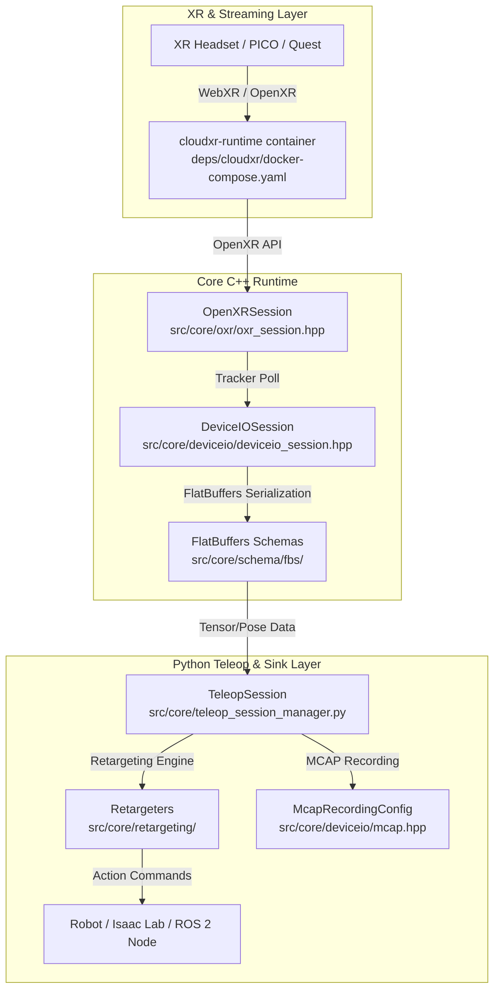
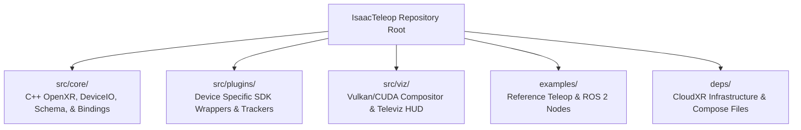

<!-- source: DeepWiki mcp.deepwiki.com · repo NVIDIA/IsaacCapture · page 1 Overview · fetched 2026-10-26 -->

# Overview

Relevant source files

The following files were used as context for generating this wiki page:

- [README.md](README.md)
- [deps/cloudxr/.env.default](deps/cloudxr/.env.default)
- [deps/cloudxr/.gitignore](deps/cloudxr/.gitignore)
- [deps/cloudxr/Dockerfile.web-app](deps/cloudxr/Dockerfile.web-app)
- [deps/cloudxr/Dockerfile.wss-proxy](deps/cloudxr/Dockerfile.wss-proxy)
- [deps/cloudxr/docker-compose.yaml](deps/cloudxr/docker-compose.yaml)
- [deps/cloudxr/webxr_client/tsconfig.json](deps/cloudxr/webxr_client/tsconfig.json)
- [docs/source/_static/hardware-req-01.svg](docs/source/_static/hardware-req-01.svg)
- [docs/source/_static/hardware-req-02.svg](docs/source/_static/hardware-req-02.svg)
- [docs/source/_static/hardware-req-03.svg](docs/source/_static/hardware-req-03.svg)
- [docs/source/_static/hardware-req-04.svg](docs/source/_static/hardware-req-04.svg)
- [docs/source/_static/isaac-teleop-architecture.svg](docs/source/_static/isaac-teleop-architecture.svg)
- [docs/source/_static/isaaclab.jpg](docs/source/_static/isaaclab.jpg)
- [docs/source/_static/isaacros.png](docs/source/_static/isaacros.png)
- [docs/source/device/body_tracking.rst](docs/source/device/body_tracking.rst)
- [docs/source/index.rst](docs/source/index.rst)
- [docs/source/overview/ecosystem.rst](docs/source/overview/ecosystem.rst)
- [docs/source/references/mcap_record_replay.rst](docs/source/references/mcap_record_replay.rst)
- [docs/source/references/requirements.rst](docs/source/references/requirements.rst)
- [examples/mcap_record_replay/.gitignore](examples/mcap_record_replay/.gitignore)
- [examples/mcap_record_replay/CMakeLists.txt](examples/mcap_record_replay/CMakeLists.txt)
- [examples/mcap_record_replay/cpp/CMakeLists.txt](examples/mcap_record_replay/cpp/CMakeLists.txt)
- [examples/mcap_record_replay/cpp/record_full_body.cpp](examples/mcap_record_replay/cpp/record_full_body.cpp)
- [examples/schemaio/CMakeLists.txt](examples/schemaio/CMakeLists.txt)
- [examples/schemaio/full_body_printer.cpp](examples/schemaio/full_body_printer.cpp)

Isaac Teleop (`isaaccapture`) is the unified framework for high-fidelity egocentric and robotics data collection, designed to solve data bottlenecks in robot learning by providing a standardized device interface, flexible retargeting pipelines, and seamless operation across simulation and real-world platforms [README.md:8-28, docs/source/index.rst:12-15]. 

Sources: [README.md:8-28](), [docs/source/index.rst:12-15]()

---

## High-Level Architecture

The Isaac Teleop architecture streams pose, video, and sensor information from extended reality (XR) client hardware into a cloud or local runtime environment, processing device inputs via C++ OpenXR bindings and DeviceIO tracker layers before routing them through Python-based retargeting engines to target robots or datasets [docs/source/index.rst:23-28, docs/references/mcap_record_replay.rst:14-32].

### System Architecture Flow

Sources: [deps/cloudxr/docker-compose.yaml:6-30](), [docs/source/references/mcap_record_replay.rst:14-32]()

---

## Child Pages & Navigation

This page provides a high-level summary of Isaac Teleop. For detailed instructions and deep technical dives, refer to the following child pages:

- **Getting Started**: For installation via `pip`/`uv`, extras configuration, starting the CloudXR container services, running initial teleoperation examples, and reviewing hardware specs, see [Getting Started](#1.1).
- **Repository Layout and Conventions**: For a thorough walkthrough of `src/core`, `src/plugins`, `src/viz`, dependency management, and contributing guidelines, see [Repository Layout and Conventions](#1.2).

Sources: [docs/source/index.rst:38-58]()

---

## 1.1. Getting Started

To initialize a development or production environment for Isaac Teleop, users install the package dependencies using `uv` or `pip`, deploy the CloudXR runtime container stack using Docker Compose, and verify configuration against system hardware requirements [README.md:50-66, docs/source/references/requirements.rst:7-35].

For full instructions, quick-start guides, and hardware prerequisites, see [Getting Started](#1.1).

Sources: [README.md:50-65](), [docs/source/references/requirements.rst:7-35]()

---

## 1.2. Repository Layout and Conventions

The repository organizes its implementation into modular directories separating low-level C++ core utilities, device integration plugins, visualization engines, and orchestration scripts [docs/source/index.rst:23-28]. 

### Repository Directory Organization

Sources: [docs/source/index.rst:23-28](), [deps/cloudxr/docker-compose.yaml:4-69]()

For comprehensive details on AGENTS.md conventions, REUSE licensing, pre-commit hooks, and codebase structure, see [Repository Layout and Conventions](#1.2).

Sources: [docs/source/index.rst:38-58]()

---

