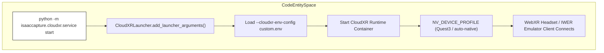

<!-- source: DeepWiki mcp.deepwiki.com · repo NVIDIA/IsaacCapture · page 1.1 Getting Started · fetched 2026-10-26 -->

# Getting Started

<details>
<summary>Relevant source files</summary>

The following files were used as context for generating this wiki page:

- [cmake/SetupPython.cmake](cmake/SetupPython.cmake)
- [docs/source/_static/hardware-req-01.svg](docs/source/_static/hardware-req-01.svg)
- [docs/source/_static/hardware-req-02.svg](docs/source/_static/hardware-req-02.svg)
- [docs/source/_static/hardware-req-03.svg](docs/source/_static/hardware-req-03.svg)
- [docs/source/_static/hardware-req-04.svg](docs/source/_static/hardware-req-04.svg)
- [docs/source/_static/isaac-teleop-architecture.svg](docs/source/_static/isaac-teleop-architecture.svg)
- [docs/source/_static/isaaclab.jpg](docs/source/_static/isaaclab.jpg)
- [docs/source/_static/isaacros.png](docs/source/_static/isaacros.png)
- [docs/source/getting_started/build_from_source/index.rst](docs/source/getting_started/build_from_source/index.rst)
- [docs/source/getting_started/quick_start.rst](docs/source/getting_started/quick_start.rst)
- [docs/source/references/build.rst](docs/source/references/build.rst)
- [docs/source/references/requirements.rst](docs/source/references/requirements.rst)
- [examples/oxr/python/pyproject.toml](examples/oxr/python/pyproject.toml)
- [examples/teleop/python/pyproject.toml](examples/teleop/python/pyproject.toml)
- [src/core/oxr/python/CMakeLists.txt](src/core/oxr/python/CMakeLists.txt)
- [src/core/plugin_manager/python/CMakeLists.txt](src/core/plugin_manager/python/CMakeLists.txt)
- [src/core/python/requirements-dev.txt](src/core/python/requirements-dev.txt)
- [src/core/python/requirements.txt](src/core/python/requirements.txt)
- [src/core/python/stubgen_pyproject.toml](src/core/python/stubgen_pyproject.toml)

</details>


## Purpose and Scope
This page covers the quick start procedures for `isaaccapture` (formerly Isaac Teleop). It details hardware and software requirements, installation via PyPI or `uv` with optional extras, building from source via CMake and `scikit-build-core`, configuring and starting the CloudXR streaming service, and executing initial teleoperation workflows.

Sources: `docs/source/getting_started/quick_start.rst:1-12`(), `docs/source/getting_started/build_from_source/index.rst:4-10`()

---

## Hardware and Software Requirements
Teleoperation sessions involving XR headsets, extra input devices (such as Manus Gloves, Logitech pedals, OAK-D cameras, Haptikos exoskeletons), or simulators demand specific workstation configurations `[docs/source/references/requirements.rst:7-18]()`.

| Component | Requirement |
| :--- | :--- |
| **CPU / GPU** | `x86_64`, NVIDIA GPU required `[docs/source/references/requirements.rst:25-26]()` |
| **OS** | Ubuntu 22.04 or 24.04 `[docs/source/references/requirements.rst:27-28]()` |
| **Python** | 3.11, 3.12, or 3.13 `[docs/source/references/requirements.rst:29-30]()` |
| **CUDA** | 12.8 or newer `[docs/source/references/requirements.rst:31-32]()` |
| **NVIDIA Driver** | 580.95.05 or newer `[docs/source/references/requirements.rst:33-34]()` |

Sources: `docs/source/references/requirements.rst:1-35`()

---

## Installation via Pip and `uv`
The package `isaaccapture` can be installed directly from PyPI along with optional feature extras such as `cloudxr` and `retargeters` `[docs/source/getting_started/quick_start.rst:33-49]()`.

```bash
# Standard pip installation with cloudxr and retargeter extras
pip install 'isaaccapture[cloudxr,retargeters]~=1.0'

# Installation via Astral uv with pre-release opt-in and NVIDIA package index
uv pip install 'isaaccapture[cloudxr,retargeters]~=1.0' \
      --extra-index-url https://pypi.nvidia.com --prerelease=allow
```

Upgrading from legacy versions (`isaacteleop` 1.5 or earlier) is handled automatically through compatibility aliases defined in requirements configurations `[docs/source/getting_started/quick_start.rst:36-40](), [src/core/python/requirements.txt:1-4]()`.

Sources: `docs/source/getting_started/quick_start.rst:31-65](), [src/core/python/requirements.txt:1-4]()`

---

## Building from Source and CMake Configuration
To compile core libraries, plugins, and bindings from source, CMake 3.24+ and a C++20 compiler are required `[docs/source/getting_started/build_from_source/index.rst:21-28]()`. Dependency management and Python version enforcement are handled by `cmake/SetupPython.cmake` `[cmake/SetupPython.cmake:7-18]()`.

```mermaid
graph TD
    RootCMake["Top-level CMakeLists.txt"] --> SetupPy["cmake/SetupPython.cmake"]
    SetupPy --> CheckVersion["isaac_teleop_enforce_python_version"]
    CheckVersion --> FindUV["find_program uv"]
    FindUV --> ManagedPy["uv python find ISAAC_TELEOP_PYTHON_VERSION"]
    ManagedPy --> FetchDeps["FetchContent OpenXR / pybind11 / yaml-cpp"]
    FetchDeps --> CoreBuild["src/core/CMakeLists.txt"]
    CoreBuild --> WheelPack["src/core/python/ wheel packaging"]

    subgraph CodeEntitySpace
        RootCMake
        SetupPy
        CheckVersion
        FindUV
        ManagedPy
        FetchDeps
        CoreBuild
        WheelPack
    end

    style RootName fill:#fff,stroke:#000,stroke-width:1px
```


*Figure 1: CMake configuration and Python discovery control flow mapping to build scripts.*

Sources: `docs/source/getting_started/build_from_source/index.rst:19-103](), [cmake/SetupPython.cmake:1-89]()`

---

## CloudXR Service and Runtime Setup
CloudXR runtime servers handle WebXR streaming from headsets (Quest, PICO, Vision Pro, or local emulator `IWER`). The CloudXR runtime can be launched via service commands or instantiated automatically by teleop examples `[docs/source/getting_started/quick_start.rst:71-108]()`.


*Figure 2: CloudXR service startup and environment parameterization sequence.*

To write a custom profile configuration and initialize the background service:
```bash
echo 'NV_DEVICE_PROFILE=auto-native' > custom.env
python -m isaaccapture.cloudxr.service start --cloudxr-env-config ./custom.env
```
Resolved runtime configurations are written to `~/.cloudxr/run/cloudxr.env` `[docs/source/getting_started/quick_start.rst:93-113]()`.

Sources: `docs/source/getting_started/quick_start.rst:69-146]()`

---

