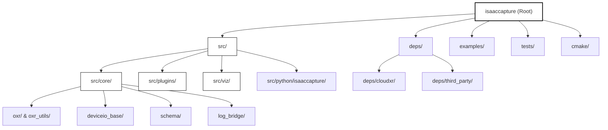
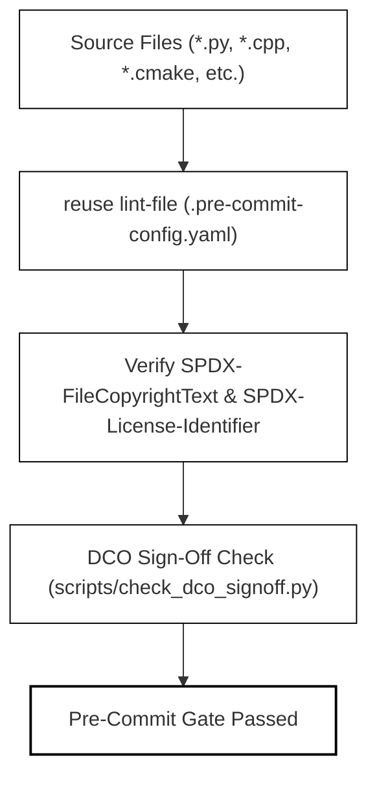

<!-- source: DeepWiki mcp.deepwiki.com · repo NVIDIA/IsaacCapture · page 1.2 Repository Layout and Conventions · fetched 2026-10-26 -->

# Repository Layout and Conventions

Relevant source files

The following files were used as context for generating this wiki page:

- [.clang-format](.clang-format)
- [.claude/skills/cmake-structure/SKILL.md](.claude/skills/cmake-structure/SKILL.md)
- [.coderabbit.yaml](.coderabbit.yaml)
- [.cursor/rules/cmake-structure.mdc](.cursor/rules/cmake-structure.mdc)
- [.github/instructions/cmake-structure.instructions.md](.github/instructions/cmake-structure.instructions.md)
- [.gitlab-ci.yml](.gitlab-ci.yml)
- [.nspect-allowlist.toml](.nspect-allowlist.toml)
- [.pre-commit-config.yaml](.pre-commit-config.yaml)
- [.reuse/templates/compact.jinja2](.reuse/templates/compact.jinja2)
- [AGENTS.md](AGENTS.md)
- [CODE_OF_CONDUCT.md](CODE_OF_CONDUCT.md)
- [CONTRIBUTING.md](CONTRIBUTING.md)
- [LICENSES/Apache-2.0.txt](LICENSES/Apache-2.0.txt)
- [REUSE.toml](REUSE.toml)
- [SECURITY.md](SECURITY.md)
- [cmake/cmake-structure.md](cmake/cmake-structure.md)
- [docs/source/references/license.rst](docs/source/references/license.rst)
- [examples/README.md](examples/README.md)
- [scripts/check_dco_signoff.py](scripts/check_dco_signoff.py)
- [src/core/log_bridge/cpp/sink_config.cpp](src/core/log_bridge/cpp/sink_config.cpp)
- [src/python/isaaccapture/cloudxr/webclient.py](src/python/isaaccapture/cloudxr/webclient.py)
- [src/python/isaaccapture/logging_config/AGENTS.md](src/python/isaaccapture/logging_config/AGENTS.md)
- [src/python/isaaccapture/logging_config/__init__.py](src/python/isaaccapture/logging_config/__init__.py)
- [src/python/isaaccapture/logging_config/_console.py](src/python/isaaccapture/logging_config/_console.py)
- [tests/python/core/logging_config/conftest.py](tests/python/core/logging_config/conftest.py)
- [tests/python/core/logging_config/test_console.py](tests/python/core/logging_config/test_console.py)
- [tests/python/core/logging_config/test_core.py](tests/python/core/logging_config/test_core.py)
- [tests/python/core/logging_config/test_routing.py](tests/python/core/logging_config/test_routing.py)

## Purpose and Scope

This page provides a comprehensive tour of the `isaaccapture` repository layout (`src/core`, `src/plugins`, `src/viz`, `deps`, `examples`, and `tests`), development conventions, agent compliance rules (`AGENTS.md`), licensing via REUSE, developer contribution workflows, and pre-commit verification gates.

Sources: [`AGENTS.md:1-119`](), [`CONTRIBUTING.md:1-133`](), [`.pre-commit-config.yaml:1-75`]()

---

## Repository Directory Layout

The repository is organized into distinct functional subtrees separating core C++ runtimes, Python device plugins, visualization components, dependencies, and validation tests.

*Figure 1: High-level repository directory layout and subsystem mapping.*

Sources: [`AGENTS.md:1-49`](), [`CONTRIBUTING.md:1-50`]()

### Top-Level Directories

- `src/core/`: Contains the primary C++ runtime architecture, including the OpenXR session layer (`oxr`), DeviceIO tracker interfaces (`deviceio_base`), FlatBuffers schema definitions and codegen (`schema`), MCAP recording adapters, and the plugin manager.
- `src/plugins/`: Houses individual device plugins (e.g., MANUS gloves, OAK cameras, Sharpa/Wuji avatars, pedals, leader arms) implemented as dynamic libraries or separate processes.
- `src/viz/`: Implements the Vulkan/CUDA/OpenXR rendering compositor (`VizSession`), camera streaming pipelines, and robot visualization HUDs (`isaaccapture.viz.robot`).
- `src/python/isaaccapture/`: Houses the Python package supporting the teleop control state machine, retargeting engines, logging configuration (`logging_config`), and CLI utilities.
- `deps/`: Vendored external dependencies, OpenXR headers, CloudXR integration files, and build utility CMake scripts.
- `examples/`: End-to-end reference applications, including ROS 2 teleop nodes, vehicle teleop, LeRobot data collection, and MuJoCo simulations.
- `tests/`: C++ (`tests/cpp`) and Python (`tests/python`) test suites executed via CTest and pytest.

Sources: [`AGENTS.md:27-48`](), [`.pre-commit-config.yaml:13-74`]()

---

## Agent Conventions (`AGENTS.md`)

Automated coding agents and contributors must adhere to strict operational constraints defined in root and directory-level `AGENTS.md` files.

### Mandatory Preflight
Before modifying or creating any file, agents must locate and read every relevant `AGENTS.md` file traversing upward from the target directory to the repository root [`AGENTS.md:27-38`](). Relying solely on chat context is strictly prohibited.

### CMake and Include Structure
When creating or editing `CMakeLists.txt` files, managing targets, placing headers, or structuring directories, contributors must follow canonical CMake and include rules defined in [`cmake/cmake-structure.md`](), which is auto-loaded by per-tool shims [`AGENTS.md:50-60`]().

### Shell Scripting Standards
In bash scripts (`#!/bin/bash`, `#!/usr/bin/env bash`), use the robust test construct `[[ ... ]]` instead of the POSIX single-bracket `[ ... ]` to prevent unquoted word-splitting or glob expansion issues [`AGENTS.md:64-68`](). Note that genuine `#!/bin/sh` (dash) scripts must retain `[ ... ]` [`AGENTS.md:69-72`]().

### Logging Conventions
Every process in the repository—both Python and C++—feeds a single logger tree rooted at `isaaccapture` [`AGENTS.md:76-78`]().
- **Naming:** Name loggers under `isaaccapture.`. In Python, use `logging.getLogger(__name__)` inside `src/python/isaaccapture/` or explicit `logging.getLogger("isaaccapture.<area>.<module>")`. In C++, use `isaaccapture::Logger::get("isaaccapture.<module>.<ClassName>")` [`AGENTS.md:80-88`]().
- **No BasicConfig:** Never call `logging.basicConfig()`, and never attach custom handlers directly to the `isaaccapture` root logger to avoid duplicate log emission [`AGENTS.md:89-94`]().
- **Public API Configuration:** Configure logging exclusively through public APIs such as `logging_config.set_console_level()` rather than constructing handlers manually [`AGENTS.md:102-105`]().
- **Terminal UX vs Diagnostics:** Use `print()` or `std::cout` strictly for deliberate terminal UX (CLI usage text, interactive prompts, operator banners), while diagnostics must be routed to the logger tree [`AGENTS.md:106-111`]().

Sources: [`AGENTS.md:1-119`](), [`src/python/isaaccapture/logging_config/__init__.py:1-32`](), [`src/python/isaaccapture/logging_config/_console.py:1-160`]()

---

## Licensing and REUSE Compliance

The codebase uses the **REUSE** specification to enforce machine-readable copyright and licensing information across all source files [`CONTRIBUTING.md:51-53`]().

*Figure 2: Code quality and compliance verification pipeline enforced by pre-commit hooks.*

Sources: [`.pre-commit-config.yaml:32-63`](), [`CONTRIBUTING.md:51-77`](), [`REUSE.toml:1-60`]()

### Required Header Annotations
Every source file must contain valid SPDX metadata headers:
- `SPDX-FileCopyrightText: Copyright (c) 2026 NVIDIA CORPORATION & AFFILIATES. All rights reserved.` [`CONTRIBUTING.md:55-63`](), [`docs/source/references/license.rst:20-36`]()
- `SPDX-License-Identifier: Apache-2.0` (with full license text stored in `LICENSES/Apache-2.0.txt`) [`CONTRIBUTING.md:55-56`]().

### Exceptions & Overrides
Certain components maintain specific license exceptions declared in [`REUSE.toml`]():
- OpenXR SDK headers and extensions are governed under MIT or Boost Software License 1.0 [`docs/source/references/license.rst:12-16`]().
- NVIDIA CloudXR SDK is proprietary software under the NVIDIA CloudXR License [`docs/source/references/license.rst:17`]().
- Vendored third-party code (e.g., Chromium key code tables) maintains original BSD-3-Clause annotations [`REUSE.toml:48-60`]().

Sources: [`REUSE.toml:1-60`](), [`CONTRIBUTING.md:51-78`](), [`docs/source/references/license.rst:1-39`]()

---

## Contributing and Developer Workflows

Contributions must follow established code styles, pre-commit validations, and Developer Certificate of Origin (DCO) sign-offs.

### Code Styles
- **C++:** Written in C++20 and formatted using `clang-format` [`CONTRIBUTING.md:18-20`]().
- **Python:** Follows PEP 8 style guidelines, utilizes type annotations (PEP 484), and employs formatted string literals (f-strings) [`CONTRIBUTING.md:22-24`]().

### Developer Certificate of Origin (DCO)
All commits must be signed off using the `git commit -s` or `--signoff` flag, appending a `Signed-off-by` line certifying that the contribution complies with the Developer Certificate of Origin Version 1.1 [`CONTRIBUTING.md:91-132`]().

Sources: [`CONTRIBUTING.md:1-133`]()

---

## Pre-Commit Verification Gates

Pre-commit hooks automatically validate formatting, linting, licensing, and documentation references before commits are finalized.

| Hook ID | Tool / Script | Target Scope | Description |
| :--- | :--- | :--- | :--- |
| `ruff` / `ruff-format` | Astral Ruff [`.pre-commit-config.yaml:5-12`]() | Python files | Lints and formats Python source code |
| `reuse-lint-file` | REUSE Tool [`.pre-commit-config.yaml:33-39`]() | All source files | Validates SPDX copyright and license headers |
| `check-dco-signoff` | `scripts/check_dco_signoff.py` [`.pre-commit-config.yaml:43-47`]() | Commit messages | Verifies DCO `Signed-off-by` signature |
| `check-copyright-year` | `scripts/check_copyright_year.py` [`.pre-commit-config.yaml:48-53`]() | Source files | Ensures copyright year includes current year |
| `check-lfs-pointers` | `scripts/check_lfs_pointers.py` [`.pre-commit-config.yaml:54-63`]() | LFS assets | Ensures Git LFS-marked files are valid pointers |
| `check-doc-refs` | `scripts/check_doc_refs.py` [`.pre-commit-config.yaml:64-74`]() | Documentation (`.rst`, `.md`) | Validates that documentation references existing code symbols and imports |

Sources: [`.pre-commit-config.yaml:1-75`](), [`CONTRIBUTING.md:26-50`]()

---

