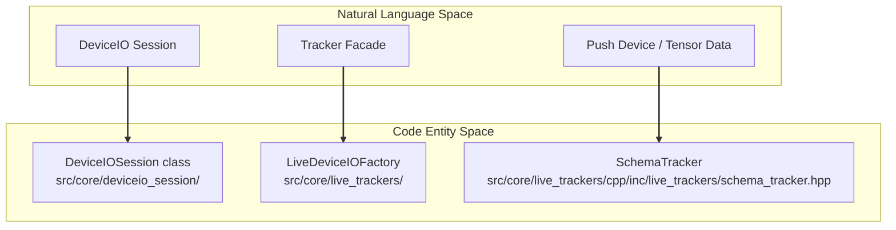
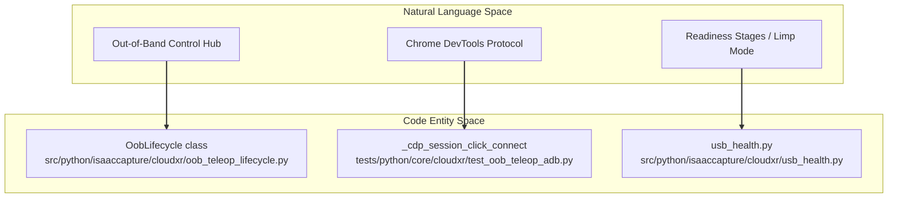

<!-- source: DeepWiki mcp.deepwiki.com · repo NVIDIA/IsaacCapture · page 10 Glossary · fetched 2026-10-26 -->

# Glossary

Relevant source files

The following files were used as context for generating this wiki page:

- [CMakeLists.txt](CMakeLists.txt)
- [docs/source/_static/camera-viz-controls.png](docs/source/_static/camera-viz-controls.png)
- [docs/source/_static/camera-viz-controls.png.license](docs/source/_static/camera-viz-controls.png.license)
- [docs/source/device/body_tracking.rst](docs/source/device/body_tracking.rst)
- [docs/source/getting_started/televiz.rst](docs/source/getting_started/televiz.rst)
- [docs/source/overview/ecosystem.rst](docs/source/overview/ecosystem.rst)
- [docs/source/references/camera_streaming.rst](docs/source/references/camera_streaming.rst)
- [docs/source/references/mcap_record_replay.rst](docs/source/references/mcap_record_replay.rst)
- [docs/source/references/oob_teleop_control.rst](docs/source/references/oob_teleop_control.rst)
- [examples/camera_viz/README.md](examples/camera_viz/README.md)
- [examples/camera_viz/camera_viz.sh](examples/camera_viz/camera_viz.sh)
- [examples/camera_viz/scripts/_install_deps.sh](examples/camera_viz/scripts/_install_deps.sh)
- [examples/camera_viz/scripts/camera-streamer.service.in](examples/camera_viz/scripts/camera-streamer.service.in)
- [examples/mcap_record_replay/.gitignore](examples/mcap_record_replay/.gitignore)
- [examples/mcap_record_replay/CMakeLists.txt](examples/mcap_record_replay/CMakeLists.txt)
- [examples/mcap_record_replay/cpp/CMakeLists.txt](examples/mcap_record_replay/cpp/CMakeLists.txt)
- [examples/mcap_record_replay/cpp/record_full_body.cpp](examples/mcap_record_replay/cpp/record_full_body.cpp)
- [examples/schemaio/CMakeLists.txt](examples/schemaio/CMakeLists.txt)
- [examples/schemaio/full_body_printer.cpp](examples/schemaio/full_body_printer.cpp)
- [src/core/AGENTS.md](src/core/AGENTS.md)
- [src/core/CMakeLists.txt](src/core/CMakeLists.txt)
- [src/core/cloudxr/python/CMakeLists.txt](src/core/cloudxr/python/CMakeLists.txt)
- [src/core/deviceio_trackers/cpp/CMakeLists.txt](src/core/deviceio_trackers/cpp/CMakeLists.txt)
- [src/core/deviceio_trackers/python/tracker_bindings.cpp](src/core/deviceio_trackers/python/tracker_bindings.cpp)
- [src/core/live_trackers/cpp/CMakeLists.txt](src/core/live_trackers/cpp/CMakeLists.txt)
- [src/core/live_trackers/cpp/inc/live_trackers/live_deviceio_factory.hpp](src/core/live_trackers/cpp/inc/live_trackers/live_deviceio_factory.hpp)
- [src/core/live_trackers/cpp/inc/live_trackers/schema_tracker.hpp](src/core/live_trackers/cpp/inc/live_trackers/schema_tracker.hpp)
- [src/core/live_trackers/cpp/live_deviceio_factory.cpp](src/core/live_trackers/cpp/live_deviceio_factory.cpp)
- [src/core/mcap/cpp/inc/mcap/recording_traits.hpp](src/core/mcap/cpp/inc/mcap/recording_traits.hpp)
- [src/core/python/CMakeLists.txt](src/core/python/CMakeLists.txt)
- [src/core/python/MANIFEST.in](src/core/python/MANIFEST.in)
- [src/core/python/pyproject.toml.in](src/core/python/pyproject.toml.in)
- [src/core/replay_trackers/cpp/CMakeLists.txt](src/core/replay_trackers/cpp/CMakeLists.txt)
- [src/core/replay_trackers/cpp/inc/replay_trackers/replay_deviceio_factory.hpp](src/core/replay_trackers/cpp/inc/replay_trackers/replay_deviceio_factory.hpp)
- [src/core/replay_trackers/cpp/replay_deviceio_factory.cpp](src/core/replay_trackers/cpp/replay_deviceio_factory.cpp)
- [src/python/isaaccapture/cloudxr/oob_teleop_adb.py](src/python/isaaccapture/cloudxr/oob_teleop_adb.py)
- [src/python/isaaccapture/cloudxr/oob_teleop_env.py](src/python/isaaccapture/cloudxr/oob_teleop_env.py)
- [src/python/isaaccapture/cloudxr/oob_teleop_lifecycle.py](src/python/isaaccapture/cloudxr/oob_teleop_lifecycle.py)
- [src/python/isaaccapture/cloudxr/service/__main__.py](src/python/isaaccapture/cloudxr/service/__main__.py)
- [tests/python/core/cloudxr/test_oob_teleop_adb.py](tests/python/core/cloudxr/test_oob_teleop_adb.py)
- [tests/python/core/cloudxr/test_oob_teleop_env.py](tests/python/core/cloudxr/test_oob_teleop_env.py)
- [tests/python/core/cloudxr/test_oob_teleop_lifecycle.py](tests/python/core/cloudxr/test_oob_teleop_lifecycle.py)
- [tests/python/core/cloudxr/test_service_cli.py](tests/python/core/cloudxr/test_service_cli.py)
- [tests/python/core/cloudxr/test_webclient.py](tests/python/core/cloudxr/test_webclient.py)

## Purpose and Scope

This page provides technical definitions, architectural context, and code pointers for codebase-specific terms, abbreviations, configuration flags, and subsystem identifiers used across the Isaac Teleop (`isaaccapture`) repository. Each entry links directly to the relevant implementation files and symbols.

---

## Core Runtime & DeviceIO Terms

### DeviceIO
The core C++ abstraction layer (`isaaccapture.deviceio`) responsible for managing live device sessions, replay sessions, tracker factories, and unified data streams. It coordinates data acquisition from hardware and feeds downstream consumers.
* **Sources:** `[src/core/CMakeLists.txt:1-49]()`, `[src/core/live_trackers/cpp/inc/live_trackers/live_deviceio_factory.hpp:1-30]()`

### Tracker Facade
A unified C++ interface pattern that masks disparate vendor hardware SDKs (such as glove APIs, body trackers, and spatial controllers) behind a standardized set of tracker base classes and polymorphic factories.
* **Sources:** `[src/core/deviceio_trackers/python/tracker_bindings.cpp:1-50](), [src/core/live_trackers/cpp/inc/live_trackers/schema_tracker.hpp:1-50]()`

### SchemaPusher
A core streaming utility responsible for serializing structured telemetry and schema definitions into transmission buffers or MCAP recording channels.
* **Sources:** `[src/core/CMakeLists.txt:1-49]()`

### HandInjector
A plugin utility module used to inject external or synthetic hand tracking data into the OpenXR runtime session when native hand data is unavailable or overridden.
* **Sources:** `[src/core/CMakeLists.txt:1-49]()`

### Push Devices & Tensor Data
Mechanisms in `DeviceIO` where trackers push raw tensor arrays (multidimensional GPU/CPU buffers) or structured FlatBuffer messages through the source-sink graph.
* **Sources:** `[src/core/live_trackers/cpp/inc/live_trackers/schema_tracker.hpp:1-50]()`

**Sources:** `[src/core/CMakeLists.txt:1-49](), [src/core/live_trackers/cpp/inc/live_trackers/live_deviceio_factory.hpp:1-30](), [src/core/live_trackers/cpp/inc/live_trackers/schema_tracker.hpp:1-50]()`

---

## CloudXR, WebXR, and OOB Terms

### Televiz
The high-performance Vulkan/CUDA/OpenXR compositor module (`isaaccapture.viz`) responsible for stereo layer composition (quads, cylinders, equirectangles, and projection layers) and robot feedback rendering inside XR headsets or desktop windows.
* **Sources:** `[docs/source/getting_started/televiz.rst:7-18](), [src/core/python/pyproject.toml.in:81-92]()`

### OOB (Out-of-Band) Control Hub
A management hub integrated into the WSS proxy (`PROXY_PORT`, default `48322`) enabling remote monitoring of connected headsets, telemetry collection, and runtime configuration pushing from outside the headset.
* **Sources:** `[docs/source/references/oob_teleop_control.rst:4-10](), [src/python/isaaccapture/cloudxr/oob_teleop_lifecycle.py:84-124]()`

### CDP (Chrome DevTools Protocol)
An automation protocol driven over ADB during OOB startup to inspect headset browser tabs, clear or bypass self-signed certificate interstitials, and automatically click connection buttons.
* **Sources:** `[docs/source/references/oob_teleop_control.rst:159-170](), [tests/python/core/cloudxr/test_oob_teleop_adb.py:26-40]()`

### Readiness Stages
Sequential preflight checkpoints and health evaluation states monitored by `OobLifecycle` during headset connection, network validation, and browser initialization.
* **Sources:** `[src/python/isaaccapture/cloudxr/oob_teleop_lifecycle.py:84-170]()`

### Limp Mode
A degraded operational state assumed by the OOB lifecycle manager when USB transport is temporarily lost or network reachability drops, allowing the browser session to survive while retries execute.
* **Sources:** `[src/python/isaaccapture/cloudxr/oob_teleop_lifecycle.py:84-170]()`

**Sources:** `[docs/source/references/oob_teleop_control.rst:4-170](), [src/python/isaaccapture/cloudxr/oob_teleop_lifecycle.py:84-170](), [tests/python/core/cloudxr/test_oob_teleop_adb.py:26-40]()`

---

## Data Recording & Retargeting Terms

### MCAP (Multi-Channel Application Protocol)
The container format used for recording live telemetry, device tracking streams, and schemas, allowing offline replay through the retargeting pipeline without requiring an active headset or OpenXR runtime.
* **Sources:** `[docs/source/references/mcap_record_replay.rst:4-10](), [src/core/mcap/cpp/inc/mcap/recording_traits.hpp:1-20]()`

### Retargeter
A Python processing component that consumes tracker tensor streams (from live sources or MCAP replay) and maps human kinematic inputs to robot joint commands, end-effector poses, or action spaces.
* **Sources:** `[docs/source/overview/ecosystem.rst:28-30]()`

### Clutch
A control state mechanism and interaction paradigm visualized in the robot HUD (`isaaccapture.viz.robot`) used by operators to engage or disengage teleoperation mapping safely during execution.
* **Sources:** `[src/core/python/pyproject.toml.in:85-92]()`

### XR_NVX1_*
Custom NVIDIA OpenXR vendor extensions implemented within the runtime stack to support advanced device streaming, compositor features, and hardware interactions.
* **Sources:** `[src/core/CMakeLists.txt:1-49]()`

---

## Build System & Packaging Tooling

### skbuild (scikit-build-core)
The build backend used to orchestrate CMake compilation of C++ pybind11 modules alongside Python packaging during wheel construction.
* **Sources:** `[src/core/python/pyproject.toml.in:11-13]()`

### uv
A fast Python package installer and virtual environment manager used across the project to provision isolated environments and manage dependencies.
* **Sources:** `[CMakeLists.txt:50-53](), [src/core/python/pyproject.toml.in:101-103]()`

### vcpkg
C++ package manager integration used for acquiring external third-party dependencies such as DepthAI for OAK camera support.
* **Sources:** `[CMakeLists.txt:20-30]()`