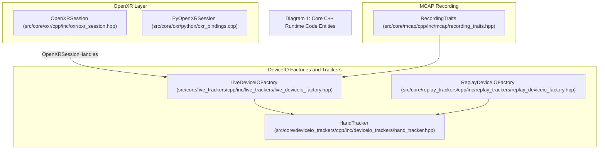
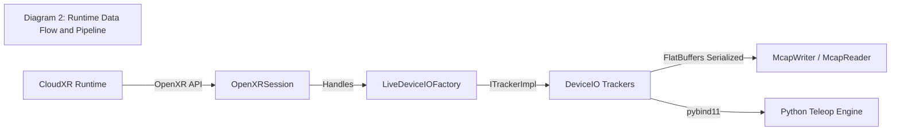

<!-- source: DeepWiki mcp.deepwiki.com · repo NVIDIA/IsaacCapture · page 2 Core Runtime Architecture · fetched 2026-10-26 -->

# Core Runtime Architecture

Relevant source files

The following files were used as context for generating this wiki page:

- [docs/source/references/device_provider_monitoring.rst](docs/source/references/device_provider_monitoring.rst)
- [src/core/deviceio_trackers/cpp/CMakeLists.txt](src/core/deviceio_trackers/cpp/CMakeLists.txt)
- [src/core/deviceio_trackers/python/tracker_bindings.cpp](src/core/deviceio_trackers/python/tracker_bindings.cpp)
- [src/core/live_trackers/cpp/CMakeLists.txt](src/core/live_trackers/cpp/CMakeLists.txt)
- [src/core/live_trackers/cpp/inc/live_trackers/live_deviceio_factory.hpp](src/core/live_trackers/cpp/inc/live_trackers/live_deviceio_factory.hpp)
- [src/core/live_trackers/cpp/inc/live_trackers/schema_tracker.hpp](src/core/live_trackers/cpp/inc/live_trackers/schema_tracker.hpp)
- [src/core/live_trackers/cpp/live_deviceio_factory.cpp](src/core/live_trackers/cpp/live_deviceio_factory.cpp)
- [src/core/mcap/cpp/inc/mcap/recording_traits.hpp](src/core/mcap/cpp/inc/mcap/recording_traits.hpp)
- [src/core/oxr/cpp/CMakeLists.txt](src/core/oxr/cpp/CMakeLists.txt)
- [src/core/oxr/cpp/inc/oxr/oxr_session.hpp](src/core/oxr/cpp/inc/oxr/oxr_session.hpp)
- [src/core/oxr/cpp/oxr_session.cpp](src/core/oxr/cpp/oxr_session.cpp)
- [src/core/oxr/python/oxr_bindings.cpp](src/core/oxr/python/oxr_bindings.cpp)
- [src/core/replay_trackers/cpp/CMakeLists.txt](src/core/replay_trackers/cpp/CMakeLists.txt)
- [src/core/replay_trackers/cpp/inc/replay_trackers/replay_deviceio_factory.hpp](src/core/replay_trackers/cpp/inc/replay_trackers/replay_deviceio_factory.hpp)
- [src/core/replay_trackers/cpp/replay_deviceio_factory.cpp](src/core/replay_trackers/cpp/replay_deviceio_factory.cpp)
- [src/python/isaaccapture/teleop_session_manager/status.py](src/python/isaaccapture/teleop_session_manager/status.py)
- [src/python/isaaccapture/teleop_session_manager/status_monitor.py](src/python/isaaccapture/teleop_session_manager/status_monitor.py)
- [tests/python/core/teleop_session_manager/test_status_monitor.py](tests/python/core/teleop_session_manager/test_status_monitor.py)

The C++ core runtime of `isaaccapture` provides high-performance OpenXR session management, live and replay tracker execution via DeviceIO, structured data serialization using FlatBuffers, MCAP recording and replay, and a plugin discovery system. These components are exposed to Python through pybind11 modules, powering teleoperation and data collection pipelines.

Sources: `src/core/oxr/cpp/inc/oxr/oxr_session.hpp:54-90`, `src/core/live_trackers/cpp/inc/live_trackers/live_deviceio_factory.hpp:55-113`

## 2.1 OpenXR Layer (`oxr`, `oxr_utils`)

The OpenXR layer handles instance creation, system acquisition, session lifecycle events, and extension negotiation for XR runtimes (such as CloudXR). It encapsulates handle management within `core::OpenXRSession` [src/core/oxr/cpp/inc/oxr/oxr_session.hpp:54-90] and provides thread-safe Python bindings via `core::PyOpenXRSession` [src/core/oxr/python/oxr_bindings.cpp:28-75]. Utilities for time conversion, math, and pose manipulation reside in `oxr_utils`.

For details, see [OpenXR Layer (oxr, oxr_utils)](#2.1).

Sources: `src/core/oxr/cpp/inc/oxr/oxr_session.hpp:54-90`, `src/core/oxr/python/oxr_bindings.cpp:28-75`, `src/core/oxr/cpp/CMakeLists.txt:17-39`

## 2.2 DeviceIO: Sessions, Trackers, Sources and Sinks

DeviceIO provides the abstraction layer for collecting telemetry from hardware or recorded streams. It separates public tracker interfaces (e.g., `core::HandTracker`, `core::HeadTracker`) from underlying implementations through live (`core::LiveDeviceIOFactory`) [src/core/live_trackers/cpp/inc/live_trackers/live_deviceio_factory.hpp:55-113] and replay (`core::ReplayDeviceIOFactory`) [src/core/replay_trackers/cpp/inc/replay_trackers/replay_deviceio_factory.hpp:56-83] factories. Trackers feed data graph nodes for retargeting and logging.

For details, see [DeviceIO: Sessions, Trackers, Sources and Sinks](#2.2).

Sources: `src/core/live_trackers/cpp/inc/live_trackers/live_deviceio_factory.hpp:55-113`, `src/core/replay_trackers/cpp/inc/replay_trackers/replay_deviceio_factory.hpp:56-83`, `src/core/deviceio_trackers/python/tracker_bindings.cpp:63-87`

## 2.3 Schema System (FlatBuffers)

Data payloads transmitted across DeviceIO channels and recorded into MCAP files are defined using FlatBuffers `.fbs` schemas. The build system compiles these schemas into golden binary reflection files (`.bfbs`) and generates high-performance C++ and Python accessors, ensuring zero-copy deserialization and backward compatibility across versions.

For details, see [Schema System (FlatBuffers)](#2.3).

Sources: `src/core/deviceio_trackers/python/tracker_bindings.cpp:16-18`

## 2.4 MCAP Recording and Replay

MCAP recording captures live tracker data streams into structured log files, while replay reads them back into deterministic simulation or debugging pipelines. Recording traits (`core::HeadRecordingTraits`, `core::HandRecordingTraits`, etc.) define default channel names and schema associations for each tracker type [src/core/mcap/cpp/inc/mcap/recording_traits.hpp:20-64].

For details, see [MCAP Recording and Replay](#2.4).

Sources: `src/core/mcap/cpp/inc/mcap/recording_traits.hpp:20-64`, `src/core/replay_trackers/cpp/replay_deviceio_factory.cpp:37-66`

## 2.5 Plugin Manager and Logging

The plugin manager discovers external device extensions via `plugin.yaml` manifests and dynamically loads shared libraries into the runtime session. Logging configuration utilities (`logging_config` and `log_bridge`) route C++ and Python log messages through unified sinks for diagnostics.

For details, see [Plugin Manager and Logging](#2.5).

Sources: `src/core/oxr/cpp/inc/oxr/oxr_session.hpp:6`, `src/core/oxr/cpp/oxr_session.cpp:52-56`

---

### Core C++ Runtime Code Entities

Sources: `src/core/oxr/cpp/inc/oxr/oxr_session.hpp:54-90`, `src/core/live_trackers/cpp/inc/live_trackers/live_deviceio_factory.hpp:55-113`, `src/core/replay_trackers/cpp/inc/replay_trackers/replay_deviceio_factory.hpp:56-83`, `src/core/mcap/cpp/inc/mcap/recording_traits.hpp:20-64`

### Runtime Data Flow and Pipeline

Sources: `src/core/oxr/cpp/inc/oxr/oxr_session.hpp:54-90`, `src/core/live_trackers/cpp/inc/live_trackers/live_deviceio_factory.hpp:55-113`, `src/core/replay_trackers/cpp/inc/replay_trackers/replay_deviceio_factory.hpp:56-83`

---

