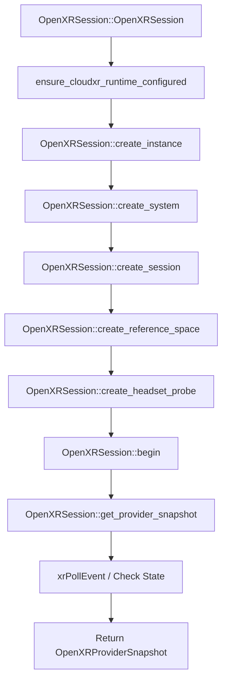
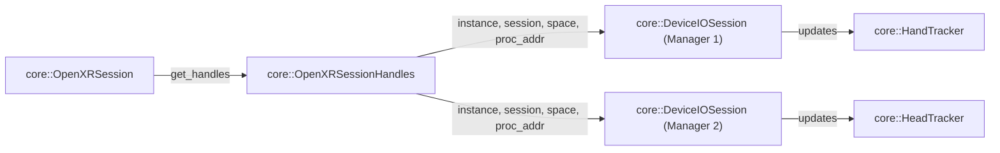

<!-- source: DeepWiki mcp.deepwiki.com · repo NVIDIA/IsaacCapture · page 2.1 OpenXR Layer (oxr, oxr_utils) · fetched 2026-10-26 -->

# OpenXR Layer (oxr, oxr_utils)

<details>
<summary>Relevant source files</summary>

The following files were used as context for generating this wiki page:

- [deps/cloudxr/openxr_extensions/CMakeLists.txt](deps/cloudxr/openxr_extensions/CMakeLists.txt)
- [deps/cloudxr/openxr_extensions/XR_NVX1_push_tensor.h](deps/cloudxr/openxr_extensions/XR_NVX1_push_tensor.h)
- [deps/cloudxr/openxr_extensions/XR_NVX1_tensor_data.h](deps/cloudxr/openxr_extensions/XR_NVX1_tensor_data.h)
- [deps/cloudxr/openxr_extensions/openxr_extension_helpers.h](deps/cloudxr/openxr_extensions/openxr_extension_helpers.h)
- [docs/source/references/device_provider_monitoring.rst](docs/source/references/device_provider_monitoring.rst)
- [examples/oxr/CMakeLists.txt](examples/oxr/CMakeLists.txt)
- [examples/oxr/cpp/oxr_session_sharing.cpp](examples/oxr/cpp/oxr_session_sharing.cpp)
- [examples/oxr/cpp/oxr_simple_api_demo.cpp](examples/oxr/cpp/oxr_simple_api_demo.cpp)
- [examples/oxr/python/modular_example.py](examples/oxr/python/modular_example.py)
- [examples/oxr/python/test_controller_tracker.py](examples/oxr/python/test_controller_tracker.py)
- [examples/oxr/python/test_extensions.py](examples/oxr/python/test_extensions.py)
- [examples/oxr/python/test_modular.py](examples/oxr/python/test_modular.py)
- [examples/oxr/python/test_session_sharing.py](examples/oxr/python/test_session_sharing.py)
- [examples/oxr/python/test_synthetic_hands.py](examples/oxr/python/test_synthetic_hands.py)
- [src/core/oxr/CMakeLists.txt](src/core/oxr/CMakeLists.txt)
- [src/core/oxr/cpp/CMakeLists.txt](src/core/oxr/cpp/CMakeLists.txt)
- [src/core/oxr/cpp/inc/oxr/oxr_session.hpp](src/core/oxr/cpp/inc/oxr/oxr_session.hpp)
- [src/core/oxr/cpp/oxr_session.cpp](src/core/oxr/cpp/oxr_session.cpp)
- [src/core/oxr/python/oxr_bindings.cpp](src/core/oxr/python/oxr_bindings.cpp)
- [src/core/oxr_utils/cpp/CMakeLists.txt](src/core/oxr_utils/cpp/CMakeLists.txt)
- [src/core/oxr_utils/cpp/inc/oxr_utils/oxr_funcs.hpp](src/core/oxr_utils/cpp/inc/oxr_utils/oxr_funcs.hpp)
- [src/core/oxr_utils/cpp/inc/oxr_utils/oxr_time.hpp](src/core/oxr_utils/cpp/inc/oxr_utils/oxr_time.hpp)
- [src/core/plugin_manager/cpp/CMakeLists.txt](src/core/plugin_manager/cpp/CMakeLists.txt)
- [src/core/pusherio/cpp/CMakeLists.txt](src/core/pusherio/cpp/CMakeLists.txt)
- [src/core/pusherio/cpp/schema_pusher.cpp](src/core/pusherio/cpp/schema_pusher.cpp)
- [src/python/isaaccapture/teleop_session_manager/status.py](src/python/isaaccapture/teleop_session_manager/status.py)
- [src/python/isaaccapture/teleop_session_manager/status_monitor.py](src/python/isaaccapture/teleop_session_manager/status_monitor.py)
- [tests/python/core/teleop_session_manager/test_status_monitor.py](tests/python/core/teleop_session_manager/test_status_monitor.py)

</details>


## Purpose and Scope

The OpenXR layer provides robust C++ session lifecycle management, dynamic function loading, extension negotiation, time synchronization, and Python bindings (`_oxr`) for XR runtimes (primarily optimized for CloudXR). 

- **`core::OpenXRSession`**: Manages headless and overlay OpenXR instances, systems, sessions, reference spaces, event polling, and health snapshots (`[src/core/oxr/cpp/inc/oxr/oxr_session.hpp:54-90]()`, `[src/core/oxr/cpp/oxr_session.cpp:80-94]()`).
- **`core::OpenXRCoreFunctions` & `oxr_utils`**: Dynamically loads core and extension function pointers using `xrGetInstanceProcAddr`, bypassing link-time dependencies on specific vendor runtimes (`[src/core/oxr_utils/cpp/inc/oxr_utils/oxr_funcs.hpp:38-119]()`).
- **`_oxr` Python Bindings**: Exposes session handlers and lifecycle management to Python via Pybind11 with deterministic RAII teardown (`[src/core/oxr/python/oxr_bindings.cpp:28-75]()`, `[src/core/oxr/python/oxr_bindings.cpp:79-144]()`).

---

## 1. OpenXRSession Lifecycle and Environment Configuration

The `OpenXRSession` class encapsulates the setup and teardown of an OpenXR application context. Before calling `xrCreateInstance`, it performs critical environment validations tailored for CloudXR deployments (`[src/core/oxr/cpp/oxr_session.cpp:62-76]()`).

### Environment Validation
`ensure_cloudxr_runtime_configured()` verifies that required IPC and runtime configuration environment variables are present (`[src/core/oxr/cpp/oxr_session.cpp:62-76]()`):
- `NV_CXR_RUNTIME_DIR`: Defaults to `~/.cloudxr/run` for IPC sockets.
- `XR_RUNTIME_JSON`: Points to `~/.cloudxr/share/openxr/1/openxr_cloudxr.json` to route OpenXR loader queries to the CloudXR runtime.
- Setting `ISAAC_TELEOP_DISABLE_CXR_ENV_CHECKS=1` bypasses these checks.

### Initialization Steps
The constructor `OpenXRSession::OpenXRSession` executes a sequential initialization pipeline (`[src/core/oxr/cpp/oxr_session.cpp:80-94]()`):
1. `create_instance`: Initializes the `XrInstance` with the requested extension list.
2. `create_system`: Queries the `XrSystemId` for head-mounted display tracking profiles.
3. `create_session`: Creates the `XrSession` handle.
4. `create_reference_space`: Establishes the tracking reference space (`XR_REFERENCE_SPACE_TYPE_STAGE` or LOCAL).
5. `create_headset_probe`: Sets up tracking spaces for the headset probe.
6. `begin`: Transitions the session to the running state via `xrBeginSession`.

### Health Polling and Event Handling
The `get_provider_snapshot()` method polls the underlying OpenXR event queue using `xrPollEvent` and evaluates tracking status and session state transitions (`[src/core/oxr/cpp/oxr_session.cpp:104-171]()`):
- Detects `XR_EVENT_DATA_INSTANCE_LOSS_PENDING` and `XR_SESSION_STATE_LOSS_PENDING` (`[src/core/oxr/cpp/oxr_session.cpp:145-165]()`).
- Returns an `OpenXRProviderSnapshot` containing `OpenXRProviderState`, `OpenXRHeadsetState`, and error codes (`[src/core/oxr/cpp/inc/oxr/oxr_session.hpp:44-51]()`).


*Sources: `[src/core/oxr/cpp/oxr_session.cpp:62-171]()`, `[src/core/oxr/cpp/inc/oxr/oxr_session.hpp:44-90]()`*

---

## 2. Extension Negotiation and Dynamic Function Loading (`oxr_utils`)

To maintain flexibility across different OpenXR runtimes and avoid link-time dependencies, `oxr_utils` defines `OpenXRCoreFunctions` and helpers under `XR_NO_PROTOTYPES` (`[src/core/oxr_utils/cpp/inc/oxr_utils/oxr_funcs.hpp:6-31]()`).

### `OpenXRCoreFunctions` Struct
The `OpenXRCoreFunctions::load` static method resolves core, action system, and haptic function pointers via `xrGetInstanceProcAddr` (`[src/core/oxr_utils/cpp/inc/oxr_utils/oxr_funcs.hpp:38-119]()`):

| Category | Functions Loaded | Role |
| :--- | :--- | :--- |
| **Core Topology** | `xrGetSystem`, `xrGetSystemProperties`, `xrCreateReferenceSpace`, `xrDestroySpace`, `xrLocateSpace` | System discovery and spatial tracking reference management (`[src/core/oxr_utils/cpp/inc/oxr_utils/oxr_funcs.hpp:41-45]()`). |
| **Action System** | `xrStringToPath`, `xrCreateActionSet`, `xrCreateAction`, `xrSuggestInteractionProfileBindings`, `xrAttachSessionActionSets`, `xrCreateActionSpace`, `xrSyncActions`, `xrGetActionStateBoolean/Float/Vector2f/Pose` | Controller input processing and action context management (`[src/core/oxr_utils/cpp/inc/oxr_utils/oxr_funcs.hpp:48-59]()`). |
| **Haptic Feedback** | `xrApplyHapticFeedback`, `xrStopHapticFeedback` | Controller haptic feedback outputs (`[src/core/oxr_utils/cpp/inc/oxr_utils/oxr_funcs.hpp:62-63]()`). |

Extension-specific entry points (e.g., hand tracking, action contexts like `XR_NVX1_action_context`) are loaded individually via `loadExtensionFunction` (`[src/core/oxr_utils/cpp/inc/oxr_utils/oxr_funcs.hpp:123-134]()`).

Sources: `[src/core/oxr_utils/cpp/inc/oxr_utils/oxr_funcs.hpp:38-134]()`

---

## 3. Session Sharing Architecture

The OpenXR layer supports session sharing, allowing multiple `DeviceIOSession` instances (managing independent collections of trackers) to share a single underlying `XrSession` and `XrInstance` (`[examples/oxr/cpp/oxr_session_sharing.cpp:42-69]()`, `[examples/oxr/python/test_session_sharing.py:39-70]()`).

### Mechanics of Sharing
1. **Create Shared Session**: An `OpenXRSession` is instantiated with the superset of all required tracker extensions (`[examples/oxr/cpp/oxr_session_sharing.cpp:26-37]()`).
2. **Extract Handles**: `oxr_session->get_handles()` extracts an `OpenXRSessionHandles` structure containing raw `XrInstance`, `XrSession`, `XrSpace`, and `xrGetInstanceProcAddr` function pointers (`[src/core/oxr/cpp/oxr_session.cpp:98-102]()`).
3. **Bind to Device Managers**: Multiple device sessions are spawned using the shared handles (`[examples/oxr/cpp/oxr_session_sharing.cpp:57-68]()`):
   ```cpp
   auto session1 = core::DeviceIOSession::run(trackers1, handles);
   auto session2 = core::DeviceIOSession::run(trackers2, handles);
   ```


*Sources: `[src/core/oxr/cpp/oxr_session.cpp:98-102]()`, `[examples/oxr/cpp/oxr_session_sharing.cpp:26-69]()`, `[examples/oxr/python/test_session_sharing.py:27-70]()`*

---

## 4. Time Conversion and Math Utilities (`oxr_time`)

Accurate timestamp mapping between operating system monotonic time and OpenXR `XrTime` is provided by `XrTimeConverter`, leveraging the `XR_KHR_convert_timespec_time` extension (`[examples/oxr/cpp/oxr_session_sharing.cpp:27-27]`, `[src/core/oxr/cpp/oxr_session.cpp:189-189]()`).

- **Monotonic Conversion**: Translates between `std::chrono::steady_clock` time points and OpenXR nanosecond durations (`[src/core/oxr/cpp/oxr_session.cpp:189-189]()`).
- **Pose Transforms**: Integration with schema math structures allows direct query and transformation of headset, hand joints, and controller poses relative to reference spaces (`[examples/oxr/cpp/oxr_session_sharing.cpp:83-97]()`).

Sources: `[src/core/oxr/cpp/oxr_session.cpp:186-192]`, `[src/core/oxr_utils/cpp/inc/oxr_utils/oxr_time.hpp:1-1]()`

---

## 5. Python Bindings (`_oxr`)

The C++ module `_oxr` exposes OpenXR capabilities to Python via Pybind11 (`[src/core/oxr/python/oxr_bindings.cpp:79-144]()`).

### Deterministic Lifetime Management (`PyOpenXRSession`)
To prevent "Broken pipe" or invalid handle errors caused by garbage collection order after CloudXR IPC socket teardown, `PyOpenXRSession` wraps `OpenXRSession` inside a `std::unique_ptr` and explicitly destroys it upon exiting Python context managers (`[src/core/oxr/python/oxr_bindings.cpp:28-75]()`):

```python
with oxr.OpenXRSession("ModularExample", required_extensions) as oxr_session:
    handles = oxr_session.get_handles()
    with deviceio.DeviceIOSession.run(trackers, handles) as session:
        session.update()
```

### Exposed Pybind11 API
- **Enums**: `OpenXRProviderState`, `OpenXRHeadsetState`, `OpenXRProviderReason` (`[src/core/oxr/python/oxr_bindings.cpp:83-96]()`).
- **Structs**: `OpenXRProviderSnapshot`, `OpenXRSessionHandles` (with integer casting helpers for raw handles and `proc_addr`) (`[src/core/oxr/python/oxr_bindings.cpp:98-131]()`).
- **Session Class**: `OpenXRSession` with methods `.get_handles()`, `.get_provider_snapshot()`, `.close()`, `__enter__`, and `__exit__` (`[src/core/oxr/python/oxr_bindings.cpp:134-143]()`).

Sources: `[src/core/oxr/python/oxr_bindings.cpp:28-144]()`

---

