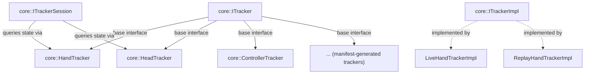
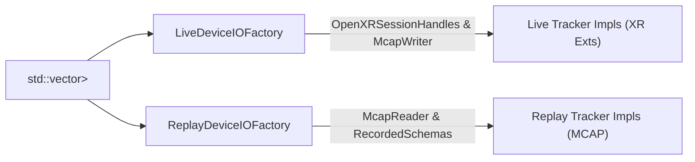
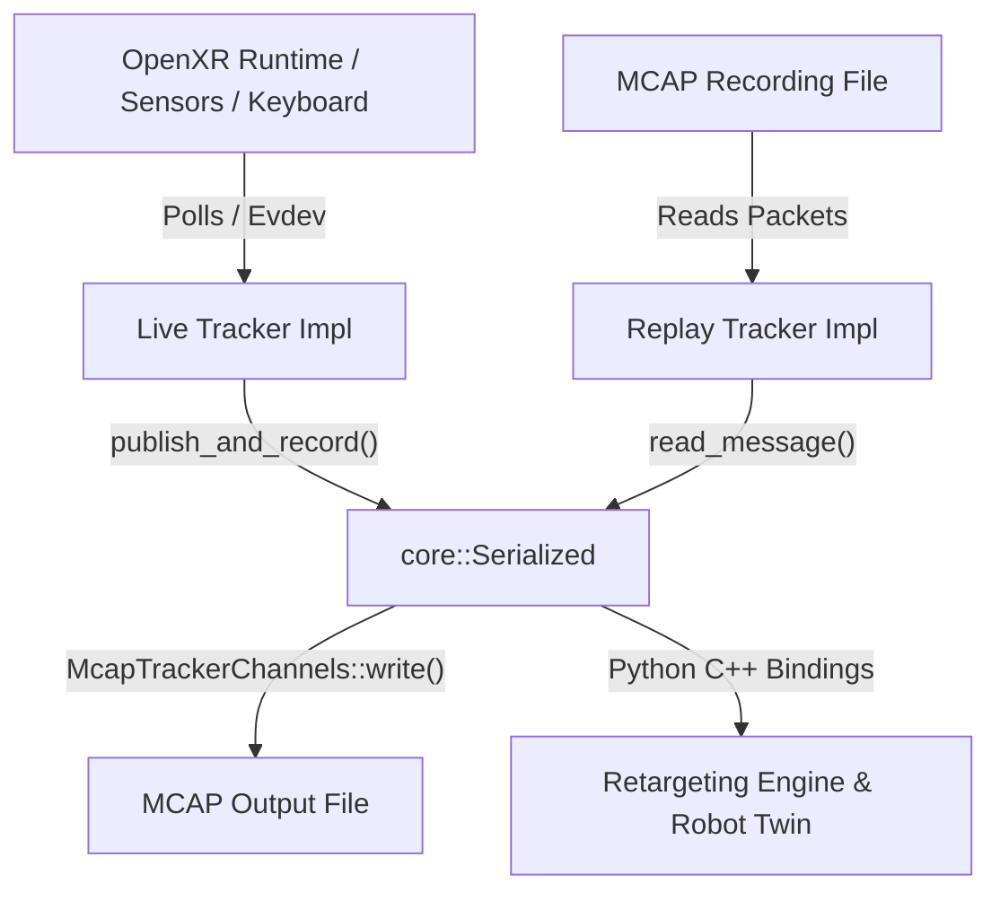

<!-- source: DeepWiki mcp.deepwiki.com · repo NVIDIA/IsaacCapture · page 2.2 DeviceIO: Sessions, Trackers, Sources and Sinks · fetched 2026-10-26 -->

# DeviceIO: Sessions, Trackers, Sources and Sinks

Relevant source files

The following files were used as context for generating this wiki page:

- [cmake/GenerateFlatBuffers.cmake](cmake/GenerateFlatBuffers.cmake)
- [src/core/deviceio_base/cpp/inc/deviceio_base/tracker.hpp](src/core/deviceio_base/cpp/inc/deviceio_base/tracker.hpp)
- [src/core/deviceio_session/AGENTS.md](src/core/deviceio_session/AGENTS.md)
- [src/core/deviceio_session/cpp/CMakeLists.txt](src/core/deviceio_session/cpp/CMakeLists.txt)
- [src/core/deviceio_session/cpp/deviceio_session.cpp](src/core/deviceio_session/cpp/deviceio_session.cpp)
- [src/core/deviceio_session/cpp/inc/deviceio_session/deviceio_session.hpp](src/core/deviceio_session/cpp/inc/deviceio_session/deviceio_session.hpp)
- [src/core/deviceio_session/cpp/inc/deviceio_session/replay_session.hpp](src/core/deviceio_session/cpp/inc/deviceio_session/replay_session.hpp)
- [src/core/deviceio_session/cpp/mcap_impl.cpp](src/core/deviceio_session/cpp/mcap_impl.cpp)
- [src/core/deviceio_session/cpp/replay_session.cpp](src/core/deviceio_session/cpp/replay_session.cpp)
- [src/core/deviceio_session/py_utils/inc/deviceio_py_utils/session.hpp](src/core/deviceio_session/py_utils/inc/deviceio_py_utils/session.hpp)
- [src/core/deviceio_session/python/session_bindings.cpp](src/core/deviceio_session/python/session_bindings.cpp)
- [src/core/deviceio_trackers/cpp/CMakeLists.txt](src/core/deviceio_trackers/cpp/CMakeLists.txt)
- [src/core/deviceio_trackers/python/tracker_bindings.cpp](src/core/deviceio_trackers/python/tracker_bindings.cpp)
- [src/core/live_trackers/cpp/CMakeLists.txt](src/core/live_trackers/cpp/CMakeLists.txt)
- [src/core/live_trackers/cpp/inc/live_trackers/live_deviceio_factory.hpp](src/core/live_trackers/cpp/inc/live_trackers/live_deviceio_factory.hpp)
- [src/core/live_trackers/cpp/inc/live_trackers/schema_tracker.hpp](src/core/live_trackers/cpp/inc/live_trackers/schema_tracker.hpp)
- [src/core/live_trackers/cpp/live_controller_tracker_impl.cpp](src/core/live_trackers/cpp/live_controller_tracker_impl.cpp)
- [src/core/live_trackers/cpp/live_controller_tracker_impl.hpp](src/core/live_trackers/cpp/live_controller_tracker_impl.hpp)
- [src/core/live_trackers/cpp/live_deviceio_factory.cpp](src/core/live_trackers/cpp/live_deviceio_factory.cpp)
- [src/core/live_trackers/cpp/live_full_body_tracker_pico_impl.cpp](src/core/live_trackers/cpp/live_full_body_tracker_pico_impl.cpp)
- [src/core/live_trackers/cpp/live_full_body_tracker_pico_impl.hpp](src/core/live_trackers/cpp/live_full_body_tracker_pico_impl.hpp)
- [src/core/live_trackers/cpp/live_hand_tracker_impl.cpp](src/core/live_trackers/cpp/live_hand_tracker_impl.cpp)
- [src/core/live_trackers/cpp/live_hand_tracker_impl.hpp](src/core/live_trackers/cpp/live_hand_tracker_impl.hpp)
- [src/core/live_trackers/cpp/live_head_tracker_impl.cpp](src/core/live_trackers/cpp/live_head_tracker_impl.cpp)
- [src/core/live_trackers/cpp/live_head_tracker_impl.hpp](src/core/live_trackers/cpp/live_head_tracker_impl.hpp)
- [src/core/mcap/cpp/inc/mcap/recording_traits.hpp](src/core/mcap/cpp/inc/mcap/recording_traits.hpp)
- [src/core/mcap/cpp/inc/mcap/tracker_channels.hpp](src/core/mcap/cpp/inc/mcap/tracker_channels.hpp)
- [src/core/replay_trackers/cpp/CMakeLists.txt](src/core/replay_trackers/cpp/CMakeLists.txt)
- [src/core/replay_trackers/cpp/inc/replay_trackers/replay_deviceio_factory.hpp](src/core/replay_trackers/cpp/inc/replay_trackers/replay_deviceio_factory.hpp)
- [src/core/replay_trackers/cpp/replay_controller_tracker_impl.cpp](src/core/replay_trackers/cpp/replay_controller_tracker_impl.cpp)
- [src/core/replay_trackers/cpp/replay_controller_tracker_impl.hpp](src/core/replay_trackers/cpp/replay_controller_tracker_impl.hpp)
- [src/core/replay_trackers/cpp/replay_deviceio_factory.cpp](src/core/replay_trackers/cpp/replay_deviceio_factory.cpp)
- [src/core/replay_trackers/cpp/replay_hand_tracker_impl.cpp](src/core/replay_trackers/cpp/replay_hand_tracker_impl.cpp)
- [src/core/replay_trackers/cpp/replay_hand_tracker_impl.hpp](src/core/replay_trackers/cpp/replay_hand_tracker_impl.hpp)
- [src/core/replay_trackers/cpp/replay_head_tracker_impl.cpp](src/core/replay_trackers/cpp/replay_head_tracker_impl.cpp)
- [src/core/replay_trackers/cpp/replay_head_tracker_impl.hpp](src/core/replay_trackers/cpp/replay_head_tracker_impl.hpp)
- [src/core/schema/python/schema_array_views.h](src/core/schema/python/schema_array_views.h)

## Purpose and Scope

This page provides a high-level architectural overview of the **DeviceIO** subsystem in `isaaccapture`, which serves as the core C++ abstraction layer connecting live physical XR hardware (via OpenXR), recorded datasets (via MCAP), and downstream teleoperation or retargeting pipelines. 

DeviceIO manages the lifecycle of tracking modalities through unified session managers, abstract tracker definitions, dynamic factory dispatchers, and input/output stream wiring.

For detailed technical implementations of code generation and tracker catalogs, see the child pages:
- [Tracker Code Generation](#2.2.1)
- [Tracker Catalog and Device Data Types](#2.2.2)

---

## 1. DeviceIO Sessions: Live vs. Replay

The DeviceIO runtime divides session management into two primary modes handled by `DeviceIOSession` and `ReplaySession`. Both manage collections of high-level tracker abstractions (`core::ITracker`) and construct concrete, platform-specific implementations (`core::ITrackerImpl`) depending on whether data is pulled from live OpenXR runtimes or replayed from pre-recorded MCAP files.

- **`DeviceIOSession`**: Manages live sessions tied to an OpenXR runtime (`OpenXRSessionHandles`). It coordinates extension negotiation, frame updates, and optional real-time MCAP serialization through `LiveDeviceIOFactory`.
- **`ReplaySession`**: Manages offline playback sessions. It uses `ReplayDeviceIOFactory` to instantiate file-backed tracker implementations that read serialized FlatBuffer records directly from MCAP archives.

Sources:
- `src/core/deviceio_session/cpp/inc/deviceio_session/deviceio_session.hpp`
- `src/core/deviceio_session/cpp/inc/deviceio_session/replay_session.hpp`

---

## 2. Tracker Base Interfaces and Facades

The DeviceIO architecture separates public-facing tracker facades from internal implementation classes. This design isolates user code and Python bindings from OpenXR session specifics or raw file parsing logic.

- `core::ITracker`: The root interface for all trackers, providing metadata such as `get_name()` [src/core/deviceio_trackers/python/tracker_bindings.cpp:65-65]().
- `core::ITrackerSession`: Represents an active snapshot session context passed to tracker accessors [src/core/deviceio_trackers/python/tracker_bindings.cpp:63-63]().
- **Specialized Trackers**: Subclasses like `core::HandTracker`, `core::HeadTracker`, and `core::ControllerTracker` expose type-safe queries (e.g., `get_left_hand()`, `get_right_hand()`) returning immutable serialized FlatBuffer snapshots wrapped in `core::Serialized<T>` [src/core/deviceio_trackers/python/tracker_bindings.cpp:38-41, 67-86]().

Sources:
- `src/core/deviceio_trackers/python/tracker_bindings.cpp`
- `src/core/deviceio_base/cpp/inc/deviceio_base/tracker.hpp`

---

## 3. Live vs. Replay Tracker Factories

Tracker instances are converted into active data sources at runtime via factory classes that implement dynamic dispatch based on the target execution environment.

### `LiveDeviceIOFactory`
Constructs live OpenXR-backed implementations [src/core/live_trackers/cpp/inc/live_trackers/live_deviceio_factory.hpp:48-55](). It inspects the selected trackers, aggregates required OpenXR extensions (such as `XR_EXT_HAND_TRACKING_EXTENSION_NAME` or `XR_MNDX_XDEV_SPACE_EXTENSION_NAME`) via `get_required_extensions()`, and optionally injects `McapTrackerChannels` writers for recording [src/core/live_trackers/cpp/live_hand_tracker_impl.cpp:62-73, src/core/live_trackers/cpp/inc/live_trackers/live_deviceio_factory.hpp:68-80]().

### `ReplayDeviceIOFactory`
Opens MCAP reader streams and validates recorded FlatBuffer schemas against `RecordedSchemas` during initialization [src/core/replay_trackers/cpp/inc/replay_trackers/replay_deviceio_factory.hpp:41-55, 81-81](). Each replayed tracker instance maintains an independent `McapReader` buffer to prevent data race conditions across chunks [src/core/replay_trackers/cpp/inc/replay_trackers/replay_deviceio_factory.hpp:41-45]().

Sources:
- `src/core/live_trackers/cpp/inc/live_trackers/live_deviceio_factory.hpp`
- `src/core/replay_trackers/cpp/inc/replay_trackers/replay_deviceio_factory.hpp`
- `src/core/live_trackers/cpp/live_hand_tracker_impl.cpp`

---

## 4. Source/Sink Graph Discovery and Data Flow

DeviceIO acts as the ingestion boundary for the broader teleoperation pipeline. Trackers publish data frames as serialized FlatBuffer payloads, which are concurrently routed to recording sinks and downstream Python retargeting nodes.

- **Publish and Record**: Helper utilities such as `publish_and_record()` encode payloads once into FlatBuffers, forwarding the exact byte buffer simultaneously to recording channels and consumer sessions [src/core/mcap/cpp/inc/mcap/tracker_channels.hpp:163-178]().
- **Python Integration**: Pybind11 modules expose session and tracker states, ensuring zero-copy or shared pointer handoffs to Python consumers without corrupting live ring buffers [src/core/deviceio_trackers/python/tracker_bindings.cpp:45-48].

Sources:
- `src/core/mcap/cpp/inc/mcap/tracker_channels.hpp`
- `src/core/deviceio_trackers/python/tracker_bindings.cpp`

---

## 5. Related Child Pages

For further details on specific tracker subsystems, refer to the following documentation:
- **Tracker Code Generation**: Covers manifests (`trackers.toml`), code generation scripts (`generate_trackers.py`), and CMake build integrations. For details, see [Tracker Code Generation](#2.2.1).
- **Tracker Catalog and Device Data Types**: Details specific modalities including hand, head, controller, full-body kinematics, haptic command readers, and message channels. For details, see [Tracker Catalog and Device Data Types](#2.2.2).

---

