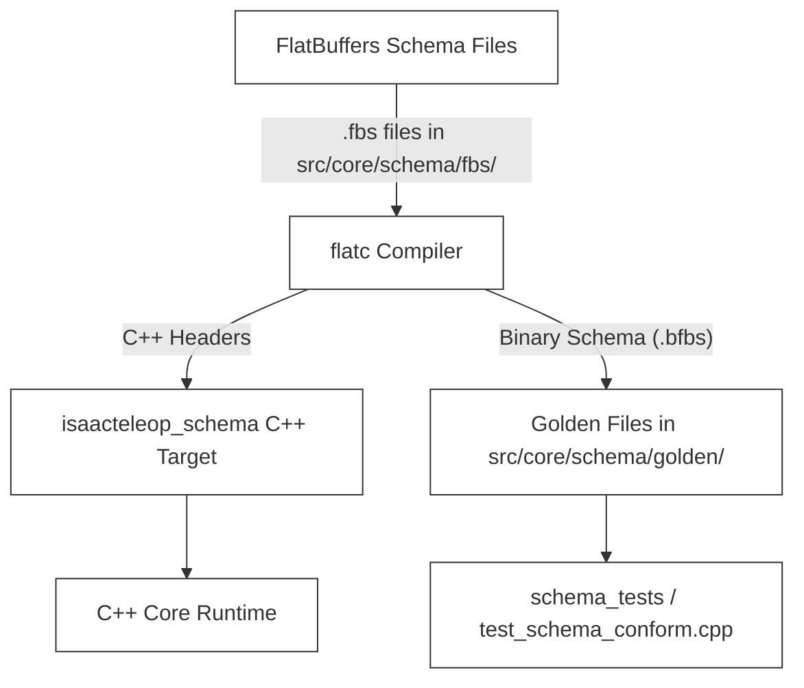
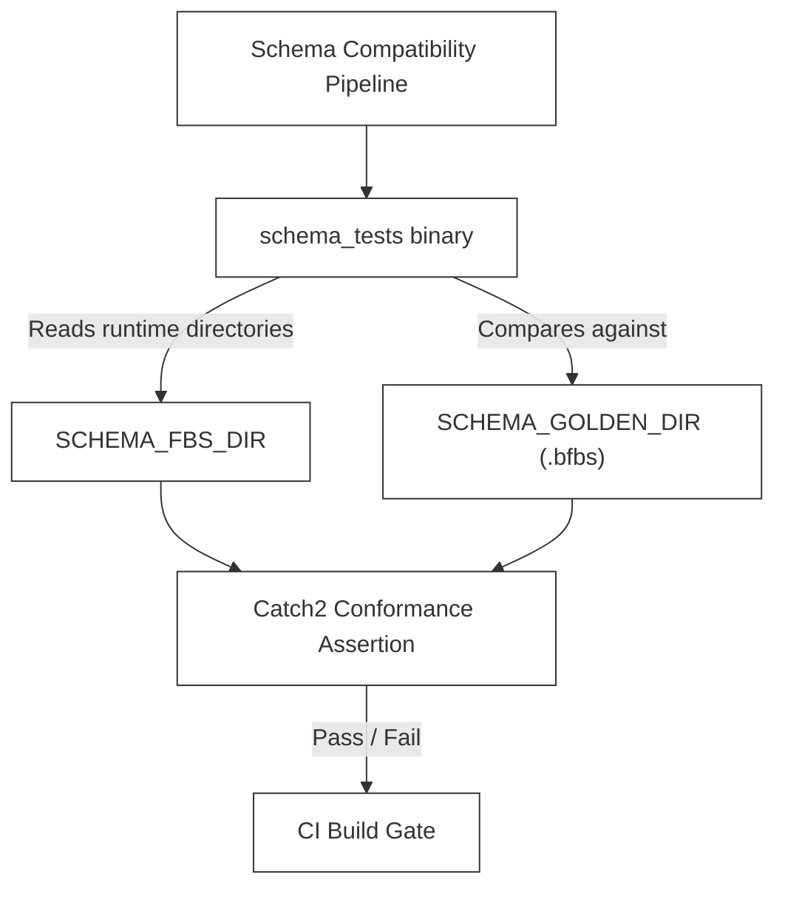
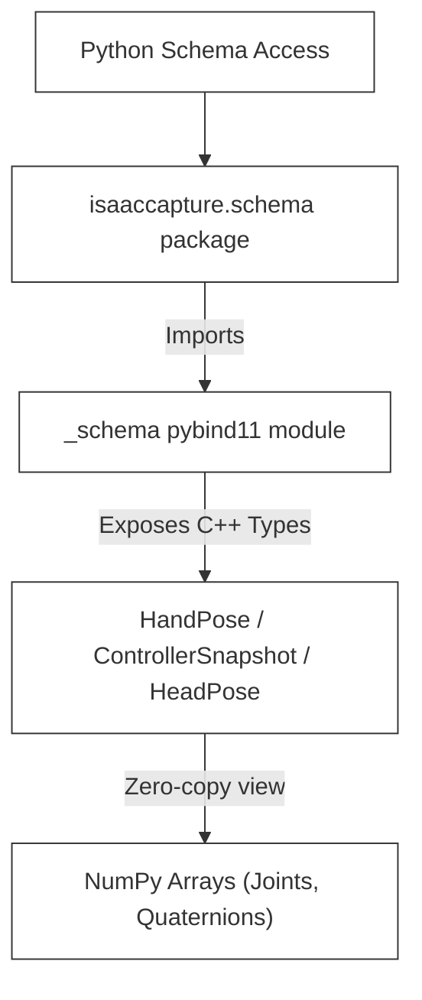
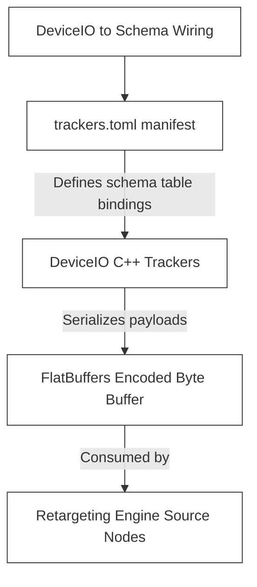

<!-- source: DeepWiki mcp.deepwiki.com · repo NVIDIA/IsaacCapture · page 2.3 Schema System (FlatBuffers) · fetched 2026-10-26 -->

# Schema System (FlatBuffers)

Relevant source files

The following files were used as context for generating this wiki page:

- [examples/oxr/python/test_full_body_tracker.py](examples/oxr/python/test_full_body_tracker.py)
- [src/core/deviceio_trackers/cpp/controller_tracker.cpp](src/core/deviceio_trackers/cpp/controller_tracker.cpp)
- [src/core/deviceio_trackers/cpp/hand_tracker.cpp](src/core/deviceio_trackers/cpp/hand_tracker.cpp)
- [src/core/deviceio_trackers/cpp/head_tracker.cpp](src/core/deviceio_trackers/cpp/head_tracker.cpp)
- [src/core/deviceio_trackers/cpp/inc/deviceio_trackers/controller_tracker.hpp](src/core/deviceio_trackers/cpp/inc/deviceio_trackers/controller_tracker.hpp)
- [src/core/deviceio_trackers/cpp/inc/deviceio_trackers/hand_tracker.hpp](src/core/deviceio_trackers/cpp/inc/deviceio_trackers/hand_tracker.hpp)
- [src/core/deviceio_trackers/trackers.toml](src/core/deviceio_trackers/trackers.toml)
- [src/core/replay_trackers/cpp/replay_full_body_tracker_impl.cpp](src/core/replay_trackers/cpp/replay_full_body_tracker_impl.cpp)
- [src/core/replay_trackers/cpp/replay_full_body_tracker_impl.hpp](src/core/replay_trackers/cpp/replay_full_body_tracker_impl.hpp)
- [src/core/schema/CMakeLists.txt](src/core/schema/CMakeLists.txt)
- [src/core/schema/cpp/CMakeLists.txt](src/core/schema/cpp/CMakeLists.txt)
- [src/core/schema/cpp/inc/schema/joint_se3_pose_family.hpp](src/core/schema/cpp/inc/schema/joint_se3_pose_family.hpp)
- [src/core/schema/fbs/full_body.fbs](src/core/schema/fbs/full_body.fbs)
- [src/core/schema/fbs/hand.fbs](src/core/schema/fbs/hand.fbs)
- [src/core/schema/fbs/head.fbs](src/core/schema/fbs/head.fbs)
- [src/core/schema/fbs/joint_se3_pose.fbs](src/core/schema/fbs/joint_se3_pose.fbs)
- [src/core/schema/golden/joint_se3_pose.bfbs](src/core/schema/golden/joint_se3_pose.bfbs)
- [src/core/schema/python/CMakeLists.txt](src/core/schema/python/CMakeLists.txt)
- [src/core/schema/python/full_body_bindings.h](src/core/schema/python/full_body_bindings.h)
- [src/core/schema/python/hand_bindings.h](src/core/schema/python/hand_bindings.h)
- [src/core/schema/python/head_bindings.h](src/core/schema/python/head_bindings.h)
- [src/core/schema/python/joint_se3_pose_bindings.h](src/core/schema/python/joint_se3_pose_bindings.h)
- [src/core/schema/python/schema_module.cpp](src/core/schema/python/schema_module.cpp)
- [src/python/isaaccapture/retargeters/__init__.py](src/python/isaaccapture/retargeters/__init__.py)
- [src/python/isaaccapture/retargeting_engine/deviceio_source_nodes/__init__.py](src/python/isaaccapture/retargeting_engine/deviceio_source_nodes/__init__.py)
- [src/python/isaaccapture/retargeting_engine/deviceio_source_nodes/deviceio_tensor_types.py](src/python/isaaccapture/retargeting_engine/deviceio_source_nodes/deviceio_tensor_types.py)
- [src/python/isaaccapture/retargeting_engine/tensor_types/__init__.py](src/python/isaaccapture/retargeting_engine/tensor_types/__init__.py)
- [src/python/isaaccapture/retargeting_engine/tensor_types/indices.py](src/python/isaaccapture/retargeting_engine/tensor_types/indices.py)
- [src/python/isaaccapture/retargeting_engine/tensor_types/standard_types.py](src/python/isaaccapture/retargeting_engine/tensor_types/standard_types.py)
- [src/python/isaaccapture/schema/__init__.py](src/python/isaaccapture/schema/__init__.py)
- [tests/cpp/core/schema/CMakeLists.txt](tests/cpp/core/schema/CMakeLists.txt)
- [tests/python/core/schema/test_vehicle_io.py](tests/python/core/schema/test_vehicle_io.py)

The schema system in `isaaccapture` provides the core serialization, compatibility checking, and cross-language binding infrastructure for all teleoperation data streams (e.g., head poses, hand joints, controllers, pedals, steering wheels, and full-body skeletons). Built on Apache FlatBuffers, it guarantees zero-copy deserialization, fast read access across C++ and Python, and robust forward/backward version compatibility.

---

## 1. FlatBuffers Schema Definitions (`.fbs`)

The structural contract for all telemetry and device outputs is defined using FlatBuffers schema files (`.fbs`) located under `src/core/schema/fbs/`. These definitions specify strongly typed tables, structs, enums, and unions that govern how telemetry is packed in memory.

Key primitive definitions and message wrappers include:
- **Timestamps**: Core synchronization structures (`DeviceDataTimestamp`) tying local mono clocks to common capture clocks.
- **Positional Primitives**: Reusable spatial structs such as `Point`, `Quaternion`, and `Pose`.
- **Device-Specific Tables**: Specialized message schemas like `HeadPose`, `HandPose`, `ControllerSnapshot`, `Generic3AxisPedalOutput`, `SteeringWheelOutput`, `SpaceMouseOutput`, `KeyboardOutput`, `OgloGloveSample`, `JointStateOutput`, `JointSe3PoseOutput`, `Se3TrackerPose`, `FullBodyPose`, and SOMA kinematic structures (`SomaBodyJointRotations`, `SomaHandJointPoses`).

During the build phase, CMake invokes the FlatBuffers compiler (`flatc`) to generate high-performance C++ header files and reflection binary files (`.bfbs`) from these `.fbs` definitions [tests/cpp/core/schema/CMakeLists.txt:35-35]().

*Sources: [tests/cpp/core/schema/CMakeLists.txt:33-40](), [src/core/schema/python/schema_module.cpp:1-100]()*

---

## 2. Golden `.bfbs` Files and Schema Compatibility

To enforce strict versioning guarantees and prevent accidental schema breaking changes (such as field reordering, type mutations, or deprecation violations), the repository maintains binary schema reflection files (`.bfbs`) under `src/core/schema/golden/`.

Schema conformance and compatibility are validated during unit testing via the C++ `schema_tests` executable (`tests/cpp/core/schema/test_schema_conform.cpp`) linked with `schema::schema_compat` [tests/cpp/core/schema/CMakeLists.txt:6-28](). 

The test runner cross-references the current `.fbs`-derived layouts against the committed golden `.bfbs` binaries using absolute compile-time definitions injected via CMake:
- `SCHEMA_FBS_DIR` [tests/cpp/core/schema/CMakeLists.txt:37-37]()
- `SCHEMA_BFBS_DIR` [tests/cpp/core/schema/CMakeLists.txt:38-38]()
- `SCHEMA_GOLDEN_DIR` [tests/cpp/core/schema/CMakeLists.txt:39-39]()

*Sources: [tests/cpp/core/schema/CMakeLists.txt:6-45]*

---

## 3. C++ and Python Bindings Generation

To bridge C++ DeviceIO publishers and Python retargeting nodes, the build system compiles a dedicated pybind11 module (`_schema`) [src/core/schema/python/schema_module.cpp:35-36]() that exposes the FlatBuffers structures into Python as zero-copy views.

### C++ Module Architecture
The module entry point `src/core/schema/python/schema_module.cpp` registers binding headers sequentially:
- `core::bind_timestamp(m)` [src/core/schema/python/schema_module.cpp:40-40]()
- `core::bind_pose(m)` [src/core/schema/python/schema_module.cpp:43-43]()
- `core::bind_head(m)` [src/core/schema/python/schema_module.cpp:46-46]()
- `core::bind_hand(m)` [src/core/schema/python/schema_module.cpp:49-49]()
- `core::bind_controller(m)` [src/core/schema/python/schema_module.cpp:52-52]()
- Complete sets for pedals, keyboards, tactile gloves, joint states, and SOMA variants [src/core/schema/python/schema_module.cpp:54-99]()

### Python Wrapper (`isaaccapture.schema`)
The high-level Python package `isaaccapture.schema` wraps `_schema`, providing immutable read-only view objects where attribute lookups access underlying memory buffers directly, and joint arrays are returned as zero-copy NumPy views [src/python/isaaccapture/schema/__init__.py:9-13]().

*Sources: [src/core/schema/python/schema_module.cpp:35-100](), [src/core/schema/python/CMakeLists.txt:4-30](), [src/python/isaaccapture/schema/__init__.py:9-13]*

---

## 4. Schema Integration with DeviceIO Trackers

FlatBuffers schemas are tightly coupled with the DeviceIO tracker generation pipeline. The tracker manifest file `src/core/deviceio_trackers/trackers.toml` maps tracker instances directly to their corresponding FlatBuffers table definitions and serialization constraints.

For instance, trackers declare their target table, maximum buffer sizes, and accessor helpers:
- `joint_state` -> `JointStateOutput` [src/core/deviceio_trackers/trackers.toml:5-7]()
- `plugin_device_status` -> `PluginDeviceStatusSnapshot` [src/core/deviceio_trackers/trackers.toml:17-19]()
- `generic_3axis_pedal` -> `Generic3AxisPedalOutput` [src/core/deviceio_trackers/trackers.toml:70-72]()

*Sources: [src/core/deviceio_trackers/trackers.toml:1-108](), [src/python/isaaccapture/retargeting_engine/deviceio_source_nodes/deviceio_tensor_types.py:34-58]*

---

