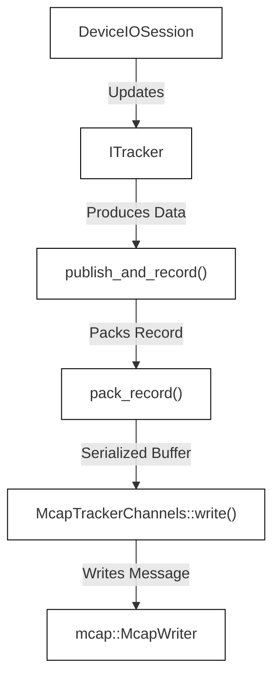
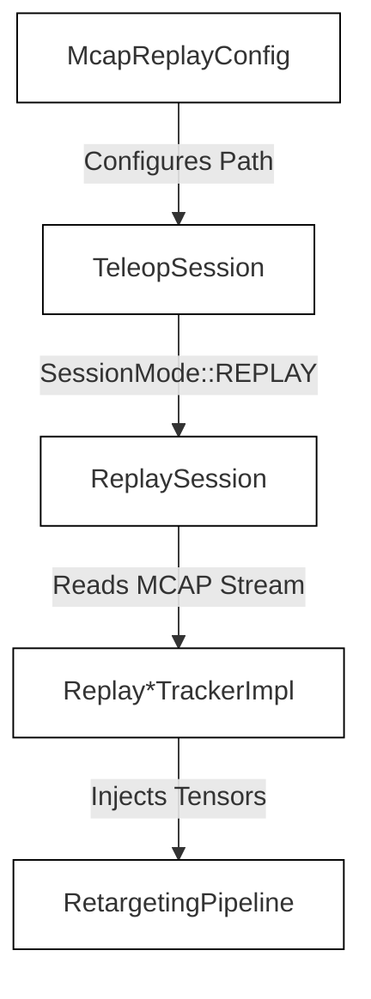

<!-- source: DeepWiki mcp.deepwiki.com · repo NVIDIA/IsaacCapture · page 2.4 MCAP Recording and Replay · fetched 2026-10-26 -->

# MCAP Recording and Replay

<details>
<summary>Relevant source files</summary>

The following files were used as context for generating this wiki page:

- [docs/source/device/body_tracking.rst](docs/source/device/body_tracking.rst)
- [docs/source/overview/ecosystem.rst](docs/source/overview/ecosystem.rst)
- [docs/source/references/mcap_record_replay.rst](docs/source/references/mcap_record_replay.rst)
- [examples/mcap_record_replay/.gitignore](examples/mcap_record_replay/.gitignore)
- [examples/mcap_record_replay/CMakeLists.txt](examples/mcap_record_replay/CMakeLists.txt)
- [examples/mcap_record_replay/README.md](examples/mcap_record_replay/README.md)
- [examples/mcap_record_replay/cpp/CMakeLists.txt](examples/mcap_record_replay/cpp/CMakeLists.txt)
- [examples/mcap_record_replay/cpp/record_full_body.cpp](examples/mcap_record_replay/cpp/record_full_body.cpp)
- [examples/mcap_record_replay/python/isaaccapture_examples/mcap_record_replay/joint_se3_common.py](examples/mcap_record_replay/python/isaaccapture_examples/mcap_record_replay/joint_se3_common.py)
- [examples/mcap_record_replay/python/isaaccapture_examples/mcap_record_replay/live_joint_se3_pose.py](examples/mcap_record_replay/python/isaaccapture_examples/mcap_record_replay/live_joint_se3_pose.py)
- [examples/mcap_record_replay/python/isaaccapture_examples/mcap_record_replay/record_joint_se3_pose.py](examples/mcap_record_replay/python/isaaccapture_examples/mcap_record_replay/record_joint_se3_pose.py)
- [examples/mcap_record_replay/python/isaaccapture_examples/mcap_record_replay/replay_controller.py](examples/mcap_record_replay/python/isaaccapture_examples/mcap_record_replay/replay_controller.py)
- [examples/mcap_record_replay/python/isaaccapture_examples/mcap_record_replay/replay_full_body.py](examples/mcap_record_replay/python/isaaccapture_examples/mcap_record_replay/replay_full_body.py)
- [examples/mcap_record_replay/python/isaaccapture_examples/mcap_record_replay/replay_hand.py](examples/mcap_record_replay/python/isaaccapture_examples/mcap_record_replay/replay_hand.py)
- [examples/mcap_record_replay/python/isaaccapture_examples/mcap_record_replay/replay_joint_se3_pose.py](examples/mcap_record_replay/python/isaaccapture_examples/mcap_record_replay/replay_joint_se3_pose.py)
- [examples/mcap_record_replay/python/isaaccapture_examples/mcap_record_replay/replay_se3_vive.py](examples/mcap_record_replay/python/isaaccapture_examples/mcap_record_replay/replay_se3_vive.py)
- [examples/schemaio/CMakeLists.txt](examples/schemaio/CMakeLists.txt)
- [examples/schemaio/full_body_printer.cpp](examples/schemaio/full_body_printer.cpp)
- [src/core/deviceio_session/cpp/inc/deviceio_session/replay_session.hpp](src/core/deviceio_session/cpp/inc/deviceio_session/replay_session.hpp)
- [src/core/deviceio_session/cpp/replay_session.cpp](src/core/deviceio_session/cpp/replay_session.cpp)
- [src/core/mcap/cpp/inc/mcap/tracker_channels.hpp](src/core/mcap/cpp/inc/mcap/tracker_channels.hpp)
- [src/core/replay_trackers/cpp/replay_controller_tracker_impl.cpp](src/core/replay_trackers/cpp/replay_controller_tracker_impl.cpp)
- [src/core/replay_trackers/cpp/replay_controller_tracker_impl.hpp](src/core/replay_trackers/cpp/replay_controller_tracker_impl.hpp)
- [src/core/replay_trackers/cpp/replay_hand_tracker_impl.cpp](src/core/replay_trackers/cpp/replay_hand_tracker_impl.cpp)
- [src/core/replay_trackers/cpp/replay_hand_tracker_impl.hpp](src/core/replay_trackers/cpp/replay_hand_tracker_impl.hpp)
- [src/core/replay_trackers/cpp/replay_head_tracker_impl.cpp](src/core/replay_trackers/cpp/replay_head_tracker_impl.cpp)
- [src/core/replay_trackers/cpp/replay_head_tracker_impl.hpp](src/core/replay_trackers/cpp/replay_head_tracker_impl.hpp)

</details>


## Purpose and Scope
This page details the MCAP recording and offline replay subsystem in Isaac Capture (`isaaccapture`). The subsystem enables recording live device tracking data (hands, controllers, full-body skeletons, and raw SE3 poses) into `MCAP` files and replaying them offline through the retargeting pipeline without requiring an active OpenXR runtime or an XR headset `[docs/source/references/mcap_record_replay.rst:7-9]()`.

---

## 1. Configuration: `McapRecordingConfig` and `McapReplayConfig`

Recording and replay sessions are controlled via dedicated configuration structures passed to `TeleopSessionConfig` or `DeviceIOSession`.

- **`McapRecordingConfig`**: Specifies the output file path and an optional list of explicit `(tracker, channel_name)` pairs. During a live session (`SessionMode.LIVE`), `TeleopSession` automatically discovers trackers from the pipeline's DeviceIO sources and uses each source's `name` as the MCAP channel base name `[docs/source/references/mcap_record_replay.rst:14-42]()`.
- **`McapReplayConfig`**: Required when running in `SessionMode.REPLAY`. It points to an existing MCAP file, bypassing all OpenXR session initialization and reading recorded FlatBuffer samples directly into replay tracker implementations `[docs/source/references/mcap_record_replay.rst:65-106]()`.

```python
from isaaccapture.teleop_session_manager import TeleopSession, TeleopSessionConfig, SessionMode
from isaaccapture.deviceio import McapRecordingConfig, McapReplayConfig

# Live Recording Configuration
config_record = TeleopSessionConfig(
    app_name="MyApp",
    pipeline=pipeline,
    mcap_config=McapRecordingConfig("recording.mcap"),
)

# Offline Replay Configuration
config_replay = TeleopSessionConfig(
    app_name="MyApp",
    pipeline=pipeline,
    mode=SessionMode.REPLAY,
    mcap_config=McapReplayConfig("recording.mcap"),
)
```
`[docs/source/references/mcap_record_replay.rst:20-27](), [docs/source/references/mcap_record_replay.rst:71-83]()`

Sources: `docs/source/references/mcap_record_replay.rst:7-106()`

---

## 2. Channel Naming and Serialization Architecture

MCAP topics are structured hierarchically using a base channel name and sub-channels. The helper function `mcap_topic()` combines a base name and sub-channel string to generate fully qualified topics:

```cpp
inline std::string mcap_topic(std::string_view base_name, const std::string& sub_channel)
{
    return std::string(base_name) + "/" + sub_channel;
}
```
`[src/core/mcap/cpp/inc/mcap/tracker_channels.hpp:33-36]()`

The `McapTrackerChannels` template class manages type-safe MCAP channel registration and message writing for FlatBuffer record types `[src/core/mcap/cpp/inc/mcap/tracker_channels.hpp:47-50]()`:

```cpp
template <typename RecordT>
class McapTrackerChannels
{
    // Registers FlatBuffer binary schema and adds channels to mcap::McapWriter
};
```
`[src/core/mcap/cpp/inc/mcap/tracker_channels.hpp:47-69]()`

Payloads and timestamps are encoded via `pack_record()` before being written to the underlying `mcap::McapWriter` instance `[src/core/mcap/cpp/inc/mcap/tracker_channels.hpp:119-152]()`.


*Figure 1: Recording Data Flow Architecture mapping high-level recording calls to `src/core/mcap/cpp/inc/mcap/tracker_channels.hpp` functions.*

Sources: `src/core/mcap/cpp/inc/mcap/tracker_channels.hpp:30-152()`

---

## 3. Schema Embedding and Compatibility Checks

Every MCAP recording embeds the FlatBuffer schema bytes under which it was written (`RecordT::BinarySchema`) `[docs/source/references/mcap_record_replay.rst:107-112]()`. 

- **Startup Validation**: Opening a replay session triggers a compatibility check via the `schema_compat` library. Every embedded schema is compared against the schema compiled into the running binary `[docs/source/references/mcap_record_replay.rst:110-115]()`.
- **Breaking vs. Non-Breaking Changes**:
  - If a breaking schema change is detected (where recorded bytes would be misread), a `RuntimeError` is raised immediately before the first frame is read `[docs/source/references/mcap_record_replay.rst:111-115]()`.
  - Additive changes (such as an appended table field or a deprecated field) are reported on `stderr`, and replay proceeds safely `[docs/source/references/mcap_record_replay.rst:122-127]()`.

Sources: `docs/source/references/mcap_record_replay.rst:107-128()`

---

## 4. Record and Replay Examples (Python and C++)

### Python Workflow
Python examples under `examples/mcap_record_replay/python/isaaccapture_examples/mcap_record_replay/` demonstrate end-to-end recording and `viser`-based 3D visualization for hands, controllers, and full-body skeletons `[docs/source/references/mcap_record_replay.rst:132-150]()`.

```python
# Snippet from replay_hand.py showing session setup in REPLAY mode
config = TeleopSessionConfig(
    app_name="McapHandReplayExample",
    pipeline=build_hand_pipeline(),
    mode=SessionMode.REPLAY,
    mcap_config=McapReplayConfig(str(mcap_path)),
)
```
`[examples/mcap_record_replay/python/isaaccapture_examples/mcap_record_replay/replay_hand.py:82-87]()`

### C++ Workflow
C++ applications record live tracking streams directly without Python bindings. For example, `record_full_body.cpp` instantiates a `FullBodyTracker`, sets up an OpenXR session, and configures `DeviceIOSession::run()` with an `McapRecordingConfig` `[examples/mcap_record_replay/cpp/record_full_body.cpp:6-108]()`:

```cpp
// Snippet from record_full_body.cpp
auto tracker = std::make_shared<core::FullBodyTracker>();
std::vector<std::shared_ptr<core::ITracker>> trackers = { tracker };
auto required_extensions = core::DeviceIOSession::get_required_extensions(trackers);
auto oxr_session = std::make_shared<core::OpenXRSession>("McapFullBodyRecordExample", required_extensions);

core::McapRecordingConfig recording_config{ mcap_path, { { tracker.get(), MCAP_BASE_NAME } } };
auto session = core::DeviceIOSession::run(trackers, oxr_session->get_handles(), std::move(recording_config));
```
`[examples/mcap_record_replay/cpp/record_full_body.cpp:96-108]()`


*Figure 2: Replay Data Flow Architecture mapping replay configurations to `TeleopSession` and replay tracker implementations (`replay_hand_tracker_impl.hpp`, `replay_controller_tracker_impl.hpp`).*

Sources: `docs/source/references/mcap_record_replay.rst:132-180()`, `examples/mcap_record_replay/cpp/record_full_body.cpp:88-142()`, `examples/mcap_record_replay/python/isaaccapture_examples/mcap_record_replay/replay_hand.py:82-114()`

---

