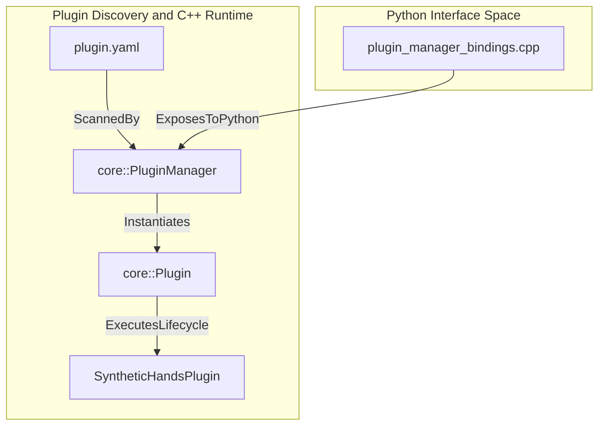
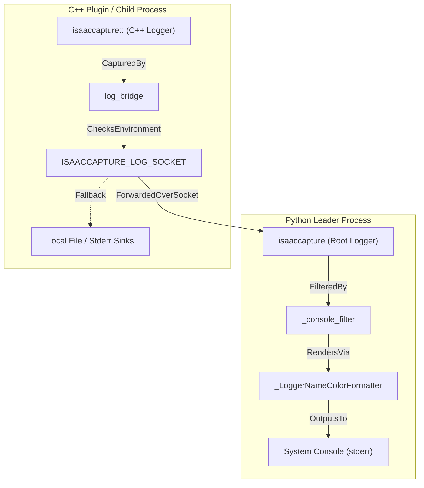

<!-- source: DeepWiki mcp.deepwiki.com · repo NVIDIA/IsaacCapture · page 2.5 Plugin Manager and Logging · fetched 2026-10-26 -->

# Plugin Manager and Logging

Relevant source files

The following files were used as context for generating this wiki page:

- [.pre-commit-config.yaml](.pre-commit-config.yaml)
- [AGENTS.md](AGENTS.md)
- [src/core/log_bridge/cpp/sink_config.cpp](src/core/log_bridge/cpp/sink_config.cpp)
- [src/core/oxr_utils/cpp/inc/oxr_utils/math.hpp](src/core/oxr_utils/cpp/inc/oxr_utils/math.hpp)
- [src/core/oxr_utils/cpp/inc/oxr_utils/pose_conversions.hpp](src/core/oxr_utils/cpp/inc/oxr_utils/pose_conversions.hpp)
- [src/core/plugin_manager/cpp/inc/plugin_manager/plugin.hpp](src/core/plugin_manager/cpp/inc/plugin_manager/plugin.hpp)
- [src/core/plugin_manager/cpp/inc/plugin_manager/plugin_manager.hpp](src/core/plugin_manager/cpp/inc/plugin_manager/plugin_manager.hpp)
- [src/core/plugin_manager/cpp/plugin.cpp](src/core/plugin_manager/cpp/plugin.cpp)
- [src/core/plugin_manager/cpp/plugin_manager.cpp](src/core/plugin_manager/cpp/plugin_manager.cpp)
- [src/core/plugin_manager/python/plugin_manager_bindings.cpp](src/core/plugin_manager/python/plugin_manager_bindings.cpp)
- [src/plugins/controller_synthetic_hands/CMakeLists.txt](src/plugins/controller_synthetic_hands/CMakeLists.txt)
- [src/plugins/controller_synthetic_hands/README.md](src/plugins/controller_synthetic_hands/README.md)
- [src/plugins/controller_synthetic_hands/controller_synthetic_hands.cpp](src/plugins/controller_synthetic_hands/controller_synthetic_hands.cpp)
- [src/plugins/controller_synthetic_hands/hand_generator.cpp](src/plugins/controller_synthetic_hands/hand_generator.cpp)
- [src/plugins/controller_synthetic_hands/synthetic_hands_plugin.cpp](src/plugins/controller_synthetic_hands/synthetic_hands_plugin.cpp)
- [src/plugins/plugin_utils/CMakeLists.txt](src/plugins/plugin_utils/CMakeLists.txt)
- [src/plugins/plugin_utils/hand_injector.cpp](src/plugins/plugin_utils/hand_injector.cpp)
- [src/python/isaaccapture/cloudxr/webclient.py](src/python/isaaccapture/cloudxr/webclient.py)
- [src/python/isaaccapture/logging_config/AGENTS.md](src/python/isaaccapture/logging_config/AGENTS.md)
- [src/python/isaaccapture/logging_config/__init__.py](src/python/isaaccapture/logging_config/__init__.py)
- [src/python/isaaccapture/logging_config/_console.py](src/python/isaaccapture/logging_config/_console.py)
- [src/python/isaaccapture/logging_config/_core.py](src/python/isaaccapture/logging_config/_core.py)
- [src/python/isaaccapture/logging_config/_file.py](src/python/isaaccapture/logging_config/_file.py)
- [src/python/isaaccapture/logging_config/_forwarding.py](src/python/isaaccapture/logging_config/_forwarding.py)
- [src/python/isaaccapture/logging_config/_native_fd.py](src/python/isaaccapture/logging_config/_native_fd.py)
- [src/python/isaaccapture/logging_config/_setup.py](src/python/isaaccapture/logging_config/_setup.py)
- [tests/python/core/logging_config/conftest.py](tests/python/core/logging_config/conftest.py)
- [tests/python/core/logging_config/test_console.py](tests/python/core/logging_config/test_console.py)
- [tests/python/core/logging_config/test_core.py](tests/python/core/logging_config/test_core.py)
- [tests/python/core/logging_config/test_routing.py](tests/python/core/logging_config/test_routing.py)

This page covers the architectural design and implementation details of the plugin management subsystem and the session-wide logging infrastructure within `isaaccapture`. It details how standalone and core plugins are discovered and loaded via `plugin.yaml` manifests and the C++ `core::PluginManager` with its pybind11 wrappers, how push-based device utilities like `plugin_utils::HandInjector` operate, and how Python's `logging_config` interlocks with C++ `log_bridge` to route logs across process boundaries.

---

## 1. Plugin Discovery and Manifests (`plugin.yaml`)

Plugins in the `isaaccapture` ecosystem reside under `src/plugins/` and are isolated into modular directories containing their source files, build scripts, and metadata manifests [src/plugins/controller_synthetic_hands/CMakeLists.txt:30-36](). 

Each plugin exports a metadata descriptor file named `plugin.yaml` that defines its root identifier, required OpenXR extensions, binary entry points, and lifecycle parameters. The `core::PluginManager` scans designated plugin directories to discover these manifests, validate compatibility against the active OpenXR instance, and dynamically load the corresponding shared libraries or executables.

Sources:
- `src/plugins/controller_synthetic_hands/CMakeLists.txt`
- `src/plugins/controller_synthetic_hands/plugin.yaml`

---

## 2. C++ Plugin Manager and Python Bindings

The C++ plugin core provides classes for lifecycle management and dynamic library loading, exposed to Python through pybind11 bindings.

### Plugin Management Architecture

The plugin runtime revolves around two core C++ classes defined in the `core` namespace:
- `core::PluginManager`: Discovers plugins, resolves dependency graphs, manages execution contexts, and controls lifecycle hooks [src/core/plugin_manager/cpp/inc/plugin_manager/plugin_manager.hpp]().
- `core::Plugin`: Represents an individual loaded plugin instance, wrapping its handle, configuration root ID, and shutdown hooks [src/core/plugin_manager/cpp/inc/plugin_manager/plugin.hpp]().

The following diagram illustrates the relationship between manifest discovery, plugin loading, and Python bindings:

*Sources: `src/core/plugin_manager/cpp/inc/plugin_manager/plugin_manager.hpp` [src/core/plugin_manager/cpp/inc/plugin_manager/plugin.hpp](), `src/core/plugin_manager/python/plugin_manager_bindings.cpp`()*

### Python Bindings Implementation

The pybind11 bindings bridge the C++ plugin manager interface into Python under the `isaaccapture` namespace, allowing orchestration scripts to query loaded plugins, inspect state, and trigger reload cycles [src/core/plugin_manager/python/plugin_manager_bindings.cpp]().

Sources:
- `src/core/plugin_manager/cpp/inc/plugin_manager/plugin_manager.hpp`
- `src/core/plugin_manager/cpp/inc/plugin_manager/plugin.hpp`
- `src/core/plugin_manager/cpp/plugin_manager.cpp`
- `src/core/plugin_manager/cpp/plugin.cpp`
- `src/core/plugin_manager/python/plugin_manager_bindings.cpp`

---

## 3. Plugin Utilities and Hand Injector (`plugin_utils`)

The `teleop_plugin_utils` static library [src/plugins/plugin_utils/CMakeLists.txt:5-12]() provides shared helper classes for device plugins, most notably the `plugin_utils::HandInjector` [src/plugins/plugin_utils/inc/plugin_utils/hand_injector.hpp]() and wrist pose sources [src/plugins/plugin_utils/inc/plugin_utils/wrist_pose_source.hpp]().

### Hand Injector Mechanics

The `plugin_utils::HandInjector` is responsible for pushing synthetic or tracked hand joint data (`XrHandJointLocationEXT`) into the OpenXR runtime via device interface extensions (e.g., `XR_NVX1_DEVICE_INTERFACE_BASE_EXTENSION_NAME`) [src/plugins/controller_synthetic_hands/synthetic_hands_plugin.cpp:29-151]().

Key responsibilities of `HandInjector`:
1. **Lifecycle Management**: Automatically registers and initializes push handles using the provided `XrInstance`, `XrSession`, and target hand (`XR_HAND_LEFT_EXT` or `XR_HAND_RIGHT_EXT`) [src/plugins/controller_synthetic_hands/synthetic_hands_plugin.cpp:147-148]().
2. **Active State Signaling**: Destructors and explicit resets signal `isActive=false` to the runtime, ensuring disconnected controllers or stopped plugins do not leave frozen hand poses hanging in the XR compositor [src/plugins/controller_synthetic_hands/synthetic_hands_plugin.cpp:85-88]().
3. **Synchronization**: Operates within thread-safe worker loops alongside `core::DeviceIOSession` and `core::ControllerTracker` [src/plugins/controller_synthetic_hands/synthetic_hands_plugin.cpp:75-100]().

Sources:
- `src/plugins/plugin_utils/CMakeLists.txt`
- `src/plugins/plugin_utils/inc/plugin_utils/hand_injector.hpp`
- `src/plugins/plugin_utils/hand_injector.cpp`
- `src/plugins/controller_synthetic_hands/synthetic_hands_plugin.cpp`

---

## 4. Session-Wide Logging Architecture (`logging_config` and `log_bridge`)

The logging architecture enforces a single, unified logger tree rooted at `isaaccapture` across both Python and C++ processes [AGENTS.md:74-88]().

### Python Logging Configuration (`logging_config`)

The Python logging module (`isaaccapture.logging_config`) manages console formatting, thresholds, and filters without calling `logging.basicConfig()` (preventing duplicate message emissions) [src/python/isaaccapture/logging_config/__init__.py:1-32](), [AGENTS.md:89-93]().

- **Console Handler**: Managed via `_console.ensure_handler()`, applying ANSI color formatting based on record severity (`_level_color`) and logger name paths (`_LoggerNameColorFormatter`) [src/python/isaaccapture/logging_config/_console.py:76-147]().
- **Filters**: Supports dynamic log filtering by logger name hierarchy (`set_console_logger_name_filter`) and content patterns (`set_console_content_filter`) [src/python/isaaccapture/logging_config/_console.py:127-188]().
- **Environment Integration**: Resolves log levels using `env_console_level()` and publishes thresholds to `ISAACCAPTURE_LOG_LEVEL` for C++ subprocesses to consume [src/python/isaaccapture/logging_config/_core.py:48-68](), [src/python/isaaccapture/logging_config/_console.py:162-182]().

### C++ Logging and Unix Socket Forwarding (`log_bridge`)

C++ components utilize `log_bridge` to output structured logs conforming to the shared line format [tests/python/core/logging_config/test_core.py:75-102](). 

- **Routing Logic**: Depending on environment variables such as `ISAACCAPTURE_LOG_SOCKET`, C++ child processes route their log records over Unix domain sockets back to the Python leader process, or fall back to local file sinks (`src/core/log_bridge/cpp/sink_config.cpp`) [tests/python/core/logging_config/test_routing.py:128-185]().

The data flow for unified logging routing across processes is represented below:

*Sources: `src/python/isaaccapture/logging_config/_console.py` [src/python/isaaccapture/logging_config/_core.py](), `src/core/log_bridge/cpp/sink_config.cpp` [tests/python/core/logging_config/test_routing.py]()*

Sources:
- `src/python/isaaccapture/logging_config/__init__.py`
- `src/python/isaaccapture/logging_config/_console.py`
- `src/python/isaaccapture/logging_config/_core.py`
- `src/core/log_bridge/cpp/sink_config.cpp`
- `tests/python/core/logging_config/test_console.py`
- `tests/python/core/logging_config/test_core.py`
- `tests/python/core/logging_config/test_routing.py`

---

