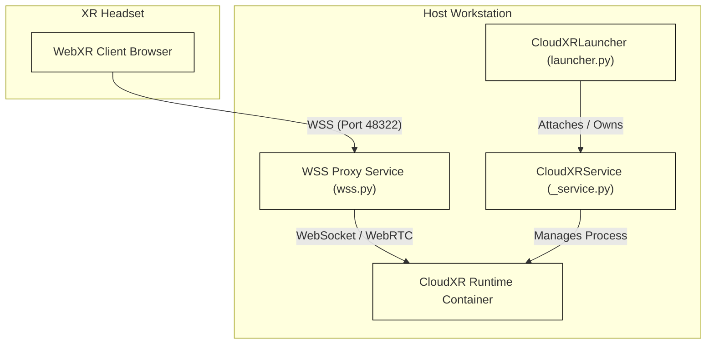

<!-- source: DeepWiki mcp.deepwiki.com · repo NVIDIA/IsaacCapture · page 3 CloudXR and WebXR Streaming · fetched 2026-10-26 -->

# CloudXR and WebXR Streaming

Relevant source files

The following files were used as context for generating this wiki page:

- [README.md](README.md)
- [deps/cloudxr/.env.default](deps/cloudxr/.env.default)
- [deps/cloudxr/.gitignore](deps/cloudxr/.gitignore)
- [deps/cloudxr/Dockerfile.web-app](deps/cloudxr/Dockerfile.web-app)
- [deps/cloudxr/Dockerfile.wss-proxy](deps/cloudxr/Dockerfile.wss-proxy)
- [deps/cloudxr/docker-compose.yaml](deps/cloudxr/docker-compose.yaml)
- [deps/cloudxr/webxr_client/tsconfig.json](deps/cloudxr/webxr_client/tsconfig.json)
- [docs/source/index.rst](docs/source/index.rst)
- [docs/source/references/cloudxr.rst](docs/source/references/cloudxr.rst)
- [src/python/isaaccapture/cloudxr/launcher.py](src/python/isaaccapture/cloudxr/launcher.py)
- [src/python/isaaccapture/cloudxr/service/_service.py](src/python/isaaccapture/cloudxr/service/_service.py)
- [src/python/isaaccapture/cloudxr/wss.py](src/python/isaaccapture/cloudxr/wss.py)
- [tests/python/core/cloudxr/test_launcher.py](tests/python/core/cloudxr/test_launcher.py)
- [tests/python/core/cloudxr/test_service.py](tests/python/core/cloudxr/test_service.py)
- [tests/python/core/cloudxr/test_service_oob_status.py](tests/python/core/cloudxr/test_service_oob_status.py)
- [tests/python/core/cloudxr/test_wss_oob_lifecycle.py](tests/python/core/cloudxr/test_wss_oob_lifecycle.py)

## Purpose and Scope

The CloudXR and WebXR streaming stack in Isaac Teleop provides low-latency, high-fidelity remote streaming of OpenXR environments from a host workstation or simulation backend to an extended reality (XR) headset. The stack encompasses runtime container orchestration, a WebSocket-over-SSL (WSS) proxy, a React/Three.js-based web client application (`webxr_client`), a Python service Command Line Interface (CLI) for lifecycle management, and out-of-band (OOB) control mechanisms for headset automation and USB networking.

This is a parent page providing a high-level architectural overview. Detailed technical specifications are documented in the respective child pages:
- [CloudXR Runtime, Containers and Service CLI](#3.1)
- [WebXR Client Application](#3.2)
- [Out-of-Band (OOB) Teleop Control](#3.3)

---

## Architecture Overview

The streaming stack coordinates multiple isolated processes and network boundaries to link the OpenXR runtime with remote XR hardware. A host workstation runs a single CloudXR service instance that manages the OpenXR runtime subprocess and the WSS proxy. Applications attach to this shared runtime rather than instantiating individual sessions, ensuring session persistence across application restarts.

### Streaming Stack Architecture

**Sources:** `src/python/isaaccapture/cloudxr/wss.py:4-15()`, `src/python/isaaccapture/cloudxr/service/_service.py:97-110()`, `src/python/isaaccapture/cloudxr/launcher.py:139-154()`

---

## 3.1 CloudXR Runtime, Containers and Service CLI

The runtime infrastructure is containerized using Docker and orchestrated via `docker-compose.yaml`. The setup consists of three primary services: `cloudxr-runtime`, `wss-proxy`, and `web-app` [deps/cloudxr/docker-compose.yaml:4-69](). 

- **`cloudxr-runtime`**: Runs the NVIDIA CloudXR runtime environment, mapping OpenXR graphics and tracking pipes with NVIDIA GPU hardware acceleration (`runtime: nvidia`) [deps/cloudxr/docker-compose.yaml:6-30]().
- **`wss-proxy`**: Acts as an HAProxy [deps/cloudxr/Dockerfile.wss-proxy:4-4]() or Python-based WebSocket secure proxy (`wss.py`) that terminates TLS traffic and forwards WebRTC/WebSocket streams to the runtime backend [src/python/isaaccapture.cloudxr.wss:4-15()].
- **`web-app`**: Delivers the static assets and the `webxr_client` bundle [deps/cloudxr/Dockerfile.web-app:4-12]() over HTTPS.

The Python service CLI (`isaaccapture.cloudxr.service`) manages these components programmatically. Through subcommands such as `start`, `run`, `stop`, `status`, and `logs` [docs/source/references/cloudxr.rst:80-100](), users can control daemonized runtime instances, accept EULAs non-interactively, and inspect session metrics.

For details, see [CloudXR Runtime, Containers and Service CLI](#3.1).

**Sources:** `deps/cloudxr/docker-compose.yaml:4-69()`, `src/python/isaaccapture/cloudxr/wss.py:4-15()`, `deps/cloudxr/Dockerfile.wss-proxy:4-4()`, `docs/source/references/cloudxr.rst:80-100()`

---

## 3.2 WebXR Client Application

The WebXR client (`webxr_client`) runs directly inside the XR headset's web browser as a React and Three.js application. It establishes a WebSocket and WebRTC connection through the WSS proxy to consume the remote CloudXR stream.

Key architectural responsibilities include:
- **2D Setup and In-XR UI**: Managing pre-session configuration menus, device profile selection, and immersive UI overlays rendered via WebXR layers [docs/source/index.rst:21-29]().
- **`CloudXRComponent` Lifecycle**: Handling session connection states, signaling exchanges, and performance metrics tracking.
- **Testing & Emulation**: Providing Jest test suites, Playwright browser integration tests, and the IWER (Immersive Web Emulator) for desktop debugging.

For details, see [WebXR Client Application](#3.2).

**Sources:** `docs/source/index.rst:21-29()`, `deps/cloudxr/docker-compose.yaml:56-69()`

---

## 3.3 Out-of-Band (OOB) Teleop Control

To streamline deployment in production robotics cells, the streaming stack supports Out-of-Band (OOB) automation. This subsystem automates headset connections over Android Debug Bridge (ADB) and Chrome DevTools Protocol (CDP), removing manual headset navigation steps.

Key mechanisms include:
- **`OobLifecycle`**: Orchestrates readiness stages, automatic browser launching on connected headsets, and simulated click-to-connect routines [docs/source/references/cloudxr.rst:122-132]().
- **USB-Local Mode**: Routes all traffic over a local USB interface using `adb reverse` combined with a `coturn` ICE/TURN relay, ensuring ultra-low latency and isolation from congested Wi-Fi networks [docs/source/references/cloudxr.rst:128-132]().
- **`usb_health`**: Measures host-to-headset link speed, topology parameters, and transfer speeds upon startup, archiving JSON health reports under `~/.cloudxr/logs/usb-health/` [docs/source/references/cloudxr.rst:138-160]().

For details, see [Out-of-Band (OOB) Teleop Control](#3.3).

**Sources:** `docs/source/references/cloudxr.rst:122-160()`, `src/python/isaaccapture/cloudxr/service/_service.py:112-156()`

---

