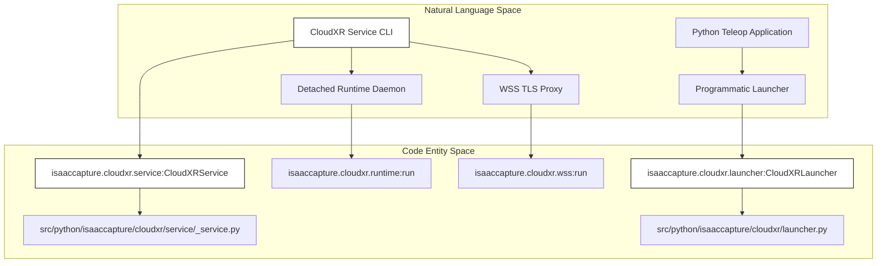
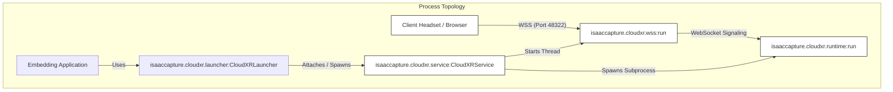

<!-- source: DeepWiki mcp.deepwiki.com · repo NVIDIA/IsaacCapture · page 3.1 CloudXR Runtime, Containers and Service CLI · fetched 2026-10-26 -->

# CloudXR Runtime, Containers and Service CLI

Relevant source files

The following files were used as context for generating this wiki page:

- [.github/actions/build-cloudxr-web-client/action.yml](.github/actions/build-cloudxr-web-client/action.yml)
- [.github/actions/setup-cloudxr-sdk/action.yml](.github/actions/setup-cloudxr-sdk/action.yml)
- [deps/cloudxr/Dockerfile.runtime](deps/cloudxr/Dockerfile.runtime)
- [deps/cloudxr/Dockerfile.runtime-ngc](deps/cloudxr/Dockerfile.runtime-ngc)
- [deps/cloudxr/docker-compose.runtime.yaml](deps/cloudxr/docker-compose.runtime.yaml)
- [deps/cloudxr/runtime/entrypoint-ngc.sh](deps/cloudxr/runtime/entrypoint-ngc.sh)
- [deps/cloudxr/runtime/entrypoint.sh](deps/cloudxr/runtime/entrypoint.sh)
- [deps/cloudxr/runtime/main.py](deps/cloudxr/runtime/main.py)
- [docs/source/_static/cloudxr-run-output.png](docs/source/_static/cloudxr-run-output.png)
- [docs/source/_static/cloudxr-web-client-howto.png](docs/source/_static/cloudxr-web-client-howto.png)
- [docs/source/_static/cloudxr_accept_cert_accepted.png](docs/source/_static/cloudxr_accept_cert_accepted.png)
- [docs/source/_static/cloudxr_accept_cert_not_private.png](docs/source/_static/cloudxr_accept_cert_not_private.png)
- [docs/source/_static/full-body-replay.gif](docs/source/_static/full-body-replay.gif)
- [docs/source/references/cloudxr.rst](docs/source/references/cloudxr.rst)
- [scripts/download_cloudxr_runtime_sdk.sh](scripts/download_cloudxr_runtime_sdk.sh)
- [scripts/download_cloudxr_sdk.sh](scripts/download_cloudxr_sdk.sh)
- [scripts/run_cloudxr.sh](scripts/run_cloudxr.sh)
- [scripts/setup_cloudxr_env.sh](scripts/setup_cloudxr_env.sh)
- [src/python/isaaccapture/cloudxr/launcher.py](src/python/isaaccapture/cloudxr/launcher.py)
- [src/python/isaaccapture/cloudxr/runtime.py](src/python/isaaccapture/cloudxr/runtime.py)
- [src/python/isaaccapture/cloudxr/service/_service.py](src/python/isaaccapture/cloudxr/service/_service.py)
- [src/python/isaaccapture/cloudxr/wss.py](src/python/isaaccapture/cloudxr/wss.py)
- [tests/python/core/cloudxr/test_launcher.py](tests/python/core/cloudxr/test_launcher.py)
- [tests/python/core/cloudxr/test_runtime.py](tests/python/core/cloudxr/test_runtime.py)
- [tests/python/core/cloudxr/test_service.py](tests/python/core/cloudxr/test_service.py)
- [tests/python/core/cloudxr/test_service_oob_status.py](tests/python/core/cloudxr/test_service_oob_status.py)
- [tests/python/core/cloudxr/test_wss_oob_lifecycle.py](tests/python/core/cloudxr/test_wss_oob_lifecycle.py)

## Purpose and Scope

This section details the NVIDIA CloudXR streaming infrastructure within `isaaccapture`, covering the runtime service control CLI (`isaaccapture.cloudxr.service`), the programmatic launcher (`isaaccapture.cloudxr.launcher`), the WebSocket Secure (WSS) proxy (`isaaccapture.cloudxr.wss`), SDK download automation scripts, and container definitions (`docker-compose.runtime.yaml`, `Dockerfile.runtime`). The architecture ensures that a host runs a single persistent CloudXR runtime and WSS proxy session, allowing OpenXR-based teleoperation applications and embedding clients (such as Isaac Lab or Isaac Sim) to attach, stream to XR headsets, and outlive individual application lifecycles.

Sources: `docs/source/references/cloudxr.rst:9-26` [docs/source/references/cloudxr.rst:9-26]()

---

## Service CLI and Subcommands (`isaaccapture.cloudxr.service`)

The `isaaccapture.cloudxr.service` module provides process orchestration for the CloudXR runtime and WSS proxy. It manages detached background daemons, foreground execution, EULA acceptance caching, and health diagnostics.

### Subcommands Table

| Command | Behavior and Description |
| :--- | :--- |
| `start` | Starts a detached background service. Refuses if a runtime is already serving to prevent dropping active headset streams [docs/source/references/cloudxr.rst:86-88](). Requires `--accept-eula` on first execution [docs/source/references/cloudxr.rst:47-51](). |
| `run` | Runs the service in the foreground. Streams logs to standard output, terminates on `Ctrl+C`, and prompts for EULA acceptance if run interactively [docs/source/references/cloudxr.rst:53-55](). |
| `stop` | Gracefully tears down the detached service and its associated runtime subprocess [docs/source/references/cloudxr.rst:91-93](). |
| `status` | Reports active session parameters, device profile, log file locations, and client URLs [docs/source/references/cloudxr.rst:94-97](). Exits non-zero if no runtime is serving. |
| `logs` | Tails the detached service log output with support for `-n` lines and `-f` live follow [docs/source/references/cloudxr.rst:98-100](). |

### Launch Modes and Optional Flags

The service supports several deployment flags governing how the XR client communicates with the host:
- `--host-client`: Serves the web client locally at `https://<ip>:48322/client/` through the WSS proxy [docs/source/references/cloudxr.rst:118-121]().
- `--setup-oob`: Enables the out-of-band hub and Chrome DevTools Protocol (CDP) automation to open the headset browser and auto-click connect over USB ADB [docs/source/references/cloudxr.rst:122-124]().
- `--usb-local`: Routes all traffic over USB (`adb reverse` and `coturn` TURN relay) [docs/source/references/cloudxr.rst:128-131](). Measures host-to-headset link speed and saves reports under `<install-dir>/logs/usb-health/` [docs/source/references/cloudxr.rst:140-156]().

Sources: `docs/source/references/cloudxr.rst:35-132` [docs/source/references/cloudxr.rst:35-132]()

---

## Architecture: Natural Language Space to Code Entity Space

**Figure:** Mapping system concepts to `isaaccapture` Python classes and execution routines.

Sources: `src/python/isaaccapture/cloudxr/launcher.py:139-168` [src/python/isaaccapture/cloudxr/launcher.py:139-168](), `src/python/isaaccapture/cloudxr/service/_service.py:97-162` [src/python/isaaccapture/cloudxr/service/_service.py:97-162]()

---

## Runtime and WSS Proxy Architecture (`runtime.py`, `service.py`, `wss.py`, `launcher.py`)

The backend consists of two primary runtime execution units managed by `CloudXRService`:
1. **CloudXR Runtime Subprocess**: Spawns an isolated Python subprocess executing `isaaccapture.cloudxr.runtime:run` [src/python/isaaccapture/cloudxr/service/_service.py:83-94](). Isolation prevents CUDA context pollution with host frameworks like Isaac Sim that preinitialize GPU resources [src/python/isaaccapture/cloudxr/service/_service.py:101-104]().
2. **WSS TLS Proxy Thread**: Runs `isaaccapture.cloudxr.wss:run()` on an asynchronous event loop [tests/python/core/cloudxr/test_wss_oob_lifecycle.py:79-89](). It generates or loads self-signed TLS certificates (`server.crt`, `server.key`) [src/python/isaaccapture/cloudxr/wss.py:100-181](), handles CORS preflight requests via `_patch_request_parser_for_cors()` [src/python/isaaccapture/cloudxr/wss.py:44-71](), and proxies WebSocket frames to the CloudXR runtime backend.

`CloudXRLauncher` enables embedding applications to interact with the service [src/python/isaaccapture/cloudxr/launcher.py:139-154](). By default, it attaches to an already serving runtime, exports environment variables like `XR_RUNTIME_JSON`, and adopts session parameters without shutting down the runtime upon application exit.

**Figure:** Data flow and process boundaries between the WSS proxy, CloudXR runtime subprocess, and application launchers.

Sources: `src/python/isaaccapture/cloudxr/wss.py:44-181` [src/python/isaaccapture/cloudxr/wss.py:44-181](), `src/python/isaaccapture/cloudxr/launcher.py:139-188` [src/python/isaaccapture/cloudxr/launcher.py:139-188](), `src/python/isaaccapture/cloudxr/service/_service.py:83-162` [src/python/isaaccapture/cloudxr/service/_service.py:83-162]()

---

## SDK Download Pipeline and Scripts

Before building containers or running services locally, the CloudXR Runtime and Web SDKs must be fetched. This is managed via shell scripts and GitHub Actions composites.

- **Runtime SDK Script**: `scripts/download_cloudxr_runtime_sdk.sh` parses `CXR_RUNTIME_SDK_VERSION`, detects host architecture (`amd64` or `arm64`), checks `deps/cloudxr/` for local tarballs, and falls back to anonymous NVIDIA NGC downloads (`nvidia/cloudxr-runtime` or unlisted pre-release resources) [scripts/download_cloudxr_runtime_sdk.sh:42-196]().
- **Web SDK Script**: `scripts/download_cloudxr_sdk.sh` downloads `nvidia-cloudxr-${CXR_WEB_SDK_VERSION}.tgz` into `deps/cloudxr/` [scripts/download_cloudxr_sdk.sh:42-131]().
- **CI Action**: `.github/actions/setup-cloudxr-sdk/action.yml` automates version extraction from `deps/cloudxr/.env.default`, restores cached tarballs using GitHub Actions cache keys, and invokes both download scripts [`.github/actions/setup-cloudxr-sdk/action.yml:18-70]().

Sources: `scripts/download_cloudxr_runtime_sdk.sh:42-70` [scripts/download_cloudxr_runtime_sdk.sh:42-70](), `scripts/download_cloudxr_sdk.sh:42-67` [scripts/download_cloudxr_sdk.sh:42-67](), `.github/actions/setup-cloudxr-sdk/action.yml:18-46` [.github/actions/setup-cloudxr-sdk/action.yml:18-46]()

---

## Container Deployment and Docker Compose

Containerized deployments are orchestrated via `deps/cloudxr/docker-compose.runtime.yaml` alongside `Dockerfile.runtime` and `Dockerfile.web-app`.

- **`cloudxr-runtime` Service**: Bundles the NVIDIA CloudXR runtime libraries, OpenXR loader, and GPU display drivers inside a CUDA-accelerated container.
- **`wss-proxy` Service**: Runs the Python WSS proxy module, handling TLS termination and client WebSocket forwarding.
- **`web-app` Service**: Compiles the React/Three.js WebXR client using `deps/cloudxr/webxr_client/` and serves the static asset bundle [.github/actions/build-cloudxr-web-client/action.yml:40-58]().

Sources: `.github/actions/build-cloudxr-web-client/action.yml:40-58` [.github/actions/build-cloudxr-web-client/action.yml:40-58]()

---

