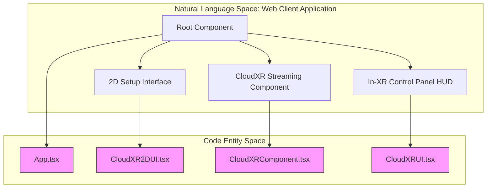
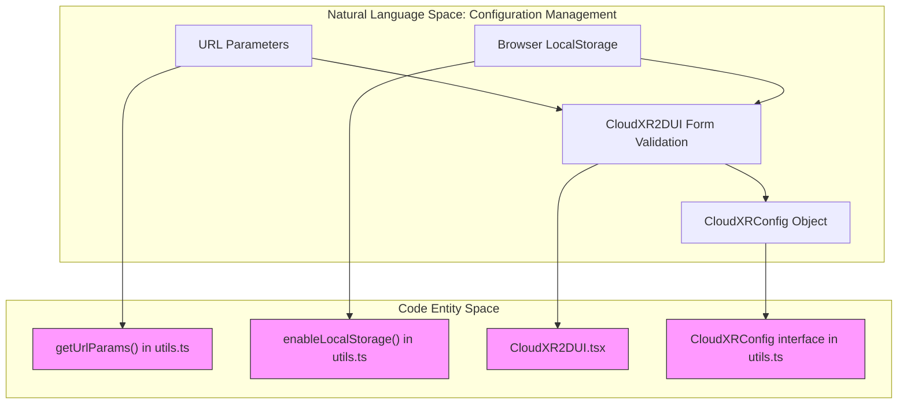

<!-- source: DeepWiki mcp.deepwiki.com · repo NVIDIA/IsaacCapture · page 3.2 WebXR Client Application · fetched 2026-10-26 -->

# WebXR Client Application

Relevant source files

The following files were used as context for generating this wiki page:

- [.gitignore](.gitignore)
- [deps/cloudxr/webxr_client/helpers/BrowserCapabilities.ts](deps/cloudxr/webxr_client/helpers/BrowserCapabilities.ts)
- [deps/cloudxr/webxr_client/helpers/DeviceProfiles.test.ts](deps/cloudxr/webxr_client/helpers/DeviceProfiles.test.ts)
- [deps/cloudxr/webxr_client/helpers/DeviceProfiles.ts](deps/cloudxr/webxr_client/helpers/DeviceProfiles.ts)
- [deps/cloudxr/webxr_client/helpers/TeleopProjects.ts](deps/cloudxr/webxr_client/helpers/TeleopProjects.ts)
- [deps/cloudxr/webxr_client/helpers/WebGLStateApply.ts](deps/cloudxr/webxr_client/helpers/WebGLStateApply.ts)
- [deps/cloudxr/webxr_client/helpers/WebGLStateBinding.ts](deps/cloudxr/webxr_client/helpers/WebGLStateBinding.ts)
- [deps/cloudxr/webxr_client/helpers/react/CloudXRComponent.tsx](deps/cloudxr/webxr_client/helpers/react/CloudXRComponent.tsx)
- [deps/cloudxr/webxr_client/helpers/react/utils.ts](deps/cloudxr/webxr_client/helpers/react/utils.ts)
- [deps/cloudxr/webxr_client/helpers/utils.ts](deps/cloudxr/webxr_client/helpers/utils.ts)
- [deps/cloudxr/webxr_client/package.json](deps/cloudxr/webxr_client/package.json)
- [deps/cloudxr/webxr_client/src/App.tsx](deps/cloudxr/webxr_client/src/App.tsx)
- [deps/cloudxr/webxr_client/src/BuildInfoOverlay.tsx](deps/cloudxr/webxr_client/src/BuildInfoOverlay.tsx)
- [deps/cloudxr/webxr_client/src/CloudXR2DUI.tsx](deps/cloudxr/webxr_client/src/CloudXR2DUI.tsx)
- [deps/cloudxr/webxr_client/src/CloudXRUI.tsx](deps/cloudxr/webxr_client/src/CloudXRUI.tsx)
- [deps/cloudxr/webxr_client/src/config/frameRate.test.ts](deps/cloudxr/webxr_client/src/config/frameRate.test.ts)
- [deps/cloudxr/webxr_client/src/config/frameRate.ts](deps/cloudxr/webxr_client/src/config/frameRate.ts)
- [deps/cloudxr/webxr_client/src/config/params.ts](deps/cloudxr/webxr_client/src/config/params.ts)
- [deps/cloudxr/webxr_client/src/config/resolve.test.ts](deps/cloudxr/webxr_client/src/config/resolve.test.ts)
- [deps/cloudxr/webxr_client/src/index.html](deps/cloudxr/webxr_client/src/index.html)
- [deps/cloudxr/webxr_client/src/index.tsx](deps/cloudxr/webxr_client/src/index.tsx)
- [deps/cloudxr/webxr_client/tests/mock/StreamAttachTimeoutTest.tsx](deps/cloudxr/webxr_client/tests/mock/StreamAttachTimeoutTest.tsx)
- [deps/cloudxr/webxr_client/webpack.chunkNames.js](deps/cloudxr/webxr_client/webpack.chunkNames.js)
- [deps/cloudxr/webxr_client/webpack.common.js](deps/cloudxr/webxr_client/webpack.common.js)
- [deps/cloudxr/webxr_client/webpack.dev.js](deps/cloudxr/webxr_client/webpack.dev.js)
- [deps/cloudxr/webxr_client/webpack.prod.js](deps/cloudxr/webxr_client/webpack.prod.js)
- [examples/teleop_ros2/AGENTS.md](examples/teleop_ros2/AGENTS.md)
- [examples/teleop_ros2/CMakeLists.txt](examples/teleop_ros2/CMakeLists.txt)
- [examples/teleop_ros2/Dockerfile](examples/teleop_ros2/Dockerfile)
- [examples/teleop_ros2/Dockerfile.dockerignore](examples/teleop_ros2/Dockerfile.dockerignore)
- [examples/teleop_ros2/README.md](examples/teleop_ros2/README.md)
- [examples/teleop_ros2/assets/.gitignore](examples/teleop_ros2/assets/.gitignore)
- [examples/teleop_ros2/assets/urdf/sharpa_standalone/README.md](examples/teleop_ros2/assets/urdf/sharpa_standalone/README.md)
- [examples/teleop_ros2/configs/sharpa_wave_left_dexpilot.yml](examples/teleop_ros2/configs/sharpa_wave_left_dexpilot.yml)
- [examples/teleop_ros2/configs/sharpa_wave_right_dexpilot.yml](examples/teleop_ros2/configs/sharpa_wave_right_dexpilot.yml)
- [examples/teleop_ros2/scripts/fetch_sharpa_wave_urdfs.py](examples/teleop_ros2/scripts/fetch_sharpa_wave_urdfs.py)
- [src/core/python/requirements-grounding.txt](src/core/python/requirements-grounding.txt)
- [src/core/python/requirements-retargeters.txt](src/core/python/requirements-retargeters.txt)

The WebXR Client Application is a React and Three.js based web frontend located in `deps/cloudxr/webxr_client/` that enables VR and AR headsets (such as Meta Quest devices) to stream interactive teleoperation video feeds from an Isaac Teleop server via NVIDIA CloudXR. It provides a 2D configuration UI for connection parameters, manages the WebXR immersive session lifecycle through `@react-three/xr`, and renders an in-headset 3D control panel and performance HUD using `@react-three/uikit`.

---

## 1. Root Application & Component Architecture (`App.tsx`)

The root component `App` (`[deps/cloudxr/webxr_client/src/App.tsx:1-147]()`) coordinates the WebXR store, Preact signals for performance tracking, and the main canvas renderer. It reads teleop project path configurations via `parseTeleopPathFromHash` and `loadStoredTeleopPath` (`[deps/cloudxr/webxr_client/helpers/TeleopProjects.ts:48-63]`, `[deps/cloudxr/webxr_client/helpers/TeleopProjects.ts:173-192]()`), driving settings inheritance across teleop profiles.

*Diagram 1: Mapping high-level WebXR application components to their respective source files.*

Sources: `[deps/cloudxr/webxr_client/src/App.tsx:1-147]()`, `[deps/cloudxr/webxr_client/helpers/TeleopProjects.ts:48-192]()`

---

## 2. 2D Setup User Interface (`CloudXR2DUI.tsx` and `index.html`)

Before entering an immersive XR session, users interact with a 2D HTML settings panel defined in `[deps/cloudxr/webxr_client/src/index.html:1-235]()` and managed by `CloudXR2DUI` (`[deps/cloudxr/webxr_client/src/CloudXR2DUI.tsx:1-100]()`). This interface handles form inputs for server IP addresses, ports, proxy URLs, video codecs, and per-eye resolutions. Persistent storage across browser reloads is maintained using `enableLocalStorage` (`[deps/cloudxr/webxr_client/helpers/utils.ts:43-85]()`).

*Diagram 2: Flow of configuration parameters from browser storage and URL query strings into the runtime configuration object.*

Sources: `[deps/cloudxr/webxr_client/src/index.html:1-235]()`, `[deps/cloudxr/webxr_client/src/CloudXR2DUI.tsx:1-100]()`, `[deps/cloudxr/webxr_client/helpers/utils.ts:23-85]()`

---

## 3. CloudXR Session Lifecycle & `CloudXRComponent`

The core streaming logic is encapsulated in `CloudXRComponent` (`[deps/cloudxr/webxr_client/helpers/react/CloudXRComponent.tsx:1-138]()`). It monitors the WebXR session state, manages WebGL state bindings (`[deps/cloudxr/webxr_client/helpers/WebGLStateBinding.ts]()`), parses decoder warm-up logs (`WARMUP_PROGRESS_LOG_PATTERN`), and implements bounded retry policies for recoverable streaming dropouts.

Sources: `[deps/cloudxr/webxr_client/helpers/react/CloudXRComponent.tsx:1-138]()`

---

## 4. In-XR User Interface (`CloudXRUI.tsx`)

Once inside the headset, `CloudXRUI` (`[deps/cloudxr/webxr_client/src/CloudXRUI.tsx:1-150]()`) renders an immersive floating control panel using `@react-three/uikit`. It manages control buttons (Start Teleop, Reset Teleop, Disconnect), face-camera rotation damping, and layout positioning based on `ControlPanelLayoutOptions`. Performance metrics update efficiently via Preact signals (`renderFpsText`, `poseSendFpsText`) bypassing React re-renders.

Sources: `[deps/cloudxr/webxr_client/src/CloudXRUI.tsx:1-150]()`

---

## 5. Configuration Parameters and Device Profiles

The client runtime relies on typed configuration schemas including `CloudXRConfig` (`[deps/cloudxr/webxr_client/helpers/utils.ts:128-186]()`) and `ReactUIConfig` (`[deps/cloudxr/webxr_client/helpers/react/utils.ts:61-97]()`). Device profiles (`DeviceProfiles.ts`) dynamically adjust resolution bounds, recommended bitrates, and reprojection mesh configurations according to the connected XR hardware profile.

Sources: `[deps/cloudxr/webxr_client/helpers/utils.ts:128-186]()`, `[deps/cloudxr/webxr_client/helpers/react/utils.ts:61-97]()`

---

## 6. Webpack Builds and Tooling

Build scripts and dependency definitions are maintained in `[deps/cloudxr/webxr_client/package.json:1-99]()`. Webpack configuration variants (`webpack.prod.js`, `webpack.dev.js`, `webpack.mock.js`) support production bundling, hot-reloading development servers, and isolated component testing environments.

Sources: `[deps/cloudxr/webxr_client/package.json:1-99]()`

---

## 7. Metrics, Recording and Tests

For details on performance metrics accumulation, input recording (`xrInputRecorder`), Playwright browser tests, Jest suites, and the IWER mock emulator, see [Web Client Metrics, Recording and Tests](#3.2.1).

Sources: `[deps/cloudxr/webxr_client/package.json:37-52]()`

---

