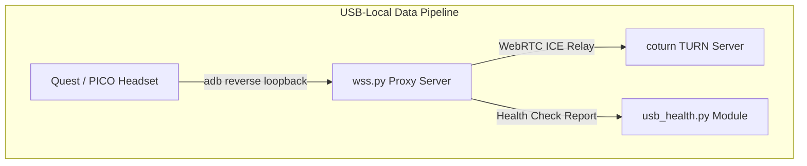

<!-- source: DeepWiki mcp.deepwiki.com · repo NVIDIA/IsaacCapture · page 3.3 Out-of-Band (OOB) Teleop Control · fetched 2026-10-26 -->

# Out-of-Band (OOB) Teleop Control

<details>
<summary>Relevant source files</summary>

The following files were used as context for generating this wiki page:

- [docs/source/references/cloudxr.rst](docs/source/references/cloudxr.rst)
- [docs/source/references/oob_teleop_control.rst](docs/source/references/oob_teleop_control.rst)
- [src/python/isaaccapture/cloudxr/launcher.py](src/python/isaaccapture/cloudxr/launcher.py)
- [src/python/isaaccapture/cloudxr/oob_teleop_adb.py](src/python/isaaccapture/cloudxr/oob_teleop_adb.py)
- [src/python/isaaccapture/cloudxr/oob_teleop_env.py](src/python/isaaccapture/cloudxr/oob_teleop_env.py)
- [src/python/isaaccapture/cloudxr/oob_teleop_lifecycle.py](src/python/isaaccapture/cloudxr/oob_teleop_lifecycle.py)
- [src/python/isaaccapture/cloudxr/service/__main__.py](src/python/isaaccapture/cloudxr/service/__main__.py)
- [src/python/isaaccapture/cloudxr/service/_service.py](src/python/isaaccapture/cloudxr/service/_service.py)
- [src/python/isaaccapture/cloudxr/usb_health.py](src/python/isaaccapture/cloudxr/usb_health.py)
- [src/python/isaaccapture/cloudxr/wss.py](src/python/isaaccapture/cloudxr/wss.py)
- [tests/python/core/cloudxr/test_launcher.py](tests/python/core/cloudxr/test_launcher.py)
- [tests/python/core/cloudxr/test_oob_teleop_adb.py](tests/python/core/cloudxr/test_oob_teleop_adb.py)
- [tests/python/core/cloudxr/test_oob_teleop_env.py](tests/python/core/cloudxr/test_oob_teleop_env.py)
- [tests/python/core/cloudxr/test_oob_teleop_lifecycle.py](tests/python/core/cloudxr/test_oob_teleop_lifecycle.py)
- [tests/python/core/cloudxr/test_service.py](tests/python/core/cloudxr/test_service.py)
- [tests/python/core/cloudxr/test_service_cli.py](tests/python/core/cloudxr/test_service_cli.py)
- [tests/python/core/cloudxr/test_service_oob_status.py](tests/python/core/cloudxr/test_service_oob_status.py)
- [tests/python/core/cloudxr/test_usb_health.py](tests/python/core/cloudxr/test_usb_health.py)
- [tests/python/core/cloudxr/test_webclient.py](tests/python/core/cloudxr/test_webclient.py)
- [tests/python/core/cloudxr/test_wss_oob_lifecycle.py](tests/python/core/cloudxr/test_wss_oob_lifecycle.py)

</details>


## Purpose and Scope

The Out-of-Band (OOB) teleop control hub provides an external management plane for Isaac Teleop (`isaaccapture`). It enables monitoring of streaming metrics, client inspection, and configuration updates from outside the XR headset over the same TLS port as the CloudXR WSS proxy (defaulting to port `48322`, or overrideable via `PROXY_PORT`) [docs/source/references/oob_teleop_control.rst:7-13](). 

---

## 1. OOB Lifecycle and Readiness Stages

The `OobLifecycle` class manages the end-to-end device setup, `coturn` instance monitoring, Chrome DevTools Protocol (CDP) session oversight, and browser connectivity verification [src/python/isaaccapture/cloudxr/oob_teleop_lifecycle.py:84-86](). It relies on `RecoveryConfig` to establish bounded timeouts and retry budgets for transport and browser re-establishment [src/python/isaaccapture/cloudxr/oob_teleop_lifecycle.py:43-52]().

```mermaid
graph TD
    subcode["Code Entity Space"]
    OobLifecycle["OobLifecycle"]
    RecoveryConfig["RecoveryConfig"]
    OobLifecycle -->|"reads budget"| RecoveryConfig
    OobLifecycle -->|"monitors"| AdbSession["enumerate_adb_devices"]
    OobLifecycle -->|"checks wake"| AwakeCheck["assert_headset_awake"]
    OobLifecycle -->|"verifies CDP"| CdpSession["_cdp_session_click_connect"]
end
```
*Sources: [src/python/isaaccapture/cloudxr/oob_teleop_lifecycle.py:43-86](), [src/python/isaaccapture/cloudxr/oob_teleop_adb.py:89-104]()*.

The lifecycle executes a 60-second recovery timeout at a 5-second cadence upon initial transport failure, transitioning into continuous observation every 5 seconds if unresolved [docs/source/references/oob_teleop_control.rst:43-47](). These bounds are configurable via `TELEOP_OOB_RECOVERY_TIMEOUT_SEC` and `TELEOP_OOB_RETRY_INTERVAL_SEC` [docs/source/references/oob_teleop_control.rst:45-47](). Setting `TELEOP_OOB_HUB_ONLY=1` bypasses all `adb` interactions for headless, CI, or wireless-only deployments [docs/source/references/oob_teleop_control.rst:49-52]().

Sources: [docs/source/references/oob_teleop_control.rst:43-52](), [src/python/isaaccapture/cloudxr/oob_teleop_lifecycle.py:43-86]()

---

## 2. ADB and CDP Headset Automation

Automated headset provisioning is enabled via the `--setup-oob` service flag, which executes device enumeration, bookmark URL dispatch, and browser automation [docs/source/references/oob_teleop_control.rst:31-39]().

1. **Device Pinned Selection**: `enumerate_adb_devices` inspects attached hardware and targets a single ready device serial for the service lifetime [src/python/isaaccapture/cloudxr/oob_teleop_adb.py:89-104]().
2. **Awakening Verification**: `open_url_on_headset` enforces confirmed wakefulness (`mWakefulness=Awake`) via `assert_headset_awake` before executing `am start` [tests/python/core/cloudxr/test_oob_teleop_adb.py:106-122]().
3. **CDP Interaction**: `_cdp_session_click_connect` forwards the browser's DevTools socket over an `adb forward` tunnel, accepts self-signed security interstitials, and dispatches click events via `Input.dispatchMouseEvent` [docs/source/references/oob_teleop_control.rst:159-166]().

```mermaid
graph TD
    subcode["Code Entity Space"]
    ServiceMain["isaaccapture.cloudxr.service"] -->|"spawns"| Lifecycle["OobLifecycle"]
    Lifecycle -->|"calls"| Enumerate["enumerate_adb_devices"]
    Enumerate -->|"filters ready"| AssertAwake["assert_headset_awake"]
    AssertAwake -->|"launches browser"| OpenUrl["open_url_on_headset"]
    OpenUrl -->|"attaches CDP"| CdpConnect["_cdp_session_click_connect"]
end
```
*Sources: [src/python/isaaccapture/cloudxr/oob_teleop_lifecycle.py:84-86](), [src/python/isaaccapture/cloudxr/oob_teleop_adb.py:89-122](), [tests/python/core/cloudxr/test_oob_teleop_adb.py:26-39]()*.

Sources: [docs/source/references/oob_teleop_control.rst:159-177](), [src/python/isaaccapture/cloudxr/oob_teleop_adb.py:89-104](), [tests/python/core/cloudxr/test_oob_teleop_adb.py:106-122]()

---

## 3. USB-Local Mode and `coturn` Integration

When invoking `--usb-local` alongside `--setup-oob`, teleop control signaling and media streaming bypass standard network routes, tunneling over USB via `adb reverse` to the headset loopback (`127.0.0.1`) [src/python/isaaccapture/cloudxr/oob_teleop_adb.py:11-18]().


*Sources: [src/python/isaaccapture/cloudxr/oob_teleop_adb.py:11-18](), [src/python/isaaccapture/cloudxr/wss.py:4-5]()*.

The `usb_health` subsystem evaluates the physical link before launching the browser:
- Measures host-to-headset transfer metrics across three seconds using `bundle.js` over HTTPS [docs/source/references/cloudxr.rst:141-149]().
- Persists JSON reports to `<CloudXR install dir>/logs/usb-health/` (retaining up to 20 reports or 14 days of history) [docs/source/references/cloudxr.rst:152-156]().
- Logs warnings if negotiated link speeds drop below 5000 Mb/s or if transfers complete incompletely [docs/source/references/cloudxr.rst:156-158]().

Sources: [docs/source/references/cloudxr.rst:138-160](), [src/python/isaaccapture/cloudxr/oob_teleop_adb.py:11-18]()

---

## 4. OOB WebSocket and HTTP APIs

The WSS proxy (`wss.py`) integrates HTTP and WebSocket handlers to manage remote queries and status reporting [src/python/isaaccapture/cloudxr/wss.py:4-5](). 

- **State Endpoint (`GET /api/oob/v1/state`)**: Returns active client telemetry, including connection flags, device labels, lifecycle status, and metrics collected across configurable cadences [docs/source/references/oob_teleop_control.rst:102-125]().
- **Config Endpoint (`GET /api/oob/v1/config`)**: Accepts query parameters to push runtime settings (such as target `serverIP`, `port`, or video `codec`) down to registered headsets dynamically [docs/source/references/oob_teleop_control.rst:132-140]().
- **Control Socket (`OOB_WS_PATH`)**: Serves as the persistent communication channel for telemetry ingestion and asynchronous command dispatch [src/python/isaaccapture/cloudxr/oob_teleop_env.py:22]().

Sources: [docs/source/references/oob_teleop_control.rst:102-140](), [src/python/isaaccapture/cloudxr/oob_teleop_env.py:22](), [src/python/isaaccapture/cloudxr/wss.py:4-5]()

---

