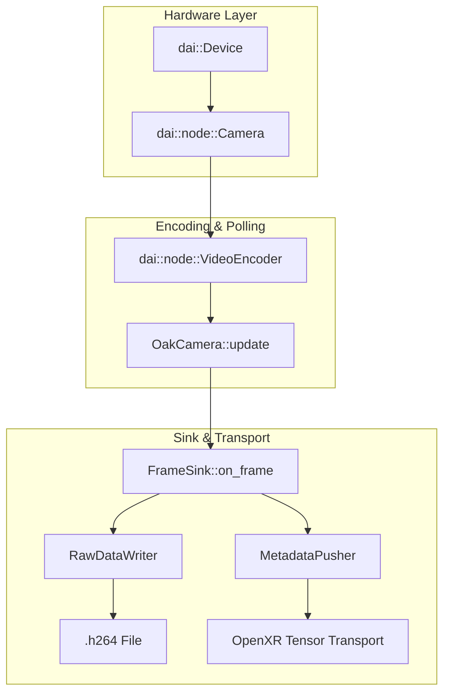
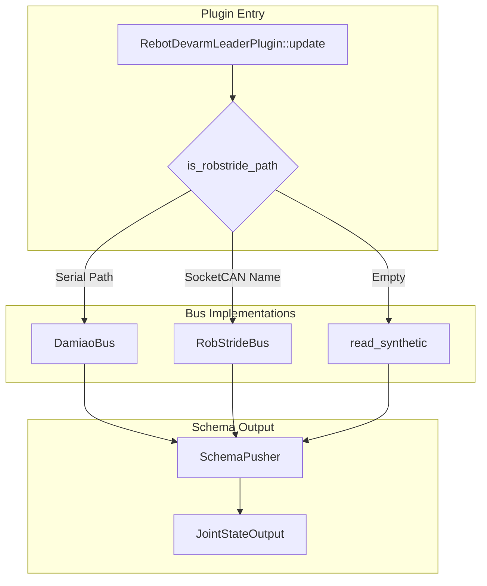

<!-- source: DeepWiki mcp.deepwiki.com · repo NVIDIA/IsaacCapture · page 4.2 Camera, Pedal, Leader-Arm and Input Device Plugins · fetched 2026-10-26 -->

# Camera, Pedal, Leader-Arm and Input Device Plugins

Relevant source files

The following files were used as context for generating this wiki page:

- [deps/README.md](deps/README.md)
- [deps/third_party/CMakeLists.txt](deps/third_party/CMakeLists.txt)
- [docs/source/device/oak.rst](docs/source/device/oak.rst)
- [examples/noitom/README.md](examples/noitom/README.md)
- [examples/noitom/assets/record.gif](examples/noitom/assets/record.gif)
- [examples/noitom/assets/replay.gif](examples/noitom/assets/replay.gif)
- [examples/noitom/assets/teleop.gif](examples/noitom/assets/teleop.gif)
- [examples/noitom/noitom_reference_draw.py](examples/noitom/noitom_reference_draw.py)
- [examples/noitom/noitom_tasks.py](examples/noitom/noitom_tasks.py)
- [examples/oxr/python/test_oak_camera.py](examples/oxr/python/test_oak_camera.py)
- [examples/schemaio/common_utils.hpp](examples/schemaio/common_utils.hpp)
- [src/core/deviceio_base/cpp/inc/deviceio_base/tracker_vendor.hpp](src/core/deviceio_base/cpp/inc/deviceio_base/tracker_vendor.hpp)
- [src/plugins/CMakeLists.txt](src/plugins/CMakeLists.txt)
- [src/plugins/generic_3axis_pedal/README.md](src/plugins/generic_3axis_pedal/README.md)
- [src/plugins/generic_3axis_pedal/generic_3axis_pedal_plugin.cpp](src/plugins/generic_3axis_pedal/generic_3axis_pedal_plugin.cpp)
- [src/plugins/generic_3axis_pedal/generic_3axis_pedal_plugin.hpp](src/plugins/generic_3axis_pedal/generic_3axis_pedal_plugin.hpp)
- [src/plugins/generic_3axis_pedal/main.cpp](src/plugins/generic_3axis_pedal/main.cpp)
- [src/plugins/generic_3axis_pedal/plugin.yaml](src/plugins/generic_3axis_pedal/plugin.yaml)
- [src/plugins/oak/CMakeLists.txt](src/plugins/oak/CMakeLists.txt)
- [src/plugins/oak/README.md](src/plugins/oak/README.md)
- [src/plugins/oak/core/frame_sink.cpp](src/plugins/oak/core/frame_sink.cpp)
- [src/plugins/oak/core/frame_sink.hpp](src/plugins/oak/core/frame_sink.hpp)
- [src/plugins/oak/core/oak_camera.cpp](src/plugins/oak/core/oak_camera.cpp)
- [src/plugins/oak/core/oak_camera.hpp](src/plugins/oak/core/oak_camera.hpp)
- [src/plugins/oak/core/preview_stream.cpp](src/plugins/oak/core/preview_stream.cpp)
- [src/plugins/oak/core/preview_stream.hpp](src/plugins/oak/core/preview_stream.hpp)
- [src/plugins/oak/main.cpp](src/plugins/oak/main.cpp)
- [src/plugins/rebot_devarm_leader/CMakeLists.txt](src/plugins/rebot_devarm_leader/CMakeLists.txt)
- [src/plugins/rebot_devarm_leader/README.md](src/plugins/rebot_devarm_leader/README.md)
- [src/plugins/rebot_devarm_leader/damiao_bus.cpp](src/plugins/rebot_devarm_leader/damiao_bus.cpp)
- [src/plugins/rebot_devarm_leader/damiao_bus.hpp](src/plugins/rebot_devarm_leader/damiao_bus.hpp)
- [src/plugins/rebot_devarm_leader/main.cpp](src/plugins/rebot_devarm_leader/main.cpp)
- [src/plugins/rebot_devarm_leader/plugin.yaml](src/plugins/rebot_devarm_leader/plugin.yaml)
- [src/plugins/rebot_devarm_leader/rebot_devarm_leader_plugin.cpp](src/plugins/rebot_devarm_leader/rebot_devarm_leader_plugin.cpp)
- [src/plugins/rebot_devarm_leader/rebot_devarm_leader_plugin.hpp](src/plugins/rebot_devarm_leader/rebot_devarm_leader_plugin.hpp)
- [src/plugins/rebot_devarm_leader/robstride_bus.cpp](src/plugins/rebot_devarm_leader/robstride_bus.cpp)
- [src/plugins/rebot_devarm_leader/robstride_bus.hpp](src/plugins/rebot_devarm_leader/robstride_bus.hpp)
- [src/plugins/steering_wheel/CMakeLists.txt](src/plugins/steering_wheel/CMakeLists.txt)
- [src/plugins/steering_wheel/README.md](src/plugins/steering_wheel/README.md)
- [src/plugins/steering_wheel/main.cpp](src/plugins/steering_wheel/main.cpp)
- [src/plugins/steering_wheel/plugin.yaml](src/plugins/steering_wheel/plugin.yaml)
- [src/plugins/steering_wheel/steering_wheel_plugin.hpp](src/plugins/steering_wheel/steering_wheel_plugin.hpp)

## Purpose and Scope
This page details the implementation, data flow, and runtime architecture of device plugins located under `src/plugins/` [src/plugins/CMakeLists.txt:1-44](). These plugins encapsulate third-party SDKs, hardware buses, and HID interfaces, bridging physical sensors (cameras, leader arms, pedals, steering wheels, SpaceMice, mocap suits, and XR trackers) into the OpenXR runtime session and Isaac Teleop core pipelines via tensor channels and FlatBuffer schemas.

---

## 1. OAK Camera Plugin (`oak_camera`)
The OAK camera plugin (`src/plugins/oak/`) provides hardware-accelerated H.264 video encoding using DepthAI v3.x (`[src/plugins/oak/README.md:8-15]()`). It supports multiple streams (`Color`, `MonoLeft`, `MonoRight`), live SDL2 previews, local raw H.264 recording, and OpenXR-based metadata pushing (`[src/plugins/oak/README.md:11-163]()`).

### Key Classes and Functions
- `plugins::oak::OakCamera`: Initializes the `dai::Device` (`[src/plugins/oak/core/oak_camera.cpp:39-40]()`), configures camera sensors and H.264 video encoders (`[src/plugins/oak/core/oak_camera.cpp:105-142]()`), and polls frames in `update()` (`[src/plugins/oak/core/oak_camera.cpp:148-179]()`).
- `plugins::oak::OakCamera::find_device`: Discovers available OAK devices via `dai::DeviceBootloader::getAllAvailableDevices()` (`[src/plugins/oak/core/oak_camera.cpp:65-84]()`).
- `FrameSink`: Dispatches encoded NAL units to disk (`RawDataWriter`) and metadata to OpenXR tensor transport (`MetadataPusher`) (`[src/plugins/oak/README.md:164-177]()`).

### Data Flow Diagram

Sources: `[src/plugins/oak/README.md:1-184]()`, `[src/plugins/oak/core/oak_camera.cpp:32-179]()`, `[src/plugins/oak/main.cpp:124-201]()`

---

## 2. Leader-Arm Plugins (`so101_leader`, `rebot_devarm_leader`)
Leader-arm plugins stream joint angles (6-DoF arm + gripper) as `JointStateOutput` FlatBuffer messages over the OpenXR tensor transport (`[src/plugins/rebot_devarm_leader/README.md:8-12]()`).

### Rebot DevArm Implementation
The `RebotDevarmLeaderPlugin` supports three distinct backends selected by the shape of the device argument (`[src/plugins/rebot_devarm_leader/rebot_devarm_leader_plugin.hpp:33-53]()`):
1. **Damiao Backend**: Selected by serial paths containing `/` (e.g., `/dev/ttyACM0`) (`[src/plugins/rebot_devarm_leader/rebot_devarm_leader_plugin.hpp:36-43]()`). Uses `DamiaoBus` to send disable frames for back-driving and queries motor feedback via command `0xCC` (`[src/plugins/rebot_devarm_leader/rebot_devarm_leader_plugin.cpp:118-159]()`).
2. **RobStride Backend**: Selected by a bare SocketCAN interface name (e.g., `can0`) (`[src/plugins/rebot_devarm_leader/rebot_devarm_leader_plugin.hpp:45-49]()`). Uses `RobStrideBus` to send stop frames and poll `mechPos` / `mechVel` parameters.
3. **Synthetic Backend**: Active when no device path is provided, generating smooth trajectories for CI and headless bring-up (`[src/plugins/rebot_devarm_leader/rebot_devarm_leader_plugin.hpp:50-53]()`).

### Code Entity Architecture

Sources: `[src/plugins/rebot_devarm_leader/rebot_devarm_leader_plugin.hpp:54-121]`, `[src/plugins/rebot_devarm_leader/rebot_devarm_leader_plugin.cpp:118-159]()`, `[src/plugins/rebot_devarm_leader/README.md:8-60]()`

---

## 3. Input Devices and Control Pedals
Isaac Capture includes specialized plugins for operator input devices under `src/plugins/`:
- **Generic 3-Axis Pedal (`generic_3axis_pedal`)**: Reads 3-axis pedal inputs (throttle, brake, clutch) and publishes normalized tensor signals for vehicle and locomotion teleoperation (`[src/plugins/CMakeLists.txt:19]()`).
- **Steering Wheel (`steering_wheel`)**: Interfaces with DirectInput/HID steering wheels for vehicle teleoperation control loops (`[src/plugins/CMakeLists.txt:20]()`).
- **SpaceMouse (`spacemouse`)**: Captures 6-DoF spatial control inputs from 3Dconnexion SpaceMouse devices for teleoperation and camera viewing (`[src/plugins/CMakeLists.txt:21]()`).

Sources: `[src/plugins/CMakeLists.txt:16-25]()`

---

## 4. SE3 and Full-Body Tracking Plugins
Absolute spatial tracking and full-body motion capture plugins map physical operator poses into the core runtime session:
- **VIVE & Controller SE3 Trackers (`vive_se3_tracker`, `controller_se3_tracker`)**: Publish 6-DoF poses (`SE3`) for XR controllers and base station trackers (`[src/plugins/CMakeLists.txt:16-17]()`).
- **Noitom & Xsens Full-Body (`noitom_mocap`, `xsens_full_body`)**: Integrate skeletal tracking suites to stream full-body joint configurations for whole-body teleoperation retargeting (`[src/plugins/CMakeLists.txt:22, 28-30]()`).

Sources: `[src/plugins/CMakeLists.txt:16-17, 22, 28-30]()`

---

