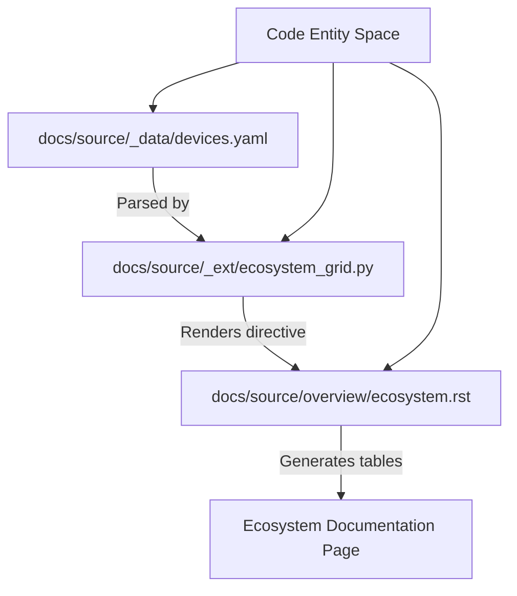
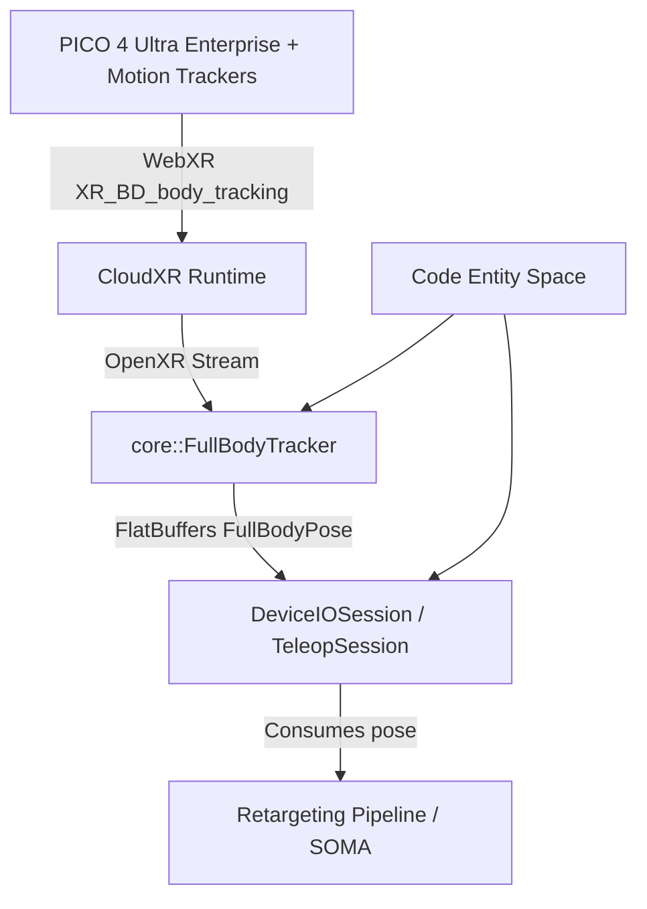
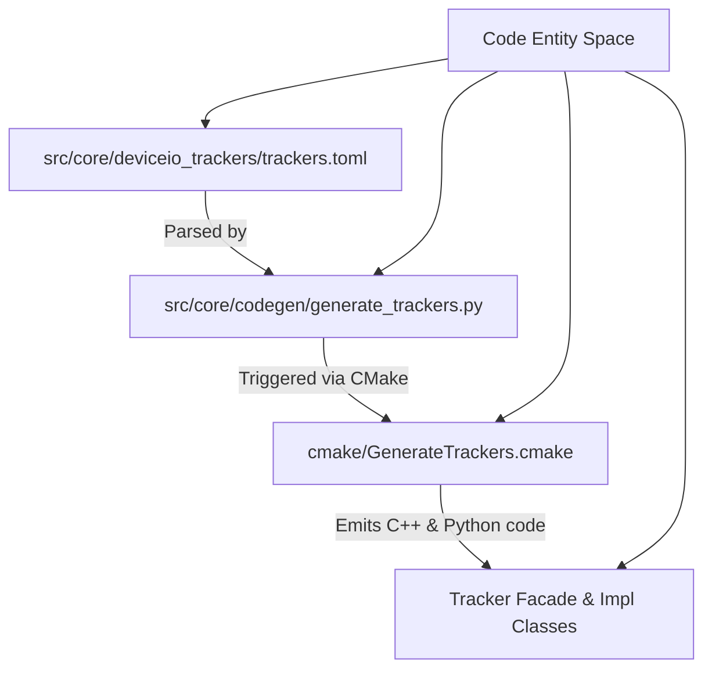

<!-- source: DeepWiki mcp.deepwiki.com · repo NVIDIA/IsaacCapture · page 4.3 Device Documentation and Adding a New Device · fetched 2026-10-26 -->

# Device Documentation and Adding a New Device

<details>
<summary>Relevant source files</summary>

The following files were used as context for generating this wiki page:

- [docs/source/_data/devices.yaml](docs/source/_data/devices.yaml)
- [docs/source/_ext/ecosystem_grid.py](docs/source/_ext/ecosystem_grid.py)
- [docs/source/_static/css/ecosystem.css](docs/source/_static/css/ecosystem.css)
- [docs/source/_static/haptikos-exoskeletons.gif](docs/source/_static/haptikos-exoskeletons.gif)
- [docs/source/_static/lerobot/sim-teleop-example-huggingface.gif](docs/source/_static/lerobot/sim-teleop-example-huggingface.gif)
- [docs/source/_static/lerobot/so-101-isaac-teleop-real.gif](docs/source/_static/lerobot/so-101-isaac-teleop-real.gif)
- [docs/source/_static/lerobot/so-101-isaac-teleop-sim.gif](docs/source/_static/lerobot/so-101-isaac-teleop-sim.gif)
- [docs/source/_static/lerobot/so101_vial_to_rack_task.gif](docs/source/_static/lerobot/so101_vial_to_rack_task.gif)
- [docs/source/_static/logos/htc-vive-dark.png](docs/source/_static/logos/htc-vive-dark.png)
- [docs/source/_static/logos/htc-vive.png](docs/source/_static/logos/htc-vive.png)
- [docs/source/_static/logos/wuji-dark.svg](docs/source/_static/logos/wuji-dark.svg)
- [docs/source/_static/logos/wuji.svg](docs/source/_static/logos/wuji.svg)
- [docs/source/device/add_device.rst](docs/source/device/add_device.rst)
- [docs/source/device/body_tracking.rst](docs/source/device/body_tracking.rst)
- [docs/source/device/haptikos.rst](docs/source/device/haptikos.rst)
- [docs/source/device/joint_space.rst](docs/source/device/joint_space.rst)
- [docs/source/device/oglo.rst](docs/source/device/oglo.rst)
- [docs/source/device/soma.rst](docs/source/device/soma.rst)
- [docs/source/device/spacemouse.rst](docs/source/device/spacemouse.rst)
- [docs/source/device/trackers.rst](docs/source/device/trackers.rst)
- [docs/source/getting_started/build_from_source/webxr.rst](docs/source/getting_started/build_from_source/webxr.rst)
- [docs/source/getting_started/lerobot/devices.rst](docs/source/getting_started/lerobot/devices.rst)
- [docs/source/getting_started/lerobot/training_groot.rst](docs/source/getting_started/lerobot/training_groot.rst)
- [docs/source/getting_started/teleop_session.rst](docs/source/getting_started/teleop_session.rst)
- [docs/source/overview/ecosystem.rst](docs/source/overview/ecosystem.rst)
- [docs/source/references/mcap_record_replay.rst](docs/source/references/mcap_record_replay.rst)
- [docs/source/references/retargeting/index.rst](docs/source/references/retargeting/index.rst)
- [docs/source/references/retargeting/joint_space.rst](docs/source/references/retargeting/joint_space.rst)
- [docs/source/references/retargeting/so101.rst](docs/source/references/retargeting/so101.rst)
- [examples/deviceio_live_view/python/isaaccapture_examples/deviceio_live_view/soma_hand.py](examples/deviceio_live_view/python/isaaccapture_examples/deviceio_live_view/soma_hand.py)
- [examples/mcap_record_replay/.gitignore](examples/mcap_record_replay/.gitignore)
- [examples/mcap_record_replay/CMakeLists.txt](examples/mcap_record_replay/CMakeLists.txt)
- [examples/mcap_record_replay/cpp/CMakeLists.txt](examples/mcap_record_replay/cpp/CMakeLists.txt)
- [examples/mcap_record_replay/cpp/record_full_body.cpp](examples/mcap_record_replay/cpp/record_full_body.cpp)
- [examples/schemaio/CMakeLists.txt](examples/schemaio/CMakeLists.txt)
- [examples/schemaio/full_body_printer.cpp](examples/schemaio/full_body_printer.cpp)
- [examples/soma_hand_publisher/python/isaaccapture_examples/soma_hand_publisher/publisher.py](examples/soma_hand_publisher/python/isaaccapture_examples/soma_hand_publisher/publisher.py)
- [examples/teleop/python/spacemouse_printer_example.py](examples/teleop/python/spacemouse_printer_example.py)
- [scripts/check_doc_refs.py](scripts/check_doc_refs.py)
- [src/core/schema/fbs/soma_common.fbs](src/core/schema/fbs/soma_common.fbs)
- [src/core/schema/fbs/soma_hand_joint_poses.fbs](src/core/schema/fbs/soma_hand_joint_poses.fbs)
- [src/core/schema/fbs/soma_hand_joint_rotations.fbs](src/core/schema/fbs/soma_hand_joint_rotations.fbs)
- [src/core/schema/fbs/spacemouse.fbs](src/core/schema/fbs/spacemouse.fbs)
- [src/core/schema/golden/soma_common.bfbs](src/core/schema/golden/soma_common.bfbs)
- [src/core/schema/golden/soma_hand_joint_poses.bfbs](src/core/schema/golden/soma_hand_joint_poses.bfbs)
- [src/core/schema/golden/soma_hand_joint_rotations.bfbs](src/core/schema/golden/soma_hand_joint_rotations.bfbs)
- [src/core/schema/golden/spacemouse.bfbs](src/core/schema/golden/spacemouse.bfbs)
- [src/core/schema/python/soma_common_bindings.h](src/core/schema/python/soma_common_bindings.h)

</details>


## Purpose and Scope

This page provides full technical documentation for the device ecosystem, advanced tracking mechanisms, joint-space device architectures, and the developer workflow for integrating custom hardware into Isaac Teleop. It covers the ecosystem grid configuration (`devices.yaml`), full-body tracking via the OpenXR `XR_BD_body_tracking` extension, SOMA and generic joint-space devices (such as the SO-101 leader arm and reBot DevArm), and the four-step guide for creating a new device plugin and tracker facade.

Sources: `docs/source/overview/ecosystem.rst:1-10`(), `docs/source/device/add_device.rst:1-15`(), `docs/source/device/joint_space.rst:1-15`()

---

## 1. The Ecosystem Grid (`devices.yaml`)

The Isaac Teleop ecosystem catalog aggregates supported XR headsets, motion controllers, gloves, pedals, master manipulators, data factory tools, and cloud infrastructure. The single source of truth for these entries is `docs/source/_data/devices.yaml`, which is parsed at documentation build time by the `ecosystem_grid.py` Sphinx extension to render structured reference tables [docs/source/_data/devices.yaml:1-141]().

### Ecosystem Data Model and Rendering

Each entry in `devices.yaml` defines its metadata, supported input modes, setup guides, requirements, and acquisition channels. The extension maps these entries onto distinct table sections based on their `group` attribute (`xr`, `peripheral`, `data_factory`, or `cloud`) [docs/source/_data/devices.yaml:8-16]().


*Figure 1: Ecosystem configuration to documentation rendering pipeline.*

Sources: `docs/source/overview/ecosystem.rst:21-60`(), `docs/source/_data/devices.yaml:1-48`(), `docs/source/_ext/ecosystem_grid.py:1-20`()

---

## 2. Body Tracking (`XR_BD_body_tracking` & IOBT)

Isaac Teleop supports full-body tracking streams from XR headsets via the CloudXR WebXR client and the OpenXR `XR_BD_body_tracking` extension defined by ByteDance (BD) [docs/source/device/body_tracking.rst:7-93](). 

### Hardware and OS Requirements

Full-body tracking targets the **PICO 4 Ultra Enterprise** paired with **PICO Motion Trackers** [docs/source/device/body_tracking.rst:11-14](). Enterprise features must be activated in headset settings to grant the `body-tracking` permission to the WebXR browser environment [docs/source/device/body_tracking.rst:16-26](). Meta Quest 3/3S headsets also expose inside-out body tracking (IOBT) to WebXR, though their skeleton is dynamically mapped to the PICO 24-joint BD layout [docs/source/device/body_tracking.rst:27-34]().

### The 24-Joint Skeleton Layout

The `FullBodyTracker` implementation queries joint transformations each frame [docs/source/device/trackers.rst:17](). Each joint provides a 3D position vector in meters, a quaternion orientation, and an `is_valid` flag [docs/source/device/body_tracking.rst:101-108]().


*Figure 2: Body tracking data flow from hardware runtime to teleop session.*

### Server-Side Access via C++ and Python

Applications access full-body poses using `FullBodyTracker::get_body_pose()` [docs/source/device/body_tracking.rst:189-195](). The underlying FlatBuffers schema is defined in `src/core/schema/fbs/full_body.fbs` [docs/source/device/body_tracking.rst:196-198](). Below is a representative snippet from the C++ reference printer demonstrating validation checks per joint [examples/schemaio/full_body_printer.cpp:40-51]():

```cpp
void print_joint(const char* label, const core::BodyJointPose& joint)
{
    if (joint.is_valid())
    {
        const auto& position = joint.pose().position();
        std::cout << " " << label << "=[" << position.x() << ", " << position.y() << ", " << position.z() << "]";
    }
    else
    {
        std::cout << " " << label << "=[not tracked]";
    }
}
```[examples/schemaio/full_body_printer.cpp:40-51]()

Sources: `docs/source/device/body_tracking.rst:1-203`(), `examples/schemaio/full_body_printer.cpp:1-151`(), `examples/mcap_record_replay/cpp/record_full_body.cpp:1-161`()

---

## 3. Generic Joint-Space Devices & SOMA

For articulated input devices such as leader arms, exoskeletons, or haptic gloves, Isaac Teleop utilizes a reusable joint-encoder path [docs/source/device/joint_space.rst:7-12](). 

### Schema and Data Flow

Devices stream name-keyed `JointStateOutput` FlatBuffers over OpenXR tensor transports [docs/source/device/joint_space.rst:8-10](). 

- **Schema:** Defined in `src/core/schema/fbs/joint_state.fbs`, containing a vector of `JointState` structs (name, position, velocity, effort, validity) [docs/source/device/joint_space.rst:27-29]() and SOMA extensions (`src/core/schema/fbs/soma_common.fbs`) [docs/source/device/joint_space.rst:27-29]().
- **Plugins:** Plugins such as `so101_leader` and `rebot_devarm_leader` read hardware buses (e.g., FEETECH STS3215 servos or Damiao/RobStride CAN motors) and push state using `core::SchemaPusher` [docs/source/device/joint_space.rst:30-33]().
- **Tracker & Source:** `JointStateTracker` and `JointStateSource` deserialize the name-keyed values into the retargeting graph [docs/source/device/joint_space.rst:34-40]().
- **Retargeters:** `JointStateRetargeter` operates in either `joint` (lossless mirror) or `ee_pose` (forward kinematics via Pinocchio) modes [docs/source/device/joint_space.rst:41-42]().

Sources: `docs/source/device/joint_space.rst:1-146`(), `docs/source/references/retargeting/index.rst:1-25`()

---

## 4. Guide to Adding a New Device (`add_device`)

Adding custom hardware that requires a dedicated driver or SDK involves creating a C++ device plugin that pushes serialized FlatBuffers over OpenXR tensor collections [docs/source/device/add_device.rst:6-13](). Follow these four steps, using the generic 3-axis foot pedal as the reference implementation [docs/source/device/add_device.rst:14-35]().

### Step 1: Define the Data Schema

Create a FlatBuffer schema (`.fbs`) under `src/core/schema/fbs/` [docs/source/device/add_device.rst:37-43](). It requires an output table for the payload and a record wrapper combining the payload with `DeviceDataTimestamp` [docs/source/device/add_device.rst:65-71]().

```idl
include "point.fbs";
include "timestamp.fbs";

namespace core;

table Generic3AxisPedalOutput {
  left_pedal: float (id: 0);
  right_pedal: float (id: 1);
  rudder: float (id: 2);
}

table Generic3AxisPedalOutputRecord {
  data: Generic3AxisPedalOutput (id: 0);
  timestamp: DeviceDataTimestamp (id: 1);
}

root_type Generic3AxisPedalOutputRecord;
```[docs/source/device/add_device.rst:46-70]()

### Step 2: Implement the Device Plugin

Implement a standalone or embedded plugin that reads hardware and pushes serialized data via `core::SchemaPusher` from the `pusherio` library [docs/source/device/add_device.rst:76-86](). The plugin initializes an OpenXR session with `SchemaPusher::get_required_extensions()` (including `XR_NVX1_push_tensor` and `XR_NVX1_tensor_data`), serializes the payload in an update loop, and pushes the buffer with local and raw device timestamps [docs/source/device/add_device.rst:83-95]().

### Step 3: Configure the Tracker Manifest

For schema-based trackers, avoid writing the tracker stack manually. Instead, register a `[[tracker]]` entry in `src/core/deviceio_trackers/trackers.toml` [docs/source/device/add_device.rst:108-117](). CMake integration (`cmake/GenerateTrackers.cmake`) invokes `src/core/codegen/generate_trackers.py` at configure time to generate the tracker facade and live/replay backends [docs/source/device/add_device.rst:118-123]().


*Figure 3: Tracker code generation pipeline from TOML manifest to compiled targets.*

### Step 4: Validate with Debug Printers

Create a standalone debug reader application (refer to `examples/schemaio/pedal_printer.cpp`) to verify that telemetry flows correctly from the plugin through the OpenXR runtime to the host application [docs/source/device/add_device.rst:31-35]().

Sources: `docs/source/device/add_device.rst:1-145`(), `src/core/schema/fbs/pedals.fbs:1-64`()

---

