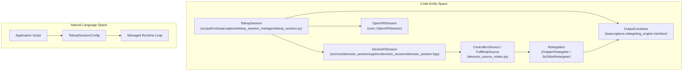
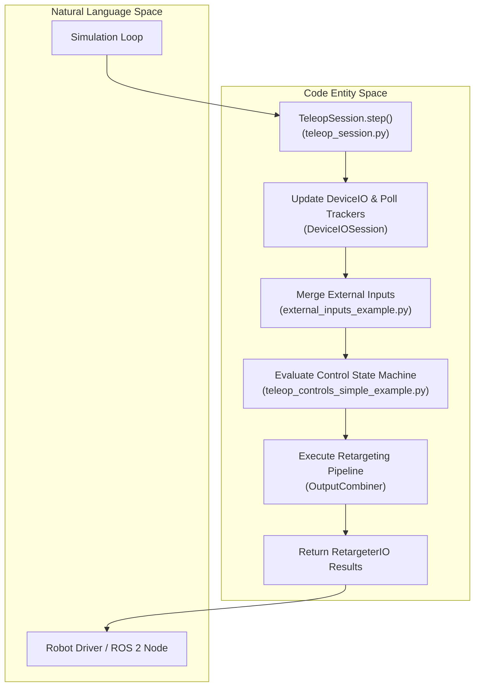

<!-- source: DeepWiki mcp.deepwiki.com · repo NVIDIA/IsaacCapture · page 5.1 Teleop Session Manager · fetched 2026-10-26 -->

# Teleop Session Manager

<details>
<summary>Relevant source files</summary>

The following files were used as context for generating this wiki page:

- [docs/AGENTS.md](docs/AGENTS.md)
- [docs/source/_static/haptikos-exoskeletons.gif](docs/source/_static/haptikos-exoskeletons.gif)
- [docs/source/device/add_device.rst](docs/source/device/add_device.rst)
- [docs/source/device/haptikos.rst](docs/source/device/haptikos.rst)
- [docs/source/device/oglo.rst](docs/source/device/oglo.rst)
- [docs/source/getting_started/build_from_source/webxr.rst](docs/source/getting_started/build_from_source/webxr.rst)
- [docs/source/getting_started/teleop_control_state_machine.rst](docs/source/getting_started/teleop_control_state_machine.rst)
- [docs/source/getting_started/teleop_session.rst](docs/source/getting_started/teleop_session.rst)
- [docs/source/references/device_provider_monitoring.rst](docs/source/references/device_provider_monitoring.rst)
- [docs/source/references/migration.rst](docs/source/references/migration.rst)
- [docs/source/references/retargeting/index.rst](docs/source/references/retargeting/index.rst)
- [docs/source/references/retargeting/joint_space.rst](docs/source/references/retargeting/joint_space.rst)
- [docs/source/references/retargeting/so101.rst](docs/source/references/retargeting/so101.rst)
- [examples/robot_viz/README.md](examples/robot_viz/README.md)
- [examples/teleop_session_manager/CMakeLists.txt](examples/teleop_session_manager/CMakeLists.txt)
- [examples/teleop_session_manager/README.md](examples/teleop_session_manager/README.md)
- [examples/teleop_session_manager/pyproject.toml](examples/teleop_session_manager/pyproject.toml)
- [examples/teleop_session_manager/python/isaaccapture_examples/teleop_session_manager/external_inputs_example.py](examples/teleop_session_manager/python/isaaccapture_examples/teleop_session_manager/external_inputs_example.py)
- [examples/teleop_session_manager/python/isaaccapture_examples/teleop_session_manager/teleop_controls_simple_example.py](examples/teleop_session_manager/python/isaaccapture_examples/teleop_session_manager/teleop_controls_simple_example.py)
- [scripts/check_doc_refs.py](scripts/check_doc_refs.py)
- [src/core/oxr/cpp/CMakeLists.txt](src/core/oxr/cpp/CMakeLists.txt)
- [src/core/oxr/cpp/inc/oxr/oxr_session.hpp](src/core/oxr/cpp/inc/oxr/oxr_session.hpp)
- [src/core/oxr/cpp/oxr_session.cpp](src/core/oxr/cpp/oxr_session.cpp)
- [src/core/oxr/python/oxr_bindings.cpp](src/core/oxr/python/oxr_bindings.cpp)
- [src/python/isaaccapture/teleop_session_manager/config.py](src/python/isaaccapture/teleop_session_manager/config.py)
- [src/python/isaaccapture/teleop_session_manager/status.py](src/python/isaaccapture/teleop_session_manager/status.py)
- [src/python/isaaccapture/teleop_session_manager/status_monitor.py](src/python/isaaccapture/teleop_session_manager/status_monitor.py)
- [src/python/isaaccapture/teleop_session_manager/teleop_session.py](src/python/isaaccapture/teleop_session_manager/teleop_session.py)
- [src/python/isaaccapture/viz/robot/assets.py](src/python/isaaccapture/viz/robot/assets.py)
- [tests/python/core/cloudxr/conftest.py](tests/python/core/cloudxr/conftest.py)
- [tests/python/core/teleop_session_manager/test_status_monitor.py](tests/python/core/teleop_session_manager/test_status_monitor.py)

</details>


## Purpose and Scope

The Teleop Session Manager provides a declarative, configuration-based API that manages the complete lifecycle of an Isaac Teleop session [docs/source/getting_started/teleop_session.rst:7-16](). It wraps lower-level components such as `DeviceIOSession`, OpenXR runtime providers, device trackers, plugins, and the graph-based retargeting pipeline [docs/source/getting_started/teleop_session.rst:17-26](). This page details session configuration classes, sink/source graph execution, LIVE versus REPLAY execution semantics, status monitoring health snapshots, and the teleop control state machine.

Sources: [docs/source/getting_started/teleop_session.rst:7-26]()

---

## 1. TeleopSessionConfig and Initialization

A teleop run is instantiated using `TeleopSession` configured via a `TeleopSessionConfig` dataclass [docs/source/getting_started/teleop_session.rst:34-37](), [docs/source/getting_started/teleop_session.rst:86-104](). The configuration specifies the application identity, retargeting graph topology, operating mode, and execution thread policy.

```python
@dataclass
class TeleopSessionConfig:
    app_name: str                            # OpenXR application name
    pipeline: Any                            # Connected retargeting pipeline
    mode: SessionMode = SessionMode.LIVE     # LIVE or REPLAY
    trackers: List[Any] = []                 # Tracker instances (optional)
    plugins: List[PluginConfig] = []         # Plugin configurations (optional)
    verbose: bool = True                     # Print progress info
    oxr_handles: Optional[...] = None        # External OpenXR handles (optional)
    mcap_config: Optional[...] = None        # Required for REPLAY, optional for LIVE
    retargeting_execution: RetargetingExecutionConfig = ...
```

Sources: [docs/source/getting_started/teleop_session.rst:86-104]()

---

## 2. Pipeline and Sink Graph Architecture

The teleop pipeline coordinates data flow from **source nodes** (e.g., controllers, hand tracking, full body, or foot pedals) through **retargeters** (e.g., `GripperRetargeter`, `Se3AbsRetargeter`, `DexHandRetargeter`) and aggregates them via output combiners [docs/source/getting_started/teleop_session.rst:34-62](), [docs/source/references/retargeting/index.rst:7-25]().

### Diagram: TeleopSession and Graph Execution Topology


Sources: [docs/source/getting_started/teleop_session.rst:34-62](), [src/core/oxr/cpp/inc/oxr/oxr_session.hpp:53-90]()

---

## 3. LIVE vs REPLAY Modes and OpenXR Lifecycle

`TeleopSession` supports two primary operational modes dictated by `SessionMode` [docs/source/getting_started/teleop_session.rst:97-111]():

1. **`SessionMode.LIVE`**: Initializes or consumes an OpenXR session. When `oxr_handles` is supplied via `OpenXRSessionHandles(instance, session, space, proc_addr)`, the session skips internal OpenXR creation and relies on external runtime lifecycles [docs/source/getting_started/teleop_session.rst:113-130](). Optional MCAP recording configuration (`McapRecordingConfig`) can be attached to dump telemetry during live runs [docs/source/getting_started/teleop_session.rst:108-111]().
2. **`SessionMode.REPLAY`**: Bypasses OpenXR session creation entirely and ingests tracking streams from an MCAP file via `McapReplayConfig` [docs/source/getting_started/teleop_session.rst:105-111](). Omitting `mcap_config` in replay mode raises a `ValueError`.

The underlying C++ OpenXR session wrapper (`OpenXRSession`) manages instance creation, extension negotiation, reference spaces, and event polling [src/core/oxr/cpp/inc/oxr/oxr_session.hpp:53-90](), [src/core/oxr/cpp/oxr_session.cpp:80-171]().

Sources: [docs/source/getting_started/teleop_session.rst:97-130](), [src/core/oxr/cpp/inc/oxr/oxr_session.hpp:53-90](), [src/core/oxr/cpp/oxr_session.cpp:80-171]()

---

## 4. Status Monitoring and Health Telemetry

Session health and tracker status are exposed via provider snapshots (`OpenXRProviderSnapshot`) and status monitor utilities [src/core/oxr/cpp/inc/oxr/oxr_session.hpp:44-51](), [src/python/isaaccapture/teleop_session_manager/status_monitor.py](). 

The OpenXR provider snapshot evaluates connection and tracking health:
- `OpenXRProviderState`: `AVAILABLE` or `FAILED` [src/core/oxr/cpp/inc/oxr/oxr_session.hpp:23-27]()
- `OpenXRHeadsetState`: `CONNECTED` or `DISCONNECTED` [src/core/oxr/cpp/inc/oxr/oxr_session.hpp:29-33]()
- `OpenXRProviderReason`: `NONE`, `TRACKING_UNAVAILABLE`, `SESSION_LOST`, `INSTANCE_LOST`, or `POLL_ERROR` [src/core/oxr/cpp/inc/oxr/oxr_session.hpp:35-42]()

Sources: [src/core/oxr/cpp/inc/oxr/oxr_session.hpp:23-51](), [src/core/oxr/cpp/oxr_session.cpp:104-184]()

---

## 5. Teleop Control State Machine and External Inputs

The teleop session step loop executes synchronously by default: it updates DeviceIO, polls active trackers, merges caller-provided external inputs, evaluates control state logic, executes the retargeting pipeline, and returns `RetargeterIO` results per frame [docs/source/getting_started/teleop_session.rst:158-164](). 

Background execution can be enabled via `retargeting_execution=RetargetingExecutionConfig(mode="pipelined")`, offloading execution to an owned worker thread after the initial seed frame [docs/source/getting_started/teleop_session.rst:165-170]().

### Diagram: Teleop Control State Machine and Step Execution


Sources: [docs/source/getting_started/teleop_session.rst:158-170](), [examples/teleop_session_manager/python/isaaccapture_examples/teleop_session_manager/teleop_controls_simple_example.py](), [examples/teleop_session_manager/python/isaaccapture_examples/teleop_session_manager/external_inputs_example.py]()

---

