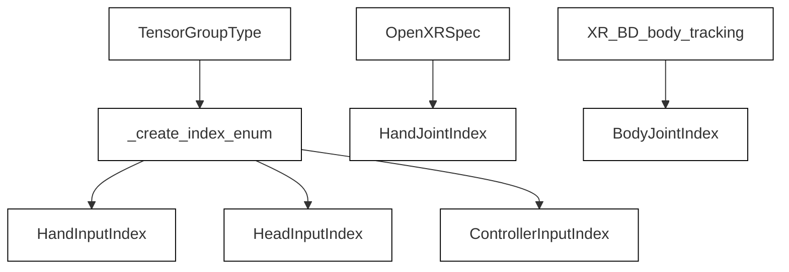
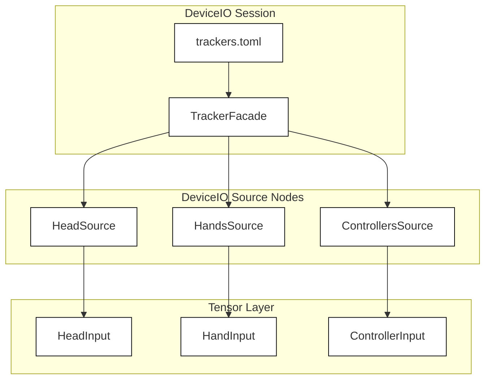
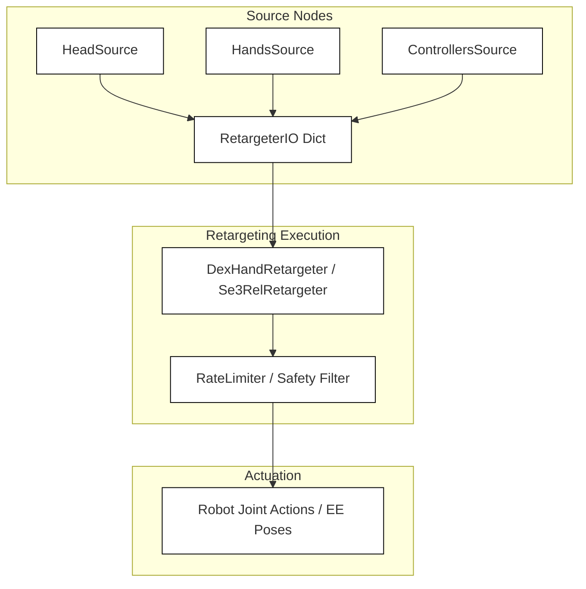

<!-- source: DeepWiki mcp.deepwiki.com · repo NVIDIA/IsaacCapture · page 5.2 Retargeting Engine · fetched 2026-10-26 -->

# Retargeting Engine

Relevant source files

The following files were used as context for generating this wiki page:

- [src/core/deviceio_trackers/trackers.toml](src/core/deviceio_trackers/trackers.toml)
- [src/core/schema/python/CMakeLists.txt](src/core/schema/python/CMakeLists.txt)
- [src/core/schema/python/schema_module.cpp](src/core/schema/python/schema_module.cpp)
- [src/python/isaaccapture/retargeters/__init__.py](src/python/isaaccapture/retargeters/__init__.py)
- [src/python/isaaccapture/retargeters/rate_limiter.py](src/python/isaaccapture/retargeters/rate_limiter.py)
- [src/python/isaaccapture/retargeting_engine/deviceio_source_nodes/__init__.py](src/python/isaaccapture/retargeting_engine/deviceio_source_nodes/__init__.py)
- [src/python/isaaccapture/retargeting_engine/deviceio_source_nodes/deviceio_tensor_types.py](src/python/isaaccapture/retargeting_engine/deviceio_source_nodes/deviceio_tensor_types.py)
- [src/python/isaaccapture/retargeting_engine/tensor_types/__init__.py](src/python/isaaccapture/retargeting_engine/tensor_types/__init__.py)
- [src/python/isaaccapture/retargeting_engine/tensor_types/indices.py](src/python/isaaccapture/retargeting_engine/tensor_types/indices.py)
- [src/python/isaaccapture/retargeting_engine/tensor_types/standard_types.py](src/python/isaaccapture/retargeting_engine/tensor_types/standard_types.py)
- [src/python/isaaccapture/schema/__init__.py](src/python/isaaccapture/schema/__init__.py)
- [tests/cpp/core/schema/CMakeLists.txt](tests/cpp/core/schema/CMakeLists.txt)
- [tests/python/core/retargeting_engine/test_rate_limiter.py](tests/python/core/retargeting_engine/test_rate_limiter.py)
- [tests/python/core/schema/test_vehicle_io.py](tests/python/core/schema/test_vehicle_io.py)

## Purpose and Scope

The **Retargeting Engine** forms the core Python teleoperation pipeline in Isaac Teleop (`isaaccapture`). Its primary responsibility is consuming raw, type-safe telemetry and tracker data streams from DeviceIO sessions, translating them via stateless converter nodes into standardized tensor groups, and passing them through specific retargeter modules to generate robot joint commands, end-effector poses, or velocity commands.

This page covers tensor types and index mappings, DeviceIO source nodes, graph wiring principles, safety utilities, and how retargeters interact with underlying tracker tensors.

---

## 1. Tensor Types and Indexing

The retargeting engine relies on a strict type system for tensor groups (`TensorGroupType`) and scalar/ndarray fields to enforce compatibility between data producers (trackers) and consumers (retargeters).

### Standard Tensor Group Types
Standard telemetry structures mirror the underlying FlatBuffers schemas defined in core [src/core/schema/python/schema_module.cpp:35-100](). Common definitions include:
*   **`HandInput`**: Represents 26 OpenXR hand joints (`XR_HAND_JOINT_COUNT_EXT`), containing `hand_joint_positions` `(26, 3)`, `hand_joint_orientations` `(26, 4)`, `hand_joint_radii` `(26,)`, and `hand_joint_valid` `(26,)` [src/python/isaaccapture/retargeting_engine/tensor_types/standard_types.py:19-87]().
*   **`HeadInput`**: Captures head position `(3,)`, head orientation `(4,)`, and validity/tracking flags [src/python/isaaccapture/retargeting_engine/tensor_types/standard_types.py:122-151]().
*   **`ControllerInput`**: Provides grip/aim poses alongside primary, secondary, thumbstick, trigger, and squeeze analog inputs [src/python/isaaccapture/retargeting_engine/tensor_types/standard_types.py:159-184]().

### Payload Tensor Handles
Trackers wrap encoded FlatBuffer payloads via `_PayloadTensorType` classes. Inactive devices safely manifest as `None` rather than empty buffers, whereas required payloads subclass `_RequiredPayloadTensorType` [src/python/isaaccapture/retargeting_engine/deviceio_source_nodes/deviceio_tensor_types.py:34-76](). Examples include:
*   `HeadPoseTrackedType` and `HandPoseTrackedType` [src/python/isaaccapture/retargeting_engine/deviceio_source_nodes/deviceio_tensor_types.py:77-86]()
*   `ControllerSnapshotTrackedType` [src/python/isaaccapture/retargeting_engine/deviceio_source_nodes/deviceio_tensor_types.py:89-92]()
*   `Generic3AxisPedalOutputTrackedType` [src/python/isaaccapture/retargeting_engine/deviceio_source_nodes/deviceio_tensor_types.py:95-98]()

### Dynamic Index Enumerations
To prevent magic numbers when slicing or indexing into tensor arrays, `indices.py` dynamically generates `IntEnum` mappings from `TensorGroupType` definitions alongside standard hardware layouts like `HandJointIndex` (26 joints) and `BodyJointIndex` (24 joints following `XR_BD_body_tracking`) [src/python/isaaccapture/retargeting_engine/tensor_types/indices.py:29-118]().

*Sources: [src/python/isaaccapture/retargeting_engine/tensor_types/standard_types.py:18-87](), [src/python/isaaccapture/retargeting_engine/deviceio_source_nodes/deviceio_tensor_types.py:34-76](), [src/python/isaaccapture/retargeting_engine/tensor_types/indices.py:29-118]()*

---

## 2. DeviceIO Source Nodes

DeviceIO source nodes act as stateless bridges between raw tracker streams (configured via `trackers.toml`) and the Python retargeting engine. They extract encoded FlatBuffers messages and unpack them into engine-compatible tensors.

Available source implementations in `deviceio_source_nodes` include:
*   `HeadSource` and `HandsSource`: Parse OpenXR head and hand tracking inputs [src/python/isaaccapture/retargeting_engine/deviceio_source_nodes/__init__.py:10-11]()
*   `ControllersSource`: Extracts controller grip/aim matrices and button states [src/python/isaaccapture/retargeting_engine/deviceio_source_nodes/__init__.py:12]()
*   `Generic3AxisPedalSource`: Handles 3-axis pedal inputs [src/python/isaaccapture/retargeting_engine/deviceio_source_nodes/__init__.py:13]()
*   `SpaceMouseSource` & `KeyboardSource`: Support 6-DoF input pucks and hotkey/command mapping [src/python/isaaccapture/retargeting_engine/deviceio_source_nodes/__init__.py:14-29]()

*Sources: [src/core/deviceio_trackers/trackers.toml:4-108](), [src/python/isaaccapture/retargeting_engine/deviceio_source_nodes/__init__.py:8-37]*

---

## 3. Graph Wiring and Data Flow

Retargeters consume input dictionaries (`RetargeterIO`) populated by source nodes, apply spatial math, IK solvers, or direct mapping rules, and output target actuation commands. Because device tracking can intermittently drop out, inputs are frequently wrapped in optional tensor types (`OptionalType`), ensuring pipeline survivability during tracking losses [src/python/isaaccapture/retargeters/__init__.py:31-34]().

*Sources: [src/python/isaaccapture/retargeters/__init__.py:31-44](), [src/python/isaaccapture/retargeting_engine/deviceio_source_nodes/__init__.py:8-37]*

---

## 4. Utilities and Safety Harnesses

To protect hardware targets from erratic teleoperation commands, the retargeting engine provides wrapper utilities and safety filters:
*   **Rate Limiters**: `EePoseRateLimiter` and `JointRateLimiter` enforce velocity and acceleration constraints on end-effector poses and joint action streams [src/python/isaaccapture/retargeters/__init__.py:31-32]().
*   **Tensor Reordering**: `TensorReorderer` flattens and reorders multiple disparate tensor inputs into a unified flat vector [src/python/isaaccapture/retargeters/__init__.py:39]().
*   **Spatial & Tactile Primitives**: Composable spatial modules (`Vector3FrameTransform`, `WorldForceAccumulator`, `MagnitudeReducer`) process tactile and haptic feedback loops [src/python/isaaccapture/retargeters/__init__.py:40-43]().

*Sources: [src/python/isaaccapture/retargeters/__init__.py:31-44]*

---

