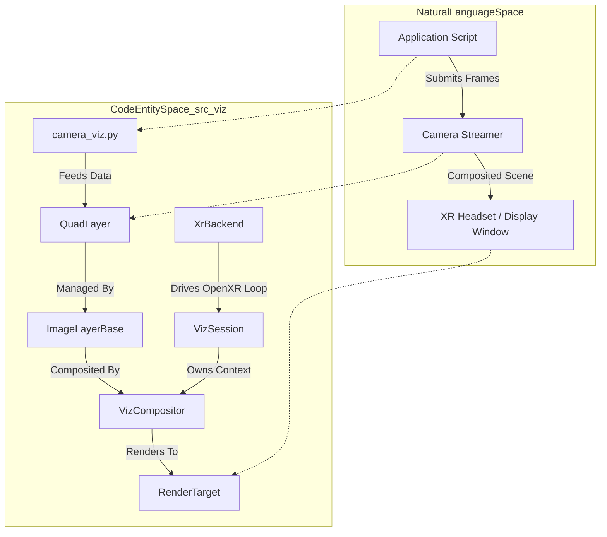

<!-- source: DeepWiki mcp.deepwiki.com · repo NVIDIA/IsaacCapture · page 6 Visualization (Televiz and Robot Twin) · fetched 2026-10-26 -->

# Visualization (Televiz and Robot Twin)

Relevant source files

The following files were used as context for generating this wiki page:

- [docs/source/_static/camera-viz-controls.png](docs/source/_static/camera-viz-controls.png)
- [docs/source/_static/camera-viz-controls.png.license](docs/source/_static/camera-viz-controls.png.license)
- [docs/source/getting_started/televiz.rst](docs/source/getting_started/televiz.rst)
- [docs/source/references/camera_streaming.rst](docs/source/references/camera_streaming.rst)
- [examples/camera_viz/README.md](examples/camera_viz/README.md)
- [examples/camera_viz/camera_viz.sh](examples/camera_viz/camera_viz.sh)
- [examples/camera_viz/scripts/_install_deps.sh](examples/camera_viz/scripts/_install_deps.sh)
- [examples/camera_viz/scripts/camera-streamer.service.in](examples/camera_viz/scripts/camera-streamer.service.in)
- [src/core/python/generate_stubs.py](src/core/python/generate_stubs.py)
- [src/viz/AGENTS.md](src/viz/AGENTS.md)
- [src/viz/CMakeLists.txt](src/viz/CMakeLists.txt)
- [src/viz/core/cpp/CMakeLists.txt](src/viz/core/cpp/CMakeLists.txt)
- [src/viz/core/cpp/inc/viz/core/viz_buffer.hpp](src/viz/core/cpp/inc/viz/core/viz_buffer.hpp)
- [src/viz/core/cpp/inc/viz/core/vk_context.hpp](src/viz/core/cpp/inc/viz/core/vk_context.hpp)
- [src/viz/core/cpp/render_target.cpp](src/viz/core/cpp/render_target.cpp)
- [src/viz/core/cpp/vk_context.cpp](src/viz/core/cpp/vk_context.cpp)
- [src/viz/python/CMakeLists.txt](src/viz/python/CMakeLists.txt)
- [src/viz/python/core_bindings.cpp](src/viz/python/core_bindings.cpp)
- [src/viz/python/viz_bindings.cpp](src/viz/python/viz_bindings.cpp)
- [src/viz/session/cpp/CMakeLists.txt](src/viz/session/cpp/CMakeLists.txt)

This page provides an overview of the ``isaaccapture.viz`` module (Televiz) and the robot twin visualization components under `src/viz/`. Televiz is the high-performance Vulkan, CUDA, and OpenXR compositor used by Isaac Teleop to assemble stereo camera feeds, sensor data, and 3D assets into a single presentation frame delivered to an XR headset or display window [docs/source/getting_started/televiz.rst:7-17](), [src/viz/AGENTS.md:16-74]().

As a parent page, this section outlines the high-level responsibilities of the visualization stack. For comprehensive instructions and implementation details, refer to the child pages:
- [Viz Session, Backends and Layers](#6.1)
- [Camera Streaming Pipeline](#6.2)
- [Robot Visualization HUD](#6.3)

---

## Viz Session, Backends, and Layers

The central runtime object in Televiz is `VizSession`, which manages the underlying Vulkan graphics context, display targets, OpenXR state (when running in headset mode), and a registry of compositing layers [docs/source/getting_started/televiz.rst:46-52](), [src/viz/AGENTS.md:41-68](). Sessions can be configured to run in three distinct display modes: `kXr` (OpenXR stereo swapchains), `kWindow` (GLFW desktop window), and `kOffscreen` (headless rendering with host readback) [docs/source/getting_started/televiz.rst:75-94]().

Content producers submit GPU-resident image buffers via CUDA-Vulkan interoperability to various concrete layer types, including `QuadLayer`, `CylinderLayer`, `EquirectLayer`, and `ProjectionLayer` [docs/source/getting_started/televiz.rst:54-69](), [src/viz/AGENTS.md:41-58](). Shaders are compiled from GLSL to SPIR-V at build time using `glslangValidator` [src/viz/AGENTS.md:76-83]().

For detailed information on session lifecycle, swapchain management, display backends, and layer configurations, see [Viz Session, Backends and Layers](#6.1).

Sources: [docs/source/getting_started/televiz.rst:46-94](), [src/viz/AGENTS.md:16-83]()

---

## Camera Streaming Pipeline

The `camera_viz` sample serves as the reference implementation for streaming multi-camera streams into Televiz [docs/source/references/camera_streaming.rst:7-17](), [examples/camera_viz/README.md:6-8](). It supports direct capture from local hardware sources—such as V4L2 webcams, OAK-D, ZED cameras, synthetic generators, or recorded video files—as well as split-mode network transport using RTP H.264 codecs over wired Ethernet links [docs/source/references/camera_streaming.rst:7-12](), [examples/camera_viz/README.md:10-23]().

On Jetson-based robot platforms, the sender runs as a managed `systemd` service deployed via automated deployment scripts, allowing low-latency remote video feeds to be consumed by workstation-hosted operator headsets [examples/camera_viz/README.md:78-104](), [examples/camera_viz/scripts/camera-streamer.service.in:7-23]().

For complete setup guides, camera options, encoding configs, and Jetson deployment workflows, see [Camera Streaming Pipeline](#6.2).

Sources: [docs/source/references/camera_streaming.rst:7-17](), [examples/camera_viz/README.md:6-124](), [examples/camera_viz/scripts/camera-streamer.service.in:1-23]()

---

## Robot Visualization HUD

The `isaaccapture.viz.robot` sub-package provides in-headset visual feedback for teleoperation operators [src/viz/CMakeLists.txt:34-40](). It handles rendering the robot twin scene, managing 3D digital assets, drawing heads-up display (HUD) elements, and displaying clutch previews and controller guides.

This module works closely with MuJoCo-backed rendering routines and Python bindings to overlay real-time teleoperation state directly into the operator's field of view.

For details regarding scene configuration, asset loading, HUD overlays, and controller helper widgets, see [Robot Visualization HUD](#6.3).

Sources: [src/viz/CMakeLists.txt:34-40]()

---

## Visualization Architecture and Data Flow

The following diagram bridges the high-level visualization concepts to their underlying code entities within `src/viz/`:

Sources: [docs/source/getting_started/televiz.rst:46-69](), [src/viz/AGENTS.md:16-74](), [examples/camera_viz/README.md:6-26]()

---

