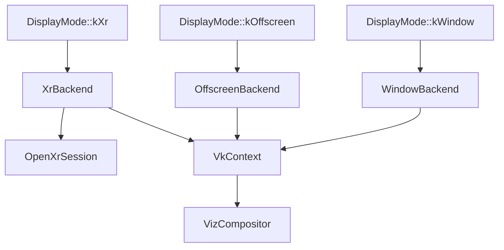
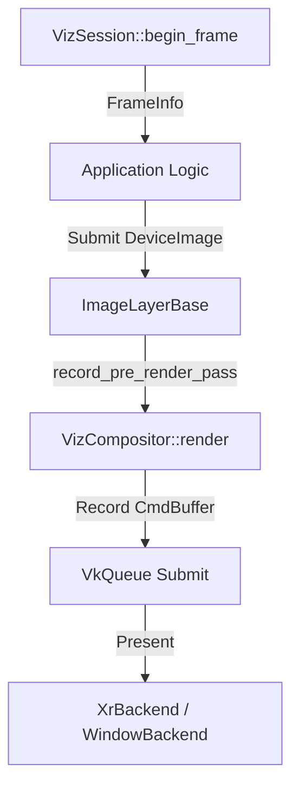

<!-- source: DeepWiki mcp.deepwiki.com · repo NVIDIA/IsaacCapture · page 6.1 Viz Session, Backends and Layers · fetched 2026-10-26 -->

# Viz Session, Backends and Layers

<details>
<summary>Relevant source files</summary>

The following files were used as context for generating this wiki page:

- [src/core/python/generate_stubs.py](src/core/python/generate_stubs.py)
- [src/viz/AGENTS.md](src/viz/AGENTS.md)
- [src/viz/CMakeLists.txt](src/viz/CMakeLists.txt)
- [src/viz/core/cpp/CMakeLists.txt](src/viz/core/cpp/CMakeLists.txt)
- [src/viz/core/cpp/device_image.cpp](src/viz/core/cpp/device_image.cpp)
- [src/viz/core/cpp/inc/viz/core/cuda_error.hpp](src/viz/core/cpp/inc/viz/core/cuda_error.hpp)
- [src/viz/core/cpp/inc/viz/core/viz_buffer.hpp](src/viz/core/cpp/inc/viz/core/viz_buffer.hpp)
- [src/viz/core/cpp/inc/viz/core/vk_context.hpp](src/viz/core/cpp/inc/viz/core/vk_context.hpp)
- [src/viz/core/cpp/render_target.cpp](src/viz/core/cpp/render_target.cpp)
- [src/viz/core/cpp/vk_context.cpp](src/viz/core/cpp/vk_context.cpp)
- [src/viz/layers/cpp/image_layer_base.cpp](src/viz/layers/cpp/image_layer_base.cpp)
- [src/viz/layers/cpp/inc/viz/layers/quad_layer.hpp](src/viz/layers/cpp/inc/viz/layers/quad_layer.hpp)
- [src/viz/layers/cpp/projection_layer.cpp](src/viz/layers/cpp/projection_layer.cpp)
- [src/viz/layers/cpp/quad_layer.cpp](src/viz/layers/cpp/quad_layer.cpp)
- [src/viz/python/CMakeLists.txt](src/viz/python/CMakeLists.txt)
- [src/viz/python/bindings_helpers.hpp](src/viz/python/bindings_helpers.hpp)
- [src/viz/python/core_bindings.cpp](src/viz/python/core_bindings.cpp)
- [src/viz/python/layers_bindings.cpp](src/viz/python/layers_bindings.cpp)
- [src/viz/python/session_bindings.cpp](src/viz/python/session_bindings.cpp)
- [src/viz/python/viz_bindings.cpp](src/viz/python/viz_bindings.cpp)
- [src/viz/session/cpp/CMakeLists.txt](src/viz/session/cpp/CMakeLists.txt)
- [src/viz/session/cpp/inc/viz/session/display_backend.hpp](src/viz/session/cpp/inc/viz/session/display_backend.hpp)
- [src/viz/session/cpp/inc/viz/session/layer_base.hpp](src/viz/session/cpp/inc/viz/session/layer_base.hpp)
- [src/viz/session/cpp/inc/viz/session/viz_session.hpp](src/viz/session/cpp/inc/viz/session/viz_session.hpp)
- [src/viz/session/cpp/inc/viz/session/xr_backend.hpp](src/viz/session/cpp/inc/viz/session/xr_backend.hpp)
- [src/viz/session/cpp/viz_compositor.cpp](src/viz/session/cpp/viz_compositor.cpp)
- [src/viz/session/cpp/viz_session.cpp](src/viz/session/cpp/viz_session.cpp)
- [src/viz/session/cpp/xr_backend.cpp](src/viz/session/cpp/xr_backend.cpp)
- [src/viz/xr/cpp/inc/viz/xr/openxr_session.hpp](src/viz/xr/cpp/inc/viz/xr/openxr_session.hpp)
- [src/viz/xr/cpp/openxr_session.cpp](src/viz/xr/cpp/openxr_session.cpp)
- [tests/cpp/viz/core/CMakeLists.txt](tests/cpp/viz/core/CMakeLists.txt)
- [tests/cpp/viz/core/test_cuda_error.cpp](tests/cpp/viz/core/test_cuda_error.cpp)
- [tests/cpp/viz/session/test_viz_session.cpp](tests/cpp/viz/session/test_viz_session.cpp)
- [tests/cpp/viz/xr/test_openxr_session.cpp](tests/cpp/viz/xr/test_openxr_session.cpp)

</details>


## Purpose and Scope
This page covers the technical architecture and implementation details of Televiz (`src/viz/`), the real-time visualization and XR streaming subsystem of `isaaccapture`. It details the creation and lifecycle of `VizSession`, the abstraction of display backends (Window, Offscreen, and OpenXR `XrBackend`), the `VizCompositor` frame loop, layer types (`QuadLayer`, `CylinderLayer`, `EquirectLayer`, and `ProjectionLayer`), Vulkan-CUDA interop via `DeviceImage`, and shader management.

Sources: `src/viz/AGENTS.md:1-126` [src/viz/AGENTS.md]()

---

## 1. VizSession Creation and Configuration
`VizSession` serves as the top-level orchestrator for Televiz, managing the `VkContext`, `VizCompositor`, `DisplayBackend`, and the registry of active layers [src/viz/python/session_bindings.cpp:95-104](). 

Applications configure and instantiate a session via `VizSession::create(const Config& config)` [src/viz/session/cpp/viz_session.cpp:53-81](). The configuration structure `VizSession::Config` controls the display mode (`DisplayMode::kOffscreen`, `DisplayMode::kWindow`, or `DisplayMode::kXr`), window dimensions, application name, near/far Z planes for depth buffering, physical device indexing, and GPU timing queries [src/viz/python/session_bindings.cpp:65-92]().

```cpp
// Example C++ session initialization
viz::VizSession::Config cfg{};
cfg.mode = viz::DisplayMode::kXr;
cfg.app_name = "isaaccapture_teleop";
auto session = viz::VizSession::create(cfg);
```

Sources: `src/viz/python/session_bindings.cpp:63-144](), [src/viz/session/cpp/viz_session.cpp:52-146]()`

---

## 2. Display Backends: XR vs Display
Televiz decouples the rendering output via the `DisplayBackend` virtual interface [src/viz/session/cpp/inc/viz/session/display_backend.hpp](). Three concrete subclasses implement target-specific presentation mechanisms:

* `WindowBackend`: Manages a GLFW window and a swapchain for desktop display [src/viz/session/cpp/window_backend.hpp]().
* `OffscreenBackend`: Allocates target framebuffers without a window surface, used for headless rendering and data recording.
* `XrBackend`: Integrates with OpenXR via `OpenXrSession` to handle HMD tracking, view configurations, swapchain creation, and frame loop synchronization (`xrWaitFrame`, `xrBeginFrame`, `xrEndFrame`) [src/viz/xr/cpp/inc/viz/xr/openxr_session.hpp](), [src/viz/session/cpp/xr_backend.cpp]().

### Backend Architecture & Code Mapping

Sources: `src/viz/session/cpp/viz_session.cpp:22-51](), [src/viz/xr/cpp/inc/viz/xr/openxr_session.hpp:34-48]()`

---

## 3. Compositor and Frame Loop
The `VizCompositor` drives the render loop, recording command buffers, synchronizing frame slots with `FrameSync`, and managing GPU timestamp query pools for performance instrumentation [src/viz/session/cpp/viz_compositor.cpp:37-131]().

### Frame Loop Lifecycle
1. **`begin_frame()`**: Queries backend swapchain images, polls events (including OpenXR runtime events and window callbacks), and computes `FrameInfo` containing per-eye view matrices, projection matrices, and predicted display times [src/viz/python/session_bindings.cpp:36-46](), [src/viz/session/cpp/viz_session.cpp:203-230]().
2. **`render()`**: Pre-passes and records drawing commands for all visible layers (`LayerBase::record_pre_render_pass()` and `LayerBase::record()`) into the command buffer associated with the current in-flight slot [src/viz/session/cpp/viz_compositor.cpp:194-270]().
3. **`end_frame()`**: Submits command buffers to the Vulkan queue with appropriate semaphore signals and presents the frame to the backend swapchain or OpenXR composition layers.

### Frame Loop Data Flow

Sources: `src/viz/session/cpp/viz_compositor.cpp:37-270](), [src/viz/session/cpp/viz_session.cpp:203-280]()`

---

## 4. Layers Catalog
Layers render visual content into the scene. They are owned by `VizSession` and created via helper methods such as `add_quad_layer()` [src/viz/python/session_bindings.cpp:134-144]().

* `LayerBase`: Base class for all renderable entities, providing visibility toggles and command recording hooks [src/viz/session/cpp/inc/viz/session/layer_base.hpp]().
* `ImageLayerBase`: Intermediate base class for image-based layers, implementing a multi-buffered mailbox pattern (`DeviceImage`) to ingest CUDA device buffers asynchronously [src/viz/AGENTS.md:41-50]().
* `QuadLayer`: Renders a CUDA-fed RGBA8 texture either as a 2D screen overlay or a 3D world-space rectangle with optional mipmap generation and stereo baseline offsets [src/viz/layers/cpp/inc/viz/layers/quad_layer.hpp:26-38](). Supports native OpenXR composition via `XrCompositionLayerQuad` when `openxr_composition = true` [src/viz/layers/cpp/inc/viz/layers/quad_layer.hpp:91-110]().
* `CylinderLayer`: Renders wrapped spherical/cylindrical video or UI feeds using `XrCompositionLayerCylinderKHR`.
* `EquirectLayer`: Renders equirectangular 360-degree panoramas using `XrCompositionLayerEquirect2KHR`.
* `ProjectionLayer`: Standard stereo projection layer for primary world rendering.

Sources: `src/viz/python/layers_bindings.cpp:35-78](), [src/viz/layers/cpp/inc/viz/layers/quad_layer.hpp:26-121]()`

---

## 5. CUDA-Vulkan Interop and Device Images
The `DeviceImage` class bridges CUDA and Vulkan memory spaces. It wraps a Vulkan `VkImage` allocated with external memory handles and maps it to a `cudaArray_t` via CUDA external memory APIs [src/viz/core/cpp/device_image.cpp:126-191]().

* **Format Mapping**: Storage formats use unorm configurations (e.g., `VK_FORMAT_R8G8B8A8_UNORM`) so CUDA writes raw byte values without implicit gamma transformations, while Vulkan sampling views apply sRGB-to-linear conversions [src/viz/core/cpp/device_image.cpp:81-110]().
* **Synchronization**: Uses timeline semaphores (`cuda_done_writing`) to coordinate producer-consumer handoffs between CUDA kernels writing frame data and the Vulkan compositor reading textures [src/viz/AGENTS.md:21-27]().

Sources: `src/viz/core/cpp/device_image.cpp:1-191]()`

---

## 6. Shaders and Python Bindings
* **Shaders**: GLSL source files (such as `textured_quad.vert` and `textured_quad.frag`) are compiled at build time into SPIR-V headers (`.spv.h`) containing inline `constexpr` byte arrays (`viz_shaders` interface library) [src/viz/AGENTS.md:76-83]().
* **Python Bindings**: Exposed via the `_viz` pybind11 module (`isaaccapture.viz`), binding `VizSession`, layer configs (`QuadLayerConfig`), and data types (`VizBuffer`, `FrameInfo`) [src/viz/python/viz_bindings.cpp](), [src/viz/python/session_bindings.cpp](), [src/viz/python/layers_bindings.cpp]().

Sources: `src/viz/AGENTS.md:75-83](), [src/viz/python/layers_bindings.cpp:1-139]()`

---

