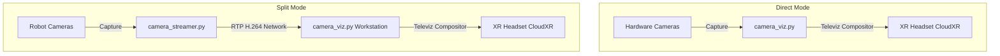
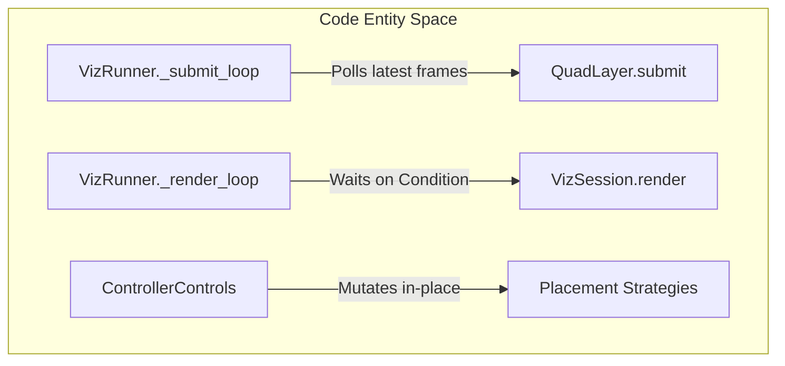

<!-- source: DeepWiki mcp.deepwiki.com · repo NVIDIA/IsaacCapture · page 6.2 Camera Streaming Pipeline · fetched 2026-10-26 -->

# Camera Streaming Pipeline

<details>
<summary>Relevant source files</summary>

The following files were used as context for generating this wiki page:

- [docs/source/_static/camera-viz-controls.png](docs/source/_static/camera-viz-controls.png)
- [docs/source/_static/camera-viz-controls.png.license](docs/source/_static/camera-viz-controls.png.license)
- [docs/source/getting_started/televiz.rst](docs/source/getting_started/televiz.rst)
- [docs/source/references/camera_streaming.rst](docs/source/references/camera_streaming.rst)
- [examples/camera_viz/README.md](examples/camera_viz/README.md)
- [examples/camera_viz/camera_viz.py](examples/camera_viz/camera_viz.py)
- [examples/camera_viz/camera_viz.sh](examples/camera_viz/camera_viz.sh)
- [examples/camera_viz/configs/multi_camera.yaml](examples/camera_viz/configs/multi_camera.yaml)
- [examples/camera_viz/configs/oakd.yaml](examples/camera_viz/configs/oakd.yaml)
- [examples/camera_viz/configs/realsense.yaml](examples/camera_viz/configs/realsense.yaml)
- [examples/camera_viz/configs/replay.yaml](examples/camera_viz/configs/replay.yaml)
- [examples/camera_viz/configs/synthetic.yaml](examples/camera_viz/configs/synthetic.yaml)
- [examples/camera_viz/configs/synthetic_stereo.yaml](examples/camera_viz/configs/synthetic_stereo.yaml)
- [examples/camera_viz/configs/synthetic_xr_3up.yaml](examples/camera_viz/configs/synthetic_xr_3up.yaml)
- [examples/camera_viz/configs/v4l2.yaml](examples/camera_viz/configs/v4l2.yaml)
- [examples/camera_viz/configs/zed.yaml](examples/camera_viz/configs/zed.yaml)
- [examples/camera_viz/display.py](examples/camera_viz/display.py)
- [examples/camera_viz/pipeline/interface.py](examples/camera_viz/pipeline/interface.py)
- [examples/camera_viz/pipeline/runner.py](examples/camera_viz/pipeline/runner.py)
- [examples/camera_viz/placements/__init__.py](examples/camera_viz/placements/__init__.py)
- [examples/camera_viz/placements/_math.py](examples/camera_viz/placements/_math.py)
- [examples/camera_viz/placements/lock_modes.py](examples/camera_viz/placements/lock_modes.py)
- [examples/camera_viz/pyproject.toml](examples/camera_viz/pyproject.toml)
- [examples/camera_viz/scripts/_install_deps.sh](examples/camera_viz/scripts/_install_deps.sh)
- [examples/camera_viz/scripts/camera-streamer.service.in](examples/camera_viz/scripts/camera-streamer.service.in)
- [examples/camera_viz/scripts/check_cuda.py](examples/camera_viz/scripts/check_cuda.py)
- [examples/camera_viz/sources/__init__.py](examples/camera_viz/sources/__init__.py)
- [examples/camera_viz/sources/_helpers.py](examples/camera_viz/sources/_helpers.py)
- [examples/camera_viz/sources/oakd.py](examples/camera_viz/sources/oakd.py)
- [examples/camera_viz/sources/rtp_h264.py](examples/camera_viz/sources/rtp_h264.py)
- [examples/camera_viz/sources/synthetic.py](examples/camera_viz/sources/synthetic.py)
- [examples/camera_viz/sources/zed.py](examples/camera_viz/sources/zed.py)
- [tests/python/examples/camera_viz/test_cuda_setup.py](tests/python/examples/camera_viz/test_cuda_setup.py)
- [tests/python/examples/camera_viz/test_synthetic_failures.py](tests/python/examples/camera_viz/test_synthetic_failures.py)

</details>


The `camera_viz` reference example (`[examples/camera_viz/camera_viz.py:1-16]()`) implements the camera streaming and visualization pipeline for Isaac Teleop. It captures frames from local cameras, video files, or RTP H.264 network streams, processes them via zero-copy GPU memory handlers, and composites them into stereo XR headset viewports using Televiz (`isaaccapture.viz`) (`[docs/source/references/camera_streaming.rst:7-14]`).

---

## 1. Architectural Modes: Direct vs. Split RTP

The pipeline operates in two core configurations defined by the session source mode (`[examples/camera_viz/README.md:10-14]()`):

*   **Direct Mode (`source: local`):** The workstation hosts the camera hardware locally (USB UVC, OAK-D, ZED, or synthetic generators) and feeds the Televiz compositor directly.
*   **Split Mode (`source: rtp`):** A Jetson robot runs a dedicated sender process (`camera_streamer.py`) that encodes frames via hardware NVENC and streams RTP H.264 over a wired network to a workstation receiver running `camera_viz.py`.


*Sources: [docs/source/references/camera_streaming.rst:7-14](), [examples/camera_viz/README.md:10-14](), [examples/camera_viz/camera_viz.py:1-16]()*

---

## 2. Camera Sources and Zero-Copy Pipelines

All hardware vendor sources inherit from `PolledSource` (`[examples/camera_viz/sources/_helpers.py:139-179]()`), which decouples device acquisition from rendering using a producer thread, page-locked pinned host staging buffers (`alloc_pinned_host`), and a triple-buffered CuPy device mailbox (`[examples/camera_viz/sources/_helpers.py:114-179]()`).

```mermaid
graph TD
    subgraph "Code Entity Space"
        H[_OakdDevice] -->|DepthAI SDK| I[_StreamSlot]
        J[_ZedCamera] -->|pyzed MEM.GPU| K[_EyeSlot]
        L[PolledSource] -->|Async H2D| M[Frame CuPy Mailbox]
        M -->|latest()| N[VizRunner]
    end
```
*Sources: [examples/camera_viz/sources/_helpers.py:114-179](), [examples/camera_viz/sources/oakd.py:115-179](), [examples/camera_viz/sources/zed.py:121-202]()*

### Supported Sources

*   **Synthetic (`type: synthetic`):** GPU test pattern generator supporting mono and stereo disparity offsets without hardware requirements (`[examples/camera_viz/README.md:15-24]()`).
*   **V4L2 (`type: v4l2`):** USB / UVC webcams accessed via OpenCV/V4L2 controls (`[examples/camera_viz/README.md:15-24]()`, `[examples/camera_viz/configs/v4l2.yaml:22-35]()`).
*   **OAK-D (`type: oakd`):** Luxonis depthai cameras. `_OakdDevice` (`[examples/camera_viz/sources/oakd.py:115-179]()`) manages a unified `dai.Device` and multiple stream slots (`left`, `right`, `rgb`), broadcasting GRAY8/BGR streams to RGBA via CUDA streams (`[examples/camera_viz/sources/oakd.py:58-113]()`).
*   **ZED (`type: zed`):** Stereolabs ZED cameras. `_ZedCamera` (`[examples/camera_viz/sources/zed.py:121-202]()`) leverages `pyzed.sl.Mat` with `MEM.GPU` (`[examples/camera_viz/sources/zed.py:6-9]()`), enabling **zero H2D transfer overhead** by performing direct GPU-to-GPU channel swaps (`[examples/camera_viz/sources/zed.py:93-100]()`).
*   **Video Replay (`type: video`):** Replays recorded media files (MP4/MKV) through the same pipeline as live cameras for testing and validation (`[examples/camera_viz/README.md:15-24]`, `[examples/camera_viz/configs/replay.yaml:9-40]()`).

*Sources: [examples/camera_viz/README.md:15-24](), [examples/camera_viz/configs/v4l2.yaml:22-35](), [examples/camera_viz/sources/oakd.py:58-179](), [examples/camera_viz/sources/zed.py:6-202]()*

---

## 3. RTP H.264 Transports and Codecs

In split-mode deployments, streams are encoded and transported via GStreamer pipelines or native NVIDIA hardware encoder bindings (`NVENC`/`NVDEC`).

*   **Configuration:** The top-level YAML config specifies the encoder engine (`auto`, `native`, or `gstreamer`) and RTP port parameters per camera (`[examples/camera_viz/configs/v4l2.yaml:16-35]()`).
*   **Provisioning:** RTP and GStreamer bindings (`PyGObject`, `gstreamer1.0-tools`, `gir1.2-gstreamer-1.0`) are installed via the provisioning script when the `--with-rtp` or `--sender-only` flag is passed (`[examples/camera_viz/scripts/_install_deps.sh:85-138]()`).

*Sources: [examples/camera_viz/configs/v4l2.yaml:16-35](), [examples/camera_viz/scripts/_install_deps.sh:85-138]()*

---

## 4. Compositor, Placements, and Lock Modes

The runtime loop is managed by `VizRunner` (`[examples/camera_viz/pipeline/runner.py:72-136]()`), which runs concurrent worker threads to guarantee low-latency submission and rendering.


*Sources: [examples/camera_viz/pipeline/runner.py:72-136](), [examples/camera_viz/camera_viz.py:69-88]() *

### Compositor Layers and Lock Modes

*   **Televiz Layers:** Camera streams are bound to `QuadLayer` (`[docs/source/getting_started/televiz.rst:54-57]()`), `CylinderLayer` (`[docs/source/getting_started/televiz.rst:58-60]()`), or `EquirectLayer` (`[docs/source/getting_started/televiz.rst:61-63]()`) instances owned by `VizSession` (`[docs/source/getting_started/televiz.rst:49-52]()`).
*   **Lock Modes:** Placements define how virtual screens anchor relative to the operator (`world`, `head`, `lazy`, or `gimbal`) (`[examples/camera_viz/README.md:25]`, `[examples/camera_viz/configs/v4l2.yaml:49-52]()`).

*Sources: [docs/source/getting_started/televiz.rst:49-67](), [examples/camera_viz/pipeline/runner.py:72-136](), [examples/camera_viz/configs/v4l2.yaml:49-52]()*

---

## 5. Configuration and Jetson Service Deployment

The entry point script `camera_viz.sh` provides a unified interface for local setup, execution, and remote Jetson robot deployment (`[examples/camera_viz/camera_viz.sh:5-18]()`).

### Workflow Commands

| Command | Action |
| :--- | :--- |
| `./camera_viz.sh setup` | Provisions virtual environment via `uv`, resolves `isaaccapture[cloudxr]`, and checks system dependencies (`[examples/camera_viz/camera_viz.sh:9]`, `[examples/camera_viz/README.md:36-40]()`). |
| `./camera_viz.sh run CONFIG` | Starts the camera viewer in XR or window mode (`[examples/camera_viz/camera_viz.sh:11]()`). |
| `./camera_viz.sh loopback CONFIG` | Runs local sender and receiver on `127.0.0.1` for end-to-end RTP validation (`[examples/camera_viz/README.md:105-108]()`). |
| `./camera_viz.sh deploy CONFIG` | Rsyncs code to the Jetson robot, installs sender dependencies, and configures the `camera-streamer` systemd user service (`[examples/camera_viz/README.md:96-104]()`). |

*Sources: [examples/camera_viz/camera_viz.sh:5-18](), [examples/camera_viz/README.md:36-108]() *

---

