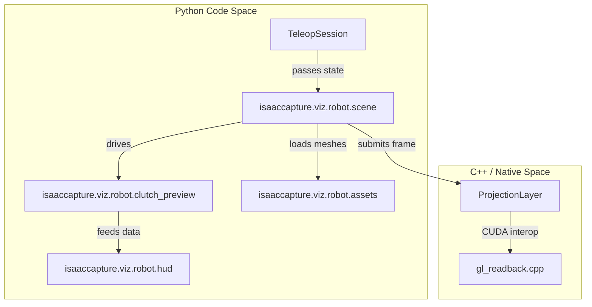
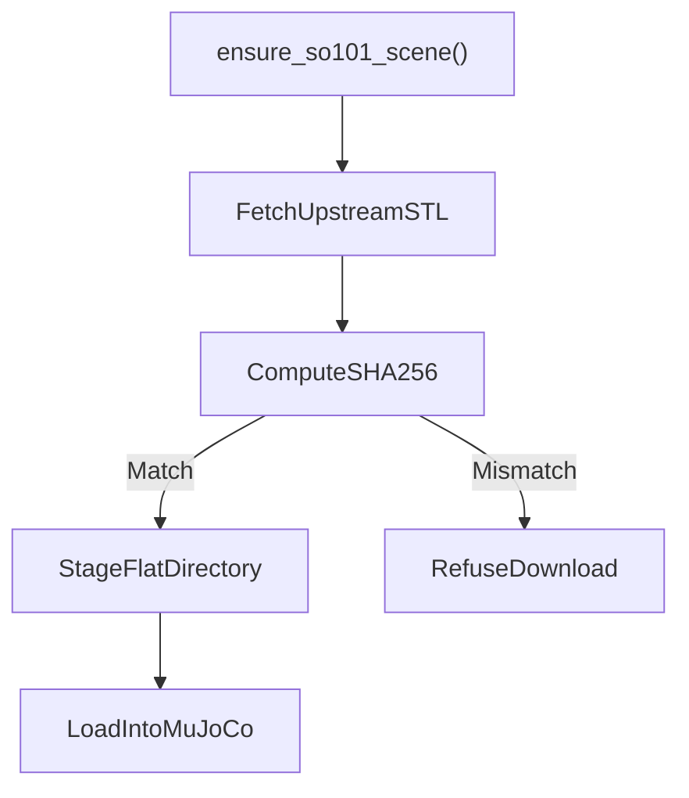
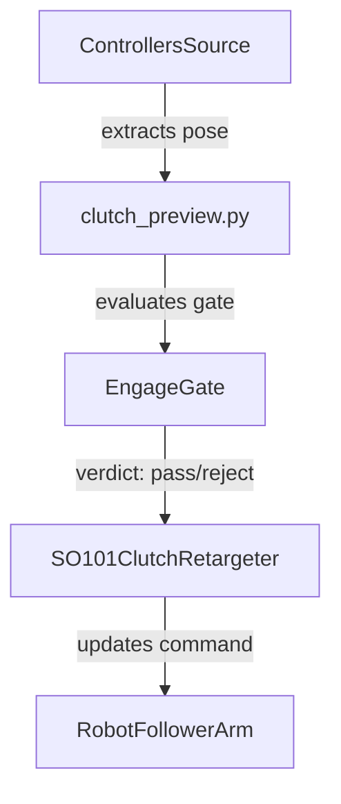

<!-- source: DeepWiki mcp.deepwiki.com · repo NVIDIA/IsaacCapture · page 6.3 Robot Visualization HUD · fetched 2026-10-26 -->

# Robot Visualization HUD

Relevant source files

The following files were used as context for generating this wiki page:

- [docs/AGENTS.md](docs/AGENTS.md)
- [docs/source/references/migration.rst](docs/source/references/migration.rst)
- [examples/robot_viz/README.md](examples/robot_viz/README.md)
- [examples/robot_viz/pyproject.toml](examples/robot_viz/pyproject.toml)
- [pyproject.toml](pyproject.toml)
- [src/core/python/requirements-cloudxr.txt](src/core/python/requirements-cloudxr.txt)
- [src/python/CMakeLists.txt](src/python/CMakeLists.txt)
- [src/python/isaaccapture/teleop_session_manager/config.py](src/python/isaaccapture/teleop_session_manager/config.py)
- [src/python/isaaccapture/teleop_session_manager/teleop_session.py](src/python/isaaccapture/teleop_session_manager/teleop_session.py)
- [src/python/isaaccapture/viz/robot/__init__.py](src/python/isaaccapture/viz/robot/__init__.py)
- [src/python/isaaccapture/viz/robot/assets.py](src/python/isaaccapture/viz/robot/assets.py)
- [src/python/isaaccapture/viz/robot/clutch_preview.py](src/python/isaaccapture/viz/robot/clutch_preview.py)
- [src/python/isaaccapture/viz/robot/controller-guide-disengaged.png](src/python/isaaccapture/viz/robot/controller-guide-disengaged.png)
- [src/python/isaaccapture/viz/robot/controller-guide-engaged.png](src/python/isaaccapture/viz/robot/controller-guide-engaged.png)
- [src/python/isaaccapture/viz/robot/hud.py](src/python/isaaccapture/viz/robot/hud.py)
- [src/python/isaaccapture/viz/robot/scene.py](src/python/isaaccapture/viz/robot/scene.py)
- [tests/python/core/cloudxr/conftest.py](tests/python/core/cloudxr/conftest.py)

## Purpose and Scope

The `isaaccapture.viz.robot` module provides in-headset feedback for teleoperation operators through a digital twin scene, dynamic asset management, clutch handoff previews, heads-up display (HUD) overlays, and controller guides [examples/robot_viz/README.md:1-10](). It operates as a pure Python interface layer that communicates state changes to a dedicated render thread while keeping MuJoCo model data (`mjModel`, `mjData`) decoupled from the core application bindings [examples/robot_viz/README.md:8-10]().

---

## 1. Module Layout and Core Components

The robot visualization subsystem is organized into several modules within `src/python/isaaccapture/viz/robot/`, working alongside the C++ compositor layers (`src/viz/robot_twin/`) [examples/robot_viz/README.md:12-16]().

| Module / Component | Code Entity / File | Role & Responsibility |
| :--- | :--- | :--- |
| **Scene Wrapper** | `isaaccapture.viz.robot.scene` | Manages the MuJoCo twin scene, frame loops, and publishes updates to the render thread [examples/robot_viz/README.md:8-10](). |
| **Asset Manager** | `isaaccapture.viz.robot.assets` | Fetches, validates (via SHA-256), and caches upstream MJCF wrappers and STL assets (SO-101, reBot) [src/python/isaaccapture/viz/robot/assets.py:4-15](). |
| **Clutch Preview** | `isaaccapture.viz.robot.clutch_preview` | Coordinates follower/leader handoff state, engage gating, and rate-limited end-effector poses [src/python/isaaccapture/viz/robot/clutch_preview.py:4-9](). |
| **HUD & Guides** | `isaaccapture.viz.robot.hud` | Renders in-headset overlays, status indicators, and interactive controller state guides [src/core/python/requirements-cloudxr.txt:7-9](). |

*Sources: [examples/robot_viz/README.md:8-14](), [src/python/isaaccapture/viz/robot/assets.py:4-15](), [src/python/isaaccapture/viz/robot/clutch_preview.py:4-9]()िज़*

---

## 2. Asset Management and Dynamic Scene Loading

The `assets.py` module handles runtime asset provisioning for supported follower arms (such as the SO-101 and reBot DevArm) [examples/robot_viz/README.md:35-37](). Upstream assets are fetched from GitHub repositories, verified against pinned cryptographic checksums, and deployed into a flat local cache directory [src/python/isaaccapture/viz/robot/assets.py:8-15]().

### Asset Verification Flow

- **Manifest Definitions**: `GHOST_ASSETS` and `SO_ARM_ASSETS` tuples specify upstream file paths, local destination names, and expected SHA-256 hashes [src/python/isaaccapture/viz/robot/assets.py:41-149]().
- **Flattening**: MuJoCo ignores nested `meshdir` attributes in included MJCF files; the asset manager stages all STLs flat while resolving filename collisions (e.g., distinguishing leader wrist rolls from follower counterparts) [src/python/isaaccapture/viz/robot/assets.py:11-37]().

*Sources: [src/python/isaaccapture/viz/robot/assets.py:8-72]()िज़*

Sources: [src/python/isaaccapture/viz/robot/assets.py:1-168](), [examples/robot_viz/README.md:33-40]()

---

## 3. Clutch Preview and Follower/Leader Handoff

The `clutch_preview.py` module implements the handoff logic between the operator's hand/controller and the robotic follower arm [src/python/isaaccapture/viz/robot/clutch_preview.py:4-9](). 

### Key Components & Data Flow
- **Hand Poses**: Utilizes `HandPose.AIM` as the primary reference frame (`HAND_POSE = HandPose.AIM`) to extract pointing rays and orientation vectors [src/python/isaaccapture/viz/robot/clutch_preview.py:62-66]().
- **Reset Button**: Binds offset resetting to the secondary controller click (`ControllerInputIndex.SECONDARY_CLICK`) mapped to `/user/hand/right/input/b/click` [src/python/isaaccapture/viz/robot/clutch_preview.py:68-71]().
- **Engage Permitted Leaf**: Evaluates `ENGAGE_PERMITTED_LEAF` (`"engage_permitted"`) to authorize clutch engagement via `SO101ClutchRetargeter` [src/python/isaaccapture/viz/robot/clutch_preview.py:73-86]().

*Sources: [src/python/isaaccapture/viz/robot/clutch_preview.py:17-48]()िज़*

Sources: [src/python/isaaccapture/viz/robot/clutch_preview.py:1-159](), [examples/robot_viz/README.md:86-92]()

---

## 4. In-Headset HUD and Controller Guides

In-headset feedback relies on visual guides and status overlays rendered into the XR session view:
- **Pillow & CuPy Integration**: On Linux platforms, `Pillow` and `cupy-cuda12x` are used to process and upload controller guide textures directly to GPU memory for low-latency XR display [src/core/python/requirements-cloudxr.txt:7-9]().
- **State Feedback**: Controller guides dynamically alternate between engaged and disengaged states (`controller-guide-engaged.png`, `controller-guide-disengaged.png`) to reflect clutch status and harness intervention bands (e.g., amber when clamping, red when rejecting, blue during unconstrained passthrough) [examples/robot_viz/README.md:89-92]().

Sources: [src/core/python/requirements-cloudxr.txt:1-9](), [examples/robot_viz/README.md:89-92]()

---

## 5. Graphics Readback and Compositor Integration

To prevent CPU bottlenecks during stereoscopic rendering, the robot twin backend uses an offscreen OpenGL readback mechanism that interfaces directly with CUDA [examples/robot_viz/README.md:12-16]().

- **Rendering**: MuJoCo renders the scene offscreen via `mjr_render`.
- **Readback (`gl_readback.cpp`)**: A fullscreen shader pass flips row orientation and adjusts depth from reverse Z (`GL_GEQUAL`) to standard depth [examples/robot_viz/README.md:14-25]().
- **Zero-Copy Interop**: Results are written into a `GL_PIXEL_PACK_BUFFER` and registered via `cudaGraphicsGLRegisterBuffer`, allowing `ProjectionLayer.submit()` to consume the GPU image pointers directly without host memory copies [examples/robot_viz/README.md:14-16]().

Sources: [examples/robot_viz/README.md:12-28]()

---

