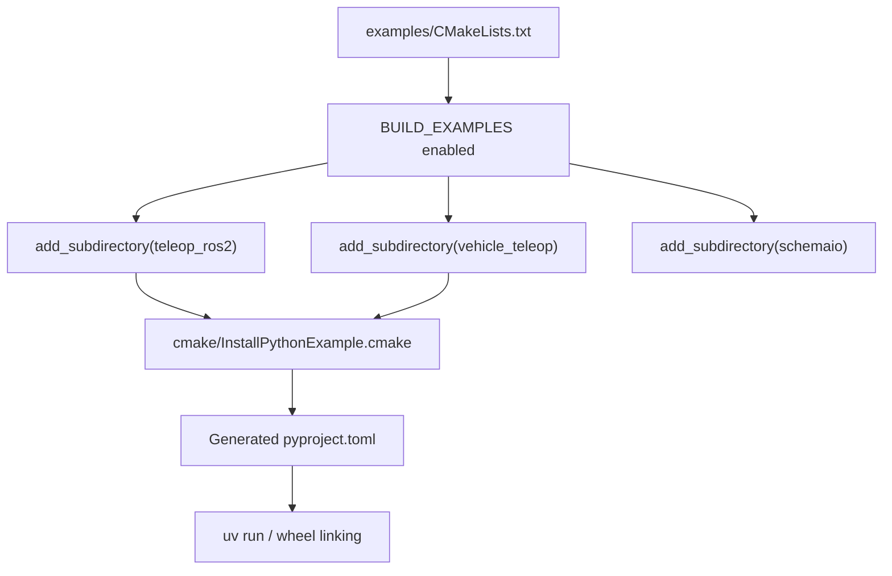
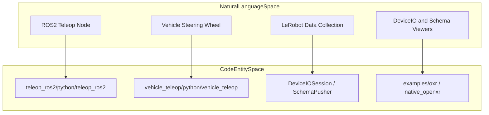

<!-- source: DeepWiki mcp.deepwiki.com · repo NVIDIA/IsaacCapture · page 7 Examples and Integrations · fetched 2026-10-26 -->

# Examples and Integrations

<details>
<summary>Relevant source files</summary>

The following files were used as context for generating this wiki page:

- [cmake/InstallPythonExample.cmake](cmake/InstallPythonExample.cmake)
- [examples/CMakeLists.txt](examples/CMakeLists.txt)
- [examples/vehicle_teleop/.gitignore](examples/vehicle_teleop/.gitignore)
- [examples/vehicle_teleop/python/vehicle_teleop/__init__.py](examples/vehicle_teleop/python/vehicle_teleop/__init__.py)

</details>


The `examples/` directory contains reference applications and domain-specific integrations that demonstrate how core runtime components—such as `DeviceIOSession`, `TeleopSession`, and OpenXR wrappers—connect with external robotics middleware, simulation platforms, vehicle controllers, and machine learning data collection pipelines. 

This page provides a high-level architectural overview of the example tree and how each integration maps to core APIs. For granular implementation details, refer to the child pages linked below.

```
examples/
├── CMakeLists.txt              # Subdirectory management and build flags
├── oxr/                        # OpenXR C++/Python primitives
├── teleop_ros2/                # ROS 2 node and reference topics
├── vehicle_teleop/             # Steering wheel and vehicle retargeting
├── schemaio/                   # Schema serialization and printing
└── ...
```

Sources: [examples/CMakeLists.txt:1-28](), [cmake/InstallPythonExample.cmake:26-103]()

---

## 1. Example Build Structure and Python Packaging

Examples in the repository are built via CMake and packaged using custom macros that generate self-contained `pyproject.toml` configurations for local execution via `uv`. The top-level `examples/CMakeLists.txt` conditionally includes subdirectories depending on CMake options like `BUILD_EXAMPLES` or `BUILD_EXAMPLE_TELEOP_ROS2` [examples/CMakeLists.txt:11-28].

The `install_python_example` macro reads source pyproject configurations, strips local source dependencies, injects pinned versions of the built `isaaccapture` wheel, and sets up path mappings (`find-links`) for isolated execution environments [cmake/InstallPythonExample.cmake:26-103].


*Figure 1: Example build routing and wheel packaging flow.*

Sources: [examples/CMakeLists.txt:11-28](), [cmake/InstallPythonExample.cmake:26-103]()

---

## 2. Integration Mapping to Core APIs

The examples bridge high-level robotics concepts to specific C++ classes and Python modules within `isaaccapture`. 


*Figure 2: Mapping natural language functional requirements to code entities.*

Sources: [examples/CMakeLists.txt:11-28]()

---

## 3. Reference Integrations and Child Pages

### ROS 2 Teleop Reference Node
The `teleop_ros2` package provides a reference bridge between Isaac Teleop sessions and ROS 2 ecosystems, translating tracking data into standard messages and handling URDF asset fetching for visualization.
* **For details, see [ROS 2 Teleop Reference Node](#7.1)**

Sources: [examples/CMakeLists.txt:11-28]()

### Vehicle Teleop
The `vehicle_teleop` application demonstrates hardware integration for steering wheels, vehicle control retargeting, command logging, and MCAP session replay.
* **For details, see [Vehicle Teleop](#7.2)**

Sources: [examples/vehicle_teleop/python/vehicle_teleop/__init__.py:1-4](), [examples/vehicle_teleop/.gitignore:1-3]()

### LeRobot and SO-101 Data Collection
Integrates leader-arm hardware (such as SO-101) and simulation workflows with the LeRobot recording pipeline to format demonstrations for GR00T training handoffs.
* **For details, see [LeRobot and SO-101 Data Collection](#7.3)**

Sources: [examples/CMakeLists.txt:11-28]()

### OpenXR, SchemaIO and DeviceIO Examples
Low-level demonstrations covering raw OpenXR session handling (`examples/oxr`), FlatBuffers schema printers (`schemaio`), web-based visualizers (`deviceio_live_view`), and haptic feedback loops.
* **For details, see [OpenXR, SchemaIO and DeviceIO Examples](#7.4)**

Sources: [examples/CMakeLists.txt:11-28]()

---

