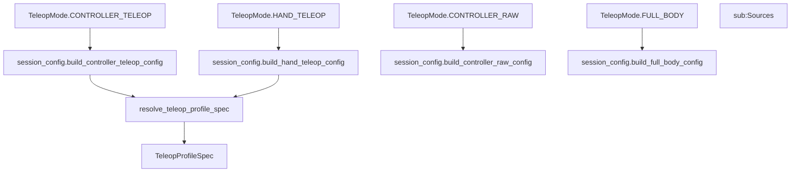
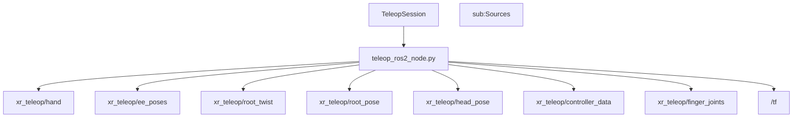
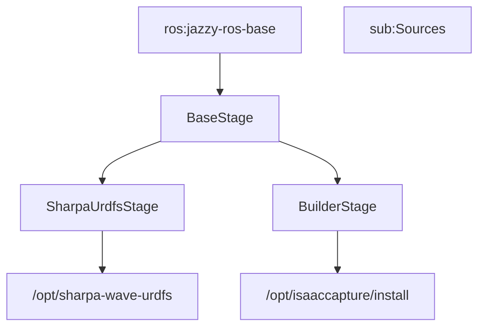
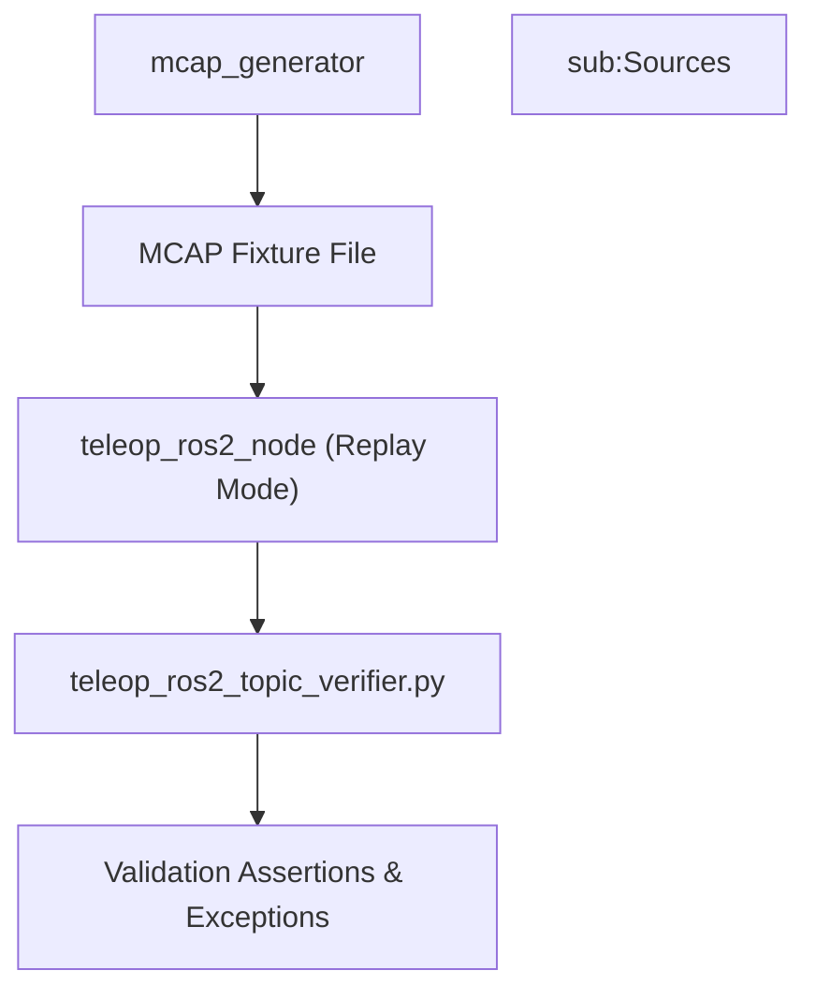

<!-- source: DeepWiki mcp.deepwiki.com · repo NVIDIA/IsaacCapture · page 7.1 ROS 2 Teleop Reference Node · fetched 2026-10-26 -->

# ROS 2 Teleop Reference Node

<details>
<summary>Relevant source files</summary>

The following files were used as context for generating this wiki page:

- [deps/cloudxr/webxr_client/helpers/TeleopProjects.ts](deps/cloudxr/webxr_client/helpers/TeleopProjects.ts)
- [examples/teleop_ros2/AGENTS.md](examples/teleop_ros2/AGENTS.md)
- [examples/teleop_ros2/CMakeLists.txt](examples/teleop_ros2/CMakeLists.txt)
- [examples/teleop_ros2/Dockerfile](examples/teleop_ros2/Dockerfile)
- [examples/teleop_ros2/Dockerfile.dockerignore](examples/teleop_ros2/Dockerfile.dockerignore)
- [examples/teleop_ros2/README.md](examples/teleop_ros2/README.md)
- [examples/teleop_ros2/assets/.gitignore](examples/teleop_ros2/assets/.gitignore)
- [examples/teleop_ros2/assets/urdf/sharpa_standalone/README.md](examples/teleop_ros2/assets/urdf/sharpa_standalone/README.md)
- [examples/teleop_ros2/configs/sharpa_wave_left_dexpilot.yml](examples/teleop_ros2/configs/sharpa_wave_left_dexpilot.yml)
- [examples/teleop_ros2/configs/sharpa_wave_right_dexpilot.yml](examples/teleop_ros2/configs/sharpa_wave_right_dexpilot.yml)
- [examples/teleop_ros2/cpp/integration_tests/mcap_generator.cpp](examples/teleop_ros2/cpp/integration_tests/mcap_generator.cpp)
- [examples/teleop_ros2/python/isaaccapture_examples/teleop_ros2/integration_tests/teleop_ros2_topic_verifier.py](examples/teleop_ros2/python/isaaccapture_examples/teleop_ros2/integration_tests/teleop_ros2_topic_verifier.py)
- [examples/teleop_ros2/scripts/fetch_sharpa_wave_urdfs.py](examples/teleop_ros2/scripts/fetch_sharpa_wave_urdfs.py)
- [src/core/python/requirements-grounding.txt](src/core/python/requirements-grounding.txt)
- [src/core/python/requirements-retargeters.txt](src/core/python/requirements-retargeters.txt)
- [tests/python/examples/teleop_ros2/test_geometry.py](tests/python/examples/teleop_ros2/test_geometry.py)
- [tests/python/examples/teleop_ros2/test_messages.py](tests/python/examples/teleop_ros2/test_messages.py)
- [tests/python/examples/teleop_ros2/test_node_parameters.py](tests/python/examples/teleop_ros2/test_node_parameters.py)
- [tests/python/examples/teleop_ros2/test_teleop_profiles.py](tests/python/examples/teleop_ros2/test_teleop_profiles.py)

</details>


## Purpose and Scope

The `teleop_ros2` package provides a reference ROS 2 publisher for Isaac Teleop data (`isaaccapture`). Hosted under `examples/` because it depends on ROS 2 and the `isaaccapture` wheel, this integration bridges OpenXR, CloudXR, and DeviceIO data streams into standard ROS 2 messages (`geometry_msgs`, `sensor_msgs`, `std_msgs`, and custom `teleop_ros2_interfaces`), enabling downstream robotic control via Isaac ROS and other ROS 2 stacks [examples/teleop_ros2/README.md:6-10](), [examples/teleop_ros2/AGENTS.md:8-10]().

---

## 1. Node Modes and Teleop Configurations

The reference node supports multiple execution modes and retargeting backends to accommodate diverse robotic hardware and input modalities.

### Mode Dispatch and Hand Retargeters
The session configuration layer maps operational modes and hand retargeter parameters to specific pipeline profiles [tests/python/examples/teleop_ros2/test_teleop_profiles.py:42-64]():
- **`controller_teleop`**: Uses controller triggers and squeezes. Default hand retargeting uses TriHand controllers, or can be overridden with DexPilot, Pink IK, or Wuji [examples/teleop_ros2/README.md:27-31]().
- **`hand_teleop`**: Retargets OpenXR hand tracking to robot hand joint commands using DexPilot Sharpa or similar retargeters, requiring a 3-axis foot pedal root command retriever [examples/teleop_ros2/README.md:12-29]().
- **`controller_raw`**: Publishes raw controller and head tracking telemetry without hand joint retargeting [tests/python/examples/teleop_ros2/test_teleop_profiles.py:47]().
- **`full_body`**: Publishes full-body tracking snapshots [tests/python/examples/teleop_ros2/test_teleop_profiles.py:48]().

Hand tracking input providers can be selected via `hand_tracking_provider`:
- `native`: Uses OpenXR runtime hand tracking or controller aim poses [examples/teleop_ros2/README.md:52-53]()
- `manus`: Integrates MANUS glove tracking with controller-to-hand calibration matrices [examples/teleop_ros2/README.md:53](), [tests/python/examples/teleop_ros2/test_geometry.py:93-104]()
- `wuji`: Uses Wuji glove hardware publishing 20 firmware-order joints (`left_thumb_j0` through `left_pinky_j3`) [examples/teleop_ros2/README.md:43-47], [53]()



Sources: [examples/teleop_ros2/README.md:12-70](), [tests/python/examples/teleop_ros2/test_teleop_profiles.py:42-64]()

---

## 2. Published Topics and Message Messages

The `teleop_ros2` node publishes standardized telemetry across several ROS 2 topics:

| Topic Name | Message Type | Description |
| :--- | :--- | :--- |
| `xr_teleop/hand` | `teleop_ros2_interfaces/msg/NamedPoseArray` | 50 joint poses (25 left, 25 right) including `WRIST`, omitting `PALM` [examples/teleop_ros2/README.md:119-120]() |
| `xr_teleop/ee_poses` | `teleop_ros2_interfaces/msg/NamedPoseArray` | End-effector poses for `left` and `right` sides [examples/teleop_ros2/README.md:121-122]() |
| `xr_teleop/root_twist` | `geometry_msgs/TwistStamped` | Root velocity command from foot pedals or input trackers [examples/teleop_ros2/README.md:12-13](), [123]() |
| `xr_teleop/root_pose` | `geometry_msgs/PoseStamped` | Root pose in world frame [examples/teleop_ros2/README.md:12-13](), [124]() |
| `xr_teleop/head_pose` | `geometry_msgs/PoseStamped` | Head tracker pose [examples/teleop_ros2/README.md:125-126]() |
| `xr_teleop/controller_data` | `std_msgs/ByteMultiArray` | Msgpack-encoded dictionary of controller state [examples/teleop_ros2/README.md:127]() |
| `xr_teleop/finger_joints` | `sensor_msgs/JointState` | Retargeted finger joint angles for the robot [examples/teleop_ros2/README.md:128-129]() |
| `/tf` | `tf2_msgs/TFMessage` | Dynamic transforms (`world_frame` to `right_wrist`, `left_wrist`, `head`) [examples/teleop_ros2/README.md:130-134]() |



Sources: [examples/teleop_ros2/README.md:117-134]()

---

## 3. Dockerfile Architecture and Build Stages

The multi-stage `Dockerfile` optimizes build caches and ensures compatibility with ROS 2 Jazzy and Python 3.12 [examples/teleop_ros2/Dockerfile:1-166]().

- **`base`**: Installs common runtime system libraries, ROS 2 base packages (`ros-jazzy-ros-base`), CycloneDDS, and `uv` via the standalone install script [examples/teleop_ros2/Dockerfile:15-60]().
- **`sharpa_urdfs`**: Uses `fetch_sharpa_wave_urdfs.py` to pull official standalone Sharpa Wave URDF configuration assets into `/opt/sharpa-wave-urdfs` [examples/teleop_ros2/Dockerfile:64-72]().
- **`builder`**: Mounts a persistent `ccache` directory, compiles C++ core utilities with `CMake`, installs the `isaaccapture` workspace, and executes `colcon build` for `teleop_ros2_interfaces` [examples/teleop_ros2/Dockerfile:76-144]().



Sources: [examples/teleop_ros2/Dockerfile:1-166]()

---

## 4. Sharpa URDF Asset Management

Hand retargeting modes (`dexpilot` and `pink_ik`) require official standalone Sharpa Wave URDF assets [examples/teleop_ros2/README.md:32-41](). 

Source-tree users and automated build jobs invoke the python helper script to fetch these files:
```bash
python3 examples/teleop_ros2/scripts/fetch_sharpa_wave_urdfs.py
```
This populates `examples/teleop_ros2/assets/urdf/sharpa_standalone/left_sharpa_wave.urdf` and `right_sharpa_wave.urdf`. Robot assets are never downloaded automatically by the node at runtime [examples/teleop_ros2/README.md:56-64]().

Sources: [examples/teleop_ros2/README.md:32-64](), [examples/teleop_ros2/Dockerfile:64-72]()

---

## 5. Integration Tests and Topic Verifier

To validate the node without live XR hardware, developers can replay MCAP fixtures generated by the C++ test utility [examples/teleop_ros2/AGENTS.md:14-15]() (`mcap_generator`) [examples/teleop_ros2/cpp/integration_tests/mcap_generator.cpp:28-33]() and verified via the Python topic verifier script [examples/teleop_ros2/python/isaaccapture_examples/teleop_ros2/integration_tests/teleop_ros2_topic_verifier.py:6-7]().

### MCAP Generator Fixture
`mcap_generator.cpp` synthesizes realistic time-varying OpenXR tracking records (controllers, hands, head, pedals, and full body) using structured joint offset tables [examples/teleop_ros2/cpp/integration_tests/mcap_generator.cpp:34-116]() and writes them to an MCAP file for offline regression testing.

### Topic Verifier Implementation
`teleop_ros2_topic_verifier.py` inspects active ROS 2 subscriptions, enforcing structural correctness, finite float values, non-collinear positions, and frame ID validity (`world`) on all published messages [examples/teleop_ros2/python/isaaccapture_examples/teleop_ros2/integration_tests/teleop_ros2_topic_verifier.py:70-101]().



Sources: [examples/teleop_ros2/AGENTS.md:14-15](), [examples/teleop_ros2/cpp/integration_tests/mcap_generator.cpp:28-116](), [examples/teleop_ros2/python/isaaccapture_examples/teleop_ros2/integration_tests/teleop_ros2_topic_verifier.py:6-101]()

---

