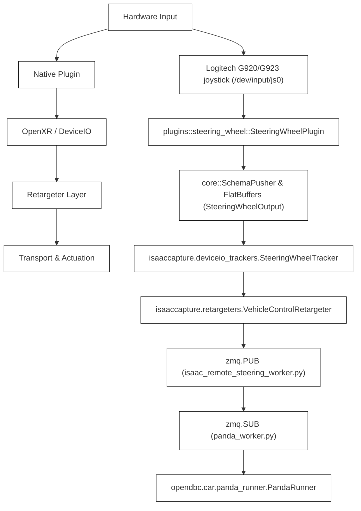
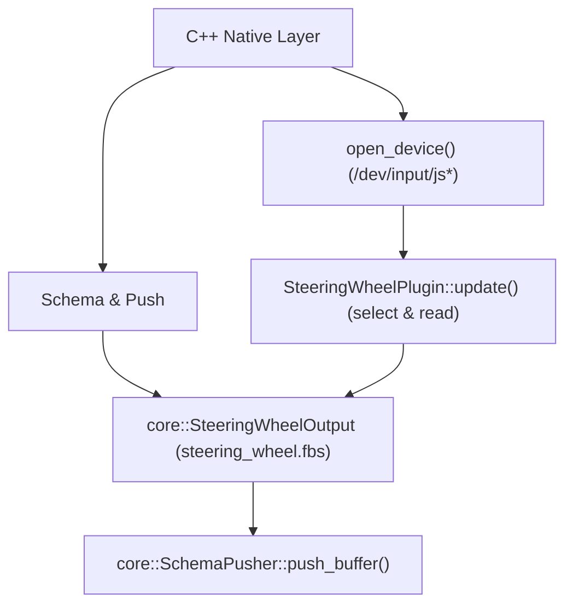

<!-- source: DeepWiki mcp.deepwiki.com · repo NVIDIA/IsaacCapture · page 7.2 Vehicle Teleop · fetched 2026-10-26 -->

# Vehicle Teleop

Relevant source files

The following files were used as context for generating this wiki page:

- [examples/vehicle_teleop/CMakeLists.txt](examples/vehicle_teleop/CMakeLists.txt)
- [examples/vehicle_teleop/README.md](examples/vehicle_teleop/README.md)
- [examples/vehicle_teleop/assets/remote-teleop-keyboard-worker.gif](examples/vehicle_teleop/assets/remote-teleop-keyboard-worker.gif)
- [examples/vehicle_teleop/assets/vehicle_teleop_flow.svg](examples/vehicle_teleop/assets/vehicle_teleop_flow.svg)
- [examples/vehicle_teleop/config/steering_wheel_config.yaml](examples/vehicle_teleop/config/steering_wheel_config.yaml)
- [examples/vehicle_teleop/python/pyproject.toml](examples/vehicle_teleop/python/pyproject.toml)
- [examples/vehicle_teleop/python/vehicle_teleop/command_log.py](examples/vehicle_teleop/python/vehicle_teleop/command_log.py)
- [examples/vehicle_teleop/python/vehicle_teleop/isaac_keyboard_control_worker.py](examples/vehicle_teleop/python/vehicle_teleop/isaac_keyboard_control_worker.py)
- [examples/vehicle_teleop/python/vehicle_teleop/isaac_remote_steering_worker.py](examples/vehicle_teleop/python/vehicle_teleop/isaac_remote_steering_worker.py)
- [examples/vehicle_teleop/python/vehicle_teleop/panda_worker.py](examples/vehicle_teleop/python/vehicle_teleop/panda_worker.py)
- [examples/vehicle_teleop/python/vehicle_teleop/replay_command_mcap.py](examples/vehicle_teleop/python/vehicle_teleop/replay_command_mcap.py)
- [examples/vehicle_teleop/python/vehicle_teleop/vehicle_command.py](examples/vehicle_teleop/python/vehicle_teleop/vehicle_command.py)
- [examples/vehicle_teleop/scripts/replay_command_mcap.sh](examples/vehicle_teleop/scripts/replay_command_mcap.sh)
- [examples/vehicle_teleop/scripts/run_isaac_remote_steering_worker.sh](examples/vehicle_teleop/scripts/run_isaac_remote_steering_worker.sh)
- [examples/vehicle_teleop/tests/CMakeLists.txt](examples/vehicle_teleop/tests/CMakeLists.txt)
- [examples/vehicle_teleop/tests/pyproject.toml](examples/vehicle_teleop/tests/pyproject.toml)
- [examples/vehicle_teleop/tests/test_workers.py](examples/vehicle_teleop/tests/test_workers.py)
- [src/core/schema/fbs/steering_wheel.fbs](src/core/schema/fbs/steering_wheel.fbs)
- [src/core/schema/python/steering_wheel_bindings.h](src/core/schema/python/steering_wheel_bindings.h)
- [src/plugins/steering_wheel/steering_wheel_plugin.cpp](src/plugins/steering_wheel/steering_wheel_plugin.cpp)
- [src/python/isaaccapture/retargeters/vehicle_control_retargeter.py](src/python/isaaccapture/retargeters/vehicle_control_retargeter.py)
- [tests/AGENTS.md](tests/AGENTS.md)
- [tests/python/CMakeLists.txt](tests/python/CMakeLists.txt)
- [tests/python/core/retargeting_engine/test_vehicle_control_retargeter.py](tests/python/core/retargeting_engine/test_vehicle_control_retargeter.py)
- [tests/python/examples/CMakeLists.txt](tests/python/examples/CMakeLists.txt)

## Purpose and Scope

This page documents the Vehicle Teleop integration example (`examples/vehicle_teleop/`) within Isaac Capture. It covers the end-to-end pipeline for capturing physical steering wheel and pedal inputs via a native C++ Linux joystick plugin, feeding them through the OpenXR and DeviceIO runtime layers, retargeting raw axes into normalized vehicle control commands, streaming them over ZeroMQ (`zmq`), and executing actuation on a physical vehicle via a Panda device runner or dry-run debugging shell.

Sources: [`examples/vehicle_teleop/README.md:1-128]()`

---

## 1. End-to-End System Architecture

The vehicle teleoperation pipeline connects remote human input devices to local vehicle controllers. Physical hardware signals are ingested by a native Linux plugin, wrapped in FlatBuffers schemas, processed by an OpenXR session worker, retargeted into standardized control commands, published via ZeroMQ, and consumed on the vehicle side to drive steering and pedal actuators.

Sources: [`examples/vehicle_teleop/README.md:1-128](), `[examples/vehicle_teleop/python/vehicle_teleop/isaac_remote_steering_worker.py:149-196](), `[src/plugins/steering_wheel/steering_wheel_plugin.cpp:41-179]()`

---

## 2. Native Linux Steering Wheel Plugin

The native C++ steering wheel plugin (`steering_wheel_plugin`) reads raw Linux joystick events from `/dev/input/js*` and publishes them into the OpenXR data stream using FlatBuffers (`steering_wheel.fbs`).

### Implementation Details

- **Device Interface**: Opens the input node in read-only and non-blocking mode, querying axis counts and button counts via `ioctl` (`JSIOCGAXES`, `JSIOCGBUTTONS`).
- **Event Loop**: Uses `select()` to poll the file descriptor and parses `js_event` structs into normalized floating-point axis values (`[-1.0, 1.0]`) and integer button states.
- **Serialization**: Packages state into a `core::SteeringWheelOutput` FlatBuffers table, recording monotonic timestamps and connection status.

Sources: [`src/plugins/steering_wheel/steering_wheel_plugin.cpp:41-180](), `[src/core/schema/fbs/steering_wheel.fbs:13-32]()`

---

## 3. Remote Workers: Steering Wheel and Keyboard Control

The remote host runs either the OpenXR-backed steering worker or an interactive terminal keyboard fallback worker. Both format commands into structured payloads and broadcast them over ZeroMQ.

### `IsaacRemoteSteeringWorker`

The remote steering worker (`IsaacRemoteSteeringWorker`) initializes an OpenXR session alongside a `SteeringWheelTracker`, monitors sample ages against a strict timeout, and publishes over a ZMQ PUB socket.

- **Initialization**: Spawns the native plugin process via `NativeSteeringWheelPlugin` or attaches to an existing data feed. Sets up an `oxr::OpenXRSession` and `deviceio::DeviceIOSession`.
- **Safety Checks**: Enforces sample timeouts (`--sample-timeout-s`). If samples become stale or the device disconnects, it publishes neutral commands and exits.
- **Logging**: Optionally wraps command generation in an `McapCommandLogger` to record session data.

### `IsaacKeyboardControlState` & `IsaacKeyboardControlWorker`

When physical hardware is unavailable, `IsaacKeyboardControlWorker` provides a zero-hardware fallback using interactive terminal key bindings (`TerminalKeyReader`).

- **Key Mappings**: `W`/`S` adjust gas/brake increments, `A`/`D` adjust steering angle, `R`/`C` reset to neutral, and `Q`/`Esc` terminate execution.
- **State Conversion**: Converts key accumulation states into a `SteeringWheelOutput` proxy structure consumed by `VehicleControlRetargeter`.

Sources: [`examples/vehicle_teleop/python/vehicle_teleop/isaac_remote_steering_worker.py:73-200](), `[examples/vehicle_teleop/python/vehicle_teleop/isaac_keyboard_control_worker.py:33-140]()`

---

## 4. Vehicle Control Retargeter

The vehicle control retargeter (`VehicleControlRetargeter`) maps raw steering wheel and pedal input samples into normalized `VehicleControlCommand` structures.

### Configuration & Calibration

- **Config Parameters**: `VehicleControlRetargeterConfig` defines deadzones (`steering_deadzone`, `pedal_deadzone`) and scaling factors (`steer_scale`, `throttle_scale`, `brake_scale`).
- **Neutral Calibration**: `calibrate_neutral()` records baseline steering offsets from live samples.
- **Pedal Transformation**: `axis_to_pedal()` inverts full-range spring-loaded pedal axes (`1` released, `-1` pressed) into normalized intervals (`[0.0, 1.0]`).
- **Validation**: Enforces numeric finiteness checks on incoming sample axes, raising `ValueError` on NaN or infinite values.

Sources: [`src/python/isaaccapture/retargeters/vehicle_control_retargeter.py:13-106](), `[tests/python/core/retargeting_engine/test_vehicle_control_retargeter.py:19-111]()`

---

## 5. Vehicle-Side Panda Worker & Wire Protocol

The vehicle-side component (`PandaWorker`) runs on the target vehicle architecture, receiving streamed commands over ZeroMQ and interfacing directly with hardware via `opendbc`.

### Wire Protocol and Safety

- **ZeroMQ Subscriber**: Connects to the remote publisher using `zmq.SUB` with `zmq.CONFLATE` enabled to drop stale message queues and process only the latest command frame.
- **Command Timeout**: If no valid command is received within `--command-timeout` seconds (default `0.25s`), the worker forces a neutral actuation state for safety.
- **Actuation Interface**: Translates retargeted commands into `CarControl` structures and writes them to the Panda interface via `PandaRunner`. In `--dry-run` mode, commands are printed to stdout instead of touching physical vehicle busses.

Sources: [`examples/vehicle_teleop/python/vehicle_teleop/panda_worker.py:21-158]()`

---

## 6. Command Logging and MCAP Replay

Session recording and replay utilities allow offline debugging and evaluation of teleoperation runs.

- **MCAP Logging**: `McapCommandLogger` records steering wheel samples and vehicle control commands into standard MCAP files during remote worker sessions (`--log-mcap`).
- **Replay Script**: `replay_command_mcap.py` (invoked via `replay_command_mcap.sh`) reads recorded MCAP files and prints retargeted command sequences, supporting real-time pacing flags (`--realtime`).

Sources: [`examples/vehicle_teleop/README.md:110-119](), `[examples/vehicle_teleop/python/vehicle_teleop/isaac_remote_steering_worker.py:182-196]()`

---

