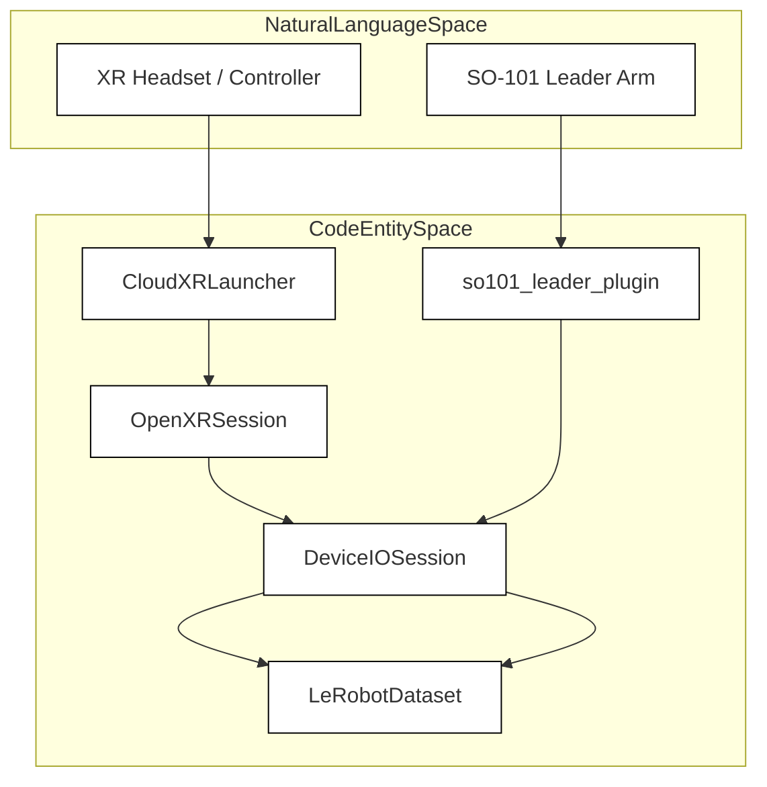
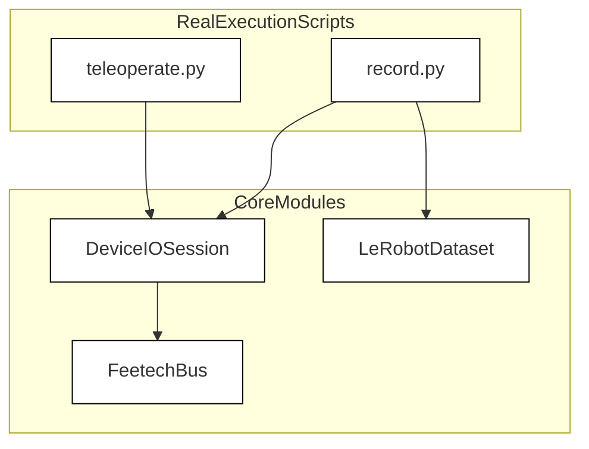

<!-- source: DeepWiki mcp.deepwiki.com · repo NVIDIA/IsaacCapture · page 7.3 LeRobot and SO-101 Data Collection · fetched 2026-10-26 -->

# LeRobot and SO-101 Data Collection

<details>
<summary>Relevant source files</summary>

The following files were used as context for generating this wiki page:

- [cmake/CheckBuildDeps.cmake](cmake/CheckBuildDeps.cmake)
- [deps/third_party/Mujoco.cmake](deps/third_party/Mujoco.cmake)
- [docs/source/_static/lerobot/sim-teleop-example-huggingface.gif](docs/source/_static/lerobot/sim-teleop-example-huggingface.gif)
- [docs/source/_static/lerobot/so-101-isaac-teleop-real.gif](docs/source/_static/lerobot/so-101-isaac-teleop-real.gif)
- [docs/source/_static/lerobot/so-101-isaac-teleop-sim.gif](docs/source/_static/lerobot/so-101-isaac-teleop-sim.gif)
- [docs/source/_static/lerobot/so101_vial_to_rack_task.gif](docs/source/_static/lerobot/so101_vial_to_rack_task.gif)
- [docs/source/_static/lerobot/xr-so-101-full.gif](docs/source/_static/lerobot/xr-so-101-full.gif)
- [docs/source/device/joint_space.rst](docs/source/device/joint_space.rst)
- [docs/source/getting_started/lerobot/data_collection_real.rst](docs/source/getting_started/lerobot/data_collection_real.rst)
- [docs/source/getting_started/lerobot/data_collection_sim.rst](docs/source/getting_started/lerobot/data_collection_sim.rst)
- [docs/source/getting_started/lerobot/devices.rst](docs/source/getting_started/lerobot/devices.rst)
- [docs/source/getting_started/lerobot/index.rst](docs/source/getting_started/lerobot/index.rst)
- [docs/source/getting_started/lerobot/training_groot.rst](docs/source/getting_started/lerobot/training_groot.rst)
- [examples/haptic_feedback/python/controller_haptic_example.py](examples/haptic_feedback/python/controller_haptic_example.py)
- [examples/lerobot/record.py](examples/lerobot/record.py)
- [examples/oglo_tactile/README.md](examples/oglo_tactile/README.md)
- [examples/oxr/python/modular_example_with_mcap.py](examples/oxr/python/modular_example_with_mcap.py)
- [examples/teleop/python/foot_pedal_locomotion_example.py](examples/teleop/python/foot_pedal_locomotion_example.py)
- [examples/teleop/python/isaac_lab_gripper_example.py](examples/teleop/python/isaac_lab_gripper_example.py)
- [examples/teleop/python/se3_retargeting_example.py](examples/teleop/python/se3_retargeting_example.py)
- [src/plugins/oglo_tactile/README.md](src/plugins/oglo_tactile/README.md)
- [src/viz/shaders/cpp/CMakeLists.txt](src/viz/shaders/cpp/CMakeLists.txt)

</details>


This page details the integration between Isaac Teleop (`isaaccapture`) and the `LeRobot` ecosystem for capturing robot manipulation demonstrations on the low-cost `SO-101` arm in both physical and simulated environments. It covers the underlying pipelines, device plugins, retargeting mechanisms, and the handoff to policy training workflows such as GR00T N1.7.

---

## 1. End-to-End Architecture & Overview

The data collection pipeline connects high-level operator intents (via an XR headset or a physical leader arm) through OpenXR sessions and DeviceIO stream graphs into standardized dataset structures (`LeRobotDataset` or HDF5 archives). 


*Figure 1: Pipeline mapping operator hardware through core runtime classes to LeRobot dataset storage.*

Sources: `examples/lerobot/record.py:24-80`, `docs/source/getting_started/lerobot/index.rst:39-68`

---

## 2. SO-101 Teleop Devices and Retargeting

Isaac Teleop supports two primary input configurations for controlling the SO-101 arm, both mapping to identical follower execution streams:

| Device Mode | Underlying Classes / Modules | Description |
| :--- | :--- | :--- |
| **XR Controller** | `CloudXRLauncher`, `OpenXRSession`, `HandTracker`, `HeadTracker` | End-effector pose control via OpenXR streams, mapped through inverse kinematics (IK) with a hardware clutch mechanism. |
| **SO-101 Leader** | `so101_leader_plugin`, `JointStateTracker`, `JointStateSource`, `JointStateRetargeter` | Direct joint-space 1:1 mirroring using a physical, back-drivable lead arm equipped with FEETECH STS3215 servos. |

The SO-101 leader plugin communicates directly over serial via `FeetechBus` implementation details, disabling active servo torque to allow back-driving while polling `Present_Position` feedback frames.

Sources: `docs/source/getting_started/lerobot/devices.rst:11-56`, `docs/source/device/joint_space.rst:7-43`

---

## 3. Real-World Data Collection Pipeline

Data collection on physical hardware executes from a LeRobot source checkout using the ``examples/isaac_teleop_to_so101/`` scripts. 

### Environment Setup and Dependencies
The execution environment requires specific extras for motor communication and OpenXR runtimes:
```bash
uv venv --python 3.12 .venv
source .venv/bin/activate
uv pip install -e ".[feetech,kinematics,dataset]" "huggingface_hub>=1.5"
uv pip install "isaaccapture[cloudxr,retargeters-lite]" "scipy>=1.14" \
      --extra-index-url https://pypi.nvidia.com --prerelease=allow
```

### Execution Scripts
- `teleoperate.py`: Steers the physical follower live via the selected `--teleop.type` (`xr_controller` or `so101_leader`).
- `record.py`: Records streamed observations and motor actions into a Hugging Face compatible dataset format.


*Figure 2: Real-world data collection script dispatch to hardware buses and dataset exporters.*

Reset poses can be overridden using the utility runner:
```bash
python -m examples.isaac_teleop_to_so101.override_reset_pose \
   --port /dev/ttyACM0 \
   --id so101_follower_arm
```
This stores custom reset joint states in `$HF_LEROBOT_HOME/reset_poses/so_follower/<robot.id>.json`.

Sources: `docs/source/getting_started/lerobot/data_collection_real.rst:7-150`, `examples/lerobot/record.py:70-180`

---

## 4. Simulation Data Collection Pipeline

Simulation workflows leverage NVIDIA Isaac Lab and registered SO-101 cube-stacking tasks.

### Registered Sim Tasks
- `IsaacContrib-Stack-Cube-SO101-IK-Abs-v0`: Absolute-pose IK driven by an **XR controller**.
- `IsaacContrib-Stack-Cube-SO101-Joint-Teleop-v0`: Joint-space mirror driven by a physical **SO-101 leader arm**.
- `IsaacContrib-Stack-Cube-SO101-v0`: Joint-position control baseline without active teleoperation.

### Recording Demonstrations
To record simulation episodes to HDF5 format using Isaac Lab tooling:
```bash
./isaaclab.sh -p scripts/tools/record_demos.py \
    --task IsaacContrib-Stack-Cube-SO101-IK-Abs-v0 \
    --dataset_file ./datasets/so101_stack_demos.hdf5 \
    --num_demos 10 \
    --step_hz 30 \
    --xr \
    --viz kit
```

For joint-space teleoperation, the native C++ binary `so101_leader_plugin` must be built from source inside the repository root prior to execution:
```bash
cmake -B build
cmake --build build --parallel
cmake --install build
```

Sources: `docs/source/getting_started/lerobot/data_collection_sim.rst:7-156`

---

## 5. GR00T Training and Sim-to-Real Handoff

Once demonstration datasets are recorded via LeRobot (`LeRobotDataset`) or Isaac Lab (HDF5 format), they serve as inputs for fine-tuning foundation manipulation policies:

1. **Dataset Unification:** Convert or ingest raw observation tensors (`observation.head`, `observation.left_hand`, `observation.right_hand`) into training-ready tensor datasets.
2. **Policy Fine-Tuning:** Train a GR00T N1.7 policy using the downstream training configuration templates.
3. **Deployment:** Evaluate learned models on physical hardware using the same serial and OpenXR integration loops established during data collection.

Sources: `docs/source/getting_started/lerobot/index.rst:39-76`, `docs/source/getting_started/lerobot/training_groot.rst:1-20`

---

