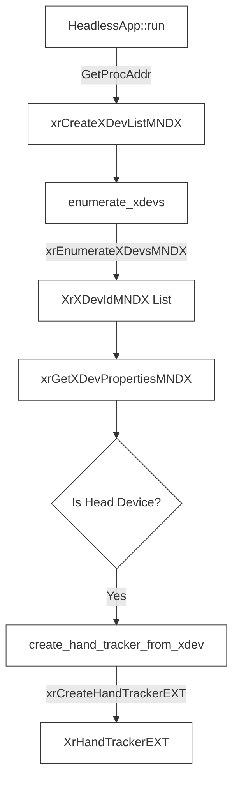
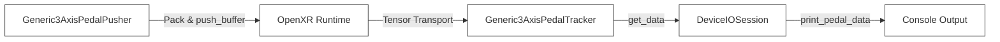
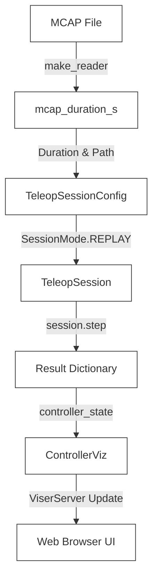

<!-- source: DeepWiki mcp.deepwiki.com · repo NVIDIA/IsaacCapture · page 7.4 OpenXR, SchemaIO and DeviceIO Examples · fetched 2026-10-26 -->

# OpenXR, SchemaIO and DeviceIO Examples

Relevant source files

The following files were used as context for generating this wiki page:

- [cmake/CompilerWarnings.cmake](cmake/CompilerWarnings.cmake)
- [examples/deviceio_live_view/README.md](examples/deviceio_live_view/README.md)
- [examples/deviceio_live_view/pyproject.toml](examples/deviceio_live_view/pyproject.toml)
- [examples/deviceio_live_view/python/isaaccapture_examples/deviceio_live_view/body_pipeline.py](examples/deviceio_live_view/python/isaaccapture_examples/deviceio_live_view/body_pipeline.py)
- [examples/deviceio_live_view/python/isaaccapture_examples/deviceio_live_view/deviceio_pipeline.py](examples/deviceio_live_view/python/isaaccapture_examples/deviceio_live_view/deviceio_pipeline.py)
- [examples/deviceio_live_view/python/isaaccapture_examples/deviceio_live_view/deviceio_viser.py](examples/deviceio_live_view/python/isaaccapture_examples/deviceio_live_view/deviceio_viser.py)
- [examples/mcap_record_replay/README.md](examples/mcap_record_replay/README.md)
- [examples/mcap_record_replay/python/isaaccapture_examples/mcap_record_replay/joint_se3_common.py](examples/mcap_record_replay/python/isaaccapture_examples/mcap_record_replay/joint_se3_common.py)
- [examples/mcap_record_replay/python/isaaccapture_examples/mcap_record_replay/live_joint_se3_pose.py](examples/mcap_record_replay/python/isaaccapture_examples/mcap_record_replay/live_joint_se3_pose.py)
- [examples/mcap_record_replay/python/isaaccapture_examples/mcap_record_replay/record_joint_se3_pose.py](examples/mcap_record_replay/python/isaaccapture_examples/mcap_record_replay/record_joint_se3_pose.py)
- [examples/mcap_record_replay/python/isaaccapture_examples/mcap_record_replay/replay_controller.py](examples/mcap_record_replay/python/isaaccapture_examples/mcap_record_replay/replay_controller.py)
- [examples/mcap_record_replay/python/isaaccapture_examples/mcap_record_replay/replay_full_body.py](examples/mcap_record_replay/python/isaaccapture_examples/mcap_record_replay/replay_full_body.py)
- [examples/mcap_record_replay/python/isaaccapture_examples/mcap_record_replay/replay_hand.py](examples/mcap_record_replay/python/isaaccapture_examples/mcap_record_replay/replay_hand.py)
- [examples/mcap_record_replay/python/isaaccapture_examples/mcap_record_replay/replay_joint_se3_pose.py](examples/mcap_record_replay/python/isaaccapture_examples/mcap_record_replay/replay_joint_se3_pose.py)
- [examples/mcap_record_replay/python/isaaccapture_examples/mcap_record_replay/replay_se3_vive.py](examples/mcap_record_replay/python/isaaccapture_examples/mcap_record_replay/replay_se3_vive.py)
- [examples/native_openxr/xdev_list/main.cpp](examples/native_openxr/xdev_list/main.cpp)
- [examples/oxr/README.md](examples/oxr/README.md)
- [examples/oxr/cpp/CMakeLists.txt](examples/oxr/cpp/CMakeLists.txt)
- [examples/oxr/cpp/README.md](examples/oxr/cpp/README.md)
- [examples/oxr/python/README.md](examples/oxr/python/README.md)
- [examples/schemaio/frame_metadata_printer.cpp](examples/schemaio/frame_metadata_printer.cpp)
- [examples/schemaio/pedal_printer.cpp](examples/schemaio/pedal_printer.cpp)
- [examples/schemaio/pedal_pusher.cpp](examples/schemaio/pedal_pusher.cpp)
- [src/CMakeLists.txt](src/CMakeLists.txt)
- [src/core/schema/fbs/oak.fbs](src/core/schema/fbs/oak.fbs)
- [src/core/schema/python/oak_bindings.h](src/core/schema/python/oak_bindings.h)

## Purpose and Scope
This page details the sample applications, demos, and reference implementations found under the `examples/` tree. It covers C++ and Python OpenXR tracking APIs (`examples/oxr`), low-level XDev enumeration (`examples/native_openxr`), FlatBuffer-based custom schema pushers and printers (`examples/schemaio`), live interactive rendering with `viser` (`examples/deviceio_live_view`), and MCAP recording/replay pipelines (`examples/mcap_record_replay`).

---

## 1. OpenXR Core Demos (`examples/oxr` and `examples/native_openxr`)

The `examples/oxr` directory provides foundational C++ and Python demonstrations of initializing OpenXR sessions, managing multi-session sharing, and querying hardware state.

### C++ Executables
The C++ demos compile as independent binaries (`oxr_session_sharing` and `oxr_simple_api_demo`) linking against `deviceio::deviceio_session`, `deviceio::deviceio_trackers`, and `oxr::oxr_core` [examples/oxr/cpp/CMakeLists.txt:7-28].

### Python Modular Wrappers
Python examples such as `modular_example.py`, `test_modular.py`, `test_extensions.py`, and `test_session_sharing.py` demonstrate querying extensions, initializing `OpenXRSession`, and sharing tracking handles across multiple `DeviceIOSession` instances [examples/oxr/python/README.md:51-77].

### Native XDev List Enumeration
The `examples/native_openxr/xdev_list` application demonstrates direct use of the `XR_MNDX_xdev_space` extension to enumerate custom extended devices (XDevs), query their properties, and create hand trackers from them [examples/native_openxr/xdev_list/main.cpp:10-164].

Title: OpenXR XDev Enumeration and Hand Tracker Creation Flow

Sources: [examples/native_openxr/xdev_list/main.cpp:10-164]

---

## 2. SchemaIO Printers and Pushers (`examples/schemaio`)

The `examples/schemaio` tree demonstrates custom FlatBuffer serialization and runtime transmission via OpenXR custom tensor push/pull mechanisms.

### Pedal Pusher and Printer
* `Generic3AxisPedalPusher` wraps `core::SchemaPusher`, packing `core::Generic3AxisPedalOutputT` native structures into FlatBuffers and pushing them via `m_pusher.push_buffer()` [examples/schemaio/pedal_pusher.cpp:36-68].
* `Generic3AxisPedalTracker` integrates with `core::DeviceIOSession` to read and print the custom pedal outputs at runtime [examples/schemaio/pedal_printer.cpp:18-80].

### OAK Frame Metadata Printer
`FrameMetadataTrackerOak` monitors camera stream channels (`Color`, `MonoLeft`, `MonoRight`) matching a specified collection prefix to read `FrameMetadataOak` samples pushed by camera plugins [examples/schemaio/frame_metadata_printer.cpp:76-129].

Title: SchemaIO Push and Print Data Flow

Sources: [examples/schemaio/pedal_pusher.cpp:36-68], [examples/schemaio/pedal_printer.cpp:18-80], [examples/schemaio/frame_metadata_printer.cpp:76-129]

---

## 3. DeviceIO Live View and Viser Visualizer (`examples/deviceio_live_view`)

`examples/deviceio_live_view` provides real-time browser-based visualization of human tracking data (hands, head, controllers, full body) using [viser](https://viser.studio) [examples/deviceio_live_view/README.md:6-21].

### Key Features and SOMA POCs
* **Live Session Management:** Automatically launches runtime connections without manual external setup [examples/deviceio_live_view/README.md:6-12].
* **SOMA Body and Hand POCs:** Supports alternative schemas like `soma` body joints and hand topologies, using upstream Forward Kinematics (`SomaBodyJointRotations`) or direct mapping (`SomaBodyJointPoses`) through `py-soma-x` [examples/deviceio_live_view/README.md:24-105].
* **Dependency Configuration:** Declares dependencies including `isaaccapture[cloudxr]`, `numpy`, `py-soma-x==0.3.1`, and `viser>=0.2.0` in `pyproject.toml` [examples/deviceio_live_view/pyproject.toml:17-22].

Sources: [examples/deviceio_live_view/README.md:6-105], [examples/deviceio_live_view/pyproject.toml:17-22]

---

## 4. MCAP Record and Replay Ecosystem (`examples/mcap_record_replay`)

The `examples/mcap_record_replay` package records live DeviceIO tracking streams to MCAP files and replays them headless for debugging and visualization.

### Supported Channels
| Channel | Live Script | Record Script | Replay Script |
| --- | --- | --- | --- |
| Hands | `live_hand` | `record_hand` | `replay_hand` |
| Controllers | `live_controller` | `record_controller` | `replay_controller` |
| Full body | `live_full_body` | `record_full_body` | `replay_full_body` |
| Raw hand joint SE3 | `live_joint_se3_pose` | `record_joint_se3_pose` | `replay_joint_se3_pose` |
| VIVE SE3 trackers | — | `record_se3_vive` | `replay_se3_vive` |

[examples/mcap_record_replay/README.md:30-37]

### Replay Architecture
Replay mode (`SessionMode.REPLAY`) bypasses OpenXR initialization entirely, allowing offline playback on any host. Duration calculation relies on MCAP summary statistics (`make_reader().get_summary().statistics`) to determine the exact playback window before looping [examples/mcap_record_replay/python/isaaccapture_examples/mcap_record_replay/replay_controller.py:47-94].

Title: MCAP Replay and Visor Visualization Pipeline

Sources: [examples/mcap_record_replay/README.md:8-37], [examples/mcap_record_replay/python/isaaccapture_examples/mcap_record_replay/replay_controller.py:47-94]

---

